# 08-Inspecting Pages using DevTools (2:13)

**ไฟล์ต้นทาง:** `Web Development Fundamentals/08-Inspecting-Pages-Using-DevTools.mp4`

▶️ **[เปิดวิดีโอต้นฉบับ](../../Web%20Development%20Fundamentals/08-Inspecting-Pages-Using-DevTools.mp4)**

> คลิปนี้พา Mosh กลับไปที่ Chrome DevTools อีกครั้ง (ภาคต่อจากคลิป "Inspecting HTTP Requests and Responses") แต่คราวนี้เจาะลึกแท็บ **Elements** — โยงกลับไปหา DOM ที่เรียนตั้งแต่คลิป "How the Web Works" แล้วสอนใช้ DevTools **แก้ไข/ทดลอง CSS แบบ live** บนหน้าเว็บจริงที่ Mosh เขียนเองในคลิปก่อนๆ ทำละเอียดที่สุด เก็บทุกจังหวะ hover/คลิก

## 1) เปิดคลิป

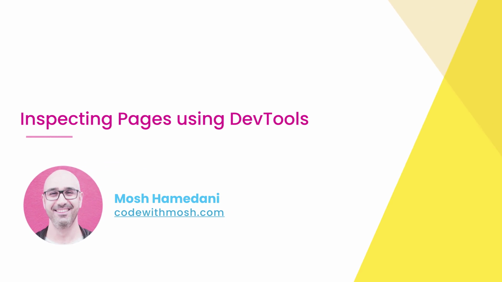

Title slide: **"Inspecting Pages using DevTools"** — Mosh Hamedani, codewithmosh.com

## 2) ทบทวน DOM (Document Object Model) ด้วย diagram

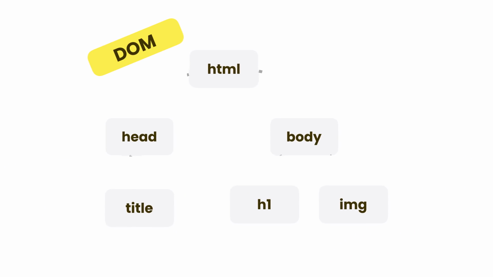

สไลด์กระดาษป้าย **"DOM"** สีเหลือง มุมซ้ายบน ตามด้วยแผนภาพโครงสร้างต้นไม้ (tree structure):
```
html
├── head
│   └── title
└── body
    ├── h1
    └── img
```
นี่คือการทบทวนแนวคิด DOM ที่เรียนไปแล้วในคลิป "How the Web Works" — ย้ำว่า browser แปลง HTML ที่ได้รับมาเป็นโครงสร้างต้นไม้แบบนี้ ก่อนจะ render ออกมาเป็นหน้าเว็บ (สังเกตว่าตัวอย่างในสไลด์ใช้ `h1` แต่ในหน้าเว็บจริงของ Mosh ใช้ `p` — เป็นแค่ตัวอย่าง element ทั่วไป)

## 3) กลับไปที่หน้าเว็บ index.html เดิม แล้วเปิด DevTools

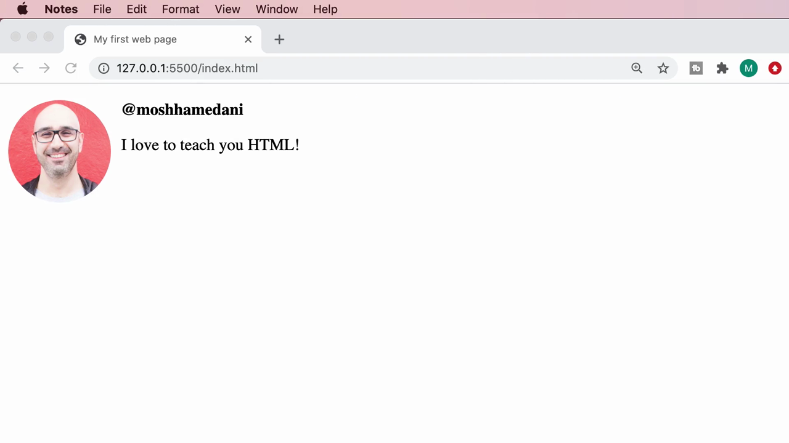

Mosh เปิดหน้าเว็บที่เขียนไว้ (`127.0.0.1:5500/index.html`) — หน้าตาเดิม: รูป Mosh วงกลม + `@moshhamedani` (ตัวหนา) + "I love to teach you HTML!"

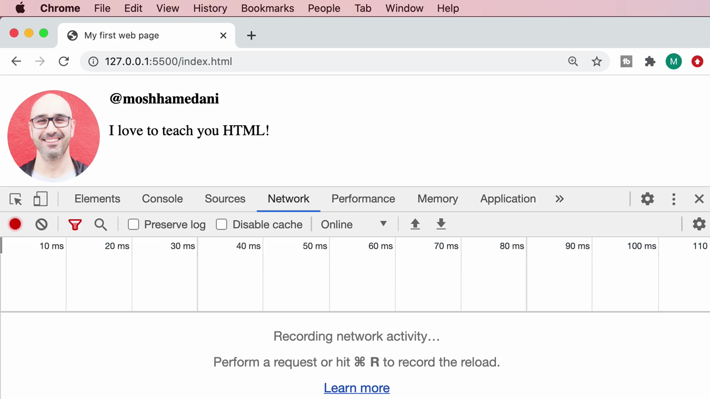

เปิด DevTools ขึ้นมา (แท็บ Network ที่เคยใช้ในคลิปก่อนยังค้างอยู่ — โชว์ข้อความ "Recording network activity... Perform a request or hit ⌘R to record the reload.") จากนั้น Mosh สลับไปที่แท็บที่จะโฟกัสในคลิปนี้

## 4) แท็บ Elements — ดู DOM tree จริงของหน้าเว็บ

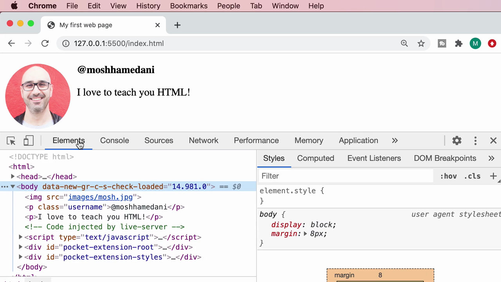

คลิกแท็บ **Elements** — เห็น DOM tree จริงของหน้าเว็บที่เขียนเอง:
```html
<!DOCTYPE html>
<html>
  <head>...</head>
  <body data-new-gr-c-s-check-loaded="14.981.0">
    
    <p class="username">@moshhamedani</p>
    <p>I love to teach you HTML!</p>
    <!-- Code injected by live-server -->
    <script type="text/javascript">...</script>
    <div id="pocket-extension-root">...</div>
    <div id="pocket-extension-styles">...</div>
  </body>
</html>
```
*(หมายเหตุ: `data-new-gr-c-s-check-loaded`, `pocket-extension-root`, `pocket-extension-styles` ไม่ใช่โค้ดที่ Mosh เขียนเอง — เป็น attribute/element ที่ **browser extension** (เช่น Grammarly, Pocket) แอบแทรกเข้ามาในหน้าเว็บทุกหน้าที่เปิด — เป็นเรื่องปกติที่จะเห็นโค้ดแปลกๆ แบบนี้ปนมาตอนเปิด DevTools ดูเว็บจริง)*

ทางขวามือมีแผง **Styles** โชว์ CSS ที่มีผลกับ element ที่เลือกอยู่ — ตอนเลือก `<body>` จะเห็น:
```css
body {
    display: block;
    margin: 8px;  /* user agent stylesheet */
}
```
*(`user agent stylesheet` = CSS ค่าเริ่มต้นที่ browser ใส่ให้เองโดยอัตโนมัติ ไม่ใช่ CSS ที่ Mosh เขียน)*

## 5) Hover แต่ละแถวใน DOM tree → ไฮไลต์ตำแหน่งจริงบนหน้าเว็บ

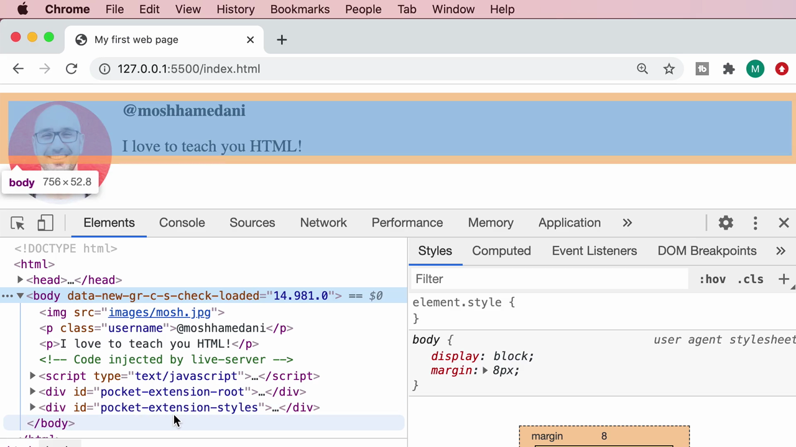

Mosh เอาเมาส์ไปวางบนแถว `<body>` ใน DOM tree (ไม่ต้องคลิก แค่ hover) → **หน้าเว็บทั้งหมดถูกไฮไลต์เป็นกรอบสีฟ้า/ส้ม** พร้อม tooltip ลอยขึ้นมาบอกขนาด: **`body 756 × 52.8`** (ความกว้าง × ความสูงเป็นพิกเซล) — นี่คือฟีเจอร์สำคัญที่สุดของแท็บ Elements: **hover element ใน DOM tree จะโชว์ตำแหน่ง/ขนาดจริงของ element นั้นบนหน้าเว็บทันที** ช่วยหา element ที่ต้องการแก้ไขได้เร็วมาก

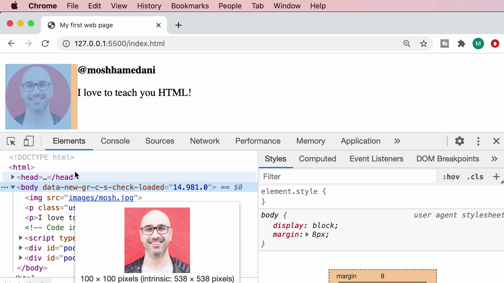

พอ hover แถว `` โดยเฉพาะ → นอกจากไฮไลต์ตำแหน่งแล้ว DevTools ยังโชว์ **preview รูปภาพจริงลอยขึ้นมา** พร้อมบอกขนาด: **"100 × 100 pixels (intrinsic: 538 × 538 pixels)"** — ตัวเลขนี้บอกว่า:
- **100×100 px** = ขนาดที่รูป**แสดงผลจริง**บนหน้าเว็บ (หลังถูกบีบด้วย CSS `width: 100px` + `border-radius: 50px`)
- **intrinsic 538×538 px** = ขนาด**ไฟล์ต้นฉบับจริง**ของรูป `mosh.jpg` (ก่อนถูกย่อด้วย CSS)

*(จุดนี้สำคัญมาก: รูปต้นฉบับใหญ่กว่าที่โชว์บนจอถึง 5 เท่ากว่า แปลว่าถ้าไม่ optimize รูปก่อนอัปโหลด จะโหลดไฟล์ใหญ่เกินจำเป็น เสียเวลาโหลดหน้าเว็บโดยเปล่าประโยชน์)*

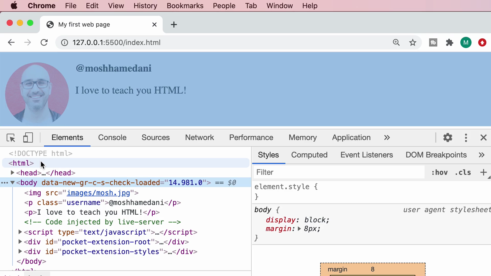

Mosh เลื่อนขึ้นไป hover แถว **`<html>`** (บนสุดของ tree) → คราวนี้**ทั้งหน้าเว็บทั้งหมด**ถูกไฮไลต์เป็นกรอบสีส้ม (เพราะ `<html>` ครอบทุกอย่างในหน้า)

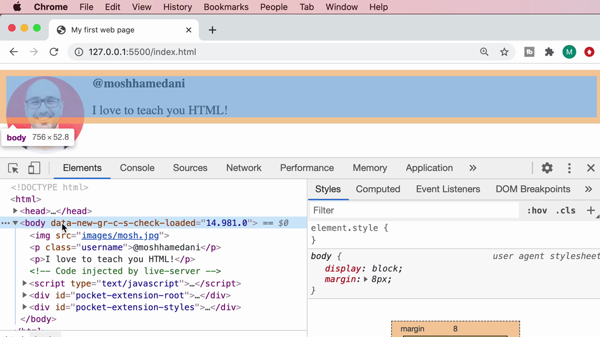

ยืนยันภาพเดิม เมาส์ขยับตำแหน่งเล็กน้อยแต่ยังอยู่ในแถว `<html>`/`<head>`

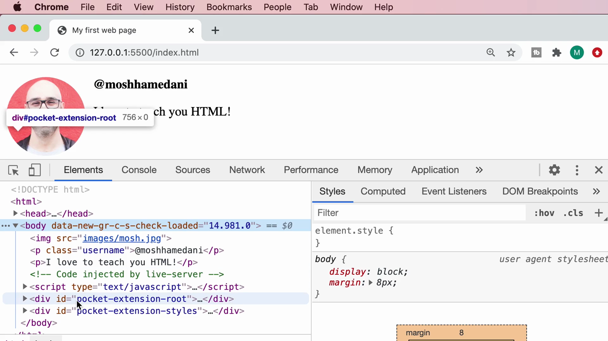

Mosh ลอง hover แถว **`<div id="pocket-extension-root">`** (ตัว extension ที่แทรกเข้ามา) → tooltip โชว์ **"div#pocket-extension-root 756 × 0"** — สูง 0 พิกเซล เพราะ div นี้ไม่มีเนื้อหาอะไรให้เห็นบนหน้าเว็บ (ซ่อนอยู่เบื้องหลัง ไม่กระทบ layout)


กลับมา hover `<body>` อีกครั้งเพื่อย้ำภาพ (`756 × 52.8`)

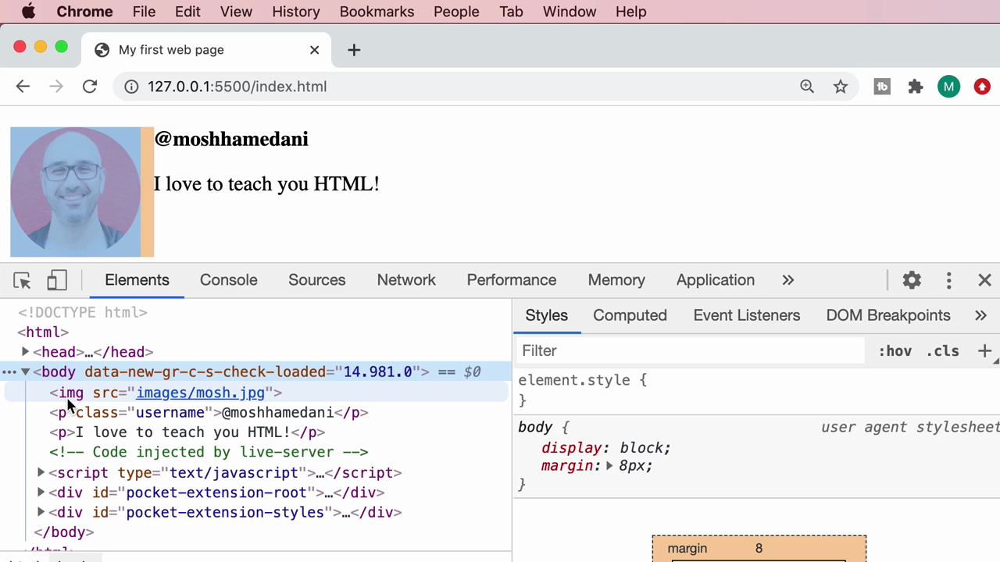

Hover แถว `` อีกครั้ง เห็นกรอบไฮไลต์ครอบเฉพาะพื้นที่รูป+ระยะ margin (สีส้มคือ margin, สีฟ้าคือตัว content จริงของ element)

## 6) แก้ไข CSS แบบ Live ผ่าน Styles panel (checkbox เปิด/ปิด property)

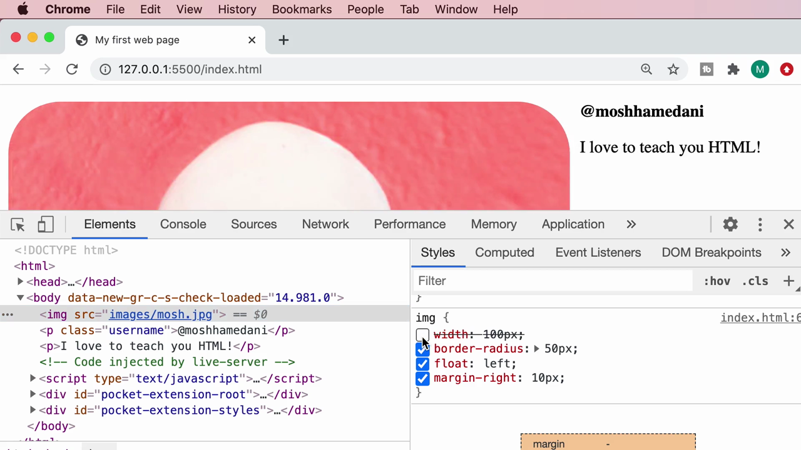

Mosh คลิกเลือก `` แล้วไปที่แผง Styles ด้านขวา เห็น property ของ `img` ทั้งหมดพร้อม **checkbox** หน้าแต่ละบรรทัด:
```css
img {
    ☑ width: 100px;
    ☑ border-radius: 50px;
    ☑ float: left;
    ☑ margin-right: 10px;
}
```
Mosh **คลิก uncheck ช่อง `width: 100px`** ออก (ข้อความขีดฆ่า strikethrough ทันที) → **ผลลัพธ์เปลี่ยนทันทีในหน้าเว็บ**: รูปกลับไปใหญ่เท่าไฟล์จริง (538×538px) จนล้นจอ เห็นแค่พื้นหลังสีชมพูของรูปเต็มจอ — นี่คือการพิสูจน์ว่า `width: 100px` คือตัวที่ควบคุมขนาดรูปอยู่

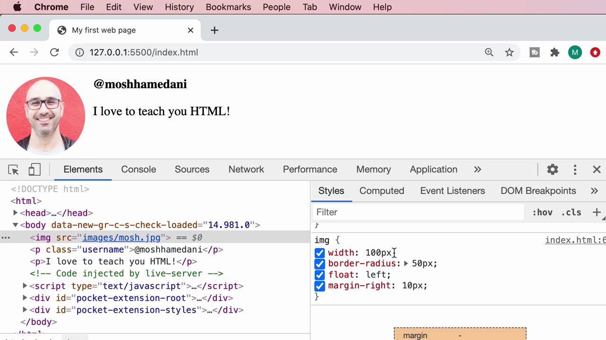

Mosh ติ๊ก checkbox กลับมาเปิดใช้งานเหมือนเดิม → รูปกลับมาขนาด 100px ปกติ

*(จุดสำคัญที่สุดของหัวข้อนี้: **การแก้ไขผ่าน DevTools แบบนี้เป็นการแก้ "ชั่วคราว" เท่านั้น** — แค่ทดลองดูผลลัพธ์บน browser เฉยๆ ไม่กระทบไฟล์ `index.html` จริงบนเครื่อง พอ refresh หน้าเว็บ การแก้ไขทั้งหมดจะหายไป กลับไปเป็นค่าตามไฟล์เดิม — เหมาะมากสำหรับการ "ลองผิดลองถูก" หาค่า CSS ที่ใช่ก่อนแก้ไฟล์จริง)*

## 7) แท็บ Sources → Filesystem (เชื่อม DevTools กับไฟล์จริงบนเครื่อง)

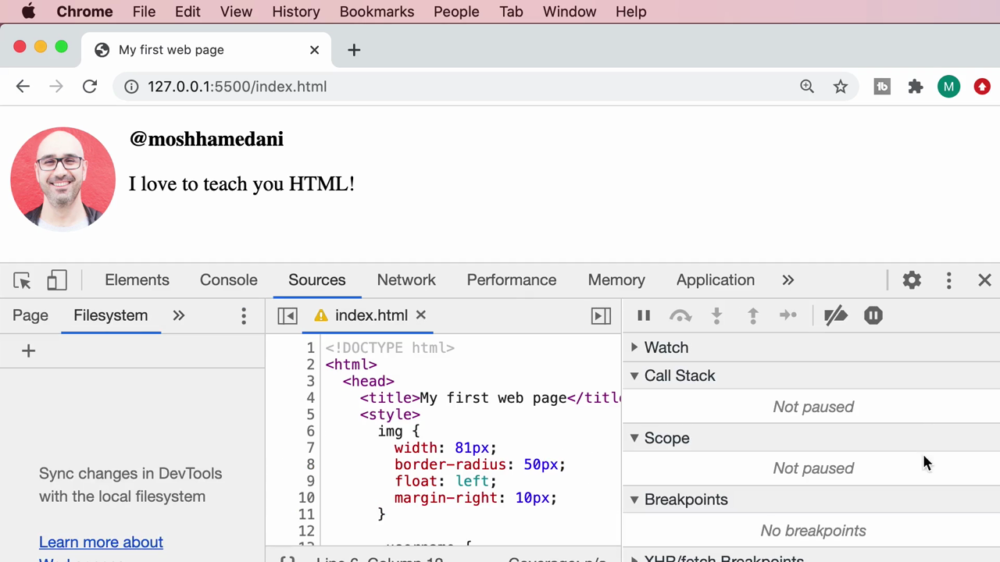

Mosh สลับไปแท็บ **Sources** → แท็บย่อย **Filesystem** — ข้อความแนะนำ: **"Sync changes in DevTools with the local filesystem"** พร้อมปุ่ม **"+"** สำหรับเพิ่มโฟลเดอร์ และลิงก์ "Learn more about Workspaces" — ฝั่งขวาแสดงโค้ด `index.html` แบบอ่านอย่างเดียว (read-only) ให้เห็นโครงสร้างไฟล์จริง:
```html
<!DOCTYPE html>
<html>
  <head>
    <title>My first web page</title>
    <style>
      img {
        width: 81px;
        border-radius: 50px;
        float: left;
        margin-right: 10px;
      }
```

*(ฟีเจอร์ **Workspaces** นี้ก้าวหน้ากว่าการแก้ CSS แบบชั่วคราว — ถ้าตั้งค่าเชื่อมโฟลเดอร์โปรเจกต์เข้ากับ DevTools ได้ การแก้ไขค่าใน DevTools จะ**เขียนกลับลงไฟล์จริงบนเครื่องได้เลย** ไม่ใช่แค่ทดลองดูผลในเบราว์เซอร์เฉยๆ — เป็นฟีเจอร์ขั้นสูงที่ Mosh แนะนำให้รู้จักไว้)*

## 8) ทดลองแก้ค่า `width` แบบ live อีกครั้ง (พิมพ์ค่าตัวเลขใหม่)

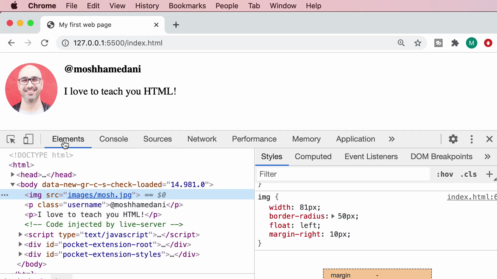

กลับมาที่แท็บ Elements Mosh **คลิกที่ตัวเลขค่า `width: 100px`** โดยตรงในแผง Styles แล้วพิมพ์แก้เป็น **`81px`** — เห็นรูปในหน้าเว็บเล็กลงทันทีตามค่าที่พิมพ์ (ไม่ต้องกด checkbox ปิด-เปิด สามารถพิมพ์แก้ค่าตัวเลขได้โดยตรงเลย)

## 9) Hover แถว `<p>` เพื่อดูขนาดข้อความ

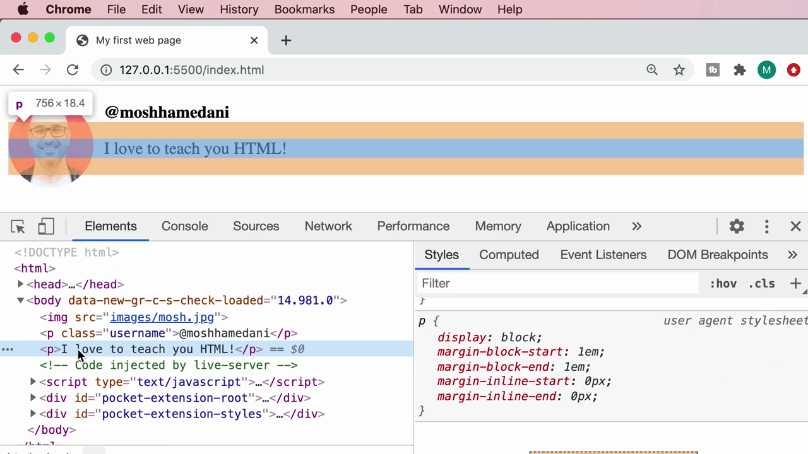

Mosh hover แถว `<p>I love to teach you HTML!</p>` → tooltip โชว์ **"p 756 × 18.4"**

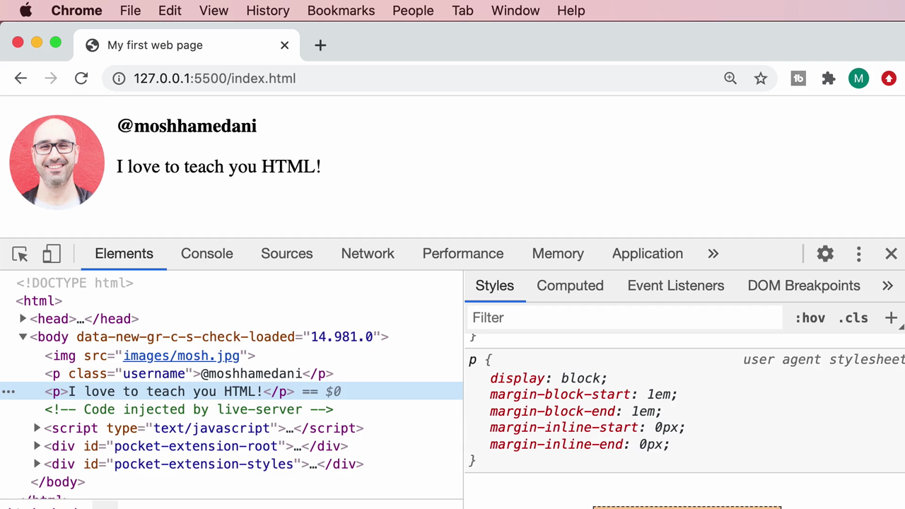

เห็นกรอบไฮไลต์ครอบเฉพาะบรรทัดข้อความ "I love to teach you HTML!" เต็มความกว้างของ container ยืนยันหลักการเดียวกัน: **`<p>` เป็น block-level element** จึงกินความกว้างเต็ม container โดยอัตโนมัติ (ต่างจาก `` ที่กว้างเท่าเนื้อหาจริง)

## สรุปที่ใช้ได้จริง

```
วิธีใช้แท็บ Elements ใน DevTools:
1. เปิด DevTools → คลิกแท็บ Elements
2. Hover (ไม่ต้องคลิก) แถวใดก็ได้ใน DOM tree → หน้าเว็บจะไฮไลต์ตำแหน่ง/ขนาดของ element นั้นทันที (พร้อมตัวเลข width x height)
3. Hover แถว  โดยเฉพาะ → เห็น preview รูป + ขนาดที่แสดงจริง vs ขนาดไฟล์จริง (intrinsic size)
4. คลิกเลือก element → แผง Styles ด้านขวาโชว่ CSS ทั้งหมดที่มีผล
5. ติ๊ก/ไม่ติ๊ก checkbox หน้า property → เปิด/ปิด CSS นั้นแบบ real-time (ทดลองดูผลก่อนแก้ไฟล์จริง)
6. คลิกที่ตัวเลขค่า (เช่น 100px) → พิมพ์แก้ไขค่าใหม่ได้โดยตรง เห็นผลทันที
7. การแก้ทั้งหมดนี้เป็นการแก้ "ชั่วคราว" — refresh หน้าแล้วหายไป (ยกเว้นตั้งค่า Workspace เชื่อมกับไฟล์จริงผ่าน Sources > Filesystem)
```

## จุดเชื่อมกับงานจริงของ Aum

- **Hover DOM tree เพื่อหาตำแหน่ง element** คือทักษะที่ใช้ทุกวันตอน debug React component จริง — แทนที่จะงมหา JSX ในโค้ด ให้เปิด DevTools แล้ว hover ดูก่อนว่า element ที่เห็นบนจอ ตรงกับ component ไหนใน DOM
- **แก้ CSS ชั่วคราวใน Styles panel ก่อนแก้ไฟล์จริง** — เทคนิคนี้ใช้ได้เหมือนกันเป๊ะตอนปรับ Tailwind class ใน React component จริง: เปิด DevTools แก้ style ลองผิดลองถูกจนได้ค่าที่ถูกใจ แล้วค่อยกลับไปแก้ใน code (`className`) จริง ประหยัดเวลากว่าการแก้โค้ดแล้ว refresh ทีละรอบมาก
- **intrinsic size vs display size ของรูป** — ตรงประเด็น image optimization ที่สำคัญมากในงาน Next.js จริง (คอมโพเนนต์ `next/image` จะเตือน/จัดการเรื่องนี้ให้อัตโนมัติ แต่การเข้าใจ concept นี้จาก DevTools ช่วยให้เข้าใจว่าทำไม Next.js ถึงต้องมีฟีเจอร์นี้)
- **Sources > Filesystem (Workspaces)** — concept นี้ใกล้เคียงกับ Hot Module Replacement (HMR) ใน Vite/Next dev server ที่ Aum ใช้งานจริง คือการซิงก์สิ่งที่เห็นในเบราว์เซอร์กับไฟล์จริงบนเครื่องแบบสองทาง
- **โค้ดแปลกที่ extension แทรกเข้ามา** (`pocket-extension-root`, `data-new-gr-c-s-check-loaded`) — เป็นความรู้ที่มีประโยชน์มากตอน debug จริง จะได้ไม่ตกใจหรือคิดว่าโค้ดตัวเองพังเวลาเห็น element แปลกๆ โผล่มาใน DOM ที่ไม่ได้เขียนเอง
