# 09-Validating Web Pages (3:58)

**ไฟล์ต้นทาง:** `Web Development Fundamentals/09-Validating-Web-Pages.mp4`

▶️ **[เปิดวิดีโอต้นฉบับ](../../Web%20Development%20Fundamentals/09-Validating-Web-Pages.mp4)**

> คลิปสุดท้ายของบท "Web Development Fundamentals" — Mosh สอนใช้เครื่องมือ **W3C Validator** (ทั้งฝั่ง HTML และ CSS) เพื่อตรวจสอบว่าโค้ดที่เขียนถูกต้องตามมาตรฐานหรือไม่ แล้วแก้ไข error/warning ที่เจอจริงบนไฟล์ `index.html` ที่เขียนมาตลอดทั้งบท ทำละเอียดที่สุด เก็บทุก error message และการแก้ไขโค้ด

## 1) เปิดคลิป

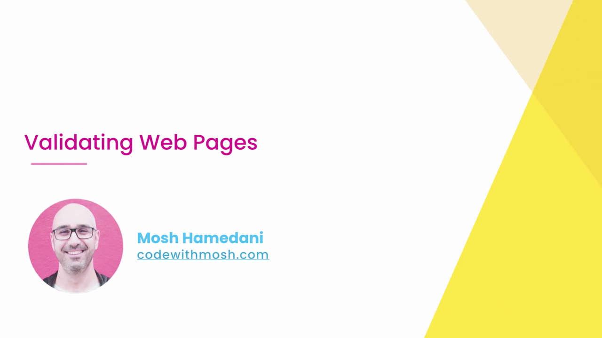

Title slide: **"Validating Web Pages"** — Mosh Hamedani, codewithmosh.com

## 2) ทบทวนไฟล์ index.html ที่เขียนมาตลอดทั้งบท

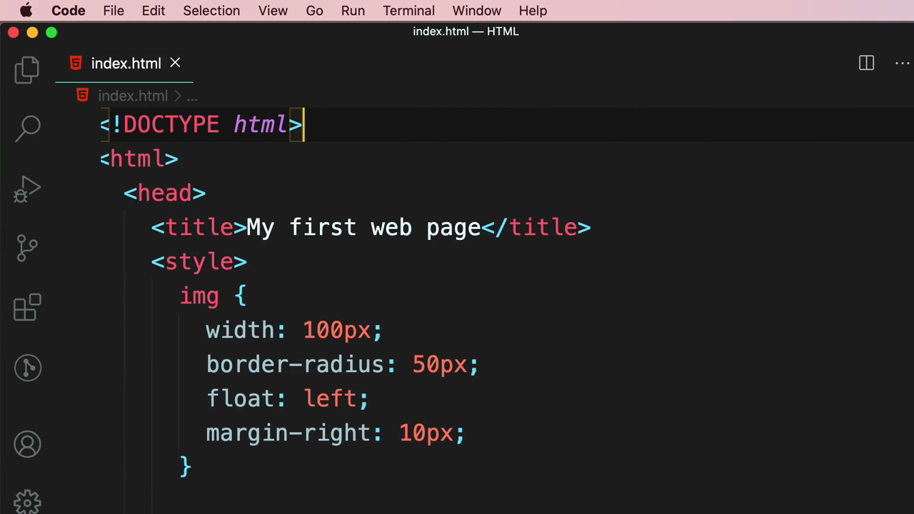

Mosh เปิดไฟล์ `index.html` เดิม (สะสมมาจากคลิป HTML Basics → CSS Basics → Formatting Code → Inspecting DevTools):
```html
<!DOCTYPE html>
<html>
  <head>
    <title>My first web page</title>
    <style>
      img {
        width: 100px;
        border-radius: 50px;
        float: left;
        margin-right: 10px;
      }
```

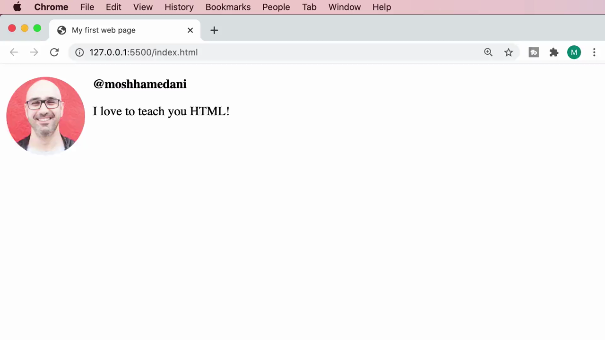

หน้าเว็บใน Chrome ยังหน้าตาเดิม: รูป Mosh วงกลม + `@moshhamedani` (ตัวหนา) + "I love to teach you HTML!"

## 3) ค้นหาและเปิด W3C Markup Validation Service

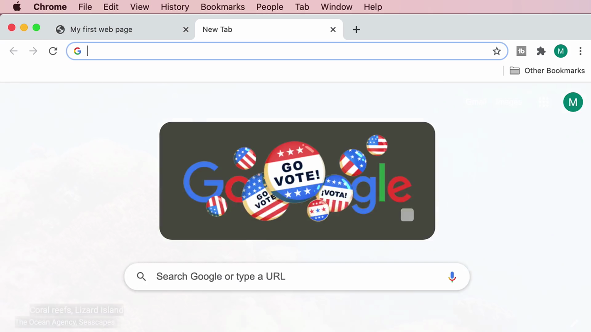

Mosh เปิดแท็บใหม่ พิมพ์ **`validator.w3.org`** ในช่อง address bar → Chrome เด้ง autocomplete แสดงผลลัพธ์ที่เกี่ยวข้อง: "The W3C Markup Validation Service - validator.w3.org", "Showing results for index.html - Nu Html Checker" (จากการใช้งานครั้งก่อนหน้า)

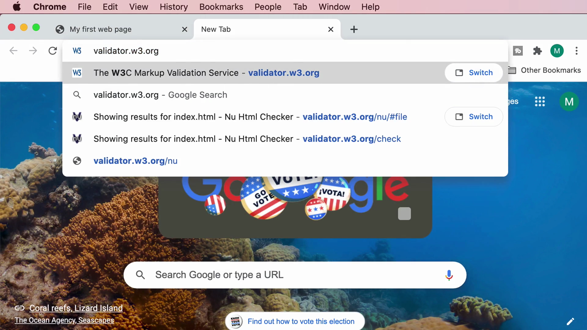

เว็บไซต์ **W3C Markup Validation Service** เปิดขึ้นมา หัวข้อ **"Check the markup (HTML, XHTML, …) of Web documents"** มี 3 แท็บให้เลือกวิธีตรวจสอบ:
- **Validate by URI** — ใส่ URL ของหน้าเว็บที่ออนไลน์อยู่แล้ว
- **Validate by File Upload** — อัปโหลดไฟล์ HTML จากเครื่องโดยตรง
- **Validate by Direct Input** — copy-paste โค้ด HTML เข้าไปโดยตรง

*(Mosh อธิบายว่า "Validate by URI" ใช้ไม่ได้กับ `127.0.0.1:5500` เพราะเป็น localhost ที่ validator ของ W3C เข้าถึงจากอินเทอร์เน็ตไม่ได้ — ต้องใช้วิธี **Validate by File Upload** แทนสำหรับไฟล์ที่ยังอยู่บนเครื่องเท่านั้น)*

## 4) อัปโหลดไฟล์ index.html เพื่อตรวจสอบ

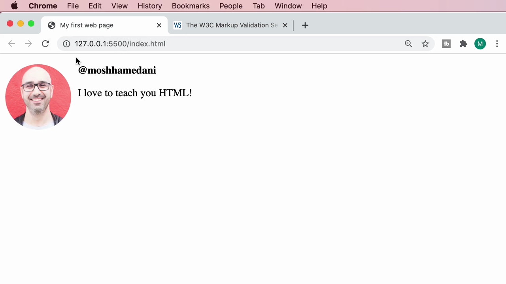

Mosh คลิกแท็บ **"Validate by File Upload"** → เจอปุ่ม **"Choose File"** พร้อมข้อความ "No file chosen" และหมายเหตุ: *"file upload may not work with Internet Explorer on some versions of Windows XP Service Pack 2"* — เลือกไฟล์ `index.html` แล้วกด **Check**

## 5) ผลการตรวจสอบครั้งแรก — เจอ 3 ปัญหา

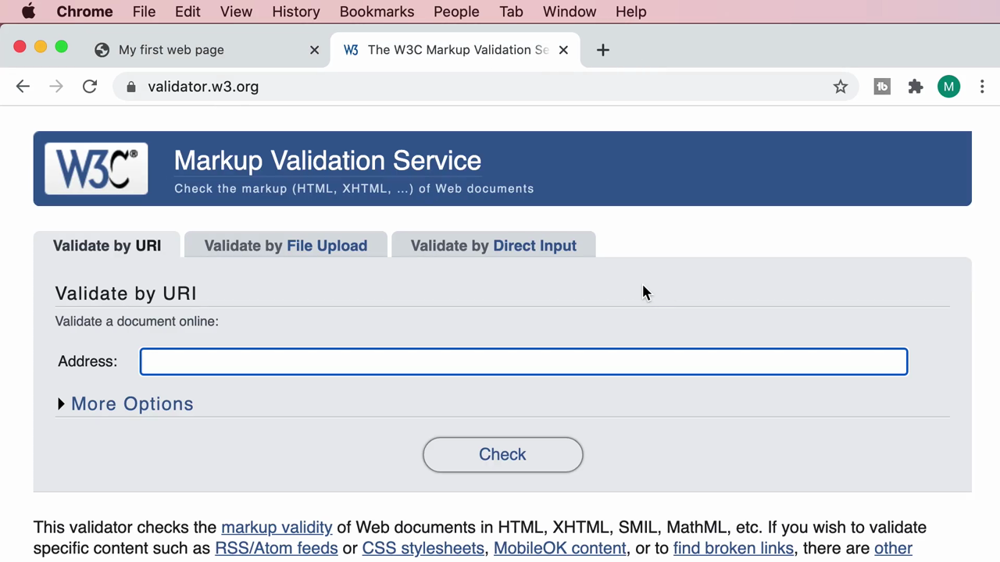

หน้า **"Nu Html Checker"** โชว์ผลลัพธ์ 3 รายการ:

**1. Warning:** *"Consider adding a `lang` attribute to the `html` start tag to declare the language of this document."*
```
From line 1, column 16; to line 2, column 6
TYPE html><html>  <he
```

**2. Error:** *"The character encoding was not declared. Proceeding using `windows-1252`."*

**3. Error:** *"An `img` element must have an `alt` attribute, except under certain conditions."*
```
From line 19, column 5; to line 19, column 33
body>    <
```
ท้ายหน้าสรุป: **"Document checking completed. Used the HTML parser. Total execution time 6 milliseconds."**

*(สรุปความหมายทั้ง 3 ข้อ:)*
- **`lang` attribute** = บอก browser/search engine/screen reader ว่าเนื้อหาในหน้านี้เป็นภาษาอะไร (เช่น `en` = อังกฤษ, `th` = ไทย) — ไม่ใส่ก็ยังใช้งานได้ปกติ แค่เป็นคำแนะนำ (Warning ไม่ใช่ Error)
- **character encoding** = การบอก browser ว่าตัวอักษรในไฟล์เข้ารหัสแบบไหน (ควรใส่ `<meta charset="UTF-8">` เสมอ) — ถ้าไม่ใส่ browser จะเดาเอาเอง ซึ่งอาจทำให้ตัวอักษรพิเศษ/ภาษาอื่นแสดงผลผิดเพี้ยนได้
- **`img` ต้องมี `alt`** = กฎ accessibility พื้นฐานที่สุดของ HTML — ทุกรูปต้องมีข้อความอธิบายสำรอง (ย้ำเรื่องเดียวกับที่เรียนตอนสอน `` ในคลิป HTML Basics)

## 6) แก้ไขปัญหาที่ 1 — เพิ่ม `lang` attribute

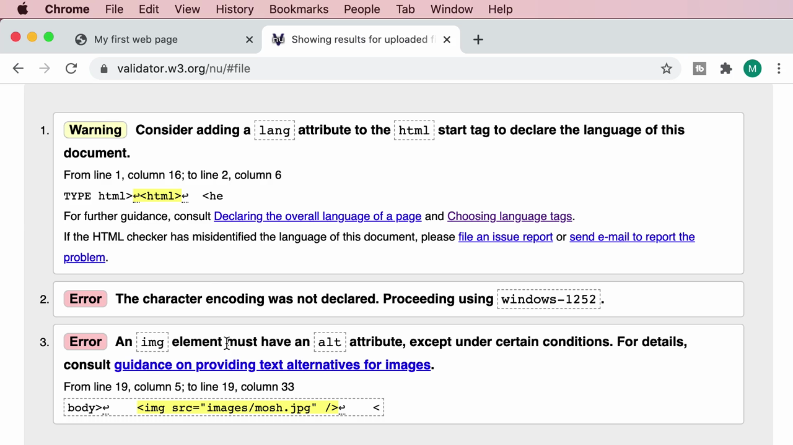

Mosh กลับไปที่ VS Code เลือกแท็บ `<html>` เพื่อเพิ่ม attribute

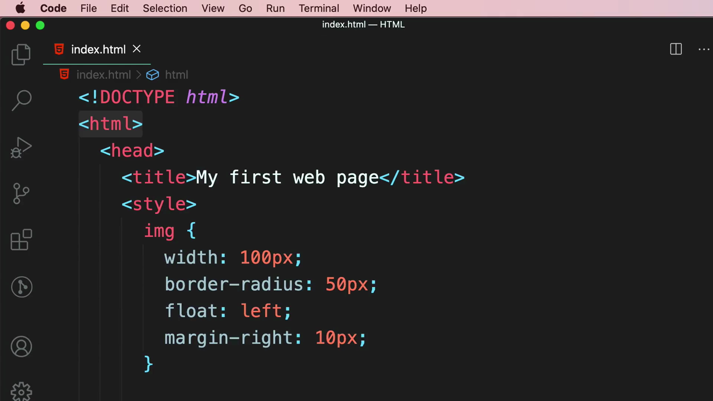

พิมพ์ `l` ต่อจาก `<html ` → Emmet/IntelliSense เด้ง suggestion: **`lang`**, `aria-label`, `aria-labelledby`, `aria-level`, `aria-live` พร้อมคำอธิบาย **`lang`**: *"Helps define the language of an element: the language that non-editable elements are in, or the language that editable elements should be written in by the user. The attribute contains one 'language tag' ... (BCP47)"*

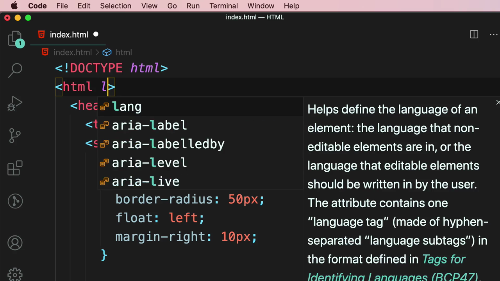

เลือก `lang` แล้วได้ผลลัพธ์:
```html
<html lang="">
```
รอกรอกค่าภาษา (ยังว่างอยู่)

## 7) อัปโหลดซ้ำเพื่อตรวจสอบอีกครั้ง

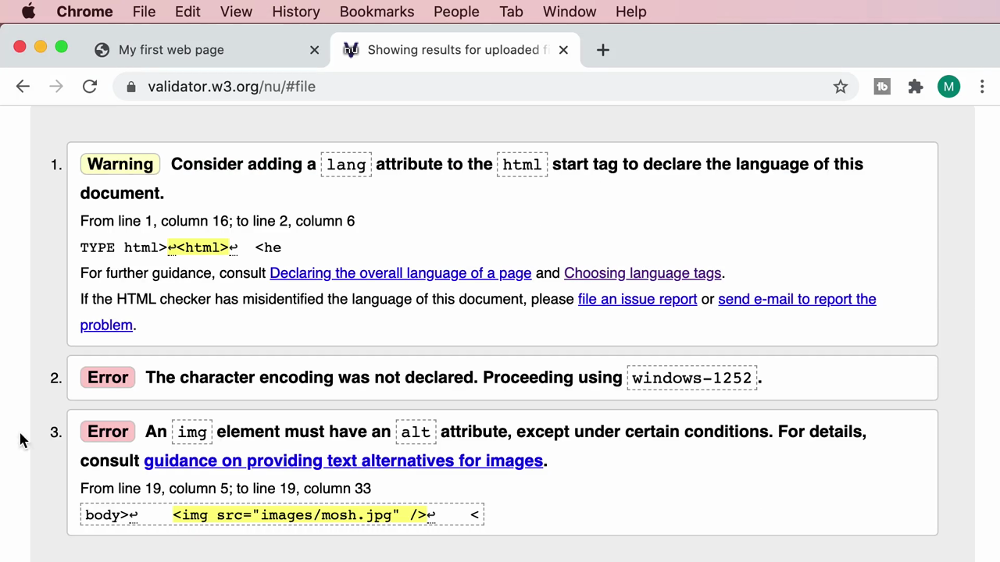

ยืนยันผลการตรวจสอบครั้งแรกอีกครั้ง (เลื่อนลงล่างสุด) — "Document checking completed. Total execution time 7 milliseconds."

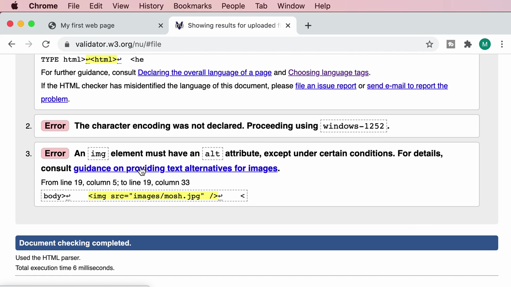

Mosh กด **Choose File** อีกครั้งเพื่ออัปโหลดไฟล์ `index.html` เวอร์ชันใหม่ (เห็น dialog เลือกไฟล์ของ macOS โชว์โฟลเดอร์ HTML ที่มี `index.html` ขนาด 460 bytes และโฟลเดอร์ `images`)

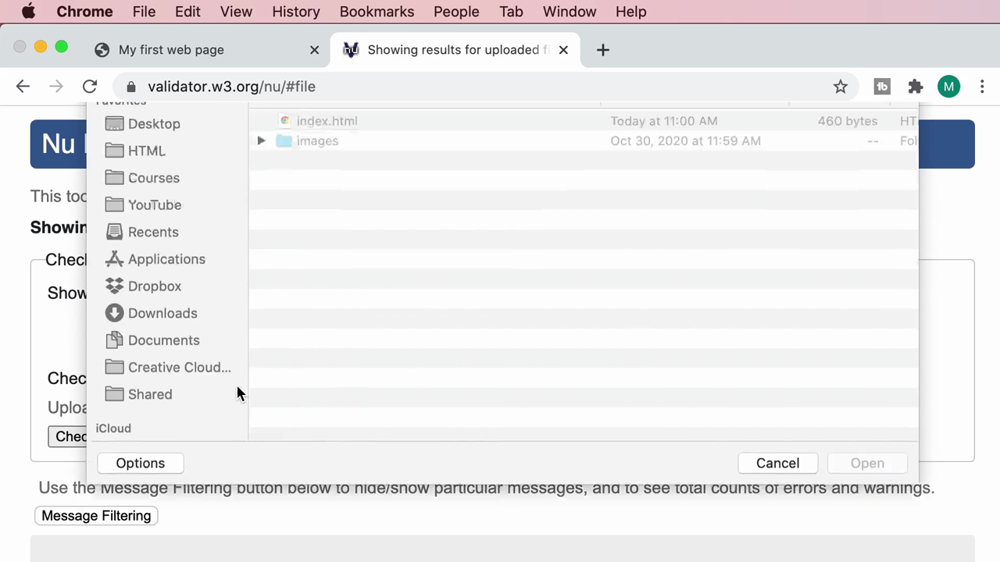

ผลลัพธ์รอบใหม่: **เหลือแค่ 1 รายการ**
```
1. Error: The character encoding was not declared. Proceeding using windows-1252.
```
(Warning เรื่อง `lang` และ Error เรื่อง `alt` หายไปแล้ว หลังจาก Mosh แก้โค้ดเพิ่ม `lang` attribute ให้ `<html>` และเพิ่ม `alt` attribute ให้ ``) — เหลือแค่เรื่อง character encoding ที่ยังไม่ได้แก้ในคลิปนี้ (Mosh ทิ้งไว้เป็นแบบฝึกหัด/หัวข้อที่จะพูดถึงในคอร์สถัดไป)

## 8) เปลี่ยนมาตรวจสอบฝั่ง CSS — W3C CSS Validation Service

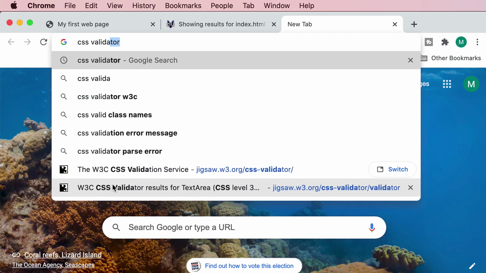

Mosh เปิดแท็บใหม่ ค้นหา **"css validator"** ใน Google

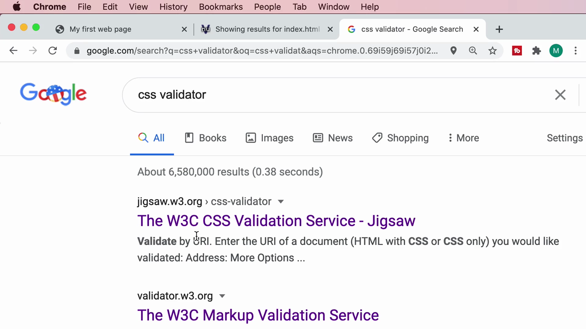

เข้าเว็บไซต์ **W3C CSS Validation Service** (`jigsaw.w3.org/css-validator`) — หน้าตาคล้ายกับ Markup Validator แต่สำหรับตรวจ CSS โดยเฉพาะ มี 3 แท็บเหมือนกัน: **By URI**, **By file upload**, **By direct input**

## 9) ดูค่า `lang` ที่กรอกสมบูรณ์แล้ว

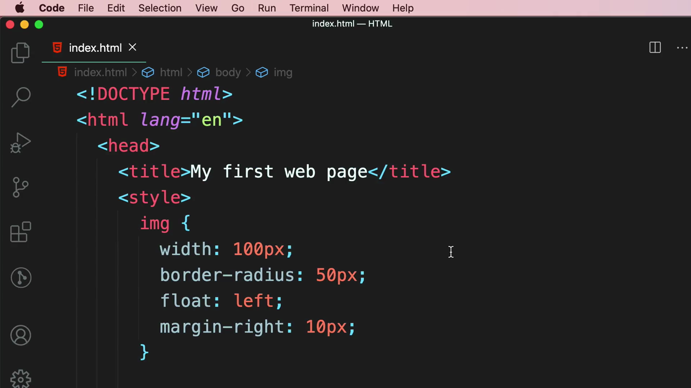

กลับไปดูไฟล์ `index.html` — ตอนนี้ `<html lang="en">` กรอกค่าเรียบร้อยแล้ว (ภาษาอังกฤษ) โครงไฟล์เต็มตอนนี้:
```html
<!DOCTYPE html>
<html lang="en">
  <head>
    <title>My first web page</title>
    <style>
      img {
        width: 100px;
        border-radius: 50px;
        float: left;
        margin-right: 10px;
      }
      .username {
        font-weight: bold;
      }
    </style>
  </head>
  ...
```

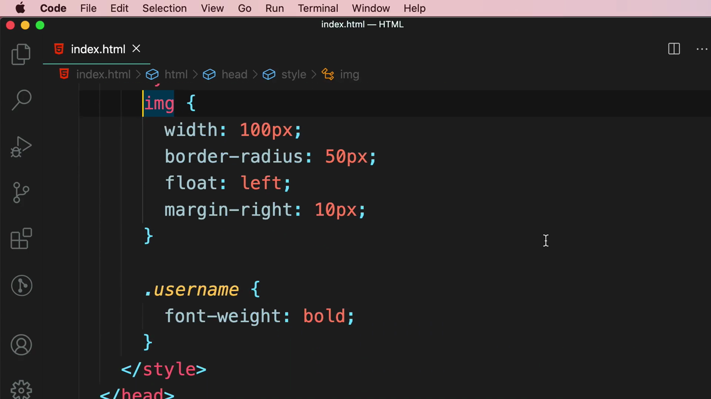

Mosh **select (ลากคลุม) โค้ด CSS ทั้งหมด**ในแท็บ `<style>` (ตั้งแต่ `img { ... }` จนถึง `.username { ... }`) เพื่อเตรียม copy ไปวางในหน้า CSS Validator

## 10) ตรวจสอบ CSS ด้วยวิธี Validate by Direct Input

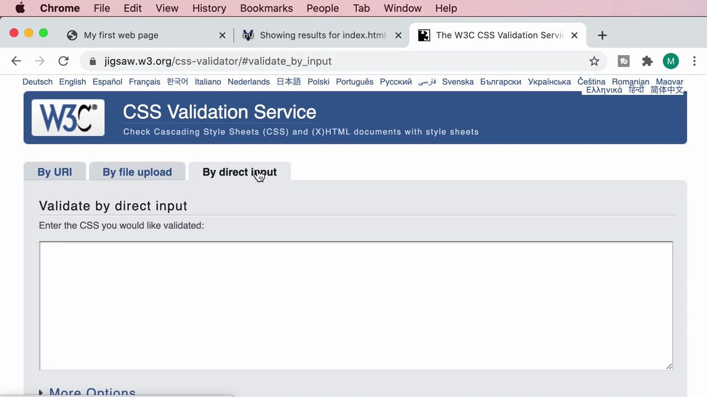

คลิกแท็บ **"By direct input"** ในหน้า CSS Validation Service → เจอกล่องข้อความให้วาง CSS โดยตรง: *"Validate by direct input — Enter the CSS you would like validated:"*

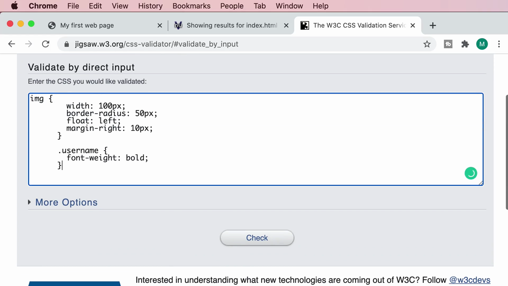

Mosh วาง (paste) โค้ด CSS ที่ copy มาลงในกล่อง:
```css
img {
    width: 100px;
    border-radius: 50px;
    float: left;
    margin-right: 10px;
}

.username {
    font-weight: bold;
}
```
แล้วกดปุ่ม **Check**

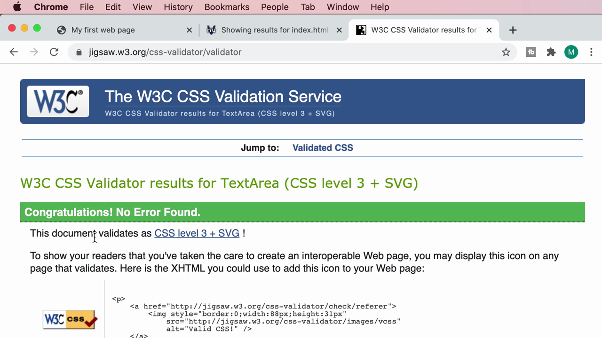

ผลลัพธ์ขึ้นข้อความสีเขียว **"Congratulations! No Error Found."** พร้อมข้อความ *"This document validates as CSS level 3 + SVG!"* — CSS ที่ Mosh เขียนมาทั้งบทผ่านการตรวจสอบสมบูรณ์แบบ ไม่มี error เลย (หน้านี้ยังมีโค้ด badge "Valid CSS" ให้ติดบนเว็บได้ถ้าต้องการ แต่ Mosh ไม่ได้ใช้ในคลิปนี้)

## สรุปที่ใช้ได้จริง

```
ทำไมต้อง Validate โค้ด:
- ช่วยจับ error/typo ที่มองด้วยตาเปล่าไม่เห็น (เช่น ลืม alt, ลืม lang)
- ช่วยให้โค้ดเป็นไปตามมาตรฐาน HTML/CSS มากขึ้น → เว็บทำงานถูกต้องตรงกันในทุก browser
- ช่วยเรื่อง accessibility (คนพิการ/ผู้ใช้ screen reader เข้าถึงเว็บได้ดีขึ้น) และ SEO

วิธีใช้ W3C Markup Validation Service (validator.w3.org):
1. ถ้าเว็บ deploy ออนไลน์แล้ว → ใช้แท็บ "Validate by URI" ใส่ URL ได้เลย
2. ถ้าเว็บยังอยู่บนเครื่อง (localhost) → ใช้แท็บ "Validate by File Upload" เลือกไฟล์ .html
3. หรือจะ copy-paste โค้ดเข้าไปตรงๆ ก็ใช้แท็บ "Validate by Direct Input" ได้เช่นกัน
4. อ่านรายการ Warning/Error ที่เจอ แก้ทีละข้อ แล้วอัปโหลด/เช็คซ้ำจนกว่าจะสะอาด

วิธีใช้ W3C CSS Validation Service (jigsaw.w3.org/css-validator) — ขั้นตอนเดียวกันแต่สำหรับ CSS โดยเฉพาะ
```

Error/Warning ที่เจอในคลิปนี้และวิธีแก้:
| ปัญหา | ระดับ | วิธีแก้ |
|---|---|---|
| ไม่มี `lang` attribute บน `<html>` | Warning | เพิ่ม `<html lang="en">` |
| ไม่ประกาศ character encoding | Error | ควรเพิ่ม `<meta charset="UTF-8">` ใน `<head>` (ยังไม่ได้แก้ในคลิปนี้) |
| `` ไม่มี `alt` attribute | Error | เพิ่ม `alt="..."` ให้ `` ทุกตัว |

## จุดเชื่อมกับงานจริงของ Aum

- **`<html lang="...">`** และ **`<meta charset="UTF-8">`** คือ 2 บรรทัดมาตรฐานที่ทุกโปรเจกต์ Next.js จริงต้องมี — ใน Next.js (App Router) จะเห็นสิ่งนี้ถูกตั้งค่าอัตโนมัติผ่านไฟล์ `app/layout.tsx` (`<html lang="en">`) และ metadata ของ framework จะจัดการ charset ให้เอง แต่ความเข้าใจว่า "ทำไมต้องมี" มาจากพื้นฐานตรงนี้เป๊ะ
- **`alt` attribute บน ``** — ตรงกับ ESLint rule ยอดฮิตในโปรเจกต์ React ชื่อ `jsx-a11y/alt-text` ที่จะ**เตือนอัตโนมัติ**ตอนเขียนโค้ดถ้าลืมใส่ `alt` — เป็นกฎเดียวกับที่ W3C Validator เตือนในคลิปนี้เป๊ะ แค่ Next.js/ESLint เช็คให้อัตโนมัติตั้งแต่ตอนเขียนโค้ด ไม่ต้องเข้าเว็บไปอัปโหลดเช็คเอง
- **แนวคิดเรื่อง Validator/Linter** เชื่อมตรงกับเครื่องมือที่ Aum น่าจะได้ใช้ในงานจริง เช่น **ESLint** (ตรวจ JavaScript/JSX), **Stylelint** (ตรวจ CSS), และ **TypeScript compiler** (ตรวจ type) — ทั้งหมดคือ "ตัวตรวจสอบมาตรฐานโค้ดอัตโนมัติ" แนวคิดเดียวกับ W3C Validator ที่เรียนในคลิปนี้ เพียงแค่ทำงานในเครื่องแทนที่จะต้องเข้าเว็บไปอัปโหลดไฟล์
- **Accessibility (a11y)** ที่เริ่มเห็นจากกฎ `alt` attribute ในคลิปนี้ เป็นหัวข้อสำคัญมากขึ้นเรื่อยๆ ในงาน Front End จริงปี 2026 โดยเฉพาะโปรเจกต์ที่ต้องรองรับมาตรฐาน WCAG — รากฐานเริ่มจากพื้นฐานง่ายๆ แบบนี้เอง
