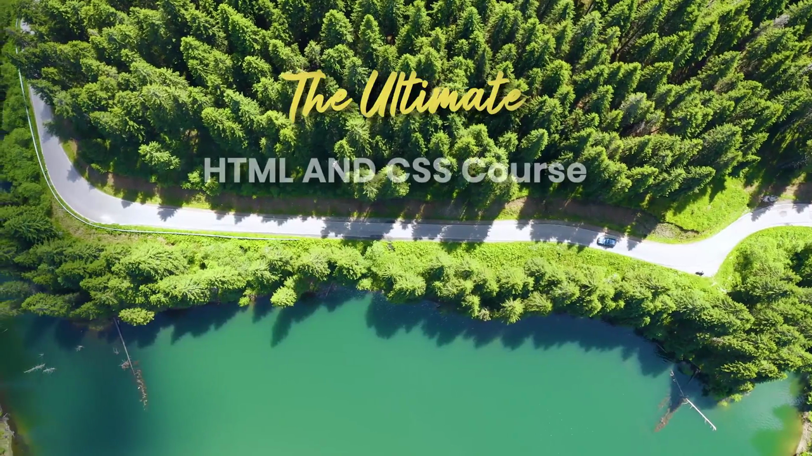
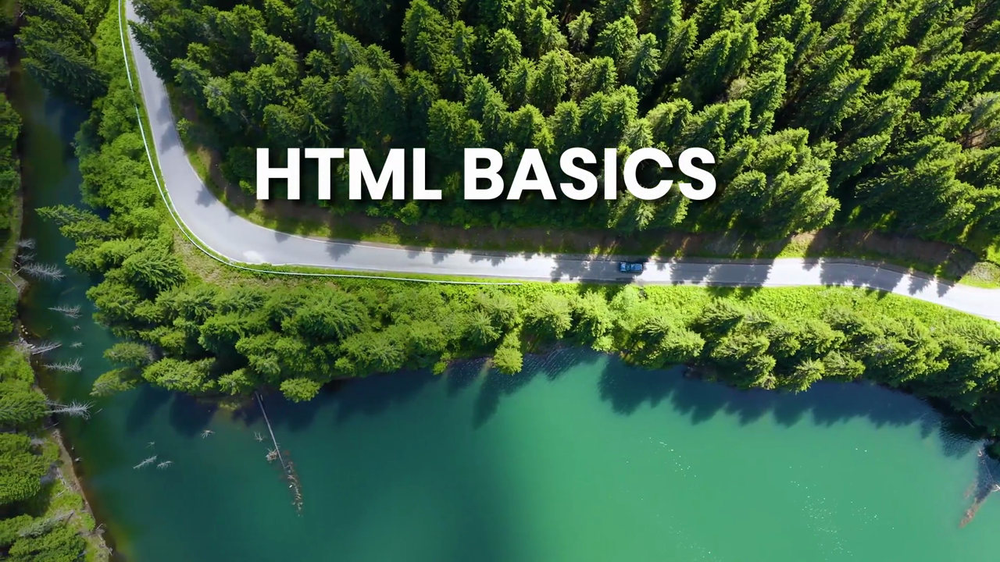
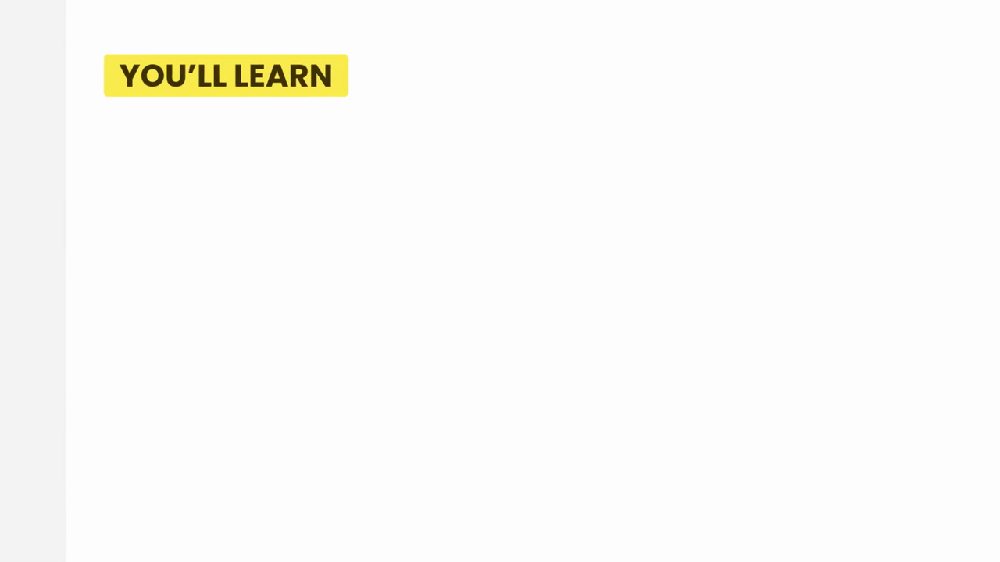
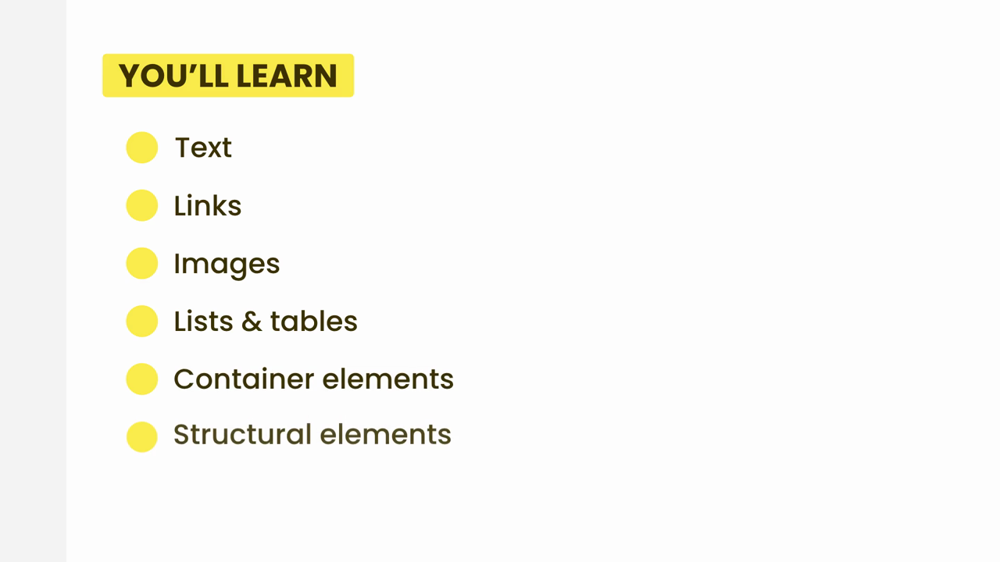

# 3-HTML Basics: 01 - Introduction (0:42)

**ไฟล์ต้นทาง:** `01-Introduction.mp4`

▶️ **[เปิดวิดีโอต้นฉบับ](../../../HTML-CSS-1/3-HTML%20Basics/01-Introduction.mp4)**

---

## ภาพรวมคลิปนี้

คลิปนี้เป็นคลิปเปิด (Introduction) ของ**หัวข้อใหม่ "HTML Basics"** ในคอร์ส The Ultimate HTML and CSS Course ของ Mosh Hamedani ความยาวเพียง 42 วินาที เป็นคลิปแนะนำหัวข้อ (ไม่มีการเขียนโค้ดหรือสาธิตในคลิปนี้) ประกอบด้วย 3 ส่วนหลัก:

1. หน้าไตเติลเปิดคอร์ส (branding animation)
2. หน้าไตเติลของหัวข้อย่อย "HTML BASICS"
3. สไลด์ "YOU'LL LEARN" ที่สรุป roadmap ของสิ่งที่จะได้เรียนในหัวข้อนี้

---

## 1. หน้าไตเติลเปิด (Course Branding)

วิดีโอเริ่มต้นด้วยแอนิเมชันภาพมุมสูง (aerial drone shot) ของถนนเลียบทะเลสาบสีเขียวมรกตท่ามกลางป่าสน พร้อมข้อความค่อยๆ ปรากฏขึ้นทีละคำ:

> **"The Ultimate HTML AND CSS Course"**

นี่คือหน้า branding เปิดคอร์สที่ใช้ซ้ำในทุก section ของคอร์สนี้ (เหมือนที่เราเคยเห็นในคลิปก่อนหน้าของ Web Development Fundamentals)

---

## 2. หน้าไตเติลหัวข้อย่อย "HTML BASICS"

จากนั้นภาพเปลี่ยนเป็นข้อความ **"HTML BASICS"** ตัวหนาสีขาว ซ้อนทับบนภาพมุมสูงเดิม (ถนนเลียบทะเลสาบ) เพื่อบอกว่ากำลังจะเข้าสู่หัวข้อใหม่

---

## 3. สไลด์ "YOU'LL LEARN" (Roadmap ของหัวข้อนี้)

ส่วนสำคัญที่สุดของคลิปนี้คือสไลด์สรุปหัวข้อที่จะได้เรียนใน section "HTML Basics" นี้ทั้งหมด โดยหัวข้อจะปรากฏเป็นกล่องสีเหลือง **"YOU'LL LEARN"** ก่อน

จากนั้นรายการหัวข้อย่อยจะค่อยๆ ปรากฏขึ้นทีละบรรทัด (แต่ละบรรทัดมีจุดกลมสีเหลืองนำหน้า) จนครบทั้งหมด 6 หัวข้อ:

| ลำดับ | หัวข้อ (ภาษาอังกฤษ) | ความหมาย |
|---|---|---|
| 1 | **Text** | การเขียนข้อความในหน้าเว็บ (heading, paragraph ฯลฯ) |
| 2 | **Links** | การสร้างลิงก์เชื่อมโยงหน้าเว็บ |
| 3 | **Images** | การแทรกรูปภาพ |
| 4 | **Lists & tables** | การสร้างรายการ (list) และตาราง (table) |
| 5 | **Container elements** | element ที่ใช้ครอบ/จัดกลุ่มเนื้อหา เช่น `
` |
| 6 | **Structural elements** | element ที่ใช้กำหนดโครงสร้างหน้า เช่น `<header>`, `<footer>`, `<section>` |

หลังจากนั้นวิดีโอจะจบด้วยโลโก้ของ codewithmosh (ตัว M สีชมพู-ม่วง) แล้วตัดเข้าสู่ความมืด ก่อนเข้าสู่คลิปถัดไป

---

## สรุปที่ใช้ได้จริง

- คลิปนี้ **ไม่มีโค้ดหรือการสาธิตใดๆ** เป็นเพียงคลิปแนะนำ (intro) เพื่อปูทาง roadmap ของหัวข้อ HTML Basics
- รายการทั้ง 6 หัวข้อ (Text, Links, Images, Lists & tables, Container elements, Structural elements) คือ**แผนที่การเรียนรู้**ของหัวข้อนี้ทั้งหมด ควรใช้เป็น checklist เพื่อติดตามว่าเรียนถึงไหนแล้ว
- Container elements และ Structural elements เป็นแนวคิดที่สำคัญมากสำหรับการจัดโครงสร้างหน้าเว็บ (จะเจอ `
`, `<header>`, `<nav>`, `<main>`, `<footer>` ในหัวข้อเหล่านี้)

### จุดเชื่อมกับงานจริงของ Aum

- Roadmap นี้ตรงกับสิ่งที่ Aum ใช้ทุกวันตอนสร้าง landing page ด้วย Next.js: การเขียนข้อความ, ใส่ลิงก์ (`<Link>` ของ Next.js ก็มาจากพื้นฐาน `<a>`), ใส่รูปภาพ (`<Image>` ของ Next.js มาจากพื้นฐาน ``), และโครงสร้างหน้าด้วย container/structural elements ซึ่งเป็นพื้นฐานเดียวกับการจัดวาง component ใน React/Next.js
- แนะนำให้ใช้ 6 หัวข้อนี้เป็น checklist สำหรับตัวเองว่าพื้นฐาน HTML ส่วนไหนที่ยังไม่แม่น ก่อนจะไปลุยงาน Tailwind + component ใน Next.js ต่อ
