# 3-HTML Basics: 02 - The Head Section (3:48)

**ไฟล์ต้นทาง:** `02-The-Head-Section.mp4`

▶️ **[เปิดวิดีโอต้นฉบับ](../../../HTML-CSS-1/3-HTML%20Basics/02-The-Head-Section.mp4)**

---

## ภาพรวมคลิปนี้

คลิปนี้ Mosh อธิบายเจาะลึกส่วน **`<head>`** ของเอกสาร HTML ว่าแต่ละ tag ที่อยู่ใน `<head>` มีหน้าที่อะไรบ้าง โดยเริ่มจากการสร้างไฟล์ `index.html` ใหม่ ใช้ Emmet สร้างโครงสร้างพื้นฐาน (HTML Boilerplate) แล้วอธิบายทีละบรรทัดว่า `<meta charset>`, `<meta viewport>`, `<meta keywords>`, `<meta description>` และ `<title>` ทำหน้าที่อะไร พร้อมสาธิตผ่านตัวอย่างจริงบน Google Search

---

## 1. เริ่มต้นด้วยไฟล์ index.html เปล่า

Mosh เปิด VS Code พร้อมไฟล์ `index.html` ที่ว่างเปล่า (ยังไม่มีเนื้อหาใดๆ) เพื่อเริ่มสร้าง HTML skeleton ใหม่ตั้งแต่ต้น

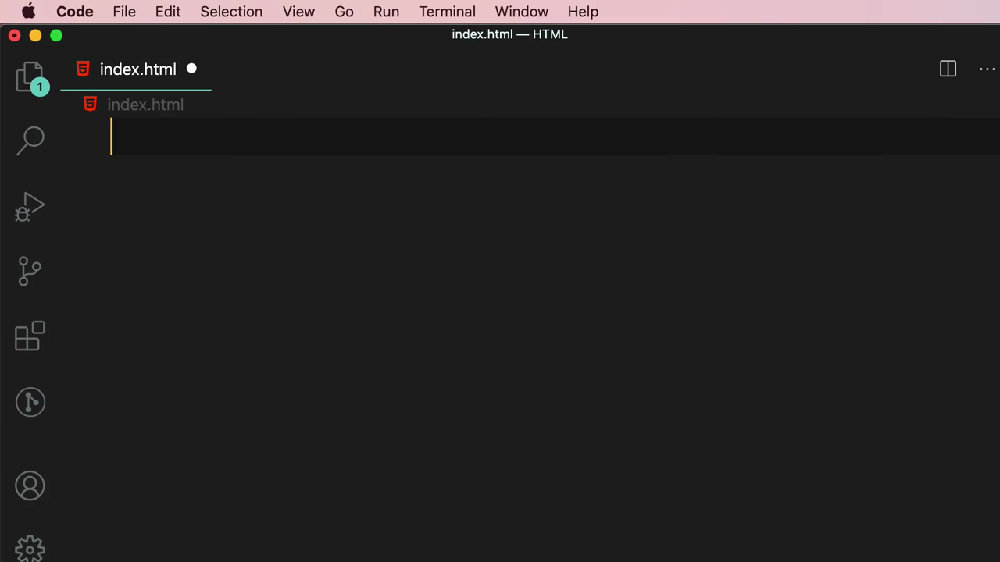

---

## 2. สร้าง HTML Boilerplate ด้วย Emmet

Mosh พิมพ์เครื่องหมาย **`!`** (เครื่องหมายอัศเจรีย์) แล้วกด Tab/Enter ซึ่งเป็น **Emmet Abbreviation** ที่ VS Code รู้จัก จะแสดง preview ของโครงสร้าง HTML พื้นฐานทั้งหมดที่จะถูกสร้างขึ้นทันที:

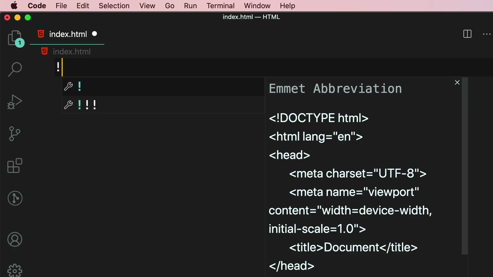

หลังจากกดยืนยัน โค้ดทั้งหมดถูกขยายออกมาเป็น:

```html
<!DOCTYPE html>
<html lang="en">
<head>
    <meta charset="UTF-8">
    <meta name="viewport" content="width=device-width, initial-scale=1.0">
    <title>Document</title>
</head>
<body>

</body>
</html>
```

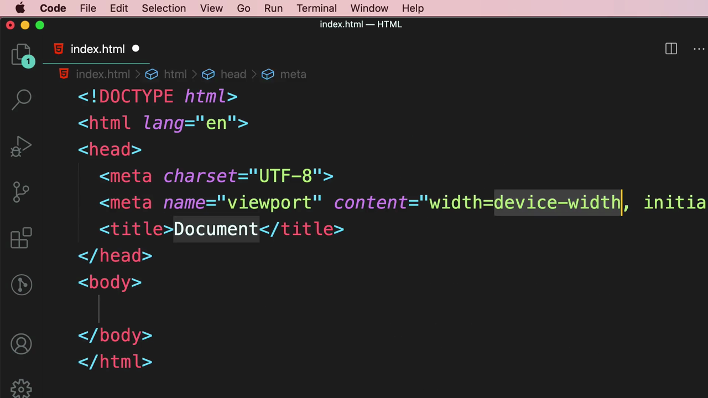

Mosh ใส่ label กำกับไว้ว่านี่คือ **"HTML Boilerplate"** — โครงสร้างพื้นฐานที่ทุกหน้า HTML ต้องมี:

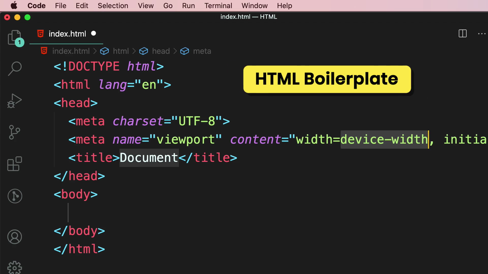

จากนั้น Mosh อธิบายทีละบรรทัดในส่วน `<head>` ว่าแต่ละ tag ทำหน้าที่อะไร

---

## 3. `<meta charset="UTF-8">` และแนวคิดเรื่อง Character Set

ก่อนจะอธิบายบรรทัดนี้ Mosh สร้างสไลด์แยกเพื่ออธิบายแนวคิดพื้นฐานของ **Character Set (ชุดตัวอักษร)** ก่อน

### Character Set คืออะไร

คอมพิวเตอร์เก็บข้อมูลเป็นตัวเลข (binary) ไม่ใช่ตัวอักษรโดยตรง ดังนั้นตัวอักษรแต่ละตัวจะถูกแทนด้วยตัวเลขตามมาตรฐานที่ตกลงกันไว้ เรียกว่า **character set** หรือ **character encoding**

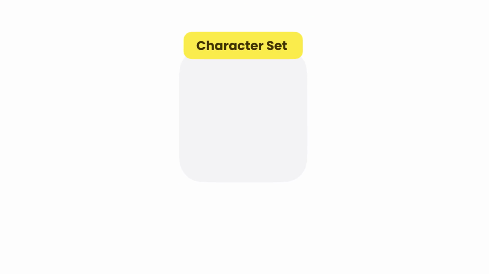

ตัวอย่างการแทนตัวอักษรด้วยตัวเลข:

| ตัวอักษร | รหัสตัวเลข |
|---|---|
| A | 65 |
| B | 66 |
| C | 67 |
| ... | ... |

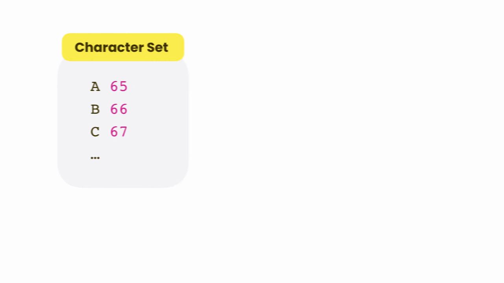

### ASCII

Mosh อธิบายว่าชุดตัวอักษรที่นิยมใช้ในยุคแรกเรียกว่า **ASCII** ย่อมาจาก:

> **A**merican **S**tandard **C**ode for **I**nformation **I**nterchange

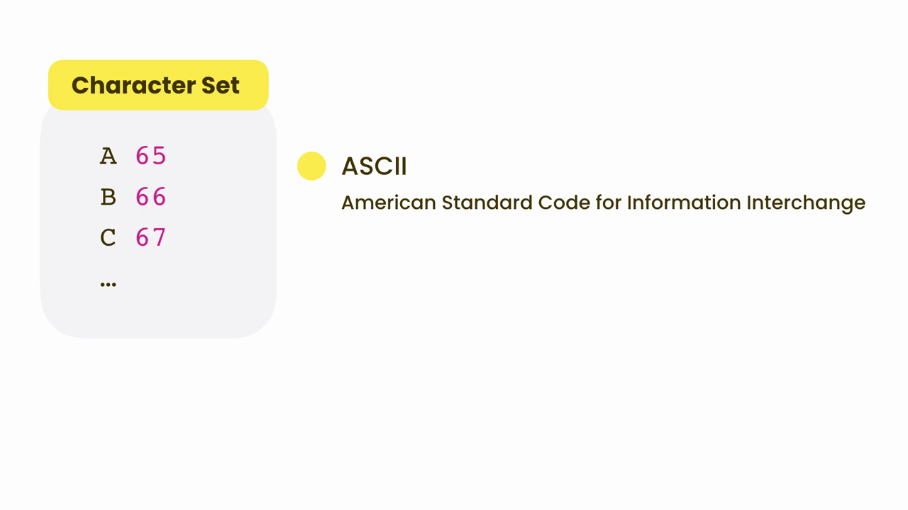

> **หมายเหตุ:** ASCII รองรับเฉพาะตัวอักษรภาษาอังกฤษพื้นฐาน (128 ตัวอักษร) เท่านั้น จึงไม่เพียงพอสำหรับภาษาอื่นๆ ทั่วโลก (รวมถึงภาษาไทย) — นี่คือเหตุผลที่ต้องมีมาตรฐานที่ครอบคลุมกว่าอย่าง **UTF-8**

### UTF-8 คือคำตอบ

Mosh เชื่อมโยงกลับมาที่บรรทัดโค้ด `<meta charset="UTF-8">` โดยไฮไลต์บรรทัดนี้พร้อมกับสไลด์ Character Set ที่เพิ่งอธิบาย เพื่อแสดงให้เห็นว่า tag นี้คือการ**บอกเบราว์เซอร์ว่าเอกสารนี้ใช้ชุดตัวอักษรแบบ UTF-8** ซึ่งเป็นมาตรฐานสากลที่ครอบคลุมตัวอักษรเกือบทุกภาษาในโลก รวมถึงภาษาไทยด้วย

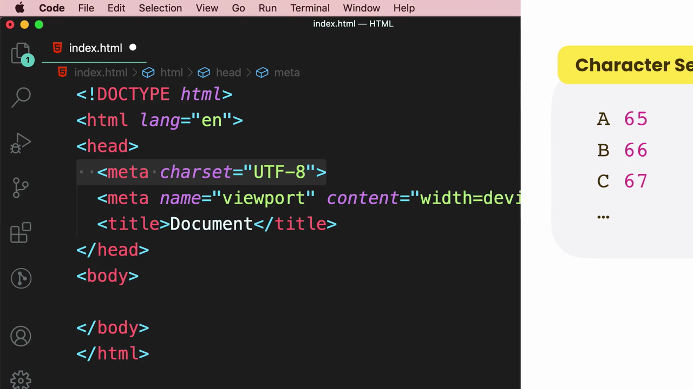

```html
<meta charset="UTF-8">
```

> **ทำไมสำคัญ:** ถ้าไม่ใส่ `charset` หรือใส่ผิด เบราว์เซอร์อาจตีความตัวอักษรผิด ทำให้ข้อความที่ไม่ใช่ภาษาอังกฤษ (เช่น ภาษาไทย, ญี่ปุ่น, จีน) แสดงผลเป็นตัวอักษรประหลาด (mojibake) ได้

---

## 4. `<meta name="viewport">` — การแสดงผลบนอุปกรณ์ต่างๆ

Mosh เปิด Live Server เพื่อดูหน้าเปล่าใน Chrome ก่อน (ยังไม่มีเนื้อหาใน `<body>` จึงเป็นหน้าว่างสีขาวล้วน)

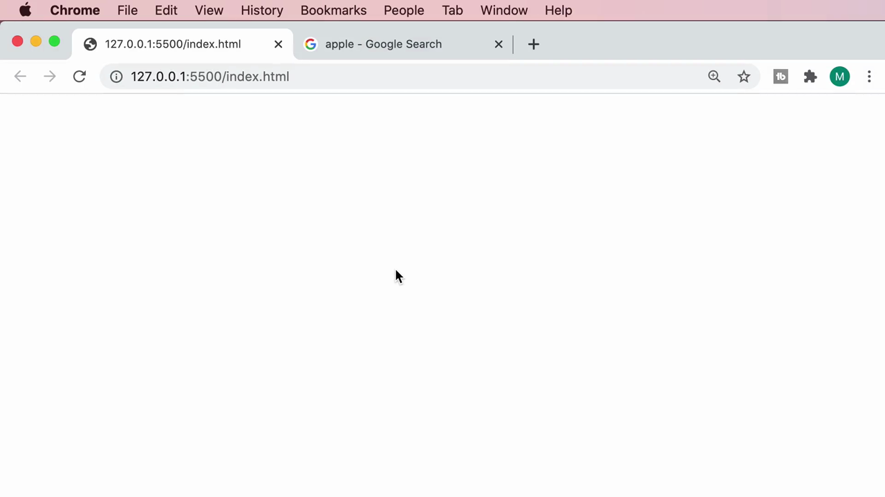

จากนั้นกลับมาที่ VS Code และเลื่อนโค้ดไปทางขวาเพื่อให้เห็นค่าทั้งหมดของบรรทัด viewport:

```html
<meta name="viewport" content="width=device-width, initial-scale=1.0">
```

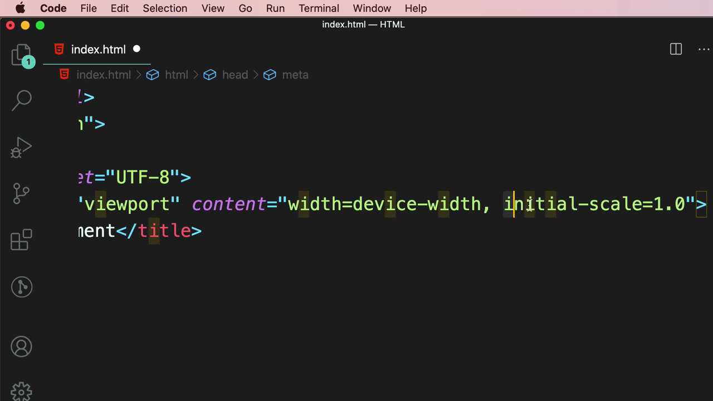

Mosh อธิบายว่า tag นี้ควบคุมการแสดงผลของหน้าเว็บบนอุปกรณ์มือถือ/แท็บเล็ต:

- **`width=device-width`** — กำหนดให้ความกว้างของหน้าเว็บเท่ากับความกว้างจริงของหน้าจออุปกรณ์ (ไม่ใช่ขนาด desktop ที่ถูกย่อลงมา)
- **`initial-scale=1.0`** — กำหนดระดับการซูมเริ่มต้นเป็น 100% (ไม่ซูมเข้า/ออก)

> **ทำไมสำคัญ:** ถ้าไม่มี viewport meta tag นี้ หน้าเว็บจะแสดงผลบนมือถือเหมือนเป็นหน้าจอ desktop ที่ถูกย่อส่วนลงมาเล็กจิ๋ว ทำให้ตัวอักษรอ่านยากมาก — tag นี้คือกุญแจสำคัญของการทำ **Responsive Web Design**

---

## 5. เพิ่ม `<meta name="keywords">`

Mosh พิมพ์ `met` แล้วใช้ Emmet suggestion เพื่อสร้างบรรทัด `<meta>` ใหม่ใต้บรรทัด viewport จากนั้นเติม attribute `name="keywords"` และเปิดวงเล็บ `content=""` ไว้ก่อน (ยังว่างเปล่า)

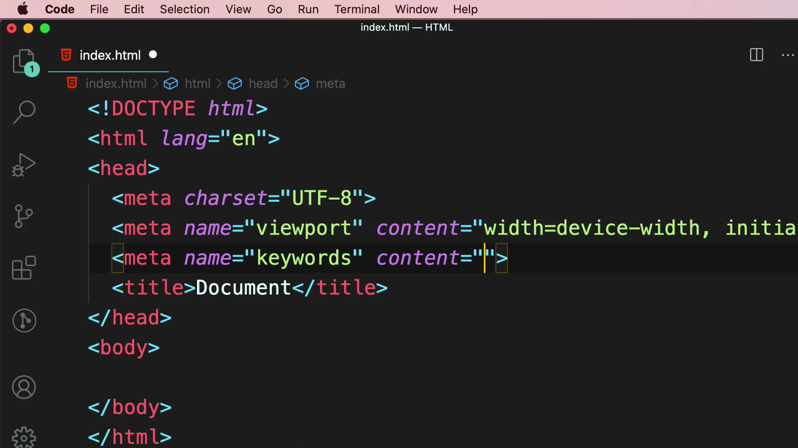

จากนั้นเติมค่า content เป็น `"HTML, CSS"`:

```html
<meta name="keywords" content="HTML, CSS">
```

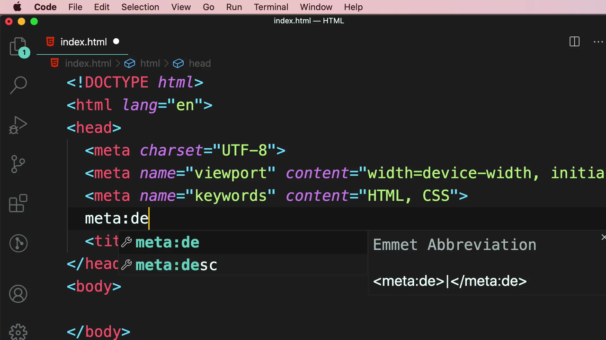

Mosh อธิบายว่า tag นี้ใช้ระบุ**คำค้นหา (keywords)** ที่เกี่ยวข้องกับหน้าเว็บ เพื่อช่วยให้ search engine เข้าใจเนื้อหาของหน้านั้นๆ

> **หมายเหตุปัจจุบัน:** ในทางปฏิบัติ Google และ search engine หลักๆ ในปัจจุบัน**ไม่ได้ใช้ `meta keywords` ในการจัดอันดับผลการค้นหาแล้ว** (เพราะเคยถูกใช้สแปมคำค้นหามากเกินไปในอดีต) แต่ยังคงมีประโยชน์สำหรับ search engine บางระบบ หรือใช้เป็นข้อมูลอ้างอิงภายในองค์กร

---

## 6. เพิ่ม `<meta name="description">` และสาธิตผลกับ Google Search

Mosh พิมพ์ต่อด้วย Emmet abbreviation `meta:de` เพื่อสร้างบรรทัด description อย่างรวดเร็ว

ก่อนเติมโค้ด Mosh สลับไปที่ Chrome และค้นหาคำว่า **"apple"** ใน Google เพื่อโชว์ตัวอย่างผลลัพธ์การค้นหาจริง:

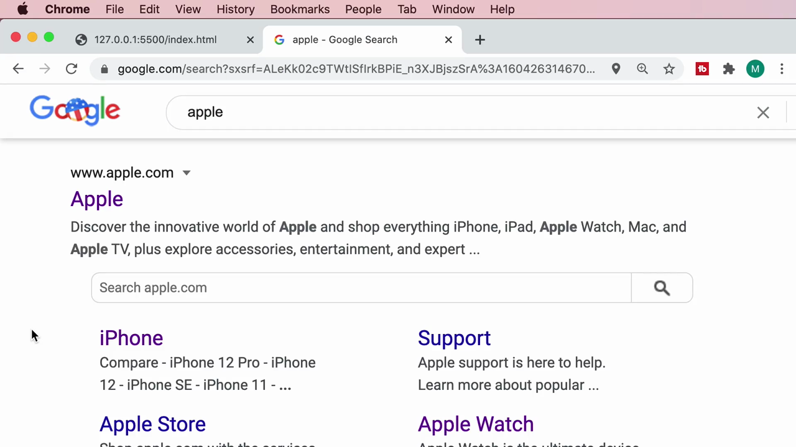

Mosh ชี้ให้เห็นว่าข้อความสีน้ำเงิน **"Apple"** ที่เห็นในผลการค้นหาคือค่าจาก `<title>` ของหน้านั้น ส่วนข้อความสีเทาด้านล่าง (*"Discover the innovative world of Apple and shop everything iPhone, iPad, Apple Watch, Mac, and Apple TV..."*) คือค่าจาก **`<meta name="description">`** ของหน้านั้นเอง — นี่คือสิ่งที่ผู้ใช้เห็นก่อนคลิกเข้าเว็บไซต์ จึงมีผลโดยตรงต่อ **SEO (Search Engine Optimization)** และอัตราการคลิก (click-through rate)

กลับมาที่ VS Code แล้วเติมโค้ด:

```html
<meta name="description" content="...">
```

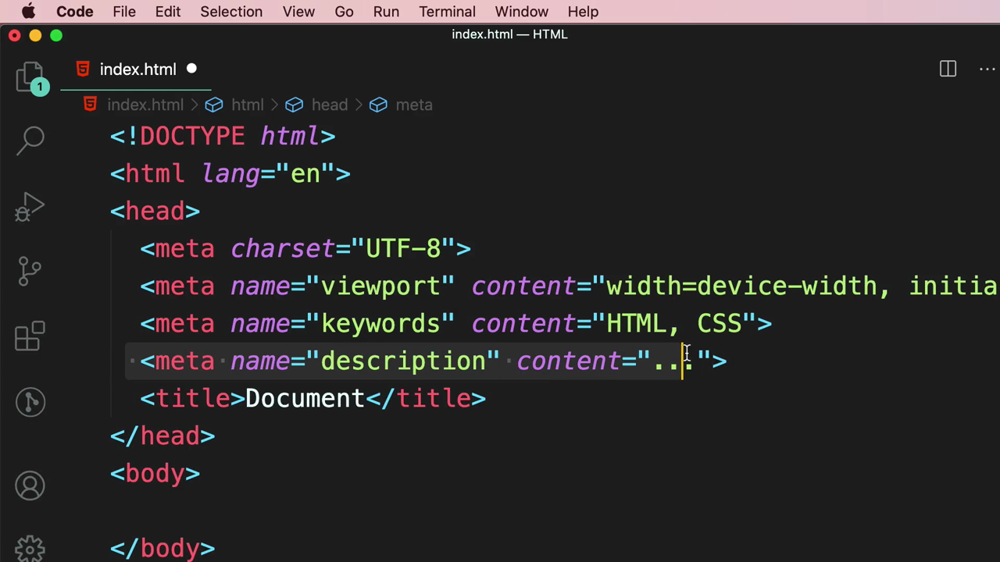

---

## สรุปโครงสร้าง `<head>` ทั้งหมดที่ได้จากคลิปนี้

```html
<!DOCTYPE html>
<html lang="en">
<head>
    <meta charset="UTF-8">
    <meta name="viewport" content="width=device-width, initial-scale=1.0">
    <meta name="keywords" content="HTML, CSS">
    <meta name="description" content="...">
    <title>Document</title>
</head>
<body>

</body>
</html>
```

| Tag | หน้าที่ |
|---|---|
| `<meta charset="UTF-8">` | กำหนดชุดตัวอักษรของเอกสาร ให้รองรับตัวอักษรทุกภาษารวมถึงภาษาไทย |
| `<meta name="viewport">` | ควบคุมการแสดงผลบนอุปกรณ์มือถือ/แท็บเล็ต (responsive) |
| `<meta name="keywords">` | ระบุคำค้นหาที่เกี่ยวข้องกับหน้า (ผลต่อ SEO น้อยลงในปัจจุบัน) |
| `<meta name="description">` | คำอธิบายสั้นๆ ของหน้า ที่แสดงในผลการค้นหา (มีผลต่อ SEO และ click-through rate) |
| `<title>` | ชื่อหัวข้อของหน้า แสดงบน tab ของ browser และเป็นหัวข้อสีน้ำเงินในผลการค้นหา |

---

## สรุปที่ใช้ได้จริง

- ทุก `<meta>` tag ในส่วน `<head>` เป็นข้อมูล "เบื้องหลัง" ที่ผู้ใช้ไม่เห็นโดยตรงในหน้าเว็บ แต่มีผลต่อการแสดงผลและ SEO
- `charset="UTF-8"` ควรใส่เสมอเป็นบรรทัดแรกสุดใน `<head>` เพื่อป้องกันปัญหาตัวอักษรเพี้ยน
- `viewport` meta tag เป็นสิ่งจำเป็นสำหรับเว็บที่ต้อง responsive (แสดงผลถูกต้องบนมือถือ)
- `description` มีผลโดยตรงต่อสิ่งที่คนเห็นในผลการค้นหา Google ก่อนตัดสินใจคลิกเข้าเว็บ

### จุดเชื่อมกับงานจริงของ Aum

- ใน Next.js เวลาสร้างหน้า (page) หรือใช้ App Router, ค่าพวกนี้ทั้งหมด (`charset`, `viewport`, `description`, `keywords`, `title`) ถูกจัดการผ่าน **`metadata` object** ใน `layout.tsx` / `page.tsx` เช่น:
  ```tsx
  export const metadata = {
    title: "My Landing Page",
    description: "...",
    keywords: "HTML, CSS, Next.js",
  }
  ```
  Next.js จะ generate `<meta>` tags พวกนี้ให้อัตโนมัติจาก object นี้ — เข้าใจพื้นฐาน HTML ตรงนี้จะช่วยให้เข้าใจว่า Next.js metadata API generate อะไรออกมาบ้าง
- `viewport` meta tag สำคัญมากสำหรับงาน Tailwind CSS ที่ Aum ใช้ทำ responsive design (breakpoints อย่าง `sm:`, `md:`, `lg:`) — ถ้าไม่มี viewport tag ที่ถูกต้อง responsive classes ของ Tailwind จะทำงานไม่ตรงตามที่คาดหวังบนมือถือจริง
- การใส่ `description` ที่ดีสำคัญมากสำหรับ landing page ที่ Aum กำลังฝึกทำ เพราะมีผลโดยตรงต่อการที่คนจะคลิกเข้าเว็บจากผลการค้นหา Google
