# 3-HTML Basics: 03 - Text (6:40)

**ไฟล์ต้นทาง:** `03-Text.mp4`

▶️ **[เปิดวิดีโอต้นฉบับ](../../../HTML-CSS-1/3-HTML%20Basics/03-Text.mp4)**

---

## ภาพรวมคลิปนี้

คลิปนี้ Mosh สอนเรื่อง **text-related elements** ใน HTML สองกลุ่มหลัก:

1. **Inline text elements** สำหรับเน้นข้อความ: `<em>`, `<i>`, `<strong>`, `<b>`
2. **Heading elements**: `<h1>` ถึง `<h6>` และแนวคิดเรื่อง **document outline / semantic structure**

โดยใช้ตัวอย่างประโยค "I love to teach you HTML!" ต่อยอดจากคลิปก่อนหน้า แล้วค่อยๆ ขยายเป็นตัวอย่างหน้าเว็บจริงที่มีโครงสร้าง heading อย่างมีความหมาย

---

## 1. เริ่มต้นด้วย `<p>` และพิมพ์ข้อความด้วย Emmet

Mosh พิมพ์ `<p>I lo` ซึ่ง Emmet เสนอ suggestion `lorem` (คำสั่งสร้างข้อความ placeholder แบบ Lorem Ipsum) ขึ้นมาโดยอัตโนมัติ แต่ Mosh เลือกพิมพ์ข้อความของตัวเองต่อแทน

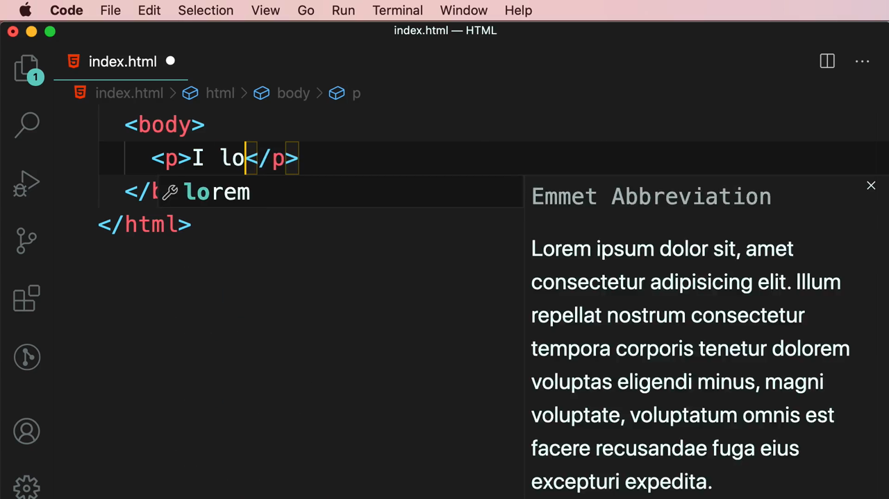

พิมพ์ต่อจนได้ข้อความเต็ม:

```html
<p>I love to teach you HTML</p>
```

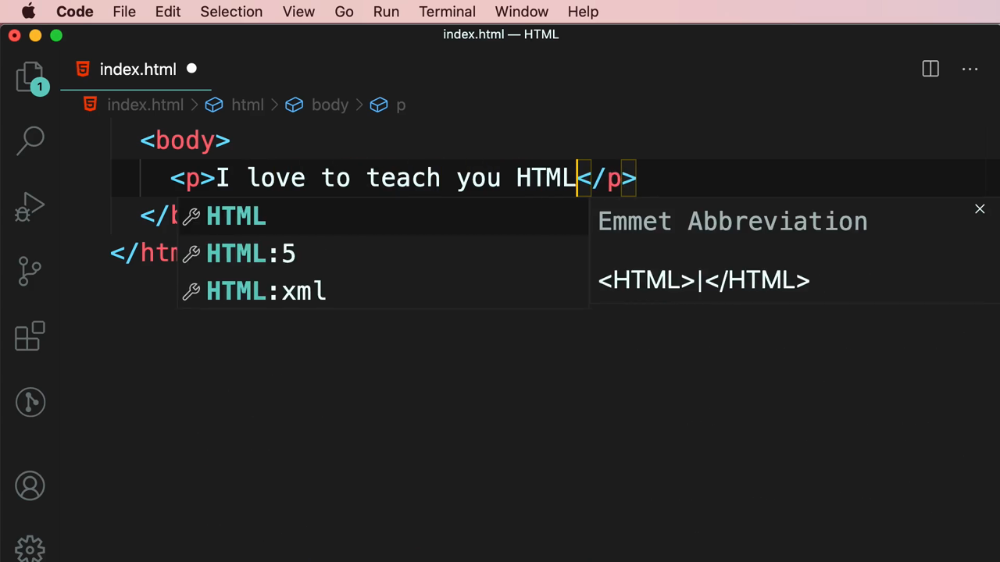

เมื่อเปิดดูใน browser ตอนนี้ยังเป็นข้อความธรรมดาไม่มีการเน้น:

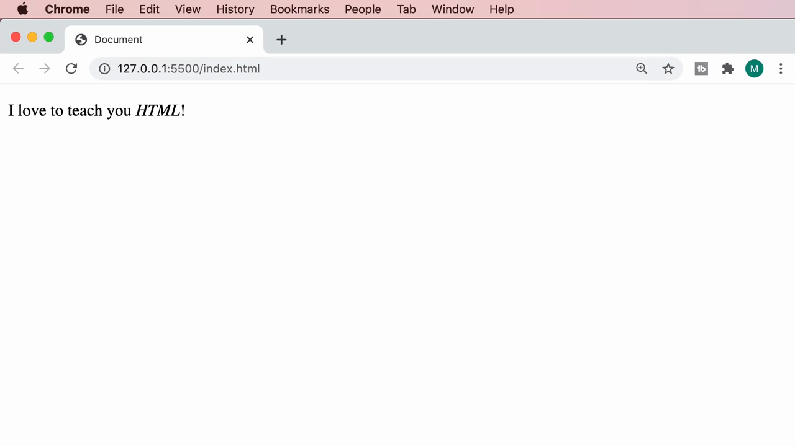

---

## 2. `<em>` — Emphasis (การเน้นความหมาย)

Mosh ครอบคำว่า "HTML" ด้วยแท็ก `<em>` เพื่อเน้นคำนี้:

```html
<p>I love to teach you <em>HTML</em>!</p>
```

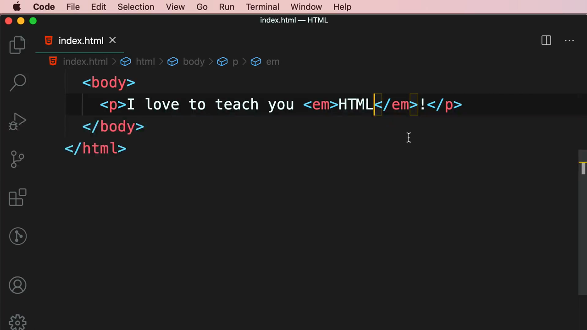

**ผลลัพธ์เริ่มต้น (default browser style):** `<em>` จะแสดงผลเป็น**ตัวเอียง (italic)** โดยอัตโนมัติ

> **ประเด็นสำคัญ:** `<em>` คือ tag เชิง**ความหมาย (semantic)** — มันบอกว่าคำนี้ "สำคัญ/ถูกเน้น" ในเชิงเนื้อหา ส่วนการแสดงผลเป็นตัวเอียงเป็นเพียง**ค่าเริ่มต้น (default styling)** ของ browser เท่านั้น สามารถเปลี่ยนได้ด้วย CSS

### พิสูจน์ว่า `<em>` แยกจากการแสดงผล — ใช้ CSS ปรับแต่ง

Mosh เพิ่ม `<style>` block ใน `<head>` แล้วเขียน CSS เลือก selector `em`:

```css
em {
    color: red;
}
```

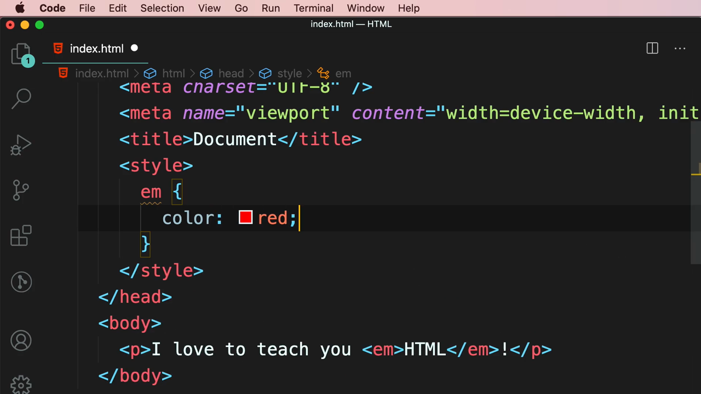

จากนั้นเพิ่ม property `font-style` และพิมพ์ `normal` (มี IntelliSense อธิบายว่า "Allows italic or oblique faces to be selected...") เพื่อ**ยกเลิกความเอียง**:

```css
em {
    color: red;
    font-style: normal;
}
```

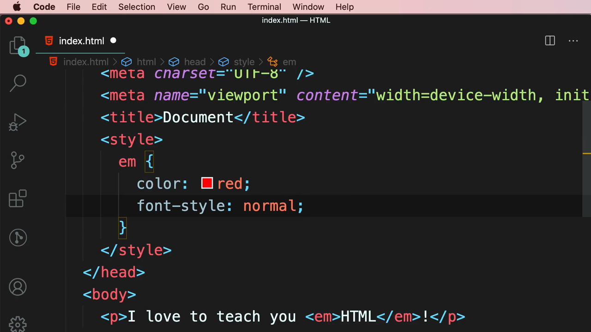

ผลลัพธ์ใน browser: คำว่า "HTML" กลายเป็น**สีแดงแต่ไม่เอียง**แล้ว — พิสูจน์ชัดเจนว่า `<em>` เป็นเรื่องความหมาย ไม่ใช่เรื่องรูปลักษณ์:

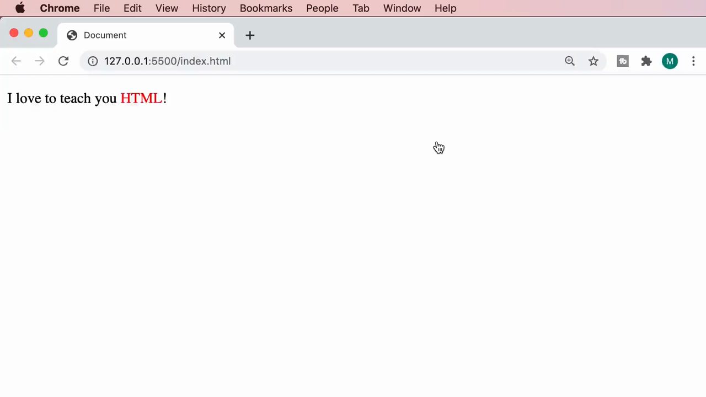

จากนั้น Mosh ลบ `<style>` block ทิ้งเพื่อกลับไปดูค่า default อีกครั้ง (สีดำ ตัวเอียง):

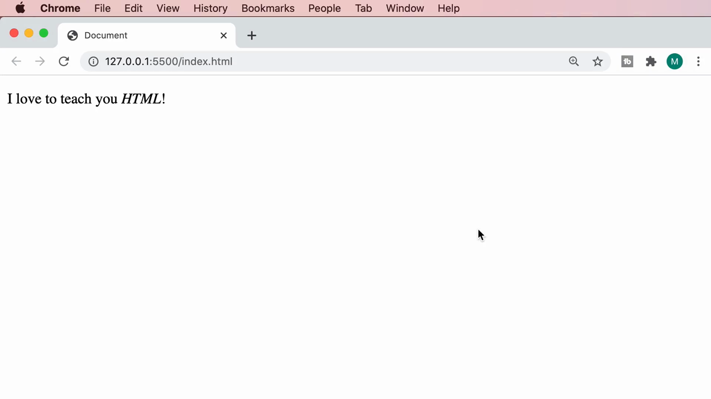

---

## 3. `<i>` — Italic (ตัวเอียงเชิงภาพล้วนๆ)

Mosh เปลี่ยนจาก `<em>` เป็น `<i>`:

```html
<p>I love to teach you <i>HTML</i>!</p>
```

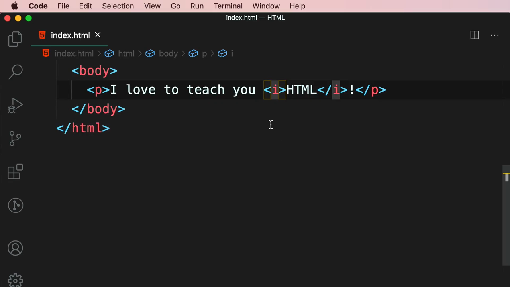

ผลลัพธ์ใน browser **เหมือนกันทุกประการ** กับ `<em>` (ตัวเอียง) เพราะทั้งสอง tag มี default style เดียวกัน

> **ความแตกต่างที่แท้จริงระหว่าง `<em>` กับ `<i>`:**
> - **`<em>`** = เน้นความหมาย (semantic emphasis) — screen reader จะอ่านเน้นเสียงคำนี้ และมีความหมายต่อ SEO/accessibility
> - **`<i>`** = ตัวเอียงเชิงภาพล้วนๆ (purely visual/stylistic) — ไม่มีความหมายพิเศษ เหมาะกับกรณีเช่น ชื่อเรื่องหนังสือ, คำศัพท์ภาษาต่างประเทศ, หรือความคิดในใจตัวละคร ที่ต้องการแค่ตัวเอียงโดยไม่ต้องการ "เน้นความสำคัญ"

---

## 4. `<strong>` และ `<b>` — Strong Importance vs Bold

Mosh เปลี่ยนเป็น `<strong>` และ VS Code แสดง IntelliSense tooltip อธิบายความหมายอย่างชัดเจน:

> **"The strong element represents strong importance, seriousness, or urgency for its contents."**
> (แท็ก strong ใช้แสดงถึงความสำคัญ ความจริงจัง หรือความเร่งด่วนของเนื้อหาข้างใน)

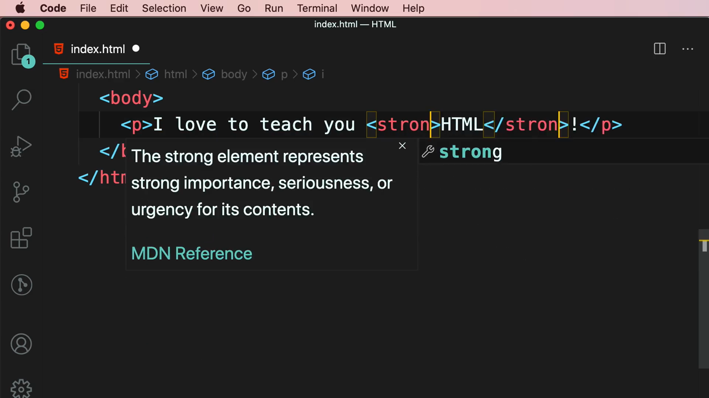

```html
<p>I love to teach you <strong>HTML</strong>!</p>
```

ผลลัพธ์ใน browser: คำว่า "HTML" แสดงเป็น**ตัวหนา (bold)** โดยอัตโนมัติ:

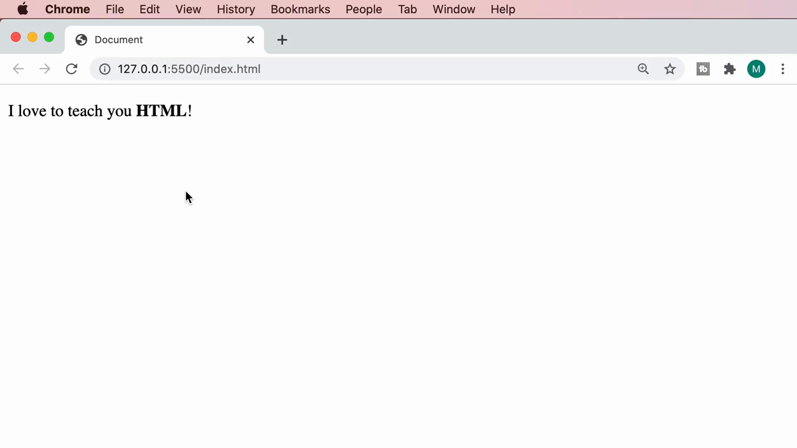

> **เช่นเดียวกับ em/i:** `<strong>` (semantic, สำคัญ) ต่างจาก `<b>` (purely visual, ตัวหนาธรรมดา) ในลักษณะเดียวกับที่ `<em>` ต่างจาก `<i>`

### สรุปคู่เปรียบเทียบ

| Semantic (มีความหมาย) | Visual only (ภาพล้วนๆ) | ผลลัพธ์ default |
|---|---|---|
| `<em>` | `<i>` | ตัวเอียง (italic) |
| `<strong>` | `<b>` | ตัวหนา (bold) |

---

## 5. Emmet: Wrap with Abbreviation

Mosh สาธิตวิธีลัดในการครอบ tag รอบข้อความที่เลือกไว้แล้ว โดยลบ tag ที่มีอยู่ทั้งหมดออกก่อน เหลือแค่ข้อความธรรมดา "I love to teach you HTML!" จากนั้นเลือกคำว่า "HTML" แล้วเปิด **Command Palette** (`View` → `Command Palette...` หรือ `⇧⌘P`) และเลือกคำสั่ง **"Emmet: Wrap with Abbreviation"**

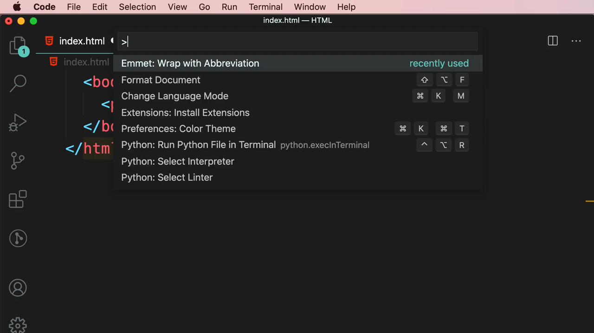

จากนั้นพิมพ์ชื่อ tag ที่ต้องการ (เช่น `em`) กด Enter ระบบจะครอบข้อความที่เลือกไว้ด้วย tag นั้นให้อัตโนมัติ — เป็นวิธีที่เร็วกว่าการพิมพ์ opening/closing tag เองทีละตัว โดยเฉพาะเมื่อมีข้อความยาวๆ ที่ต้องการครอบ

---

## 6. Heading Elements: `<h1>` ถึง `<h6>`

Mosh เพิ่ม heading ทีละระดับเหนือ paragraph เดิม:

```html
<h1>Heading 1</h1>
<h2>Heading 2</h2>
<h3>Heading 3</h3>
<h4>Heading 4</h4>
<h5>Heading 5</h5>
<h6>Heading 6</h6>
<p>I love to teach you <em>HTML</em>!</p>
```

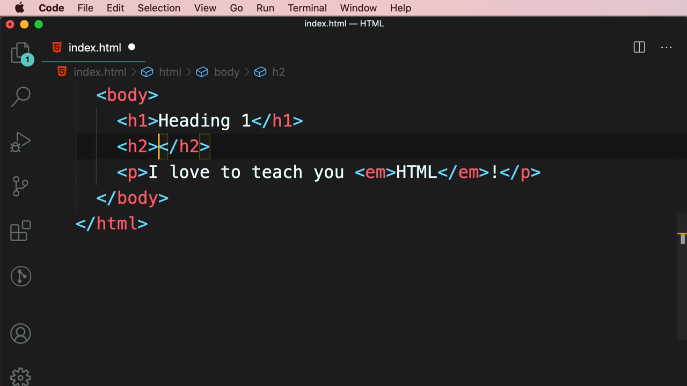

ผลลัพธ์ใน browser แสดงให้เห็นขนาดตัวอักษรที่**ลดหลั่นกันตามลำดับ** จาก h1 (ใหญ่สุด ตัวหนา) ไปจนถึง h6 (เล็กสุด):

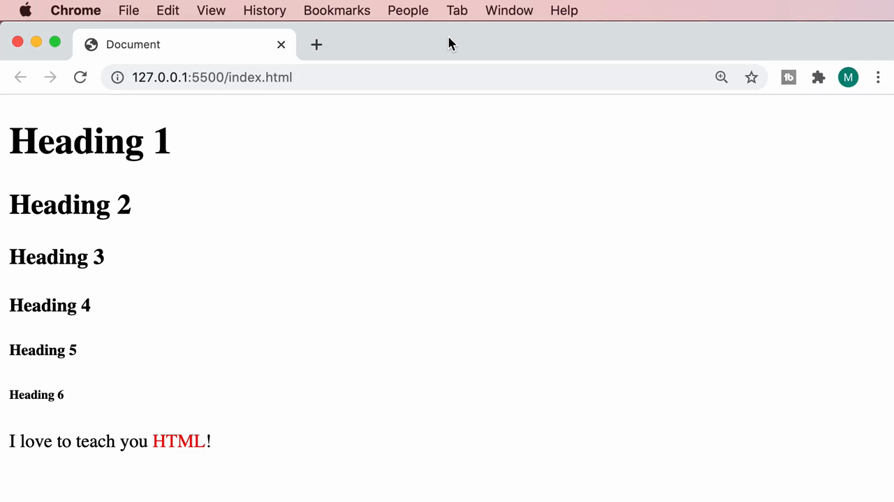

> **หน้าที่ของ heading:** ใช้กำหนด**หัวข้อ/หัวเรื่อง**ของเนื้อหาแต่ละส่วน โดย `<h1>` คือหัวข้อหลักที่สำคัญที่สุดของหน้า ลดหลั่นไปจนถึง `<h6>` ที่เป็นหัวข้อย่อยระดับลึกสุด

### ทดลอง: มี `<h1>` สองอันในหน้าเดียวกันได้ไหม?

Mosh ลองเพิ่ม `<h1>` อันที่สอง (ข้อความ "Heading 1+") ต่อจาก h1 อันแรก

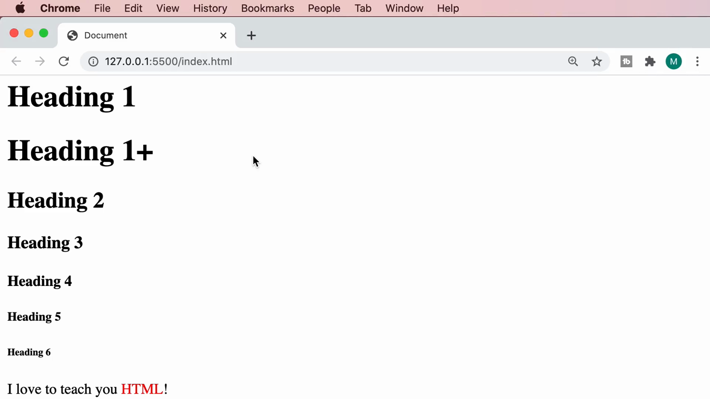

ผลลัพธ์: เบราว์เซอร์**ไม่ error** และแสดงผลได้ปกติ (ขนาดตัวอักษรเท่ากันทั้งคู่) — ในทางเทคนิค HTML **อนุญาต**ให้มี `<h1>` หลายอันได้

> **ข้อควรระวังเชิง semantic/SEO:** แม้ HTML จะอนุญาตให้มีหลาย `<h1>` แต่โดยแนวปฏิบัติที่ดี (best practice) **ควรมี `<h1>` เพียงอันเดียวต่อหน้า** เพื่อสื่อสารว่านี่คือหัวข้อหลักของหน้านั้นอย่างชัดเจนต่อทั้งผู้ใช้ (โดยเฉพาะผู้ใช้ screen reader) และ search engine (SEO)

จากนั้น Mosh ลบ `<h1>` ที่ซ้ำออก กลับไปเหลือ h1 เดียว

---

## 7. Document Outline — โครงสร้างหัวข้อที่มีความหมายจริง

ส่วนสำคัญที่สุดของคลิปนี้คือการแสดงให้เห็นว่า heading ไม่ได้มีไว้ "ทำตัวอักษรให้ใหญ่/หนา" แต่มีไว้สร้าง**โครงสร้างเอกสาร (document outline)** ที่มีความหมายจริง

Mosh ค่อยๆ ปรับเนื้อหาให้เป็นตัวอย่างที่สมจริง:

```html
<h1>Heading 1</h1>
<h2>HTML</h2>
<p>HTML tutorial</p>
<h2>CSS</h2>
<p>CSS tutorial</p>
<p>I love to teach you <em>HTML</em>!</p>
```

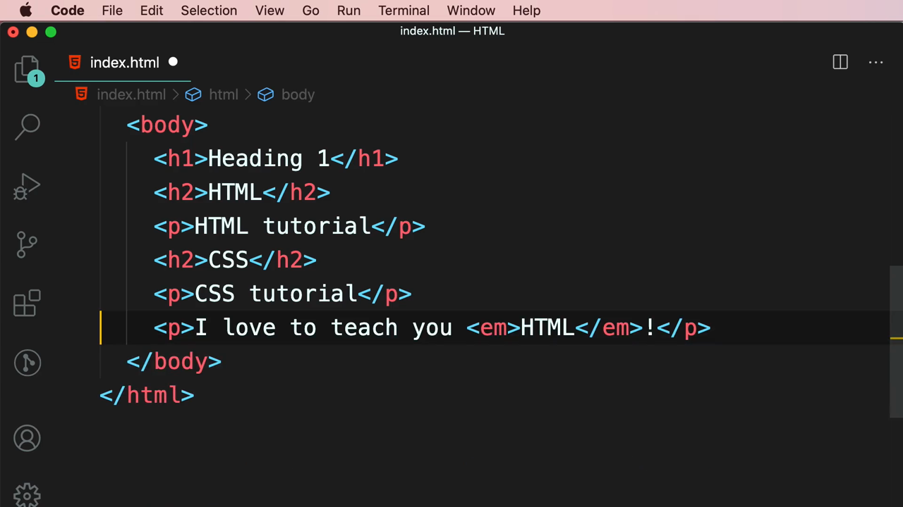

ผลลัพธ์ใน browser แสดงให้เห็นโครงสร้างที่มีลำดับชั้นชัดเจน: h1 เป็นหัวข้อใหญ่สุด, h2 สองอัน ("HTML" และ "CSS") เป็นหัวข้อย่อยระดับถัดมา แต่ละอันมี paragraph อธิบายตามมา:

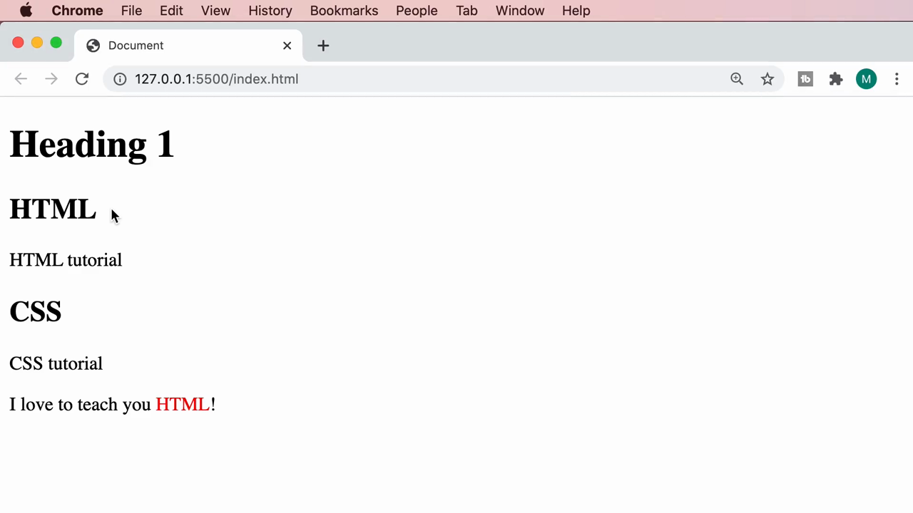

### เพิ่มระดับย่อยลงไปอีกด้วย `<h3>`

Mosh เพิ่ม `<h3>Code</h3>` และ `<h3>Exercise</h3>` เป็นหัวข้อย่อยภายใต้ section "HTML" (h2) เพื่อแสดงว่าสามารถซ้อนลำดับชั้นได้ลึกขึ้นเรื่อยๆ:

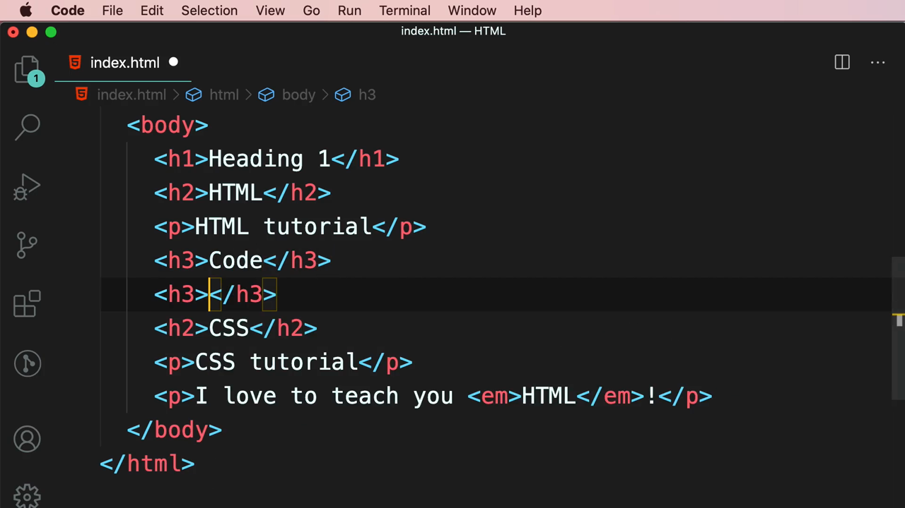

ผลลัพธ์สุดท้ายใน browser แสดงโครงสร้างแบบลำดับชั้นที่สมบูรณ์:

```
Heading 1                 (h1)
  HTML                    (h2)
    HTML tutorial         (p)
    Code                  (h3)
    Exercise              (h3)
  CSS                     (h2)
    CSS tutorial          (p)
I love to teach you HTML! (p)
```

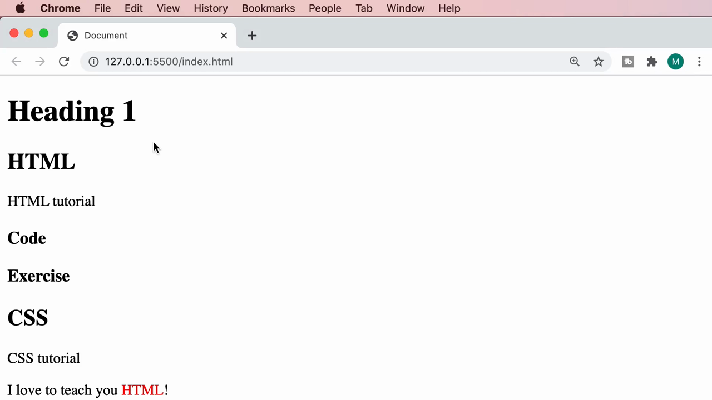

---

## สรุปที่ใช้ได้จริง

- **Semantic vs Visual tags:** `<em>`/`<strong>` สื่อความหมาย ส่วน `<i>`/`<b>` เป็นแค่การจัดรูปแบบภาพ — ควรเลือกใช้ semantic tag เป็นหลักเพื่อประโยชน์ด้าน accessibility และ SEO เว้นแต่ต้องการตัวเอียง/หนาแบบไม่มีความหมายพิเศษจริงๆ
- **Heading ไม่ใช่เครื่องมือจัดฟอนต์:** อย่าใช้ `<h3>` แค่เพราะ "อยากได้ตัวอักษรขนาดนี้" — ให้ใช้ CSS ปรับขนาดฟอนต์แทน แล้วเลือก heading level ตาม**ความสำคัญเชิงโครงสร้าง**ของเนื้อหาจริงๆ
- **ควรมี `<h1>` เดียวต่อหน้า** แม้ HTML จะไม่บังคับ แต่เป็น best practice สำหรับ SEO และ accessibility
- **Emmet "Wrap with Abbreviation"** (`⇧⌘P` → พิมพ์ "wrap") เป็นเครื่องมือลัดที่มีประโยชน์มากเมื่อต้องครอบ tag รอบข้อความที่มีอยู่แล้ว

### จุดเชื่อมกับงานจริงของ Aum

- ใน React/Next.js เวลาเขียน component เรามักจะเผลอใช้ `<div>` หรือ `<span>` ทุกอย่างแล้วจัดการด้วย Tailwind classes ล้วนๆ — แต่การเลือกใช้ `<h1>`-`<h6>`, `<strong>`, `<em>` ที่ถูกต้องเชิงความหมายยังคงสำคัญมากสำหรับ **SEO และ accessibility** ของหน้าเว็บจริง แม้จะจัด styling ด้วย Tailwind ก็ตาม
- ตัวอย่าง document outline (h1 > h2 > h3) ในคลิปนี้ตรงกับการวางโครงสร้างของ landing page จริง: Hero section เป็น h1, แต่ละ feature section เป็น h2, หัวข้อย่อยในนั้นเป็น h3 — ควรวางแผนโครงสร้างนี้ไว้ตั้งแต่ต้นก่อนเริ่มจัด layout ด้วย Tailwind
- แนวคิด "separate meaning from styling" (เช่น `em` ที่ปรับสีด้วย CSS ได้อิสระจาก default) ตรงกับหลักการเขียน Tailwind ที่ดี: ใช้ tag ที่ถูกต้องเชิงความหมาย แล้วค่อยควบคุมหน้าตาด้วย utility classes แยกต่างหาก
