# 3-HTML Basics: 04 - Entities (3:29)

**ไฟล์ต้นทาง:** `04-Entities.mp4`

▶️ **[เปิดวิดีโอต้นฉบับ](../../../HTML-CSS-1/3-HTML%20Basics/04-Entities.mp4)**

---

## ภาพรวมคลิปนี้

คลิปนี้ Mosh สอนเรื่อง **HTML Entities (ตัวอักขระพิเศษ)** — วิธีแสดงผลอักขระที่มีความหมายพิเศษในภาษา HTML (เช่น `<`, `>`) ให้ปรากฏเป็นข้อความธรรมดาบนหน้าเว็บ แทนที่จะถูกตีความเป็นส่วนหนึ่งของ tag แล้วปิดท้ายด้วยเทคนิค Emmet เสริมสำหรับสร้างข้อความ placeholder (`lorem`)

---

## 1. ปัญหา: พิมพ์ `<` `>` ตรงๆ แล้วมันหายไปไหน?

Mosh เริ่มจากโค้ดเดิม `<p>I love to teach you HTML!</p>` แล้วลองแก้คำว่า "HTML" ให้เป็น `<HTML>` (ใส่เครื่องหมาย `<` `>` ล้อมรอบตรงๆ):

```html
<p>I love to teach you <HTML>!</p>
```

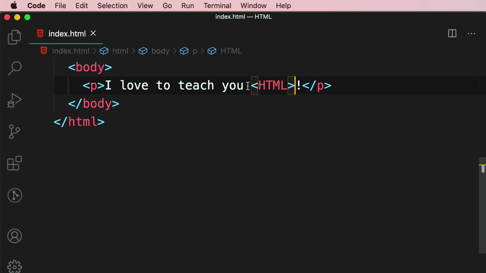

ผลลัพธ์ใน browser: คำว่า "HTML" **หายไปทั้งหมด** เหลือแค่ "I love to teach you !"

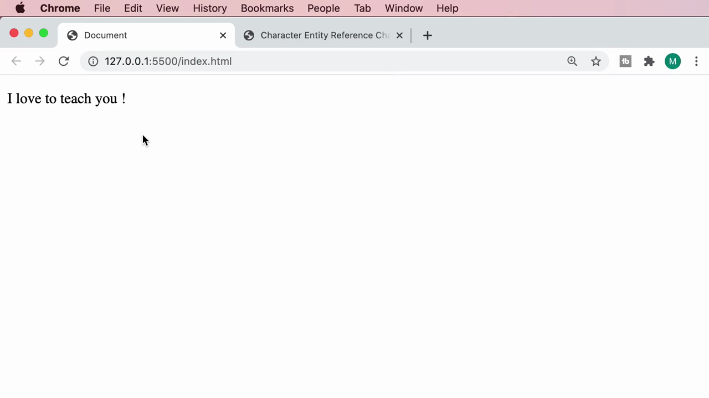

> **สาเหตุ:** เบราว์เซอร์มองว่า `<HTML>` คือ**แท็ก HTML** ตัวหนึ่ง (แม้จะเป็นแท็กที่ไม่รู้จัก) จึงไม่แสดงมันเป็นข้อความ แต่พยายามตีความเป็นโครงสร้างเอกสารแทน — นี่คือปัญหาคลาสสิกเวลาต้องการพิมพ์เครื่องหมาย `<` หรือ `>` ให้ปรากฏเป็นตัวอักษรจริงๆ บนหน้าเว็บ

---

## 2. ทางแก้: ใช้ HTML Entities `&lt;` และ `&gt;`

Mosh แทนที่เครื่องหมาย `<` ด้วย entity **`&lt;`** โดยพิมพ์แล้ว VS Code แสดง IntelliSense อธิบายทันที:

> **"Character entity representing '<'"**

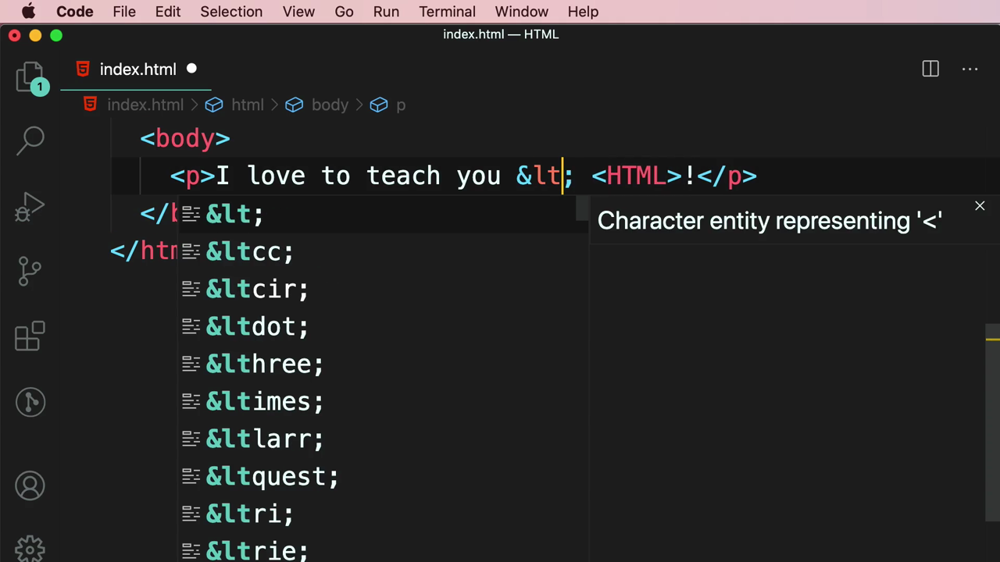

จากนั้นแทนที่เครื่องหมาย `>` ด้วย entity **`&gt;`**:

> **"Character entity representing '>'"**

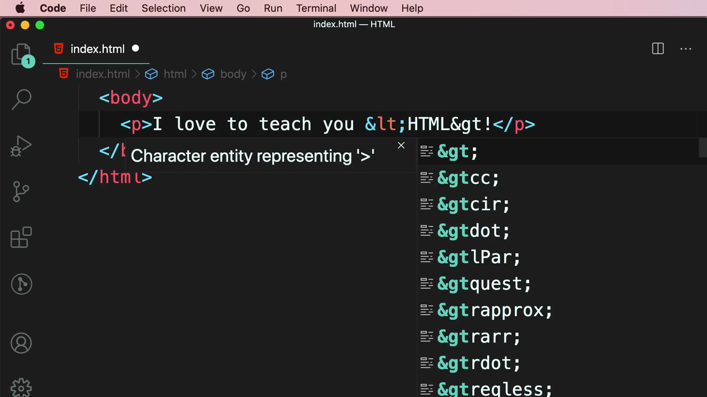

โค้ดสุดท้าย:

```html
<p>I love to teach you &lt;HTML&gt;!</p>
```

ผลลัพธ์ใน browser: ตอนนี้แสดงข้อความ **"I love to teach you <HTML>!"** ได้ถูกต้องแล้ว — เครื่องหมาย `<` `>` ปรากฏเป็นตัวอักษรจริงๆ ไม่ถูกตีความเป็น tag:

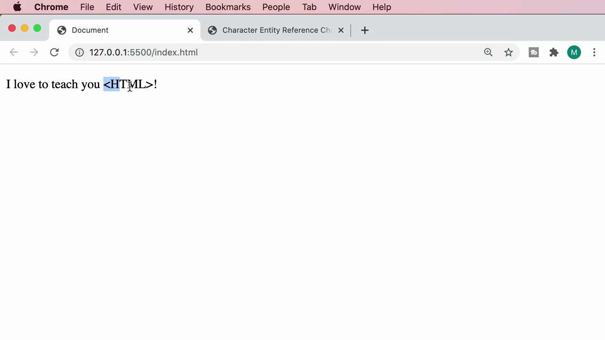

> **หลักการของ HTML Entity:** เขียนในรูปแบบ `&ชื่อ;` (ขึ้นต้นด้วย `&` ลงท้ายด้วย `;`) เบราว์เซอร์จะแปลงกลับเป็นอักขระจริงตอนแสดงผล ใช้สำหรับอักขระที่มีความหมายพิเศษในไวยากรณ์ HTML (`<`, `>`, `&`) หรืออักขระที่พิมพ์จากคีย์บอร์ดโดยตรงไม่ได้ (เช่น สัญลักษณ์ลิขสิทธิ์)

### ตัวอย่างเพิ่มเติม: `&copy;`

Mosh เพิ่มอีกหนึ่ง entity ต่อท้ายประโยค — **`&copy;`** ซึ่งแสดงผลเป็นสัญลักษณ์ลิขสิทธิ์ **©**:

```html
<p>I love to teach you &lt;HTML&gt;! &copy;</p>
```

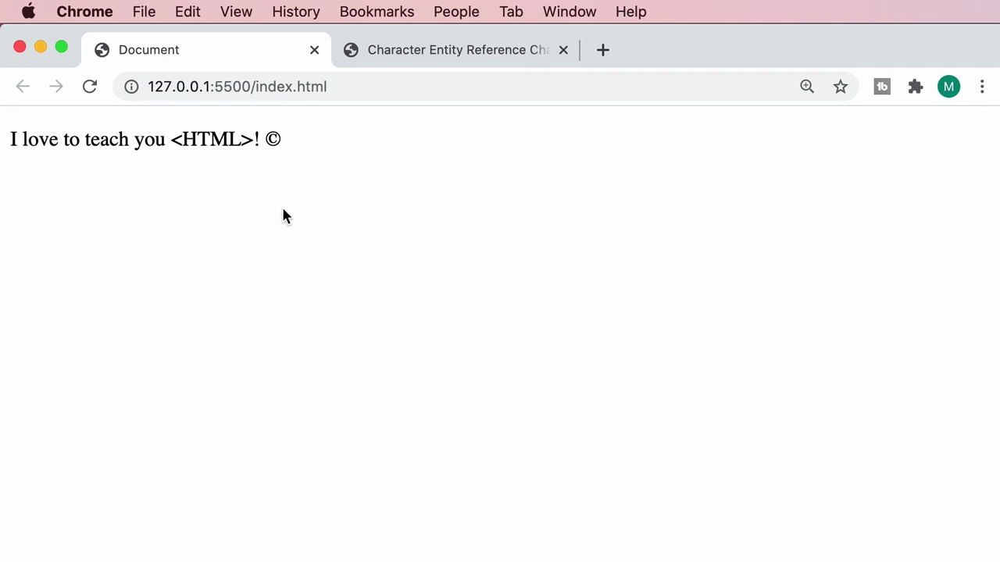

---

## 3. ค้นหารายการ Entity ทั้งหมดด้วย Google

เนื่องจากมี entity อยู่หลายร้อยตัว Mosh สาธิตวิธีค้นหารายการทั้งหมดผ่าน Google ด้วยคำค้น **"html entities"**:

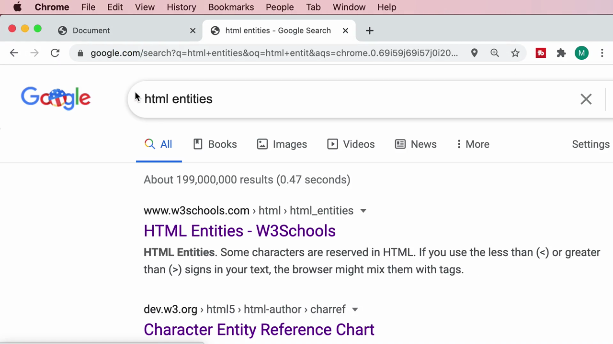

ผลการค้นหาแนะนำสองแหล่งอ้างอิงหลัก:
- **HTML Entities - W3Schools** — คำอธิบาย: *"Some characters are reserved in HTML. If you use the less than (<) or greater than (>) signs in your text, the browser might mix them with tags."*
- **Character Entity Reference Chart** (dev.w3.org) — ตารางรายการ entity แบบสมบูรณ์

Mosh เปิดหน้า **Character Entity Reference Chart** ซึ่งแสดง entity ทุกตัวเป็นตารางภาพ พร้อมชื่อ entity กำกับใต้แต่ละสัญลักษณ์:

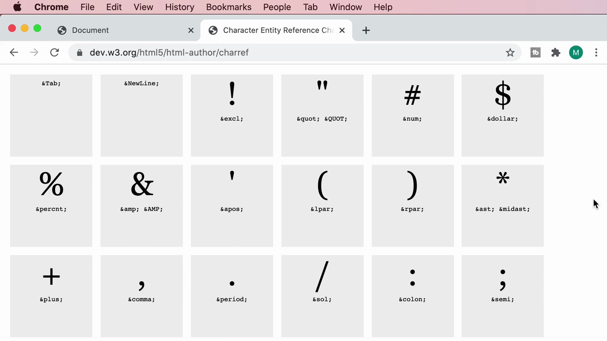

เมื่อเลื่อนลงมาจะเห็น entity คุ้นเคยอย่าง `&lt;` `&gt;` `&equals;` `&quest;` `&commat;` (@) และอื่นๆ อีกมากมาย:

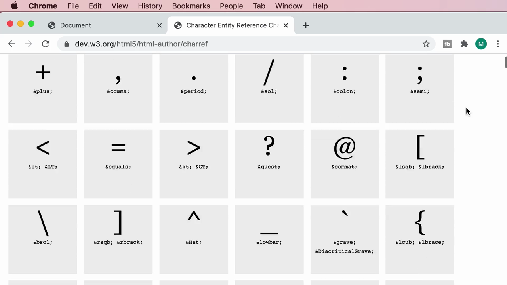

> **หมายเหตุ:** ตารางนี้มี entity รวมกว่า 2,000 รายการ ครอบคลุมทั้งสัญลักษณ์พื้นฐาน (เครื่องหมายวรรคตอน, คณิตศาสตร์) ไปจนถึงตัวอักษรของภาษาอื่นๆ (เช่น ตัวอักษรมีเครื่องหมายกำกับในภาษายุโรป, ตัวอักษรซีริลลิก) — ไม่จำเป็นต้องจำทั้งหมด แค่รู้วิธีค้นหาเมื่อต้องการใช้ก็เพียงพอ

---

## 4. เทคนิคเสริม: Emmet `lorem` สำหรับสร้างข้อความ placeholder

Mosh สาธิตวิธีลัดของ Emmet ที่เคยเห็นตอนต้นคลิปก่อนหน้าแต่ยังไม่ได้ใช้จริง — การพิมพ์ **`lorem`** ใน tag แล้วกด Tab จะสร้างข้อความ Lorem Ipsum (ข้อความ placeholder มาตรฐานที่ใช้ในวงการออกแบบ/พัฒนาเว็บ) ให้อัตโนมัติ

หากต้องการกำหนด**จำนวนคำ**ที่แน่นอน สามารถพิมพ์ตัวเลขต่อท้ายได้ เช่น **`lorem5`** จะสร้างข้อความยาว 5 คำพอดี:

> Lorem ipsum dolor sit amet.

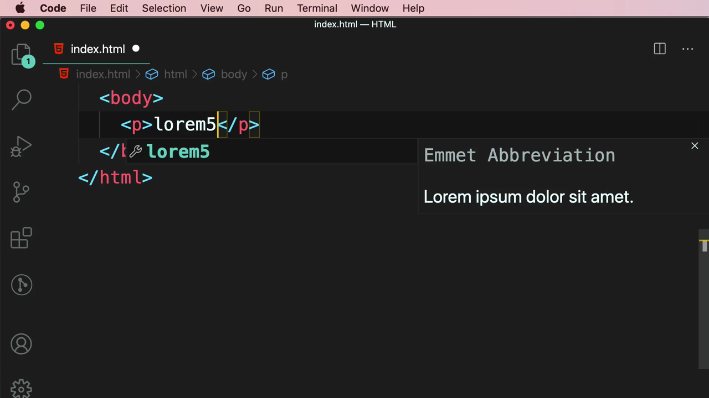

ถ้าพิมพ์แค่ `lorem` เฉยๆ (ไม่ใส่ตัวเลข) จะได้ข้อความความยาวมาตรฐาน (ประมาณ 1 ย่อหน้า) แบบสุ่มทุกครั้งที่เรียกใช้:

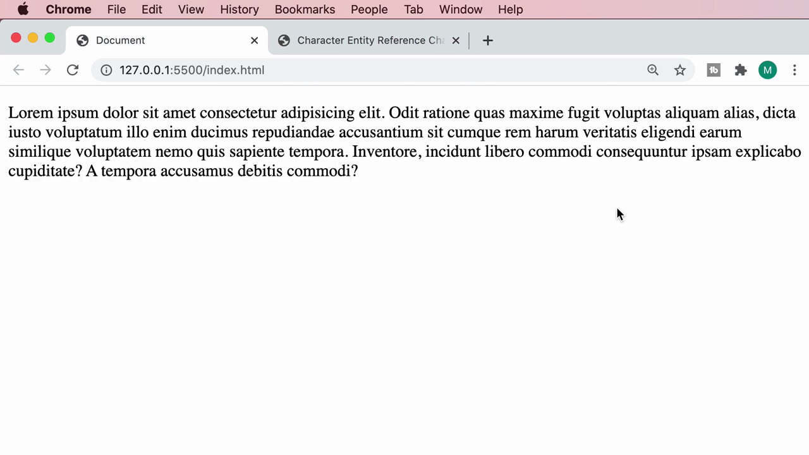

---

## สรุปที่ใช้ได้จริง

- **HTML Entity syntax:** `&ชื่อ;` — ต้องมีทั้ง `&` นำหน้าและ `;` ปิดท้ายเสมอ ลืม `;` แล้ว entity จะไม่ทำงาน
- Entity ที่ใช้บ่อยที่สุด: `&lt;` (`<`), `&gt;` (`>`), `&amp;` (`&`), `&quot;` (`"`), `&apos;` (`'`), `&copy;` (©), `&nbsp;` (non-breaking space)
- เมื่อไม่แน่ใจชื่อ entity ให้ค้นหา "html entities" ใน Google หรือเปิดหน้า Character Entity Reference Chart ได้เลย
- `lorem` (Emmet) เป็นเครื่องมือที่มีประโยชน์มากเวลาต้องการ mockup เนื้อหาเร็วๆ โดยไม่ต้องคิดข้อความเอง — ใส่ตัวเลขต่อท้ายเพื่อกำหนดจำนวนคำที่ต้องการ

### จุดเชื่อมกับงานจริงของ Aum

- ใน JSX/TSX ของ React/Next.js การใส่ตัวอักษรพิเศษต้องระวังเช่นกัน — เช่นการแสดง `<` หรือ `>` เป็นข้อความใน component ต้องใช้ entity เหมือนกัน (`&lt;`, `&gt;`) หรือใส่เป็น string ผ่าน `{'<'}` ก็ได้
- `&nbsp;` (non-breaking space) มีประโยชน์มากเวลาทำ layout ด้วย Tailwind ที่ต้องการป้องกันคำสำคัญถูกตัดขึ้นบรรทัดใหม่ (เช่น ราคาสินค้ากับหน่วยเงิน)
- Emmet `lorem` ใช้ได้ตรงๆ ใน VS Code เวลาสร้าง mockup landing page เพื่อทดสอบ layout ก่อนใส่เนื้อหาจริง ประหยัดเวลาได้มาก
