# 3-HTML Basics: 05 - Hyperlinks (9:30)

**ไฟล์ต้นทาง:** `05-Hyperlinks.mp4`

▶️ **[เปิดวิดีโอต้นฉบับ](../../../HTML-CSS-1/3-HTML%20Basics/05-Hyperlinks.mp4)**

---

## ภาพรวมคลิปนี้

คลิปนี้เป็นคลิปที่**เนื้อหาเยอะที่สุด**ใน section นี้ Mosh สอนเรื่อง **`<a>` tag (Hyperlink/Anchor)** อย่างละเอียด ครอบคลุมทุกรูปแบบการใช้งานจริง: ลิงก์ไปหน้าอื่นในเว็บเดียวกัน (relative path), ลิงก์ไปรูปภาพ/ไฟล์โดยตรง, ลิงก์ดาวน์โหลดไฟล์, ลิงก์เลื่อนไปยังส่วนหนึ่งของหน้าเดียวกัน (fragment/anchor link), ลิงก์ไปเว็บไซต์ภายนอก (absolute URL), การเปิดลิงก์ในแท็บใหม่ และลิงก์ส่งอีเมล (mailto)

---

## 1. เริ่มต้นด้วย Emmet `a`

Mosh พิมพ์ `a` ใน `<body>` และ Emmet แสดง suggestion หลายแบบ:

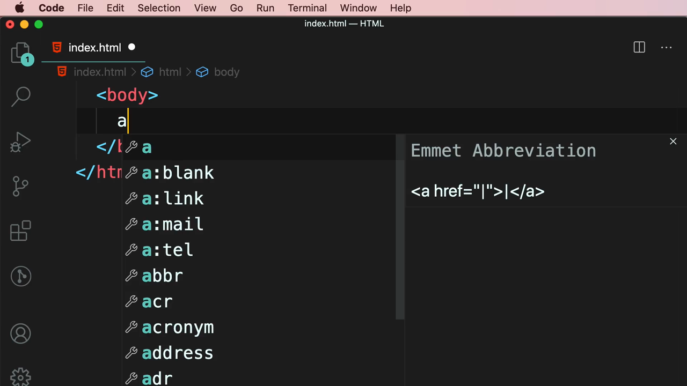

- **`a`** → `<a href="|">|</a>` (แบบพื้นฐาน)
- **`a:blank`** → ลิงก์เปิดแท็บใหม่
- **`a:mail`** → ลิงก์ส่งอีเมล
- **`a:tel`** → ลิงก์โทรศัพท์

เลือกแบบพื้นฐานได้:

```html
<a href=""></a>
```

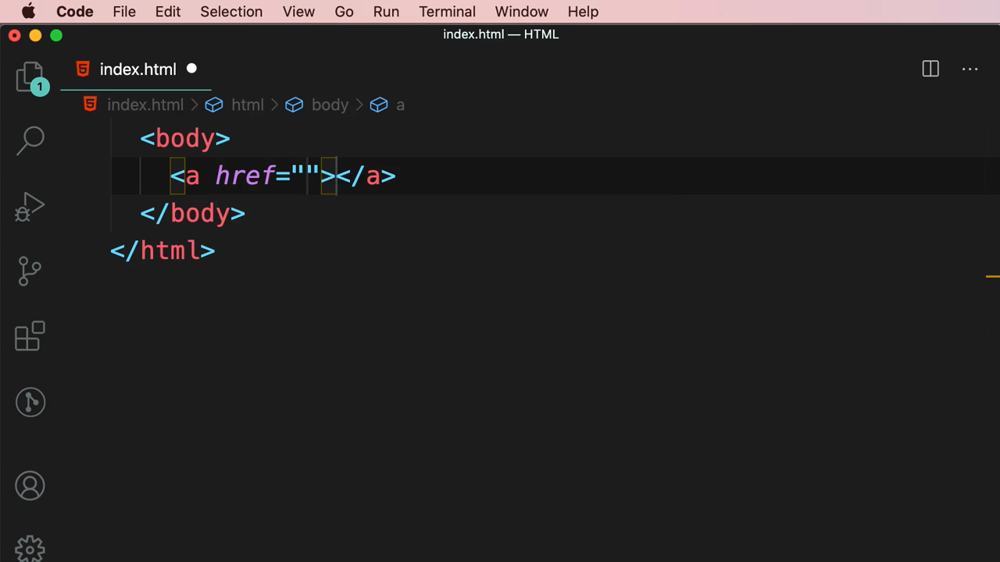

---

## 2. Relative Path — ลิงก์ไปหน้าอื่นในเว็บเดียวกัน

Mosh สร้างไฟล์ **`about.html`** ขึ้นมาใหม่ในโปรเจกต์ แล้วกลับมาใส่ค่า `href` ที่ index.html:

```html
<a href="company/about.html">About Me</a>
```

Path นี้เป็น **relative path** (เส้นทางสัมพัทธ์) — โดยย้ายไฟล์ `about.html` ไปไว้ใน subfolder ชื่อ `company` เพื่อสาธิตว่าเวลาไฟล์ปลายทางอยู่คนละโฟลเดอร์ ต้องระบุ path ให้ตรงกับตำแหน่งจริงของไฟล์

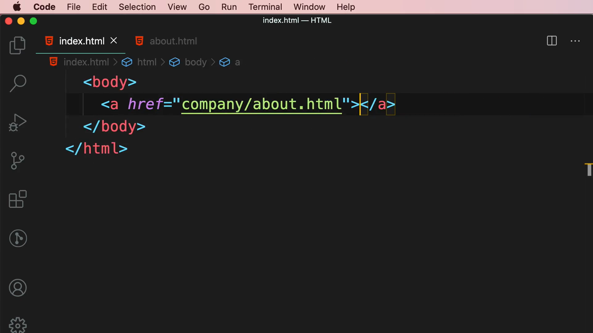

ผลลัพธ์ใน browser: ลิงก์ **"About Me"** สีม่วง (แสดงว่าเคยถูกคลิกไปแล้ว — visited link):

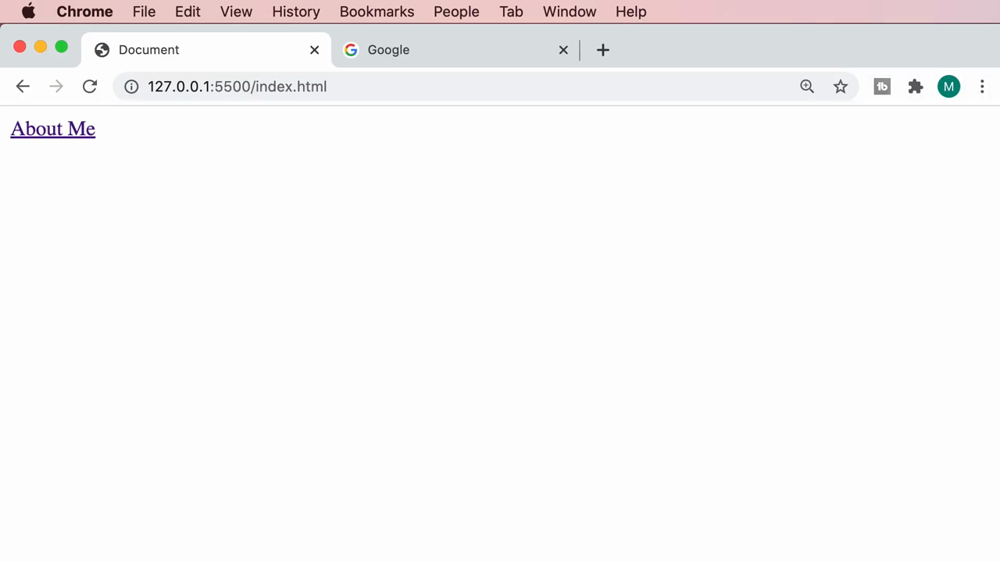

> **สีลิงก์ default ของเบราว์เซอร์:** สีน้ำเงิน = ยังไม่เคยคลิก (unvisited), สีม่วง = เคยคลิกไปแล้ว (visited) — เบราว์เซอร์จำประวัติการคลิกลิงก์ไว้เพื่อแสดงสถานะนี้

---

## 3. ใช้รูปภาพเป็นลิงก์ (Clickable Image)

Mosh ทดลองเปลี่ยนเนื้อหาข้างใน `<a>` จากข้อความเป็น ``:

```html
<a href="company/about.html">
    
</a>
```

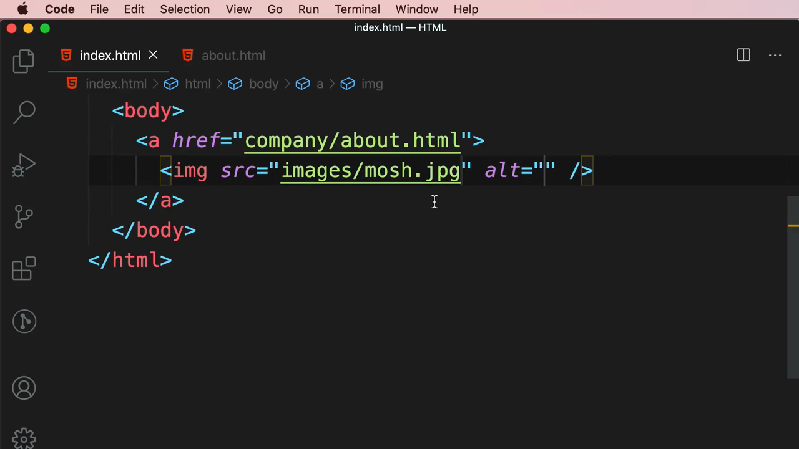

ผลลัพธ์: รูปภาพของ Mosh กลายเป็น**คลิกได้**เหมือนลิงก์ทั่วไป — คลิกที่รูปแล้วพาไปหน้า about.html ได้เลย:

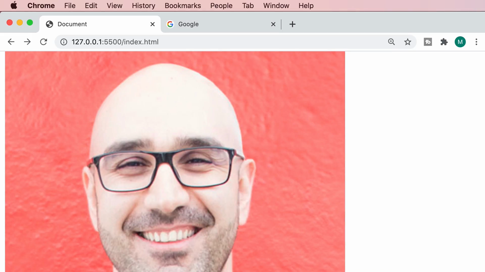

> **ข้อคิด:** `<a>` สามารถครอบ element อื่นๆ ได้ ไม่จำกัดแค่ข้อความ — ปุ่ม, รูปภาพ, หรือแม้แต่กลุ่ม element ทั้งหมดก็สามารถกลายเป็นลิงก์คลิกได้ด้วยวิธีนี้ (Mosh กลับมาใช้ข้อความ "About Me" ตามเดิมหลังสาธิตจบ)

---

## 4. ลิงก์ไปไฟล์โดยตรง (ไม่ใช่หน้า HTML)

Mosh เพิ่มลิงก์ที่สองที่ชี้ไปยัง**ไฟล์รูปภาพโดยตรง**:

```html
<a href="images/mosh.jpg">My Photo</a>
```

ผลลัพธ์ใน browser: มีลิงก์ **"About Me"** และ **"My Photo"** สองอัน:

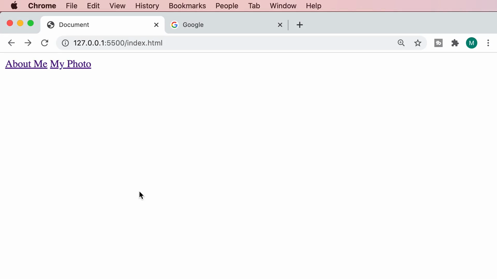

เมื่อคลิก "My Photo" เบราว์เซอร์จะ**เปิดไฟล์รูปภาพนั้นโดยตรง** (title tab เปลี่ยนเป็น "mosh.jpg (538×538)"):

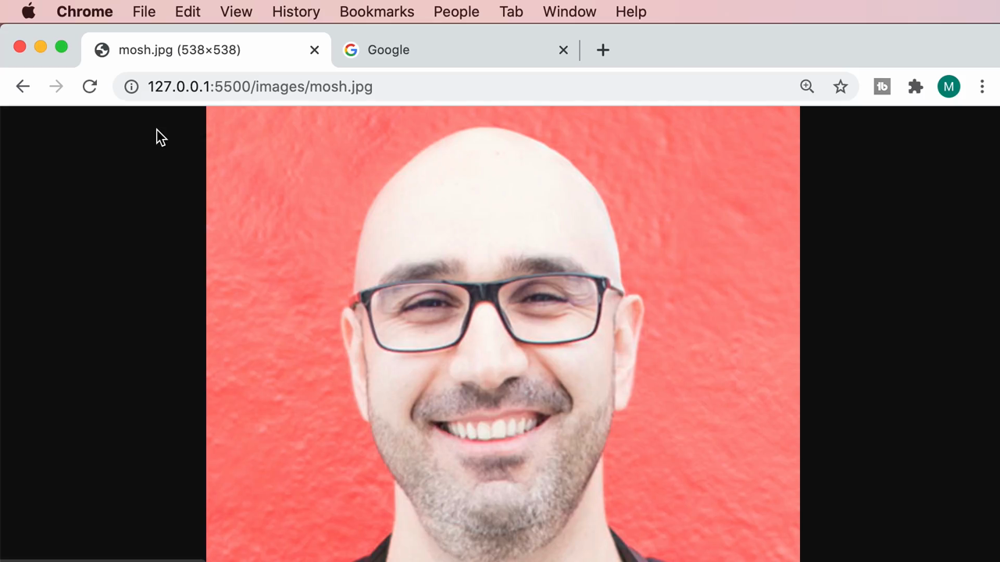

> **จุดสำคัญ:** `href` ไม่จำเป็นต้องชี้ไปที่หน้า HTML เท่านั้น สามารถชี้ไปยังไฟล์ประเภทใดก็ได้ (รูปภาพ, PDF, วิดีโอ ฯลฯ) เบราว์เซอร์จะพยายามเปิด/แสดงไฟล์นั้นตามความสามารถของมัน

### เพิ่ม attribute `download` — บังคับให้ดาวน์โหลดแทนการเปิด

```html
<a href="images/mosh.jpg" download>My Photo</a>
```

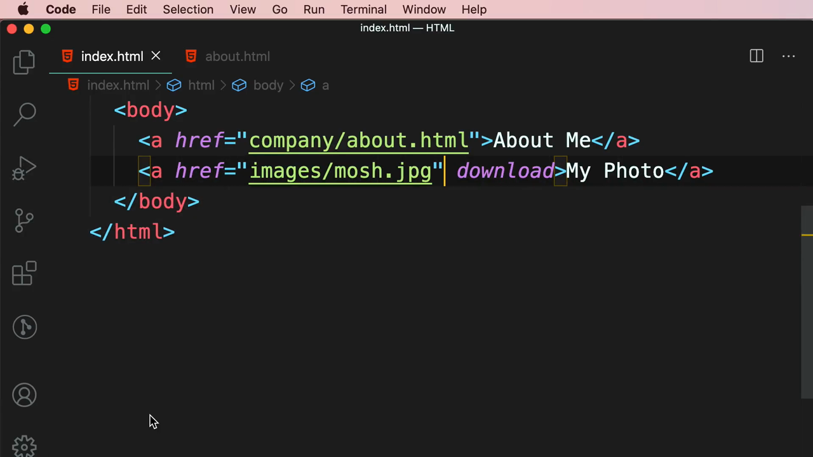

ผลลัพธ์: แทนที่จะเปิดรูปในแท็บใหม่ เบราว์เซอร์จะ**ดาวน์โหลดไฟล์ลงเครื่องทันที** (มี download notification ปรากฏที่แถบด้านล่างของเบราว์เซอร์)

> **`download`** เป็น boolean attribute (ไม่ต้องใส่ค่า) เหมาะมากสำหรับลิงก์ปุ่ม "ดาวน์โหลด PDF", "ดาวน์โหลด Resume" ฯลฯ

---

## 5. สร้างหน้ายาวสำหรับสาธิต Anchor Link (Fragment Link)

Mosh สร้างโครงหน้าใหม่ให้ยาวขึ้น เพื่อสาธิตการลิงก์เลื่อนไปยังส่วนต่างๆ ในหน้าเดียวกัน:

```html
<h2>HTML</h2>
<p>Lorem ipsum dolor sit amet... (ย่อหน้ายาว)</p>

<h2>CSS</h2>
<p>Lorem ipsum dolor sit amet... (ย่อหน้ายาว)</p>
```

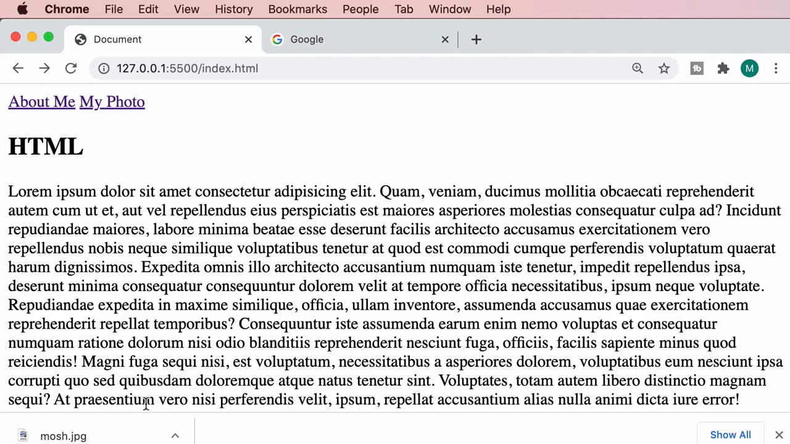

### เพิ่ม `id` ให้ heading ที่ต้องการเป็นจุดหมายปลายทาง

```html
<h2 id="section-css">CSS</h2>
```

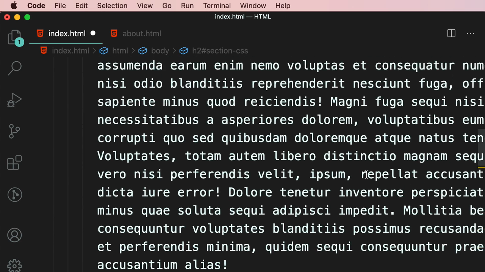

### สร้างลิงก์ที่ชี้ไปยัง `id` นั้นด้วยเครื่องหมาย `#`

```html
<a href="#section-css">CSS</a>
```

เมื่อคลิกลิงก์นี้ browser จะ**เลื่อนหน้าไปยังตำแหน่งของ element ที่มี `id="section-css"`** โดยอัตโนมัติ (สังเกต URL เปลี่ยนเป็น `index.html#section-css`):

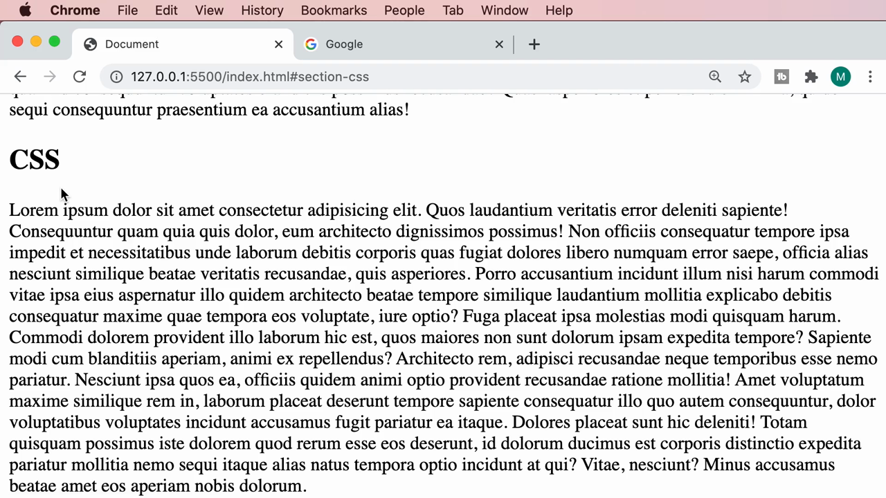

### "Jump to Top" — ลิงก์กลับขึ้นบนสุดของหน้า

Mosh เพิ่มลิงก์ **"Jump to Top"** ที่ท้ายหน้า โดยใช้ `href="#"` (เครื่องหมาย `#` เปล่าๆ ไม่มีชื่อ id ต่อท้าย):

```html
<a href="#">Jump to Top</a>
```

คลิกแล้วหน้าจะเลื่อนกลับไปด้านบนสุดทันที (URL กลายเป็น `index.html#`):

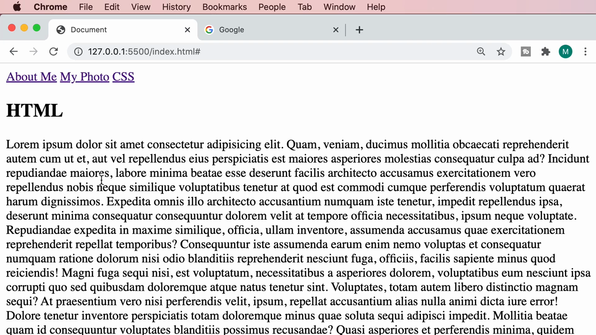

> **หลักการ Fragment Link:**
> - `href="#ชื่อ-id"` → เลื่อนไปยัง element ที่มี `id` ตรงกัน
> - `href="#"` (ว่างเปล่า) → เลื่อนกลับไปด้านบนสุดของหน้า
> - ใช้ได้ทั้งกับ element ในหน้าเดียวกัน และสามารถใช้ร่วมกับ path ไปหน้าอื่นได้ (เช่น `about.html#section-x`)

---

## 6. Absolute URL — ลิงก์ไปเว็บไซต์ภายนอก

Mosh เพิ่มลิงก์ไป Google โดยใช้ **absolute URL** (URL แบบเต็มที่มี `https://` นำหน้า):

```html
<a href="https://google.com">Google</a>
```

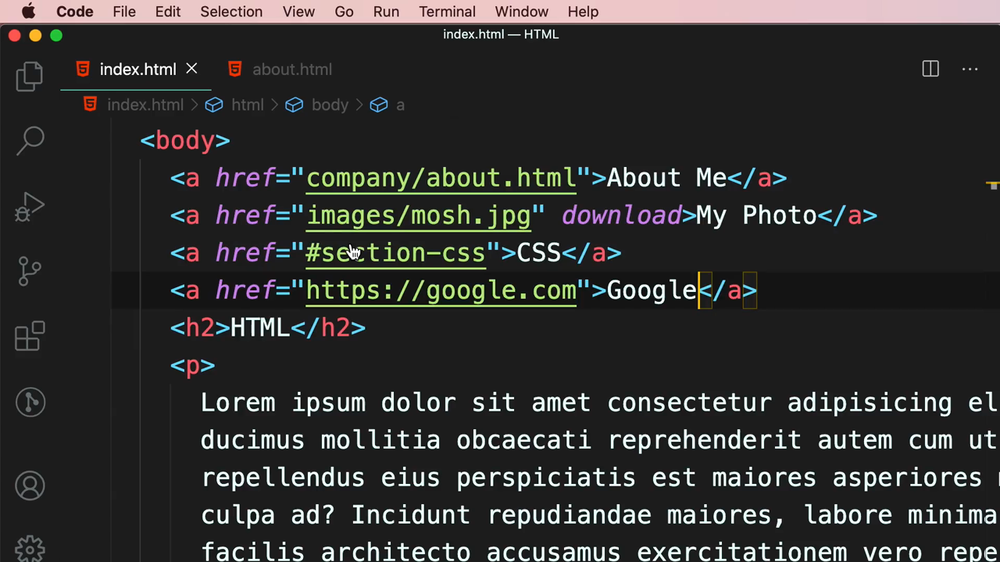

คลิกแล้ว browser จะนำทางไปยัง google.com **ในแท็บเดิม** (tab เดิมเปลี่ยนจาก "Document" เป็น "Google"):

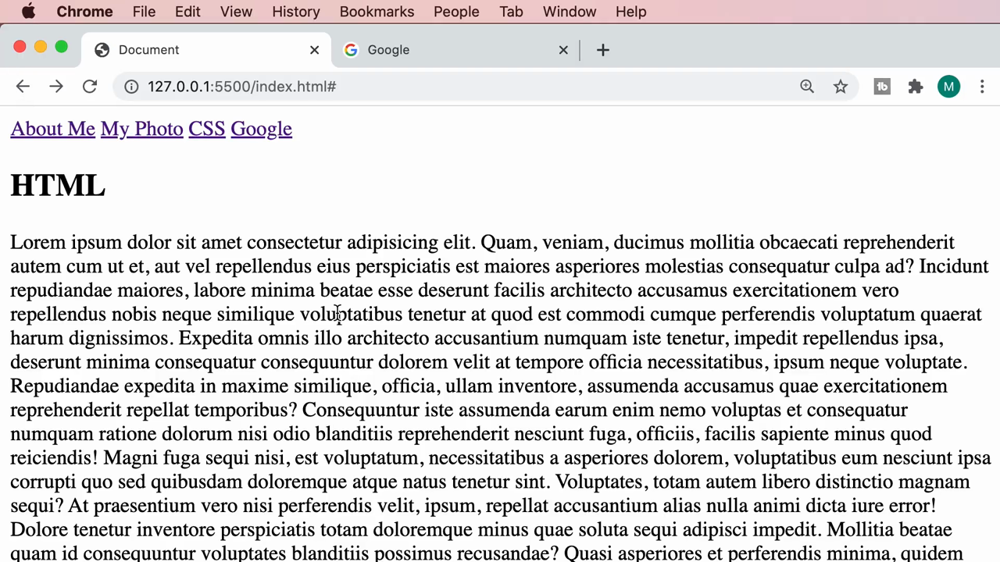

> **Relative vs Absolute path:**
> - **Relative path** (เช่น `about.html`, `company/about.html`, `images/mosh.jpg`) — ใช้สำหรับลิงก์ไฟล์**ภายในเว็บไซต์เดียวกัน** อ้างอิงตำแหน่งเทียบกับไฟล์ปัจจุบัน
> - **Absolute URL** (เช่น `https://google.com`) — ใช้สำหรับลิงก์ไป**เว็บไซต์อื่น** ต้องระบุ URL แบบเต็มเสมอ

### เปิดลิงก์ในแท็บใหม่ด้วย `target="_blank"`

```html
<a href="https://google.com" target="_blank">Google</a>
```

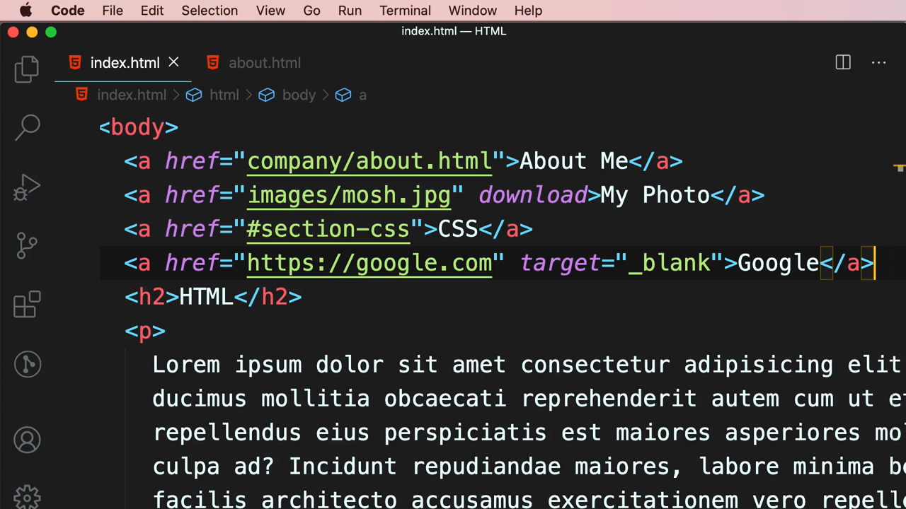

ผลลัพธ์: คลิกแล้ว Google จะเปิดใน**แท็บใหม่** โดยที่แท็บเดิม ("Document") ยังคงเปิดอยู่:

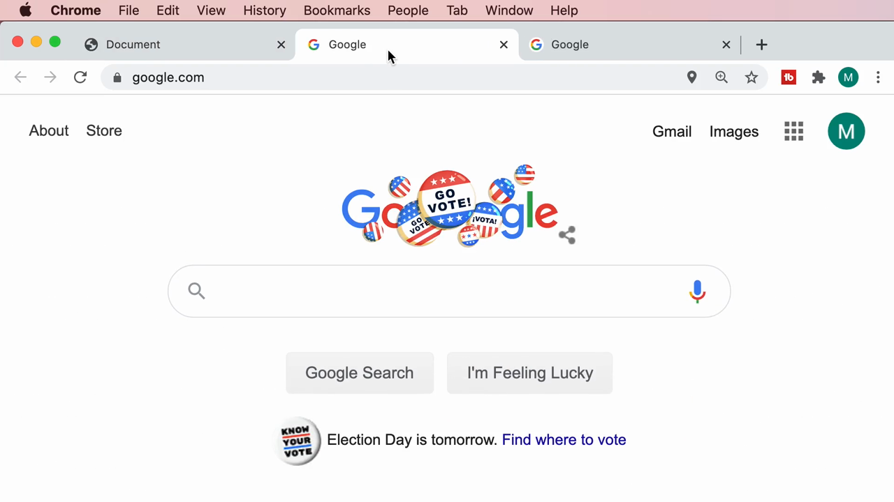

> **`target="_blank"`** เป็นค่าที่ใช้บ่อยที่สุดสำหรับลิงก์ภายนอก เพื่อไม่ให้ผู้ใช้หลุดออกจากเว็บไซต์ของเรา — ผู้ใช้ยังกลับมาที่แท็บเดิมได้ตลอดเวลา

---

## 7. Mailto Link — ลิงก์ส่งอีเมล

Mosh เพิ่มลิงก์สุดท้ายด้วย scheme พิเศษ **`mailto:`**:

```html
<a href="mailto:programmingwithmosh@gmail.com">Email Me</a>
```

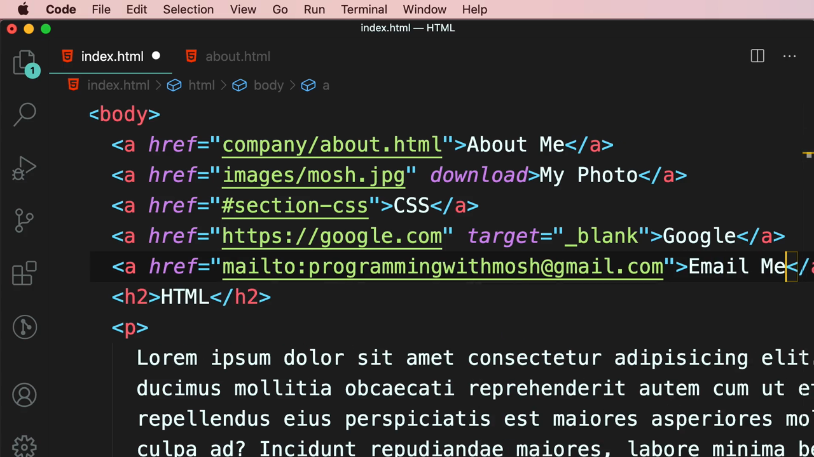

คลิกแล้ว macOS เปิดแอป **Mail** ขึ้นมาทันที พร้อมหน้าต่างเขียนอีเมลใหม่ที่กรอกช่อง **"To:"** ไว้ล่วงหน้าด้วยอีเมลที่ระบุ:

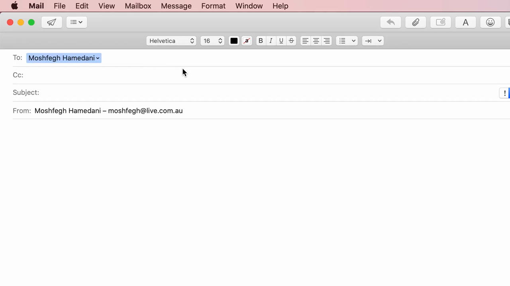

> **`mailto:`** เป็น URI scheme พิเศษที่บอกให้ระบบปฏิบัติการเปิดโปรแกรมอีเมลเริ่มต้นของเครื่อง พร้อมกรอกผู้รับให้อัตโนมัติ — สะดวกมากสำหรับปุ่ม "ติดต่อเรา" บนเว็บไซต์

---

## สรุปโค้ดทั้งหมดจากคลิปนี้

```html
<body>
    <a href="company/about.html">About Me</a>
    <a href="images/mosh.jpg" download>My Photo</a>
    <a href="#section-css">CSS</a>
    <a href="https://google.com" target="_blank">Google</a>
    <a href="mailto:programmingwithmosh@gmail.com">Email Me</a>

    <h2>HTML</h2>
    <p>...</p>

    <h2 id="section-css">CSS</h2>
    <p>...</p>

    <a href="#">Jump to Top</a>
</body>
```

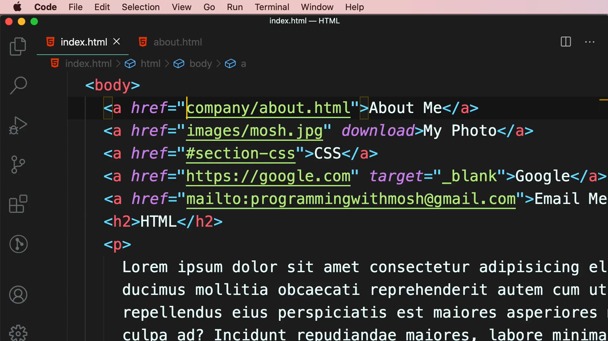

| รูปแบบ | ตัวอย่าง | การใช้งาน |
|---|---|---|
| Relative path | `href="about.html"` | ลิงก์ไปหน้าอื่นในเว็บเดียวกัน |
| ลิงก์ไฟล์โดยตรง | `href="images/mosh.jpg"` | เปิด/แสดงไฟล์ (รูป, PDF ฯลฯ) |
| `download` | `href="..." download` | บังคับดาวน์โหลดไฟล์แทนการเปิด |
| Fragment/Anchor | `href="#section-css"` | เลื่อนไปยัง element ที่มี id ตรงกัน |
| Jump to top | `href="#"` | เลื่อนกลับไปบนสุดของหน้า |
| Absolute URL | `href="https://google.com"` | ลิงก์ไปเว็บไซต์ภายนอก |
| `target="_blank"` | `target="_blank"` | เปิดลิงก์ในแท็บใหม่ |
| Mailto | `href="mailto:..."` | เปิดโปรแกรมอีเมลพร้อมกรอกผู้รับ |

---

## สรุปที่ใช้ได้จริง

- `<a>` tag ครอบได้มากกว่าข้อความ — ใส่รูปภาพ, ปุ่ม, หรือกลุ่ม element เข้าไปเพื่อทำให้คลิกได้ทั้งหมด
- Relative path ต้องตรงกับตำแหน่งไฟล์จริงเสมอ ผิด path แม้แค่ subfolder เดียวก็ทำให้ลิงก์เสีย (broken link)
- `target="_blank"` ควรใช้กับลิงก์ภายนอกเป็นหลัก ไม่ควรใช้พร่ำเพรื่อกับลิงก์ภายในเว็บเดียวกัน (ผู้ใช้จะงงว่าทำไมเปิดแท็บใหม่ตลอด)
- Fragment link (`#id`) เป็นเทคนิคพื้นฐานสำหรับสร้าง "Table of Contents" หรือเมนู "Jump to section" ในหน้าที่มีเนื้อหายาว

### จุดเชื่อมกับงานจริงของ Aum

- ใน Next.js, การนำทางระหว่างหน้าใช้ **`<Link href="...">`** ของ `next/link` แทน `<a>` ธรรมดา แต่หลักการ relative/absolute path ยังเหมือนเดิมทุกประการ — Next.js จะแปลง `<Link>` เป็น `<a>` จริงๆ ตอน render
- `target="_blank"` ยังใช้ได้เหมือนเดิมใน Next.js เวลาต้องการเปิดลิงก์ภายนอก (เช่น โซเชียลมีเดีย, เอกสารอ้างอิง) ควรเพิ่ม `rel="noopener noreferrer"` ควบคู่ไปด้วยเพื่อความปลอดภัย (ป้องกัน tab-nabbing)
- Fragment link (`#section-css`) ใช้ได้ตรงๆ ใน landing page ที่ Aum ทำอยู่ — เหมาะมากสำหรับเมนู navbar ที่ต้องการเลื่อนไปยัง section ต่างๆ ในหน้าเดียว (single-page site) โดยไม่ต้องใช้ JavaScript scroll library เพิ่ม
- `mailto:` และ `download` เป็นเทคนิคที่ใช้ได้จริงกับปุ่ม "ติดต่อเรา" และปุ่ม "ดาวน์โหลด Resume/Portfolio" บน landing page ได้เลยโดยไม่ต้องเขียน JavaScript เพิ่มเติม
