# 3-HTML Basics: 06 - Images (5:38)

**ไฟล์ต้นทาง:** `06-Images.mp4`

▶️ **[เปิดวิดีโอต้นฉบับ](../../../HTML-CSS-1/3-HTML%20Basics/06-Images.mp4)**

---

## ภาพรวมคลิปนี้

คลิปนี้ Mosh สอนเรื่อง **`` tag** อย่างครบวงจร ตั้งแต่การหารูปภาพฟรีมาใช้งานอย่างถูกลิขสิทธิ์จาก Unsplash, การใส่ `alt` attribute, ไปจนถึงการควบคุมขนาดและสัดส่วนของรูปภาพด้วย CSS (`width`, `height`, `object-fit`) ซึ่งเป็นเรื่องที่มักสร้างความสับสนให้กับมือใหม่มากที่สุดเรื่องหนึ่ง

---

## 1. หารูปภาพฟรีจาก Unsplash

Mosh เปิดเว็บไซต์ **unsplash.com** ซึ่งเป็นแหล่งรวมรูปภาพคุณภาพสูงที่ใช้งานได้ฟรี:

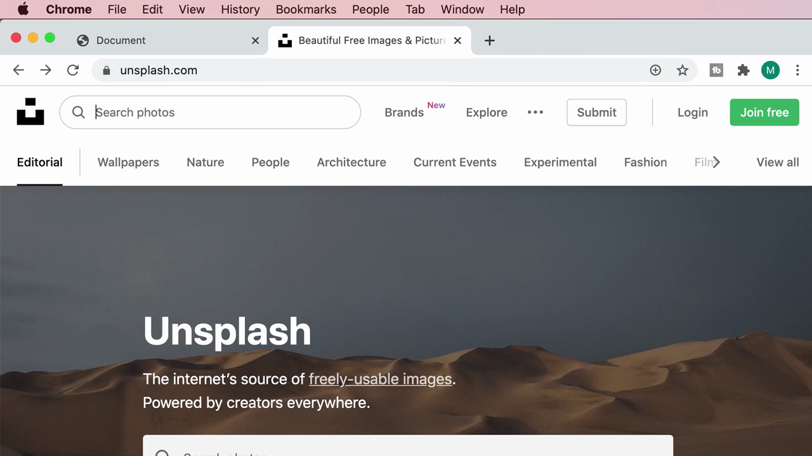

ค้นหาคำว่า **"coffee"** และเลือกรูปภาพที่ต้องการจากผลการค้นหา:

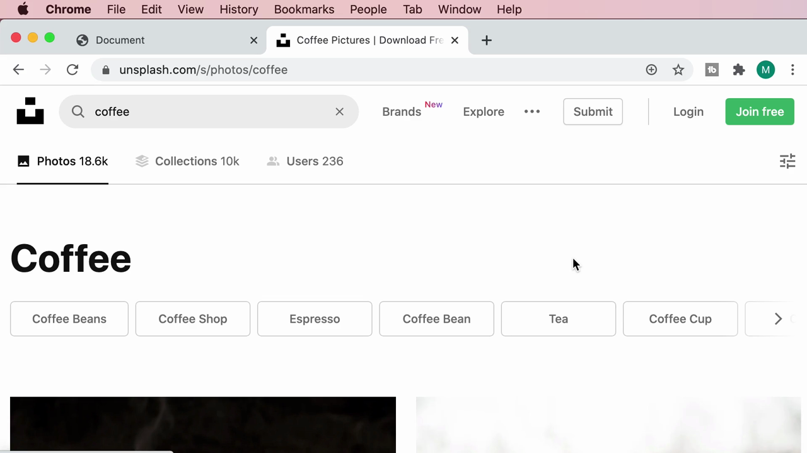

เปิดหน้ารายละเอียดของรูปภาพ (โดย Nathan Dumlao) พร้อมปุ่ม **"Download free"**:

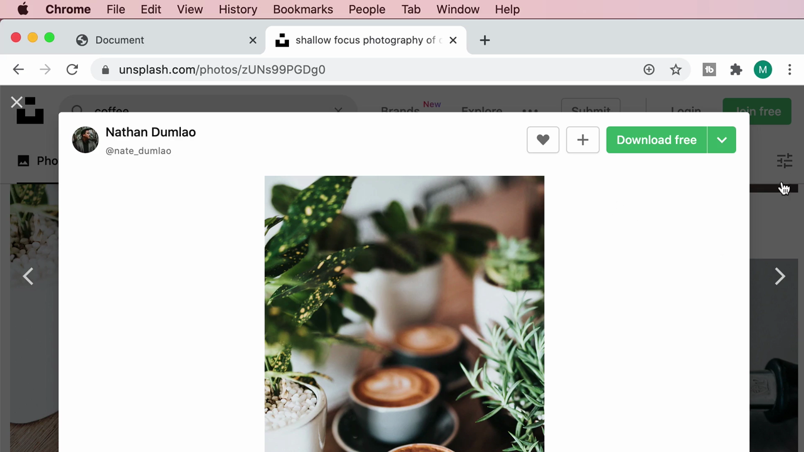

เมื่อกดปุ่มดาวน์โหลด จะมีตัวเลือกขนาดไฟล์ให้เลือก:

| ขนาด | ความละเอียด |
|---|---|
| Small | 640×960 |
| Medium | 1920×2880 |
| Large | 2400×3600 |
| Original Size | 4480×6720 |

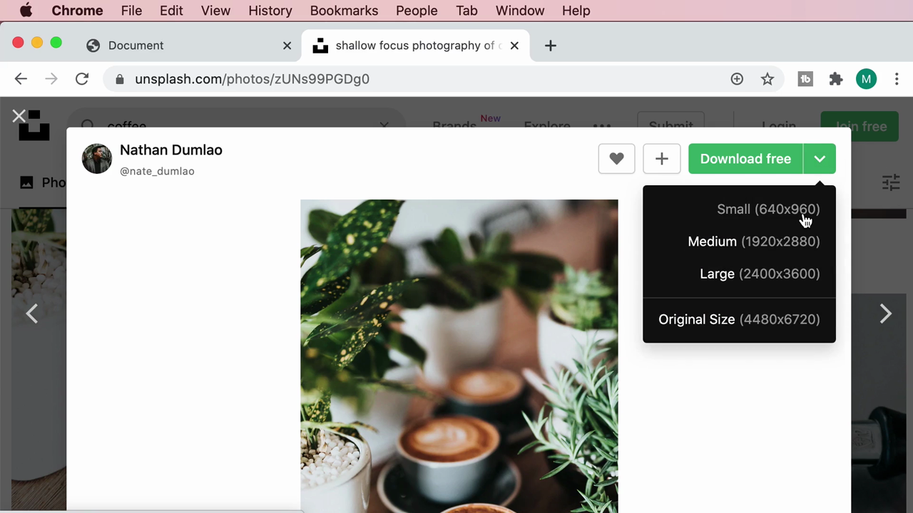

หลังดาวน์โหลด Unsplash แสดง popup **"Say thanks"** พร้อมข้อความสำหรับให้เครดิตช่างภาพ:

> **"Photo by Nathan Dumlao on Unsplash"**

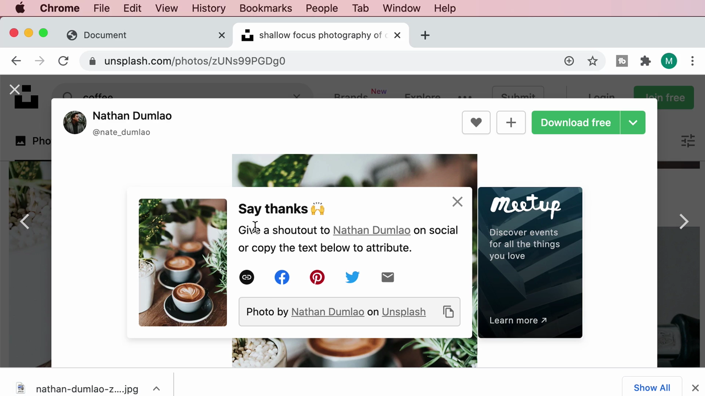

> **มารยาทสำคัญ:** แม้ Unsplash จะอนุญาตให้ใช้รูปฟรีโดยไม่บังคับต้องให้เครดิต แต่การใส่เครดิตช่างภาพ (เช่น "Photo by [ชื่อ] on Unsplash") เป็นแนวปฏิบัติที่ดีและควรทำเมื่อเป็นไปได้ เพื่อสนับสนุนผู้สร้างสรรค์ผลงาน

---

## 2. นำไฟล์เข้าโปรเจกต์และเขียน ``

Mosh ย้ายไฟล์ที่ดาวน์โหลดมาไว้ใน folder `images/` ของโปรเจกต์ และเปิดดูตัวอย่างใน VS Code:

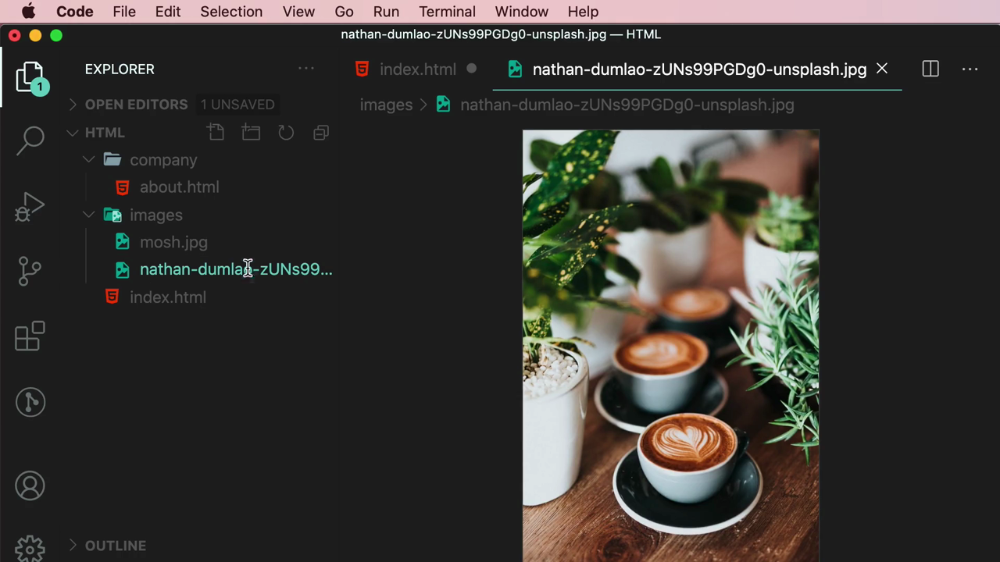

จากนั้นเขียนโค้ด `` ใน `index.html`:

```html

```

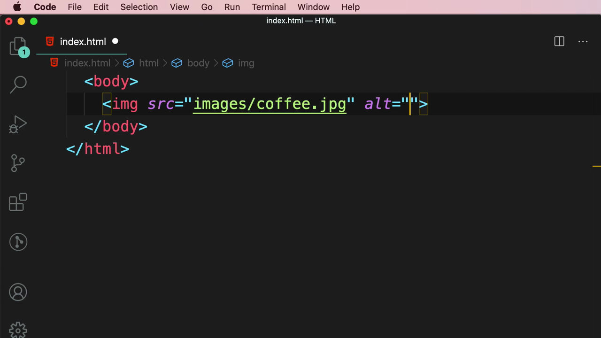

### เมื่อ path ผิด → alt text กลายเป็นตัวช่วยชีวิต

ระหว่างขั้นตอน (ก่อนไฟล์จะถูกเปลี่ยนชื่อให้ตรงกับ `src` ที่ระบุ) ผลลัพธ์ใน browser แสดง**ไอคอนรูปภาพเสีย** พร้อมข้อความจาก `alt` **"A coffee mug on a table"** ปรากฏแทนที่:

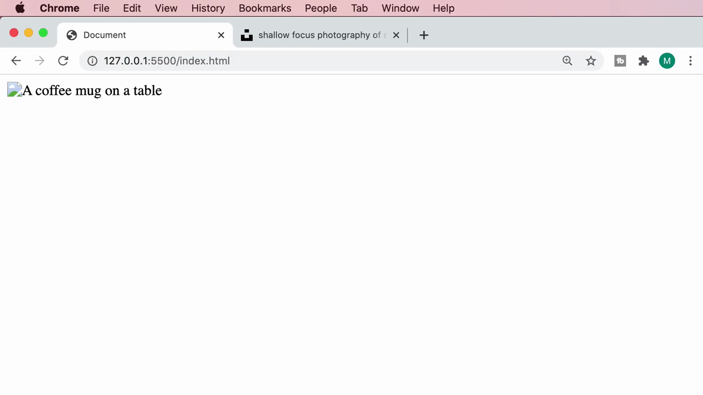

> **นี่คือเหตุผลที่ `alt` สำคัญมาก:** เมื่อรูปภาพโหลดไม่สำเร็จไม่ว่าด้วยเหตุผลใด (path ผิด, ไฟล์หาย, อินเทอร์เน็ตช้า) ข้อความใน `alt` จะแสดงแทนที่เพื่อให้ผู้ใช้ยังเข้าใจว่าตรงนั้นควรจะมีรูปอะไร นอกจากนี้ `alt` ยังจำเป็นสำหรับ **screen reader** (ผู้พิการทางสายตา) และมีผลต่อ **SEO** ของรูปภาพด้วย

หลังแก้ไขชื่อไฟล์ให้ตรงกับ `src` แล้ว รูปภาพแสดงผลได้ถูกต้อง:

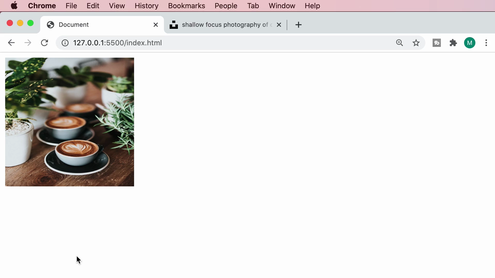

### เทคนิคเสริม: คัดลอก URL รูปภาพโดยตรง

Mosh สาธิตการคลิกขวาที่รูปภาพเพื่อดูตัวเลือกต่างๆ เช่น "Copy Image Address" สำหรับกรณีที่ต้องการใช้รูปภาพแบบ **hotlink** (ลิงก์ตรงไปยัง URL ของรูปบนอินเทอร์เน็ต แทนที่จะดาวน์โหลดมาเก็บในโปรเจกต์):

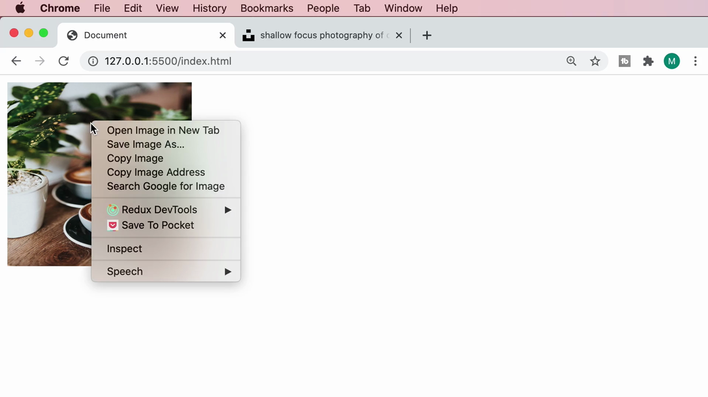

> **ข้อควรระวัง:** การใช้ URL รูปภาพจากเว็บอื่นโดยตรง (hotlinking) ควรทำเฉพาะเมื่อเว็บไซต์นั้นอนุญาต เพราะรูปอาจถูกลบ/เปลี่ยนโดยเจ้าของได้ทุกเมื่อ ทำให้รูปในเว็บเราหายไปด้วย — ปกติแนะนำให้ดาวน์โหลดมาเก็บไว้ในโปรเจกต์ของเราเองเหมือนที่ Mosh ทำ

---

## 3. ควบคุมขนาดรูปภาพด้วย CSS

Mosh เพิ่ม `<style>` และกำหนดขนาดให้ `img`:

```css
img {
    width: 200px;
    height: 200px;
}
```

### ปัญหา: กำหนดทั้ง width และ height พร้อมกัน → รูปบิดเบี้ยว

Mosh เปิด DevTools แล้วทดลอง**ปิด** property `height` ชั่วคราว (คลิก checkbox ออก) เพื่อดูว่าเกิดอะไรขึ้นเมื่อกำหนดแค่ `width`:

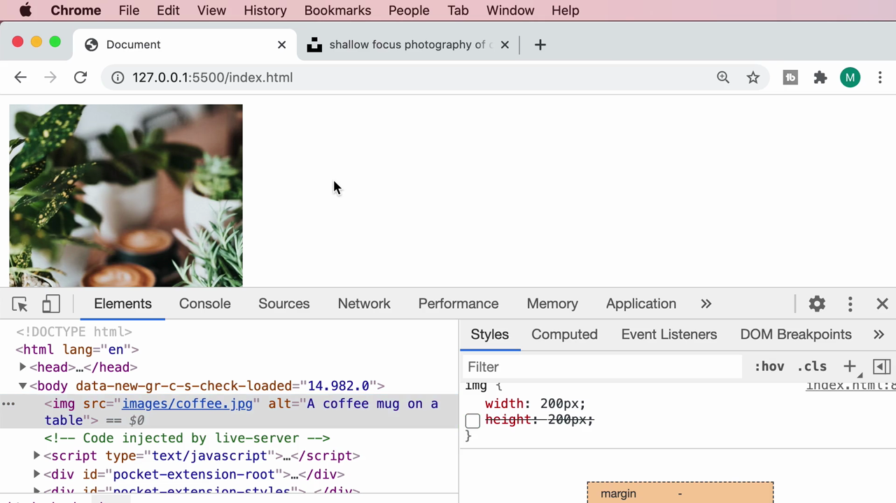

ผลลัพธ์: รูปภาพแสดงตาม**สัดส่วนเดิม (aspect ratio)** ของไฟล์จริง (สูงกว่ากว้าง เพราะรูปต้นฉบับเป็นแนวตั้ง) — เมื่อกำหนดแค่ `width` อย่างเดียว เบราว์เซอร์จะคำนวณ `height` ให้เองตามสัดส่วนเดิมโดยอัตโนมัติ

เมื่อเปิด `height: 200px` กลับมาอีกครั้ง (บังคับทั้งสองค่า):

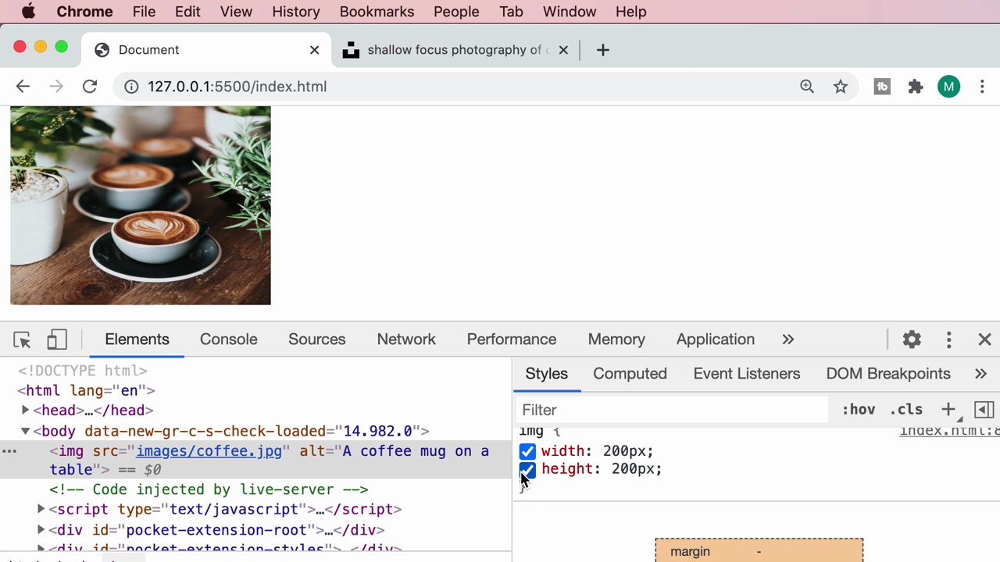

> **ปัญหา:** เมื่อกำหนดทั้ง `width` และ `height` เป็นค่าตายตัวที่**ไม่ตรงกับสัดส่วนจริง**ของรูปภาพ เบราว์เซอร์จะ**บีบ/ยืดรูปให้พอดีกับกรอบ** ทำให้ภาพดูบิดเบี้ยวผิดสัดส่วน (บุคคล/วัตถุในภาพดูแบนหรือยืดผิดรูป)

### ทางแก้: `object-fit`

Mosh เพิ่ม property `object-fit` โดย IntelliSense อธิบายว่า:

> **"Specifies how the contents of a replaced element should be scaled relative to the box established by its used height and width."**

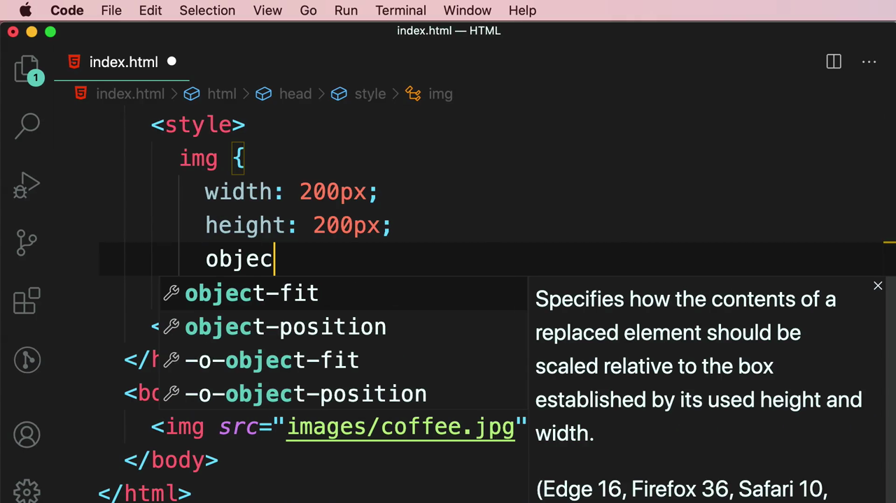

เมื่อพิมพ์ค่า พบตัวเลือกหลายแบบ โดย **`cover`** มีคำอธิบาย:

> **"The replaced content is sized to maintain its aspect ratio while filling the element's entire content box..."**

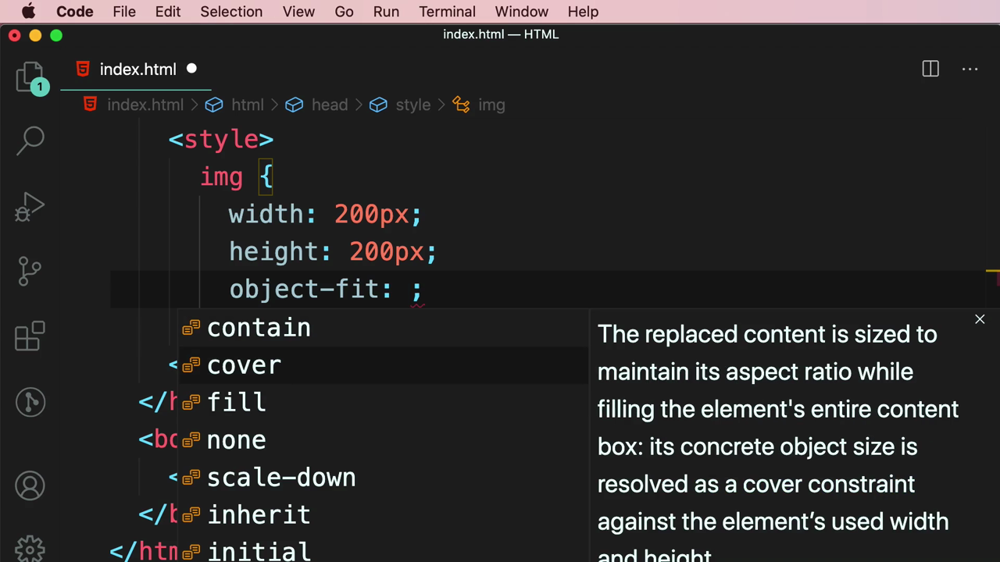

```css
img {
    width: 200px;
    height: 200px;
    object-fit: cover;
}
```

ผลลัพธ์: รูปภาพเต็มกรอบ 200×200px พอดี **โดยไม่บิดเบี้ยว** (สัดส่วนเดิมยังคงอยู่ ส่วนที่เกินขอบจะถูกครอปออกอย่างสวยงาม):

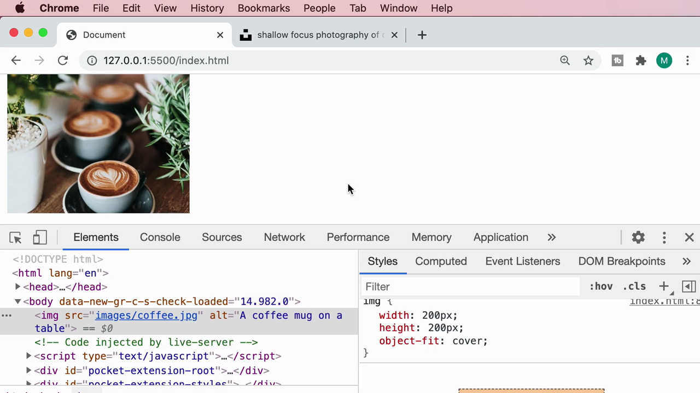

### เปรียบเทียบค่าอื่นๆ ของ `object-fit`

Mosh ทดลองสลับค่าต่างๆ ผ่าน DevTools โดยตรงเพื่อเปรียบเทียบ:

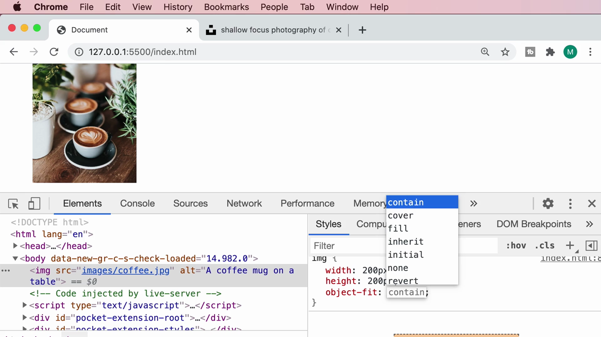

| ค่า | ผลลัพธ์ |
|---|---|
| **`fill`** (default เมื่อไม่ใส่ object-fit) | บีบ/ยืดรูปให้เต็มกรอบพอดี — **บิดเบี้ยว** ถ้าสัดส่วนไม่ตรง |
| **`cover`** | รักษาสัดส่วนเดิม ขยายให้เต็มกรอบ แล้ว**ครอปส่วนเกิน**ออก — นิยมใช้มากที่สุด |
| **`contain`** | รักษาสัดส่วนเดิม ย่อให้พอดีกรอบ **ไม่มีการครอป** แต่อาจเกิดขอบว่าง (letterbox) |
| **`none`** | แสดงรูปตามขนาดจริง ไม่ปรับสเกลเลย |
| **`scale-down`** | เลือกใช้ค่าที่เล็กกว่าระหว่าง `none` กับ `contain` |

---

## สรุปที่ใช้ได้จริง

- **`alt` attribute ไม่ใช่ทางเลือก** ควรใส่ข้อความอธิบายรูปภาพให้มีความหมายเสมอ — ทั้งเพื่อ accessibility, SEO, และเป็น fallback เมื่อรูปโหลดไม่สำเร็จ
- **อย่ากำหนด `width` และ `height` เป็นค่าตายตัวพร้อมกัน** โดยไม่คิดเรื่องสัดส่วน เพราะจะทำให้รูปบิดเบี้ยวถ้าสัดส่วนไม่ตรงกับต้นฉบับ
- **`object-fit: cover`** คือค่าที่ควรใช้เป็นค่าเริ่มต้นเกือบทุกครั้งที่ต้องบังคับขนาดรูปภาพให้คงที่ (เช่น รูปโปรไฟล์, thumbnail, การ์ดสินค้า)
- ควรให้เครดิตช่างภาพเมื่อใช้รูปจาก Unsplash หรือแหล่งรูปฟรีอื่นๆ แม้จะไม่บังคับก็ตาม

### จุดเชื่อมกับงานจริงของ Aum

- ใน Next.js มี component พิเศษคือ **`<Image>`** จาก `next/image` ซึ่งบังคับให้ต้องระบุ `width`/`height` (หรือใช้ `fill`) และมี `alt` เป็น required prop ตั้งแต่ต้น — หลักการเรื่อง aspect ratio และ `object-fit` (ใน Next.js ใช้ prop `style={{objectFit: 'cover'}}` หรือ Tailwind class `object-cover`) เหมือนกับที่เรียนในคลิปนี้ทุกประการ
- ใน Tailwind CSS มี utility class ตรงตัวเลย: **`object-cover`**, **`object-contain`**, **`object-fill`**, **`object-none`**, **`object-scale-down`** — ใช้แทน CSS `object-fit` ที่เขียนเองได้เลย เช่น ``
- เทคนิคเรื่อง broken image + alt fallback สำคัญมากสำหรับ landing page ที่ดึงรูปจาก API หรือ CMS ภายนอก เพราะบางครั้งรูปอาจโหลดไม่สำเร็จจากปัญหาเครือข่าย — การมี `alt` ที่ดีช่วยให้ UX ไม่พังไปเลยแม้รูปจะโหลดไม่ขึ้น
