# 3-HTML Basics: 07 - Video and Audio (5:40)

**ไฟล์ต้นทาง:** `07-Video-and-Audio.mp4`

▶️ **[เปิดวิดีโอต้นฉบับ](../../../HTML-CSS-1/3-HTML%20Basics/07-Video-and-Audio.mp4)**

---

## ภาพรวมคลิปนี้

คลิปนี้ Mosh สอนเรื่อง **แท็ก `<video>` และ `<audio>`** — วิธีฝังวิดีโอและเสียงลงในหน้าเว็บ ตั้งแต่การไปหาวิดีโอฟรีมาใช้งาน (สอนวิธีเดียวกับที่เคยสอนเรื่องรูปภาพในคลิปก่อนหน้า), การกำหนดขนาดด้วย CSS, ไปจนถึง attribute สำคัญๆ ของ `<video>` (`controls`, `autoplay`, `loop`) และการเช็ค browser support ด้วยเว็บไซต์ caniuse.com

---

## 1. หาวิดีโอฟรีมาใช้งานจาก Pexels

เช่นเดียวกับตอนหารูปจาก Unsplash ในคลิปก่อนหน้า Mosh สาธิตการหา**วิดีโอสต็อกฟรี**จากเว็บไซต์ **Pexels** โดยเข้าไปที่ `pexels.com/search/videos/ocean/` แล้วค้นหาคำว่า **"ocean"**:

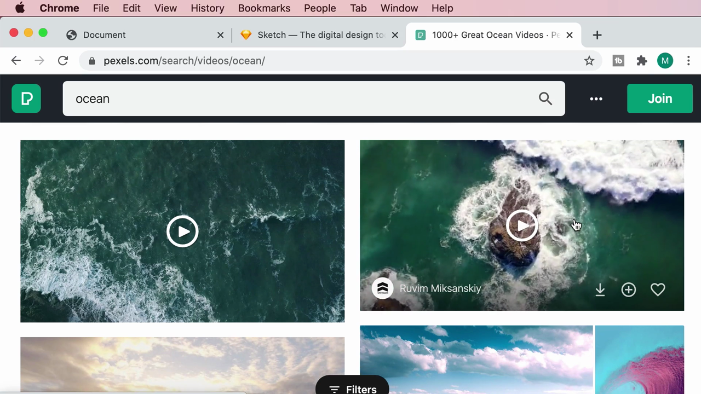

Mosh เลือกวิดีโอ "Waves Crashing" ของช่างภาพ Ruvim Miksanskiy แล้วกด **Free Download** ซึ่งจะมีตัวเลือกขนาดไฟล์ให้เลือก (Original 4096×2160, Quad HD, Full HD, HD):

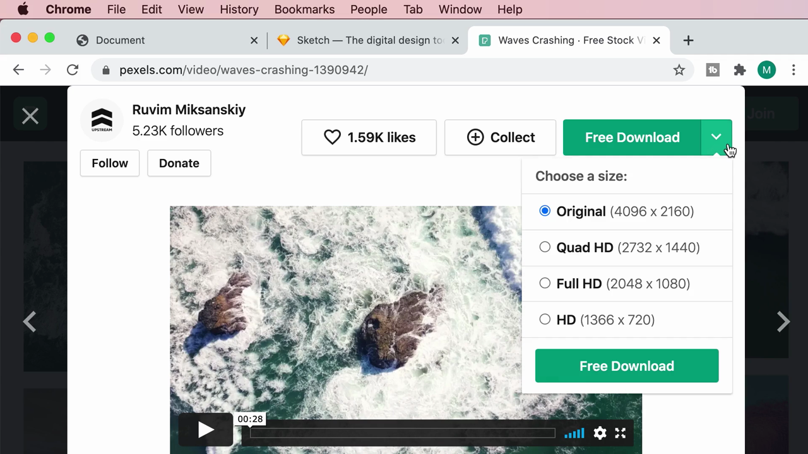

หลังดาวน์โหลด จะมี popup ขอบคุณผู้สร้าง (Say thanks to Ruvim) พร้อมข้อความ attribution แนะนำให้ใส่เครดิตกลับไปที่วิดีโอต้นฉบับ (เหมือนที่เคยสอนสำหรับรูปภาพ Unsplash)

> **หมายเหตุ:** แม้ Pexels จะให้ใช้ฟรีโดยไม่บังคับใส่เครดิต แต่ Mosh แนะนำว่าเป็นมารยาทที่ดีที่ควรให้เครดิตผู้สร้างผลงานเสมอ

---

## 2. จัดระเบียบไฟล์: สร้างโฟลเดอร์ `videos/` แล้ว rename ไฟล์

Mosh ย้ายไฟล์วิดีโอที่ดาวน์โหลดมา (ชื่อไฟล์ยาวๆ เช่น `Pexels Videos 1390942.mp4`) เข้าไปในโฟลเดอร์ใหม่ชื่อ **`videos/`** ในโปรเจกต์ (คู่ขนานกับโฟลเดอร์ `images/` ที่มีอยู่แล้ว):

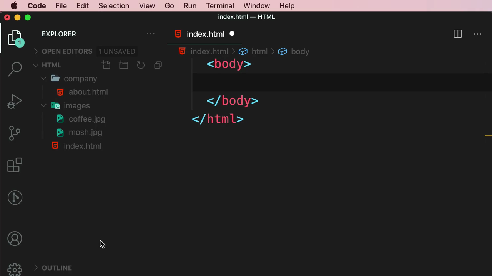

จากนั้น **เปลี่ยนชื่อไฟล์** ให้สั้นและสื่อความหมาย จากชื่อยาวๆ ของ Pexels เป็น **`ocean.mp4`**:

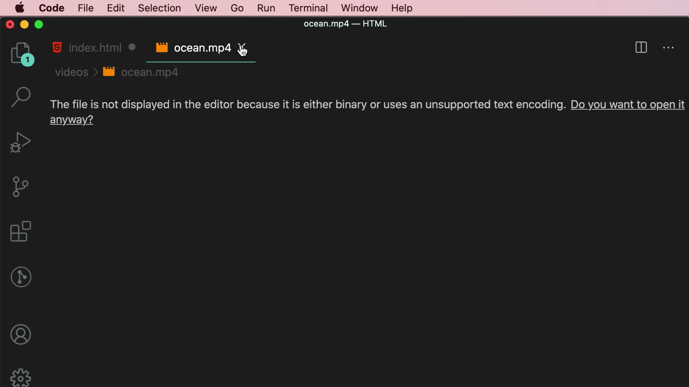

> **หลักการเดียวกับรูปภาพ:** ไฟล์ที่ดาวน์โหลดมาจากเน็ตมักมีชื่อยาวไม่สื่อความหมาย ควรจัดหมวดหมู่ใส่โฟลเดอร์เฉพาะ (`videos/`, `images/`) และตั้งชื่อไฟล์ใหม่ให้สั้น กระชับ อธิบายเนื้อหาได้ ก่อนนำไปอ้างอิงในโค้ด

---

## 3. เขียนแท็ก `<video>` พื้นฐาน

Mosh พิมพ์แท็ก `<video>` พร้อม attribute `src` ชี้ไปที่โฟลเดอร์ `videos/` โดยใช้ IntelliSense autocomplete ช่วยเลือกไฟล์ `ocean.mp4`:

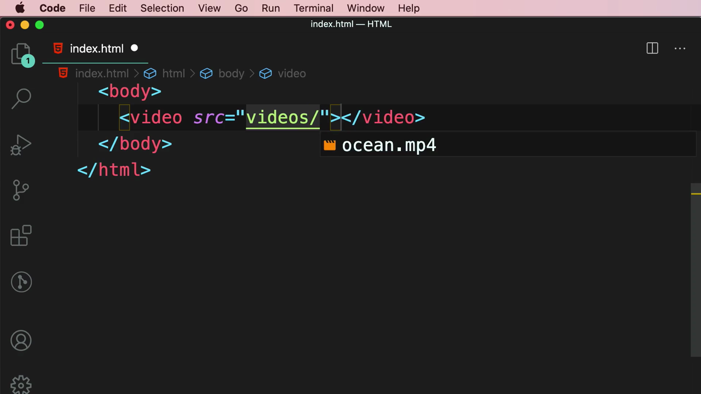

โค้ดที่ได้:

```html
<video src="videos/ocean.mp4"></video>
```

เมื่อเปิดดูใน browser (ผ่าน Live Server ที่ `127.0.0.1:5500`) วิดีโอจะแสดงเป็น**ภาพนิ่งเฟรมแรก**ของวิดีโอเท่านั้น ยังไม่มีปุ่มเล่นหรือควบคุมใดๆ:

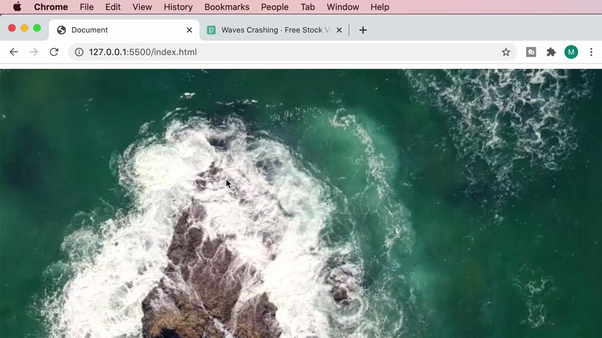

> **สังเกต:** แท็ก `<video>` เพียงอย่างเดียว (ไม่มี attribute เพิ่มเติม) จะไม่แสดงปุ่มเล่น ไม่เล่นอัตโนมัติ และผู้ใช้ไม่สามารถโต้ตอบกับวิดีโอได้เลย — ต้องเพิ่ม attribute เพื่อควบคุมพฤติกรรม

โค้ดเต็มของ `index.html` ในจุดนี้:

```html
<video src="videos/ocean.mp4"></video>
```

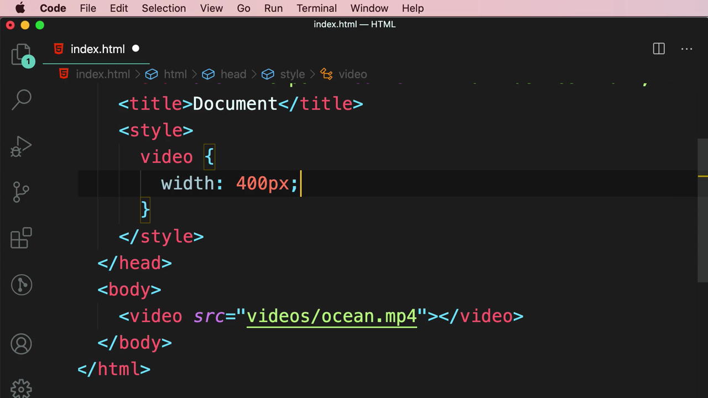

---

## 4. กำหนดขนาดวิดีโอด้วย CSS

เนื่องจากวิดีโอต้นฉบับมีความละเอียดสูงมาก (4096×2160) ทำให้แสดงผลใหญ่เกินหน้าจอ Mosh จึงเพิ่ม `<style>` ใน `<head>` เพื่อกำหนดขนาด:

```html
<style>
  video {
    width: 400px;
  }
</style>
```

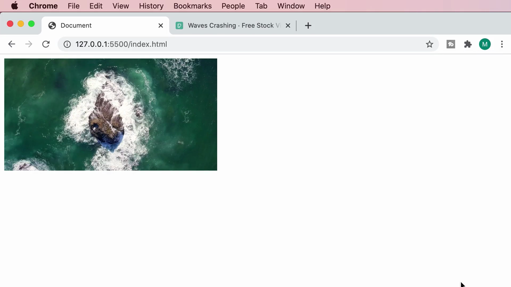

> **จุดสำคัญ:** การเลือก selector `video` ใน CSS จะมีผลกับ**ทุก** `<video>` element ในหน้า เหมือนกับการเลือก selector `img` ที่เคยสอนไปในคลิปก่อนหน้า — เป็นวิธีกำหนดสไตล์แบบรวมศูนย์ให้ elements ประเภทเดียวกันทั้งหมด

---

## 5. Attribute `controls` — เพิ่มปุ่มควบคุมการเล่น

Mosh เพิ่ม attribute **`controls`** เข้าไปในแท็ก `<video>`:

```html
<video controls="false" src="videos/ocean.mp4"></video>
```

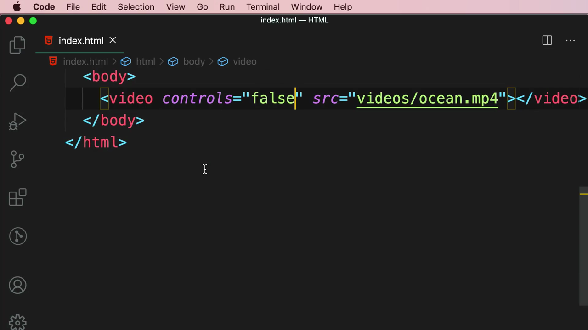

ผลลัพธ์ใน browser: วิดีโอตอนนี้มี**แถบควบคุม** (play/pause, timeline, volume, fullscreen) ปรากฏขึ้นมาด้านล่างของวิดีโอ:

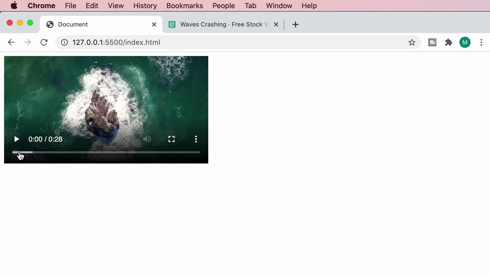

> **Boolean Attribute คืออะไร:** `controls` เป็นตัวอย่างของ **boolean attribute** — attribute ประเภทที่แค่ "มีอยู่" ในแท็กก็เพียงพอที่จะเปิดใช้งานฟีเจอร์นั้น ไม่ว่าจะใส่ค่าอะไรก็ตาม (แม้แต่ `controls="false"` ก็ยังทำให้ controls แสดงผล เพราะ HTML ไม่ได้ตีความค่า string "false" เป็น boolean false) วิธีที่ถูกต้องคือเขียนแค่ `controls` เฉยๆ โดยไม่ต้องใส่ค่า หากต้องการปิดฟีเจอร์นี้ ให้**ลบ attribute ออกทั้งหมด** ไม่ใช่ใส่ค่า false

โค้ดสุดท้ายในส่วนนี้ (แบบสะอาด ไม่ใส่ค่า):

```html
<video controls src="videos/ocean.mp4"></video>
```

---

## 6. Attribute `autoplay` — เล่นวิดีโออัตโนมัติ

ถัดมา Mosh เพิ่ม attribute **`autoplay`** ต่อจาก `controls`:

```html
<video controls autoplay src="videos/ocean.mp4"></video>
```

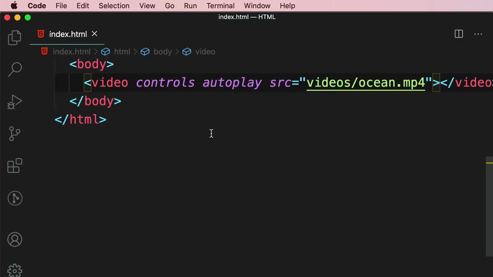

ผลลัพธ์: วิดีโอเริ่มเล่นเองทันทีที่หน้าเว็บโหลดเสร็จ โดยไม่ต้องกดปุ่ม play

---

## 7. เช็ค Browser Support ด้วย caniuse.com

Mosh สาธิตวิธีตรวจสอบว่า attribute หรือ feature ของ HTML ที่ใช้นั้น**รองรับใน browser ไหนบ้าง** โดยเข้าเว็บไซต์ **caniuse.com** แล้วค้นหาคำว่า **"video"**:

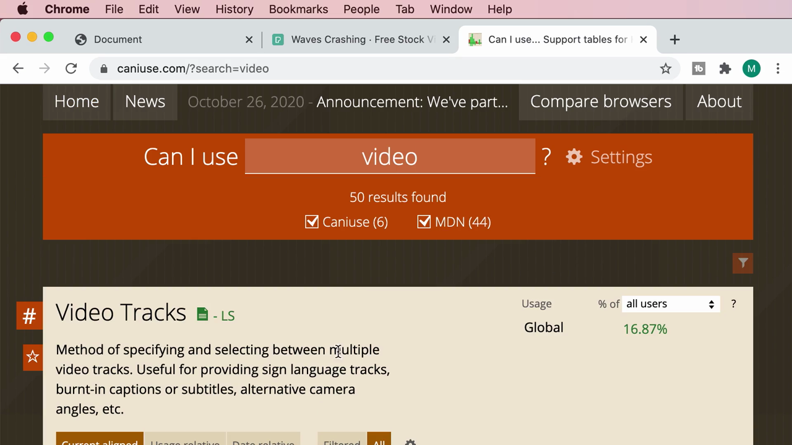

เลื่อนลงไปดูรายการ **"Video element"** ซึ่งอธิบายว่า:

> **"Method of playing videos on webpages (without requiring a plug-in). Includes support for the following media properties: currentSrc, currentTime, paused, playbackRate, buffered, duration, played, seekable, ended, autoplay, loop, controls, volume & muted"**

ตารางแสดง**เปอร์เซ็นต์การรองรับทั่วโลก (Global usage) อยู่ที่ 98.5% + 0.12% = 98.61%**:

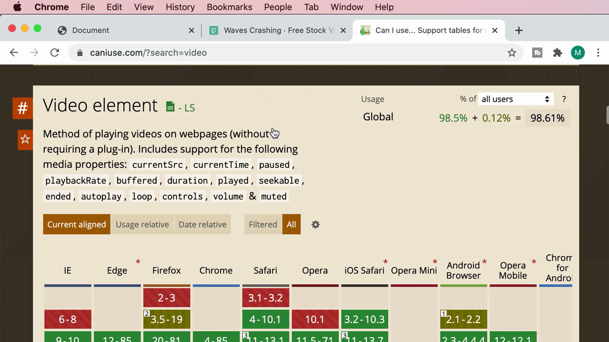

Mosh สาธิตการ hover เมาส์ไปที่ช่องสีของแต่ละ browser (เช่น Safari 4-10.1, Firefox 2-3, Opera Mini) เพื่อดูรายละเอียด popup — ช่องสีเขียวหมายถึง **"Supported"** ส่วนช่องสีแดงหมายถึง **"Not supported"** พร้อมข้อมูลเปอร์เซ็นต์การใช้งานทั่วโลกของ browser เวอร์ชันนั้นๆ (เช่น Opera Mini "Not supported", Global usage 0.88%)

> **ทำไมต้องเช็ค caniuse.com:** ก่อนใช้ HTML/CSS/JS feature ใหม่ๆ ควรเช็คก่อนว่า browser ที่ผู้ใช้เป้าหมายของเราใช้งานอยู่รองรับ feature นั้นหรือไม่ เพื่อป้องกันปัญหาหน้าเว็บพังหรือทำงานผิดปกติในบาง browser

---

## 8. Attribute `loop` และข้อความ Fallback

สุดท้าย Mosh เพิ่ม attribute **`loop`** เพื่อให้วิดีโอเล่นวนซ้ำไปเรื่อยๆ เมื่อจบแล้ว:

```html
<video controls autoplay loop src="videos/ocean.mp4"></video>
```

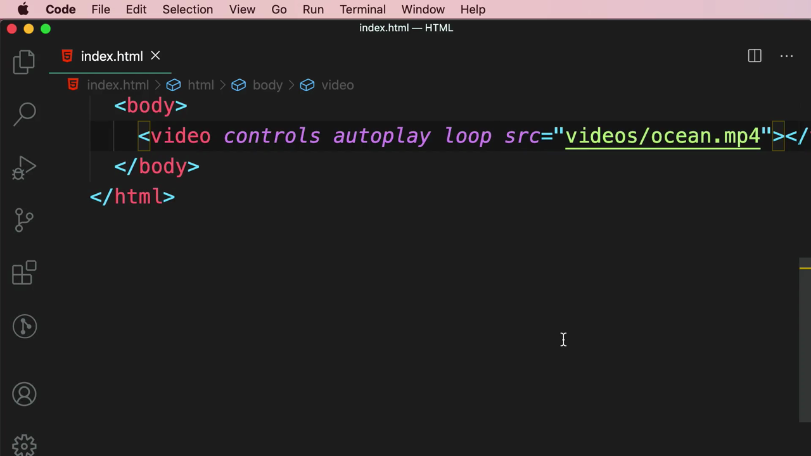

จากนั้นเพิ่ม**ข้อความ fallback** ไว้ระหว่างเปิด-ปิดแท็ก `<video>` สำหรับ browser รุ่นเก่าที่ไม่รองรับแท็กนี้:

```html
<video controls autoplay loop src="videos/ocean.mp4">
  Your browser doesn't support videos.
</video>
```

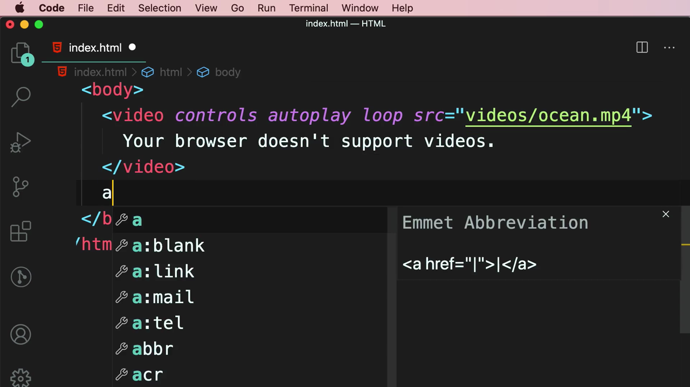

> **หลักการ Fallback Content:** เนื้อหาที่เขียนไว้ระหว่าง `<video>...</video>` จะแสดงผล**เฉพาะเมื่อ browser ไม่รองรับ**แท็ก `<video>` เท่านั้น หาก browser รองรับปกติ ข้อความนี้จะไม่ปรากฏให้เห็นเลย เป็นวิธีเดียวกับที่ `alt` ทำงานกับ `` แต่ใช้ syntax ต่างกัน (content ภายในแท็ก แทนที่จะเป็น attribute)

---

## 9. เริ่มต้นแท็ก `<audio>`

ปิดท้ายคลิป Mosh เริ่มพิมพ์แท็ก **`<audio>`** ต่อจาก `<video>` โดยใช้ syntax คล้ายกันมาก:

```html
<video controls autoplay loop src="videos/ocean.mp4">
  Your browser doesn't support videos.
</video>
<audio src=""></audio>
```

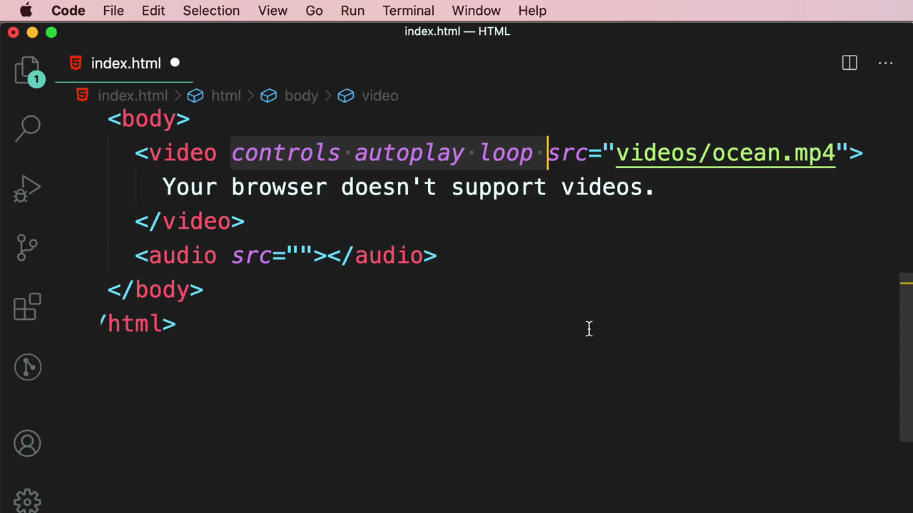

> **หมายเหตุ:** แท็ก `<audio>` มี attribute ชุดเดียวกับ `<video>` ทุกประการ (`src`, `controls`, `autoplay`, `loop`) เพียงแต่ไม่มีภาพวิดีโอมาแสดง — คลิปนี้เพิ่งเริ่มต้นแท็ก `<audio>` ไว้ ยังไม่ได้ใส่ไฟล์เสียงจริงหรือสาธิตการทำงานฉบับเต็ม

---

## สรุปที่ใช้ได้จริง

- แหล่งวิดีโอฟรีที่ใช้ได้ถูกลิขสิทธิ์: **Pexels** (pexels.com/search/videos/) เหมือน Unsplash แต่เป็นวิดีโอ ควรให้เครดิตผู้สร้างเสมอแม้ไม่บังคับ
- จัดระเบียบไฟล์วิดีโอไว้ในโฟลเดอร์ `videos/` แยกจาก `images/` และตั้งชื่อไฟล์ให้สั้น สื่อความหมาย
- `<video src="...">` เพียงอย่างเดียวจะแสดงแค่ภาพนิ่งเฟรมแรก ไม่มีการควบคุมใดๆ ต้องเพิ่ม attribute เพื่อเปิดใช้งานฟีเจอร์
- **Boolean attributes** (`controls`, `autoplay`, `loop`) — แค่มี attribute อยู่ในแท็กก็เปิดใช้งานแล้ว ไม่ต้องใส่ค่า และใส่ค่าอะไรก็ไม่มีผล (แม้แต่ `="false"`) ถ้าต้องการปิด ต้องลบ attribute ออกทั้งหมด
- **caniuse.com** เป็นเครื่องมือสำคัญสำหรับเช็ค browser compatibility ก่อนใช้ feature ใหม่ๆ ของ HTML/CSS/JS
- ข้อความระหว่าง `<video>...</video>` คือ fallback content แสดงเฉพาะ browser ที่ไม่รองรับแท็กนี้
- `<audio>` มีชุด attribute เดียวกับ `<video>` ทุกประการ ต่างกันแค่ไม่มีภาพให้แสดง

### จุดเชื่อมกับงานจริงของ Aum

- ใน Next.js การฝังวิดีโอ background (เช่น hero section ของ landing page) มักใช้หลักการเดียวกัน: `<video autoPlay loop muted playsInline>` — สังเกตว่า React/JSX ใช้ camelCase (`autoPlay` ไม่ใช่ `autoplay`) ต่างจาก HTML ธรรมดา
- `autoplay` วิดีโอบนเว็บสมัยใหม่ (รวมถึง browser มือถือ) มักต้องใส่ `muted` ควบคู่ไปด้วยเสมอ ไม่เช่นนั้น browser จะบล็อกการเล่นอัตโนมัติ (autoplay policy) — เป็นเรื่องที่ควรระวังเมื่อทำ landing page ที่มีวิดีโอพื้นหลัง
- Tailwind CSS มักใช้ `w-full h-auto object-cover` ควบคู่กับ `<video>` เพื่อควบคุมขนาดและการ crop ในลักษณะเดียวกับที่เคยเรียนเรื่อง `object-fit` กับ ``
- caniuse.com เป็นเว็บไซต์ที่มีประโยชน์มากเวลาต้องตัดสินใจว่าจะใช้ CSS/JS feature ใหม่ๆ (เช่น CSS Grid, `:has()` selector) ในโปรเจกต์ Next.js ของ Aum ได้หรือยัง
