# 3-HTML Basics: 08 - Lists (6:05)

**ไฟล์ต้นทาง:** `08-Lists.mp4`

▶️ **[เปิดวิดีโอต้นฉบับ](../../../HTML-CSS-1/3-HTML%20Basics/08-Lists.mp4)**

---

## ภาพรวมคลิปนี้

คลิปนี้ Mosh สอนเรื่อง **List (รายการ) ใน HTML** ทั้ง 3 ประเภทหลัก: **Unordered List** (`<ul>`), **Ordered List** (`<ol>`), และ **Description List** (`<dl>`) รวมถึงการทำ**รายการซ้อนรายการ (nested list)** และการปรับแต่งสไตล์ bullet ด้วย CSS

---

## 1. Unordered List (`<ul>`) — รายการไม่มีลำดับ

Mosh เริ่มต้นด้วยแท็ก `<ul>` ว่างๆ แล้วใส่ `<li>` (list item) 4 รายการเป็นเมนูนำทางตัวอย่าง:

```html
<ul>
  <li>About me</li>
  <li>Courses</li>
  <li>Subscribe</li>
  <li>Contact me</li>
</ul>
```

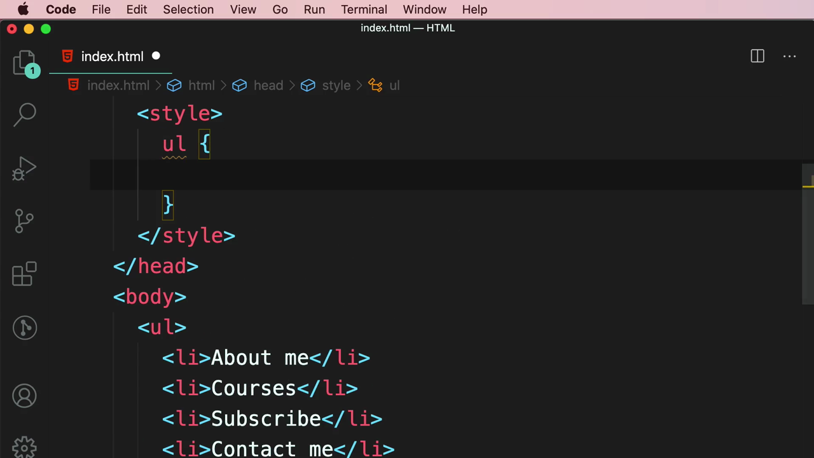

ผลลัพธ์ใน browser: แสดงเป็นรายการมี**จุดกลม (bullet point)** นำหน้าแต่ละบรรทัดโดยอัตโนมัติ — นี่คือสไตล์ default ของ `<ul>`:

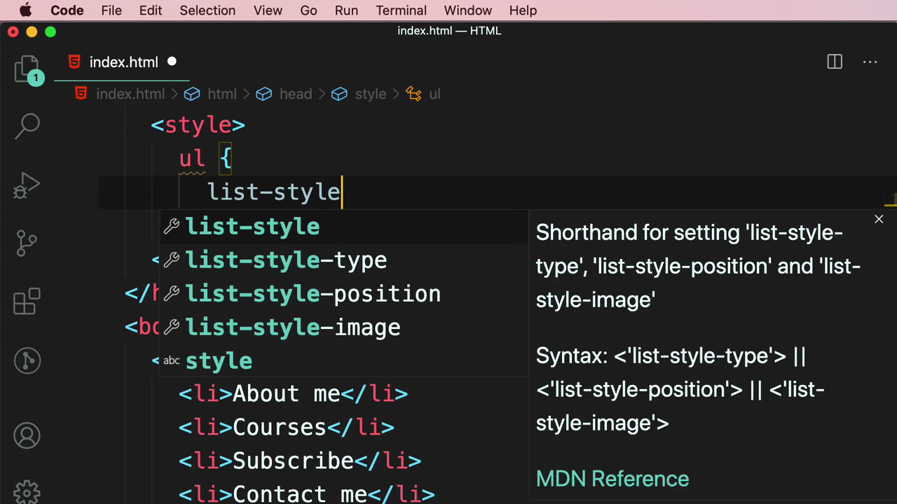

### ปรับแต่งรูปแบบ Bullet ด้วย CSS `list-style-type`

Mosh เพิ่ม CSS เพื่อเปลี่ยนรูปแบบ bullet จากจุดกลมเป็น**สี่เหลี่ยม (square)**:

```html
<style>
  ul {
    list-style-type: square;
  }
</style>
```

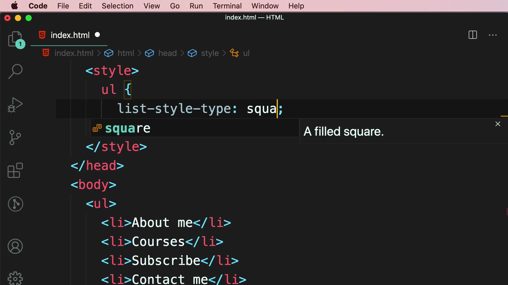

ผลลัพธ์: bullet เปลี่ยนจากจุดกลมเป็นสี่เหลี่ยมทึบ:

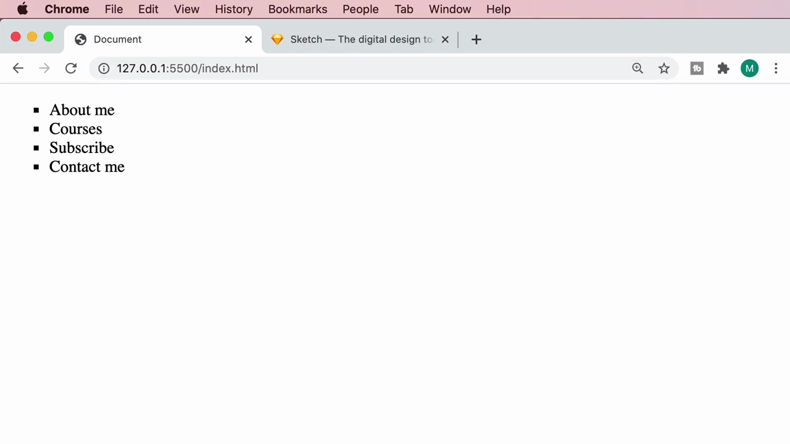

> **ค่าอื่นๆ ของ `list-style-type`:** นอกจาก `square` ยังมี `disc` (จุดกลม, ค่า default), `circle` (วงกลมกลวง), และ `none` (ไม่มี bullet เลย) — การตั้งค่า `none` เป็นเทคนิคที่นิยมใช้มากเวลาทำเมนูนำทาง (navigation menu) ด้วย `<ul>` เพราะไม่ต้องการให้มี bullet แสดง

---

## 2. Nested List — รายการซ้อนรายการ

Mosh สาธิตการสร้าง**รายการย่อยภายในรายการหลัก** โดยใส่ `<ul>` ใหม่เข้าไปข้างใน `<li>Courses</li>` — เปลี่ยนจาก self-closing เป็นแท็กเปิด-ปิดที่มี `<ul>` ซ้อนอยู่ข้างใน:

```html
<li>
  Courses
  <ul>
    <li>HTML</li>
    <li>JavaScript</li>
    <li>Git</li>
  </ul>
</li>
```

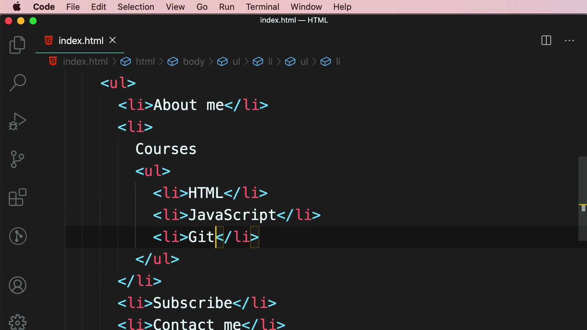

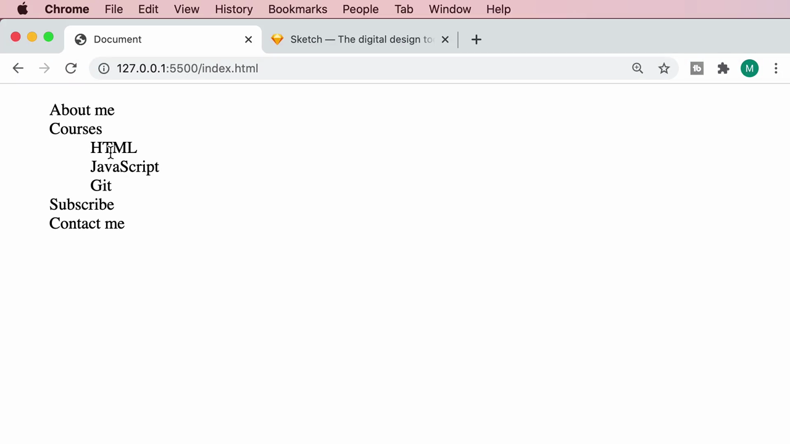

ผลลัพธ์ใน browser: รายการย่อย (HTML, JavaScript, Git) จะแสดงเป็น**รายการซ้อน**อยู่ใต้ "Courses" พร้อมการเยื้อง (indent) เข้าไปด้านใน:

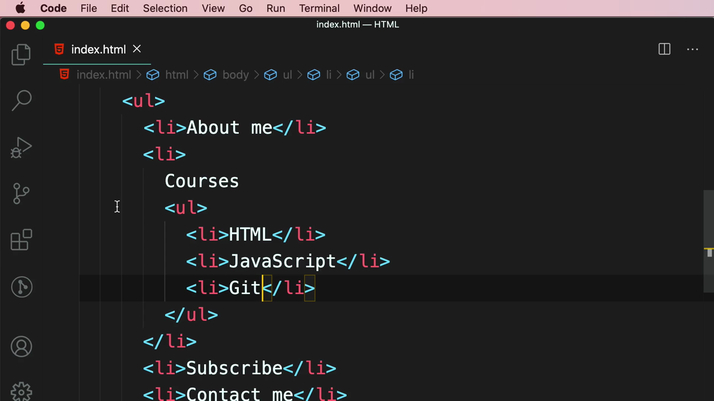

> **หลักการ Nested List:** สามารถวางแท็ก `<ul>` (หรือ `<ol>`) ไว้ข้างในแท็ก `<li>` ได้โดยตรง เพื่อสร้างโครงสร้างรายการแบบลำดับชั้น (hierarchy) เหมาะสำหรับเมนูแบบ dropdown หรือสารบัญที่มีหัวข้อย่อย

---

## 3. Ordered List (`<ol>`) — รายการมีลำดับเลข

Mosh ล้างโค้ดในส่วน `<body>` แล้วเริ่มตัวอย่างใหม่ด้วยแท็ก **`<ol>`** สำหรับขั้นตอนการทำพิซซ่า:

```html
<ol>
  <li>Preheat the oven.</li>
  <li>Place the ingredients on the crust.</li>
  <li>Put the pizza in the oven for 20 minutes.</li>
</ol>
```

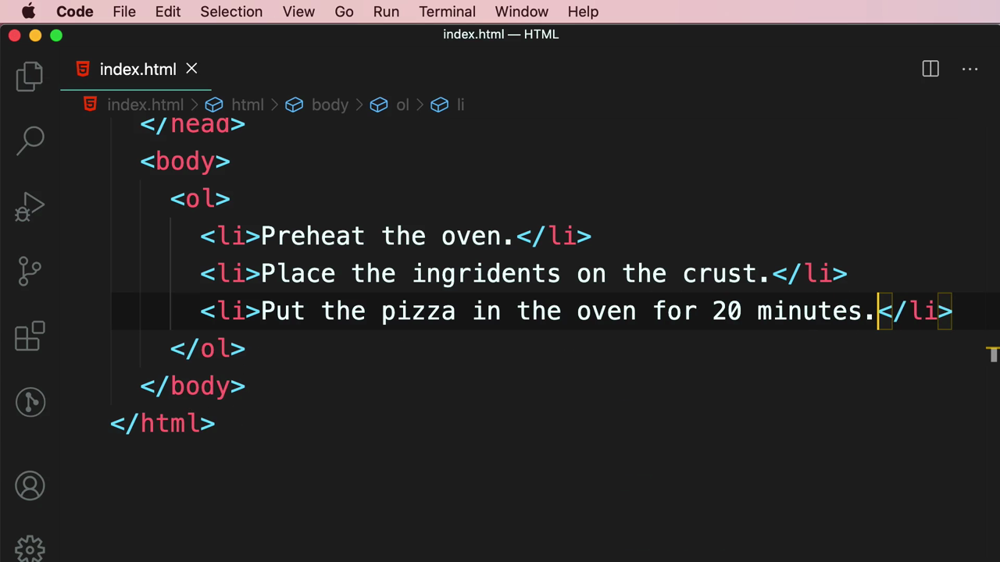

ผลลัพธ์ใน browser: browser จะ**ใส่เลขลำดับให้อัตโนมัติ** (1, 2, 3, ...) หน้าแต่ละ `<li>`:

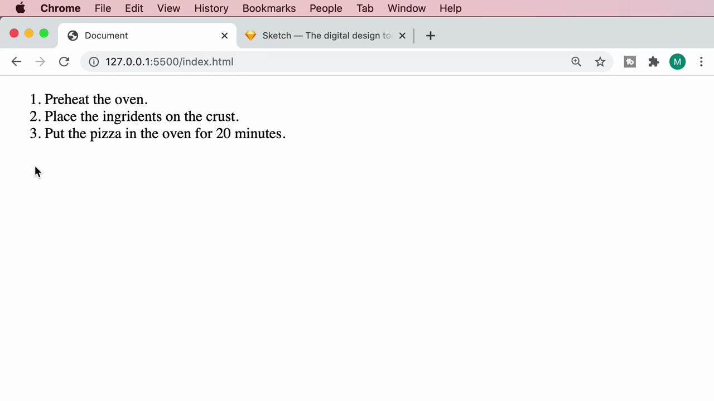

> **จุดต่างจาก `<ul>`:** `<ol>` (Ordered List) เหมาะกับเนื้อหาที่มี**ลำดับความสำคัญหรือขั้นตอนที่ต้องทำตามลำดับ** เช่น สูตรอาหาร คู่มือการใช้งาน ในขณะที่ `<ul>` (Unordered List) เหมาะกับรายการที่ไม่มีลำดับก่อนหลัง เช่น เมนูนำทาง, รายการ tag

---

## 4. Description List (`<dl>`) — รายการคำอธิบาย

Mosh ล้างโค้ดอีกครั้งแล้วสาธิตแท็กที่สาม: **`<dl>`** (Description List) ซึ่งใช้คู่กับ `<dt>` (Description Term — คำศัพท์) และ `<dd>` (Description Data — คำอธิบาย):

```html
<dl>
  <dt>HTML</dt>
  <dd>Hypertext Markup Language</dd>
  <dt>CSS</dt>
  <dd>Cascading Stylesheets</dd>
</dl>
```

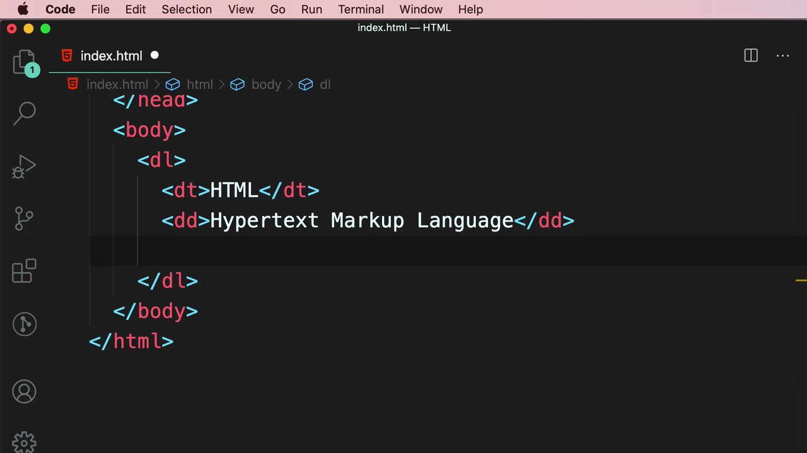

ผลลัพธ์ใน browser: คำศัพท์ (`<dt>`) แสดงอยู่บรรทัดบน และคำอธิบาย (`<dd>`) แสดงเยื้องเข้ามาด้านล่าง:

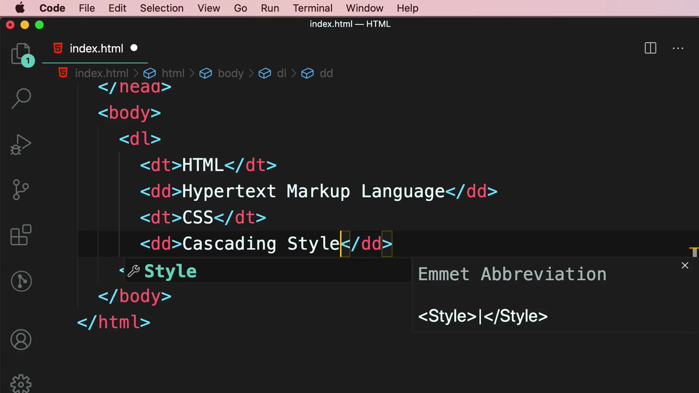

### หนึ่ง `<dt>` สามารถมีได้หลาย `<dd>`

Mosh ขยายตัวอย่างเป็นข้อมูลคอร์สเรียน (Title, Author, Skills) และสาธิตว่า **`<dt>` หนึ่งตัวสามารถมี `<dd>` ตามมาได้มากกว่า 1 รายการ** — ใช้กับ "Skills" ที่มีทักษะหลายอย่าง:

```html
<dl>
  <dt>Title</dt>
  <dd>The Ultimate HTML and CSS Course</dd>
  <dt>Author</dt>
  <dd>Mosh Hamedani</dd>
  <dt>Skills</dt>
  <dd>HTML</dd>
  <dd>CSS</dd>
  <dd>Responsive Design</dd>
  <dd>Search Engine Optimization</dd>
</dl>
```

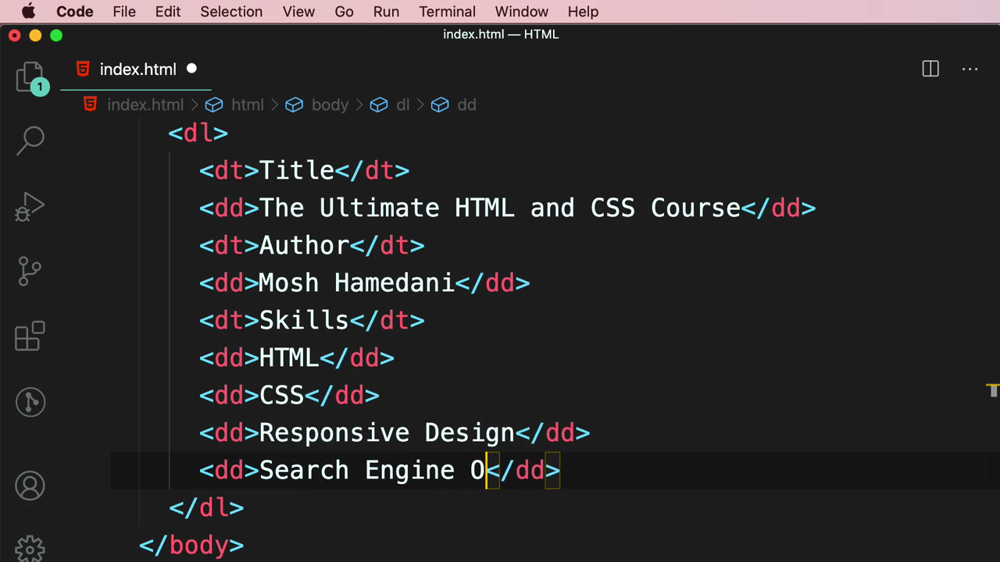

ผลลัพธ์ใน browser: "Skills" แสดงเป็นหัวข้อเดียว ตามด้วยรายการทักษะทั้ง 4 อย่างเรียงกันด้านล่าง (HTML, CSS, Responsive Design, Search Engine Optimization):

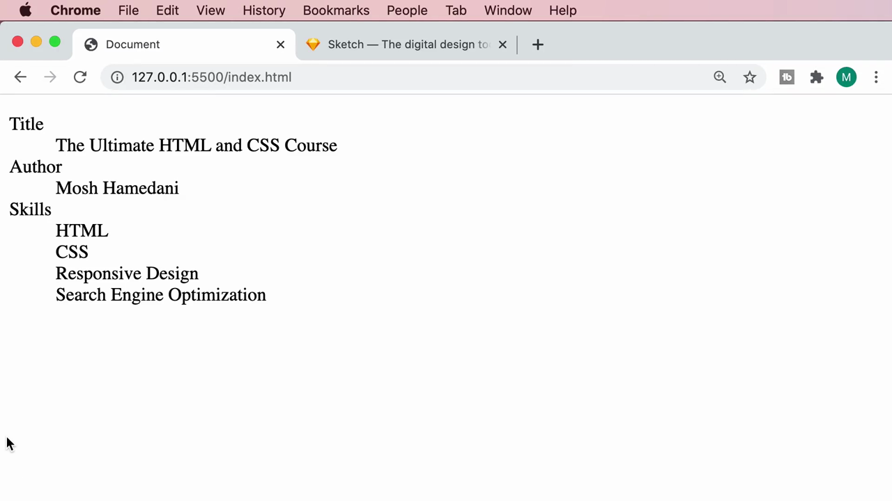

> **การใช้งานจริงของ `<dl>`:** เหมาะกับข้อมูลประเภท**คำศัพท์-คำนิยาม** เช่น พจนานุกรม, glossary, FAQ, หรือรายละเอียดสินค้า (ชื่อคุณสมบัติ + ค่า) — พบได้บ่อยในหน้า metadata หรือ specification ของสินค้า

---

## สรุปที่ใช้ได้จริง

- **`<ul>`** (Unordered List) — ใช้ `<li>` เป็นรายการย่อย เหมาะกับรายการที่ไม่มีลำดับก่อนหลัง เช่น เมนู
- **`<ol>`** (Ordered List) — เหมือน `<ul>` แต่ใส่เลขลำดับอัตโนมัติ เหมาะกับขั้นตอนที่ต้องทำตามลำดับ
- **`<dl>` + `<dt>` + `<dd>`** — สำหรับคู่คำศัพท์-คำอธิบาย และ `<dt>` หนึ่งตัวสามารถมีได้หลาย `<dd>`
- **Nested list** — วาง `<ul>`/`<ol>` ซ้อนภายใน `<li>` เพื่อสร้างโครงสร้างลำดับชั้น
- CSS `list-style-type` ปรับรูปแบบ bullet ได้ (`disc`, `circle`, `square`, `none`) ตั้งค่าที่ selector `ul` หรือ `ol` จะมีผลกับทุก list ในหน้า

### จุดเชื่อมกับงานจริงของ Aum

- เมนูนำทาง (Navbar) ใน Next.js แทบทุกโปรเจกต์สร้างจาก `<ul>` + `<li>` ครอบ `<Link>` ของ Next.js และมักตั้ง `list-style: none` ใน Tailwind ด้วย class `list-none` เสมอ เพราะไม่ต้องการให้เห็น bullet ในเมนู
- Nested `<ul>` เป็นพื้นฐานของ dropdown menu หรือ mega menu ที่ทำใน React component โดยใช้ state (`useState`) ควบคุมการเปิด-ปิดรายการย่อย
- `<dl>`/`<dt>`/`<dd>` มีประโยชน์เวลาแสดงข้อมูล spec สินค้าใน e-commerce landing page (เช่น ชื่อคุณสมบัติ + ค่า) — สามารถ map ข้อมูลจาก JSON server มาแสดงเป็นโครงสร้างนี้ได้โดยตรง
- Tailwind class ที่ใช้คู่กับ list บ่อยๆ: `list-disc`, `list-decimal`, `list-none`, `list-inside`/`list-outside` — ควบคุมรูปแบบและตำแหน่ง bullet ได้โดยไม่ต้องเขียน custom CSS
