# 3-HTML Basics: 09 - Tables (8:45)

**ไฟล์ต้นทาง:** `09-Tables.mp4`

▶️ **[เปิดวิดีโอต้นฉบับ](../../../HTML-CSS-1/3-HTML%20Basics/09-Tables.mp4)**

---

## ภาพรวมคลิปนี้

คลิปนี้ Mosh สอนเรื่อง **Table (ตาราง) ใน HTML** อย่างละเอียด ตั้งแต่โครงสร้างพื้นฐาน (`<table>`, `<tr>`, `<td>`) การจัดสไตล์เส้นขอบด้วย CSS (พร้อมหลักการ **DRY — Don't Repeat Yourself**) ไปจนถึงแท็กหัวตาราง (`<th>`), โครงสร้างเชิงความหมาย (`<thead>`, `<tbody>`, `<tfoot>`) และ attribute `colspan` สำหรับการรวมคอลัมน์

---

## 1. ดูตัวอย่างตารางจาก Bootstrap ก่อนเริ่ม

Mosh เปิดหน้าเอกสาร **Bootstrap v4.5** (`getbootstrap.com/docs/4.5/content/tables/`) เพื่อโชว์ตัวอย่างตารางที่จัดสไตล์สวยงามเป็นแรงบันดาลใจก่อนเริ่มสอน โครงสร้างพื้นฐาน:

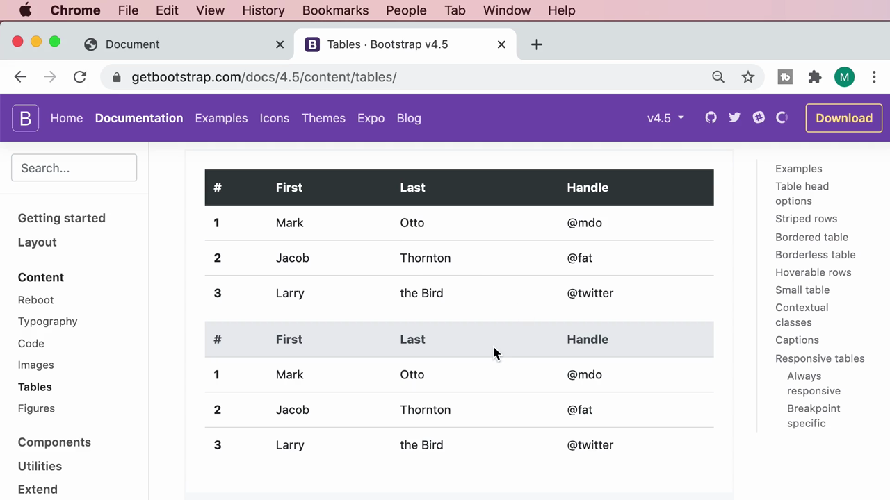

---

## 2. โครงสร้างพื้นฐาน: `<table>`, `<tr>`, `<td>`

Mosh เริ่มสร้างตารางงบประมาณ (budget) ด้วยโครงสร้าง 3 ชั้น:
- **`<table>`** — ครอบทั้งตาราง
- **`<tr>`** (table row) — หนึ่งแถว
- **`<td>`** (table data) — หนึ่งช่องข้อมูล

```html
<table>
  <tr>
    <td>Marketing</td>
    <td>$100</td>
  </tr>
  <tr>
    <td>Accounting</td>
    <td>$200</td>
  </tr>
</table>
```

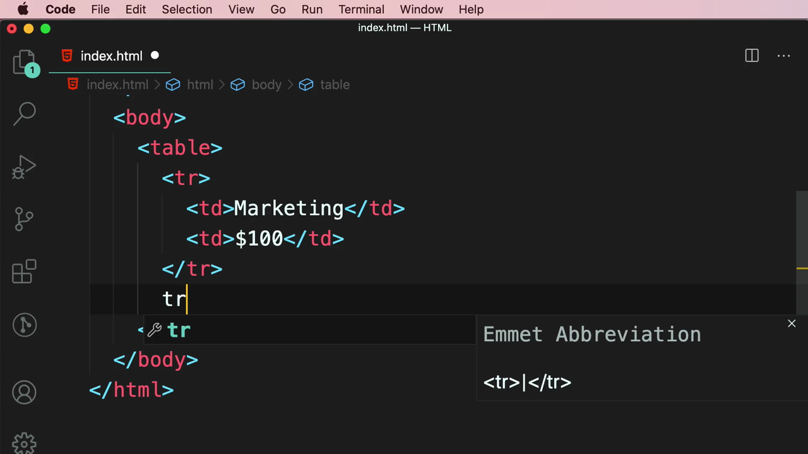

ผลลัพธ์ใน browser: ข้อมูลแสดงเรียงกันแต่**ไม่มีเส้นขอบ**ใดๆ เลย:

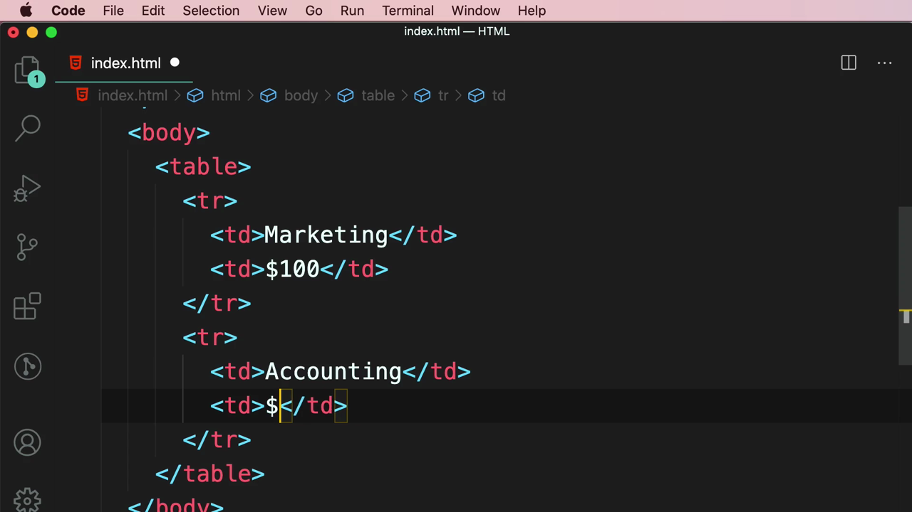

> **โครงสร้างข้อมูล:** แต่ละ `<tr>` แทนหนึ่งแถว และภายในแต่ละแถวจะมี `<td>` กี่ตัวก็ได้ตามจำนวนคอลัมน์ที่ต้องการ — จำนวน `<td>` ในแต่ละ `<tr>` ควรเท่ากันเพื่อให้ตารางเรียงคอลัมน์ตรงกัน

---

## 3. เพิ่มเส้นขอบด้วย CSS และหลักการ DRY

Mosh เพิ่ม CSS ให้ `<table>` มีเส้นขอบ:

```html
<style>
  table {
    border: 1px solid grey;
  }
</style>
```

ผลลัพธ์: มีเพียง**เส้นขอบรอบนอกตาราง**เท่านั้น ยังไม่มีเส้นแบ่งระหว่างช่อง:

เมื่อ Mosh ลองเพิ่มเส้นขอบให้ `<td>` ด้วยอีก CSS rule แยกต่างหาก (คัดลอกโค้ดเดิมมาวาง) จะได้ตารางมีเส้นขอบครบ แต่ Mosh หยุดสอนแทรกด้วยหลักการสำคัญ:


> **หลักการ DRY (Don't Repeat Yourself):** หากพบว่ากำลังเขียนโค้ดซ้ำกัน (เช่น `border: 1px solid grey;` ในสอง selector) ควรหาวิธีรวมเป็นที่เดียว เพื่อให้ง่ายต่อการแก้ไขในอนาคต — นี่คือหลักการพื้นฐานที่สำคัญมากในวงการเขียนโปรแกรม

Mosh จึงรวม selector ด้วยเครื่องหมายจุลภาค (comma) แทนการเขียนซ้ำ:

```html
<style>
  table,
  td {
    border: 1px solid grey;
  }
</style>
```

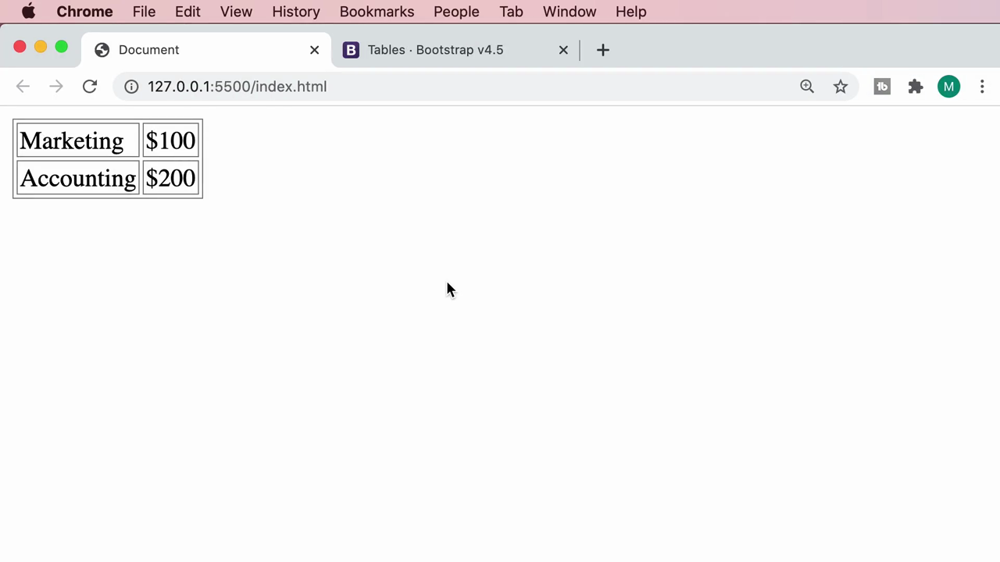

ผลลัพธ์: ตอนนี้ตารางมีเส้นขอบครบทุกช่อง แต่สังเกตว่าเส้นขอบระหว่างช่องมี**ความหนาเป็นสองเท่า** (double border) เพราะเส้นขอบของ `<table>` กับ `<td>` ที่อยู่ติดกันซ้อนทับกัน:

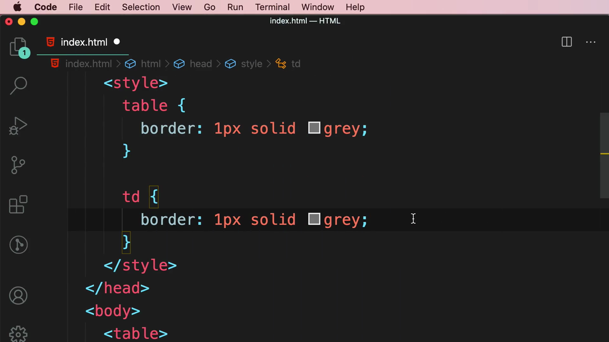

---

## 4. แก้ปัญหาเส้นขอบซ้อนด้วย `border-collapse`

Mosh เพิ่ม CSS property **`border-collapse: collapse`** เพื่อรวมเส้นขอบที่ซ้อนกันให้เหลือเส้นเดียว:

```html
<style>
  table,
  td {
    border: 1px solid grey;
    border-collapse: collapse;
  }
</style>
```

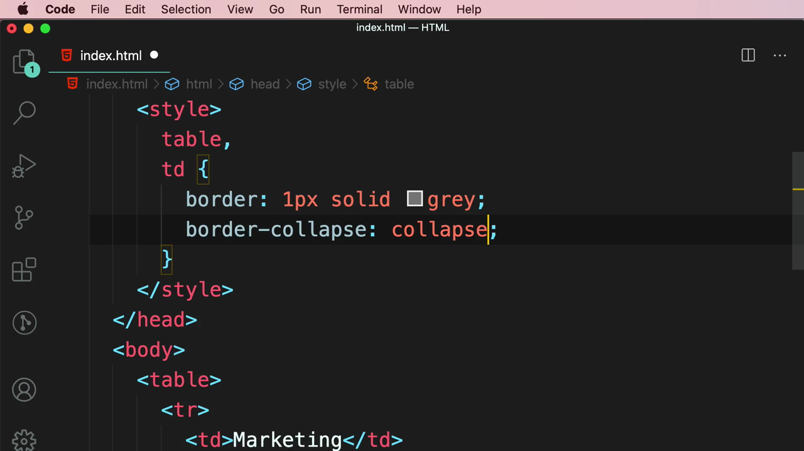

ผลลัพธ์: เส้นขอบกลับมาเป็นเส้นเดียวบางๆ ที่สวยงาม ไม่ซ้อนทับกันอีกต่อไป:

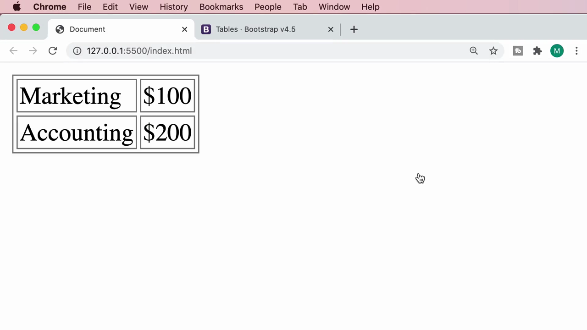

Mosh ยังเพิ่ม `padding: 5px;` เพื่อให้เนื้อหาในแต่ละช่องมีระยะห่างจากขอบ ไม่ชิดจนเกินไป

> **หมายเหตุ:** `border-collapse: collapse` ควรตั้งค่าที่ selector `table` เท่านั้นก็เพียงพอ (ไม่จำเป็นต้องตั้งที่ `td` ด้วย) แต่เนื่องจากใช้ comma selector ร่วมกัน จึงมีผลกับทั้งสอง element โดยไม่มีปัญหาอะไร

---

## 5. `<th>` — แท็กสำหรับหัวตาราง (Table Header)

Mosh เพิ่มแถวใหม่ด้านบนสุดโดยใช้แท็ก **`<th>`** (table header) แทน `<td>` สำหรับหัวข้อคอลัมน์ "Category" และ "Amount":

```html
<tr>
  <th>Category</th>
  <th>Amount</th>
</tr>
```

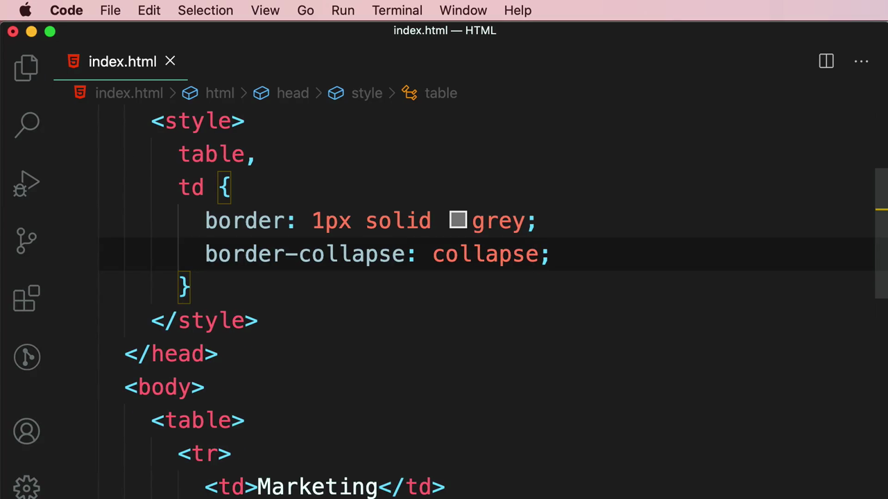

ผลลัพธ์ใน browser: ข้อความใน `<th>` แสดงเป็น**ตัวหนา (bold)** และ**จัดกึ่งกลาง (centered)** โดยอัตโนมัติ ต่างจาก `<td>` ที่ชิดซ้ายและไม่หนา:

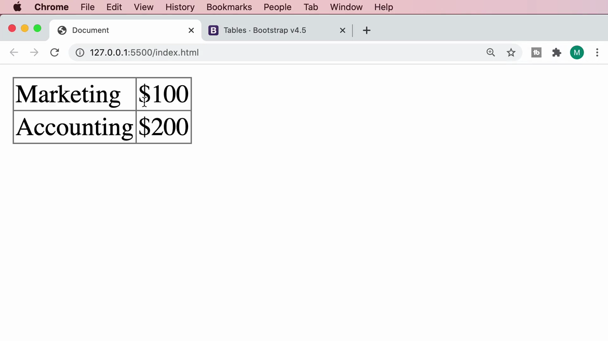

> **`<th>` vs `<td>`:** `<th>` มีความหมายเชิงความหมาย (semantic) ว่าเป็น**หัวข้อของคอลัมน์หรือแถว** ซึ่งช่วยให้ screen reader และเครื่องมือค้นหาเข้าใจโครงสร้างข้อมูลได้ดีขึ้น นอกจากสไตล์ default (ตัวหนา + กึ่งกลาง) แล้วยังสื่อความหมายเชิง accessibility ที่ `<td>` ทำไม่ได้

---

## 6. โครงสร้างเชิงความหมาย: `<thead>`, `<tbody>`, `<tfoot>`

Mosh สอนการจัดกลุ่มแถวของตารางให้มีความหมายชัดเจนขึ้นด้วย 3 แท็ก:

### `<thead>` — ครอบแถวหัวตาราง

```html
<table>
  <thead>
    <tr>
      <th>Category</th>
      <th>Amount</th>
    </tr>
  </thead>
  ...
```

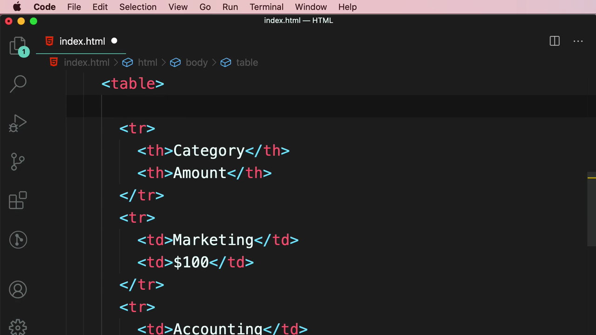

### `<tbody>` — ครอบแถวเนื้อหาข้อมูลหลัก

```html
  <tbody>
    <tr>
      <td>Marketing</td>
      <td>$100</td>
    </tr>
    <tr>
      <td>Accounting</td>
      <td>$200</td>
    </tr>
  </tbody>
</table>
```

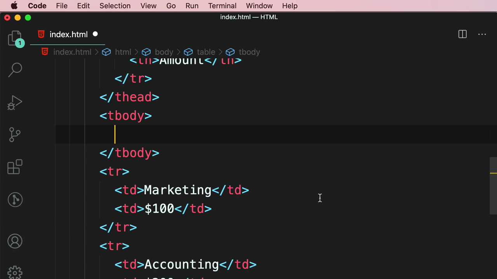

> **ทำไมต้องใช้ `<thead>`/`<tbody>`/`<tfoot>`:** แม้จะไม่มีผลต่อการแสดงผลโดย default แต่ช่วยให้โครงสร้าง HTML สื่อความหมายชัดเจน (semantic) ทำให้ browser, screen reader, และเครื่องมือ SEO เข้าใจว่าส่วนไหนคือหัวตาราง ส่วนไหนคือเนื้อหา ส่วนไหนคือสรุปท้ายตาราง นอกจากนี้ยังเปิดโอกาสให้ใช้ CSS เลือกสไตล์แต่ละส่วนแยกกันได้ง่ายขึ้น

---

## 7. Attribute `colspan` — รวมหลายคอลัมน์เข้าด้วยกัน

Mosh เพิ่มแถวหัวข้อใหญ่ "Expenses" ไว้เหนือแถว Category/Amount:

```html
<thead>
  <tr>
    <th>Expenses</th>
  </tr>
  <tr>
    <th>Category</th>
    <th>Amount</th>
  </tr>
</thead>
```

เมื่อดูใน browser ตอนแรก "Expenses" จะกินพื้นที่แค่คอลัมน์แรกเท่านั้น ทำให้ตารางดูไม่สมดุล:

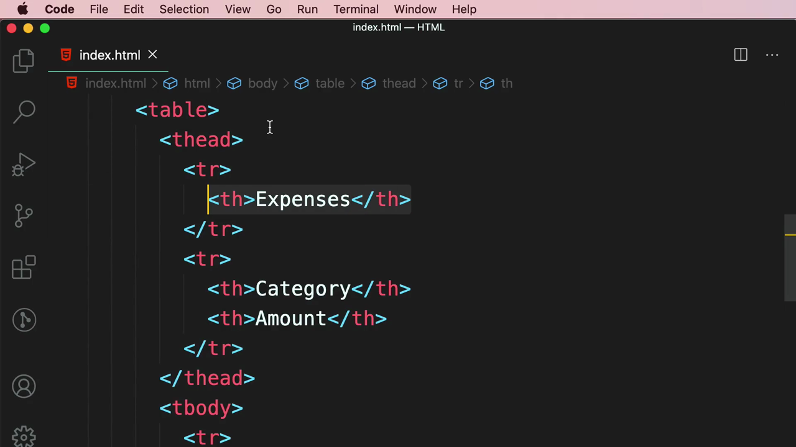

Mosh แก้ไขด้วย attribute **`colspan="2"`** เพื่อให้ `<th>Expenses</th>` ขยายกินพื้นที่ **2 คอลัมน์**:

```html
<th colspan="2">Expenses</th>
```

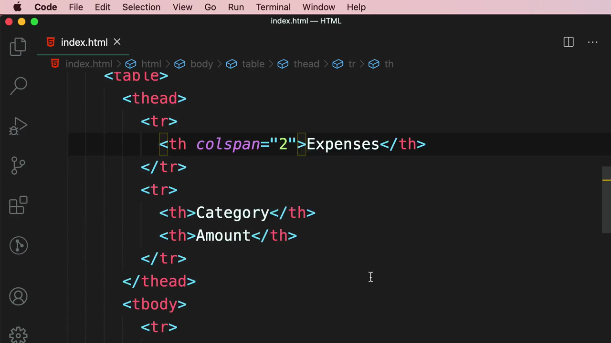

> **หลักการ `colspan`:** attribute นี้ใส่ในแท็ก `<th>` หรือ `<td>` เพื่อสั่งให้ช่องนั้น**กินพื้นที่ข้ามหลายคอลัมน์** โดยค่าตัวเลขคือจำนวนคอลัมน์ที่ต้องการรวม (มี `rowspan` คู่กันสำหรับรวมข้ามหลายแถวในลักษณะเดียวกัน)

---

## 8. `<tfoot>` — แถวสรุปท้ายตาราง

สุดท้าย Mosh เพิ่ม **`<tfoot>`** พร้อมแถวสรุปยอดรวม (Total):

```html
<tfoot>
  <tr>
    <th>Total</th>
    <th>$300</th>
  </tr>
</tfoot>
```

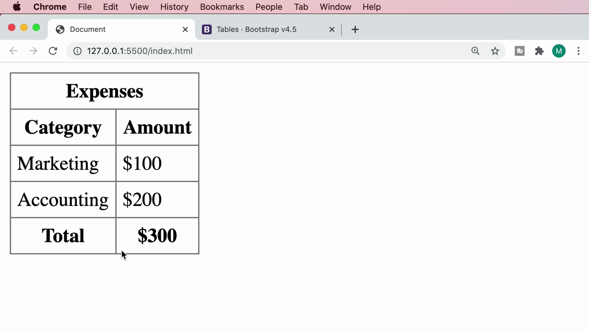

ผลลัพธ์สุดท้าย: ตารางครบสมบูรณ์ มีหัวข้อ "Expenses" ครอบ 2 คอลัมน์, แถวหัวตาราง Category/Amount, ข้อมูล Marketing/Accounting และแถวสรุป Total ที่ท้ายตาราง:

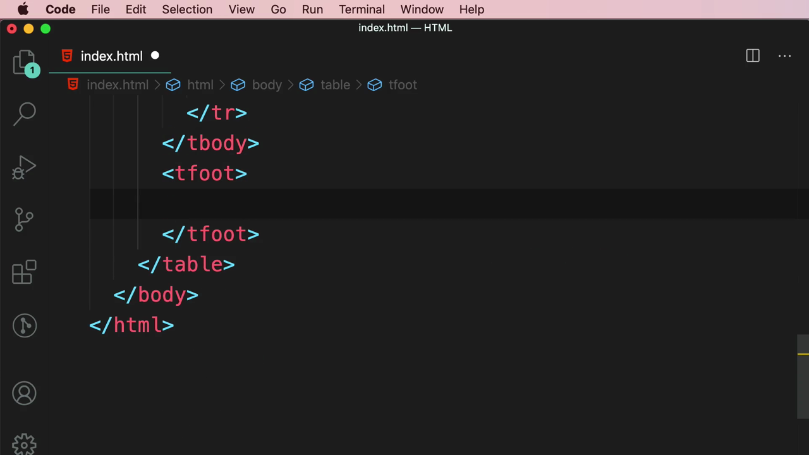

---

## สรุปที่ใช้ได้จริง

- โครงสร้างพื้นฐานตาราง: `<table>` → `<tr>` (แถว) → `<td>` (ช่องข้อมูล) หรือ `<th>` (ช่องหัวตาราง)
- **หลักการ DRY** — หลีกเลี่ยงการเขียน CSS ซ้ำ ใช้ comma selector (`table, td { ... }`) รวม rule ที่เหมือนกัน
- `border-collapse: collapse` แก้ปัญหาเส้นขอบตารางซ้อนทับกันเป็นเส้นคู่
- `<th>` ให้สไตล์ bold + center อัตโนมัติ และสื่อความหมาย semantic ว่าเป็นหัวข้อ
- `<thead>`, `<tbody>`, `<tfoot>` จัดกลุ่มแถวตามความหมาย (หัวตาราง/เนื้อหา/สรุป) แม้ไม่กระทบการแสดงผล default แต่ดีต่อ SEO และ accessibility
- `colspan="n"` (และ `rowspan="n"`) ใช้รวมหลายคอลัมน์/แถวเข้าเป็นช่องเดียว

### จุดเชื่อมกับงานจริงของ Aum

- ตารางข้อมูล (data table) ใน Next.js dashboard มักสร้างจากโครงสร้าง `<table>`/`<thead>`/`<tbody>` เดียวกันนี้ทุกประการ เพียงแต่ข้อมูลจะ map มาจาก array ด้วย `.map()` แทนการพิมพ์ตายตัว
- Tailwind CSS มี utility class ตรงกับ CSS ที่เรียนวันนี้: `border`, `border-collapse`, `p-2` (padding) — ใช้แทน custom CSS ได้ทันที เช่น `<table className="border-collapse border border-gray-400">`
- `colspan`/`rowspan` มีประโยชน์มากเวลาทำตาราง pricing plan หรือตารางเปรียบเทียบสินค้าที่มีหัวข้อครอบหลายคอลัมน์
- เมื่อ fetch ข้อมูลจาก JSON server มาแสดงเป็นตาราง ควรจำไว้เสมอว่า `<thead>` ใส่แค่ครั้งเดียว ส่วน `<tbody>` คือที่ที่ข้อมูล dynamic (จาก state หรือ API) จะถูก render ซ้ำเป็นแต่ละแถว
