# 3-HTML Basics: 10 - Containers (5:04)

**ไฟล์ต้นทาง:** `10-Containers.mp4`

▶️ **[เปิดวิดีโอต้นฉบับ](../../../HTML-CSS-1/3-HTML%20Basics/10-Containers.mp4)**

---

## ภาพรวมคลิปนี้

คลิปนี้ Mosh สอนเรื่อง **Container Elements** สองตัวหลักของ HTML คือ **`<div>`** (Block-level container) และ **`<span>`** (Inline container) พร้อมอธิบายความแตกต่างพื้นฐานที่สุดของ HTML คือ **Block-level Element vs Inline Element** ซึ่งเป็นแนวคิดสำคัญที่ต้องเข้าใจก่อนจะเรียน CSS Layout ต่อไป

---

## 1. `<div>` — Container พื้นฐานสำหรับจัดกลุ่มเนื้อหา

Mosh เริ่มต้นด้วยแท็ก `<div>` ว่างๆ แล้วใส่เนื้อหาเข้าไปข้างใน:

```html
<div>
  <p>Lorem ipsum dolor sit amet.</p>
  <a href="#">Link</a>
</div>
```

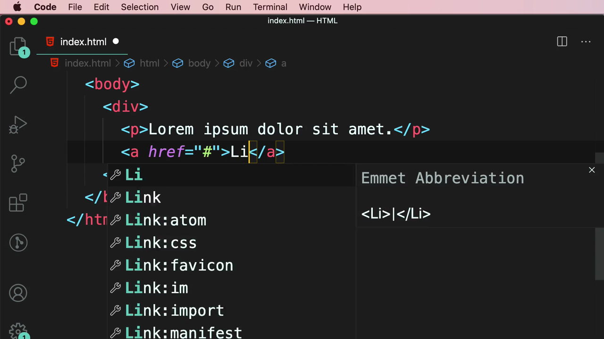

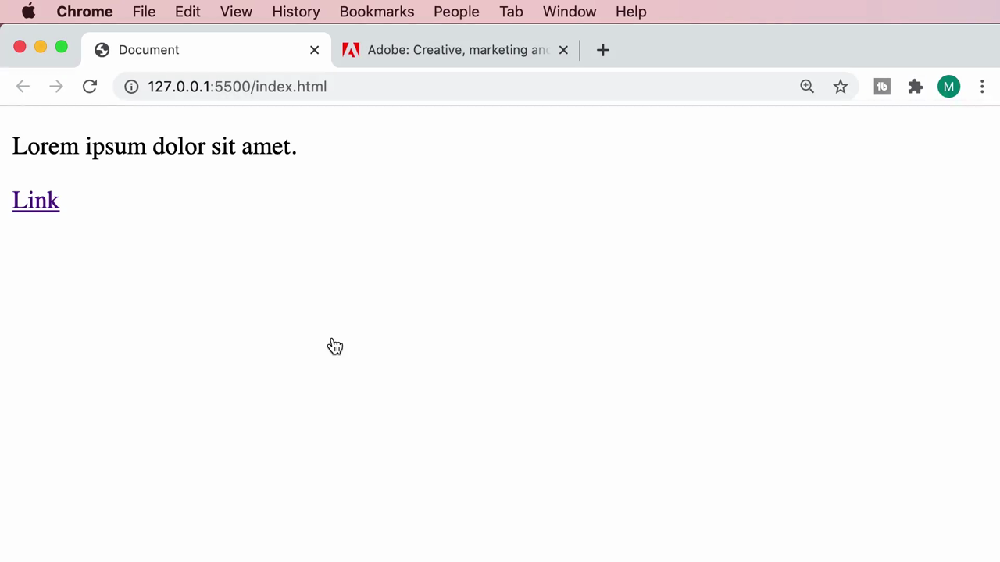

ผลลัพธ์ใน browser แสดงเนื้อหาปกติ ไม่มีสไตล์พิเศษ:

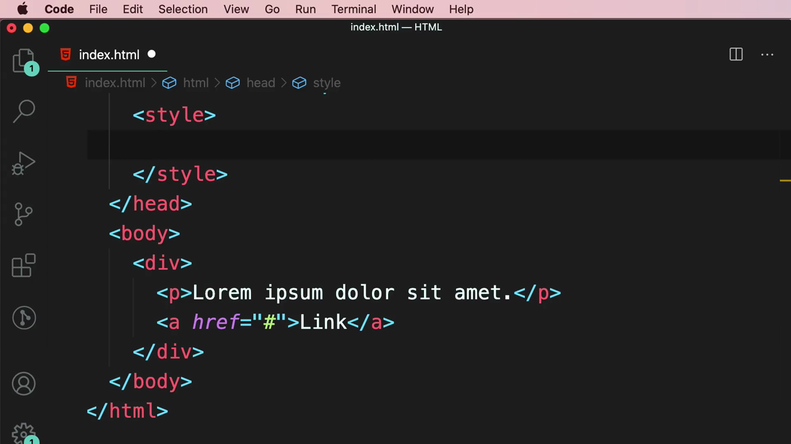

> **`<div>` คืออะไร:** `<div>` (Division) เป็น element ที่**ไม่มีความหมายเชิงความหมาย (non-semantic)** ใช้เป็นภาชนะ (container) สำหรับจัดกลุ่มเนื้อหาหลายๆ ส่วนเข้าด้วยกัน เพื่อให้ง่ายต่อการจัดสไตล์หรือจัดวางด้วย CSS ในคราวเดียว

---

## 2. ใช้ `class` เพื่อจัดสไตล์ container ด้วย CSS

Mosh เพิ่ม attribute `class="product"` ให้กับ `<div>` แล้วเขียน CSS เลือกด้วย class selector (`.product`):

```html
<div class="product">
  <p>Lorem ipsum dolor sit amet.</p>
  <a href="#">Link</a>
</div>
```

```css
.product {
  background-color: gold;
}
```

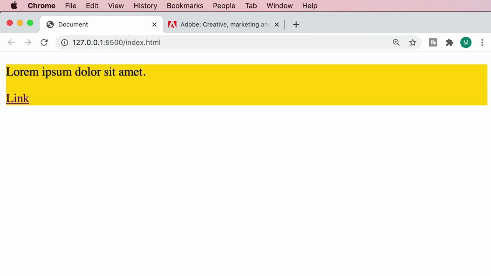

ผลลัพธ์: กล่อง `<div>` ทั้งกล่องถูกทาสีทองเป็นพื้นหลัง และสังเกตว่า**ความกว้างของกล่องขยายเต็มความกว้างของหน้าจอโดยอัตโนมัติ** แม้เนื้อหาข้างในจะสั้นก็ตาม:

Mosh อธิบายด้วยสไลด์:

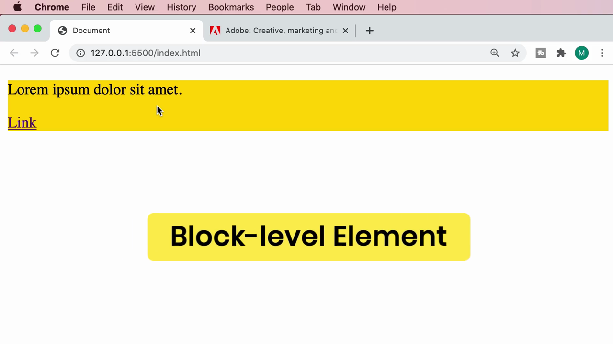

> **Block-level Element:** `<div>` เป็นตัวอย่างของ **block-level element** ซึ่งมีคุณสมบัติ 2 อย่างเสมอ:
> 1. **กินพื้นที่เต็มความกว้างที่มี (full width)** โดยอัตโนมัติ ไม่ว่าเนื้อหาข้างในจะสั้นแค่ไหน
> 2. **ขึ้นบรรทัดใหม่เสมอ** — ไม่สามารถวางอยู่ติดกับ element อื่นในบรรทัดเดียวกันได้
>
> Element อื่นๆ ที่เป็น block-level เช่นกัน ได้แก่ `<p>`, `<h1>`-`<h6>`, `<ul>`, `<table>`

### พิสูจน์ด้วยการทำซ้ำ 2 กล่อง

Mosh คัดลอก `<div class="product">` ทั้งก้อนมาวางซ้ำเป็นกล่องที่สอง:

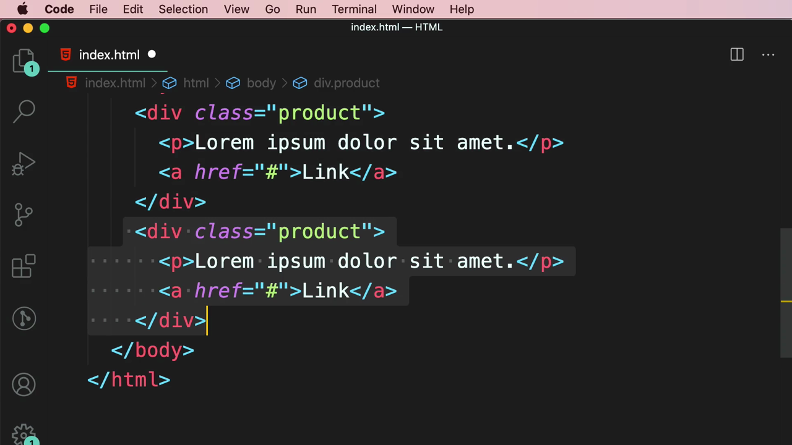

ผลลัพธ์: ทั้งสองกล่อง**เรียงต่อกันในแนวตั้ง (stack)** แต่ละกล่องยังคงกินพื้นที่เต็มความกว้าง ยืนยันคุณสมบัติ block-level:

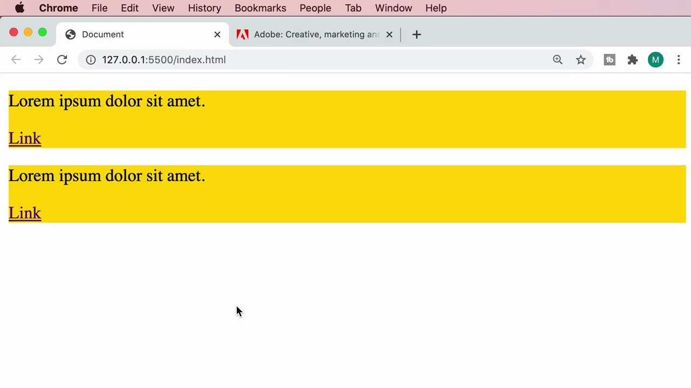

### กำหนดความกว้างคงที่ด้วย CSS `width`

Mosh เพิ่ม `width: 300px;` ให้กับ `.product` เพื่อจำกัดความกว้าง:

```css
.product {
  background-color: gold;
  width: 300px;
}
```

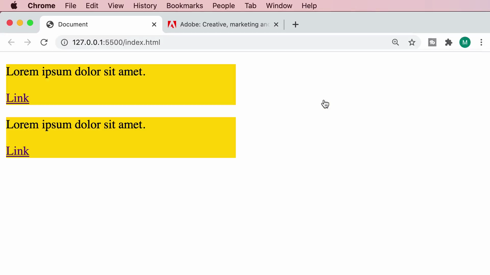

ผลลัพธ์: ทั้งสองกล่องมีความกว้างคงที่ 300px แต่**ยังคงเรียงซ้อนกันในแนวตั้งเหมือนเดิม** (ไม่เรียงข้างกัน) เพราะ block-level element ยังคง "ขึ้นบรรทัดใหม่เสมอ" แม้จะกำหนดความกว้างเองแล้วก็ตาม:

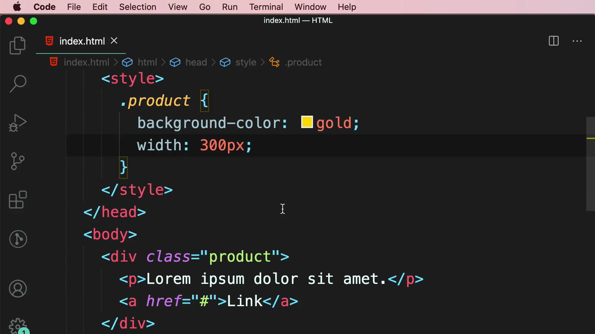

---

## 3. ปัญหา: `<div>` ทำลายโครงสร้างข้อความในย่อหน้า

Mosh ล้างโค้ดแล้วสาธิตปัญหาที่เกิดขึ้นเมื่อพยายามใช้ `<div>` เพื่อไฮไลต์คำเดียวภายในประโยค:

```html
<p><div class="highlight">Lorem</div> ipsum dolor sit amet, consectetur adipisicing elit. Amet, non.</p>
```

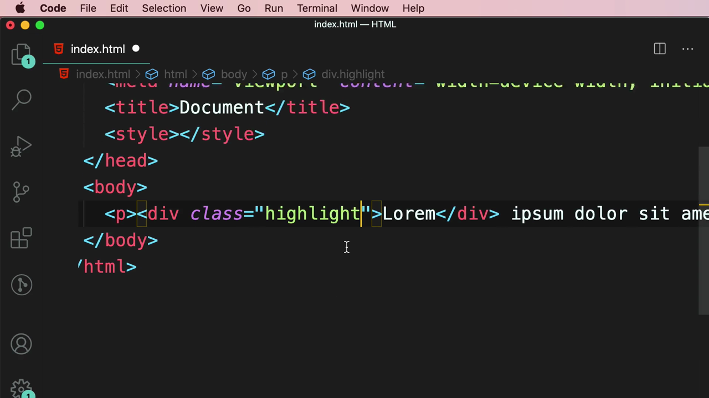

ผลลัพธ์ใน browser: คำว่า "Lorem" ที่ควรอยู่ในประโยคเดียวกัน กลับ**ถูกดันขึ้นไปอยู่คนละบรรทัด** แยกจากข้อความที่เหลือ ทำให้โครงสร้างประโยคเสียหาย:

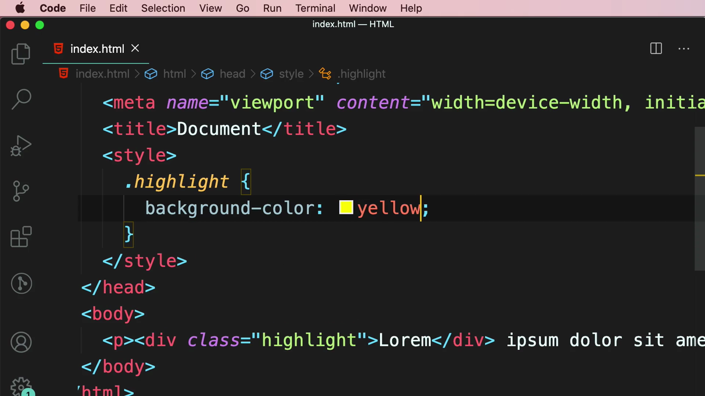

> **สาเหตุ:** เพราะ `<div>` เป็น block-level element จึง**บังคับขึ้นบรรทัดใหม่เสมอ** แม้จะอยู่ภายในประโยคเดียวกันก็ตาม — นี่คือข้อจำกัดสำคัญที่ทำให้ `<div>` ใช้ไม่ได้กับการไฮไลต์คำในเนื้อหาข้อความ

---

## 4. ทางแก้: `<span>` — Inline Container

Mosh อธิบายด้วยสไลด์:

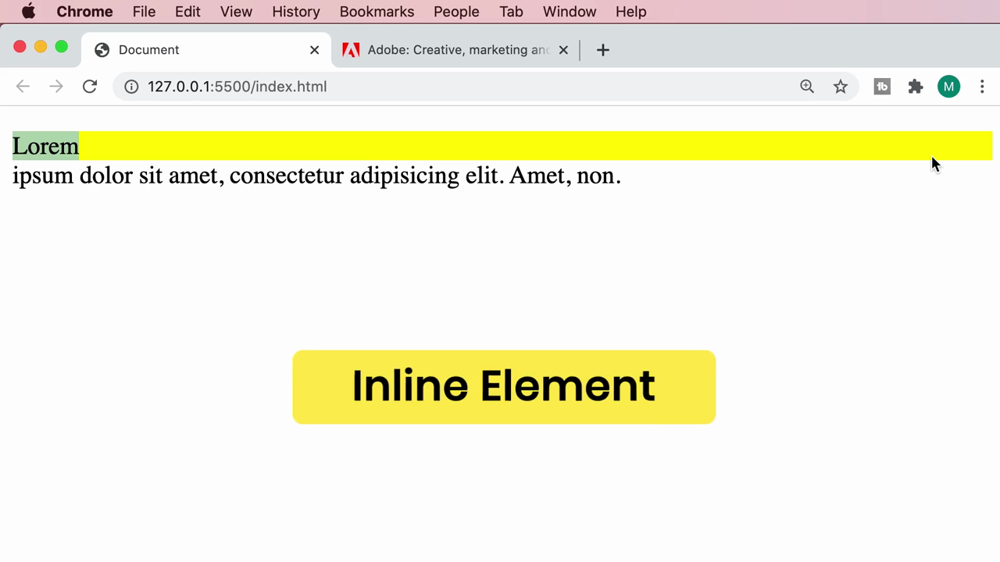

> **Inline Element คืออะไร:** ตรงข้ามกับ block-level, **inline element** จะ**ไม่บังคับขึ้นบรรทัดใหม่** และ**กินพื้นที่แค่เท่าที่เนื้อหาต้องการ** ทำให้สามารถอยู่ต่อเนื่องกับข้อความอื่นในบรรทัดเดียวกันได้

Mosh เปลี่ยนจาก `<div>` เป็น **`<span>`** ซึ่งเป็น inline container:

```html
<p><span class="highlight">Lorem</span> ipsum dolor sit amet, consectetur adipisicing elit. Amet, non.</p>
```

VS Code แสดง IntelliSense อธิบาย `<span>` ทันทีที่พิมพ์:

> **"The span element doesn't mean anything on its own, but can be useful when used together with the global attributes, e.g. class, lang, or dir. It represents its children."**

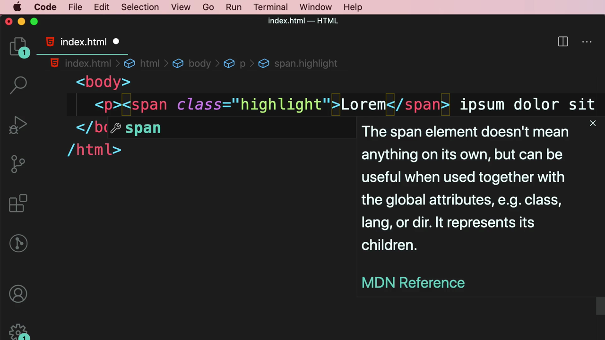

ผลลัพธ์ใน browser: คำว่า "Lorem" ตอนนี้**อยู่ในบรรทัดเดียวกัน**กับข้อความที่เหลือ พร้อมพื้นหลังสีเหลืองไฮไลต์เฉพาะคำนั้น โดยไม่กระทบโครงสร้างประโยค:

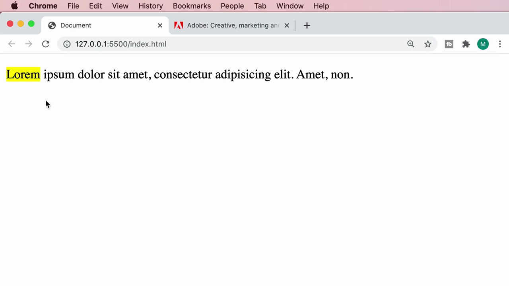

---

## สรุปที่ใช้ได้จริง

- **`<div>`** — block-level container ใช้จัดกลุ่มเนื้อหาหลายส่วน (ย่อหน้า, ลิงก์, รูปภาพ ฯลฯ) เข้าด้วยกันเป็นก้อนใหญ่
- **`<span>`** — inline container ใช้ครอบข้อความบางส่วนภายในประโยคหรือย่อหน้า เพื่อจัดสไตล์เฉพาะจุดโดยไม่ทำลายโครงสร้างข้อความ
- **Block-level element** (`div`, `p`, `h1`-`h6`, `ul`, `table` ฯลฯ): กินพื้นที่เต็มความกว้าง + บังคับขึ้นบรรทัดใหม่เสมอ
- **Inline element** (`span`, `a`, `strong`, `em` ฯลฯ): กินพื้นที่เท่าที่เนื้อหาต้องการ + ไม่บังคับขึ้นบรรทัดใหม่
- ทั้ง `<div>` และ `<span>` ไม่มีความหมายเชิง semantic ในตัวเอง ต้องใช้คู่กับ `class` เพื่อสื่อความหมายและจัดสไตล์ด้วย CSS
- กฎการเลือกใช้: ต้องการครอบ**เนื้อหาทั้งก้อน**ที่ขึ้นบรรทัดใหม่ได้ → ใช้ `<div>` ต้องการครอบ**ข้อความบางส่วนภายในประโยค** → ใช้ `<span>`

### จุดเชื่อมกับงานจริงของ Aum

- ใน React/Next.js `<div>` คือ container ที่ใช้บ่อยที่สุดในการจัดโครงสร้าง component (Card, Section, Container) และมักใช้คู่กับ Tailwind class เช่น `<div className="flex flex-col gap-4">`
- `<span>` ใช้บ่อยมากเวลาต้องการไฮไลต์ข้อความบางส่วน เช่น ราคาสินค้าที่ลดพิเศษ หรือ badge เล็กๆ ภายในประโยค: `<p>ราคา <span className="text-red-500 font-bold">-20%</span></p>`
- แนวคิด Block vs Inline เป็นพื้นฐานสำคัญก่อนเรียน CSS `display` property (`display: block`, `display: inline`, `display: inline-block`, `display: flex`) ซึ่งเป็นหัวใจของการทำ Layout ทั้งหมดใน Tailwind CSS
- เมื่อ component ใน Next.js render ผิดตำแหน่ง (เช่น อยู่คนละบรรทัดโดยไม่ตั้งใจ) ให้ตรวจสอบก่อนว่า element นั้นเป็น block หรือ inline โดย default เสมอ
