# 3-HTML Basics: 11 - Semantic Elements (5:20)

**ไฟล์ต้นทาง:** `11-Semantic-Elements.mp4`

▶️ **[เปิดวิดีโอต้นฉบับ](../../../HTML-CSS-1/3-HTML%20Basics/11-Semantic-Elements.mp4)**

---

## ภาพรวมคลิปนี้

คลิปนี้ Mosh สอนเรื่อง **Semantic Elements** — แท็ก HTML ที่**มีความหมายในตัวเอง** ต่างจาก `<div>`/`<span>` ที่เป็น generic element ไม่สื่อความหมายใดๆ คลิปนี้ครอบคลุม `<article>`, `<figure>`/`<figcaption>`, `<mark>`, และ `<time>`

---

## 1. ทบทวน: `<div>`/`<span>` คือ Generic Element

Mosh เปิดสไลด์อธิบายว่า `<div>` และ `<span>` เป็น **generic element** — ไม่มีความหมายอะไรในตัวเอง เป็นแค่ภาชนะเปล่าๆ สำหรับจัดกลุ่ม:

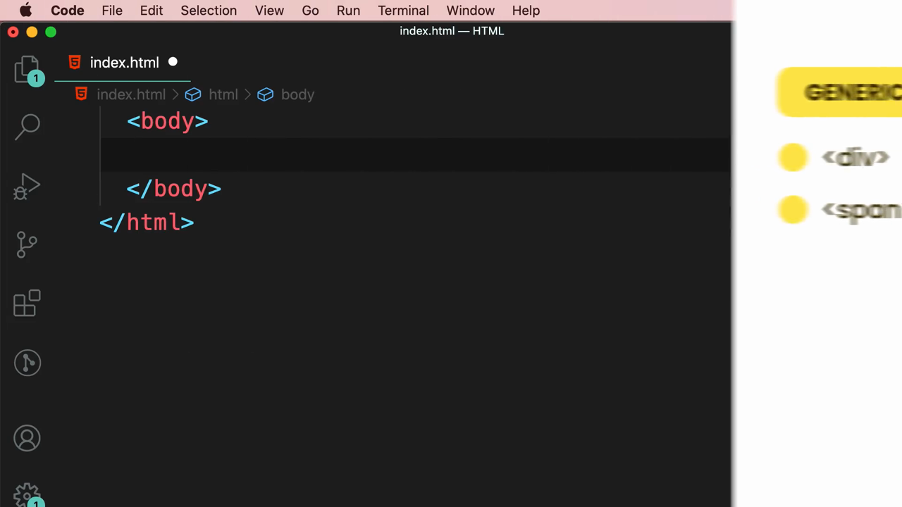

> **ปัญหาของ Generic Element:** เมื่อ browser, screen reader หรือเครื่องมือ SEO อ่านโค้ดที่มีแต่ `<div>` ซ้อนกันเต็มไปหมด จะไม่สามารถเข้าใจได้เลยว่าส่วนไหนคือบทความ ส่วนไหนคือเมนู ส่วนไหนคือส่วนหัว — Semantic Element จึงถูกออกแบบมาเพื่อแก้ปัญหานี้

---

## 2. `<article>` — แทนที่ `<div class="article">`

Mosh เริ่มจากโค้ดเดิมที่ใช้ `<div class="article">` ครอบเนื้อหาบทความ:

```html
<div class="article">
  <h1>Heading</h1>
  <p>Lorem ipsum dolor, sit amet consectetur adipisicing elit...</p>
</div>
```

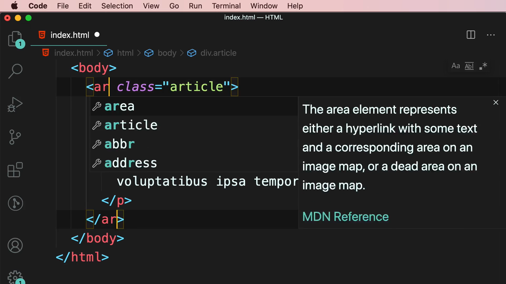

ผลลัพธ์ใน browser แสดงหัวข้อและข้อความปกติ:

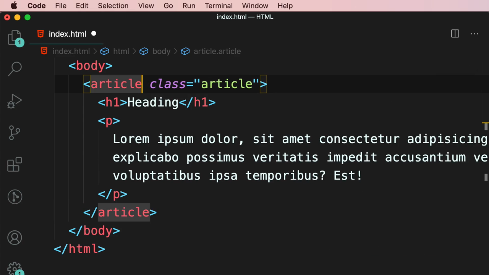

Mosh เปลี่ยนแท็ก `<div>` เป็น **`<article>`** โดยตรง (ลบ `class="article"` ที่ไม่จำเป็นอีกต่อไปออกด้วย) VS Code แสดง IntelliSense อธิบายทันที:

> **"The article element represents either a hyperlink with some text and a corresponding area on an image map, or a dead area on an image map."** *(หมายเหตุ: ข้อความ tooltip นี้เป็นของแท็ก `<area>` ซึ่งมีชื่อขึ้นต้นคล้ายกันและปรากฏใน autocomplete ระหว่างพิมพ์ `<ar...`)*

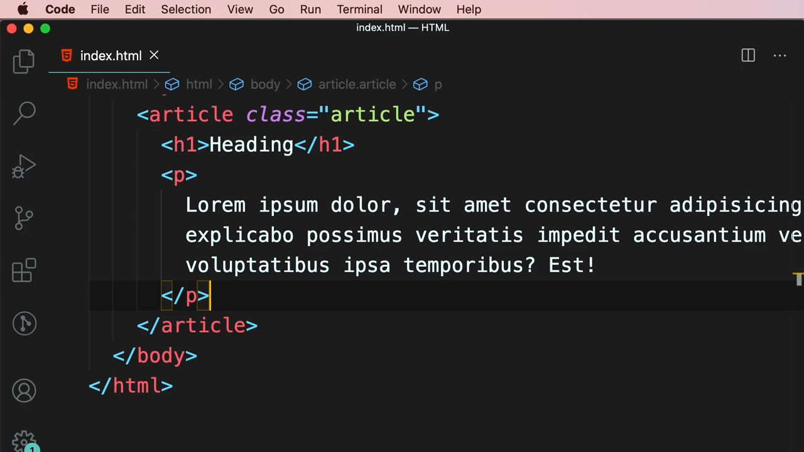

โค้ดสุดท้ายหลังเปลี่ยนเป็น `<article>`:

```html
<article class="article">
  <h1>Heading</h1>
  <p>Lorem ipsum dolor, sit amet consectetur adipisicing elit...</p>
</article>
```

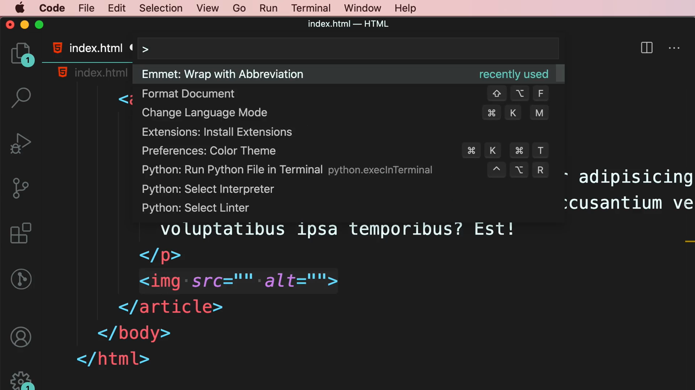

Mosh อธิบายความหมายที่แท้จริงของ `<article>` ด้วยสไลด์:

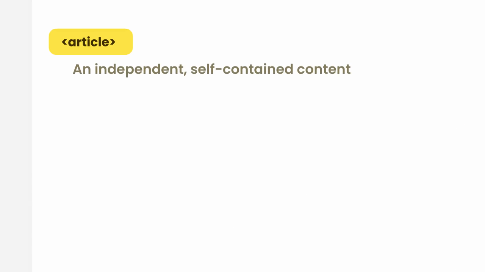

> **`<article>` คืออะไร:** เนื้อหาที่**เป็นอิสระและสมบูรณ์ในตัวเอง (independent, self-contained content)** สามารถนำไปแสดงที่อื่นได้โดยยังเข้าใจได้ครบถ้วน เช่น บทความข่าว, บล็อกโพสต์, ความคิดเห็นของผู้ใช้ในฟอรัม

---

## 3. `<figure>` และ `<figcaption>` — รูปภาพพร้อมคำบรรยาย

Mosh เพิ่ม `` ด้วย Emmet ผ่าน **Command Palette** (`Cmd+Shift+P` → "Emmet: Wrap with Abbreviation"):

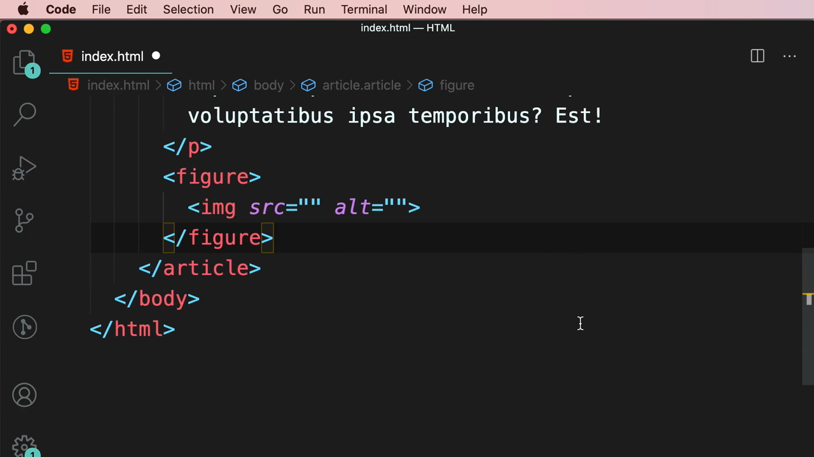

จากนั้นครอบ `` ด้วยแท็ก **`<figure>`**:

```html
<figure>
  
</figure>
```

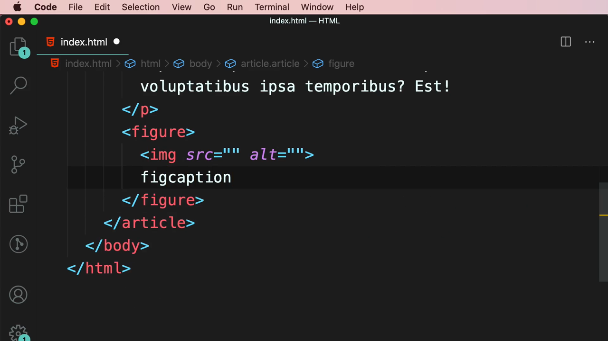

เพิ่ม **`<figcaption>`** สำหรับคำบรรยายใต้ภาพ:

```html
<figure>
  
  <figcaption>My coffee this morning</figcaption>
</figure>
```

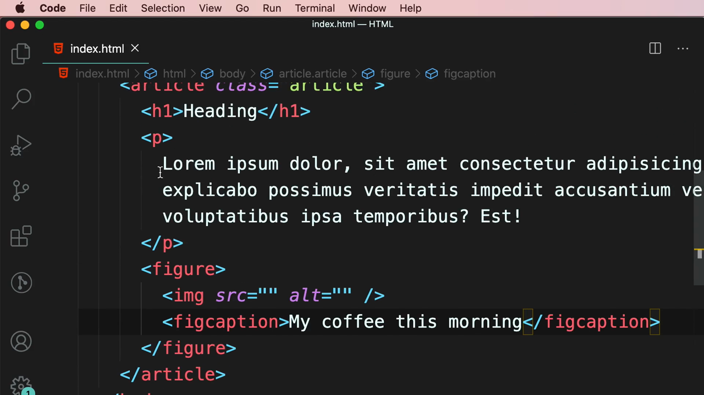

ผลลัพธ์ใน browser: ข้อความ "My coffee this morning" แสดงเป็นคำบรรยายอยู่ใต้ตำแหน่งรูปภาพ:

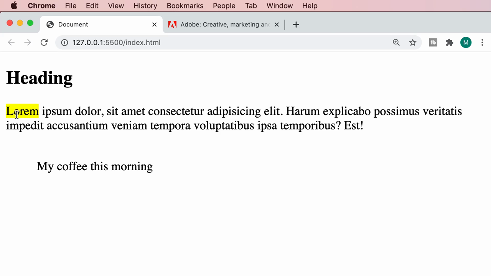

> **`<figure>`/`<figcaption>` คืออะไร:** `<figure>` ใช้ครอบเนื้อหาสื่อ (รูปภาพ, แผนภูมิ, โค้ด ฯลฯ) ที่เป็นภาพประกอบเนื้อหาหลัก โดยสามารถย้ายตำแหน่งได้โดยไม่กระทบการไหลของเนื้อหาหลัก ส่วน `<figcaption>` คือคำบรรยายที่ผูกกับ `<figure>` นั้นโดยเฉพาะ — ใช้แทน `<div>` + `<p>` ธรรมดาเพื่อสื่อความหมายชัดเจนกว่า

---

## 4. `<mark>` — ไฮไลต์ข้อความสำคัญ

Mosh ครอบคำว่า "Lorem" ในย่อหน้าด้วยแท็ก **`<mark>`**:

```html
<p><mark>Lorem</mark> ipsum dolor, sit amet consectetur adipisicing elit...</p>
```

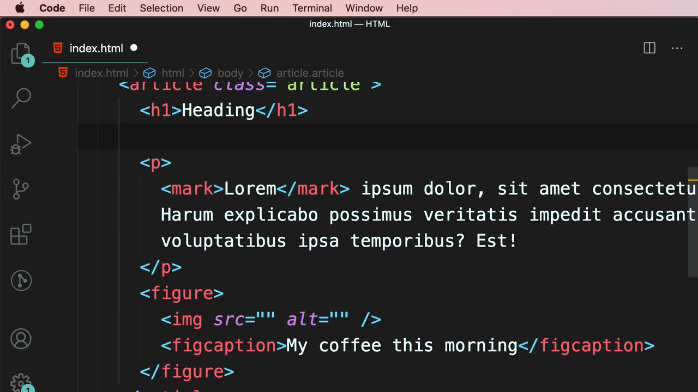

> **`<mark>` คืออะไร:** ใช้ไฮไลต์ข้อความที่ต้องการเน้นความสำคัญหรือเกี่ยวข้องกับบริบทปัจจุบัน (เช่น ผลลัพธ์การค้นหา) โดย browser จะแสดงพื้นหลัง**สีเหลือง**ให้อัตโนมัติโดยไม่ต้องเขียน CSS เพิ่ม — มีความหมายต่างจาก `<span>` ที่ไฮไลต์ด้วย CSS เอง เพราะ `<mark>` สื่อความหมายเชิง semantic ว่า "นี่คือข้อความที่สำคัญ" ด้วย

---

## 5. `<time>` — วันที่และเวลาที่เครื่องอ่านได้

Mosh เพิ่มบรรทัด "Published" พร้อมวันที่ แล้วครอบด้วยแท็ก **`<time>`**:

```html
<p>Published <time datetime="">January 1 2021 05:00pm</time></p>
```

VS Code แสดง IntelliSense อธิบาย:

> **"The time element represents its contents, along with a machine-readable form of those contents in the datetime attribute. The kind of content is limited to various kinds of dates, times, time-zone offsets, and durations, as described below."**

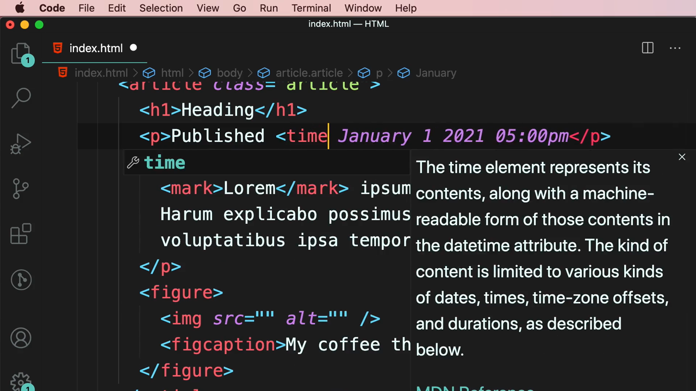

ผลลัพธ์ใน browser: ข้อความ "Published January 1 2021 05:00pm" แสดงปกติ พร้อมคำว่า "Lorem" ไฮไลต์สีเหลืองด้านล่าง:

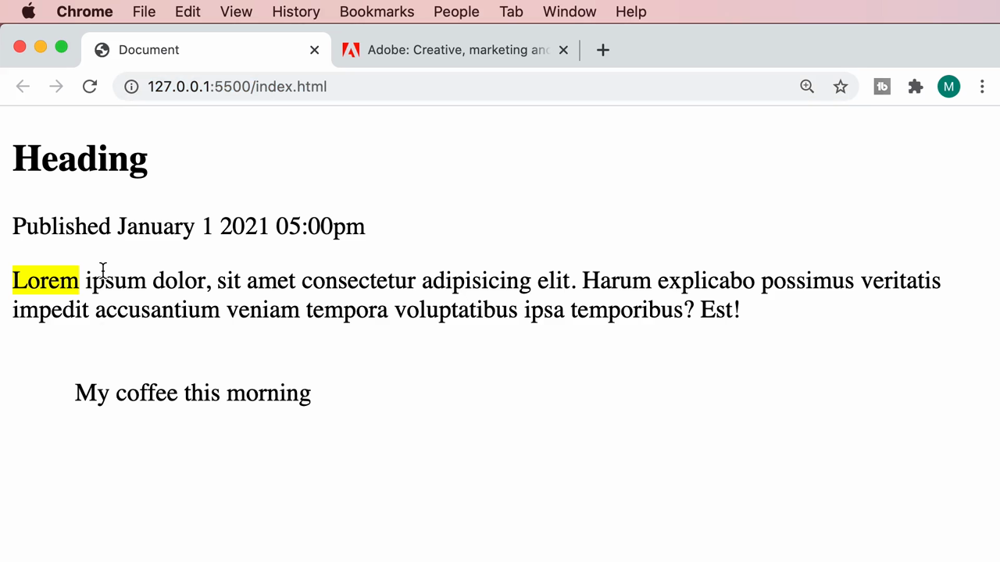

Mosh เพิ่ม attribute **`datetime`** ให้กับ `<time>` ซึ่ง IntelliSense อธิบายว่า:

> **"This attribute indicates the time and/or date of the element and must be in one of the formats described below."**

```html
<p>Published <time datetime="">January 1 2021 05:00pm</time></p>
```

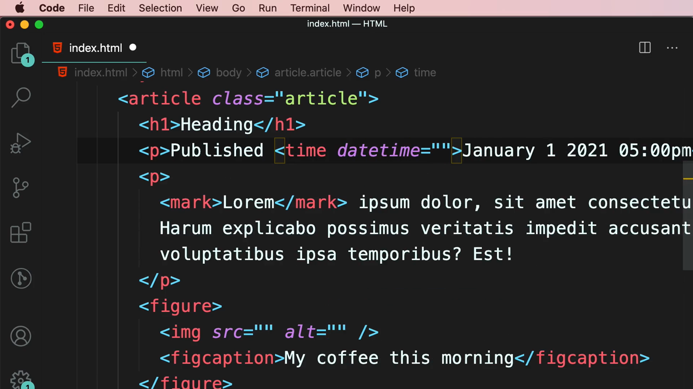

> **`<time>` คืออะไร:** ข้อความที่แสดงผลให้มนุษย์อ่าน (เช่น "January 1 2021 05:00pm") อาจไม่ใช่รูปแบบที่โปรแกรมคอมพิวเตอร์เข้าใจได้ง่าย attribute **`datetime`** จึงใช้ระบุค่าวันที่/เวลาในรูปแบบมาตรฐานที่เครื่อง (เช่น search engine, screen reader) อ่านและประมวลผลได้ถูกต้อง เช่น `datetime="2021-01-01T17:00"` — ข้อความในแท็กยังคงแสดงแบบอ่านง่ายสำหรับมนุษย์ตามปกติ

---

## สรุปที่ใช้ได้จริง

- **Semantic Element** สื่อความหมายในตัวเอง ต่างจาก `<div>`/`<span>` ที่เป็น generic ไม่สื่อความหมาย — ควรเลือกใช้ semantic element ทุกครั้งที่มีแท็กที่ตรงความหมายมากกว่า
- **`<article>`** — เนื้อหาที่เป็นอิสระสมบูรณ์ในตัวเอง เช่น บทความ, บล็อกโพสต์, comment
- **`<figure>` + `<figcaption>`** — ภาพประกอบพร้อมคำบรรยาย ใช้แทน `` + `<p>` ธรรมดา
- **`<mark>`** — ไฮไลต์ข้อความสำคัญ พื้นหลังสีเหลืองอัตโนมัติ ไม่ต้องเขียน CSS
- **`<time datetime="...">`** — วันที่/เวลาที่ทั้งมนุษย์อ่านง่ายและเครื่องประมวลผลได้ถูกต้อง
- ประโยชน์หลักของ semantic HTML: SEO ดีขึ้น, accessibility ดีขึ้น (screen reader เข้าใจโครงสร้าง), และโค้ดอ่านง่ายขึ้นสำหรับนักพัฒนา

### จุดเชื่อมกับงานจริงของ Aum

- ใน Next.js การใช้ semantic tag เหล่านี้ (`<article>`, `<figure>`, `<time>`) แทน `<div>` ล้วนๆ ช่วยให้ Lighthouse/SEO score ดีขึ้นโดยตรง เพราะ Google และ screen reader เข้าใจโครงสร้างหน้าเว็บได้ชัดเจนกว่า
- Blog หรือ portfolio ที่ทำด้วย Next.js ควรใช้ `<article>` ครอบแต่ละโพสต์ และ `<time datetime="{isoDate}">{displayDate}</time>` เพื่อให้ทั้งแสดงผลสวยงามและ SEO-friendly
- `<figure>`/`<figcaption>` เหมาะมากกับ gallery หรือ portfolio ที่แสดงรูปภาพพร้อมคำอธิบาย
- `<mark>` มีประโยชน์เวลาทำฟีเจอร์ค้นหา (search) ที่ต้องไฮไลต์คำที่ผู้ใช้ค้นหาเจอในผลลัพธ์ — สามารถ render `<mark>{matchedText}</mark>` แบบ dynamic ได้ใน React
