# 3-HTML Basics: 12 - Structuring a Web Page (3:23)

**ไฟล์ต้นทาง:** `12-Structuring-a-Web-Page.mp4`

▶️ **[เปิดวิดีโอต้นฉบับ](../../../HTML-CSS-1/3-HTML%20Basics/12-Structuring-a-Web-Page.mp4)**

---

## ภาพรวมคลิปนี้

คลิปสุดท้ายของบท HTML Basics นี้ Mosh สรุปรวบยอด (capstone) โดยนำ **semantic element ระดับโครงสร้างหน้าเว็บ** ทั้งหมดมาประกอบกันเป็นโครงหน้าเว็บสมบูรณ์แบบหนึ่งหน้า ได้แก่ `<header>`, `<nav>`, `<main>`, `<section>`, `<aside>`, และ `<footer>` — เป็นภาพรวมว่าหน้าเว็บทั่วไปหนึ่งหน้าจะถูกแบ่งโครงสร้างอย่างไรด้วย semantic HTML ล้วนๆ โดยยังไม่ใส่เนื้อหาจริงหรือ CSS

---

## 1. โครงสร้างระดับบนสุด: `header`, `main`, `aside`, `footer`

Mosh เริ่มพิมพ์แท็กโครงสร้างหลักของหน้าเว็บทีละตัวด้วย Emmet:

```html
<body>
  <header></header>
  <main></main>
  <aside></aside>
  <footer></footer>
</body>
```

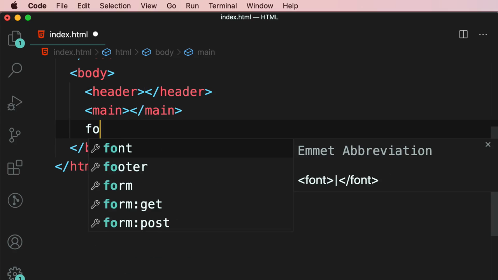

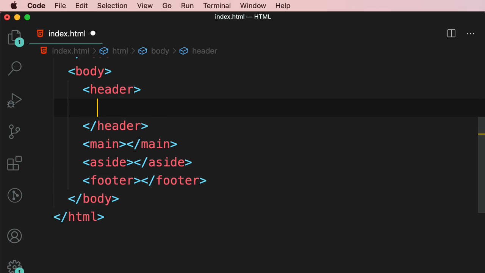

> **ความหมายของแต่ละแท็ก:**
> - **`<header>`** — ส่วนหัวของหน้าเว็บ (หรือของ section/article หนึ่งๆ) มักมีโลโก้ เมนูนำทาง
> - **`<main>`** — เนื้อหาหลักของหน้า มีได้เพียงแท็กเดียวต่อหนึ่งหน้าเว็บ
> - **`<aside>`** — เนื้อหาข้างเคียงที่เกี่ยวข้องแต่ไม่ใช่เนื้อหาหลัก เช่น sidebar, โฆษณา, ลิงก์ที่เกี่ยวข้อง
> - **`<footer>`** — ส่วนท้ายของหน้าเว็บ มักมีลิงก์ติดต่อ, ลิขสิทธิ์, โซเชียลมีเดีย

---

## 2. เมนูนำทางใน `<header>`: `<nav>` + `<ul>` + `<li>`

Mosh เพิ่มเมนูนำทางภายใน `<header>` โดยใช้ `<nav>` ครอบ `<ul>`:

```html
<header>
  <nav>
    <ul>
      <li></li>
      <li></li>
      <li></li>
    </ul>
  </nav>
</header>
```

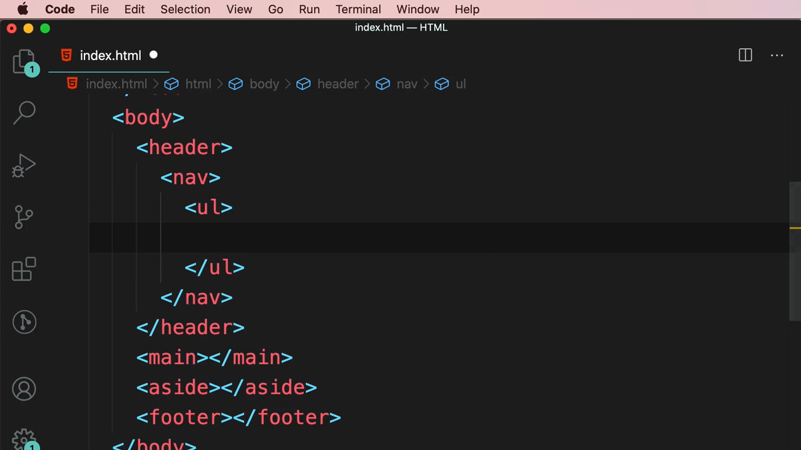

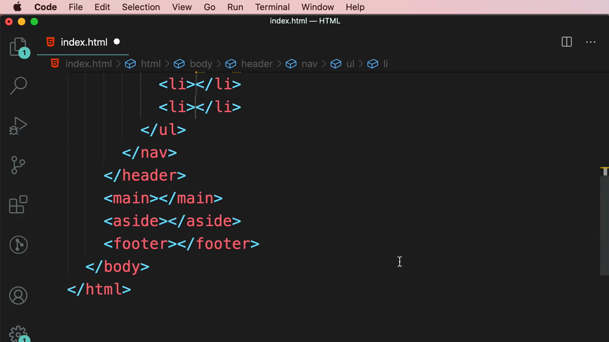

> **`<nav>` คืออะไร:** ครอบกลุ่มลิงก์นำทางหลักของเว็บไซต์หรือของหน้า (main navigation) — ใช้ได้ทั้งใน `<header>` และ `<footer>` (เช่น footer navigation สำหรับลิงก์ Privacy Policy, Terms of Service)

---

## 3. เนื้อหาหลักใน `<main>`: แบ่งด้วย `<section>` และ `<article>`

Mosh เพิ่ม 2 ส่วนย่อยภายใน `<main>` โดยใช้ `<section>` แบ่งเนื้อหาแต่ละหัวข้อ:

```html
<main>
  <section></section>
  <section></section>
</main>
```

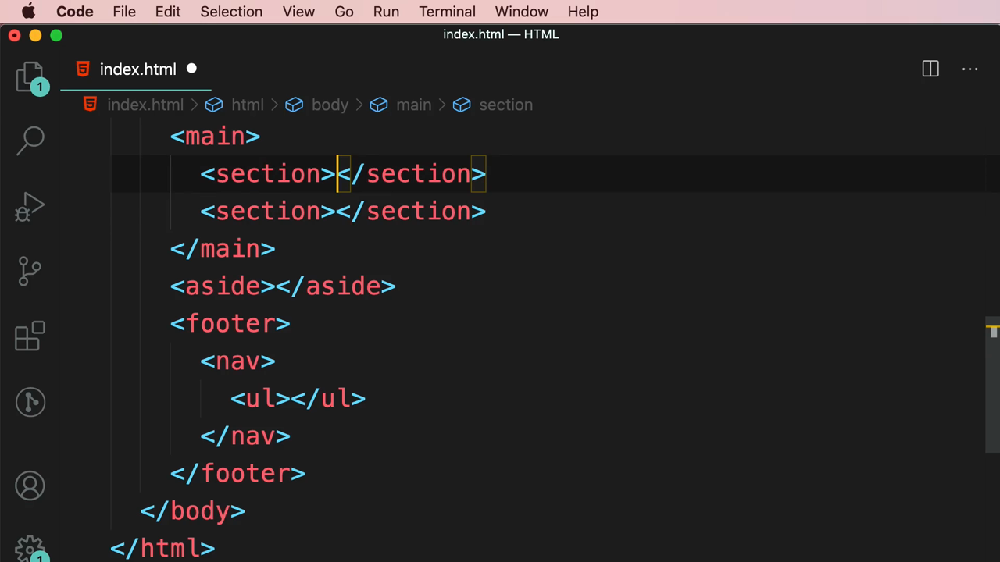

### Section แรก: "Products"

```html
<section>
  <h2>Products</h2>
  <article></article>
  <article></article>
  <article></article>
</section>
```

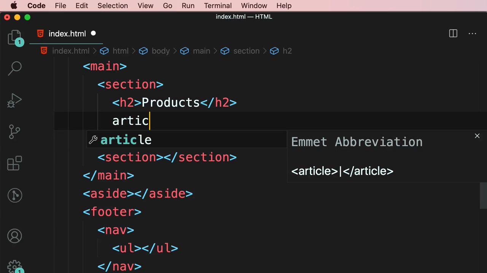

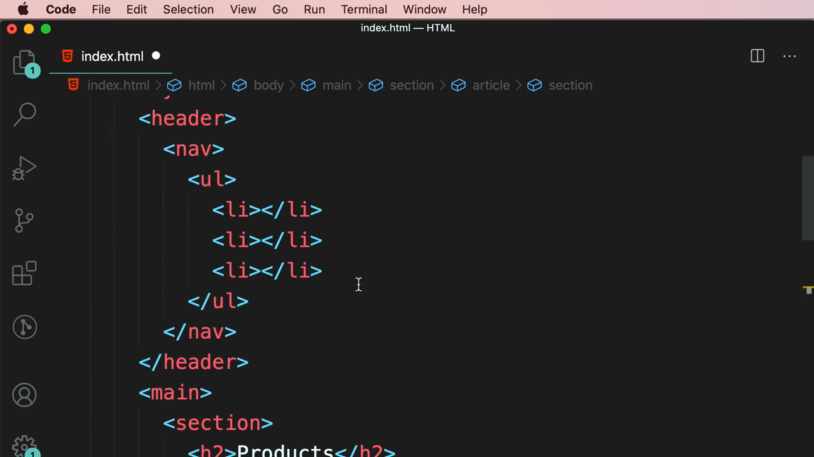

### Section ที่สอง: "Testimonial"

```html
<section>
  <h2>Testimonial</h2>
  <article></article>
  <article></article>
</section>
```

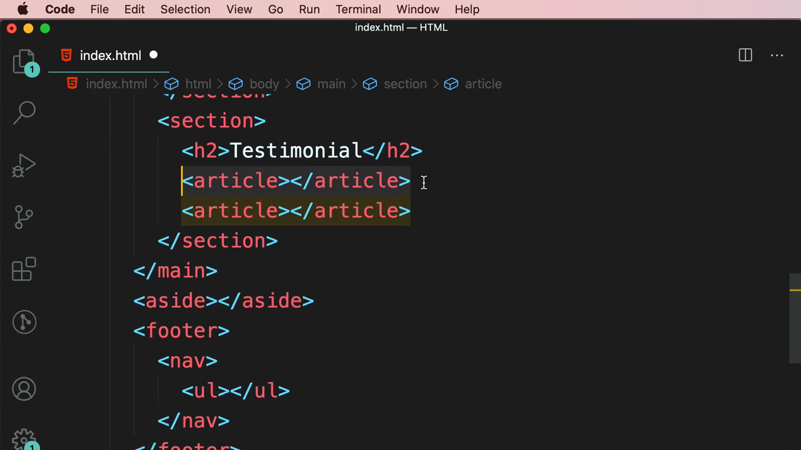

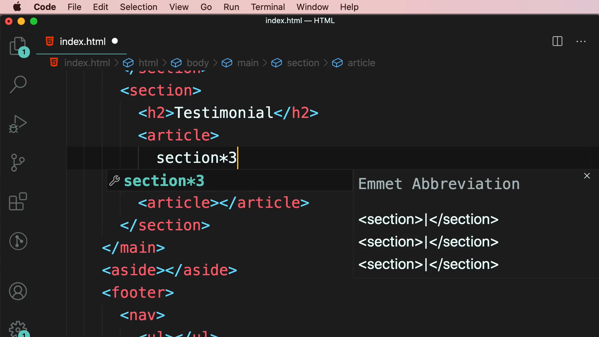

> **`<section>` vs `<article>`:**
> - **`<section>`** — จัดกลุ่มเนื้อหาที่เกี่ยวข้องกันภายใต้**หัวข้อเดียวกัน** (มักมี heading กำกับ เช่น "Products", "Testimonial") ใช้แบ่งหน้าเว็บออกเป็นหมวดหมู่ตามธีม
> - **`<article>`** — เนื้อหาที่**เป็นอิสระสมบูรณ์ในตัวเอง** (ตามที่เรียนในคลิปก่อนหน้า) เช่น สินค้าแต่ละชิ้นใน "Products" หรือรีวิวแต่ละอันใน "Testimonial" — สังเกตว่า `<article>` มักถูกวางซ้อนอยู่ภายใน `<section>` เพราะเนื้อหาแต่ละชิ้นเป็นส่วนหนึ่งของหมวดหมู่นั้น

---

## 4. ภาพรวมโครงสร้างหน้าเว็บที่สมบูรณ์

โค้ดสุดท้ายของทั้งหน้า:

```html
<body>
  <header>
    <nav>
      <ul>
        <li></li>
        <li></li>
        <li></li>
      </ul>
    </nav>
  </header>
  <main>
    <section>
      <h2>Products</h2>
      <article></article>
      <article></article>
      <article></article>
    </section>
    <section>
      <h2>Testimonial</h2>
      <article></article>
      <article></article>
    </section>
  </main>
  <aside></aside>
  <footer>
    <nav>
      <ul></ul>
    </nav>
  </footer>
</body>
```

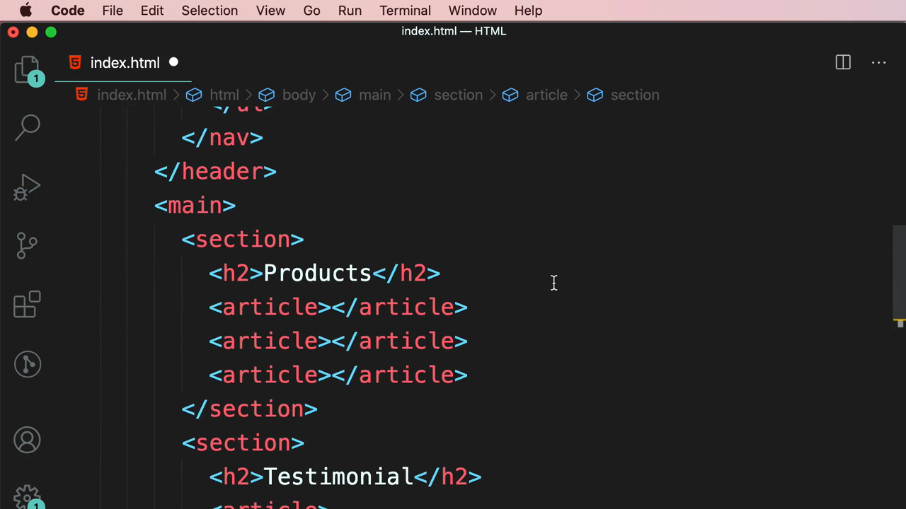

Mosh ปิดท้ายด้วยสไลด์เน้นย้ำแท็ก `<main>` เป็นแกนกลางของโครงสร้าง:

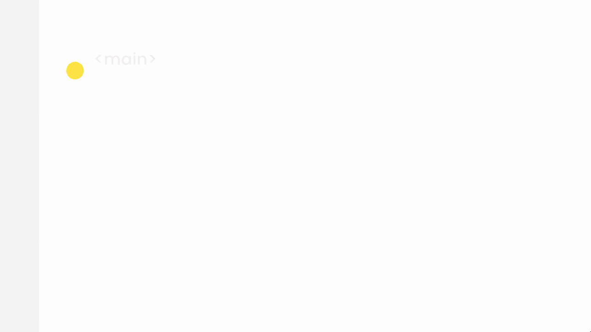

> **ข้อควรระวัง:** `<main>` ใช้ได้เพียง**หนึ่งครั้งต่อหนึ่งหน้าเว็บ**เท่านั้น (ไม่เหมือน `<section>`/`<article>` ที่ใช้ซ้ำได้หลายครั้ง) เพราะเป็นตัวบ่งชี้เนื้อหาหลักที่ไม่ซ้ำกันของหน้านั้นให้กับ screen reader และ search engine

---

## สรุปที่ใช้ได้จริง

- โครงสร้างหน้าเว็บมาตรฐานด้วย semantic HTML: `<header>` → `<main>` (มี `<section>`/`<article>` ข้างใน) → `<aside>` → `<footer>`
- `<nav>` ใช้ได้ทั้งใน `<header>` (เมนูหลัก) และ `<footer>` (เมนูท้ายเว็บ)
- `<section>` แบ่งเนื้อหาตามหัวข้อ/ธีม ส่วน `<article>` คือเนื้อหาย่อยที่สมบูรณ์ในตัวเองภายใน section นั้น
- `<main>` ใช้ได้แค่ 1 ครั้งต่อหน้า ส่วนแท็กอื่นๆ ใช้ซ้ำได้ตามต้องการ
- โครงสร้างนี้เป็น**พิมพ์เขียว (blueprint)** มาตรฐานที่ใช้ได้กับเว็บไซต์เกือบทุกประเภท ตั้งแต่ landing page ธรรมดาไปจนถึงเว็บแอปพลิเคชันเต็มรูปแบบ

### จุดเชื่อมกับงานจริงของ Aum

- โครงสร้างนี้คือแม่แบบเดียวกับที่ใช้ทำ `layout.tsx` (Root Layout) ใน Next.js App Router — โดยทั่วไปจะมี `<Header />`, `{children}` อยู่ใน `<main>`, และ `<Footer />` เป็น component แยกกัน
- แต่ละ `<section>` ใน landing page (เช่น Hero, Features, Testimonials, Pricing, CTA) สามารถแยกเป็น React component ของตัวเองได้ตรงตามโครงสร้าง semantic นี้เป๊ะๆ
- การวางแผนโครงสร้างหน้าเว็บด้วย semantic tag ก่อนเริ่มเขียน component ช่วยให้ code base เป็นระเบียบ อ่านง่าย และ SEO/accessibility ดีตั้งแต่ต้น — เป็นขั้นตอนที่ควรทำก่อนลงมือจัด layout ด้วย Tailwind flex/grid เสมอ
- เมื่อ Aum เริ่มทำโปรเจกต์ full-stack ที่ใช้ JSON server ควรวางโครง `<main><section>` ให้สอดคล้องกับ endpoint ของข้อมูล เช่น section "Products" ดึงจาก `/products`, section "Testimonial" ดึงจาก `/testimonials` เพื่อให้โครงสร้าง HTML และโครงสร้างข้อมูลสอดคล้องกัน
