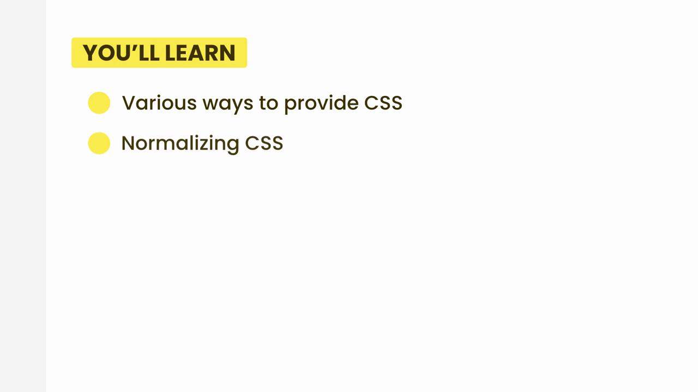

# 4-CSS Basics: 01 - Introduction (0:52)

**ไฟล์ต้นทาง:** `01-Introduction.mp4`

▶️ **[เปิดวิดีโอต้นฉบับ](../../../HTML-CSS-1/4-CSS%20Basics/01-Introduction.mp4)**

---

## ภาพรวมคลิปนี้

คลิปแนะนำสั้นๆ เปิดบทใหม่ **"4-CSS Basics"** ต่อจากบท HTML Basics ที่เพิ่งจบไป เป็นคลิปแนะนำภาพรวม (ไม่มีการเขียนโค้ด) บอกหัวข้อที่จะเรียนในบทนี้

---

## 1. Intro แบรนด์คอร์ส

เปิดด้วยฉาก intro เดียวกับที่เคยเห็นตอนต้นบท HTML Basics — วิดีโอถนนคดเคี้ยวบนภูเขา พร้อมข้อความ:

> **"The Ultimate HTML AND CSS Course"**

---

## 2. หัวข้อของบทนี้: Essential CSS Concepts

ตามด้วยฉากป่าสน พร้อมชื่อบทใหม่:

> **"ESSENTIAL CSS CONCEPTS"**

จากนั้นสไลด์ **"YOU'LL LEARN"** สรุปหัวข้อที่จะเรียนในบทนี้:

- **Various ways to provide CSS** (วิธีต่างๆ ในการใส่ CSS ให้ HTML)
- **Normalizing CSS** (การทำให้ CSS เริ่มต้นเหมือนกันทุก browser)

> **หมายเหตุ:** สไลด์นี้แสดงเพียง 2 หัวข้อแรกของบท แต่จากชื่อคลิปที่ Aum อัปโหลดต่อจากนี้ (Basic Selectors, Relational Selectors, Pseudo-class Selectors) แสดงว่าบทนี้ยังครอบคลุมเรื่อง **CSS Selectors** ในหลายรูปแบบต่อไปด้วย

---

## 3. โลโก้ผู้สอน

ปิดท้ายด้วยโลโก้ **MOSH** (Code with Mosh) เช่นเดียวกับ intro ของทุกบทในคอร์สนี้:

---

## สรุปที่ใช้ได้จริง

- บทนี้เป็นการเปลี่ยนจาก HTML (โครงสร้างเนื้อหา) มาสู่ **CSS (การจัดสไตล์)** ซึ่งเป็นขั้นต่อไปที่จำเป็นสำหรับการทำหน้าเว็บให้สวยงามใช้งานได้จริง
- หัวข้อหลักที่จะได้เรียน: วิธีใส่ CSS หลายรูปแบบ, การทำ CSS Normalization, และ CSS Selectors หลายประเภท (basic, relational, pseudo-class)

### จุดเชื่อมกับงานจริงของ Aum

- CSS Selectors เป็นพื้นฐานสำคัญมากก่อนจะไปต่อกับ Tailwind CSS เพราะ Tailwind class ทุกตัวคือการ "แปลง" CSS property ให้เป็น utility class — การเข้าใจ selector และ specificity ของ CSS ดั้งเดิมจะช่วยให้เข้าใจว่าทำไม Tailwind ทำงานแบบ utility-first ได้ดี
- CSS Normalization เป็นแนวคิดเดียวกับที่ Next.js/Tailwind ใช้ผ่านไฟล์ `globals.css` ที่มี `@tailwind base;` ซึ่งภายในก็คือการ normalize CSS แบบอัตโนมัติให้กับโปรเจกต์
