# 4-CSS Basics: 02 - Providing CSS (6:06)

**ไฟล์ต้นทาง:** `02-Providing-CSS.mp4`

▶️ **[เปิดวิดีโอต้นฉบับ](../../../HTML-CSS-1/4-CSS%20Basics/02-Providing-CSS.mp4)**

---

## ภาพรวมคลิปนี้

คลิปนี้ Mosh สอนเรื่อง **3 วิธีในการใส่ CSS ให้กับ HTML**: **Internal CSS** (`<style>` ใน head), **External CSS** (ไฟล์ `.css` แยกต่างหาก), และ **Inline CSS** (attribute `style` บน element โดยตรง) พร้อมทดลองให้เห็นจริงว่าเมื่อ CSS ทั้ง 3 แบบขัดแย้งกัน **วิธีไหนจะ "ชนะ"** และปิดท้ายด้วยการแนะนำ **ID Selector** เบื้องต้น

---

## 1. Internal CSS — เขียน CSS ไว้ใน `<style>` ภายในไฟล์ HTML

Mosh เริ่มจากไฟล์ที่มี `<style>` ว่างๆ ใน `<head>` และมี `<p>` สองอัน:

```html
<head>
  <style>
  </style>
</head>
<body>
  <p>Lorem ipsum dolor sit amet.</p>
  <p>Lorem ipsum dolor sit amet.</p>
</body>
```

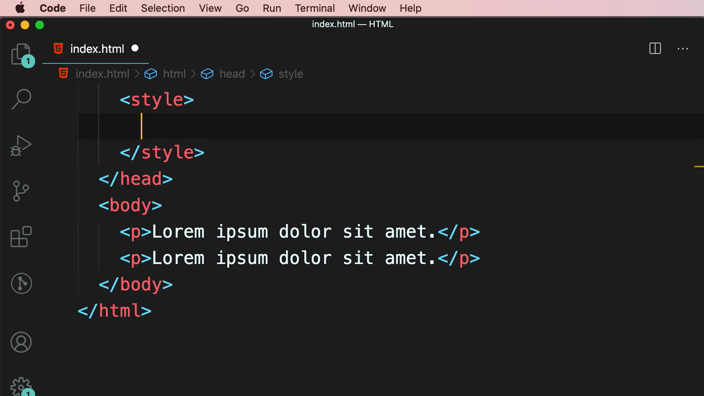

พิมพ์ selector `p` แล้วเพิ่ม property `color` โดย VS Code แสดง IntelliSense:

> **"Sets the color of an element's text"**

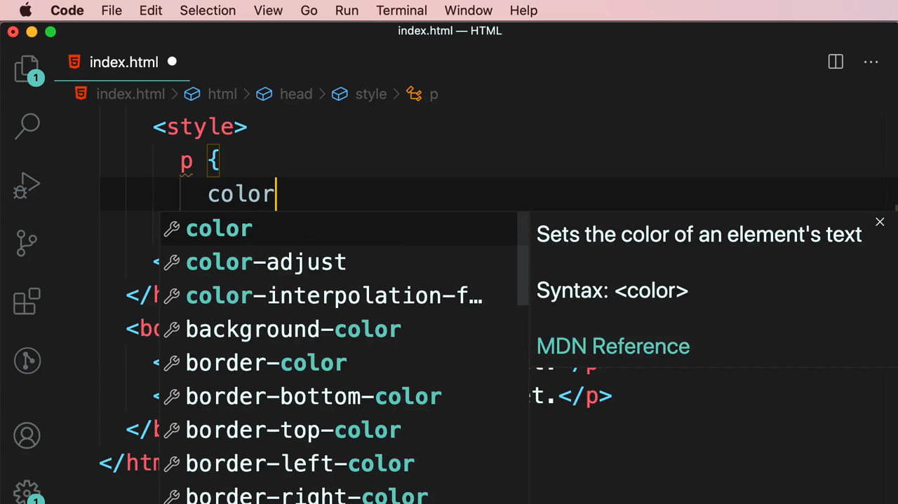

```html
<style>
  p {
    color: orange;
  }
</style>
```

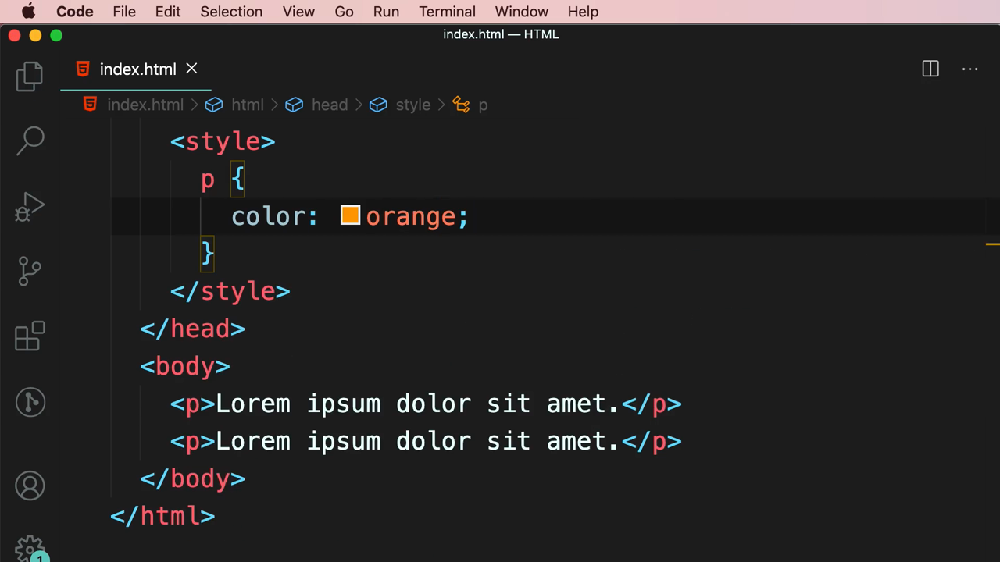

ผลลัพธ์ใน browser: ข้อความทั้งสองย่อหน้าเป็นสีส้ม:

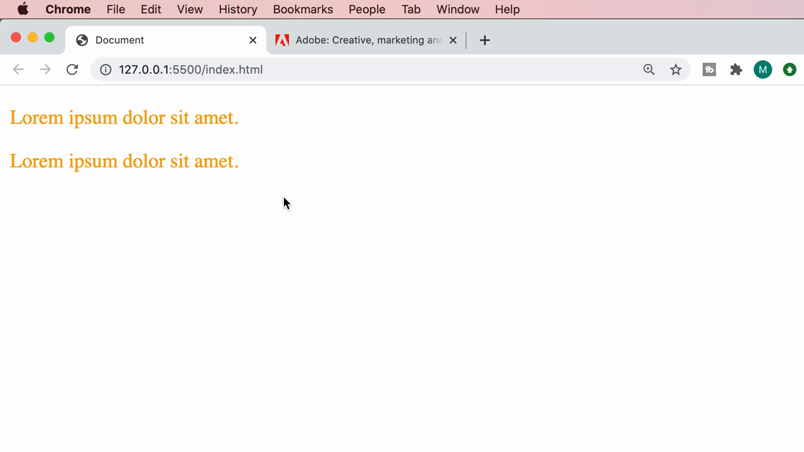

> **Internal CSS คืออะไร:** การเขียน CSS ไว้ในแท็ก `<style>` ภายในไฟล์ HTML เดียวกัน (มักอยู่ใน `<head>`) — สะดวกสำหรับตัวอย่างเล็กๆ แต่ไม่เหมาะกับโปรเจกต์จริงที่มีหลายหน้า เพราะต้องคัดลอก `<style>` ซ้ำในทุกไฟล์

---

## 2. หลักการ Separation of Concerns

ก่อนแนะนำ External CSS Mosh อธิบายหลักการสำคัญด้วยสไลด์:

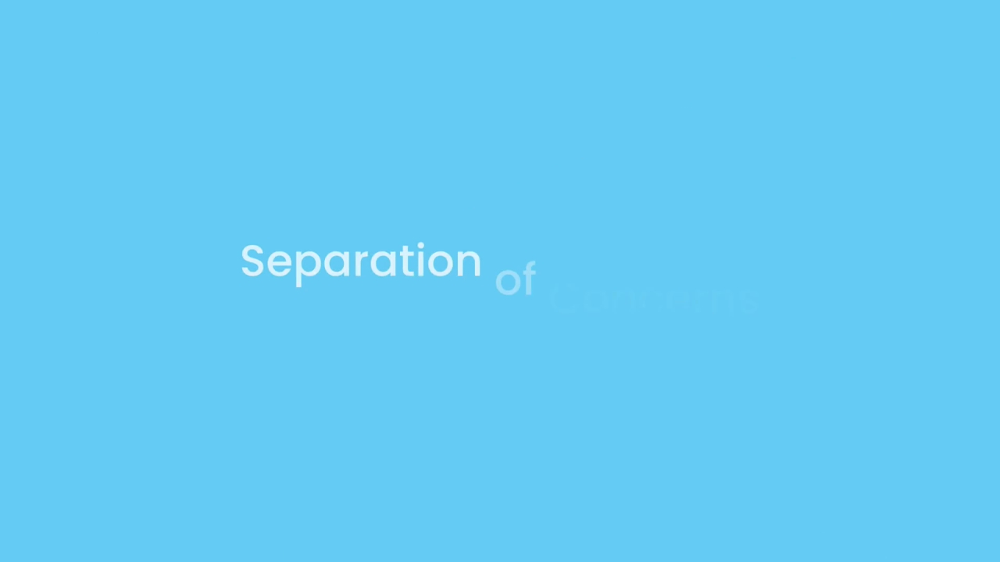

จากนั้นแสดงวงกลม HTML กับ CSS แยกกัน:

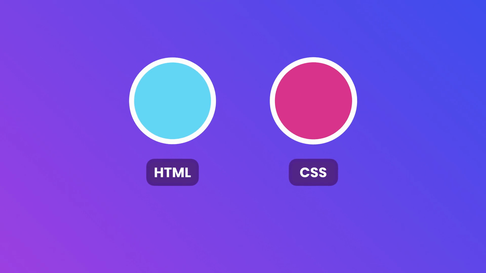

Mosh อธิบายด้วยการเปรียบเทียบ (metaphor) วิดีโอรถเข็นในซูเปอร์มาร์เก็ต:


> **Separation of Concerns คืออะไร:** หลักการที่ว่าแต่ละส่วนของโค้ดควรรับผิดชอบหน้าที่ของตัวเองแยกจากกันอย่างชัดเจน — **HTML รับผิดชอบโครงสร้างและเนื้อหา** ส่วน **CSS รับผิดชอบรูปลักษณ์/การจัดสไตล์** การแยกไฟล์ CSS ออกจาก HTML (เหมือนแยกของแต่ละแผนกในซูเปอร์มาร์เก็ต) ทำให้โค้ด**ดูแลรักษาง่ายขึ้น (maintainable)** และสามารถ**ใช้ไฟล์ CSS เดียวกันซ้ำได้กับหลายหน้า HTML**

---

## 3. External CSS — แยกไฟล์ `.css` ต่างหาก

Mosh สร้างไฟล์ใหม่ชื่อ **`styles.css`** ในโฟลเดอร์เดียวกับ `index.html`:

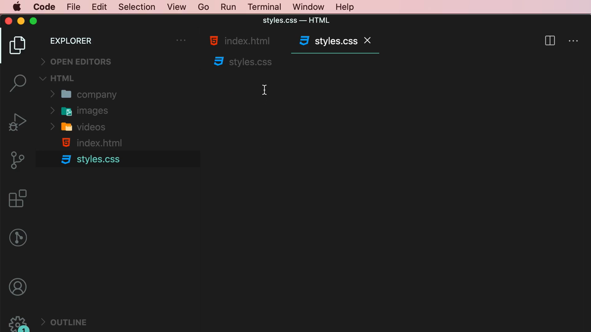

จากนั้น**ตัด (cut)** โค้ด `p { color: orange; }` จาก `<style>` ในไฟล์ HTML แล้วนำไปวางในไฟล์ `styles.css`:

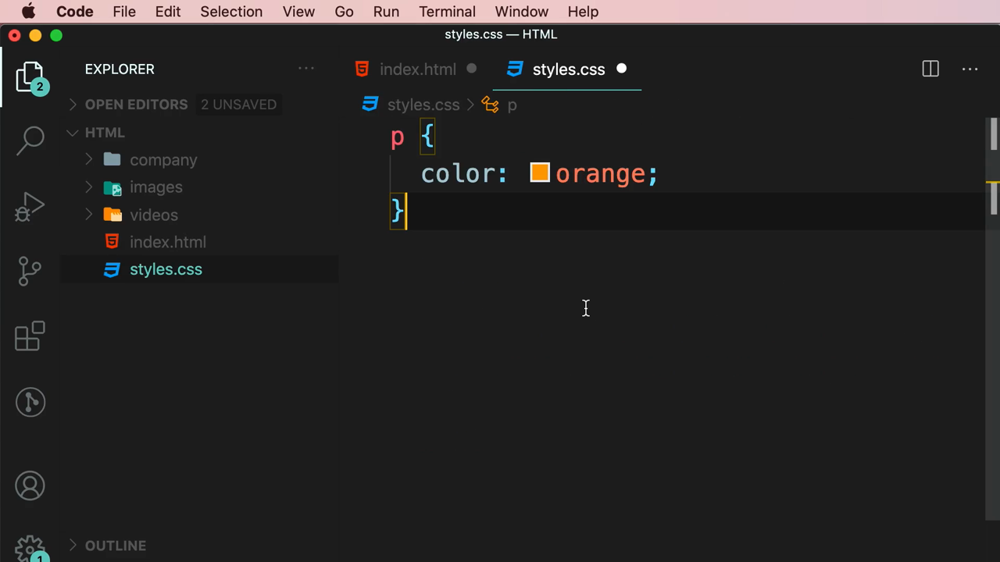

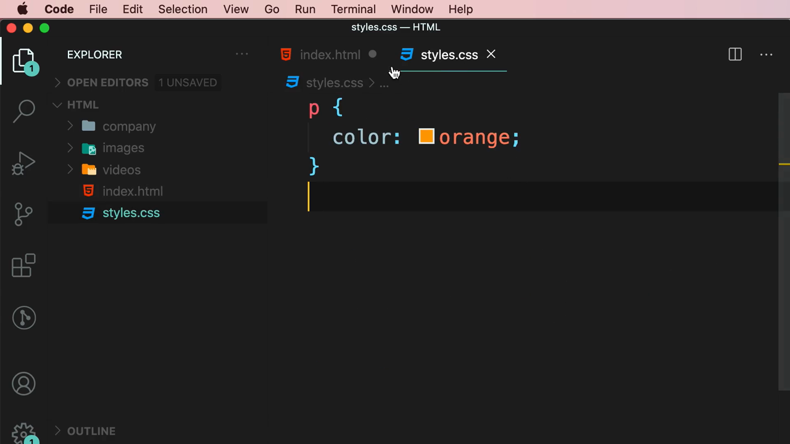

และลบเนื้อหาข้างในแท็ก `<style>` ในไฟล์ HTML ออกจนว่างเปล่า:

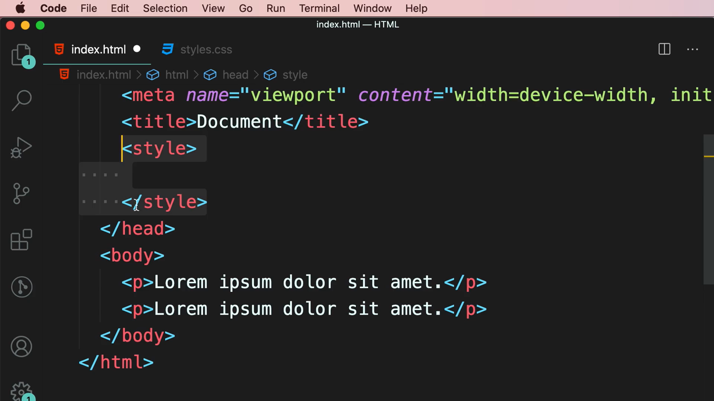

### เชื่อมไฟล์ CSS เข้ากับ HTML ด้วย `<link>`

Mosh พิมพ์ Emmet `link:css` เพื่อสร้างแท็ก `<link>`:

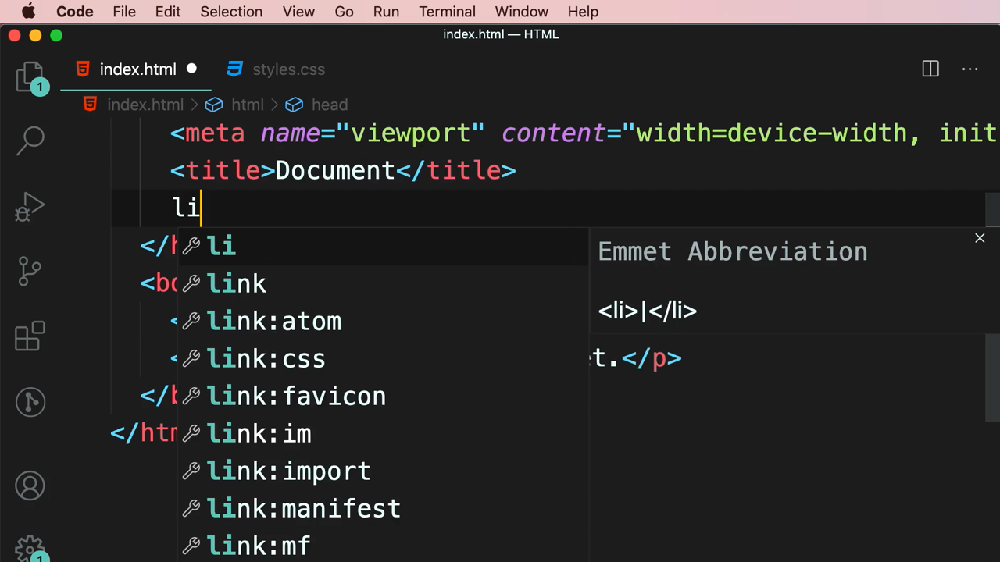

```html
<link rel="stylesheet" href="" />
```

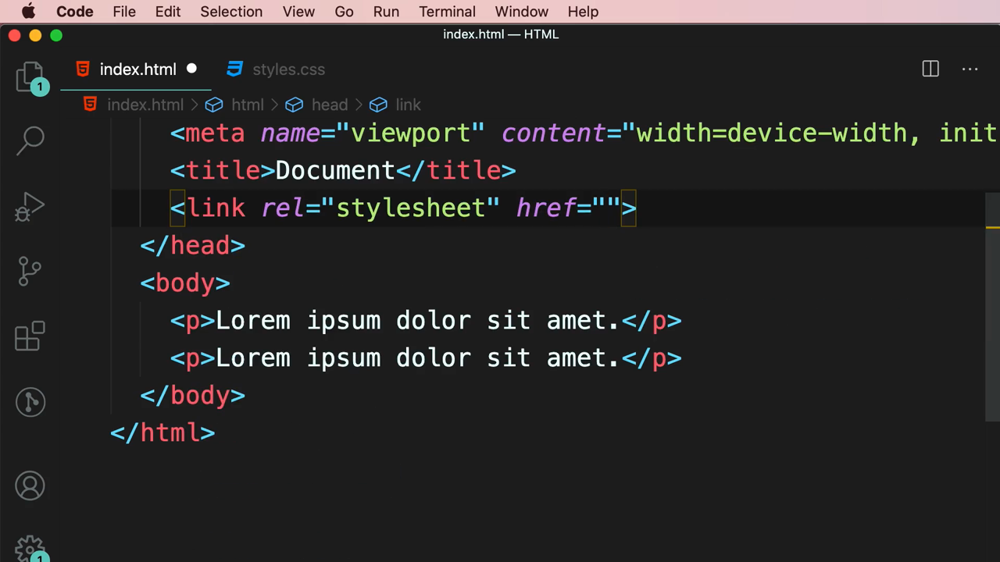

เมื่อทดสอบใน browser (ก่อนใส่ path) ข้อความยังคงเป็นสีส้มอยู่ เพราะยังไม่ได้เชื่อมไฟล์จริง (มาจาก cache หรือค่า default):

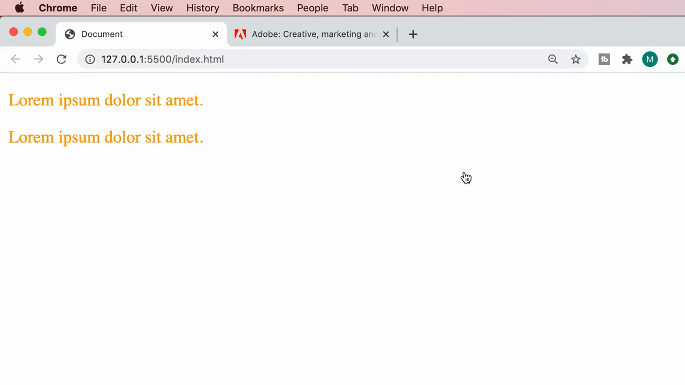

ใส่ path ไฟล์ CSS ใน attribute `href`:

```html
<link rel="stylesheet" href="styles.css" />
```

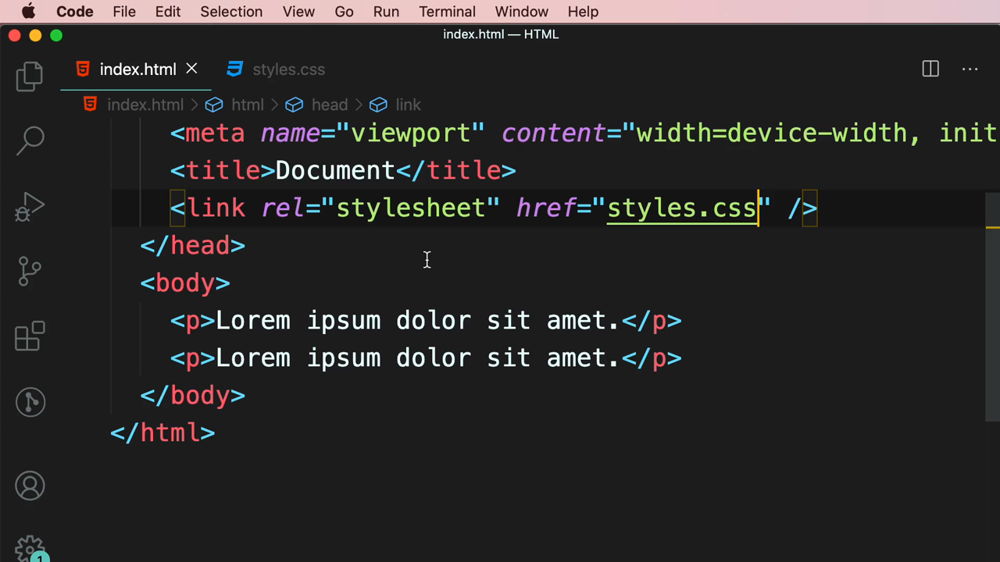

> **External CSS คืออะไร:** การเขียน CSS แยกไว้ในไฟล์ `.css` ต่างหาก แล้วเชื่อมเข้ากับ HTML ด้วยแท็ก **`<link rel="stylesheet" href="ที่อยู่ไฟล์">`** ภายใน `<head>` — เป็นวิธีที่**แนะนำที่สุด**สำหรับโปรเจกต์จริง เพราะแยกโค้ดชัดเจนตาม Separation of Concerns และไฟล์ CSS เดียวสามารถใช้ร่วมกันได้หลายหน้า HTML

---

## 4. ทดสอบลำดับความสำคัญ: Internal ชนะ External

Mosh เพิ่มโค้ดกลับเข้าไปใน `<style>` ที่ว่างเปล่าอีกครั้ง (โดยที่ `<link>` ไปยัง external CSS ยังอยู่):

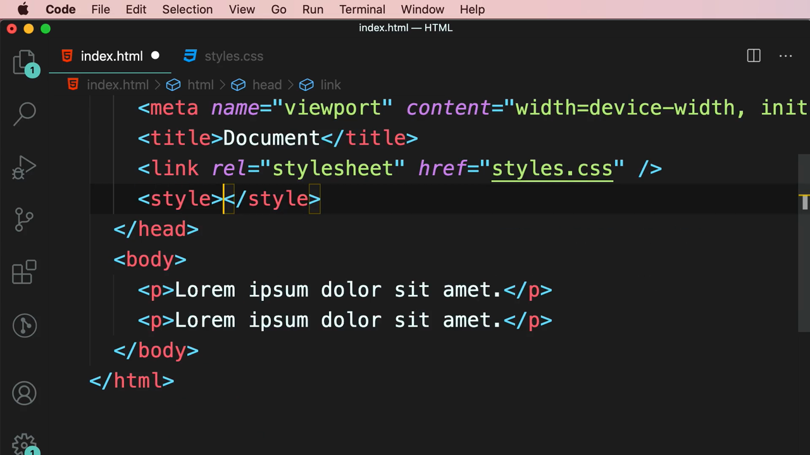

```html
<style>
  p {
    color: black;
  }
</style>
```

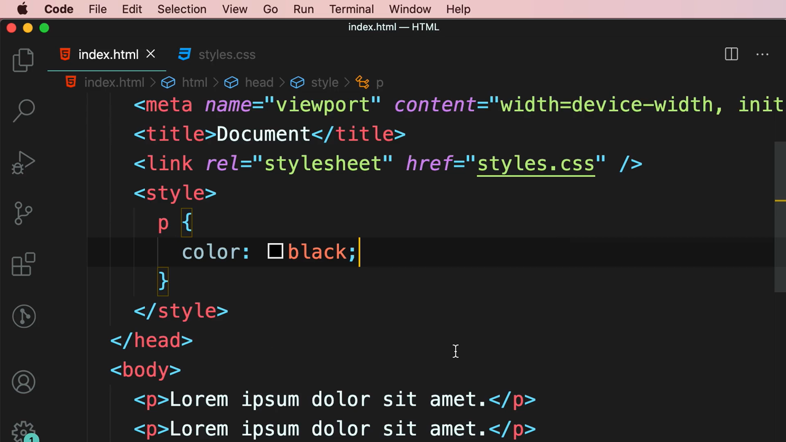

ผลลัพธ์ใน browser: ข้อความเปลี่ยนเป็น**สีดำ** ทั้งที่ external CSS (`styles.css`) ยังกำหนด `color: orange` อยู่:

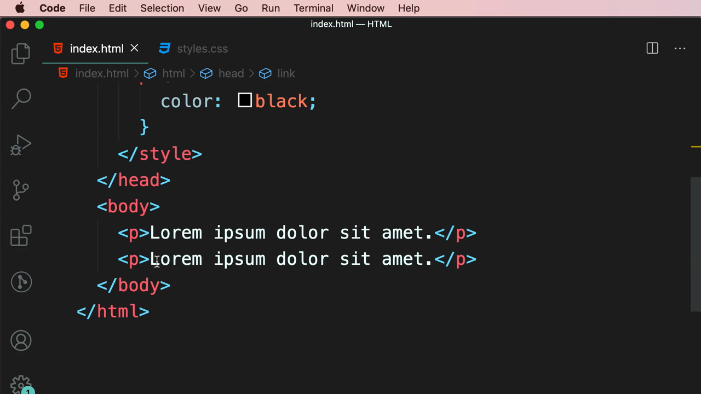

> **สรุปลำดับที่ 1:** เมื่อ Internal CSS และ External CSS แข่งกันกำหนดสไตล์ตัวเดียวกัน **Internal CSS จะชนะ** เพราะเขียนอยู่**หลัง** `<link>` ในลำดับของโค้ด (บราวเซอร์อ่านและใช้กฎที่มาทีหลังทับกฎที่มาก่อน เมื่อ specificity เท่ากัน)

---

## 5. ทดสอบลำดับความสำคัญ: Inline ชนะทุกอย่าง

Mosh เพิ่ม attribute **`style`** ตรงๆ บนแท็ก `<p>` ตัวแรก:

```html
<p style="color: blue">Lorem ipsum dolor sit amet.</p>
```

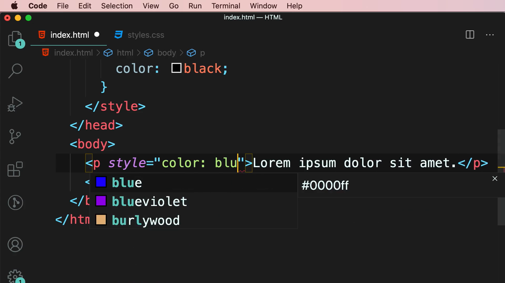

เพิ่ม property ที่สองต่อท้ายด้วย semicolon คั่น พร้อม IntelliSense อธิบาย `font-weight`:

> **"Specifies weight of glyphs in the font, their degree of blackness or stroke thickness."**

```html
<p style="color: blue; font-weight: bold">Lorem ipsum dolor sit amet.</p>
```

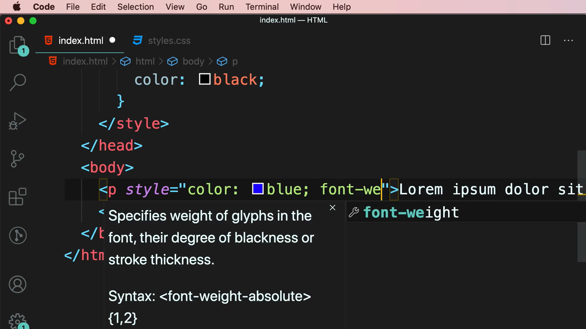

ผลลัพธ์ใน browser: ย่อหน้าแรกเป็น**สีน้ำเงินตัวหนา** (ชนะทั้ง internal สีดำและ external สีส้ม) ส่วนย่อหน้าที่สองยังเป็นสีดำตามปกติ (จาก internal CSS):

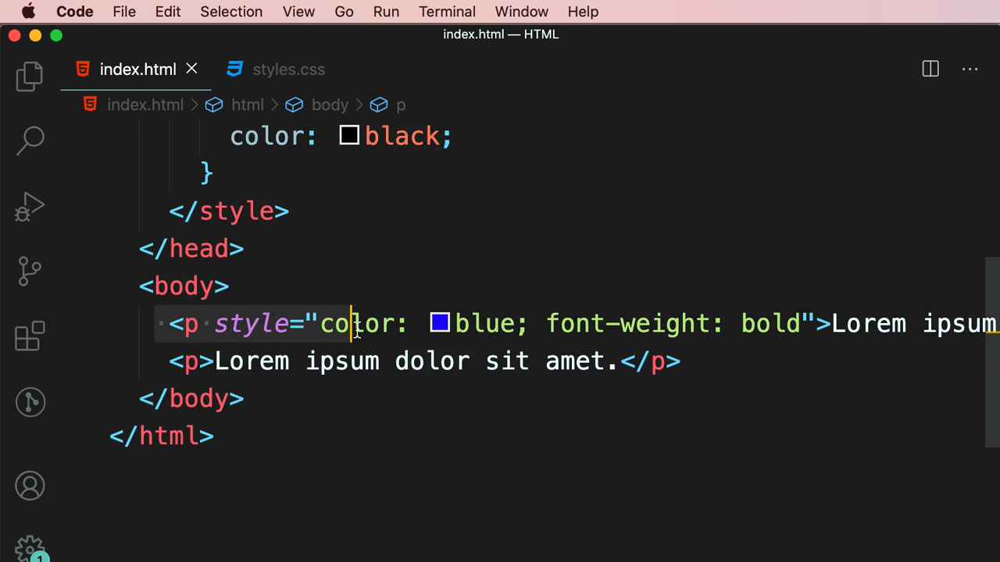

> **สรุปลำดับที่ 2:** **Inline CSS (attribute `style` บน element) มีความสำคัญสูงสุด** ชนะทั้ง Internal และ External CSS เสมอ (ยกเว้นกรณีใช้ `!important` ซึ่งนอกเหนือขอบเขตคลิปนี้) — ลำดับความสำคัญโดยรวม: **Inline > Internal > External**

---

## 6. เกริ่นนำ ID Selector

Mosh ปิดท้ายด้วยการเพิ่ม `id="first"` ให้กับ `<p>` แรก แล้วย้ายสไตล์จาก inline ไปเป็น selector แบบ ID ใน internal CSS แทน:

```html
<p id="first" style="color: blue; font-weight: bold">Lorem ipsum dolor sit amet.</p>
```

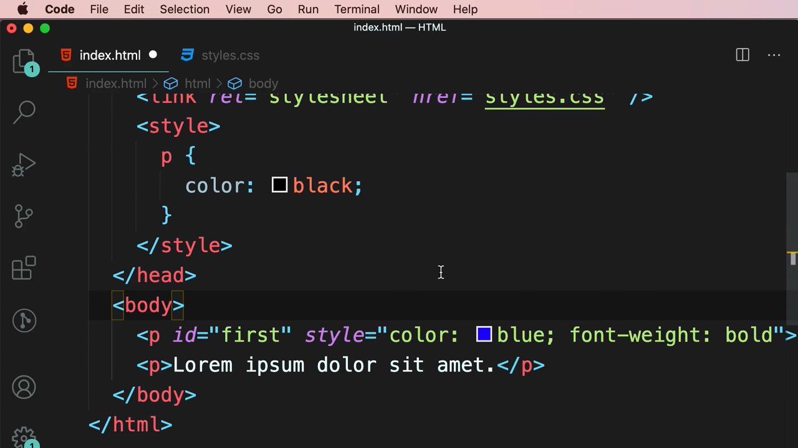

จากนั้นเขียน selector ใหม่ในแท็ก `<style>` โดยใช้เครื่องหมาย `#` นำหน้าชื่อ id:

```css
#first {
}
```

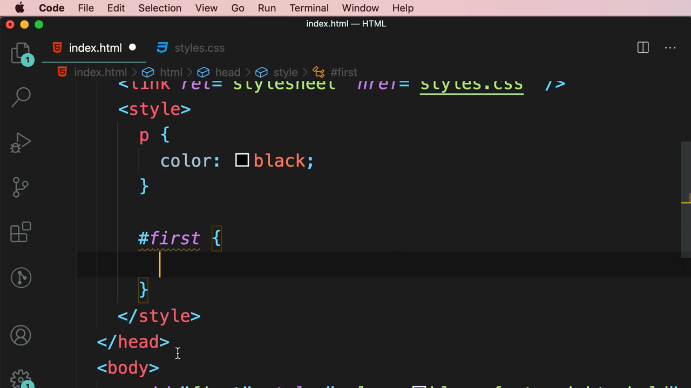

```css
#first {
  color: blue;
  font-weight: bold;
}
```

พร้อมลบค่าออกจาก attribute `style` ใน HTML (เหลือแค่ `style=""`) เพื่อให้ผลลัพธ์เหมือนเดิมแต่ CSS ทั้งหมดอยู่ในที่เดียว:

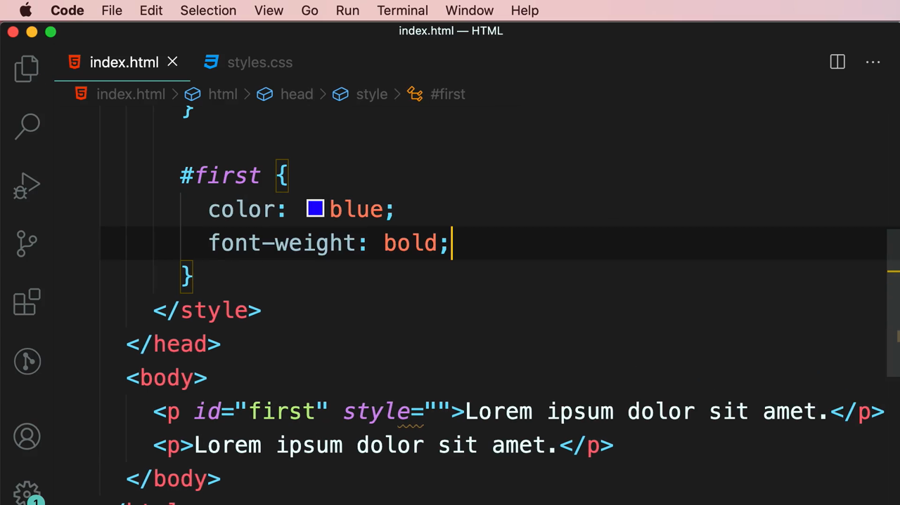

> **ID Selector คืออะไร:** ใช้เครื่องหมาย **`#`** นำหน้าชื่อ id (เช่น `#first`) เพื่อเลือก element ที่มี `id="first"` โดยเฉพาะ — เป็นวิธีที่ดีกว่า inline style เพราะยังคง CSS แยกจาก HTML ได้ตามหลัก Separation of Concerns แต่ยังคงเจาะจงกับ element เดียวได้เหมือน inline (รายละเอียดเรื่อง selector ประเภทต่างๆ จะสอนลึกขึ้นในคลิปถัดไป)

---

## สรุปที่ใช้ได้จริง

- 3 วิธีใส่ CSS: **Internal** (`<style>` ใน head), **External** (ไฟล์ `.css` แยก + `<link>`), **Inline** (attribute `style` บน element)
- **External CSS คือวิธีที่แนะนำที่สุด**สำหรับโปรเจกต์จริง เพราะแยกโค้ดชัดเจนและใช้ซ้ำได้หลายหน้า
- ลำดับความสำคัญเมื่อ CSS ขัดแย้งกัน: **Inline > Internal > External** (เมื่อ selector specificity เท่ากัน กฎที่มาทีหลังในโค้ดจะชนะ)
- **หลักการ Separation of Concerns**: HTML ดูแลโครงสร้าง, CSS ดูแลสไตล์ — ไม่ควรปนกัน
- **ID Selector** (`#idName`) ใช้เลือก element เฉพาะตัวผ่าน CSS แทนการเขียน inline style

### จุดเชื่อมกับงานจริงของ Aum

- ใน Next.js ไฟล์ `globals.css` ที่ import เข้า `layout.tsx` คือรูปแบบหนึ่งของ External CSS — ใช้ได้กับทุกหน้าในแอปเหมือนที่เรียนวันนี้
- Tailwind CSS ที่ใช้เขียนเป็น className บน element โดยตรง มีพฤติกรรมคล้าย "inline" ในแง่ที่เจาะจงเฉพาะจุด แต่จริงๆ แล้วยังคง generate เป็น class ใน stylesheet เบื้องหลัง ไม่ใช่ inline style จริงๆ — เพราะฉะนั้นเมื่อ Aum เขียน custom CSS ทับ Tailwind class ในไฟล์ CSS แยก อาจต้องระวังเรื่อง specificity เช่นเดียวกับที่เรียนวันนี้
- เข้าใจลำดับความสำคัญของ CSS (specificity) เป็นพื้นฐานสำคัญเวลา debug ปัญหา "ทำไม style ที่เขียนไม่ทำงาน" ซึ่งเกิดขึ้นบ่อยมากในการพัฒนาเว็บจริง ไม่ว่าจะใช้ CSS ธรรมดาหรือ Tailwind
- ID selector (`#first`) ควรใช้อย่างระมัดระวังใน React/Next.js เพราะ id ต้องไม่ซ้ำกันในหน้าเดียว — โดยทั่วไปนิยมใช้ `class`/`className` มากกว่า `id` สำหรับการจัดสไตล์
