# 4-CSS Basics: 03 - Normalizing CSS (2:59)

**ไฟล์ต้นทาง:** `03-Normalizing-CSS.mp4`

▶️ **[เปิดวิดีโอต้นฉบับ](../../../HTML-CSS-1/4-CSS%20Basics/03-Normalizing-CSS.mp4)**

---

## ภาพรวมคลิปนี้

คลิปนี้ Mosh สอนเรื่อง **ปัญหา browser แต่ละตัวมีค่า CSS default ไม่เหมือนกัน** และวิธีแก้ด้วยไลบรารี **Normalize.css** ซึ่งเป็นขั้นตอนสำคัญที่ควรทำก่อนเริ่มเขียน custom CSS ในทุกโปรเจกต์

---

## 1. ปัญหา: แต่ละ Browser มีค่า Default CSS ไม่เหมือนกัน

Mosh เปิดด้วยโลโก้ browser หลัก 4 ตัว (Chrome, Firefox, Safari, Edge):

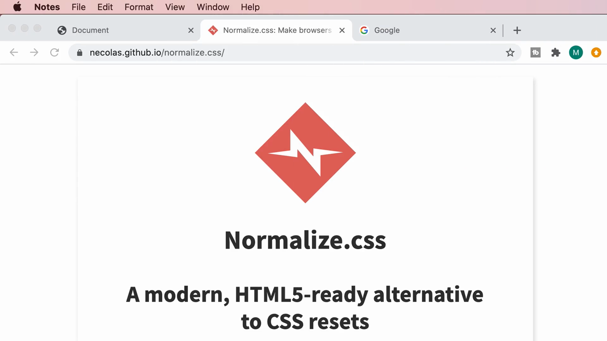

> **ปัญหาคือ:** แต่ละ browser มี **user agent stylesheet** (สไตล์เริ่มต้นที่ browser กำหนดเอง) ที่**ไม่เหมือนกัน** เช่น ขนาด margin ของ `<body>`, สไตล์ของ heading, ปุ่ม, ลิสต์ ฯลฯ ทำให้หน้าเว็บเดียวกันอาจแสดงผลต่างกันเล็กน้อยเมื่อเปิดคนละ browser ถ้าไม่ได้จัดการเรื่องนี้ตั้งแต่แรก

---

## 2. ค้นหาและติดตั้ง Normalize.css

Mosh ค้นหาคำว่า **"normalize.css"** ใน Google:

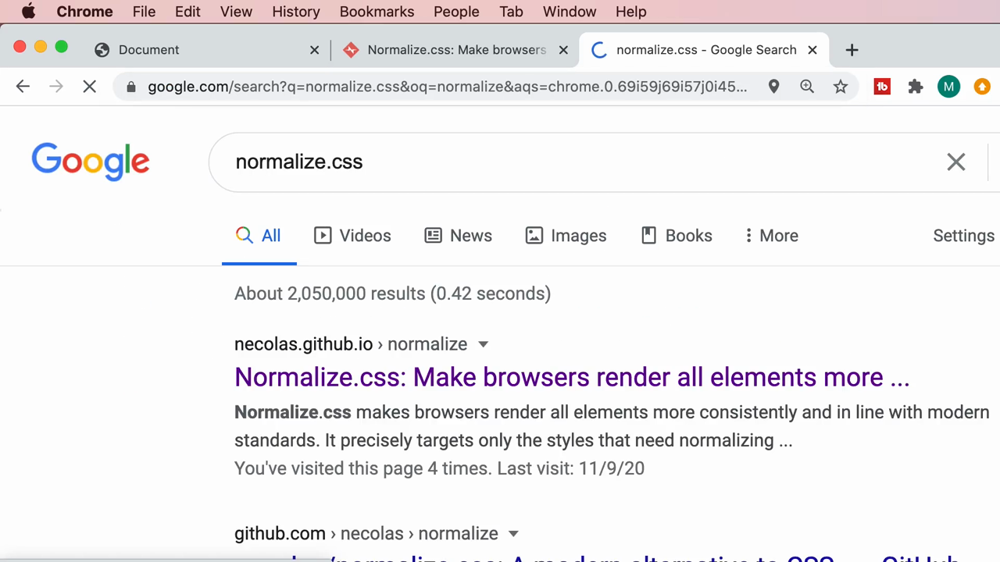

เข้าไปที่เว็บไซต์ **necolas.github.io/normalize.css/** ซึ่งอธิบายว่า:

> **"Normalize.css makes browsers render all elements more consistently and in line with modern standards. It precisely targets only the styles that need normalizing."**

มีปุ่ม **Download v8.0.1** และคำสั่งติดตั้งผ่าน npm (`npm install normalize.css`) สำหรับโปรเจกต์ที่ใช้ package manager:

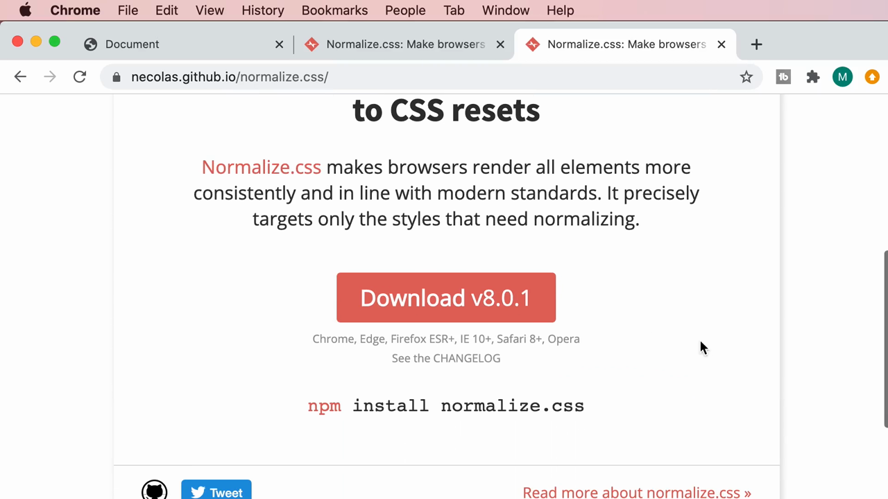

> **Normalize.css คืออะไร:** ไลบรารี CSS ที่มีหน้าที่**ปรับค่าเริ่มต้นของทุก element ให้เหมือนกันในทุก browser** ก่อนที่เราจะเริ่มเขียนสไตล์ของตัวเอง — ต่างจาก "CSS Reset" แบบเก่าที่ล้างทุกสไตล์ทิ้งหมด Normalize.css จะ**คงค่า default ที่มีประโยชน์ไว้** และแก้เฉพาะจุดที่ browser ต่างกันจริงๆ เท่านั้น

---

## 3. จัดระเบียบโฟลเดอร์: สร้าง `css/` แล้วย้าย `styles.css` เข้าไป

ก่อนเพิ่ม normalize.css Mosh จัดระเบียบโปรเจกต์ก่อน โดยเริ่มจากไฟล์เดิม (`p { color: orange; }` ใน `styles.css`):

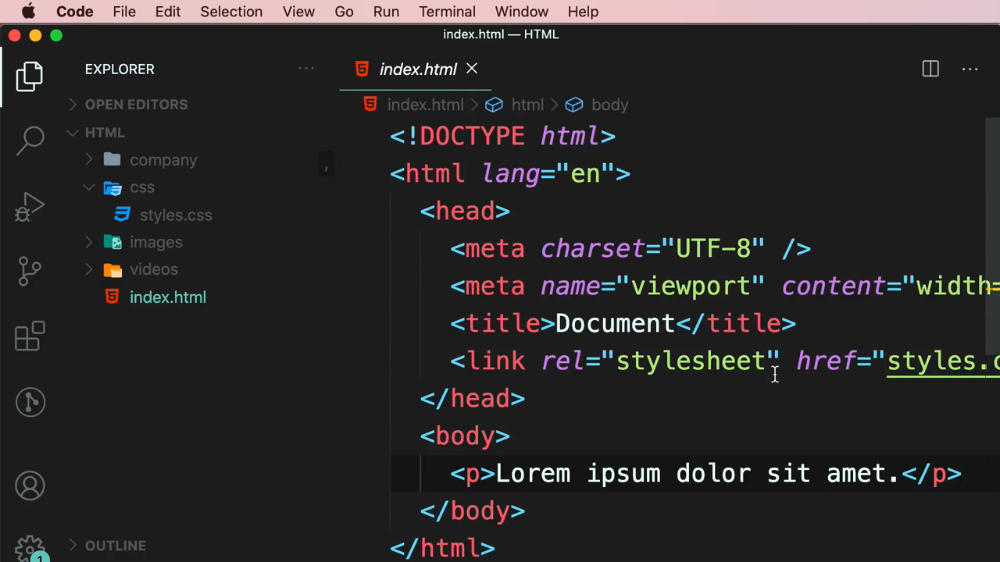

สร้างโฟลเดอร์ใหม่ชื่อ **`css/`** แล้วย้าย `styles.css` เข้าไปข้างใน:

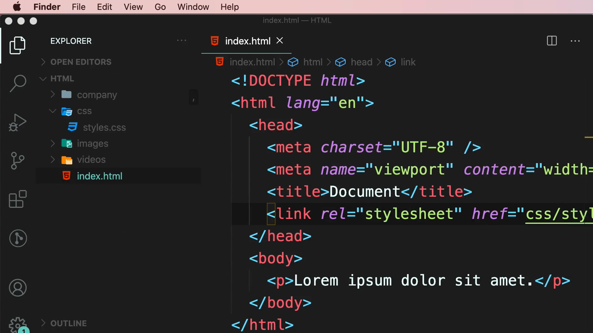

จากนั้นลาก (drag) ไฟล์ **`normalize.css`** ที่ดาวน์โหลดมาจาก Finder เข้าไปวางในโฟลเดอร์ `css/` เดียวกัน:

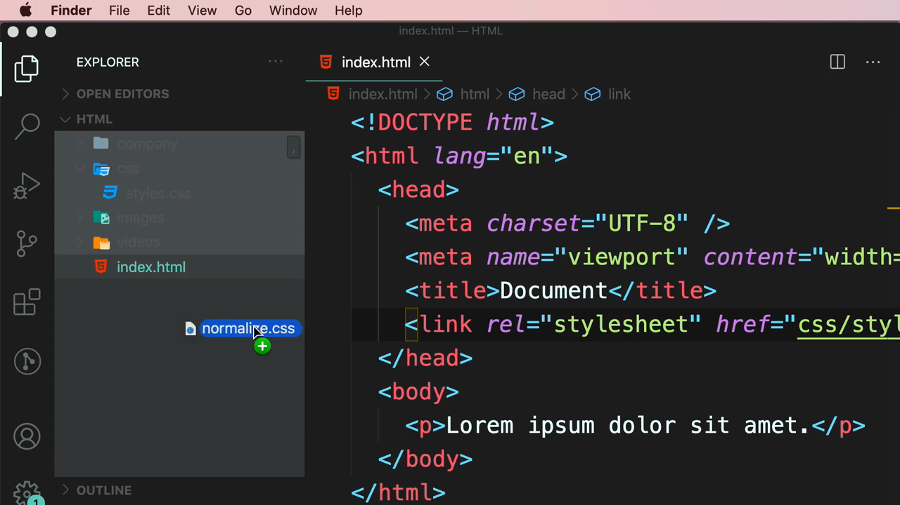

Mosh เปิดดูเนื้อหาไฟล์ `normalize.css` คร่าวๆ ซึ่งมีกฎ CSS จำนวนมากพร้อมคอมเมนต์อธิบายแต่ละจุด เช่น:

```css
/**
 * Remove the margin in all browsers.
 */
body {
  margin: 0;
}
```

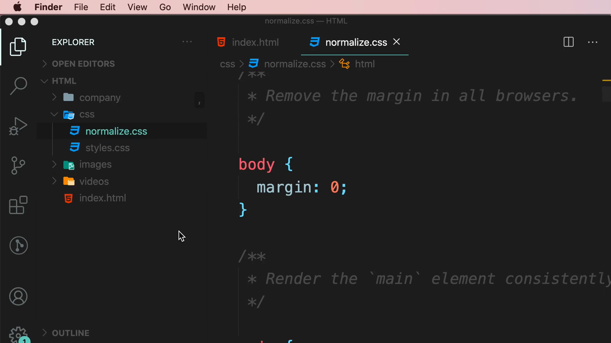

> **จัดระเบียบโฟลเดอร์:** การแยกไฟล์ CSS ทั้งหมด (ทั้งของเราเองและของไลบรารีภายนอก) ไว้ในโฟลเดอร์ `css/` ทำให้โครงสร้างโปรเจกต์เป็นระเบียบ ง่ายต่อการค้นหาและดูแลรักษาในระยะยาว

---

## 4. เชื่อม `normalize.css` เข้ากับ HTML ด้วย `<link>` ตัวที่สอง

ก่อนแก้ไข path ใน `<link>` เดิม Mosh ทดสอบใน browser ก่อน — เห็นว่าข้อความยังชิดขอบซ้ายบนตามปกติ (ยังไม่มี normalize):

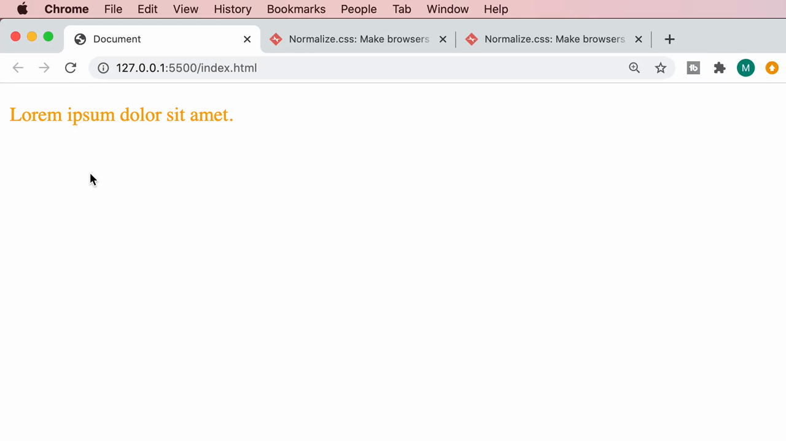

อัปเดต `href` ของ `<link>` เดิมให้ชี้ไปที่ path ใหม่ **`css/styles.css`**:

```html
<link rel="stylesheet" href="css/styles.css" />
```

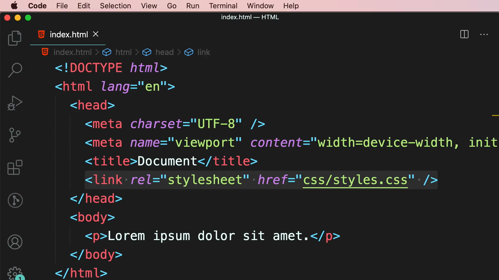

จากนั้นเพิ่ม `<link>` **ตัวที่สอง** สำหรับ normalize.css โดยพิมพ์ Emmet `li` แล้วเลือก `link`:

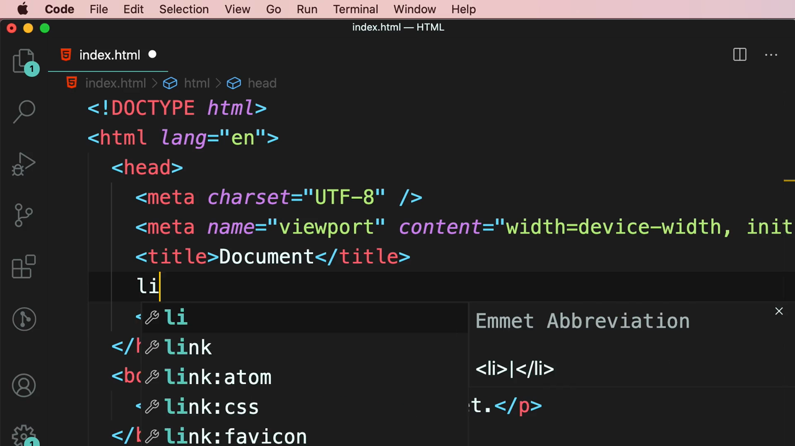

VS Code แสดง autocomplete ให้เลือกไฟล์ในโฟลเดอร์ `css/`:

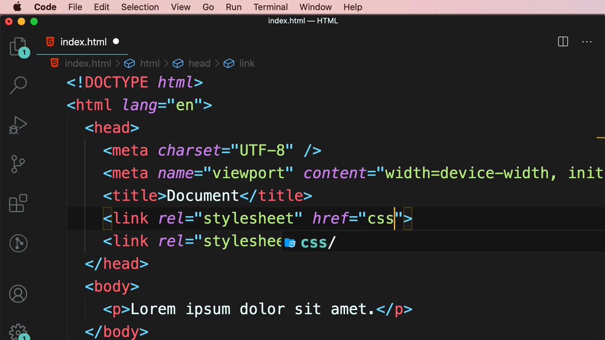

โค้ดสุดท้าย:

```html
<link rel="stylesheet" href="css/normalize.css" />
<link rel="stylesheet" href="css/styles.css" />
```

ผลลัพธ์ใน browser: ข้อความ "Lorem ipsum dolor sit amet." (สีส้มจาก `styles.css`) ตอนนี้**ชิดขอบซ้ายบนสุดพอดี ไม่มี margin เหลืออยู่เลย** เพราะ `normalize.css` ได้ลบ margin เริ่มต้นของ `<body>` ออกไปแล้ว:

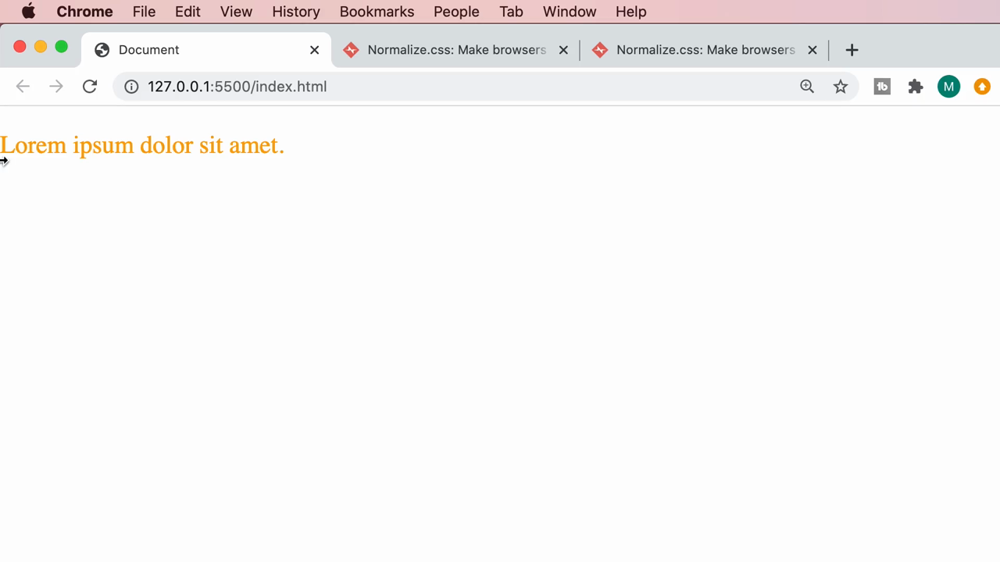

> **จุดสำคัญเรื่องลำดับ `<link>`:** ต้องใส่ `<link>` ของ **normalize.css ไว้ก่อน** `<link>` ของ `styles.css` (ไฟล์ของเราเอง) เสมอ เพราะต้องการให้ normalize.css ทำงานปรับค่า default ก่อน แล้วจึงให้ custom CSS ของเรามาเขียนทับทีหลัง — ตามหลักการที่เรียนในคลิปก่อนหน้าว่า "โค้ดที่มาทีหลังจะชนะ" เมื่อ specificity เท่ากัน

---

## 5. ทดสอบ: Custom CSS ยังคงเขียนทับ Normalize ได้ตามปกติ

Mosh เพิ่ม CSS ของตัวเองใน `styles.css` เพื่อยืนยันว่ายังสามารถกำหนดค่า margin ใหม่ทับ normalize ได้ตามต้องการ:

```css
body {
  margin: 10px;
}

p {
  color: orange;
}
```

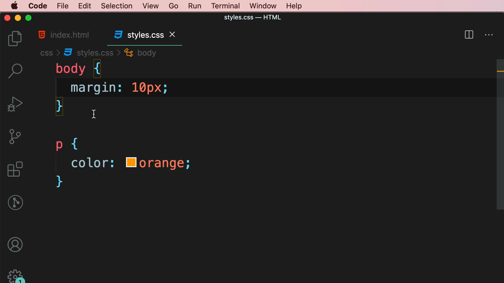

ผลลัพธ์ใน browser: ข้อความสีส้มกลับมามี margin เล็กน้อยรอบขอบตามค่าที่เรากำหนดเอง (10px) แทนที่จะเป็น 0 จาก normalize หรือค่า default ที่ไม่แน่นอนของแต่ละ browser:

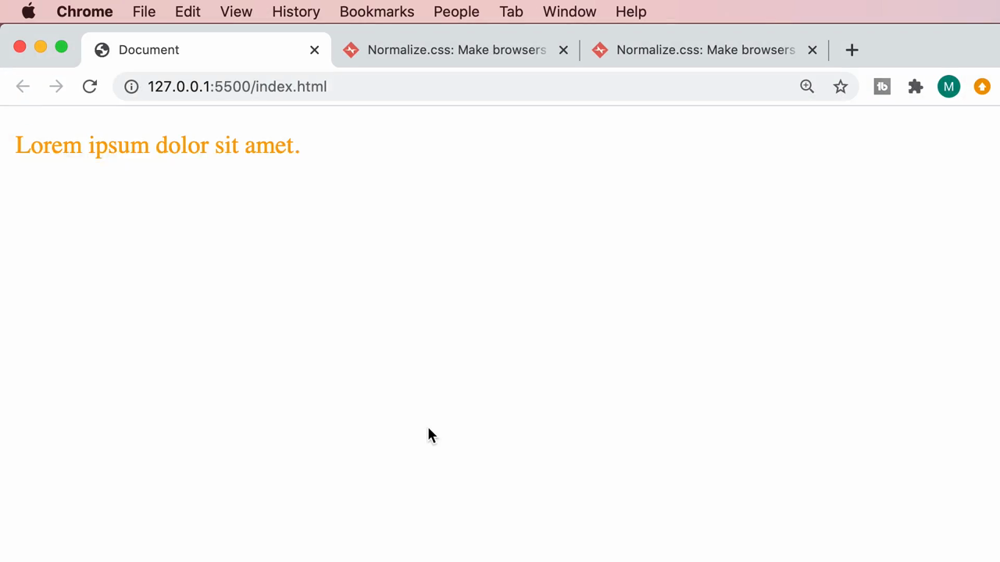

> **สรุป:** Normalize.css ไม่ได้ "ล็อก" ค่าใดๆ ไว้ถาวร มันแค่ทำให้**จุดเริ่มต้น (baseline)** ของทุก browser เหมือนกัน หลังจากนั้น custom CSS ของเรายังคงเขียนทับค่าต่างๆ ได้ตามปกติทุกประการ

---

## สรุปที่ใช้ได้จริง

- **ปัญหา:** แต่ละ browser มีค่า default CSS ไม่เหมือนกัน (margin, font ของ heading ฯลฯ) ทำให้หน้าเว็บแสดงผลต่างกันถ้าไม่จัดการ
- **Normalize.css** คือไลบรารีที่ทำให้ค่า default ของทุก browser เหมือนกัน โดยไม่ล้างสไตล์ทั้งหมดทิ้งแบบ CSS Reset เก่า
- ขั้นตอน: ดาวน์โหลด `normalize.css` → วางในโฟลเดอร์ `css/` → เพิ่ม `<link>` ชี้ไปที่ไฟล์นั้น **ก่อน** `<link>` ของ CSS ของเราเอง
- ลำดับ `<link>` สำคัญมาก: normalize.css ต้องมาก่อนเสมอ เพื่อให้ custom CSS ของเรา override ทับได้ในภายหลัง

### จุดเชื่อมกับงานจริงของ Aum

- ใน Next.js สมัยใหม่ ไม่จำเป็นต้องติดตั้ง normalize.css เองแล้ว เพราะ **Tailwind CSS มี Preflight** (`@tailwind base;` ใน `globals.css`) ซึ่งทำหน้าที่เดียวกันคือ normalize ค่า default ของทุก browser ให้เหมือนกันโดยอัตโนมัติ
- แนวคิดเรื่อง "จัดลำดับการโหลด CSS" (normalize ก่อน แล้วค่อยเป็น custom style) เป็นหลักการเดียวกับที่ Next.js ใช้ตอน import `globals.css` ไว้บนสุดของ `layout.tsx` ก่อน component อื่นๆ
- การจัดโฟลเดอร์ CSS แยกเป็น `css/` เป็นนิสัยที่ดีที่สามารถนำไปปรับใช้กับการจัดโครงสร้าง `styles/` หรือ `app/globals.css` ในโปรเจกต์ Next.js ได้เช่นกัน
