# 4-CSS Basics: 04 - Basic Selectors (4:57)

**ไฟล์ต้นทาง:** `04-Basic-Selectors.mp4`

▶️ **[เปิดวิดีโอต้นฉบับ](../../../HTML-CSS-1/4-CSS%20Basics/04-Basic-Selectors.mp4)**

---

## ภาพรวมคลิปนี้

คลิปนี้ Mosh สอนเรื่อง **Selector พื้นฐาน (Basic Selectors)** ใน CSS ทั้งหมด 4 แบบหลัก ได้แก่ **Type Selector**, **Class Selector**, **ID Selector**, และ **Attribute Selector** พร้อมสาธิตให้เห็นข้อดี-ข้อจำกัดของแต่ละแบบด้วยตัวอย่างจริงในโค้ด

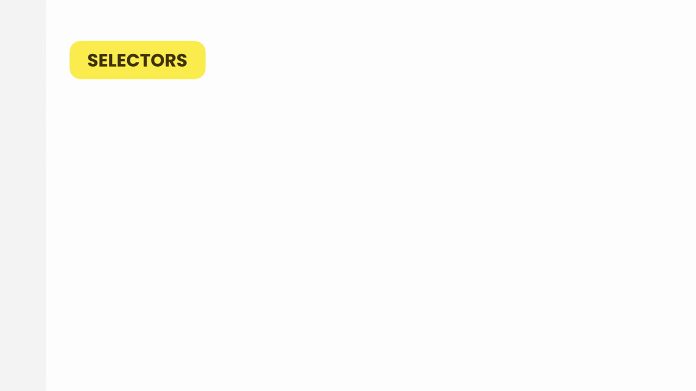

---

## 1. เตรียมโครงสร้าง HTML: เพิ่ม `<section id="products">`

Mosh เริ่มจากไฟล์ที่มีอยู่แล้ว (สืบทอดจากคลิปก่อนหน้า) — `index.html` มี `<link>` สองอันเชื่อม `css/normalize.css` และ `css/styles.css` ส่วน `<body>` ยังว่างเปล่า:

```html
<link rel="stylesheet" href="css/normalize.css" />
<link rel="stylesheet" href="css/styles.css" />
```

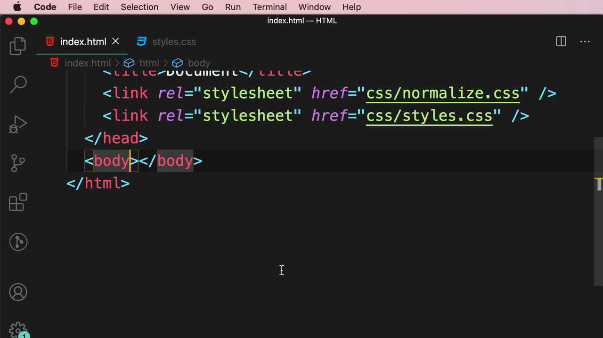

พิมพ์ `section` ด้วย Emmet ในแท็ก `<body>`:

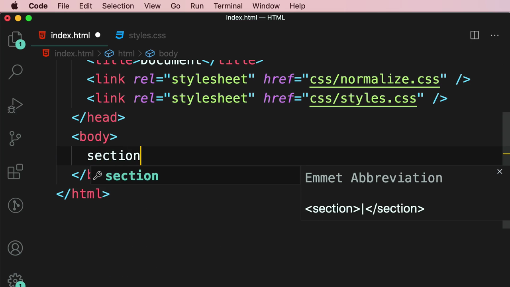

จากนั้นเพิ่ม `id="products"` เข้าไปในแท็ก `<section>`:

```html
<body>
  <section id="products"></section>
</body>
```

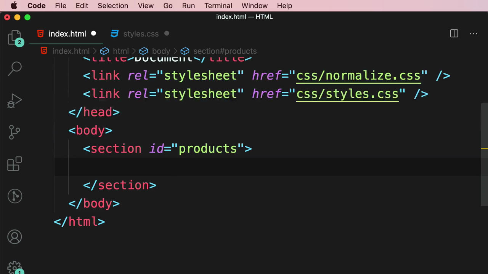

---

## 2. Type Selector (Element Selector) — ทบทวนสั้นๆ

> **Type Selector คืออะไร:** เลือก element ตาม**ชื่อแท็ก HTML** โดยตรง เช่น `body { }`, `p { }`, `section { }` — เป็น selector พื้นฐานที่สุด แต่มีข้อจำกัดคือจะ**เลือกทุก element ที่เป็นแท็กนั้นทั้งหมดในหน้า** ไม่สามารถเจาะจงเลือกแค่บางอันได้

ตัวอย่างที่มีอยู่แล้วใน `styles.css` จากคลิปก่อนหน้าคือ `body { margin: 10px; }` ซึ่งเป็น Type Selector ที่เลือกแท็ก `<body>` ทั้งหมด

---

## 3. Class Selector — เพิ่ม `<article class="product">` สามชิ้น

Mosh พิมพ์ `article.pro` ด้วย Emmet เพื่อสร้าง `<article>` ที่มี `class="pro"`:

```html
article.pro
```


แล้วแก้ให้เป็น `class="product"` และคัดลอกเป็น 3 ชิ้นภายใน `<section id="products">`:

```html
<section id="products">
  <article class="product"></article>
  <article class="product"></article>
  <article class="product"></article>
</section>
```

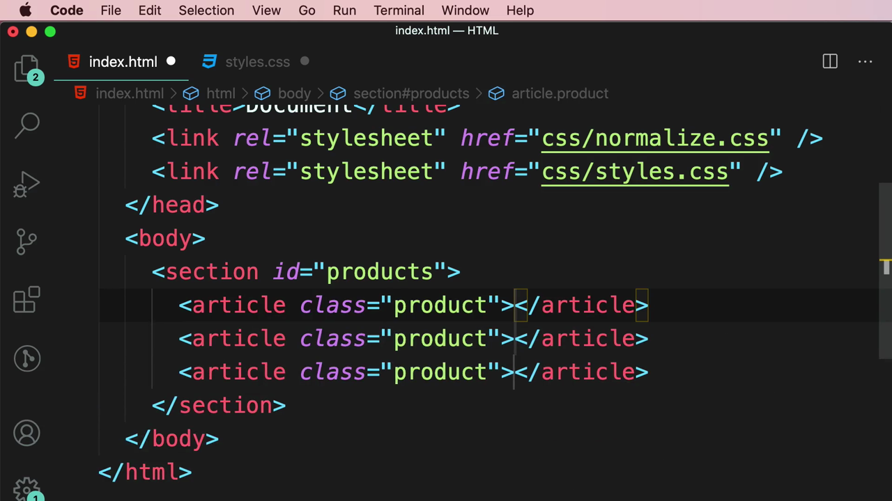

---

## 4. ID Selector — ทดลองเลือกด้วย `#products` (ยังว่างเปล่า)

Mosh สลับไปที่ `styles.css` แล้วพิมพ์ **ID Selector** โดยใช้เครื่องหมาย `#` ตามด้วยชื่อ id:

```css
#products {
}
```

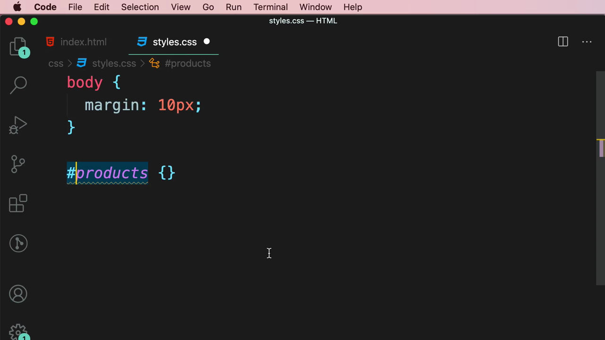

> **ID Selector คืออะไร:** เลือก element ที่มี `id` ตรงกับที่ระบุ โดยใช้เครื่องหมาย **`#`** นำหน้าชื่อ id เช่น `#products { }` จะเลือกเฉพาะ element ที่มี `id="products"` เท่านั้น — เนื่องจาก `id` ต้อง**ไม่ซ้ำกัน**ในหน้าเดียวกัน (unique) ID Selector จึงเลือกได้แค่ **element เดียว** ต่อหนึ่งหน้าเสมอ

Mosh ลบ `<section id="products">` ทิ้งชั่วคราว (เหลือ `<body>` ว่างเปล่า) เพื่อเคลียร์พื้นที่ก่อนโฟกัสเรื่อง Class Selector และ Attribute Selector ต่อ:

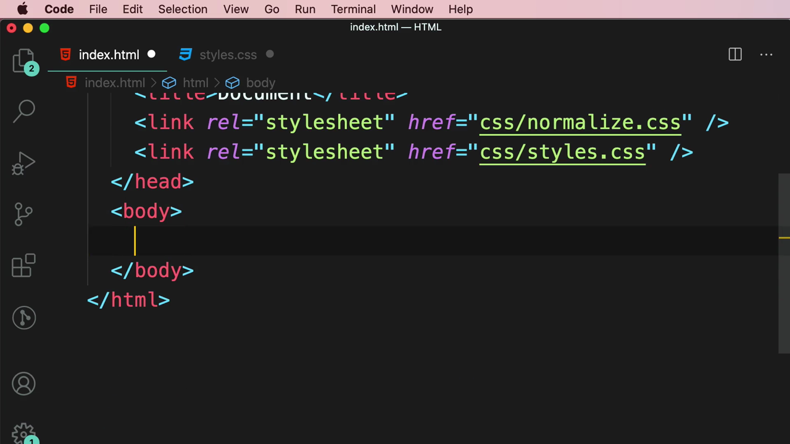

---

## 5. Class Selector — เจาะจงด้วย `.product`

กลับมาที่ `styles.css` Mosh พิมพ์ **Class Selector** โดยใช้เครื่องหมายจุด `.` ตามด้วยชื่อ class:

```css
.product {
}
```

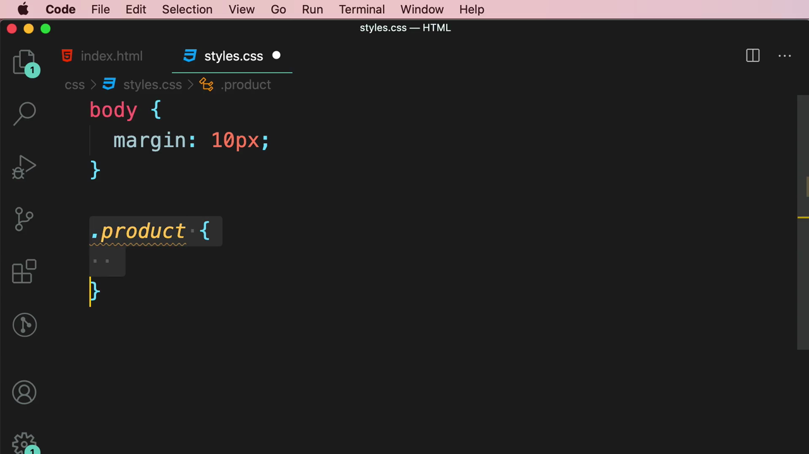

> **Class Selector คืออะไร:** เลือก element ที่มี attribute `class` ตรงกับชื่อที่ระบุ โดยใช้เครื่องหมาย **`.`** (จุด) นำหน้าชื่อ class เช่น `.product { }` จะเลือก**ทุก element** ที่มี `class="product"` — ต่างจาก ID Selector ตรงที่ **class ใช้ซ้ำกันได้หลาย element** จึงเหมาะกับการจัดกลุ่ม element ที่ต้องการสไตล์เหมือนกันหลายชิ้น เช่น การ์ดสินค้าหลายใบในหน้าร้านค้า

---

## 6. Attribute Selector — เลือกจากค่า Attribute แบบตรงเป๊ะ (Exact Match)

Mosh สร้างลิงก์ `<a>` ไปยัง Google เพื่อสาธิต **Attribute Selector**:

```html
<a href="https://google.com" target="_blank">Google</a>
```

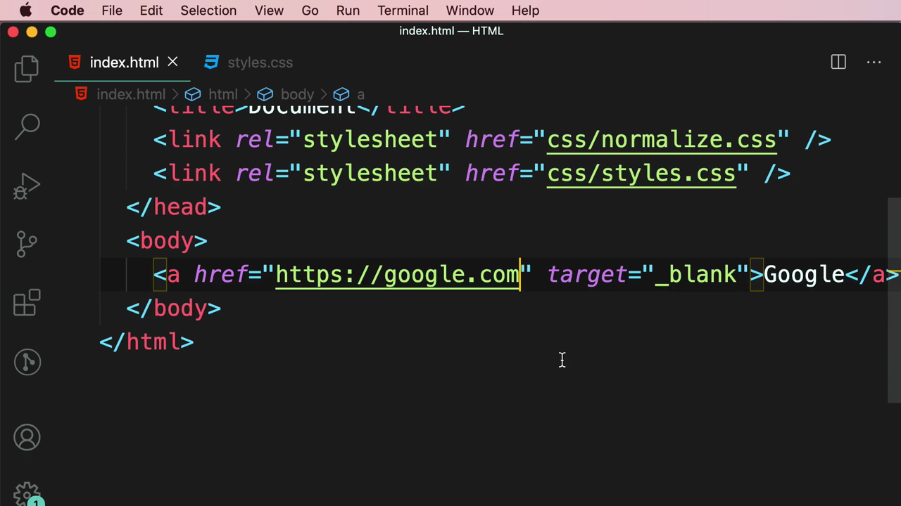

แล้วเขียน CSS ด้วย **Attribute Selector** ที่เลือกเฉพาะ `<a>` ที่มี `href` ตรงกับค่าที่ระบุ**เป๊ะๆ ทุกตัวอักษร**:

```css
a[href="https://google.com"] {
  color: orange;
}
```

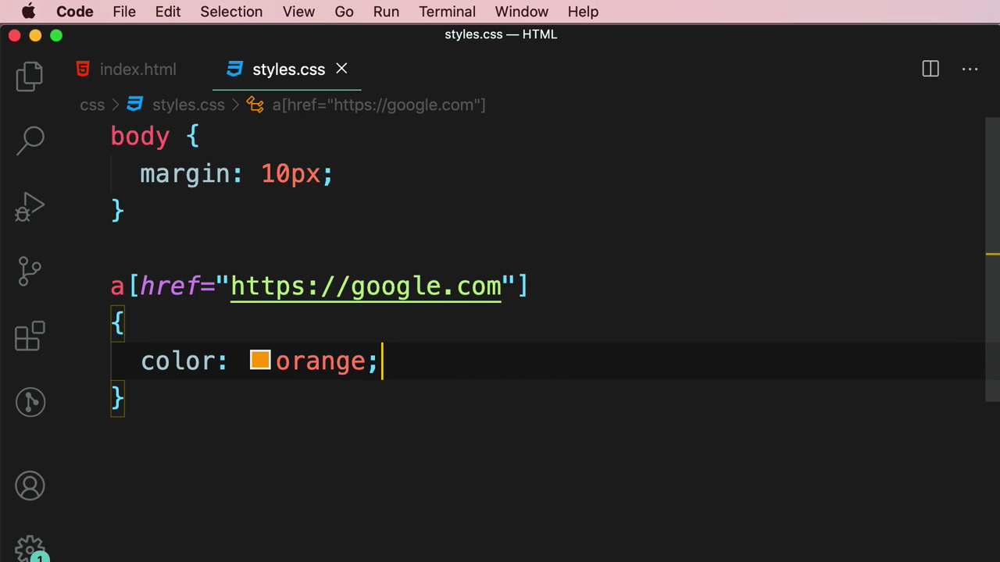

ผลลัพธ์ใน browser: ลิงก์ "Google" กลายเป็นสีส้มตามที่กำหนด:

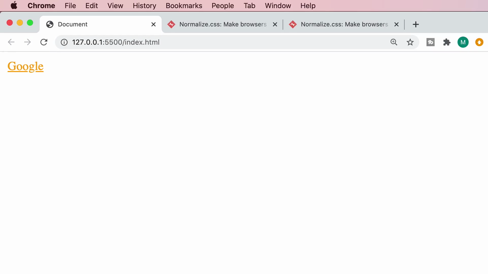

> **Attribute Selector (Exact Match) คืออะไร:** ใช้เครื่องหมาย **`[ ]`** ครอบชื่อ attribute และค่าที่ต้องการ เช่น `a[href="https://google.com"]` จะเลือกเฉพาะ `<a>` ที่มี `href` เท่ากับค่านี้**เป๊ะทุกตัวอักษร** (exact match) — เป็น selector ที่เจาะจงมาก ไม่ต้องพึ่ง `class` หรือ `id` เลย แต่ก็**เปราะบาง**เพราะถ้าค่า attribute เปลี่ยนแม้เพียงเล็กน้อยก็จะไม่ match ทันที

---

## 7. ปัญหาของ Exact Match: เพิ่ม `/` ต่อท้าย URL แล้ว Selector ใช้ไม่ได้

Mosh สาธิตจุดอ่อนของ exact match attribute selector โดยแก้ `href` ให้มี **`/`** ต่อท้าย:

```html
<a href="https://google.com/" target="_blank">Google</a>
```

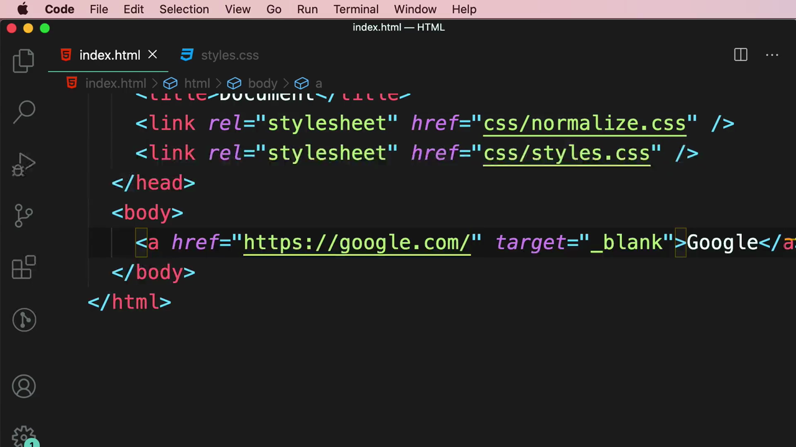

เมื่อ refresh browser ลิงก์ "Google" **ไม่เป็นสีส้มอีกต่อไป** (กลับไปเป็นสีน้ำเงินขีดเส้นใต้ตามค่า default ของ browser) เพราะค่า `href` ใน HTML (`https://google.com/`) ไม่ตรงกับค่าที่ระบุใน selector (`https://google.com` ไม่มี `/`) แบบเป๊ะๆ อีกต่อไป:

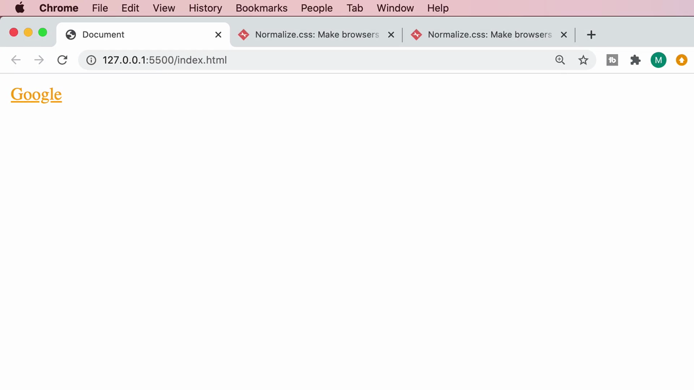

> **บทเรียนสำคัญ:** Exact match attribute selector (`[attr="value"]`) เปราะบางมาก เพราะต้องตรงกันทุกตัวอักษร แม้แค่เครื่องหมาย `/` ต่อท้ายก็ทำให้ selector ใช้ไม่ได้ทันที

---

## 8. แก้ปัญหาด้วย Wildcard Attribute Selector: `[href*="google"]`

Mosh แก้ปัญหาโดยเปลี่ยนมาใช้ **wildcard operator `*=`** แทน `=` ธรรมดา:

```css
a[href*="google"] {
  color: orange;
}
```

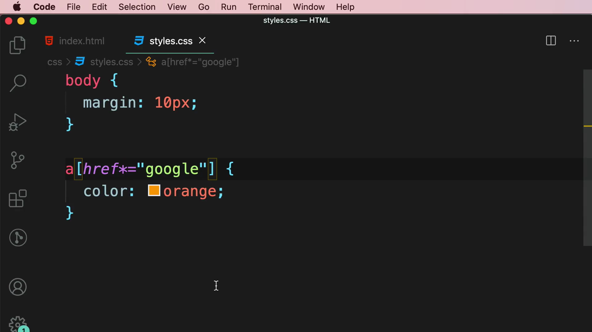

ผลลัพธ์: ลิงก์กลับมาเป็นสีส้มอีกครั้ง แม้ `href` จะมี `/` ต่อท้ายหรือมีข้อความอื่นเพิ่มเติมก็ตาม เพราะ `*=` หมายถึง **"href ที่มีคำว่า google อยู่ตรงไหนก็ได้ในค่านั้น"** (contains match) ไม่จำเป็นต้องตรงกันเป๊ะทั้งหมด

> **Attribute Selector แบบ Wildcard (`*=`) คืออะไร:** `[attr*="value"]` เลือก element ที่ attribute นั้น**มีข้อความ**ที่ระบุอยู่**ที่ไหนก็ได้**ภายในค่า (ไม่ต้องขึ้นต้นหรือจบด้วยค่านั้น) — ยืดหยุ่นกว่า exact match (`=`) มาก เหมาะกับกรณีที่ค่า attribute อาจมีการเปลี่ยนแปลงเล็กน้อย เช่น URL ที่มี query string หรือ trailing slash ต่อท้าย

---

## สรุปที่ใช้ได้จริง

Basic Selectors ทั้ง 4 แบบที่เรียนในคลิปนี้:

| Selector | ไวยากรณ์ | เลือกอะไร | จำนวนที่เลือกได้ |
|---|---|---|---|
| **Type Selector** | `tagname { }` | ทุก element ที่เป็นแท็กนั้น | หลายชิ้น (ทั้งหมดในหน้า) |
| **Class Selector** | `.classname { }` | element ที่มี class ตรงกัน | หลายชิ้น (ใช้ซ้ำได้) |
| **ID Selector** | `#idname { }` | element ที่มี id ตรงกัน | ชิ้นเดียวเท่านั้น (unique) |
| **Attribute Selector** | `tag[attr="value"] { }` | element ที่มีค่า attribute ตรงกัน (เป๊ะ) | ขึ้นอยู่กับข้อมูล |
| **Attribute Selector (wildcard)** | `tag[attr*="value"] { }` | element ที่ attribute นั้นมีข้อความนี้อยู่ | ขึ้นอยู่กับข้อมูล |

- **Class Selector** เหมาะกับการจัดกลุ่ม element หลายชิ้นที่ต้องการสไตล์ร่วมกัน (ใช้บ่อยที่สุดในการทำงานจริง)
- **ID Selector** เหมาะกับ element ที่มีหนึ่งเดียวในหน้า เช่น header หลัก, footer หลัก
- **Attribute Selector** มีประโยชน์เมื่อไม่ต้องการเพิ่ม class/id ใหม่ หรือต้องการเลือกตาม attribute ที่มีอยู่แล้ว เช่น `href`, `type`, `target`
- Wildcard (`*=`) ทำให้ attribute selector ยืดหยุ่นและทนทานต่อการเปลี่ยนแปลงข้อมูลเล็กน้อยมากกว่า exact match (`=`)

### จุดเชื่อมกับงานจริงของ Aum

- **Class Selector** คือแนวคิดที่ Tailwind CSS สร้างขึ้นมาต่อยอด — ทุก utility class ของ Tailwind (เช่น `text-orange-500`, `flex`, `p-4`) ก็คือ Class Selector ที่ถูกสร้างไว้ล่วงหน้าแล้วนับพันตัว ทำให้เราไม่ต้องเขียน `.product { color: orange; }` เองอีกต่อไป แค่ใส่ `className="text-orange-500"` ใน JSX
- **ID Selector** ใน React/Next.js ควรใช้อย่างระมัดระวัง เพราะ id ต้อง unique ทั้งหน้า — ถ้า component ถูก render ซ้ำหลายครั้ง (เช่น ใน `.map()`) จะทำให้เกิด id ซ้ำกันในหน้าเดียว ซึ่งผิดกฎ HTML ทางที่ดีควรใช้ class/Tailwind class แทนเสมอในกรณีที่ต้อง render ซ้ำ
- **Attribute Selector** พบได้บ่อยในการเขียน CSS สำหรับ input state เช่น `input[type="checkbox"]`, `input[disabled]`, หรือ `a[target="_blank"]` — และใน Tailwind ก็มี arbitrary attribute variant เทียบเท่า เช่น `data-[state=open]:block`
- บทเรียนเรื่อง exact match vs wildcard (`=` vs `*=`) สำคัญมากเวลาทำงานกับ dynamic href หรือ URL ที่มี query string ต่อท้าย เช่นตอนเช็ค active link ใน navbar ของ Next.js ด้วย `usePathname()` ควรเทียบแบบ `startsWith()` แทนการเทียบ string แบบเป๊ะ เพื่อไม่ให้พังง่ายเหมือนตัวอย่างในคลิปนี้
