# 4-CSS Basics: 05 - Relational Selectors (5:21)

**ไฟล์ต้นทาง:** `05-Relational-Selectors.mp4`

▶️ **[เปิดวิดีโอต้นฉบับ](../../../HTML-CSS-1/4-CSS%20Basics/05-Relational-Selectors.mp4)**

---

## ภาพรวมคลิปนี้

คลิปนี้ Mosh สอนเรื่อง **Relational Selectors (Combinators)** — วิธีเลือก element โดยอาศัย**ความสัมพันธ์เชิงตำแหน่งใน DOM** ระหว่าง element กับ element อื่น แทนที่จะต้องเพิ่ม `class` หรือ `id` ใหม่ทุกครั้ง ครอบคลุมทั้งหมด 4 แบบ: **Descendant Combinator**, **Child Combinator**, **Adjacent Sibling Combinator**, และ **General Sibling Combinator**

---

## 1. เตรียมโครงสร้าง HTML

Mosh เริ่มจาก `<section id="products">` ที่มี `<p>` อยู่ข้างใน:

```html
<body>
  <section id="products">
    <p>Lorem ipsum dolor sit amet.</p>
  </section>
</body>
```

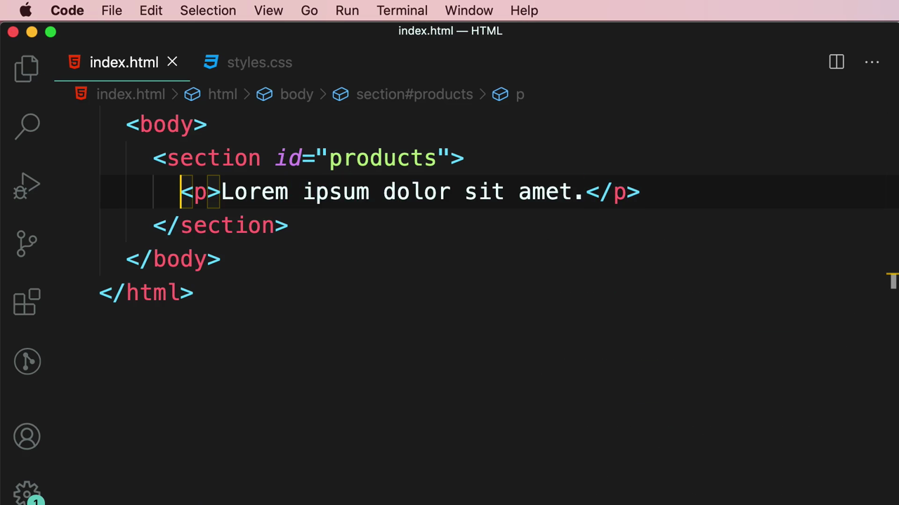

---

## 2. Descendant Combinator — ช่องว่าง ` ` (Space)

Mosh เขียน CSS โดยใช้**ช่องว่าง**คั่นระหว่าง selector สองตัว:

```css
#products p {
  color: orange;
}
```

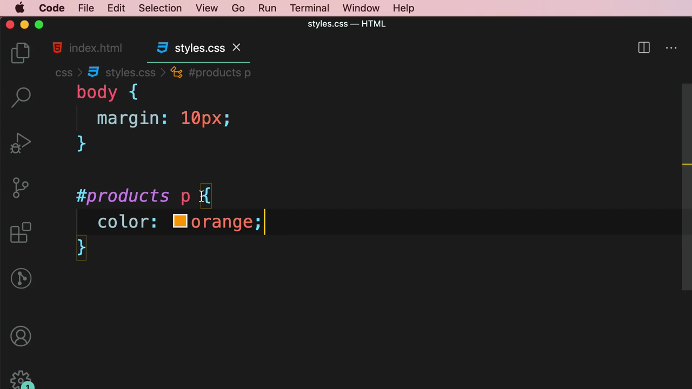

จากนั้นเพิ่ม `<article>` ที่มี `<p>` ซ้อนอยู่ข้างในอีกชั้น เพื่อทดสอบว่า descendant selector ทำงานลึกแค่ไหน:

```html
<section id="products">
  <p>Lorem ipsum dolor sit amet.</p>
  <article>
    <p>Lorem ipsum dolor sit amet.</p>
  </article>
</section>
```

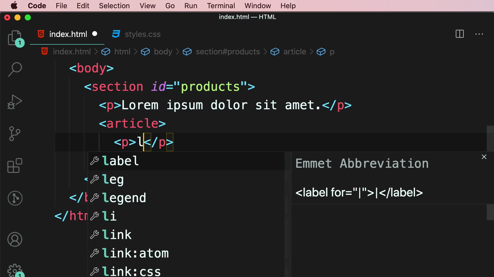

ผลลัพธ์: **ทั้งสอง `<p>`** กลายเป็นสีส้ม แม้ตัวที่สองจะซ้อนลึกอยู่ใน `<article>` ก็ตาม:

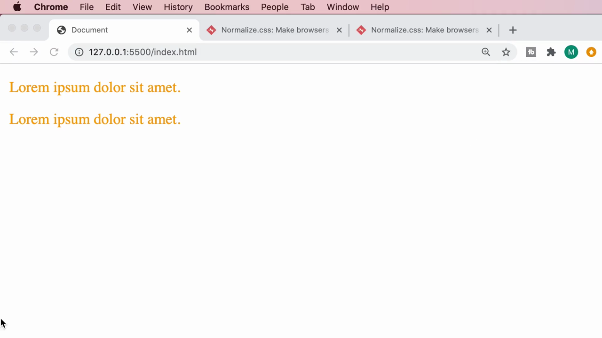

> **Descendant Combinator (ช่องว่าง) คืออะไร:** `A B { }` เลือก element `B` ที่เป็น**ลูกหลาน (descendant)** ของ `A` ไม่ว่าจะซ้อนอยู่ลึกแค่ไหนก็ตาม (ลูก, หลาน, เหลน, ...) เป็น combinator ที่ใช้บ่อยที่สุดใน CSS

---

## 3. Child Combinator — เครื่องหมาย `>`

Mosh เปลี่ยน selector ให้ใช้เครื่องหมาย **`>`** แทนช่องว่าง:

```css
#products > p {
  color: orange;
}
```

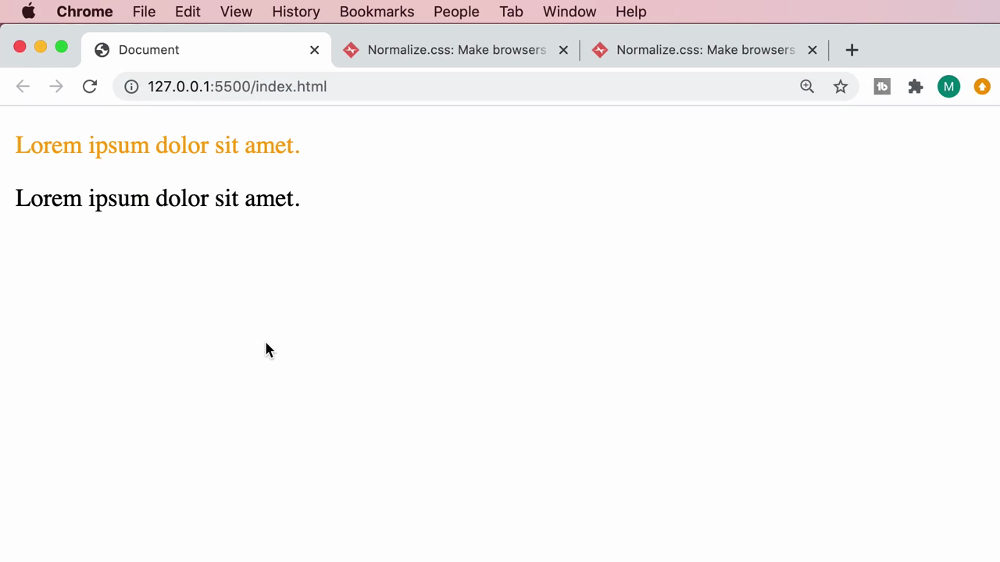

ผลลัพธ์: มีเพียง `<p>` ตัวแรก (ที่เป็น**ลูกโดยตรง**ของ `#products`) เท่านั้นที่เป็นสีส้ม ส่วน `<p>` ที่ซ้อนอยู่ใน `<article>` **ไม่ถูกเลือก** เพราะไม่ใช่ลูกโดยตรง (เป็นหลาน):

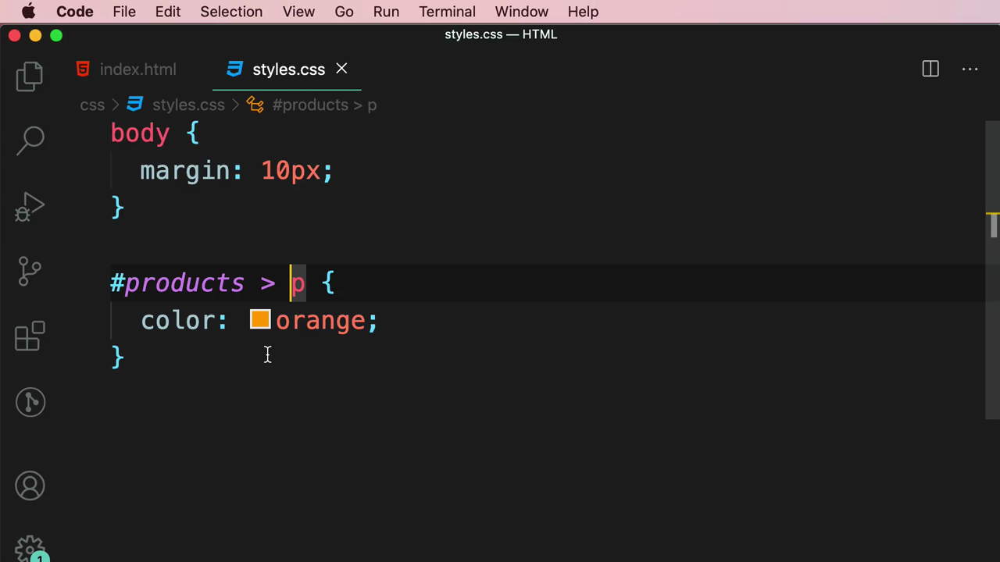

> **Child Combinator (`>`) คืออะไร:** `A > B { }` เลือกเฉพาะ element `B` ที่เป็น**ลูกโดยตรง (direct child)** ของ `A` เท่านั้น — ไม่รวมลูกหลานที่ซ้อนลึกกว่านั้น ต่างจาก Descendant Combinator ที่เลือกทุกระดับ

---

## 4. Adjacent Sibling Combinator — เครื่องหมาย `+`

Mosh เพิ่ม `<p>` อีกตัวไว้**หลัง** `</section>` (เป็น sibling ของ `<section id="products">`):

```html
<section id="products">
  <p>Lorem ipsum dolor sit amet.</p>
  <article>
    <p>Lorem ipsum dolor sit amet.</p>
  </article>
</section>
<p>Lorem ipsum dolor sit amet.</p>
```

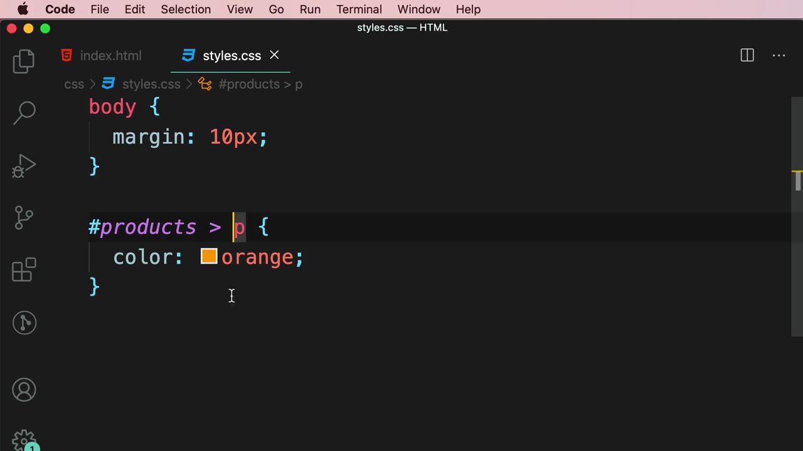

เปลี่ยน CSS เป็นเครื่องหมาย **`+`**:

```css
#products + p {
  color: orange;
}
```

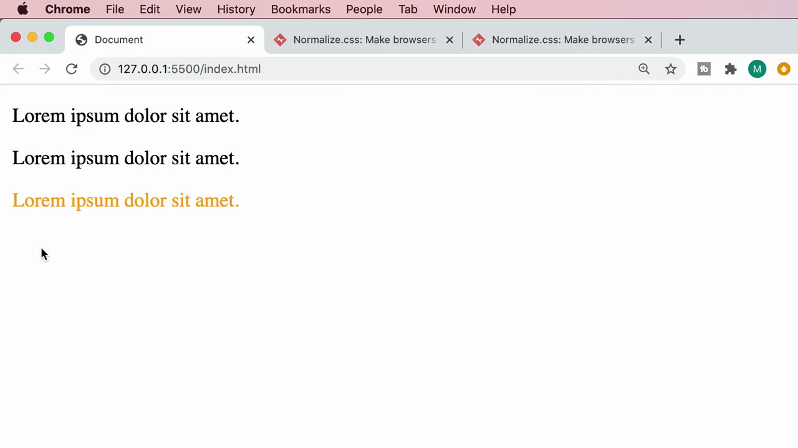

ผลลัพธ์: มีเพียง `<p>` ตัวที่อยู่**ติดกันทันทีหลัง** `#products` (นอก section) เท่านั้นที่เป็นสีส้ม ส่วน `<p>` สองตัวที่อยู่ข้างในยังคงเป็นสีดำตามเดิม:

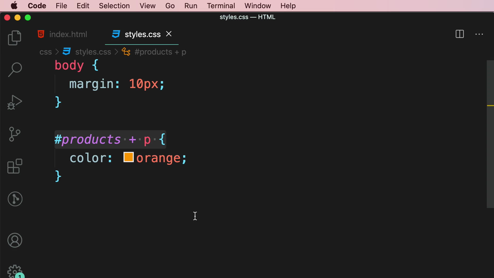

> **Adjacent Sibling Combinator (`+`) คืออะไร:** `A + B { }` เลือก element `B` ที่เป็น**พี่น้องตัวถัดไปทันที (immediately following sibling)** ของ `A` — ต้องอยู่ในระดับเดียวกัน (sibling) และอยู่**ติดกันเป๊ะๆ**เท่านั้น ถ้ามี element อื่นคั่นอยู่ระหว่างกลางจะไม่ถูกเลือก

---

## 5. General Sibling Combinator — เครื่องหมาย `~`

Mosh เพิ่ม `<p>` อีกตัวหนึ่งต่อท้าย (รวมเป็น 2 ตัวหลัง section):

```html
</section>
<p>Lorem ipsum dolor sit amet.</p>
<p>Lorem ipsum dolor sit amet.</p>
```

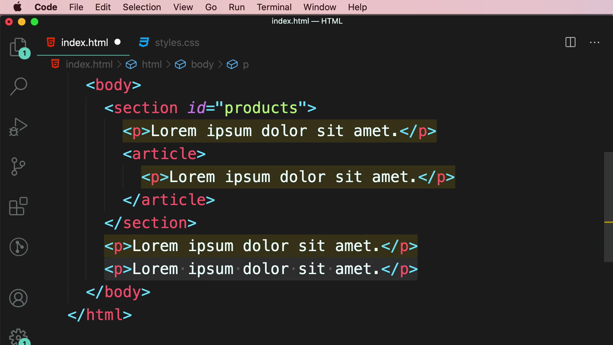

เปลี่ยน CSS เป็นเครื่องหมาย **`~`**:

```css
#products ~ p {
  color: orange;
}
```

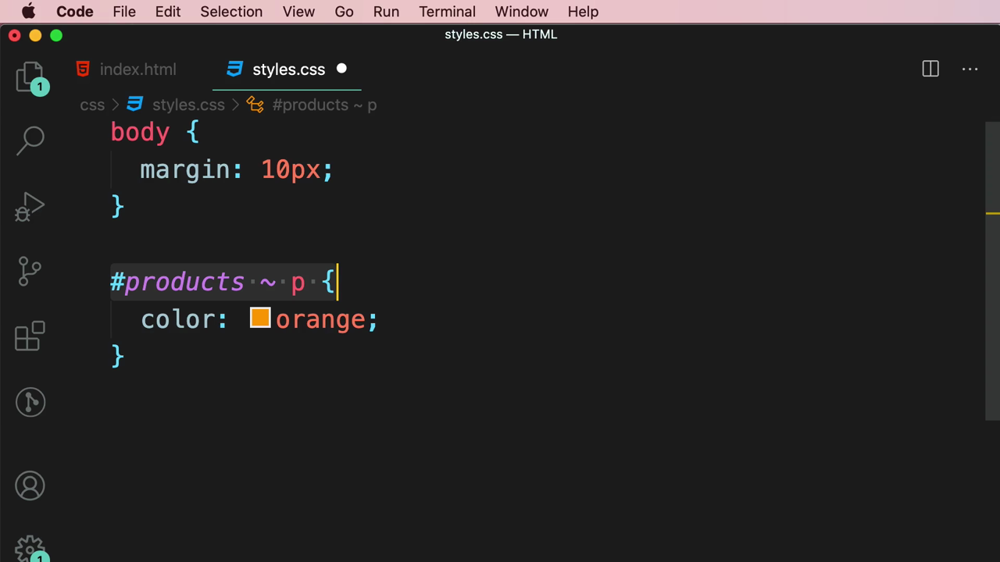

ผลลัพธ์: **ทั้งสอง `<p>`** ที่อยู่หลัง section (ทั้งตัวที่ติดกันและตัวถัดไป) กลายเป็นสีส้มทั้งคู่:

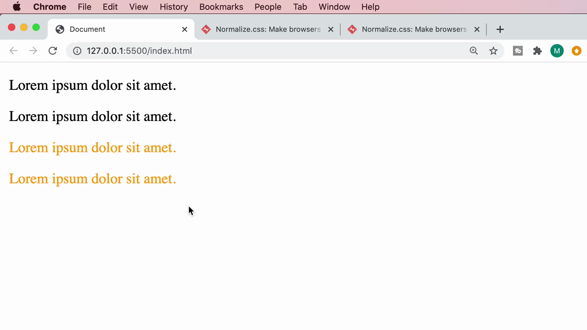

> **General Sibling Combinator (`~`) คืออะไร:** `A ~ B { }` เลือก element `B` ทุกตัวที่เป็น**พี่น้องที่ตามหลัง (following sibling)** ของ `A` ในระดับเดียวกัน ไม่จำเป็นต้องติดกันเป๊ะๆ เหมือน `+` — เลือกได้ทุกตัวที่ตามมาทีหลัง

Mosh สรุปด้วยสไลด์หัวข้อ **"RELATIONAL SELECTORS"**:

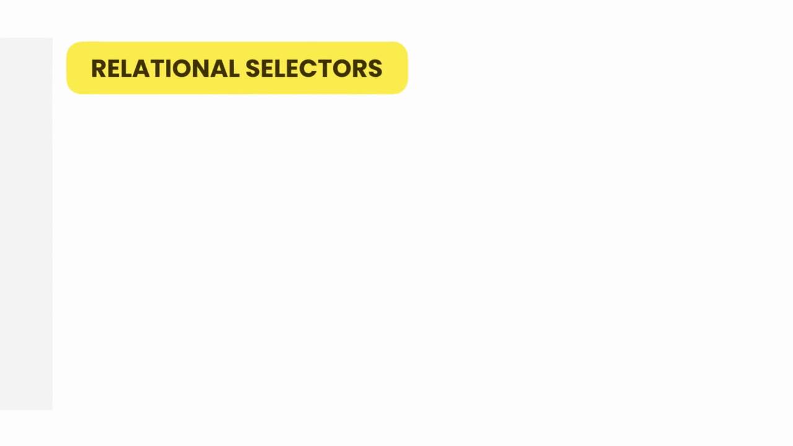

---

## 6. ข้อควรระวัง: Combinator เลือกได้แค่ Sibling ที่ตามมา "ทีหลัง" เท่านั้น

Mosh สาธิตเพิ่มเติมโดยเพิ่ม `<p>` ตัวใหม่ไว้**ก่อน** `<section id="products">` (เป็น sibling ที่มาก่อน):

```html
<body>
  <p>Lorem ipsum dolor sit amet.</p>

  <section id="products">
    <p>Lorem ipsum dolor sit amet.</p>
    <article>
      <p>Lorem ipsum dolor sit amet.</p>
    </article>
  </section>
  <p>Lorem ipsum dolor sit amet.</p>
</body>
```

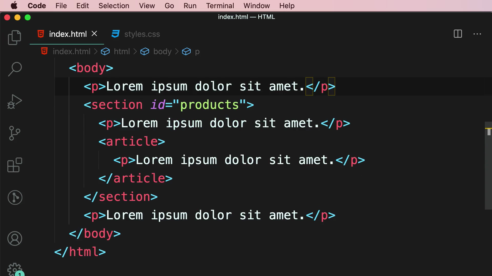

ด้วย selector เดิม `#products ~ p` ผลลัพธ์: **`<p>` ที่อยู่ก่อน section ไม่ถูกเลือก** (ยังเป็นสีดำ) มีเพียง `<p>` ที่อยู่**หลัง**เท่านั้นที่เป็นสีส้ม:

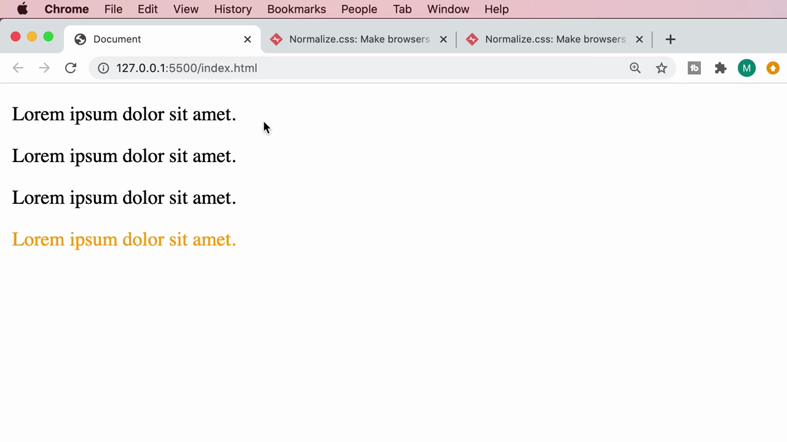

> **บทเรียนสำคัญ:** Sibling Combinator ทั้ง `+` และ `~` เลือกได้เฉพาะ element ที่อยู่**หลัง (following)** element อ้างอิงใน HTML เท่านั้น **ไม่สามารถเลือกย้อนกลับไปข้างหน้า (preceding sibling) ได้เลย** ไม่ว่าจะใช้ combinator แบบไหนก็ตาม — เป็นข้อจำกัดพื้นฐานของ CSS selector ทั้งหมด

---

## 7. สรุปข้อดี-ข้อเสียของ Relational Selectors

สไลด์สรุป:

> **Cleaner markup** (ทำให้ HTML สะอาดขึ้น — ไม่ต้องเพิ่ม class ทุก element)
> **Can be fragile** (เปราะบางได้ — ถ้าโครงสร้าง HTML เปลี่ยนแปลง เช่น สลับตำแหน่ง element selector อาจใช้ไม่ได้ทันที)

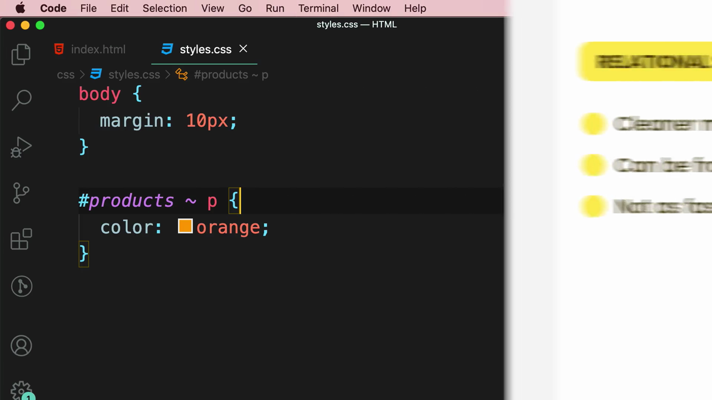

ปิดท้ายด้วยคำคมเตือนใจ:

> **"REMEMBER: Premature optimization is the root of all evils." — Donald Knuth**

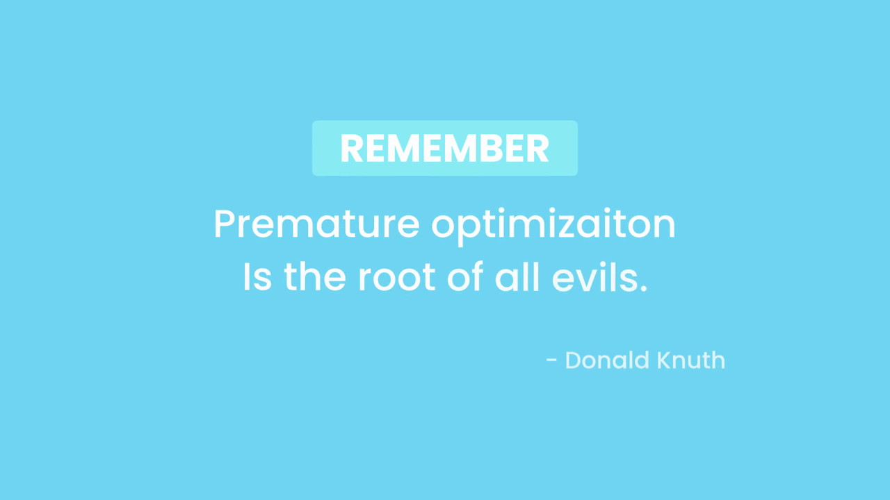

> **ความหมาย:** อย่ารีบ optimize หรือทำให้โค้ดซับซ้อนเกินจำเป็นตั้งแต่แรก (เช่น พยายามใช้ Relational Selector ที่ซับซ้อนเพื่อเลี่ยงการเพิ่ม class) เพราะอาจทำให้โค้ดเปราะบางและดูแลรักษายากกว่าการเขียนแบบตรงไปตรงมาด้วย class/id ธรรมดา

---

## สรุปที่ใช้ได้จริง

Relational Selectors (Combinators) ทั้ง 4 แบบที่เรียนในคลิปนี้:

| Combinator | สัญลักษณ์ | เลือกอะไร |
|---|---|---|
| **Descendant** | ` ` (ช่องว่าง) | ลูกหลานทุกระดับ (ลึกแค่ไหนก็ได้) |
| **Child** | `>` | ลูกโดยตรงเท่านั้น (1 ระดับ) |
| **Adjacent Sibling** | `+` | พี่น้องตัวถัดไปทันที (ติดกันเป๊ะ) |
| **General Sibling** | `~` | พี่น้องทุกตัวที่ตามมาทีหลัง |

- ทุก combinator เลือกได้เฉพาะ element ที่อยู่**หลัง**ใน DOM เท่านั้น ไม่สามารถย้อนกลับไปเลือก element ก่อนหน้าได้
- Relational Selector ช่วยให้ markup สะอาดขึ้นเพราะไม่ต้องเพิ่ม class/id ทุก element แต่ก็เปราะบางถ้าโครงสร้าง HTML เปลี่ยน

### จุดเชื่อมกับงานจริงของ Aum

- ใน React/Next.js เราแทบไม่ใช้ Relational Selector ตรงๆ แบบนี้ เพราะ **Tailwind CSS ใช้แนวคิด utility class ที่ผูกกับ element โดยตรง** แทนที่จะพึ่งความสัมพันธ์ใน DOM — ทำให้ไม่ต้องกังวลเรื่อง "เปราะบางเมื่อโครงสร้างเปลี่ยน" เหมือนใน CSS ดั้งเดิม
- แต่แนวคิด **Child Combinator (`>`)** ยังมีประโยชน์เวลาทำ styling ให้ children ของ component โดยไม่ต้องใส่ class ให้ทุกตัว เช่น Tailwind มี arbitrary variant `[&>*]:` หรือ `space-y-4` (ใช้หลักการ adjacent sibling `~`/`+` ภายใน เพื่อเพิ่มระยะห่างระหว่าง children ที่ตามมาทีหลัง)
- คำคมของ Donald Knuth เป็นหลักการสำคัญมากตอนเขียน React component — ไม่ควรพยายาม optimize re-render หรือใช้ `useMemo`/`useCallback` ทุกจุดตั้งแต่แรกโดยไม่มีปัญหา performance จริง เพราะจะทำให้โค้ดซับซ้อนและอ่านยากขึ้นโดยไม่จำเป็น ควรเขียนให้ทำงานถูกต้องก่อน แล้วค่อย optimize เฉพาะจุดที่วัดผลแล้วว่าช้าจริง
