# 4-CSS Basics: 06 - Pseudo-class Selectors (9:07)

**ไฟล์ต้นทาง:** `06-Pseudo-class-Selectors.mp4`

▶️ **[เปิดวิดีโอต้นฉบับ](../../../HTML-CSS-1/4-CSS%20Basics/06-Pseudo-class-Selectors.mp4)**

---

## ภาพรวมคลิปนี้

คลิปสุดท้ายของบท CSS Basics นี้ Mosh สอนเรื่อง **Pseudo-class Selectors** — selector พิเศษที่เลือก element ตาม **สถานะ (state)** หรือ**ตำแหน่งในโครงสร้าง (structural position)** โดยไม่ต้องเพิ่ม class ใหม่ในทุกกรณี ครอบคลุม `:first-child`, `:first-of-type`, `:last-of-type`, `:last-child`, `:nth-child()`, `:visited`, `:link`, และ `:hover`

---

## 1. ปัญหาเดิม: ใช้ Class เพื่อเลือก Element แรก

Mosh เริ่มจาก `<article>` ที่มี `<p>` สองตัว:

```html
<body>
  <article>
    <p>Lorem ipsum dolor sit amet.</p>
    <p>Lorem ipsum dolor sit amet.</p>
  </article>
</body>
```

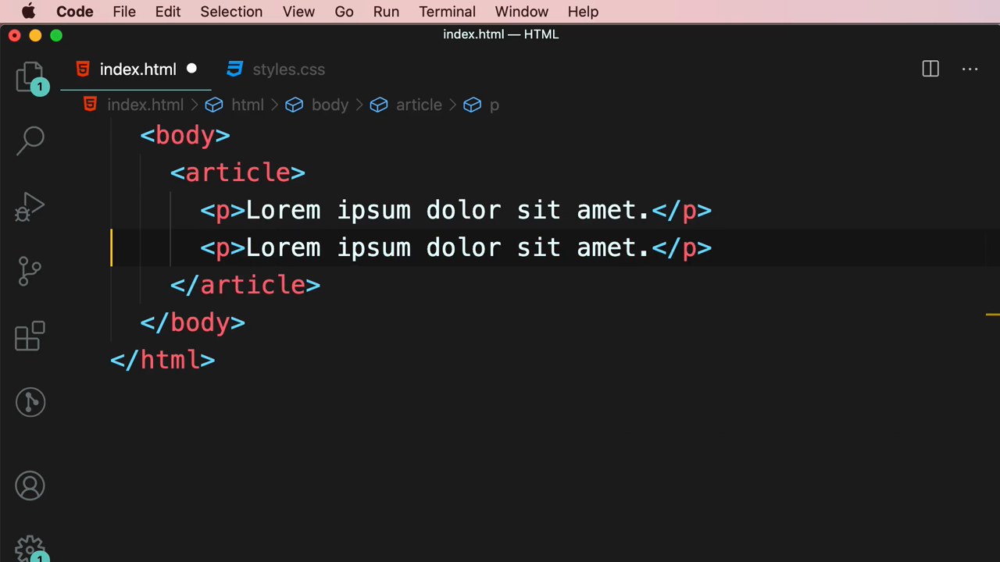

เพิ่ม `class="first"` ให้ `<p>` ตัวแรกเพื่อเลือกมันแยกจากตัวที่สอง:

```html
<p class="first">Lorem ipsum dolor sit amet.</p>
<p>Lorem ipsum dolor sit amet.</p>
```

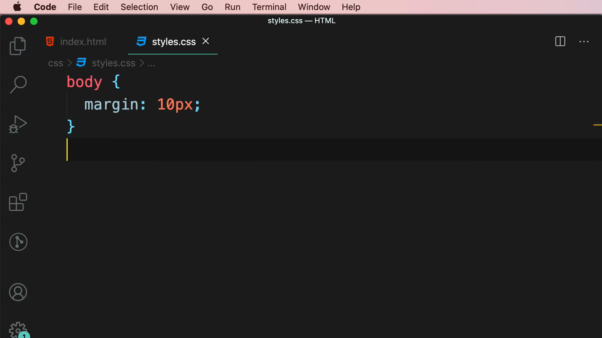

เขียน CSS ด้วย Class Selector ปกติ:

```css
p.first {
  font-size: 140%;
  font-style: italic;
}
```

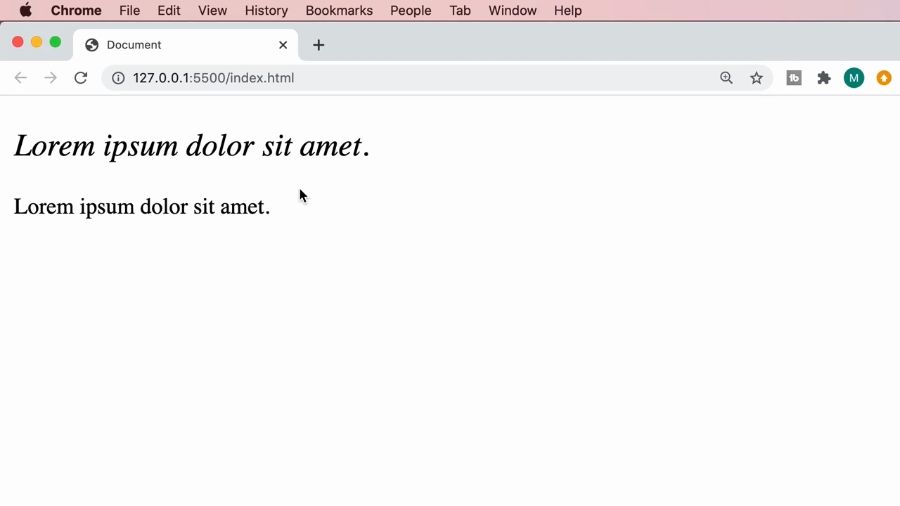

ผลลัพธ์: `<p>` ตัวแรกใหญ่ขึ้นและเอียง (italic):

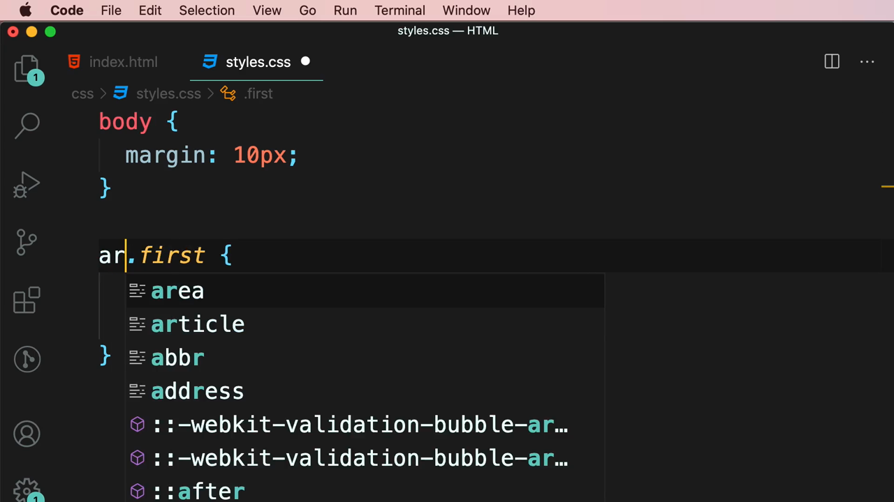

> **ปัญหา:** วิธีนี้ต้องเพิ่ม `class="first"` เข้าไปใน HTML ทุกครั้ง ทำให้ markup ไม่ค่อยสะอาด (ไม่ตรงตามหลัก Separation of Concerns เสียทีเดียว เพราะ "first" เป็นข้อมูลเกี่ยวกับตำแหน่ง ไม่ใช่ความหมายของเนื้อหา)

---

## 2. Pseudo-class `:first-child` — เลือกโดยไม่ต้องเพิ่ม Class

Mosh ลบ `class="first"` ออกจาก HTML ทั้งหมด กลับไปเป็น `<p>` ธรรมดา 2 ตัว:

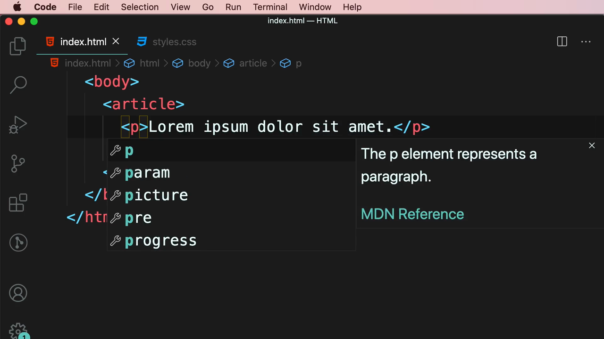

แล้วเขียน CSS ใหม่โดยใช้ **pseudo-class `:first-child`**:

```css
article :first-child {
  font-size: 140%;
  font-style: italic;
}
```

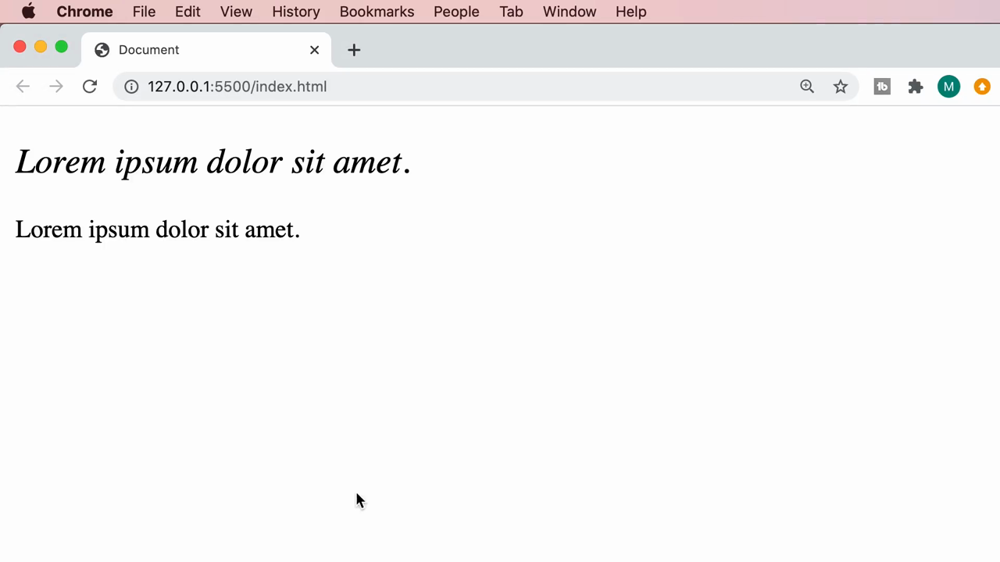

> **`:first-child` คืออะไร:** pseudo-class ที่เลือก element ที่เป็น**ลูกตัวแรก (first child)** ของ parent ของมัน ไม่ว่า element นั้นจะเป็นแท็กอะไรก็ตาม — สังเกตว่าในโค้ดนี้มี**ช่องว่าง**ระหว่าง `article` กับ `:first-child` ทำให้เป็นการรวม **Descendant Combinator** เข้ากับ pseudo-class (เลือกลูกตัวแรกของ element ใดๆ ที่อยู่ใน `article`)

---

## 3. ทดสอบ `:first-child` เมื่อโครงสร้างเปลี่ยน

Mosh เพิ่ม `<h2>Heading</h2>` เป็น element แรกสุดก่อน `<p>` ทั้งสอง:

```html
<article>
  <h2>Heading</h2>
  <p>Lorem ipsum dolor sit amet.</p>
  <p>Lorem ipsum dolor sit amet.</p>
</article>
```

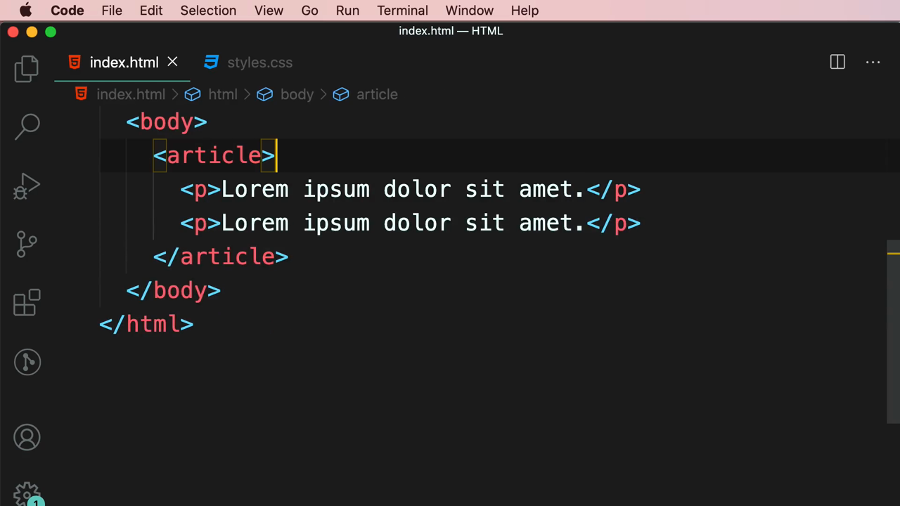

ผลลัพธ์ใน browser: ตอนนี้ **`<h2>Heading</h2>` กลายเป็นตัวใหญ่และเอียงแทน** ส่วน `<p>` ตัวแรกกลับมาเป็นปกติ:

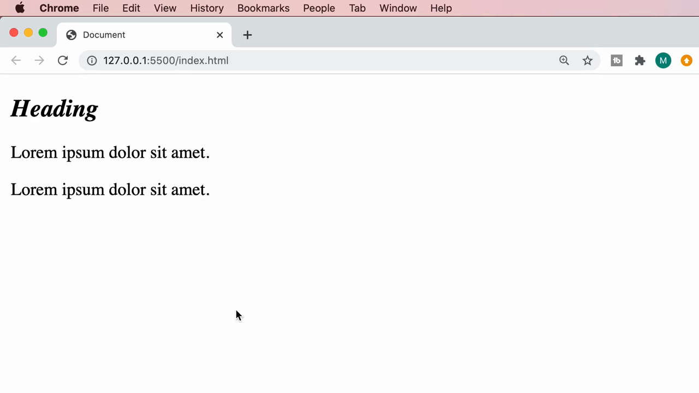

เปิด DevTools ยืนยันว่า rule `article :first-child` เข้าไปจับที่ `<h2>` (ไม่ใช่ `<p>` อีกต่อไป):

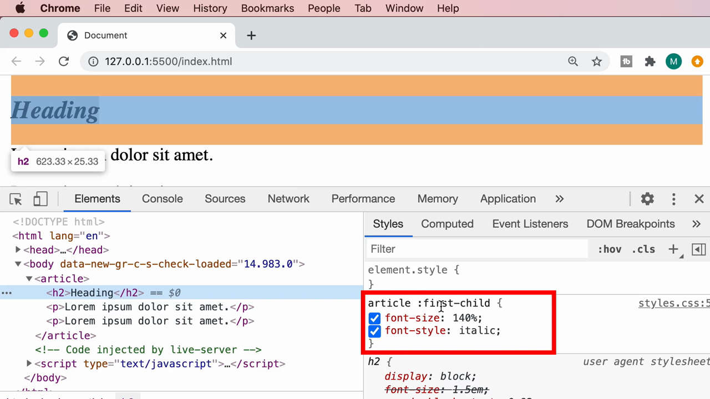

> **บทเรียนสำคัญ:** `:first-child` สนใจแค่ **"ใครเป็นลูกคนแรก"** เท่านั้น ไม่สนใจว่าลูกคนนั้นเป็นแท็กอะไร — ถ้าโครงสร้าง HTML เปลี่ยน (เช่น เพิ่ม element ใหม่ไว้ข้างหน้า) การจับคู่ของ selector นี้จะเปลี่ยนตามทันที ซึ่งอาจทำให้ style ผิดที่ได้ถ้าไม่ระวัง

---

## 4. Pseudo-class `:first-of-type` — เลือกลูกตัวแรก "ของแต่ละประเภท"

Mosh เปลี่ยน selector จาก `:first-child` เป็น **`:first-of-type`**:

```css
article :first-of-type {
  font-size: 140%;
  font-style: italic;
}
```

ผลลัพธ์: **ทั้ง `<h2>` และ `<p>` ตัวแรก** กลายเป็นตัวใหญ่และเอียงพร้อมกัน (เพราะแต่ละตัวเป็น "ตัวแรกของประเภทตัวเอง" — h2 ตัวแรกในบรรดา h2 ทั้งหมด, p ตัวแรกในบรรดา p ทั้งหมด):

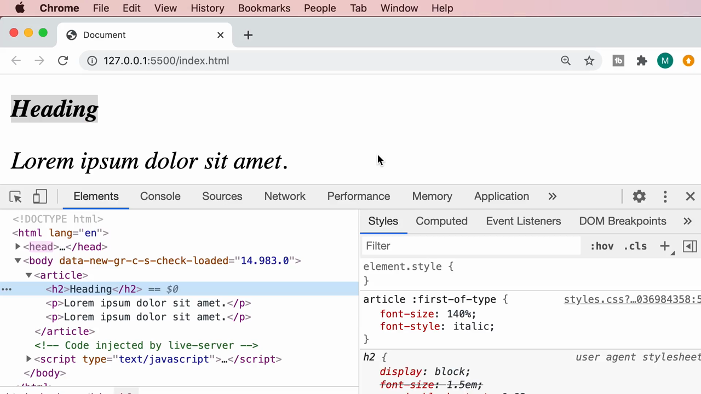

DevTools แสดงว่า rule เดียวกันนี้ apply ทั้งกับ `<h2>` และ `<p>` ตัวแรก:

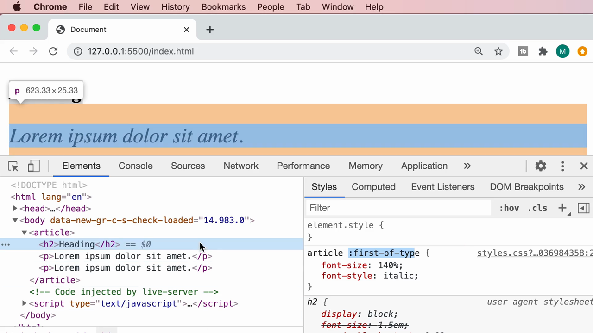

> **`:first-of-type` คืออะไร:** เลือก element ที่เป็น**ตัวแรกของประเภท (type) เดียวกัน** ในบรรดา sibling ของมัน — ต่างจาก `:first-child` ตรงที่ `:first-of-type` จะแยกพิจารณาแยกตามแท็ก ทำให้ปลอดภัยกว่าเมื่อโครงสร้าง HTML มีหลายประเภท element ปนกัน

Mosh เจาะจงให้แคบลงอีกโดยระบุ type `p` ไปด้วย เพื่อเลือกเฉพาะ `<p>` ตัวแรกเท่านั้น (ไม่รวม `<h2>`):

```css
article p:first-of-type {
  font-size: 140%;
  font-style: italic;
}
```

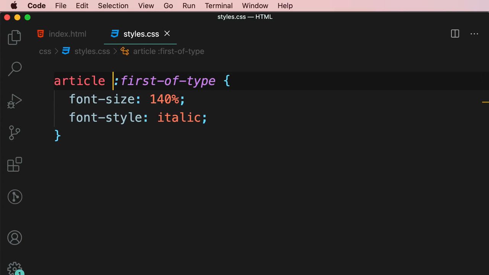

ผลลัพธ์: เฉพาะ `<p>` ตัวแรกเท่านั้นที่เป็น italic ส่วน `<h2>` กลับมาเป็นปกติ:

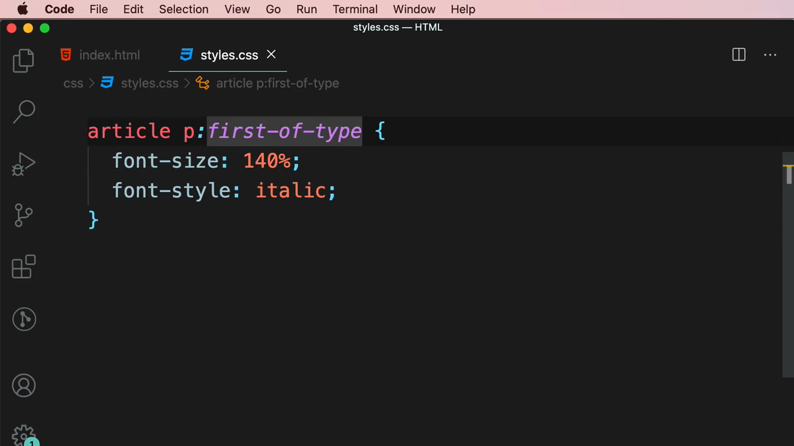

---

## 5. Pseudo-class `:last-of-type` และ `:last-child`

Mosh เพิ่ม rule ใหม่เพื่อจัดสไตล์ `<p>` ตัวสุดท้ายด้วย **`:last-of-type`**:

```css
article p:last-of-type {
  font-weight: bold;
}
```

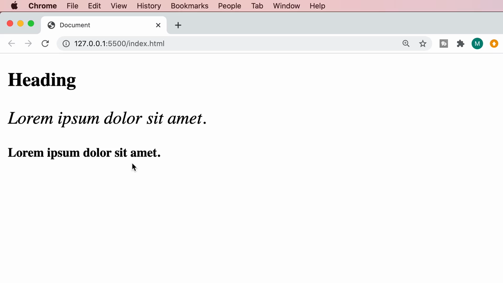

ผลลัพธ์: `<p>` ตัวที่สอง (ตัวสุดท้ายของประเภท p) กลายเป็นตัวหนา:

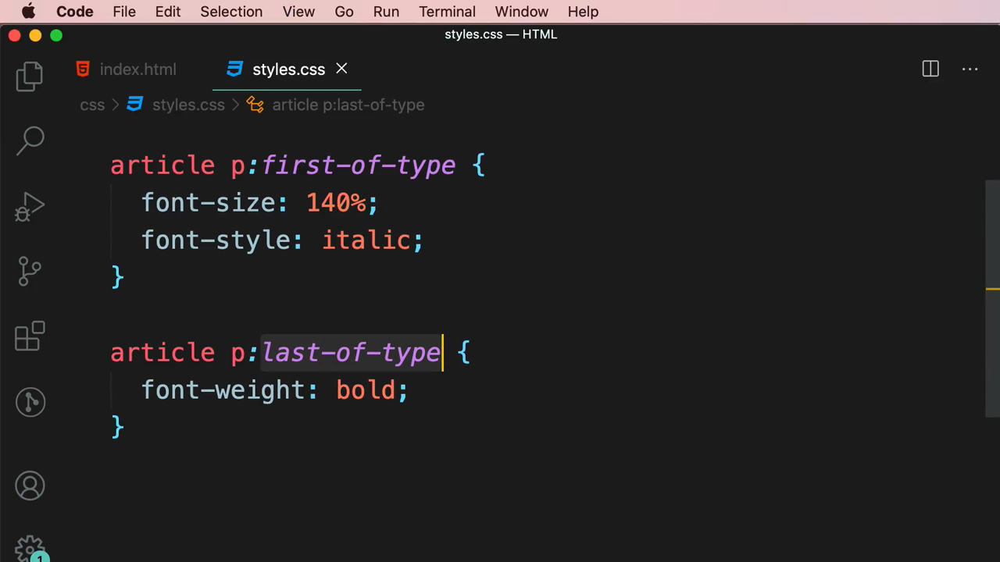

จากนั้น Mosh เพิ่ม `<a href="#">Link</a>` และ `<ul>` ที่มี `<li>` 5 รายการเข้าไปต่อจาก `<p>` ทั้งสอง เพื่อเตรียมสาธิต pseudo-class อื่นๆ ต่อ:

```html
<article>
  <h2>Heading</h2>
  <p>Lorem ipsum dolor sit amet.</p>
  <p>Lorem ipsum dolor sit amet.</p>
  <a href="#">Link</a>
  <ul>
    <li>Item 1</li>
    <li>Item 2</li>
    <li>Item 3</li>
    <li>Item 4</li>
    <li>Item 5</li>
  </ul>
</article>
```

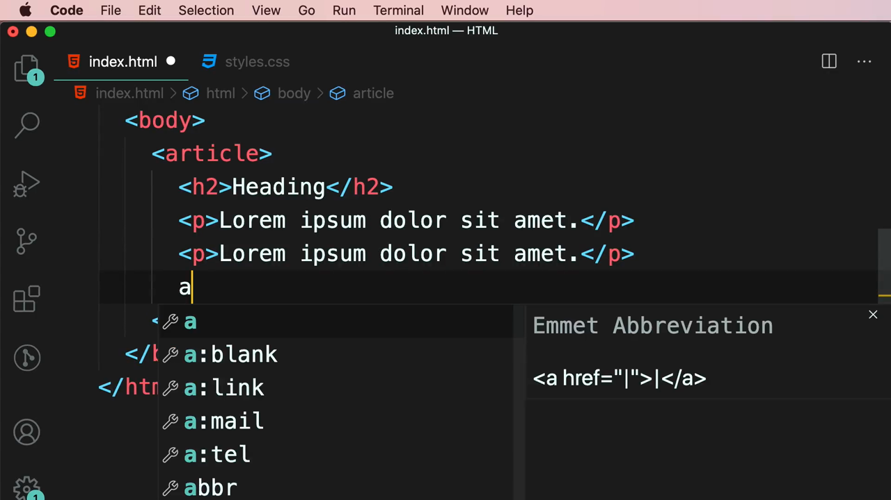

เปลี่ยน selector เป็น **`article :last-child`** (ไม่ระบุ type) เพื่อทดสอบว่าเลือก element สุดท้ายของ `article` (ซึ่งตอนนี้คือ `<ul>`):

```css
article :last-child {
  font-weight: bold;
}
```

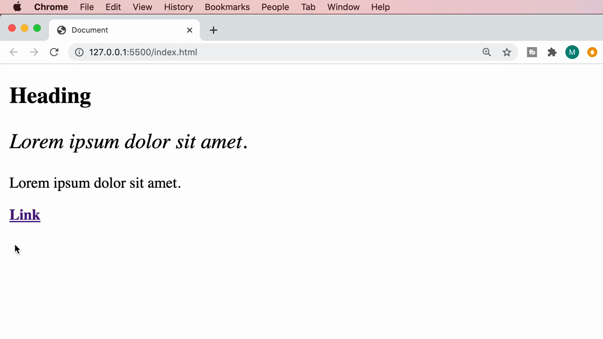

> **`:last-child` vs `:last-of-type`:** เหมือนกับคู่ `:first-child`/`:first-of-type` — `:last-child` สนใจแค่ "ใครเป็นลูกคนสุดท้ายจริงๆ" (ไม่สนแท็ก) ส่วน `:last-of-type` สนใจ "ใครเป็นตัวสุดท้ายในบรรดาแท็กประเภทเดียวกัน"

---

## 6. Pseudo-class `:nth-child()` — เลือกตามลำดับตัวเลข

Mosh ใช้ `:nth-child()` กับ `<li>` ใน `<ul>` โดยระบุ **`odd`** (คี่):

```css
ul li:nth-child(odd) {
  color: deeppink;
}
```

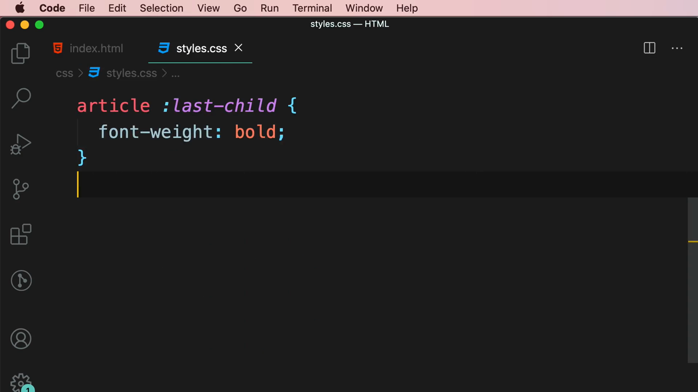

ผลลัพธ์: Item 1, 3, 5 (ลำดับคี่) เป็นสีชมพู:

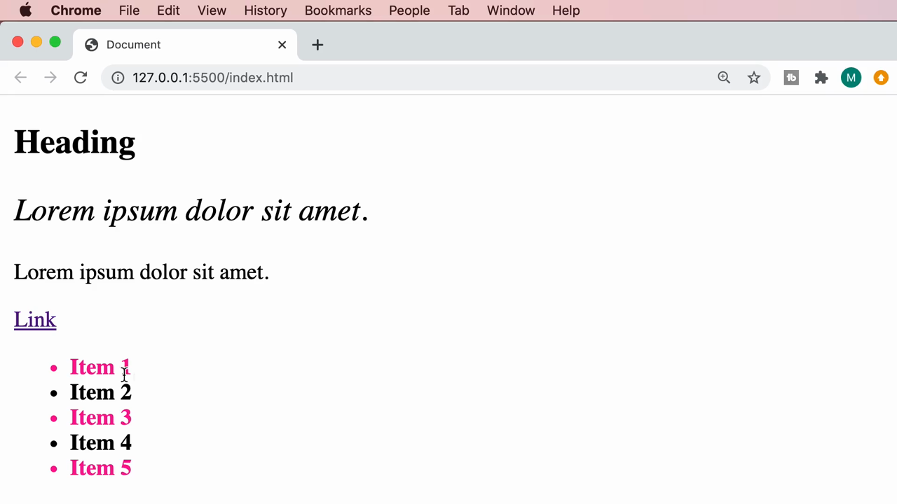

เปลี่ยนเป็น **`even`** (คู่):

```css
ul li:nth-child(even) {
  color: deeppink;
}
```

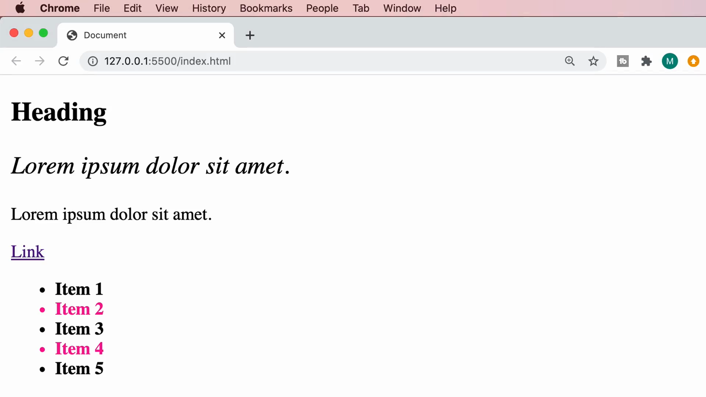

ผลลัพธ์: Item 2, 4 (ลำดับคู่) เป็นสีชมพูแทน:

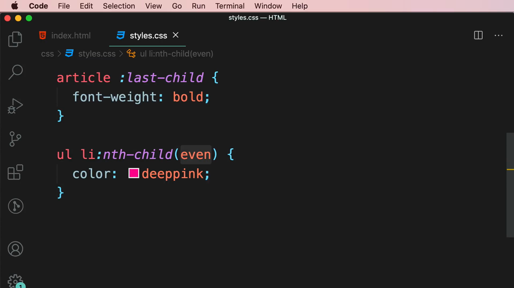

> **`:nth-child()` คืออะไร:** เลือก element ตาม**ลำดับตำแหน่ง**ในบรรดา sibling รับค่าเป็นตัวเลข (เช่น `:nth-child(3)` เลือกตัวที่ 3), คีย์เวิร์ด `odd`/`even`, หรือสูตรคณิตศาสตร์ (เช่น `2n+1`) — มีประโยชน์มากสำหรับการทำลาย เช่น สีสลับแถวของตาราง (zebra striping)

---

## 7. Pseudo-class สำหรับ Link: `:link`, `:visited`, `:hover`

Mosh เขียน CSS ให้กับ `<a>`:

```css
a:visited {
  color: dodgerblue;
}
```

จากนั้นรวม `:link` เข้าไปด้วยโดยใช้ **comma** คั่น (group selector) เพื่อให้ครอบคลุมทั้งลิงก์ที่ยังไม่เคยกด (`:link`) และที่เคยกดแล้ว (`:visited`):

```css
a:visited,
a:link {
  color: dodgerblue;
}
```

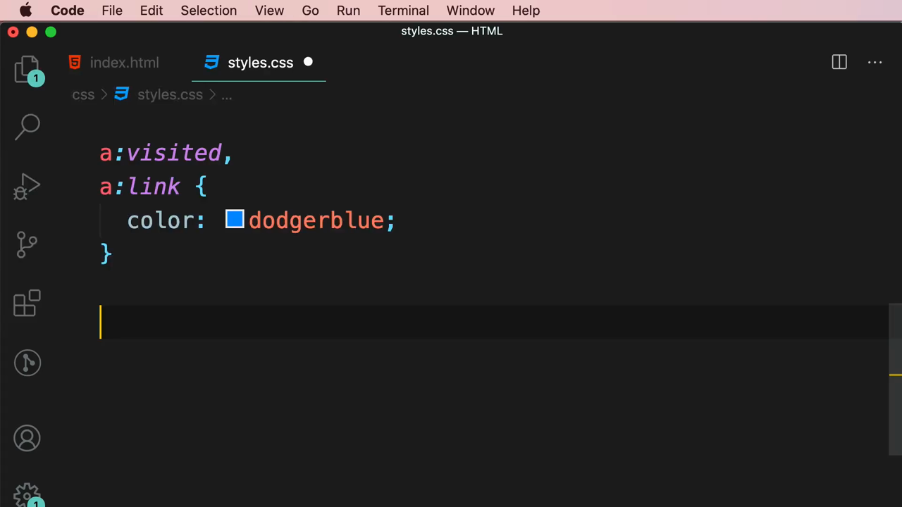

ผลลัพธ์: ลิงก์ "Link" เป็นสีน้ำเงิน (dodgerblue) ปกติ:

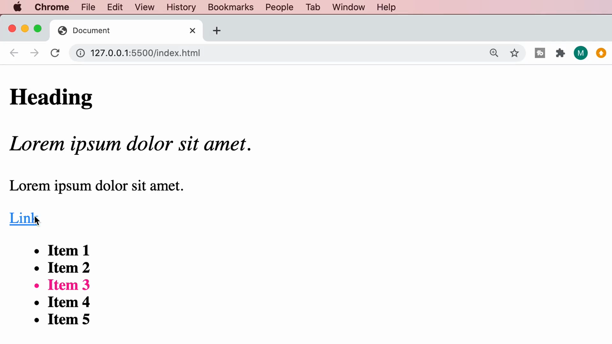

> **`:link` vs `:visited` คืออะไร:**
> - **`:link`** — เลือกลิงก์ที่**ยังไม่เคยถูกคลิก** (unvisited)
> - **`:visited`** — เลือกลิงก์ที่**เคยถูกคลิกไปแล้ว** (browser จดจำประวัติการเข้าชม)
>
> ปกติ browser จะแสดงสองสถานะนี้ด้วยสีต่างกันเป็น default (น้ำเงิน = ยังไม่เคยกด, ม่วง = เคยกดแล้ว) การเขียน CSS ทั้งคู่พร้อมกันทำให้ควบคุมสีได้ตามที่ต้องการโดยไม่ขึ้นกับค่า default ของ browser

สุดท้ายเพิ่ม **`:hover`**:

```css
a:hover {
  color: deeppink;
}
```

ผลลัพธ์: เมื่อเอาเมาส์ไปชี้ (hover) ที่ลิงก์ "Link" สีจะเปลี่ยนเป็นสีชมพู (deeppink) ทันที:

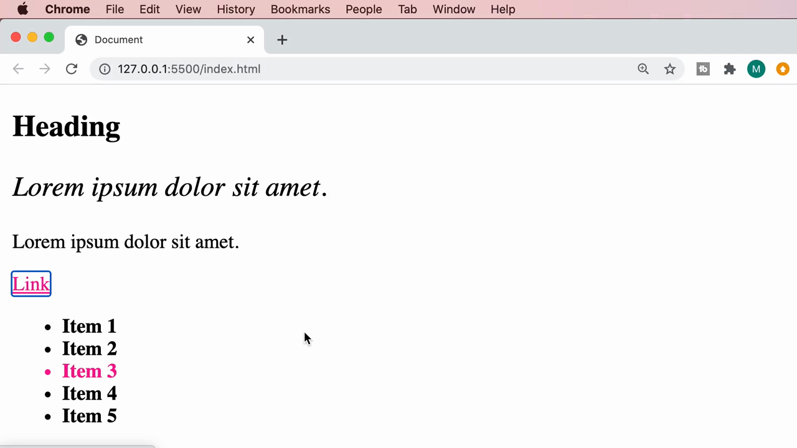

> **`:hover` คืออะไร:** เลือก element ขณะที่ผู้ใช้เอาเมาส์ไปวางอยู่เหนือมัน (แต่ยังไม่ได้คลิก) ใช้บ่อยมากสำหรับสร้าง interactive feedback เช่น เปลี่ยนสีปุ่มหรือลิงก์เมื่อชี้เมาส์ผ่าน

---

## สรุปที่ใช้ได้จริง

Pseudo-class Selectors ที่เรียนในคลิปนี้:

| Pseudo-class | ความหมาย |
|---|---|
| **`:first-child`** | ลูกตัวแรกของ parent (ไม่สนแท็ก) |
| **`:first-of-type`** | ลูกตัวแรก**ของแต่ละประเภทแท็ก** |
| **`:last-child`** | ลูกตัวสุดท้ายของ parent (ไม่สนแท็ก) |
| **`:last-of-type`** | ลูกตัวสุดท้าย**ของแต่ละประเภทแท็ก** |
| **`:nth-child(n)`** | ลูกตัวที่ n (รองรับ `odd`, `even`, สูตร `an+b`) |
| **`:link`** | ลิงก์ที่ยังไม่เคยถูกคลิก |
| **`:visited`** | ลิงก์ที่เคยถูกคลิกไปแล้ว |
| **`:hover`** | element ขณะเมาส์ชี้อยู่เหนือมัน |

- ควรใช้ **`:first-of-type`/`:last-of-type`** แทน **`:first-child`/`:last-child`** เมื่อโครงสร้าง HTML มีหลายประเภท element ปนกัน เพื่อป้องกันการเลือกผิดตัวเมื่อโครงสร้างเปลี่ยน
- Pseudo-class ช่วยลดการเพิ่ม class ที่ไม่จำเป็นใน HTML ทำให้ markup สะอาดขึ้นตามหลัก Separation of Concerns

### จุดเชื่อมกับงานจริงของ Aum

- **`:hover`** คือแนวคิดเดียวกับ Tailwind's `hover:` variant (เช่น `hover:bg-blue-600`, `hover:text-pink-500`) — Tailwind แปลง pseudo-class ทั้งหมดเป็น prefix variant แบบนี้ทั้งสิ้น เช่น `focus:`, `active:`, `visited:`, `first:`, `last:`, `odd:`, `even:`
- **`:nth-child(odd)`/`:nth-child(even)`** ตรงกับ Tailwind's `odd:` และ `even:` variant โดยตรง เช่น `odd:bg-gray-100` สำหรับทำแถบสีสลับในตาราง (table zebra striping) ซึ่งเป็นเทคนิคที่ใช้บ่อยมากเวลาแสดงรายการข้อมูลจาก JSON server หรือ API
- **`:first-child`/`:last-child`** มีประโยชน์มากเวลาจัดการ spacing ระหว่าง items ใน React list (เช่น ใช้ `not-first:mt-4` หรือเทียบเท่าใน Tailwind เพื่อไม่ให้ item แรกมี margin-top เกินความจำเป็น) โดยไม่ต้องเขียน logic เช็ค index ใน JavaScript
- **`:link`/`:visited`** สำคัญเวลาทำ navigation component ใน Next.js — ควรระวังไม่ให้สี `:visited` รบกวน active state ของ `<Link>` ที่ใช้ `usePathname()` เช็คหน้าปัจจุบัน เพราะทั้งสองระบบพยายามควบคุมสีเดียวกัน ถ้าเขียนไม่ระวังอาจ conflict กันได้
- pseudo-class ทั้งหมดในคลิปนี้เป็นพื้นฐานสำคัญก่อนจะไปเรียนเรื่อง state และ conditional styling ใน React/Tailwind ต่อไป เพราะแนวคิด "styling ตามสถานะ" (hover, focus, first, last, nth) เป็นหลักการเดียวกันไม่ว่าจะเขียนด้วย CSS ดั้งเดิมหรือ Tailwind utility class
