# 4-CSS Basics: 07 - Pseudo-element Selectors (4:42)

**ไฟล์ต้นทาง:** `07-Pseudo-element-Selectors.mp4`

▶️ **[เปิดวิดีโอต้นฉบับ](../../../HTML-CSS-1/4-CSS%20Basics/07-Pseudo-element-Selectors.mp4)**

---

## ภาพรวมคลิปนี้

คลิปนี้ Mosh สอนเรื่อง **Pseudo-element Selectors** — selector พิเศษที่ใช้**จัดสไตล์เฉพาะบางส่วนของ element** (ไม่ใช่ทั้ง element เหมือน pseudo-class) เช่น ตัวอักษรแรก บรรทัดแรก ข้อความที่ถูกเลือก หรือแม้แต่เนื้อหาที่ไม่มีอยู่จริงใน HTML ครอบคลุม `::first-letter`, `::first-line`, `::selection`, `::before`, และ `::after`

---

## 1. วิธีเดิม: ใช้ `<span>` ห่อตัวอักษรแรก

Mosh เริ่มจาก `<p>` ที่มีข้อความ Lorem ipsum ยาว 50 คำ:

```html
<body>
  <p>Lorem ipsum dolor, sit amet consectetur adipisicing elit. ...</p>
</body>
```

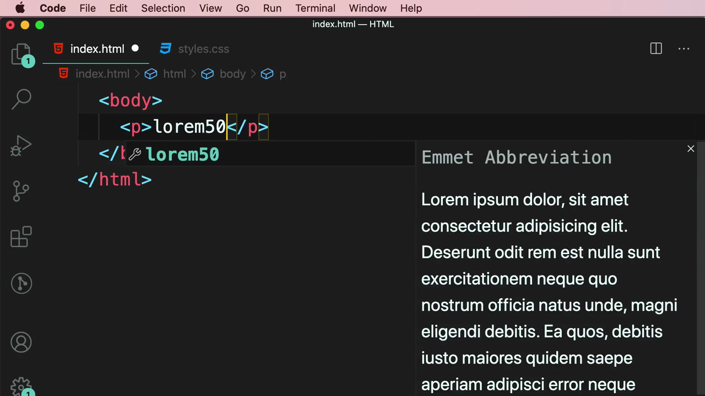

เพื่อทำให้ตัวอักษรแรกใหญ่ขึ้น (แบบ "drop cap" ที่เห็นในหนังสือ/นิตยสาร) Mosh ใช้วิธีเดิมคือห่อตัวอักษรแรกด้วย `<span>`:

```html
<span class="first-letter">L</span>orem ipsum dolor, sit amet...
```

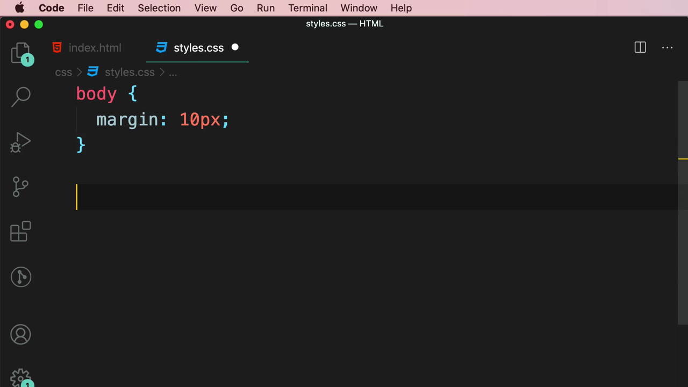

แล้วเขียน CSS ด้วย Class Selector ธรรมดา:

```css
.first-letter {
  font-size: 140%;
  font-weight: bold;
}
```

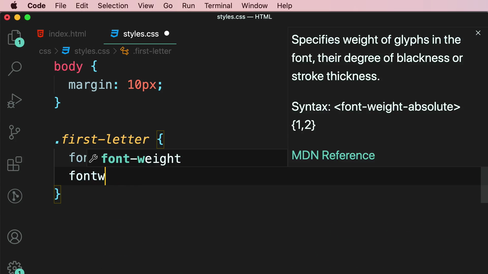

ผลลัพธ์: ตัวอักษร "L" ใหญ่และหนาขึ้น:

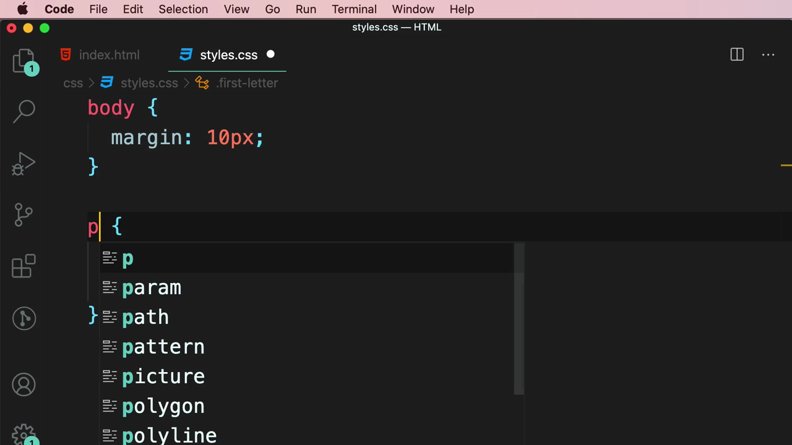

> **ปัญหา:** วิธีนี้ต้องเพิ่ม `<span>` เข้าไปใน HTML เพื่อ "แทรก" element ปลอมเข้าไปครอบข้อความ ทำให้ markup ไม่สะอาดและผิดหลัก Separation of Concerns (HTML ควรมีแค่โครงสร้างเนื้อหา ไม่ใช่ element ที่มีไว้เพื่อการจัดสไตล์ล้วนๆ)

---

## 2. Pseudo-element `::first-letter`

Mosh ลบ `<span>` ออกจาก HTML แล้วเขียน CSS ใหม่ด้วย **pseudo-element `::first-letter`** (สังเกตเครื่องหมาย **`::`** สองตัว ต่างจาก pseudo-class ที่ใช้ `:` ตัวเดียว):

```css
p::first-letter {
  font-size: 140%;
  font-weight: bold;
}
```

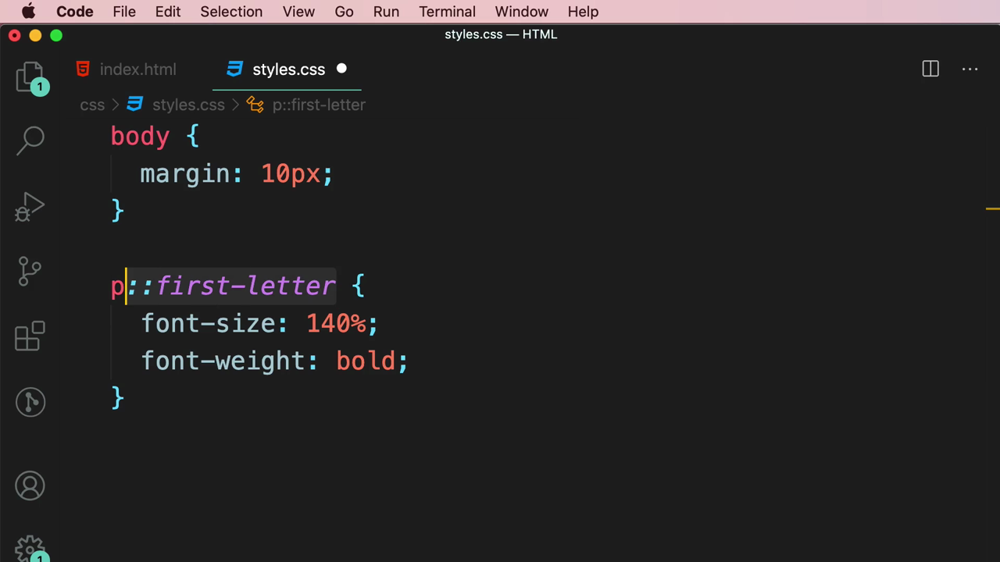

Mosh อธิบายความแตกต่างระหว่าง Pseudo-elements กับ Pseudo-classes ด้วยสไลด์:

> **PSEUDO-ELEMENTS** — To style part of an element (Eg. First letter)
> **PSEUDO-CLASSES** — (เลือกตามสถานะ/ตำแหน่ง เช่น `:hover`, `:first-child` ที่เรียนไปในคลิปก่อนหน้า)

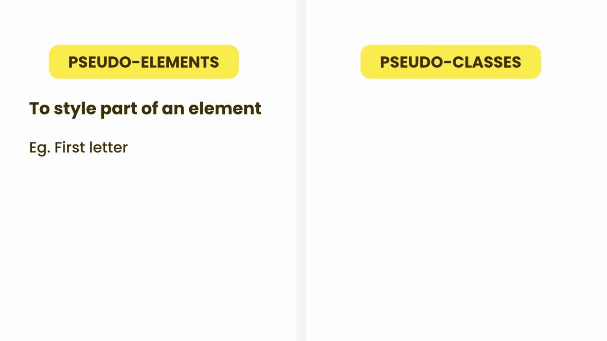

ผลลัพธ์: ตัวอักษร "L" ใหญ่และหนาเหมือนเดิม แต่ HTML สะอาดขึ้นมาก (ไม่มี `<span>` เลย):

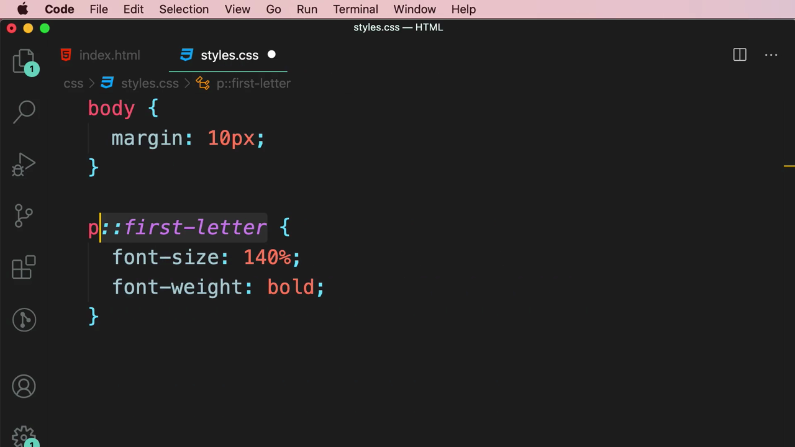

> **`::first-letter` คืออะไร:** จัดสไตล์**ตัวอักษรตัวแรก**ของ element โดยอัตโนมัติ โดยไม่ต้องเพิ่ม element ปลอมใดๆ ใน HTML

---

## 3. Pseudo-element `::first-line`

Mosh เพิ่ม rule ใหม่ด้วย **`::first-line`**:

```css
p::first-line {
  font-weight: bold;
}
```

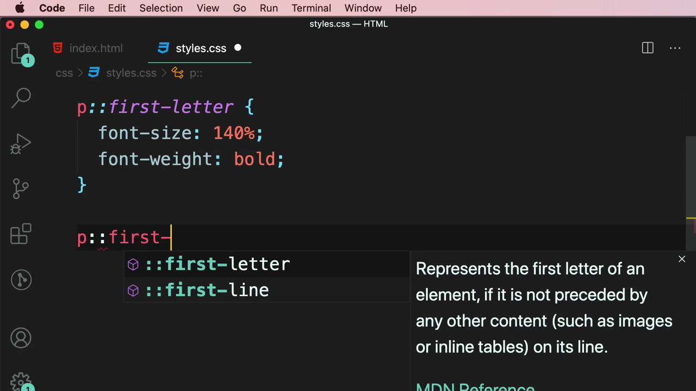

ผลลัพธ์: **บรรทัดแรกทั้งบรรทัด** (ไม่ใช่แค่ตัวอักษรแรก) กลายเป็นตัวหนา — ความยาวของ "บรรทัดแรก" จะเปลี่ยนไปอัตโนมัติตามความกว้างของหน้าจอ เพราะ browser คำนวณจากการตัดบรรทัดจริง (line wrap) ไม่ใช่จากจำนวนตัวอักษรคงที่:

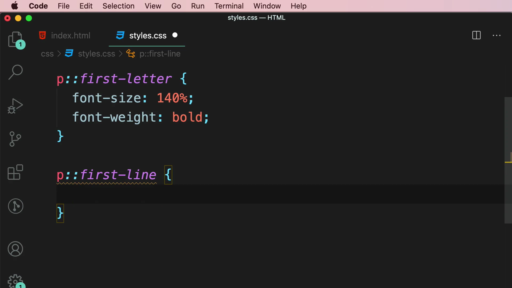

> **`::first-line` คืออะไร:** จัดสไตล์**บรรทัดแรก**ของข้อความใน element โดยอัตโนมัติ ปรับตามการตัดบรรทัดจริงของ browser ไม่ใช่ค่าคงที่

---

## 4. Pseudo-element `::selection`

Mosh เพิ่ม rule ด้วย **`::selection`**:

```css
p::selection {
  background-color: pink;
}
```

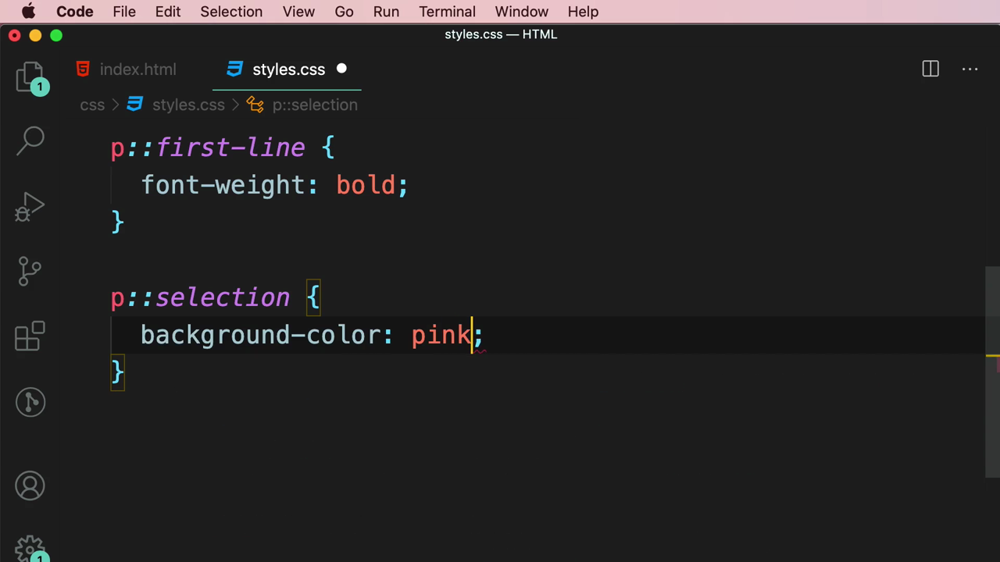

ผลลัพธ์: เมื่อผู้ใช้**ลากเมาส์เลือกข้อความ**ใน `<p>` นั้น พื้นหลังของข้อความที่ถูกเลือกจะเป็นสีชมพู แทนสีฟ้า default ของ browser:

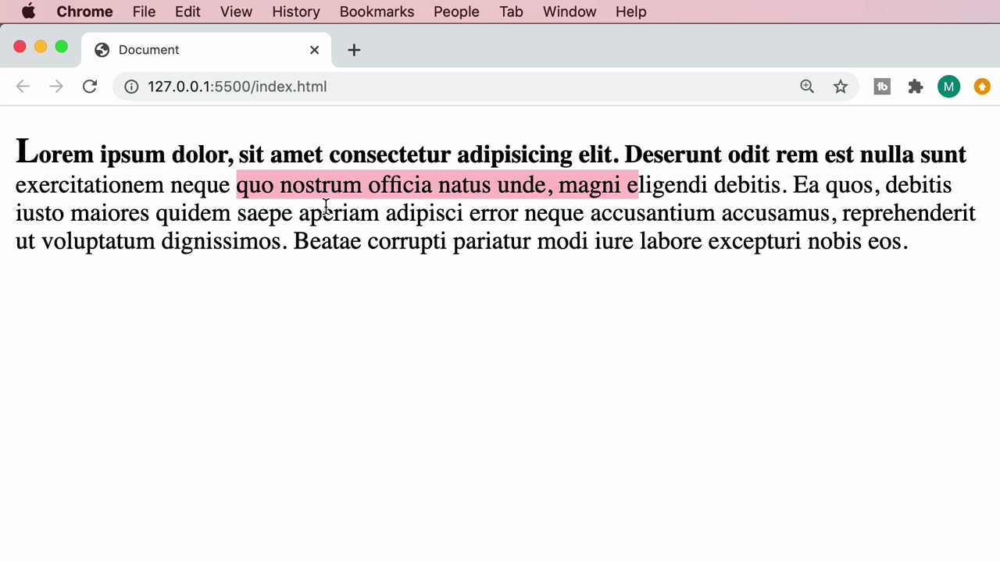

Mosh เพิ่ม `<h1>Heading</h1>` เข้าไปก่อน `<p>` แล้วเปลี่ยน selector จาก `p::selection` เป็น **`::selection`** (ไม่ระบุ tag) เพื่อให้ครอบคลุม**ทุก element**ในหน้า:

```css
::selection {
  background-color: pink;
}
```


ผลลัพธ์: ไม่ว่าจะเลือกข้อความใน `<h1>` หรือ `<p>` ก็เป็นสีชมพูเหมือนกันทั้งหมด:

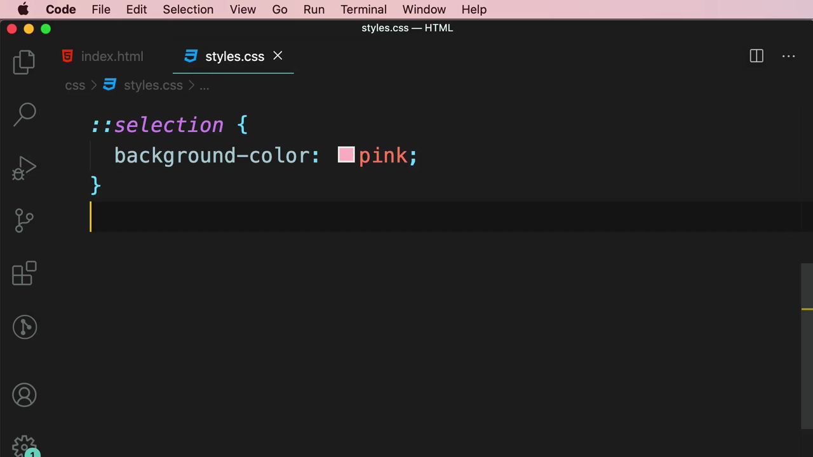

> **`::selection` คืออะไร:** จัดสไตล์ข้อความในช่วงที่ผู้ใช้**เลือก (highlight)** ด้วยเมาส์หรือคีย์บอร์ด มักใช้กำหนด `background-color` และ `color` เพื่อให้ตรงกับธีมสีของเว็บไซต์

---

## 5. Pseudo-element `::before` และ `::after`

Mosh เปิด DevTools แล้วตรวจสอบ element `<p>` เพื่อแนะนำ pseudo-element ใหม่ — สังเกตว่ามี `::before` ปรากฏอยู่ใน DOM tree แม้จะไม่มีเขียนไว้ใน HTML จริง:

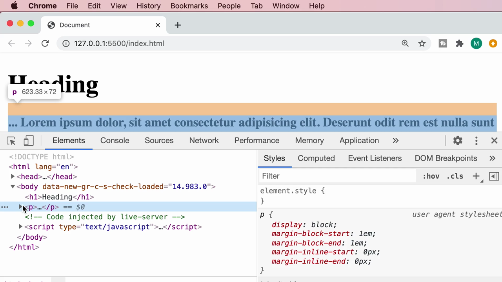

DevTools แสดง rule ที่กำหนดไว้:

```css
p::before {
  content: "...";
}
```

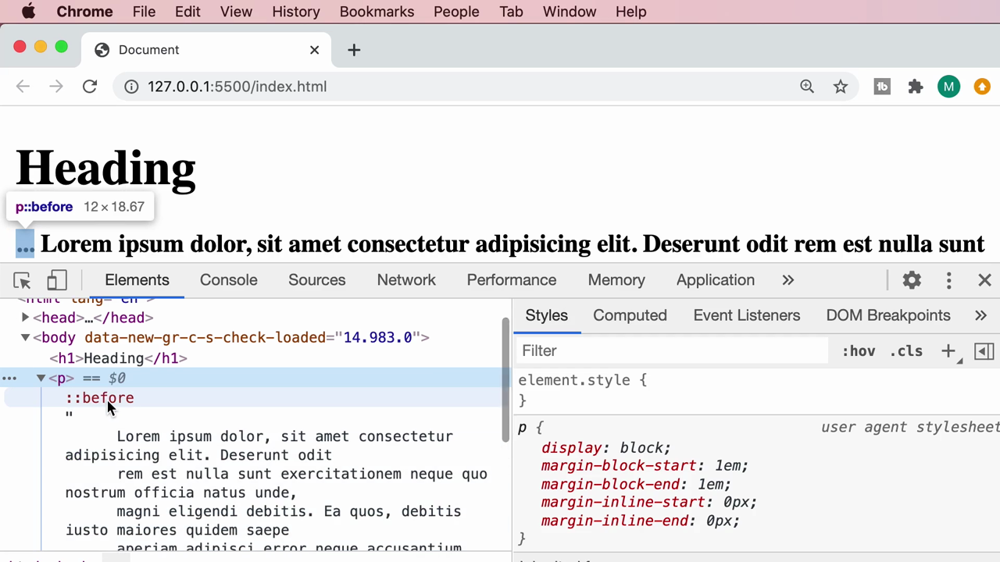

Mosh เขียนโค้ดนี้ใน `styles.css`:

```css
p::before {
  content: "...";
}
```

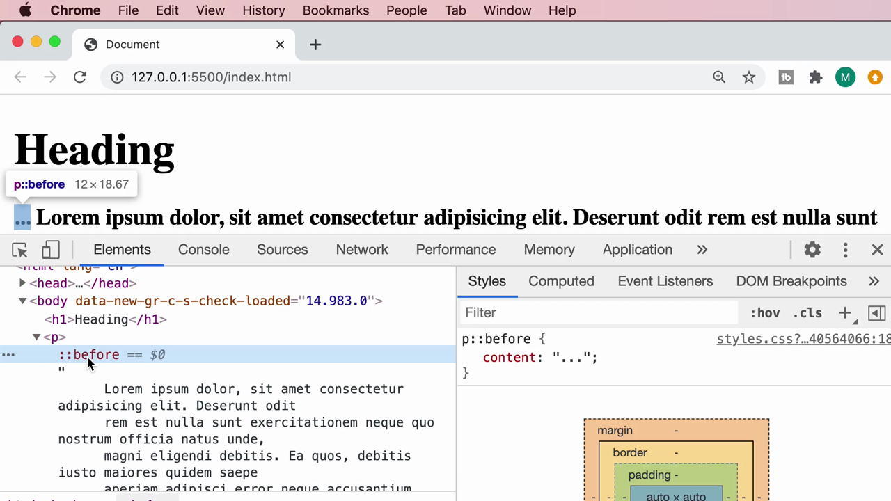

ผลลัพธ์: มีข้อความ **"..."** ปรากฏขึ้นมา**ก่อนหน้า**เนื้อหาจริงของ `<p>` ทันที ทั้งที่ไม่มีอยู่ใน HTML เลย — นี่คือเนื้อหาที่ถูก "สร้างขึ้นมา" (generated content) โดย CSS ล้วนๆ

Mosh เพิ่ม `display: block;` เพื่อให้ "..." ขึ้นบรรทัดของตัวเองแยกจากข้อความ:

```css
p::before {
  content: "...";
  display: block;
}
```

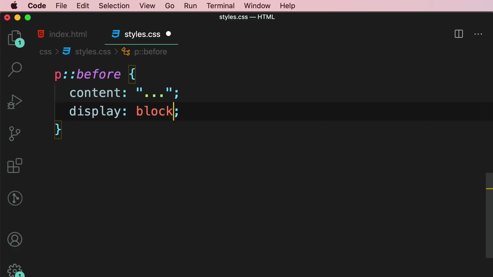

ผลลัพธ์: "..." ขึ้นเป็นบรรทัดแยกอยู่**ก่อน**ข้อความ Lorem ipsum:

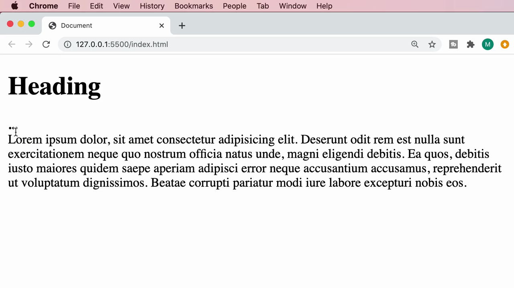

จากนั้น Mosh เปลี่ยน selector จาก `::before` เป็น **`::after`** เพื่อเปรียบเทียบ ผลลัพธ์: "..." ย้ายไปอยู่**หลัง**เนื้อหาข้อความแทน:

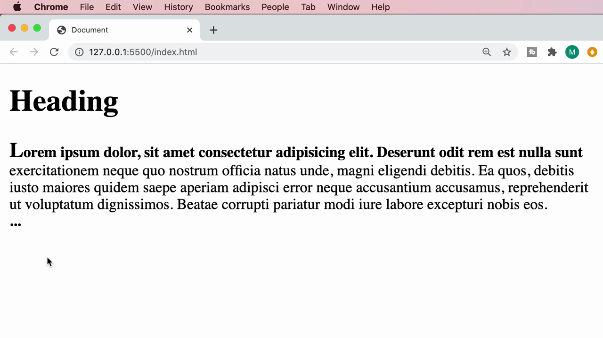

> **`::before`/`::after` คืออะไร:** สร้าง**เนื้อหาเสมือน (generated content)** ขึ้นมาใหม่ ก่อน (`::before`) หรือ หลัง (`::after`) เนื้อหาจริงของ element โดยใช้ property **`content`** เป็นตัวกำหนดข้อความหรือสัญลักษณ์ที่จะแสดง — ใช้บ่อยมากสำหรับไอคอนตกแต่ง, เครื่องหมายคำพูด, ตัวเลขลำดับ, หรือ tooltip โดยไม่ต้องเพิ่ม element ปลอมใน HTML

---

## สรุปที่ใช้ได้จริง

Pseudo-element Selectors ที่เรียนในคลิปนี้ (สังเกตว่าทุกตัวใช้ **`::`** สองจุด):

| Pseudo-element | ความหมาย |
|---|---|
| **`::first-letter`** | ตัวอักษรตัวแรกของ element |
| **`::first-line`** | บรรทัดแรกของข้อความ (ปรับตามการตัดบรรทัดจริง) |
| **`::selection`** | ข้อความช่วงที่ผู้ใช้เลือกด้วยเมาส์/คีย์บอร์ด |
| **`::before`** | สร้างเนื้อหาใหม่ก่อนเนื้อหาจริงของ element |
| **`::after`** | สร้างเนื้อหาใหม่หลังเนื้อหาจริงของ element |

- **Pseudo-class** (`:hover`, `:first-child`) เลือก element ทั้งตัวตามสถานะ/ตำแหน่ง ส่วน **Pseudo-element** (`::before`, `::first-letter`) จัดสไตล์แค่**บางส่วน**ของ element หรือสร้างเนื้อหาใหม่ขึ้นมาเลย
- `::before`/`::after` ต้องมี property `content` เสมอ (แม้จะเป็นค่าว่าง `content: "";`) ไม่เช่นนั้นจะไม่แสดงผลอะไรเลย

### จุดเชื่อมกับงานจริงของ Aum

- **`::before`/`::after`** เป็นเทคนิคที่ใช้บ่อยมากใน production CSS/Tailwind สำหรับใส่ไอคอนตกแต่ง, badge "NEW", เครื่องหมาย required (`*`) ข้างหลัง label ของ form, หรือเส้นคั่น (divider) ระหว่าง breadcrumb — Tailwind มี utility `before:content-['...']` และ `after:content-['...']` ที่ทำงานเหมือนกันทุกประการ
- **`::selection`** มีประโยชน์เวลาทำ branding ให้เว็บไซต์ดูเป็นมืออาชีพ เช่น กำหนดสีตอนผู้ใช้เลือกข้อความให้ตรงกับ brand color แทนสีฟ้า default — ทำได้ทั้งด้วย CSS ปกติและ Tailwind's `selection:` variant
- **`::first-letter`** เหมาะกับ landing page ที่ต้องการทำ drop cap สไตล์นิตยสาร/บทความ ซึ่งเป็นเทคนิคที่ใช้ pure CSS ได้โดยไม่ต้องพึ่ง JavaScript หรือ library เพิ่มเติม
- หลักการ "generated content" จาก `::before`/`::after` เป็นแนวคิดสำคัญที่ควรเข้าใจก่อนไปเรียน CSS ขั้นสูงอย่าง tooltip แบบ pure CSS, custom checkbox/radio button styling, และ loading spinner ที่ทำด้วย CSS ล้วนๆ โดยไม่ต้องมี extra `<div>` ใน React component
