# 4-CSS Basics: 08 - Selectors Specificity (8:02)

**ไฟล์ต้นทาง:** `08-Selectors-Specificity.mp4`

▶️ **[เปิดวิดีโอต้นฉบับ](../../../HTML-CSS-1/4-CSS%20Basics/08-Selectors-Specificity.mp4)**

---

## ภาพรวมคลิปนี้

คลิปนี้ Mosh สอนเรื่อง **Selector Specificity (น้ำหนักของ selector)** อย่างละเอียด — กฎที่ใช้ตัดสินว่าเมื่อมี CSS rule หลายอันขัดแย้งกัน (เลือก element เดียวกัน แต่กำหนดค่าต่างกัน) **rule ไหนจะชนะ** โดยอธิบายทั้งลำดับขั้นของ selector แต่ละประเภท วิธีคำนวณน้ำหนักเป็นตัวเลข และผลกระทบของ `!important`

---

## 1. ปัญหา: Selector สองอันขัดแย้งกัน

Mosh เริ่มจาก `<h1 class="highlight">Heading</h1>` ภายใน `<article>` แล้วเขียน CSS สองกฎที่แข่งกันเลือก element เดียวกัน:

```css
h1 {
  color: dodgerblue;
}

.highlight {
  color: deeppink;
}
```

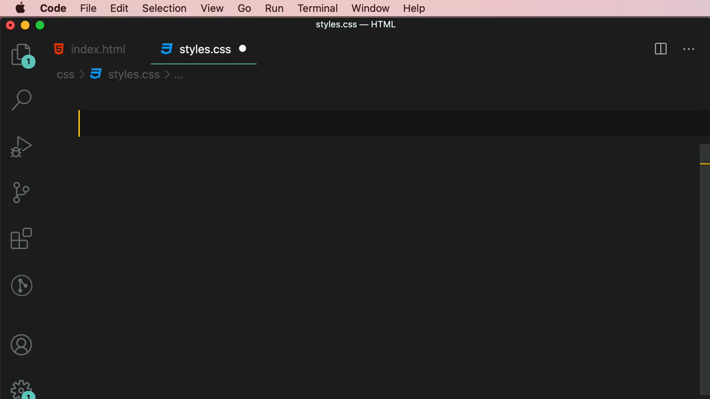

---

## 2. สไลด์: Selector Specificity (Weight)

Mosh อธิบายด้วยสไลด์หัวข้อ **"Selector Specificity (Weight)"**:

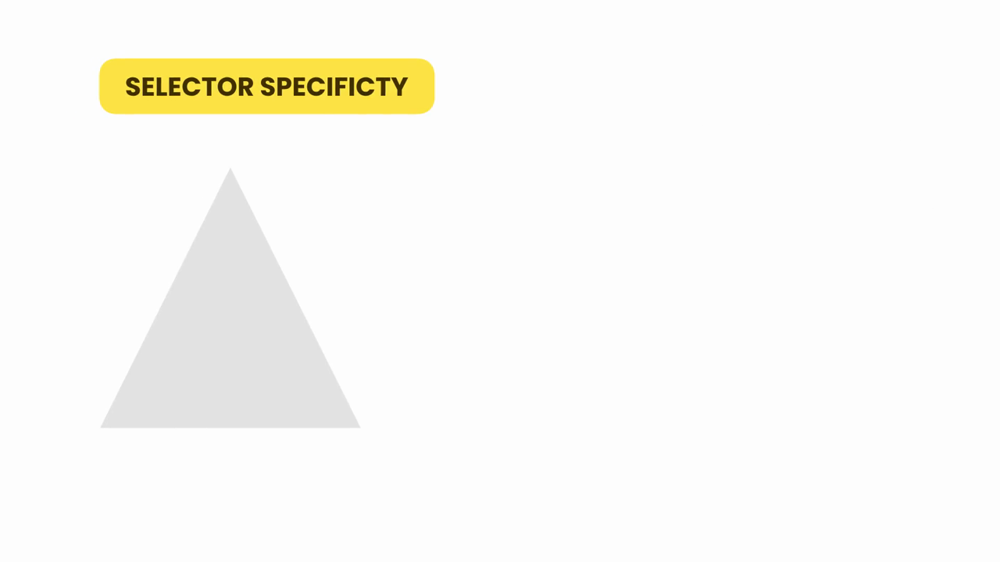

จากนั้นแสดง**พีระมิดลำดับความสำคัญของ selector** จากสูงสุดไปต่ำสุด:

> **ID selector** (`#products`) — สูงสุด
> **Class & attribute selectors** (`.products`) — กลาง
> **Element selector** (`section`) — ต่ำสุด

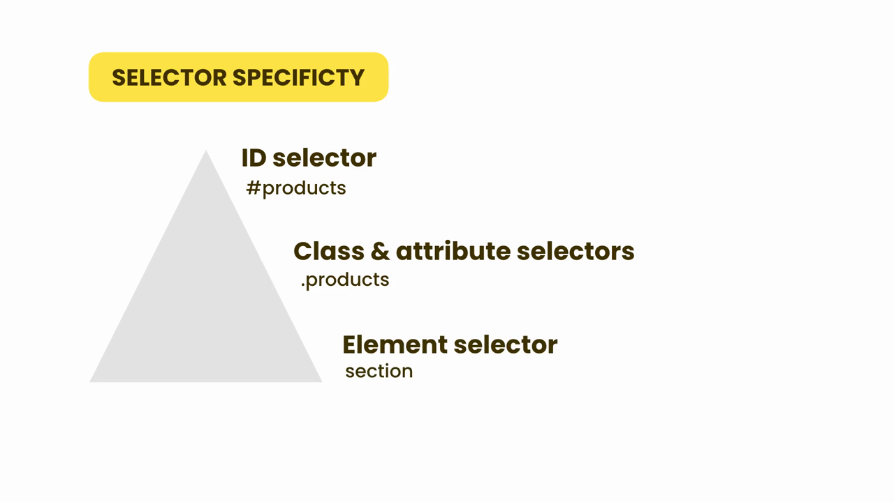

> **หลักการ:** ยิ่ง selector อยู่สูงในพีระมิดเท่าไร ก็ยิ่งมี "น้ำหนัก" (specificity) มากเท่านั้น เมื่อมี rule หลายอันขัดแย้งกัน rule ที่มี selector น้ำหนักสูงกว่าจะชนะเสมอ **ไม่ว่าจะเขียนก่อนหรือหลังก็ตาม**

---

## 3. ทดสอบ: Class Selector ชนะ Element Selector

ผลลัพธ์จากโค้ดในขั้นตอนที่ 1: หัวข้อ "Heading" กลายเป็นสีชมพู (deeppink) ไม่ใช่สีฟ้า (dodgerblue):

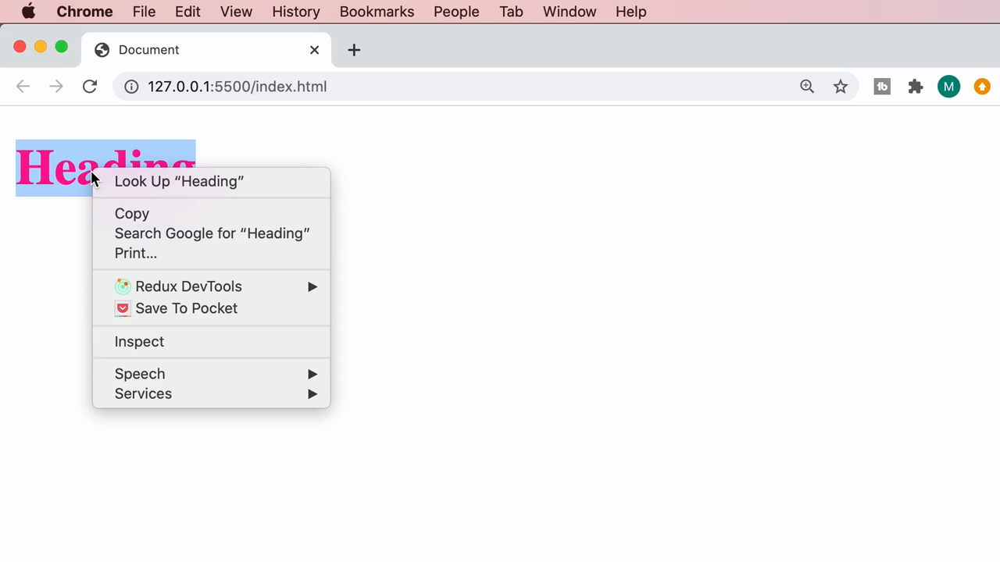

เปิด DevTools ยืนยัน: rule `h1 { color: dodgerblue; }` ถูกขีดฆ่า (ไม่ถูกใช้งาน) เพราะ **`.highlight` (class) มีน้ำหนักสูงกว่า `h1` (element)** แม้ `h1` จะเขียนอยู่**ก่อน**ในไฟล์ก็ตาม:

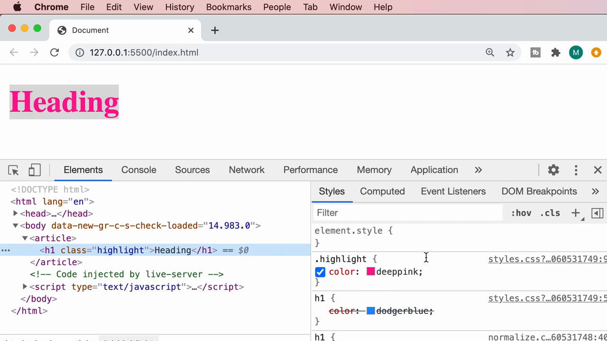

> **บทเรียนสำคัญ:** ลำดับการเขียนโค้ดใน CSS **ไม่ได้เป็นตัวตัดสินเสมอไป** — Specificity (น้ำหนักของ selector) ต่างหากที่เป็นตัวตัดสินหลัก ลำดับการเขียนจะมีผลก็ต่อเมื่อ specificity เท่ากันเท่านั้น (ตามที่เรียนไปแล้วในคลิป "Providing CSS")

---

## 4. ทดสอบ: ID Selector ชนะ Class Selector

Mosh เพิ่ม `id="products"` ให้กับ `<h1>` แล้วเขียน CSS ด้วย ID Selector:

```css
#products {
  color: green;
}
```

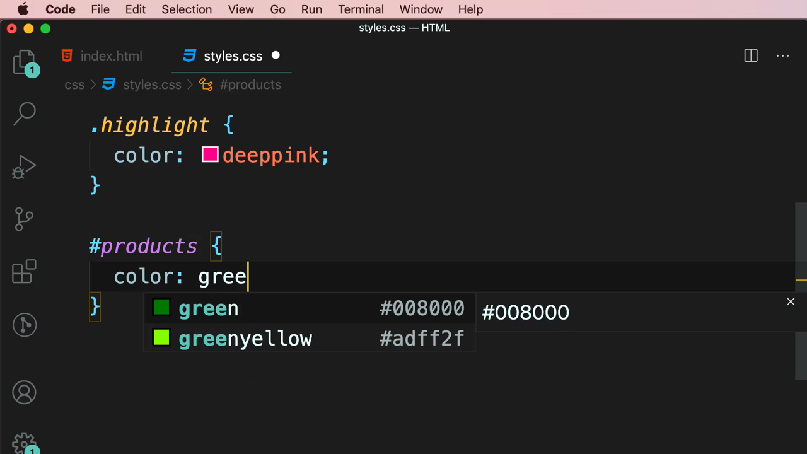

ผลลัพธ์: หัวข้อ "Heading" กลายเป็นสีเขียว (green) — **ID Selector ชนะทั้ง class และ element selector**:

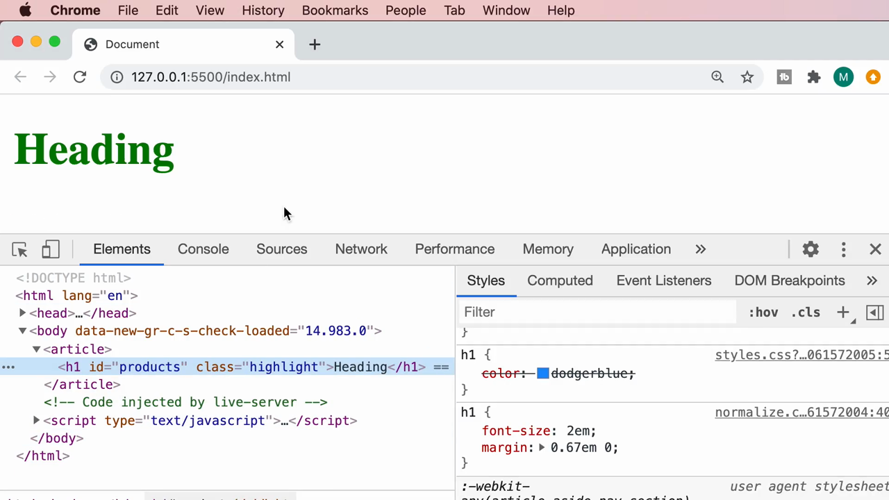

---

## 5. เมื่อ Specificity เท่ากัน: ใครเขียนทีหลังชนะ

Mosh สร้าง rule `#products` ซ้ำอีกอันด้วยสีต่างกัน (สีน้ำตาล) เพื่อทดสอบว่าเกิดอะไรขึ้นเมื่อ specificity เท่ากันเป๊ะ:

```css
#products {
  color: green;
}

#products {
  color: brown;
}
```

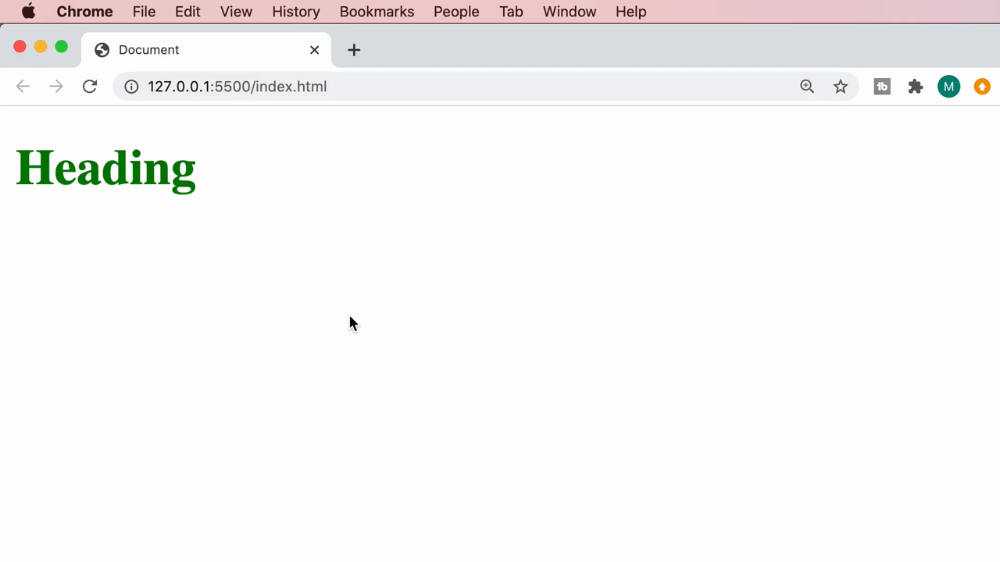

> **ผลลัพธ์:** เมื่อ selector สองอันมี specificity **เท่ากันเป๊ะ** rule ที่เขียนอยู่**ทีหลัง**ในไฟล์จะชนะเสมอ (ตามหลัก "cascade" ที่เรียนมาตั้งแต่คลิป Providing CSS)

---

## 6. การคำนวณ Specificity เป็นตัวเลข (a, b, c)

Mosh แสดงให้เห็นว่า VS Code สามารถคำนวณค่า specificity เป็นตัวเลขให้ดูได้จริงเมื่อ hover ที่ selector — ระบบตัวเลขนี้มี 3 ตำแหน่ง **(จำนวน ID, จำนวน Class/Attribute, จำนวน Element)**:

Selector `#products` เพียงอย่างเดียว มีค่า specificity เป็น **(1, 0, 0)** (มี ID 1 ตัว):

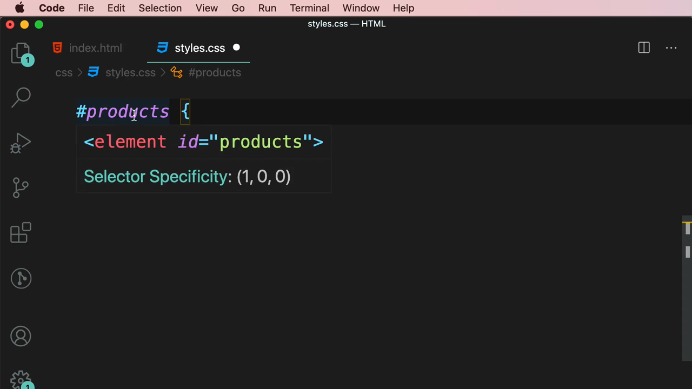

เมื่อรวม class เข้ากับ id ในตัวเดียวกัน `.highlight#products` ค่าจะกลายเป็น **(1, 1, 0)** (ID 1 ตัว + Class 1 ตัว) — **สูงกว่า** `#products` เดี่ยวๆ:

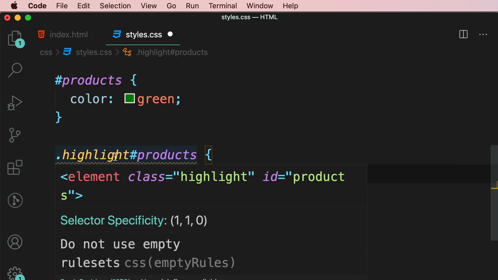

เมื่อรวม element เข้ากับ id `h1#products` ค่าจะกลายเป็น **(1, 0, 1)** (ID 1 ตัว + Element 1 ตัว):

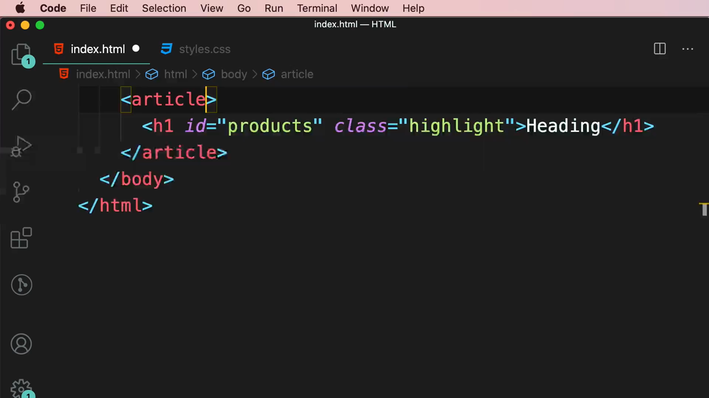

> **วิธีคำนวณ Specificity:** นับจำนวนแต่ละประเภทของ selector ที่ปรากฏในกฎ (ไม่ว่าจะรวมกันด้วย descendant, child combinator หรือเขียนติดกันแบบ `tag#id.class`):
> - ตำแหน่งที่ 1 = จำนวน **ID selector** (`#`)
> - ตำแหน่งที่ 2 = จำนวน **Class/Attribute/Pseudo-class selector** (`.`, `[]`, `:`)
> - ตำแหน่งที่ 3 = จำนวน **Element/Pseudo-element selector** (tag name, `::`)
>
> เปรียบเทียบทีละตำแหน่งจากซ้ายไปขวา — ตำแหน่งซ้ายสุดที่มีค่ามากกว่าจะชนะทันที (เช่น `(1,0,0)` ชนะ `(0,99,99)` เสมอ เพราะเทียบตำแหน่งแรกก่อน)

Mosh สาธิตเพิ่มเติมด้วย selector ที่ผสมหลาย combinator เข้าด้วยกัน เช่น `html body #featured h2#products` เพื่อแสดงว่า specificity จะถูก**บวกรวมกัน**จากทุกส่วนของ selector chain ไม่ว่าจะเชื่อมด้วยช่องว่างหรือเขียนติดกัน:

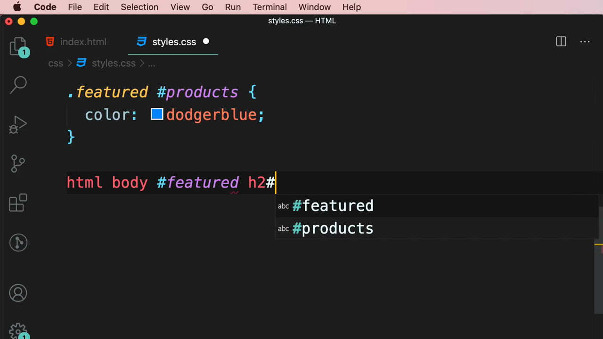

---

## 7. `!important` — ตัวทำลายกฎทุกอย่าง

Mosh เพิ่ม `!important` ต่อท้ายค่าใน rule `h1`:

```css
h1 {
  color: dodgerblue !important;
}
```

ผลลัพธ์: แม้ `#products { color: green; }` จะมี specificity สูงกว่ามาก (1,0,0 vs 0,0,1) แต่ **`h1` กลับชนะ** เพราะมี `!important` กำกับอยู่ เปิด DevTools ยืนยันว่า rule ของ `#products` และ `.highlight` ถูกขีดฆ่าทั้งคู่ ทั้งที่ specificity สูงกว่า:

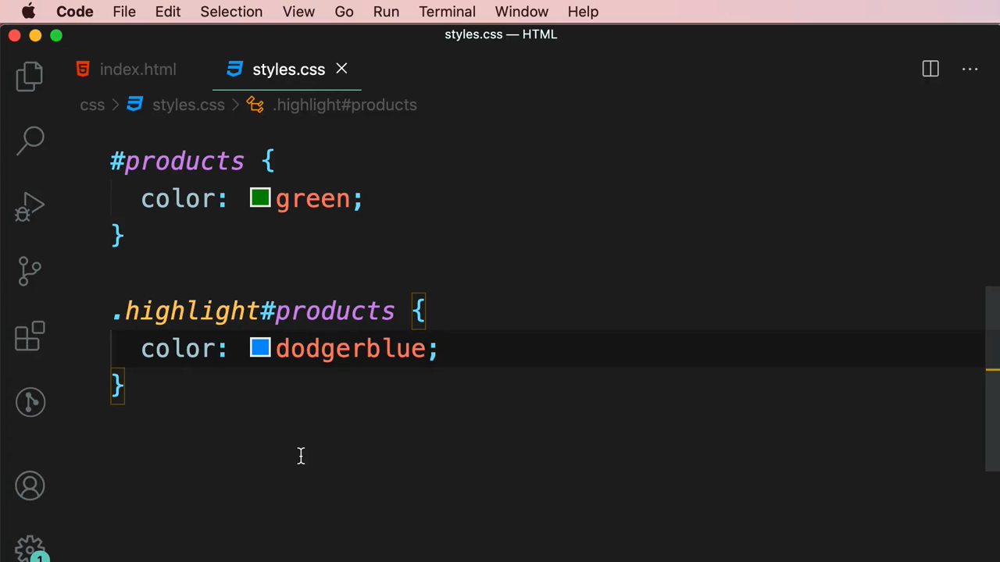

> **`!important` คืออะไร:** เป็นคำสั่งพิเศษที่เขียนต่อท้ายค่าของ property เพื่อบังคับให้ rule นั้น**ชนะทุก rule อื่น**โดยไม่สนใจ specificity เลย (ยกเว้นจะมี `!important` แข่งกันเอง ซึ่งกรณีนั้นจะกลับไปเทียบ specificity ตามปกติ)
>
> **คำเตือนสำคัญ:** Mosh ย้ำว่า **ควรหลีกเลี่ยงการใช้ `!important`** ในโปรเจกต์จริงให้มากที่สุดเท่าที่จะทำได้ เพราะมันทำให้ debug CSS ยากขึ้นมาก (เมื่อเจอ `!important` ที่ไหนสักแห่งในโปรเจกต์ใหญ่ๆ จะไม่รู้เลยว่าทำไม style ถึงไม่เปลี่ยนตามที่คาดหวัง) ควรใช้ `!important` เฉพาะกรณีจำเป็นจริงๆ เท่านั้น เช่น การ override สไตล์จาก library ภายนอกที่แก้ไม่ได้

---

## สรุปที่ใช้ได้จริง

ลำดับความสำคัญของ Selector Specificity จากสูงสุดไปต่ำสุด:

1. **`!important`** (ควรเลี่ยง)
2. **Inline style** (`style=""` ในแท็ก HTML)
3. **ID selector** (`#id`)
4. **Class, Attribute, Pseudo-class selector** (`.class`, `[attr]`, `:hover`)
5. **Element, Pseudo-element selector** (`tag`, `::before`)

- Specificity คำนวณเป็นตัวเลข 3 ตำแหน่ง **(จำนวน ID, จำนวน Class, จำนวน Element)** และเปรียบเทียบทีละตำแหน่งจากซ้ายไปขวา
- เมื่อ specificity เท่ากัน **rule ที่เขียนทีหลังในไฟล์จะชนะ**
- `!important` ควรใช้ให้น้อยที่สุดเท่าที่จะทำได้ เพราะทำให้ debug ยากขึ้นมาก

### จุดเชื่อมกับงานจริงของ Aum

- **Tailwind CSS ถูกออกแบบมาเพื่อหลีกเลี่ยงปัญหา specificity โดยตรง** — utility class ของ Tailwind แทบทุกตัวมี specificity เท่ากันหมด (class selector ธรรมดา = (0,1,0)) ทำให้ class ที่เขียนทีหลังใน `className` ชนะตามลำดับที่คาดเดาได้ ไม่ต้องกังวลเรื่อง ID/element ขัดแย้งกันแบบ CSS ดั้งเดิม
- อย่างไรก็ตาม เวลาผสม Tailwind กับ custom CSS class เดิม (เช่น library CSS หรือ CSS Module) ปัญหา specificity แบบที่เรียนในคลิปนี้ยังเกิดขึ้นได้ ถ้า custom CSS ใช้ ID selector หรือมี `!important` ซ่อนอยู่ ก็จะ override Tailwind class ไม่ได้ ต้องเข้าใจหลักการนี้เพื่อ debug ปัญหาที่ style ไม่ขึ้นตามที่ต้องการ
- ปัญหา "style ไม่ทำงานตามที่คาดหวัง" เป็นปัญหาที่พบบ่อยมากตอนทำ landing page — ทักษะการเปิด DevTools แล้วดูว่า rule ไหนถูกขีดฆ่า (เหมือนที่ Mosh สาธิต) เป็นทักษะ debug ที่สำคัญมากสำหรับ Front End developer ทุกคน ใช้ได้ทั้งกับ CSS ธรรมดาและ Tailwind
- คำแนะนำ "หลีกเลี่ยง `!important`" ของ Mosh สอดคล้องกับแนวทางของ Tailwind ที่แทบไม่แนะนำให้ใช้ `!important` เลย (แม้จะมี variant `!` นำหน้า class ก็ตาม เช่น `!text-red-500`) เพราะทำให้ปรับแต่ง component ในอนาคตยากขึ้นมาก
