# 4-CSS Basics: 09 - Inheritance (2:43)

**ไฟล์ต้นทาง:** `09-Inheritance.mp4`

▶️ **[เปิดวิดีโอต้นฉบับ](../../../HTML-CSS-1/4-CSS%20Basics/09-Inheritance.mp4)**

---

## ภาพรวมคลิปนี้

คลิปนี้ Mosh สอนเรื่อง **Inheritance (การสืบทอดสไตล์)** — กลไกที่ทำให้ค่า CSS บางอย่างที่กำหนดกับ element แม่ (parent) จะ**ไหลลงไปหา element ลูก (child) โดยอัตโนมัติ** โดยไม่ต้องเขียน rule ซ้ำ พร้อมสาธิตวิธีตรวจสอบใน DevTools ว่าค่าที่เห็นนั้น "สืบทอดมาจากไหน" และวิธี**ตัดการสืบทอด**ด้วยคีย์เวิร์ด `initial`

---

## 1. เตรียม HTML: ประโยคที่มี `<strong>` ซ้อนอยู่ใน `<p>`

Mosh เริ่มจากการเขียน HTML ธรรมดา แล้วใช้ Emmet พิมพ์ `strong` เพื่อห่อคำว่า "dolor" ไว้ในแท็ก `<strong>` ที่อยู่ตรงกลางประโยค:

```html
<body>
  <p>Lorem ipsum <strong>dolor</strong> sit amet.</p>
</body>
```

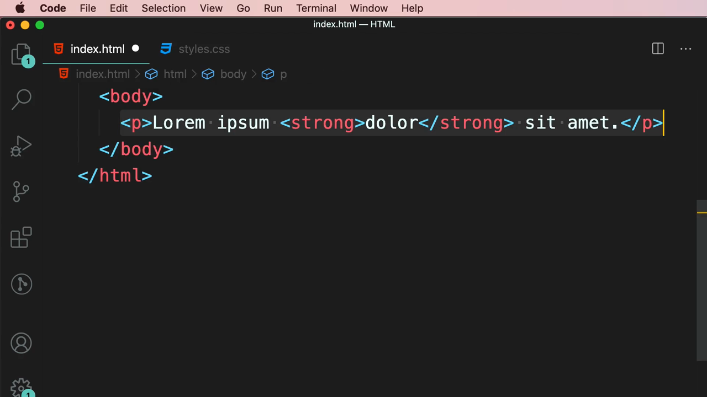

ตอนนี้ยังไม่มี CSS ใดๆ เลย ดังนั้นทุกคำในหน้าเว็บจะแสดงด้วยสไตล์ default ของเบราว์เซอร์ทั้งหมด (สีดำ, ฟอนต์ปกติ ยกเว้น `<strong>` ที่ตัวหนาโดย default ของ user agent stylesheet)

---

## 2. เปิด DevTools ตรวจสอบคำว่า "dolor"

Mosh คลิกขวาที่คำว่า "dolor" ในเบราว์เซอร์ แล้วเลือก **Inspect** เพื่อเปิด DevTools และดูว่า element `<strong>` นี้กำลังได้รับสไตล์อะไรอยู่บ้าง:

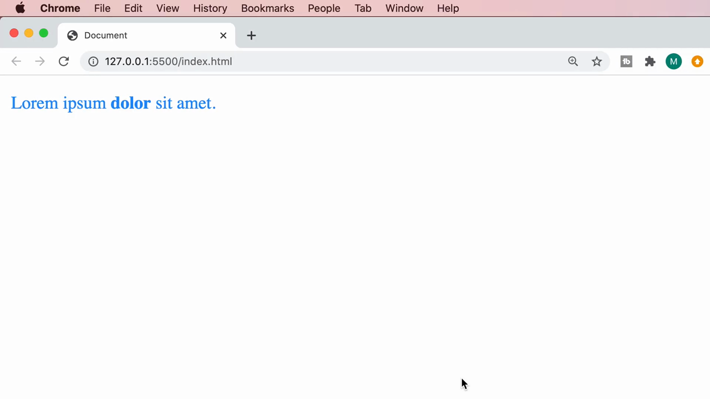

> **ทำไมต้องเริ่มด้วยการเปิด DevTools:** Mosh ใช้ DevTools เป็นเครื่องมือหลักตลอดคลิปนี้ เพราะ Inheritance เป็นเรื่องที่ "มองไม่เห็นด้วยโค้ด" ตรงๆ — ต้องเปิด Styles panel เพื่อดูว่า "ค่าที่ element ได้รับมาจากที่ไหน" ถึงจะเข้าใจภาพจริง

---

## 3. เพิ่ม `color: dodgerblue` ให้ `<p>` — และ `<strong>` ก็เปลี่ยนสีตามไปด้วย

Mosh เปิดไฟล์ `styles.css` (ว่างเปล่า) แล้วเขียน rule ให้ `p`:

```css
p {
  color: dodgerblue;
}
```

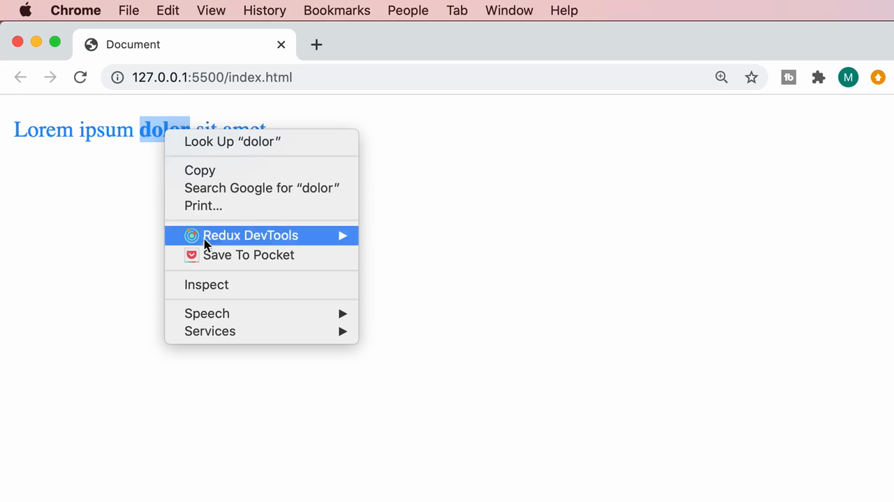

ผลลัพธ์ในเบราว์เซอร์: **ทั้งประโยคเปลี่ยนเป็นสีฟ้า (dodgerblue) ทั้งหมด** รวมถึงคำว่า "dolor" ที่อยู่ใน `<strong>` ด้วย — ทั้งที่ Mosh ไม่ได้เขียน rule ให้ `strong` เลย!

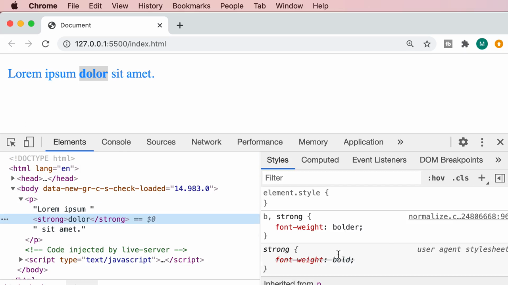

> **นี่คือ Inheritance:** เมื่อกำหนด `color` ให้กับ `<p>` (parent) ค่าสีนี้จะ**สืบทอด (inherit)** ลงไปยัง element ลูกทุกตัวที่อยู่ข้างในโดยอัตโนมัติ (เช่น `<strong>`) ตราบใดที่ element ลูกนั้นไม่มี rule ของตัวเองมา override ค่าที่สืบทอดมา

---

## 4. เปิด DevTools ยืนยัน: `strong` ไม่มี `color` เป็นของตัวเอง

Mosh เปิด DevTools แล้วเลือก element `<strong>dolor</strong>` ดูที่ panel **Styles** ทางขวา จะเห็นว่า:

- มี rule `b, strong { font-weight: bolder; }` จาก stylesheet ปกติ
- มี rule `strong { font-weight: bold; }` จาก **user agent stylesheet** (สไตล์ default ของเบราว์เซอร์) ซึ่งถูกขีดฆ่า (ไม่ทำงาน เพราะถูกอันแรกทับ)
- **ไม่มี `color` อยู่ใน block ของ `strong` เลย** — เพราะยังไม่ได้เขียน rule ให้ `strong`

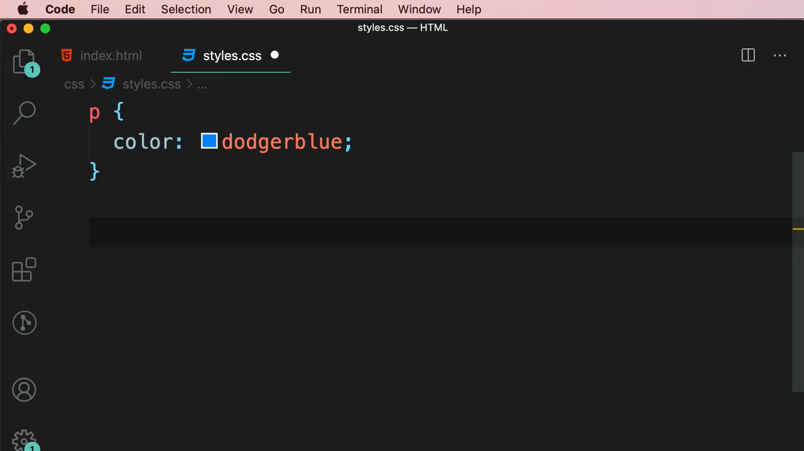

เมื่อเลื่อนดูต่อในแถบ Styles ด้านล่าง จะเห็น section หัวข้อ **"Inherited from p"** ที่แสดง rule `p { color: dodgerblue; }` — นี่คือหลักฐานตรงจาก DevTools ว่าค่า `color: dodgerblue` ที่ `strong` ใช้อยู่นั้น**ไม่ได้เขียนเอง แต่สืบทอดมาจาก `<p>` ที่เป็น parent**

> **จุดสำคัญที่ Mosh เน้น:** DevTools มี section แยกชื่อ **"Inherited from `<element>`"** ไว้ให้เห็นชัดๆ เสมอว่าค่าไหนที่ element ปัจจุบัน**ไม่ได้กำหนดเอง**แต่ได้รับมาจาก parent ตัวไหน — นี่คือวิธีที่ถูกต้องในการ debug ว่าสีหรือ property หนึ่งๆ "มาจากไหน" เวลาเจอ CSS ที่ซับซ้อนขึ้น

---

## 5. เขียน `color: dodgerblue` ให้ `strong` แบบชัดเจน (explicit)

Mosh เขียน rule ใหม่ให้ `strong` โดยกำหนดสีเดียวกันแบบตรงๆ พร้อมดู IntelliSense tooltip ของ property `color`:

> `color` — Sets the color of an element's text. Syntax: `<color>`

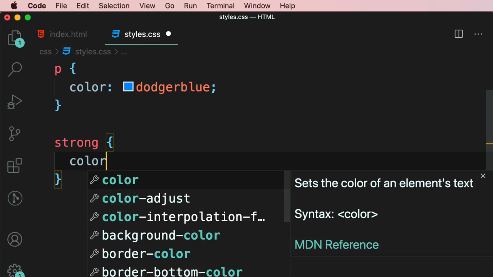

```css
p {
  color: dodgerblue;
}

strong {
  color: dodgerblue;
}
```

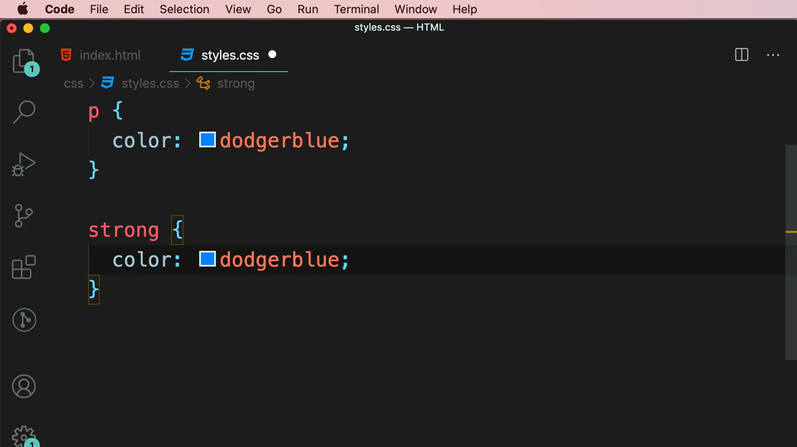

ตอนนี้หน้าตาในเบราว์เซอร์**เหมือนเดิมทุกอย่าง** (ยังเป็นสีฟ้าเหมือนก่อนหน้า) เพราะค่าที่เขียนเองกับค่าที่สืบทอดมาบังเอิญเป็นค่าเดียวกัน — Mosh ใช้จุดนี้เพื่อปูทางไปสู่การทดลองขั้นต่อไป: จะเกิดอะไรขึ้นถ้าสั่งให้ `strong` **เลิกรับค่าที่สืบทอดมา** แล้วกลับไปใช้ค่า default แทน

เมื่อเปิด DevTools อีกครั้งดูที่ `strong` จะเห็นตอนนี้ `color: dodgerblue` กลายเป็น rule ของ `strong` เองแล้ว (ไม่ใช่ inherited อีกต่อไป) และยังเห็น section **"Inherited from p"** แสดง rule เดิมของ `p` อยู่ด้วยเพื่อเทียบให้เห็นความแตกต่างระหว่าง "ค่าที่ประกาศเอง" กับ "ค่าที่สืบทอดมา":

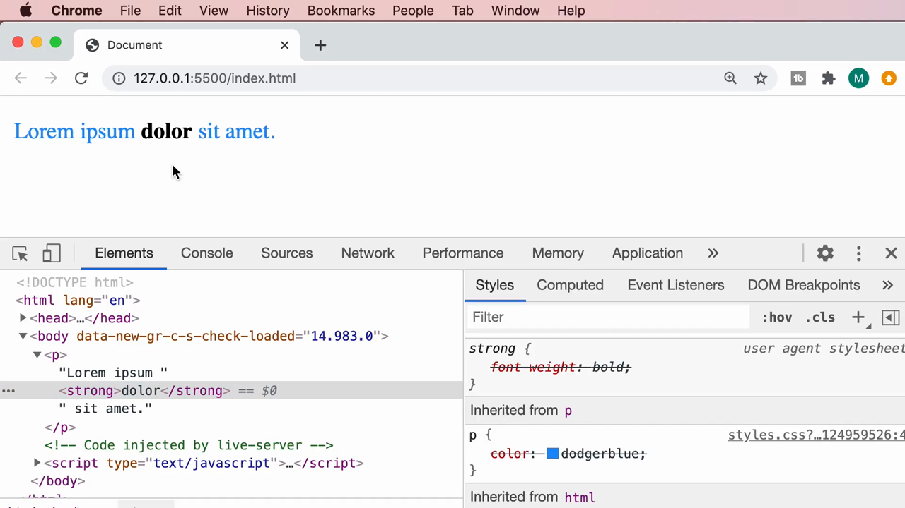

---

## 6. `color: initial` — วิธีตัดการสืบทอด กลับไปใช้ค่า default

Mosh เปลี่ยนค่าใน rule ของ `strong` จาก `dodgerblue` เป็นคีย์เวิร์ดพิเศษ **`initial`**:

```css
strong {
  color: initial;
}
```

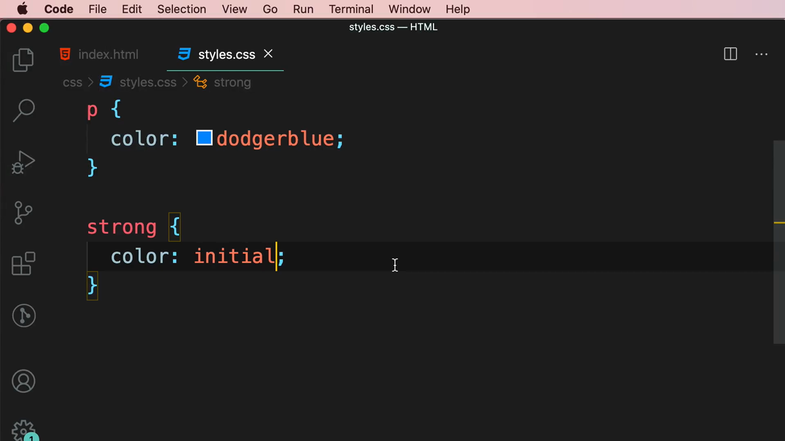

ผลลัพธ์ในเบราว์เซอร์: คำว่า **"dolor"** (อยู่ใน `<strong>`) **กลับไปเป็นสีดำ** (สี default ของเบราว์เซอร์) ในขณะที่ **"Lorem ipsum" และ "sit amet."** (อยู่ใน `<p>` แต่นอก `<strong>`) **ยังคงเป็นสีฟ้า (dodgerblue) เหมือนเดิม**:

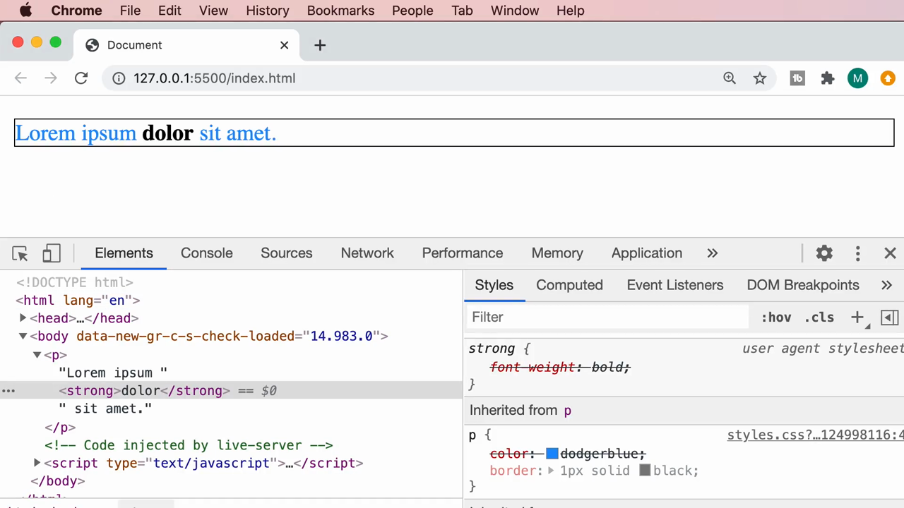

> **`initial` คืออะไร:** เป็นคีย์เวิร์ดพิเศษที่ใช้แทนค่าของ property ใดๆ ก็ได้ เพื่อสั่งให้ browser **เลิกสืบทอดค่าจาก parent และเลิกใช้ค่าที่เขียนไว้ก่อนหน้า** แล้วกลับไปใช้**ค่าเริ่มต้น (initial value) ตามสเปคของ CSS** สำหรับ property นั้นๆ แทน (สำหรับ `color` ค่า default ของ browser ส่วนใหญ่คือสีดำ)
>
> พูดง่ายๆ คือ `initial` เป็นเหมือน "ปุ่มรีเซ็ต" ให้ property หนึ่งกลับไปเป็นค่าที่มันควรจะเป็นถ้าไม่มีใครเขียน CSS อะไรเลย โดยไม่สนใจว่ามี rule อื่นหรือค่าที่สืบทอดมาจาก parent อยู่หรือไม่

---

## 7. เพิ่มกรอบ `border` ให้ `<p>` เพื่อดูภาพรวมชัดเจนขึ้น

สุดท้าย Mosh เพิ่ม `border: 1px solid black;` เข้าไปใน rule ของ `p` เพื่อวาดกรอบล้อมรอบทั้งประโยค ทำให้เห็นขอบเขตของ `<p>` ชัดเจนขึ้นในภาพหน้าจอ:

```css
p {
  color: dodgerblue;
  border: 1px solid black;
}

strong {
  color: initial;
}
```

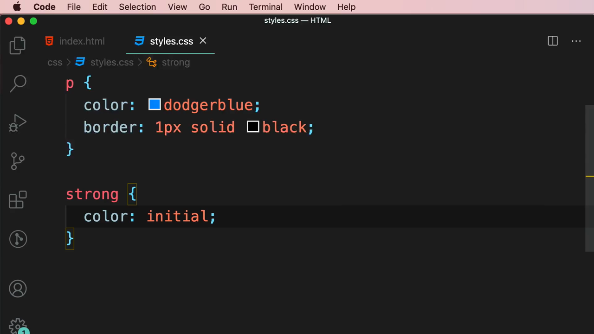

ผลลัพธ์สุดท้าย: กรอบสีดำล้อมรอบทั้งประโยค "Lorem ipsum **dolor** sit amet." โดยคำว่า **"dolor" เป็นตัวหนาสีดำ** (ตัวหนามาจาก user agent stylesheet ของ `strong` ที่ไม่เกี่ยวกับ inheritance ส่วนสีดำมาจาก `initial`) ในขณะที่ข้อความส่วนที่เหลือยังคงเป็นสีฟ้าตามที่สืบทอดมาจาก `<p>`:

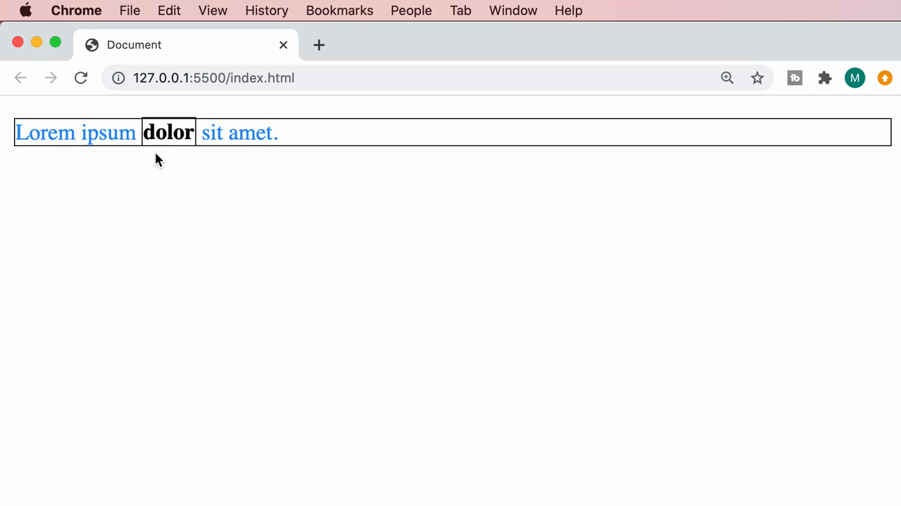

---

## สรุปที่ใช้ได้จริง

- **Inheritance (การสืบทอด)** คือกลไกที่ค่า CSS บางอย่าง (โดยเฉพาะกลุ่มที่เกี่ยวกับข้อความ เช่น `color`, `font-family`, `font-size`, `line-height`) ที่กำหนดให้ parent element จะ**ไหลลงไปหา child element โดยอัตโนมัติ** โดยไม่ต้องเขียน rule ซ้ำให้ลูกทุกตัว
- Child element จะใช้ค่าที่สืบทอดมา **ก็ต่อเมื่อตัวมันเองไม่มี rule ที่กำหนดค่านั้นไว้เอง** — ถ้ามี rule ของตัวเอง (ไม่ว่าจะ specificity เท่าไหร่) ค่าที่เขียนเองจะ override ค่าที่สืบทอดมาเสมอ
- **`initial`** เป็นคีย์เวิร์ดพิเศษที่ใช้เป็นค่าของ property ใดก็ได้ เพื่อ**รีเซ็ตกลับไปที่ค่าเริ่มต้นตามสเปค CSS** ตัดขาดทั้งจากค่าที่สืบทอดมาจาก parent และค่าที่ rule อื่นเคยกำหนดไว้
- **DevTools > Styles panel > section "Inherited from `<element>`"** คือเครื่องมือหลักในการตรวจสอบว่าค่า property หนึ่งๆ ที่ element กำลังใช้อยู่นั้น "มาจากไหน" — เขียนเอง หรือสืบทอดมาจาก parent ตัวไหน

### จุดเชื่อมกับงานจริงของ Aum

- **CSS Custom Properties (CSS Variables)** เช่น `--primary-color: dodgerblue;` ที่ประกาศไว้ที่ `:root` ก็ใช้หลักการ Inheritance เดียวกันนี้ — มันสืบทอดลงไปให้ element ลูกทุกตัวใช้งานผ่าน `var(--primary-color)` ได้ทั่วทั้งหน้าเว็บ โดยไม่ต้องประกาศซ้ำ
- **Tailwind CSS** เองก็อาศัย Inheritance ของเบราว์เซอร์อยู่เบื้องหลัง เช่น การตั้ง `font-family` หรือ `color` ที่ container ระดับบน (`<body>` หรือ layout wrapper) แล้วปล่อยให้ text ข้างในสืบทอดไปเอง แทนที่จะต้องใส่ class สีหรือฟอนต์ซ้ำทุก element ลูก — แต่ถ้าต้องการ override เฉพาะจุด ก็ใส่ utility class (เช่น `text-black`) ตรงจุดนั้นแทนที่จะพึ่ง `initial`
- เวลาเจอปัญหา "ทำไมสีของ text ตรงนี้ไม่ตรงกับที่ตั้งไว้ใน parent" หรือ "ทำไม override CSS ไม่ได้ตามที่คิด" ให้เปิด DevTools แล้วดู section **"Inherited from"** เหมือนที่ Mosh สาธิต — เป็นทักษะ debug ที่ใช้ได้ทั้งกับ CSS ธรรมดาและตอนแก้ style ที่ผสมกับ Tailwind class
- คีย์เวิร์ด `initial` (รวมถึงเพื่อนของมันคือ `inherit` และ `unset` ที่จะเจอในคลิปต่อๆ ไป) มีประโยชน์มากเวลาต้อง override CSS จาก library ภายนอกที่ไม่สามารถแก้ source ได้โดยตรง เช่น ต้องการยกเลิกสไตล์ที่ library กำหนดไว้แล้วให้กลับไปเป็นค่า default ของ browser
