# 4-CSS Basics: 10 - Colors (6:48)

**ไฟล์ต้นทาง:** `10-Colors.mp4`

▶️ **[เปิดวิดีโอต้นฉบับ](../../../HTML-CSS-1/4-CSS%20Basics/10-Colors.mp4)**

---

## ภาพรวมคลิปนี้

คลิปนี้ Mosh สอนเรื่อง **การกำหนดสี (Colors) ใน CSS** อย่างครบทุกรูปแบบ — ตั้งแต่ชื่อสี (named color), ฟังก์ชัน `rgb()`, ระบบเลขฐาน 16 (Hexadecimal / HEX code), ไปจนถึงฟังก์ชัน `hsl()` และ `hsla()` ที่ใช้ Hue-Saturation-Lightness พร้อมสาธิตเครื่องมือ **color picker** ทั้งจาก Google Search และจาก Chrome DevTools เพื่อช่วยแปลงค่าสีไปมาระหว่างระบบต่างๆ

---

## 1. เตรียม `<div class="box">` เป็นกล่องสี่เหลี่ยมสำหรับทดลองสี

Mosh สร้าง `<div>` ใหม่ในหน้าเว็บ ใส่ class `box` ด้วย Emmet (`div.box`) แล้วเขียน CSS กำหนดขนาดกล่องก่อน จากนั้นเริ่มพิมพ์ property `background-color` โดยดู IntelliSense tooltip ประกอบ:

> `background-color` — Sets the background color of an element. Syntax: `<color>`

```css
.box {
  width: 200px;
  height: 200px;
  background-color: ;
}
```

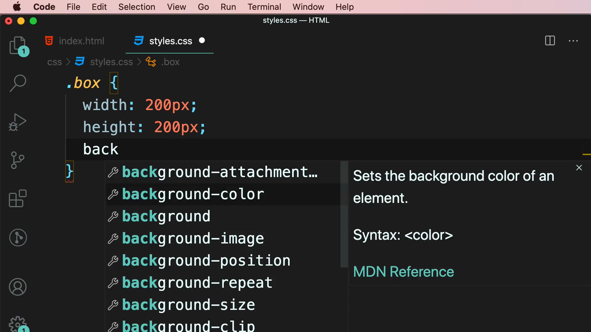

---

## 2. แนะนำเครื่องมือ "Color Picker" จาก Google Search

ก่อนเขียนค่าสี Mosh เปิดแท็บใหม่แล้วค้นหาคำว่า **"color picker"** ใน Google ซึ่ง Google จะแสดง**เครื่องมือเลือกสีในตัว** ขึ้นมาทันที ประกอบด้วยแผงสีให้ลากเลือก แถบ Hue (สเปกตรัมสี) และช่องแสดงค่าสีในหลายรูปแบบพร้อมกัน:

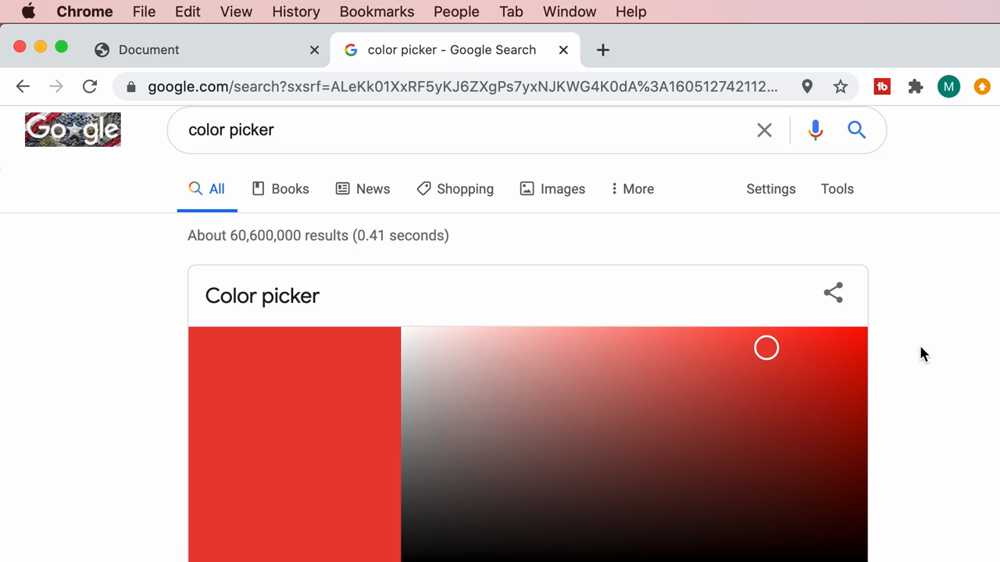

เมื่อเลื่อนแถบ Hue มาที่โทนเหลือง แล้วดูด้านล่าง จะเห็นค่าสีเดียวกันถูกแสดงพร้อมกันถึง 4 รูปแบบ:

- **HEX** — `#e6cd10` (รหัสฐาน 16)
- **RGB** — `230, 205, 16` (ค่าแดง-เขียว-น้ำเงิน 0-255)
- **CMYK** — `0%, 11%, 93%, 10%` (ใช้ในงานพิมพ์ ไม่ใช้ใน CSS)
- **HSV** — `53°, 93%, 90%` (Hue-Saturation-Value)
- **HSL** — `53°, 87%, 48%` (Hue-Saturation-Lightness)

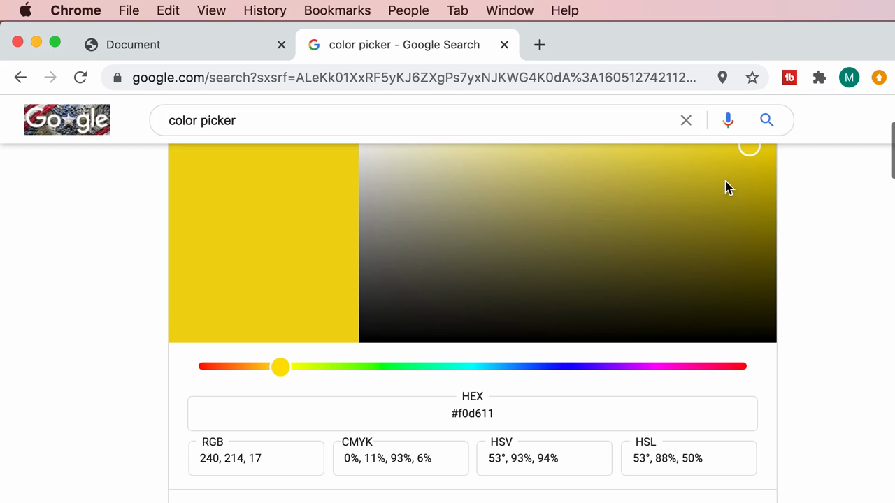

> **จุดสำคัญที่ Mosh เน้น:** สีเดียวกันสามารถเขียนแทนได้หลายรูปแบบ ขึ้นอยู่กับว่าจะใช้ระบบไหน — CSS รองรับการเขียนสีอย่างน้อย 4 แบบหลักคือ **named color** (เช่น `dodgerblue`), **RGB**, **HEX**, และ **HSL** (ส่วน CMYK และ HSV ไม่ใช้ใน CSS โดยตรง)

---

## 3. วิธีที่ 1: ฟังก์ชัน `rgb()` — กำหนดสีด้วยค่าแดง-เขียว-น้ำเงิน

Mosh พิมพ์ฟังก์ชัน `rgb()` ใน CSS โดยใส่ค่าตัวเลขที่ได้จาก color picker (230, 205, 16):

```css
.box {
  width: 200px;
  height: 200px;
  background-color: rgb(230, 205, 16);
}
```

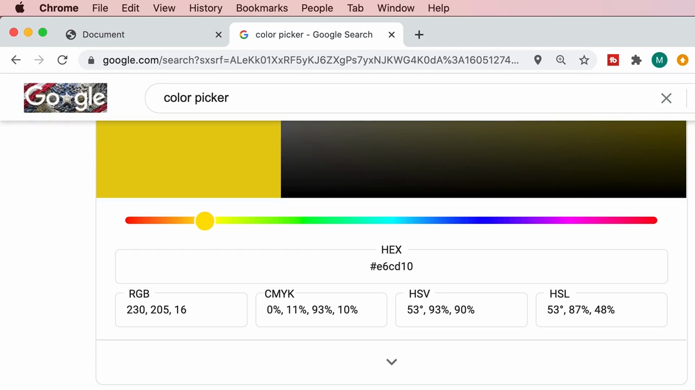

> **`rgb()` คืออะไร:** ฟังก์ชันที่รับค่าตัวเลข 3 ตัว คือ **Red, Green, Blue** แต่ละค่ามีช่วงตั้งแต่ **0 ถึง 255** (256 ระดับ) ยิ่งค่าตัวไหนสูง สีนั้นก็จะยิ่งเข้มขึ้นในภาพสุดท้าย การผสม 3 สีแม่แสงนี้ในสัดส่วนต่างๆ กันทำให้สร้างสีได้หลายล้านเฉดสี

---

## 4. ทำไม RGB ถึงมีค่า 0-255? สไลด์ "Numeral Systems"

Mosh อธิบายที่มาของเลข 255 ด้วยสไลด์หัวข้อ **"NUMERAL SYSTEMS"** โดยเริ่มจากระบบเลขฐานสอง **Binary (0, 1)**:

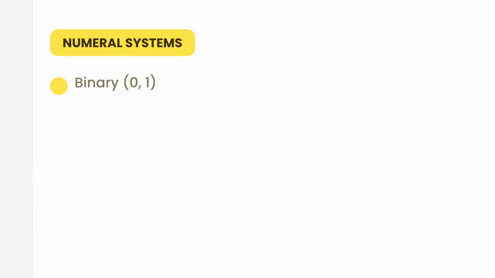

> **อธิบายเพิ่มเติม (ระบบเลขฐานที่เกี่ยวข้องกับสี):** คอมพิวเตอร์เก็บค่าสีแต่ละช่อง (Red, Green, Blue) เป็นข้อมูล **1 ไบต์ (8 บิต)** ซึ่งใน**ระบบเลขฐานสอง (Binary)** สามารถแทนค่าได้ตั้งแต่ `00000000` ถึง `11111111` — เมื่อแปลงเป็น**เลขฐานสิบ (Decimal)** ที่คนทั่วไปใช้ ก็จะได้ตั้งแต่ **0 ถึง 255** พอดี (2 ยกกำลัง 8 = 256 ค่า) นี่คือเหตุผลที่ `rgb()` ใช้ช่วงค่า 0-255 เสมอ

---

## 5. วิธีที่ 2: HEX Code — เลขฐาน 16 ที่ใช้แทน RGB แบบย่อ

Mosh กลับไปที่ color picker แล้วเลือกไฮไลต์ค่าในช่อง **HEX** ทีละคู่ตัวอักษร เพื่อแสดงให้เห็นว่ารหัส `#e6cd10` แบ่งออกเป็น 3 คู่ ตรงกับค่า R, G, B ตามลำดับ:


> **HEX Code คืออะไร:** เป็นการเขียนค่าสีในรูปแบบ **`#RRGGBB`** โดยแต่ละคู่ตัวอักษร (RR, GG, BB) คือค่าของ Red, Green, Blue ตามลำดับ แต่เขียนใน**เลขฐาน 16 (Hexadecimal)** แทนที่จะเป็นเลขฐานสิบแบบ `rgb()`
>
> เลขฐาน 16 ใช้สัญลักษณ์ 16 ตัว คือ `0-9` และ `A-F` (โดย A=10, B=11, C=12, D=13, E=14, F=15) ทำให้ตัวเลข 2 หลักในฐาน 16 (เช่น `E6`) สามารถแทนค่าได้ตั้งแต่ 0 ถึง 255 พอดี — เท่ากับช่วงค่าของ `rgb()` — แต่เขียนสั้นกว่า (2 ตัวอักษร แทนที่จะเป็นตัวเลข 3 หลักแบบ `230`)

Mosh นำค่า HEX มาใส่ในโค้ด:

```css
.box {
  width: 200px;
  height: 200px;
  background-color: #e6cd10;
}
```

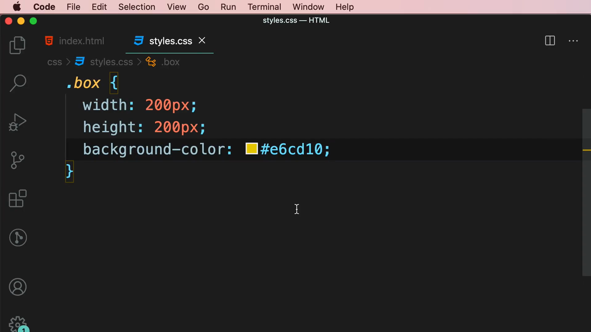

ผลลัพธ์เหมือนเดิมทุกประการกับตอนใช้ `rgb(230, 205, 16)` เพราะเป็นสีเดียวกัน เพียงแต่เขียนคนละรูปแบบ

---

## 6. Hue คืออะไร: ภาพวงล้อสี (Color Wheel)

ก่อนอธิบาย `hsl()` Mosh เปิดภาพ **วงล้อสี (Color Wheel)** ขึ้นมาประกอบเพื่อแสดงว่า **Hue** คือมุมองศาบนวงกลมสี ไล่จากแดง (0°) → เหลือง → เขียว → ฟ้า → น้ำเงิน → ม่วง → กลับมาแดง (360°):

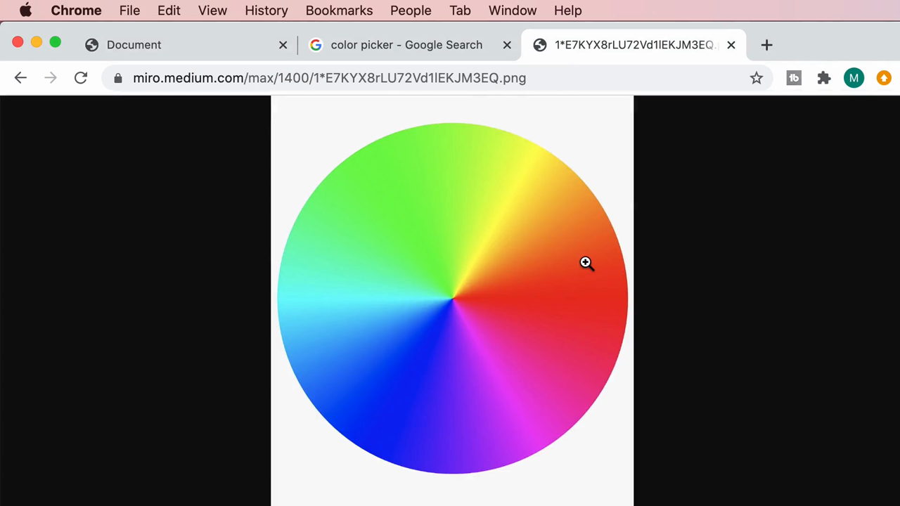

> **Hue คืออะไร:** ค่าองศา (0° ถึง 360°) ที่บอกว่า "สีนี้เป็นสีอะไรบนวงล้อสี" เช่น 0°/360° = แดง, 120° = เขียว, 240° = น้ำเงิน, 53° = เหลือง-ทอง (ตามตัวอย่างในคลิปนี้)

---

## 7. วิธีที่ 3: ฟังก์ชัน `hsl()` — Hue, Saturation, Lightness

Mosh ลบค่า HEX แล้วพิมพ์ `hsl` ดู IntelliSense tooltip:

> `hsl($hue, $saturation, $lightness)` — Creates a Color from hue, saturation, and lightness values.

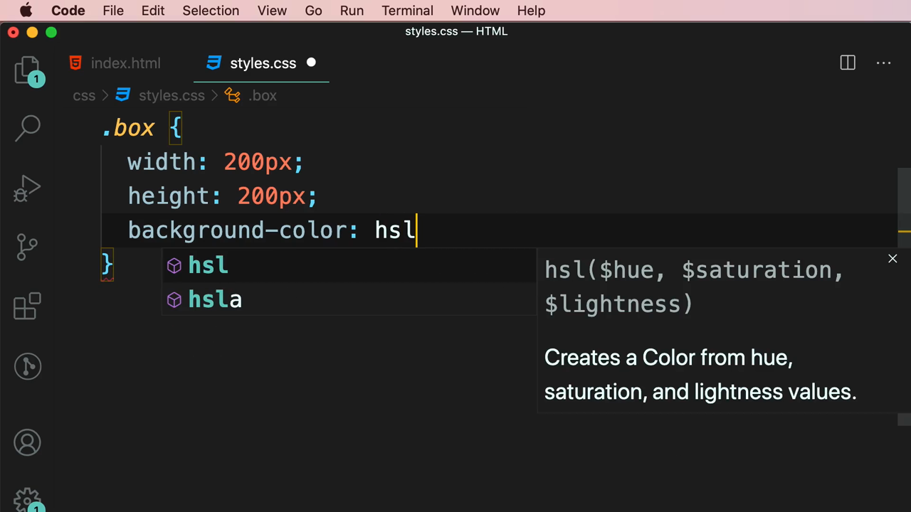

จากนั้นใส่ค่าตามที่ color picker แสดงไว้ก่อนหน้า (Hue 53°, Saturation 65%, Lightness 77%):

```css
.box {
  width: 200px;
  height: 200px;
  background-color: hsl(53°, 65%, 77%);
}
```

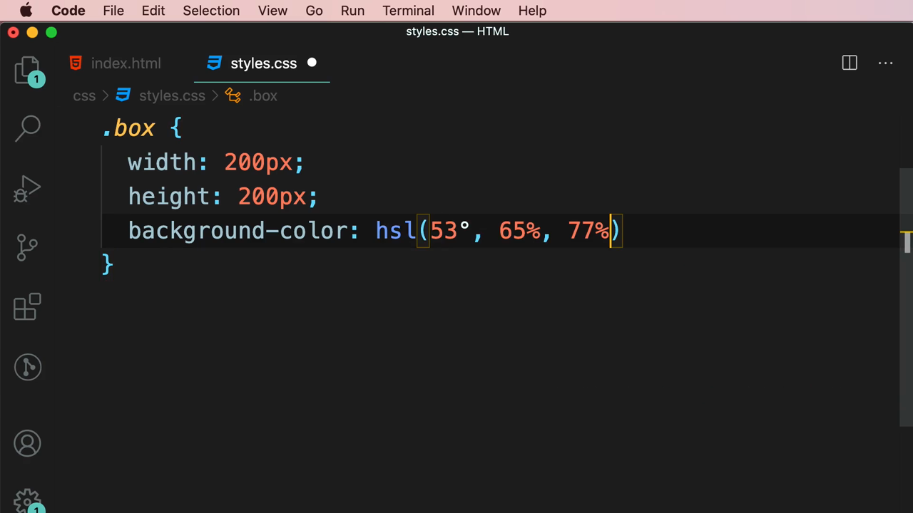

ผลลัพธ์: ได้สีเหลืองอ่อนเหมือนเดิม เพราะเป็นสีเดียวกันกับที่แปลงมาจาก RGB/HEX ก่อนหน้านี้

> **HSL คืออะไร:**
> - **Hue (สี)** — องศาบนวงล้อสี (0°-360°) บอกว่าเป็นสีโทนไหน
> - **Saturation (ความอิ่มตัวของสี)** — เปอร์เซ็นต์ (0%-100%) บอกว่าสีนั้น "จัดจ้าน" แค่ไหน ยิ่งสูงยิ่งสดใส ยิ่งต่ำยิ่งหม่น/เทา
> - **Lightness (ความสว่าง)** — เปอร์เซ็นต์ (0%-100%) บอกว่าสีนั้น "สว่าง-มืด" แค่ไหน 0% = ดำสนิท, 100% = ขาวสนิท, 50% = สีเต็มโทน

---

## 8. ทดลองปรับ Saturation — เพิ่มความสดของสี

Mosh เปลี่ยนค่า Saturation จาก `65%` เป็น `100%`:

```css
background-color: hsl(53, 100%, 77%);
```

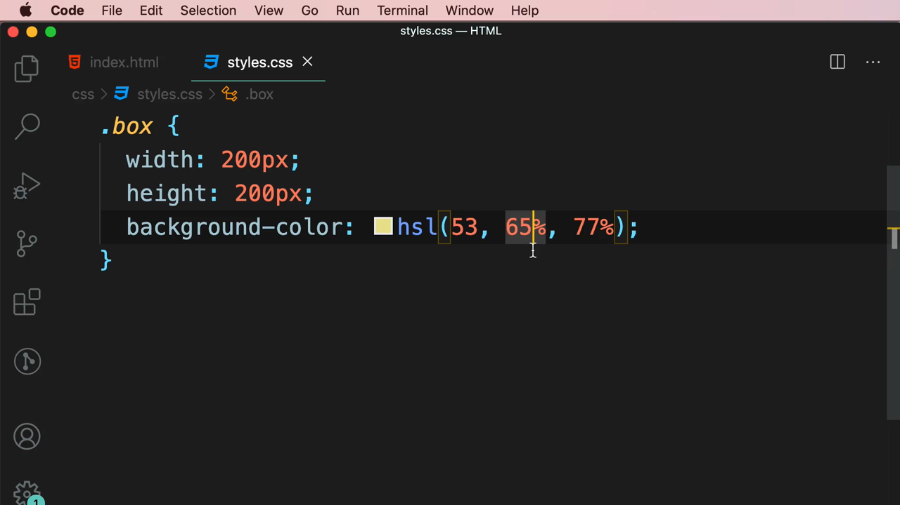

ผลลัพธ์ในเบราว์เซอร์: กล่องเปลี่ยนจากสีเหลืองอมเทาๆ (65%) เป็น**สีเหลืองสดใสจัดจ้านขึ้นมาก** (100%) แสดงให้เห็นชัดเจนว่า Saturation ควบคุมความสดของสี:

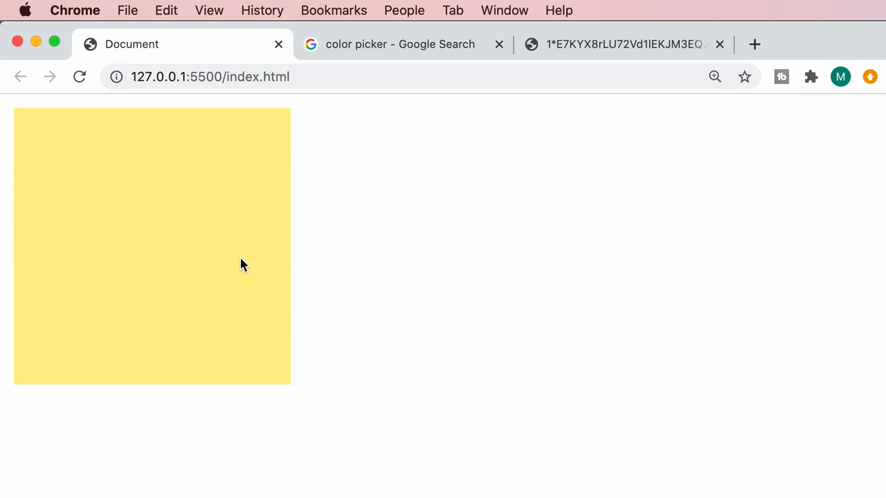

---

## 9. ทดลองปรับ Lightness — ทำให้สีเข้มขึ้น

Mosh เปลี่ยนค่า Lightness จาก `77%` เป็น `40%`:

```css
background-color: hsl(53, 100%, 40%);
```

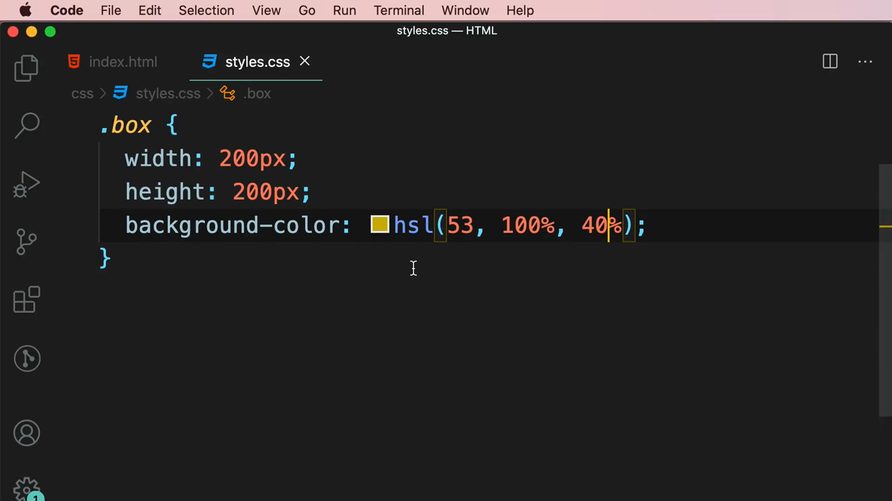

ผลลัพธ์: กล่องเปลี่ยนจากสีเหลืองสว่างเป็น**สีเหลืองทอง/มัสตาร์ดที่เข้มขึ้นมาก** ยืนยันว่า Lightness ยิ่งต่ำ สียิ่งเข้ม (เข้าใกล้สีดำ) ยิ่งสูงยิ่งสว่าง (เข้าใกล้สีขาว)

---

## 10. เปิด DevTools ใช้ Color Picker ในตัวเบราว์เซอร์

Mosh คลิกขวาที่กล่องแล้วเลือก **Inspect** เพื่อเปิด DevTools:

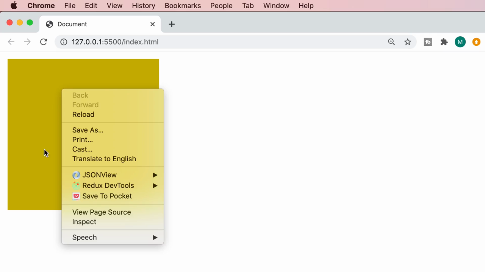

ใน Styles panel เมื่อคลิกที่สี่เหลี่ยมสีเล็กๆ หน้าค่า `hsl(...)` DevTools จะเปิด **color picker ในตัว** ขึ้นมาทันที ซึ่งมีแผงไล่สี แถบ Hue และแถบ **Alpha (ความโปร่งใส)** พร้อมช่องตัวเลข **H, S, L, A** ให้ปรับได้ตรงๆ:

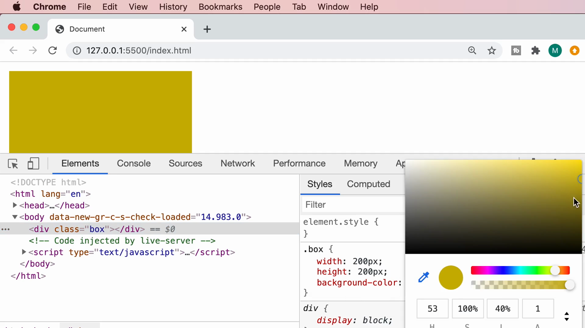

> **ประโยชน์ของ DevTools color picker:** ไม่ต้องเปิดแท็บ Google แยกต่างหาก สามารถลากปรับ Hue/Saturation/Lightness/Alpha แล้วเห็นผลเปลี่ยนที่หน้าเว็บจริงทันที (live preview) เป็นเครื่องมือที่มีประโยชน์มากเวลาต้องหาสีที่ใช่สำหรับดีไซน์

---

## 11. วิธีที่ 4: `hsla()` — เพิ่มค่า Alpha (ความโปร่งใส)

Mosh พิมพ์ฟังก์ชัน `hsla()` (มี "a" ต่อท้ายชื่อ) เพิ่มค่าตัวที่ 4 คือ Alpha:

```css
.box {
  width: 200px;
  height: 200px;
  background-color: hsla(53, 100%, 40%, 0.5);
}
```

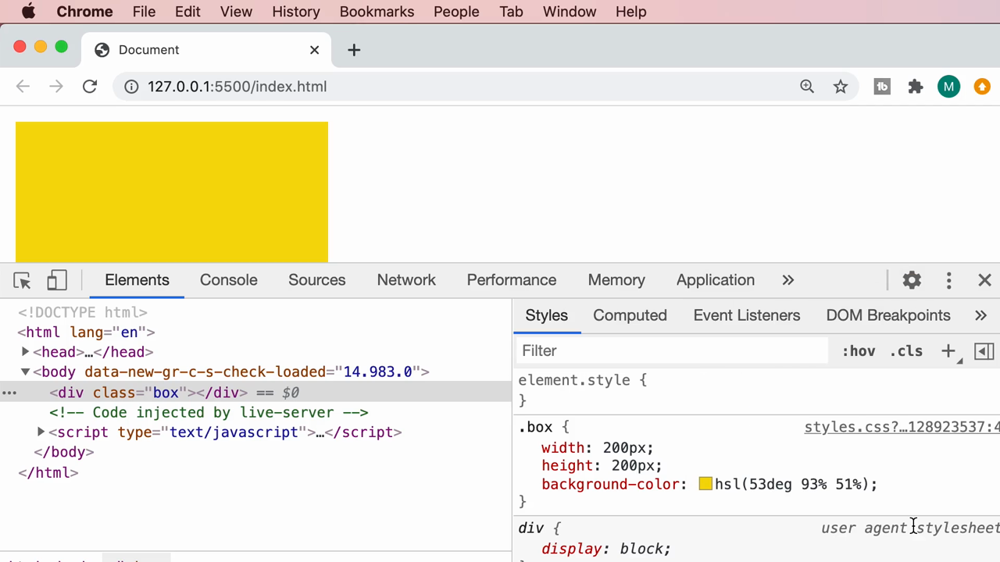

> **Alpha คืออะไร:** ค่าความโปร่งใส (opacity) มีช่วงตั้งแต่ **0 ถึง 1** โดย `0` = โปร่งใสหมด (มองไม่เห็นสีเลย) และ `1` = ทึบแสงเต็มที่ (ค่า default ถ้าไม่ใส่) ค่ากลางๆ อย่าง `0.5` จะทำให้สีนั้นโปร่งแสงครึ่งหนึ่ง มองทะลุไปเห็นพื้นหลังด้านหลังได้บางส่วน — `rgba()` ก็ใช้หลักการเดียวกัน เพียงแต่ 3 ค่าแรกเป็น Red/Green/Blue แทน Hue/Saturation/Lightness

---

## สรุปที่ใช้ได้จริง

CSS รองรับการเขียนสีอย่างน้อย 4 รูปแบบหลัก:

1. **Named color** — เช่น `dodgerblue`, `red`, `black` (จำง่าย แต่มีจำนวนจำกัด)
2. **`rgb(r, g, b)`** — ค่าตัวเลข 0-255 สามค่า (Red, Green, Blue)
3. **HEX code `#RRGGBB`** — เลขฐาน 16 คู่ละ 2 หลัก แทนค่า R, G, B (สั้นกว่า RGB ใช้กันแพร่หลายมาก)
4. **`hsl(hue, saturation%, lightness%)`** — Hue เป็นองศา (0-360), Saturation และ Lightness เป็นเปอร์เซ็นต์ (0-100%) — ใช้งานง่ายเวลาต้องการปรับสีให้สว่างขึ้น/มืดลง/สดขึ้นโดยไม่ต้องคำนวณค่า RGB ใหม่

ทั้ง `rgb()` และ `hsl()` มีเวอร์ชันเพิ่ม **Alpha (ความโปร่งใส 0-1)** คือ `rgba()` และ `hsla()` ตามลำดับ

เครื่องมือช่วยแปลงสี: ค้นหา **"color picker"** ใน Google หรือเปิด **DevTools > Styles panel** แล้วคลิกสี่เหลี่ยมสีหน้าค่า color เพื่อเปิด color picker ในตัวเบราว์เซอร์

### จุดเชื่อมกับงานจริงของ Aum

- **Tailwind CSS ใช้ชื่อ utility class แทนการเขียนค่าสีตรงๆ** เช่น `bg-yellow-400`, `text-blue-600` — แต่เบื้องหลัง Tailwind ก็แปลงเป็นค่า HEX หรือ RGB ให้เอง การเข้าใจว่า `400`, `600` คือระดับ Lightness ที่ต่างกันในโทนสีเดียวกัน จะช่วยให้เลือกเฉดสีใน Tailwind ได้แม่นยำขึ้นมาก
- เวลาต้องทำสี custom ที่ไม่มีใน Tailwind palette (ผ่าน `tailwind.config.js` หรือ arbitrary value เช่น `bg-[#e6cd10]`) จำเป็นต้องรู้จัก HEX code หรือ `rgb()`/`hsl()` แบบที่เรียนในคลิปนี้โดยตรง
- **`hsla()`/`rgba()` กับ Alpha channel** มีประโยชน์มากสำหรับทำ overlay สีดำโปร่งแสงทับรูปภาพ (เช่น `bg-black/50` ใน Tailwind ซึ่งก็คือ alpha 0.5) หรือทำเอฟเฟกต์ glassmorphism ที่กำลังนิยมในดีไซน์ landing page ยุคใหม่
- ทักษะการเปิด **DevTools color picker** เพื่อทดลองปรับ Hue/Saturation/Lightness/Alpha แบบ real-time เป็นเทคนิคที่มีประโยชน์มากเวลาต้องเลือกโทนสีให้เข้ากับดีไซน์ ใช้ได้ทั้งตอนเขียน CSS ธรรมดาและตอนปรับแต่ง Tailwind config
