# 4-CSS Basics: 11 - Gradients (6:06)

**ไฟล์ต้นทาง:** `11-Gradients.mp4`

▶️ **[เปิดวิดีโอต้นฉบับ](../../../HTML-CSS-1/4-CSS%20Basics/11-Gradients.mp4)**

---

## ภาพรวมคลิปนี้

คลิปนี้ Mosh สอนเรื่อง **Gradients (การไล่สี)** ใน CSS ทั้งสองรูปแบบหลักคือ **`linear-gradient()`** (ไล่สีเป็นเส้นตรง) และ **`radial-gradient()`** (ไล่สีเป็นวงกลม/วงรีจากจุดศูนย์กลาง) พร้อมสาธิตวิธีกำหนดทิศทาง มุมองศา ตำแหน่งจุดสี (color stop) และแนะนำเว็บไซต์ **cssgradient.io** ซึ่งเป็นเครื่องมือช่วยสร้างโค้ด gradient แบบไม่ต้องเขียนเอง

---

## 1. เปลี่ยนจาก `background-color` เป็น `background` (shorthand)

คลิปนี้ต่อจากกล่อง `.box` ในคลิปก่อนหน้า Mosh เปลี่ยนชื่อ property จาก `background-color` เป็น `background` เฉยๆ พร้อมดู IntelliSense tooltip:

> `background` — Shorthand property for setting most background properties at the same place in the style sheet. Syntax: `[<bg-layer>,]* <final-bg-layer>`

```css
.box {
  width: 200px;
  height: 200px;
  background: hsl(53deg 93% 51%);
}
```

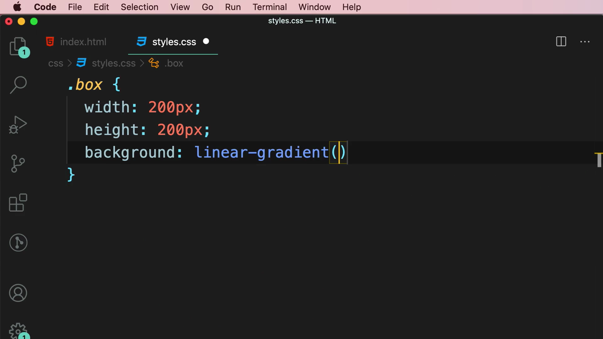

> **ทำไมต้องเปลี่ยนเป็น `background`:** `background-color` รับได้แค่ "สีเดียว" เท่านั้น แต่ **gradient ไม่ใช่สีเดียว** มันคือรูปแบบพิเศษของ**ภาพพื้นหลัง (background image)** ที่สร้างจากโค้ด ดังนั้นต้องใช้ property `background` (หรือ `background-image` ก็ได้เช่นกัน) ถึงจะใส่ฟังก์ชัน gradient ได้

---

## 2. `linear-gradient()` — ไล่สีเป็นเส้นตรง (ค่าเริ่มต้น: บนลงล่าง)

Mosh พิมพ์ `linear-gradient()` ใส่สี 2 สีคั่นด้วยจุลภาค:

```css
.box {
  width: 200px;
  height: 200px;
  background: linear-gradient(dodgerblue, yellow);
}
```

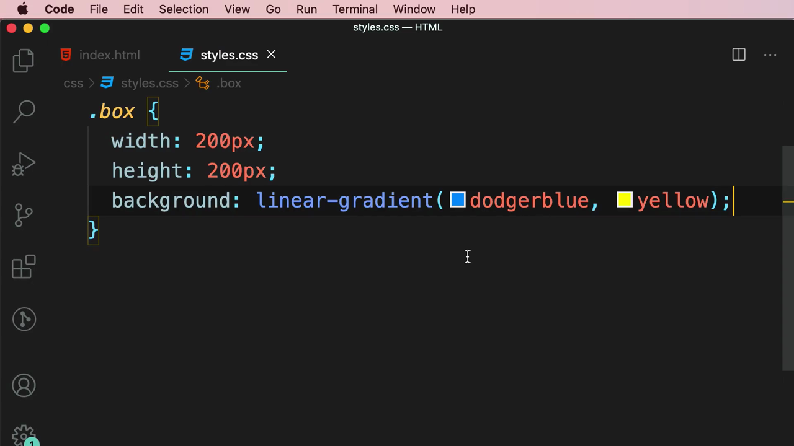

ผลลัพธ์: กล่องไล่สีจาก **dodgerblue (บน) ไปยัง yellow (ล่าง)** โดยอัตโนมัติ เพราะทิศทางเริ่มต้นของ `linear-gradient()` (เมื่อไม่ระบุทิศทาง) คือ **จากบนลงล่าง**:

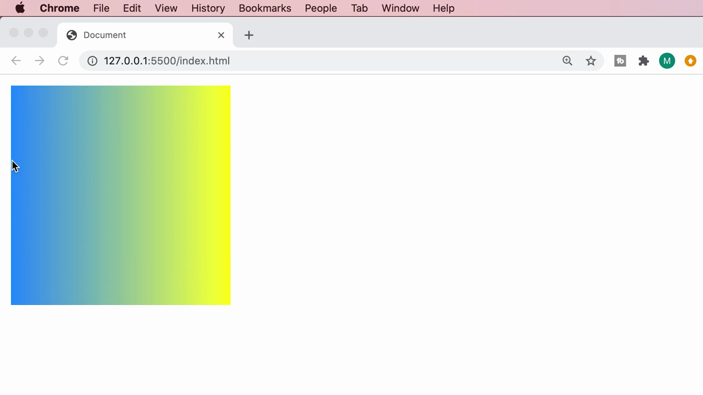

---

## 3. กำหนดทิศทางด้วยคำว่า `to <direction>`

Mosh เพิ่ม argument แรกเป็นทิศทาง `to right` แล้วเปลี่ยนเป็น `to bottom right`:

```css
background: linear-gradient(to bottom right, dodgerblue, yellow);
```

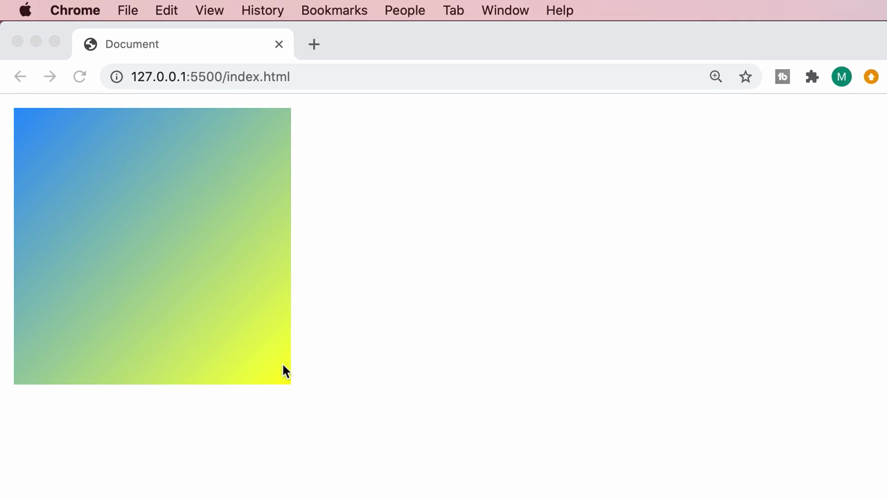

ผลลัพธ์: กล่องไล่สีจากมุมบนซ้าย (dodgerblue) ไปยังมุมล่างขวา (yellow) เป็นแนวทแยง

> **คำสั่งทิศทางที่ใช้ได้:** `to top`, `to bottom` (ค่า default), `to left`, `to right`, และแบบผสมมุม เช่น `to top left`, `to bottom right`

---

## 4. กำหนดทิศทางแม่นยำด้วยมุมองศา (`deg`)

Mosh เปลี่ยนจากคำว่า `to bottom right` เป็นตัวเลขมุมองศาโดยตรง:

```css
background: linear-gradient(45deg, dodgerblue, yellow);
```

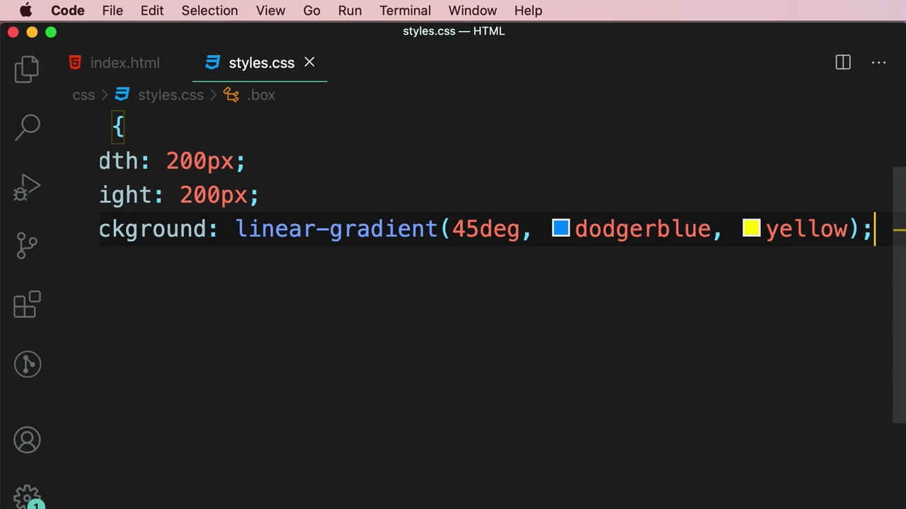

> **ทำไมต้องมีมุมองศา:** คำว่า `to bottom right` ให้ทิศทางแบบคร่าวๆ ตามสัดส่วนของกล่อง แต่ **มุมองศา (`deg`)** ให้ควบคุมทิศทางได้ละเอียดแม่นยำกว่ามาก (0deg = จากล่างขึ้นบน, 90deg = จากซ้ายไปขวา, 180deg = จากบนลงล่าง เป็นต้น) เหมาะกับงานที่ต้องการมุมไล่สีที่เจาะจง

---

## 5. Color Stop — กำหนดตำแหน่งที่สีเริ่มปรากฏ

Mosh เพิ่มค่าเปอร์เซ็นต์ต่อท้ายสี `yellow` เพื่อกำหนดว่าสีนั้นควรเริ่มปรากฏที่ตำแหน่งไหนของเส้นไล่สี:

```css
background: linear-gradient(45deg, dodgerblue, yellow 30%);
```

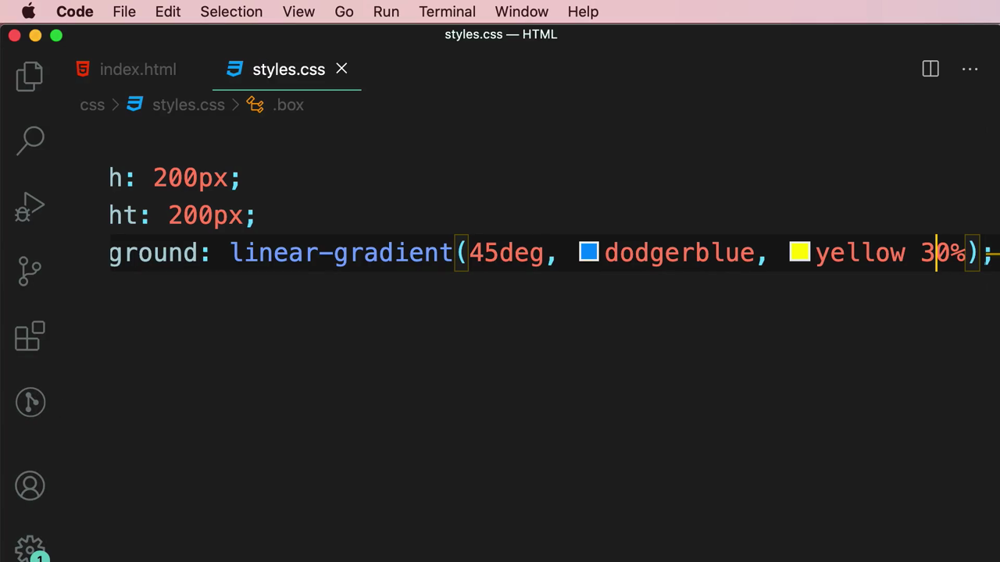

จากนั้น Mosh เพิ่มสีที่ 3 เข้าไปในเส้นเดียวกัน:

```css
background: linear-gradient(45deg, dodgerblue, yellow, tomato);
```

ผลลัพธ์: ไล่สีจาก dodgerblue → yellow → tomato ต่อเนื่องกันในเส้นเดียว:

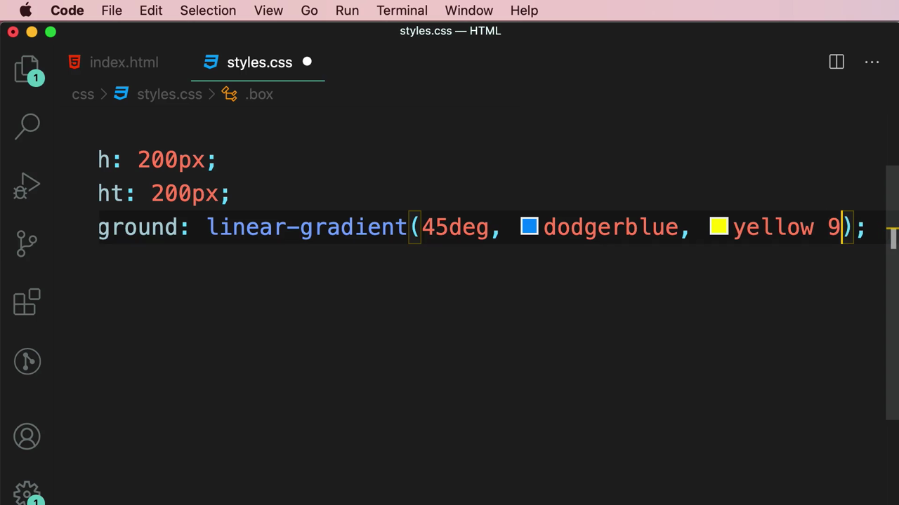

> **Color Stop คืออะไร:** ตัวเลขเปอร์เซ็นต์ (หรือหน่วยความยาวอื่นๆ) ที่ใส่ต่อท้ายแต่ละสีใน gradient เพื่อกำหนด "ตำแหน่ง" ที่สีนั้นควรจะแสดงเต็มที่บนเส้นไล่สี — ถ้าไม่ระบุ เบราว์เซอร์จะกระจายสีทั้งหมดให้ห่างเท่าๆ กันเองโดยอัตโนมัติ `linear-gradient()` สามารถใส่สีได้มากกว่า 2 สี ไม่จำกัดจำนวน

---

## 6. `radial-gradient()` — ไล่สีจากจุดศูนย์กลางออกไป

Mosh ลบโค้ดเดิม พิมพ์ `radial-gradient()` ดู IntelliSense tooltip:

> `radial-gradient()` — Colors emerge from a single point and smoothly spread outward in a circular or elliptical shape.

```css
.box {
  width: 200px;
  height: 200px;
  background: radial-gradient(white, yellow);
}
```

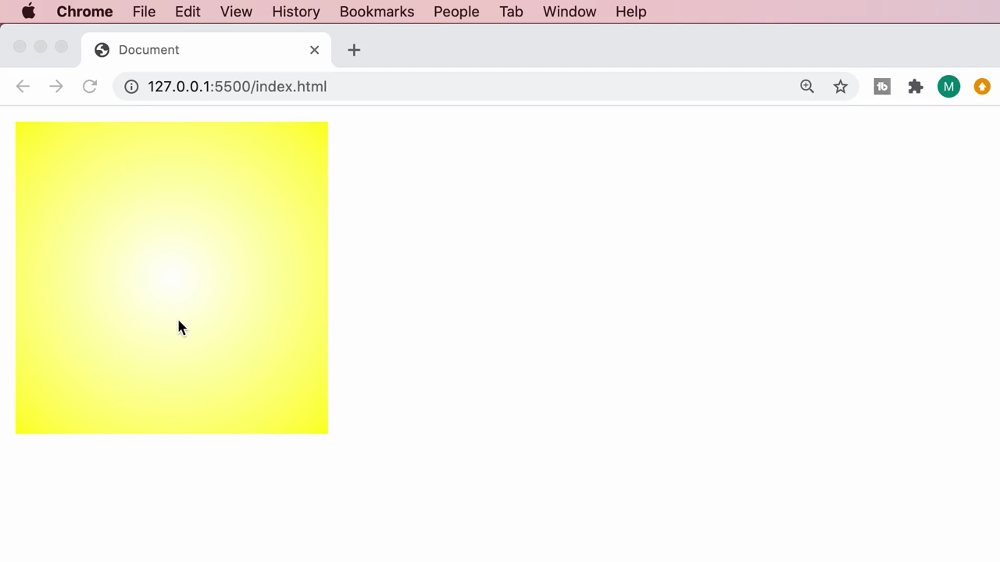

ผลลัพธ์: สีขาวเริ่มจากจุดกึ่งกลางกล่อง แล้วไล่ออกไปเป็นสีเหลืองที่ขอบ:

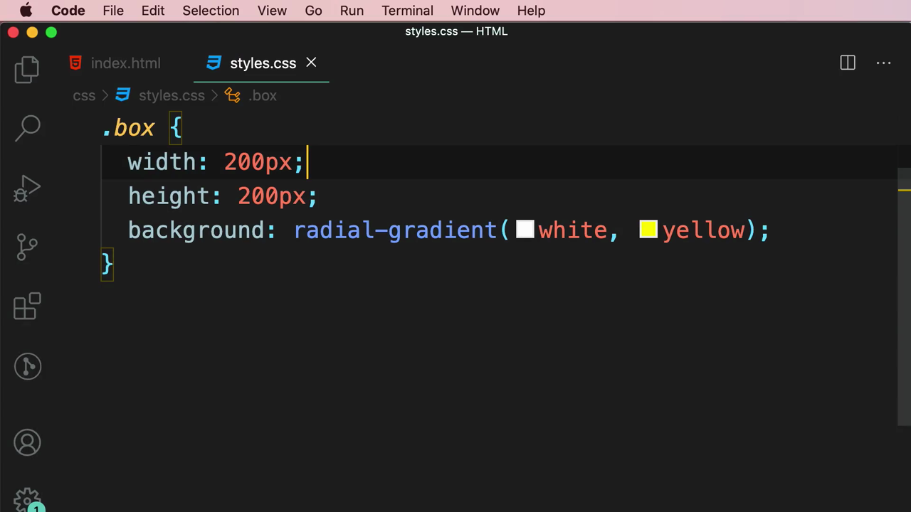

---

## 7. `circle` — บังคับให้เป็นวงกลมสมบูรณ์

Mosh ขยายความกว้างของกล่องเป็น `600px` (กล่องกลายเป็นสี่เหลี่ยมผืนผ้า) ทำให้ `radial-gradient()` ที่ไม่ระบุรูปทรงจะกลายเป็น**วงรี (ellipse)** ตามสัดส่วนกล่องโดยอัตโนมัติ Mosh จึงเพิ่มคีย์เวิร์ด `circle` เข้าไปเป็น argument แรก เพื่อบังคับให้เป็นวงกลมสมบูรณ์เสมอ ไม่ว่ากล่องจะมีสัดส่วนอย่างไร:

```css
.box {
  width: 600px;
  height: 200px;
  background: radial-gradient(circle, white, yellow);
}
```

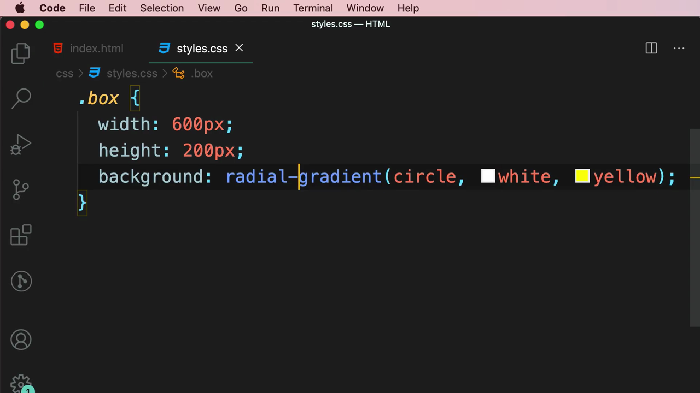

นอกจากนี้ยังสามารถกำหนด**ตำแหน่งจุดศูนย์กลาง**ได้ด้วยคำว่า `at <position>` เช่น:

```css
background: radial-gradient(circle at top left, white, yellow);
```

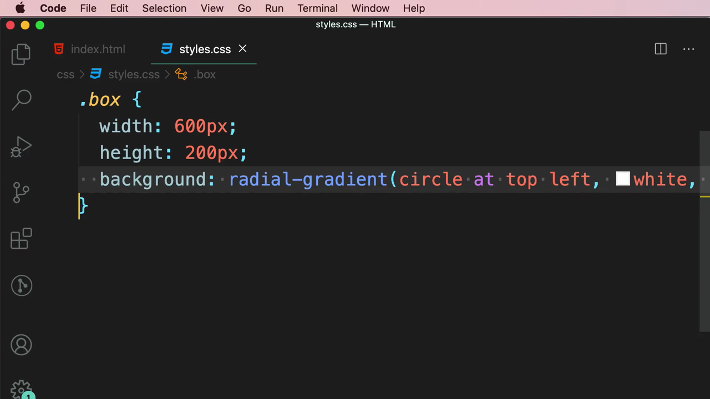

ทำให้จุดศูนย์กลางของวงกลมย้ายไปอยู่ที่มุมบนซ้ายของกล่องแทนที่จะเป็นกึ่งกลาง

---

## 8. เครื่องมือช่วยสร้าง Gradient: ค้นหา "gradient generator"

เขียน gradient ที่ซับซ้อนหลายสีด้วยมือทำได้ยาก Mosh จึงเปิดแท็บใหม่ค้นหาคำว่า **"gradient generator"** ใน Google:

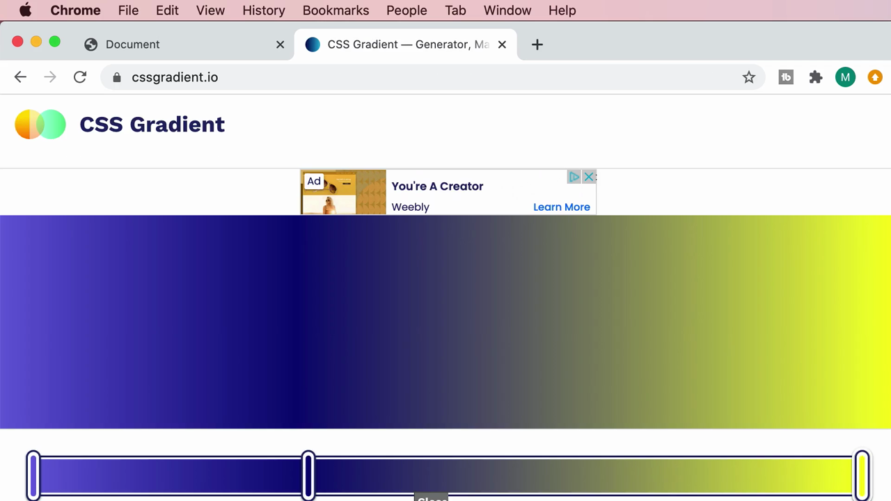

แล้วเลือกเว็บไซต์ **cssgradient.io** ซึ่งเป็นเครื่องมือสร้าง gradient แบบเห็นภาพ (visual tool):

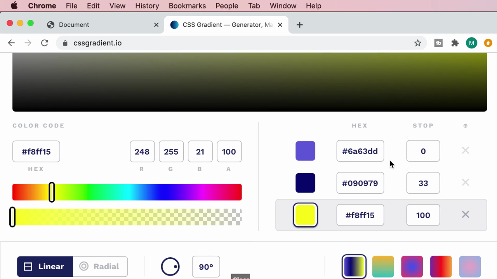

เครื่องมือนี้ให้ผู้ใช้:

- เพิ่ม/ลบสี และปรับค่าสีแต่ละจุดด้วย color picker ในตัว (HEX, RGB, Alpha)
- **ลากปรับตำแหน่ง Color Stop** บนแถบเลื่อนได้โดยตรง (ตัวเลข 0-100):

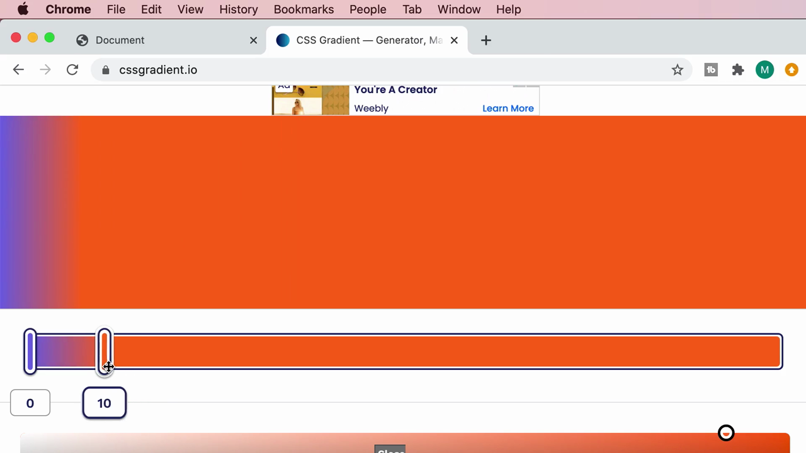

- สลับโหมด **Linear / Radial** และปรับ **มุมองศา** ด้วยวงกลมลาก (drag) หรือกรอกตัวเลขตรงๆ:

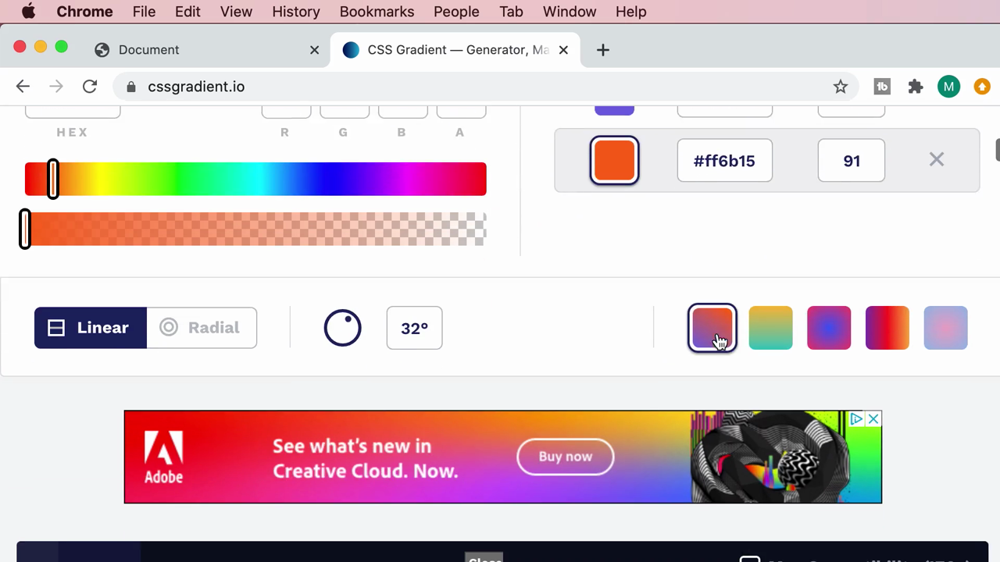

- ที่สำคัญที่สุด: เว็บไซต์จะ**สร้างโค้ด CSS ให้อัตโนมัติ** พร้อมปุ่ม "Copy to Clipboard":

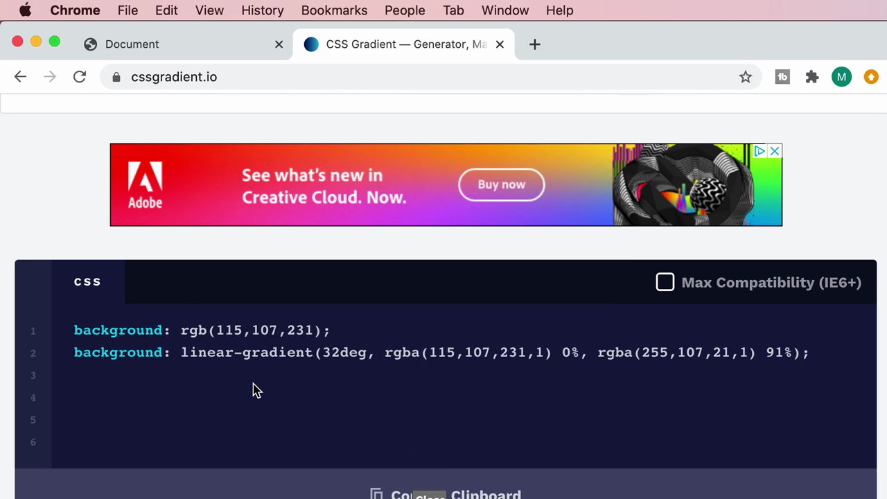

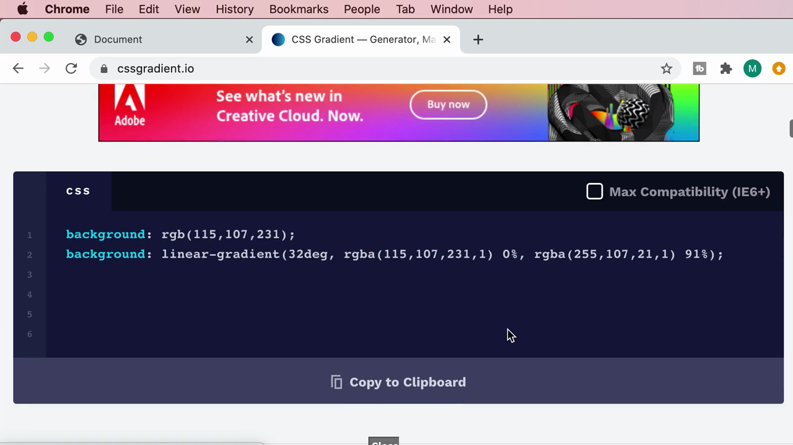

Mosh คัดลอกโค้ดที่ได้มาวางใน VS Code:

```css
.box {
  width: 600px;
  height: 200px;
  background: rgb(115, 107, 231);
  background: linear-gradient(
    32deg,
    rgba(115, 107, 231, 1) 0%,
    rgba(255, 107, 21, 1) 91%
  );
}
```

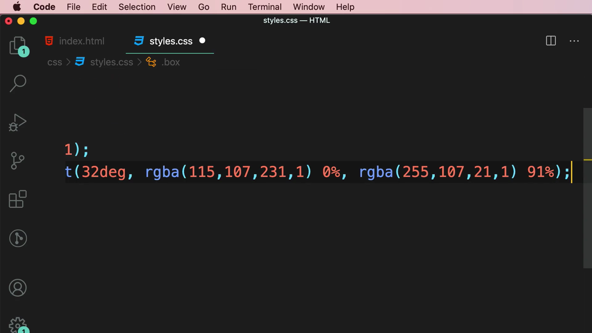

ผลลัพธ์สุดท้ายในเบราว์เซอร์ — gradient สีม่วง-ส้มที่สร้างจากเครื่องมือ นำมาวางใช้ได้ทันที:

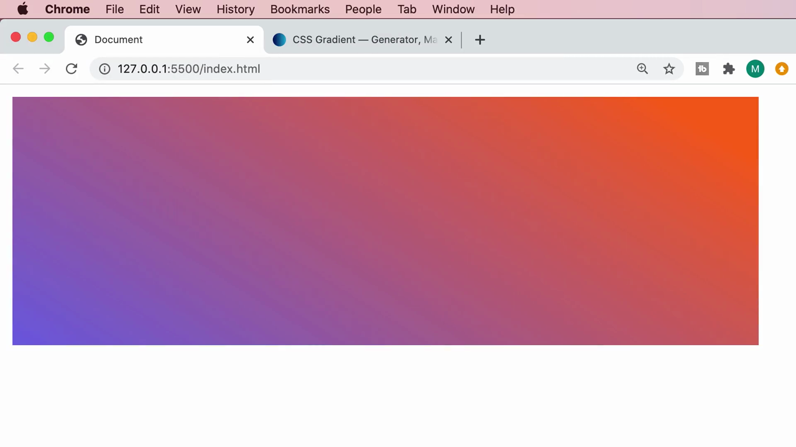

> **จุดสำคัญที่ Mosh เน้น:** โค้ดที่เว็บไซต์สร้างให้จะมี**บรรทัด `background` สองบรรทัด** บรรทัดแรกเป็นสีทึบ (fallback) สำหรับเบราว์เซอร์รุ่นเก่าที่ไม่รองรับ gradient บรรทัดที่สองเป็น gradient จริง — เบราว์เซอร์จะใช้บรรทัดสุดท้ายที่มันรู้จัก (ถ้ารองรับ gradient ก็จะทับบรรทัดแรกไปเลย)

---

## สรุปที่ใช้ได้จริง

- **`linear-gradient(direction, color1, color2, ...)`** — ไล่สีเป็นเส้นตรง ทิศทางกำหนดได้ด้วยคำ (`to right`, `to bottom left`) หรือมุมองศา (`45deg`) แม่นยำกว่า ถ้าไม่ระบุทิศทาง ค่า default คือจากบนลงล่าง
- **`radial-gradient([circle/ellipse] [at position], color1, color2, ...)`** — ไล่สีจากจุดศูนย์กลางออกไปเป็นวงกลมหรือวงรี ใช้ `circle` บังคับให้เป็นวงกลมสมบูรณ์ และ `at <position>` ย้ายจุดศูนย์กลาง
- ทั้งสองฟังก์ชันรองรับ **Color Stop** (เปอร์เซ็นต์ต่อท้ายสี) เพื่อกำหนดตำแหน่งที่สีนั้นเริ่มแสดงเต็มที่ และรองรับสีได้มากกว่า 2 สีในเส้นเดียว
- Gradient ต้องใช้ property **`background`** หรือ **`background-image`** เท่านั้น — ใช้กับ `background-color` ไม่ได้
- เว็บไซต์ **cssgradient.io** (หรือค้นหา "gradient generator") ช่วยสร้างโค้ด gradient ที่ซับซ้อนได้รวดเร็ว โดยไม่ต้องคำนวณมุมหรือตำแหน่ง stop ด้วยมือ

### จุดเชื่อมกับงานจริงของ Aum

- **Tailwind CSS มี utility class สำหรับ gradient โดยเฉพาะ** เช่น `bg-gradient-to-r` (เทียบเท่า `linear-gradient(to right, ...)`), `from-blue-500`, `via-yellow-300`, `to-red-500` — เข้าใจหลักการ `linear-gradient()` จากคลิปนี้จะช่วยให้เข้าใจว่า class เหล่านี้ทำงานอย่างไรเบื้องหลัง
- Gradient เป็นเทคนิคที่ใช้บ่อยมากในการทำ **hero section ของ landing page** เพื่อสร้างพื้นหลังที่มีมิติมากกว่าสีทึบสีเดียว หรือใช้ทำปุ่ม (button) ให้ดูทันสมัยขึ้น
- เทคนิค `radial-gradient()` ที่มี fallback สีทึบเป็นค่าที่ 1 ก่อน gradient เป็นแนวปฏิบัติที่ดี (progressive enhancement) ที่ควรนำไปใช้แม้ในโปรเจกต์ที่ใช้ Tailwind เพราะเบราว์เซอร์รุ่นเก่าบางตัวหรือ email client บางระบบยังไม่รองรับ gradient
- เว็บไซต์อย่าง cssgradient.io เป็นเครื่องมือที่มีประโยชน์มากเวลาต้องออกแบบพื้นหลัง gradient ที่ซับซ้อน ช่วยประหยัดเวลาไม่ต้องลองผิดลองถูกปรับค่าองศาและตำแหน่งสีด้วยมือ
