# 4-CSS Basics: 12 - Borders (5:47)

**ไฟล์ต้นทาง:** `12-Borders.mp4`

▶️ **[เปิดวิดีโอต้นฉบับ](../../../HTML-CSS-1/4-CSS%20Basics/12-Borders.mp4)**

---

## ภาพรวมคลิปนี้

คลิปนี้ Mosh สอนเรื่อง **Border (เส้นขอบ)** ใน CSS อย่างครบถ้วน — ตั้งแต่ shorthand property `border`, การกำหนดแต่ละด้านแยกกัน (`border-top` ฯลฯ), รูปแบบเส้น (`border-style`) ต่างๆ, การเขียนค่าหลายด้านแบบย่อ (`border-width` 2/3/4 ค่า), ไปจนถึง `border-radius` สำหรับทำมุมโค้งและวงกลม ปิดท้ายด้วยการแนะนำเทคนิคการใช้ border สร้างรูปทรงต่างๆ (CSS Shapes)

---

## 1. `border` — Shorthand ตั้งค่าเส้นขอบทั้ง 4 ด้านพร้อมกัน

Mosh เริ่มจากกล่อง `.box` ที่มี `background: dodgerblue` แล้วเพิ่ม property `border` ตามด้วยค่า 3 ส่วนคั่นด้วยช่องว่าง (ความหนา, รูปแบบเส้น, สี):

```css
.box {
  width: 600px;
  height: 200px;
  background: dodgerblue;
  border: 10px solid royalblue;
}
```

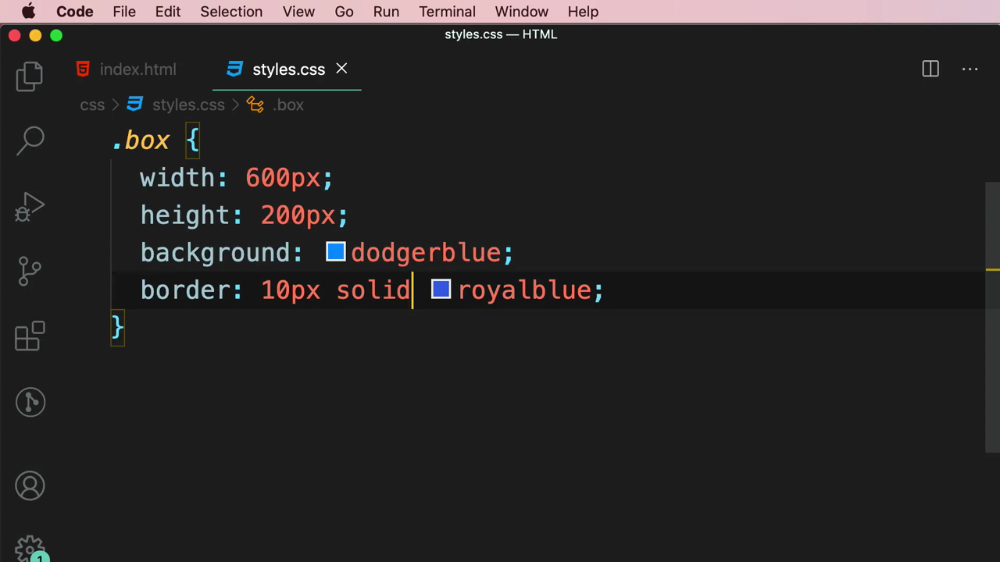

> **`border` (shorthand) คืออะไร:** เป็นวิธีเขียนสั้นที่รวม 3 ค่าเข้าด้วยกันในบรรทัดเดียว คือ **border-width** (ความหนาของเส้น), **border-style** (รูปแบบเส้น เช่น solid, dashed), และ **border-color** (สีของเส้น) — เรียงลำดับอย่างไรก็ได้ แต่ตามธรรมเนียมนิยมเขียนเรียง width → style → color

---

## 2. `border-style` — รูปแบบเส้นขอบมีหลายแบบ

Mosh ทดลองเปลี่ยนค่ากลาง (style) จาก `solid` เป็น `dotted` แล้วเป็น `dashed` โดยดู IntelliSense tooltip ของแต่ละแบบ:

> `dashed` — A series of square-ended dashes.

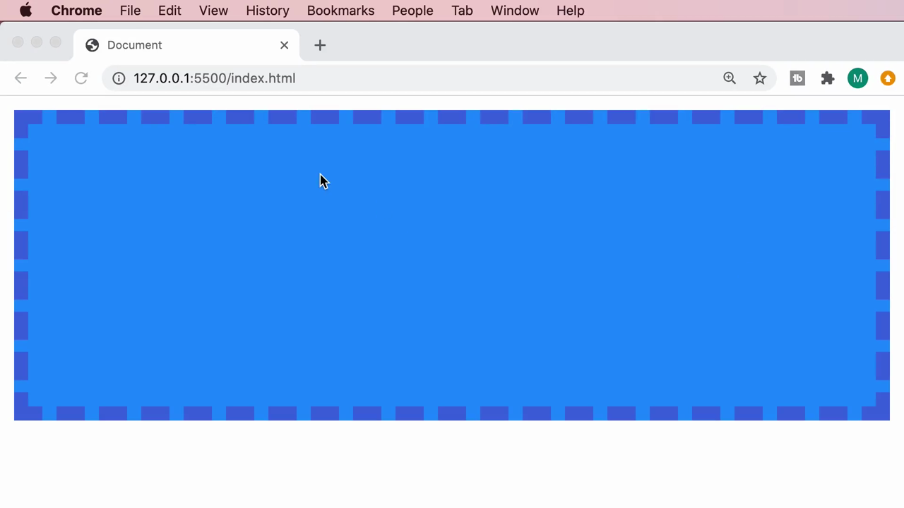

ผลลัพธ์ในเบราว์เซอร์เมื่อใช้ `dashed`:

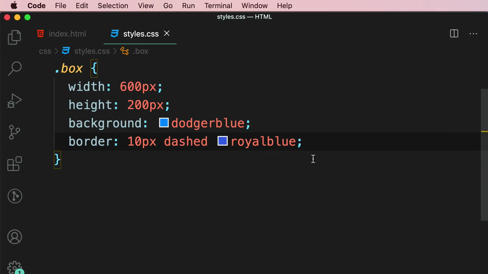

> **ค่าของ `border-style` ที่ใช้ได้:** `solid` (เส้นทึบ), `dotted` (เส้นจุด), `dashed` (เส้นประ), `double` (เส้นคู่), `groove`, `ridge`, `inset`, `outset` (เอฟเฟกต์ 3 มิติ), `hidden`/`none` (ไม่แสดงเส้น)

---

## 3. กำหนดเฉพาะบางด้านด้วย `border-top`, `border-right` ฯลฯ

Mosh เพิ่มบรรทัดใหม่ `border-top` ดู IntelliSense tooltip:

> `border-top` — Shorthand property for setting border width, style and color. Syntax: `<line-width> || <line-style> || <color>`

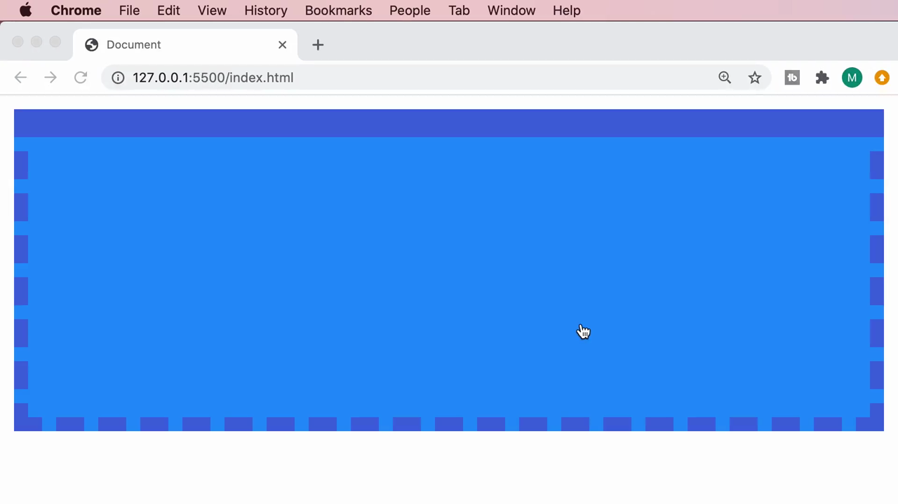

```css
.box {
  width: 600px;
  height: 200px;
  background: dodgerblue;
  border: 10px dashed royalblue;
  border-top: 20px solid royalblue;
}
```

ผลลัพธ์: ด้านบนของกล่องกลายเป็นเส้นทึบหนา 20px (ทับค่า `border` เดิม) ในขณะที่อีก 3 ด้านยังเป็นเส้นประหนา 10px ตามเดิม:

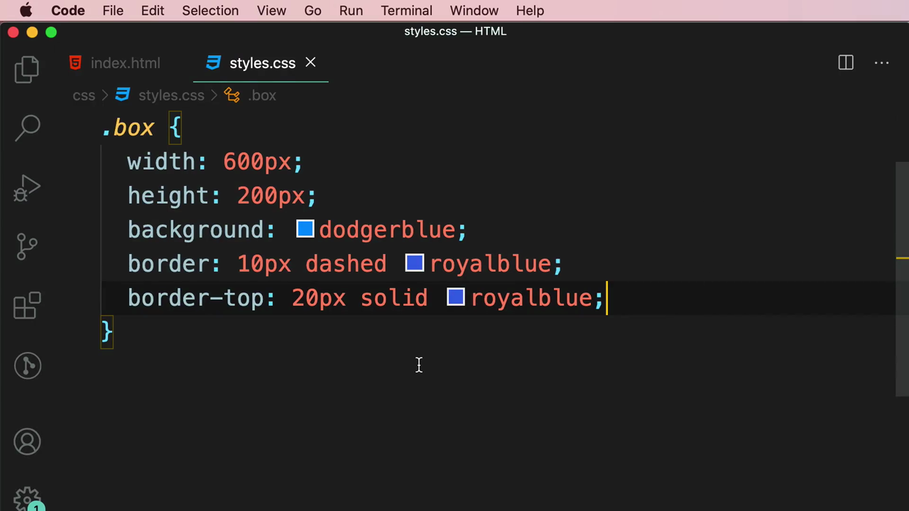

> **หลักการ:** `border-top`, `border-right`, `border-bottom`, `border-left` คือ shorthand เฉพาะด้าน ใช้ตั้งค่าด้านใดด้านหนึ่งแยกจากด้านอื่น และจะ**override** ค่าที่มาจาก `border` (ที่ตั้งครบ 4 ด้านพร้อมกัน) ในด้านที่ระบุซ้ำ ตามหลัก specificity/ลำดับการเขียนโค้ดที่เรียนมาก่อนหน้านี้

---

## 4. `border-width` — กำหนดความหนาแต่ละด้านแบบย่อ (Shorthand หลายค่า)

Mosh ลบ `border-top` ออก แล้วเขียน `border-width` พร้อมดู tooltip:

> `border-width` — Shorthand that sets the four 'border-*-width' properties. If it has four values, they set top, right, bottom and left in that order. If left is missing, it is the same as right; if bottom is missing, it is the same as top.

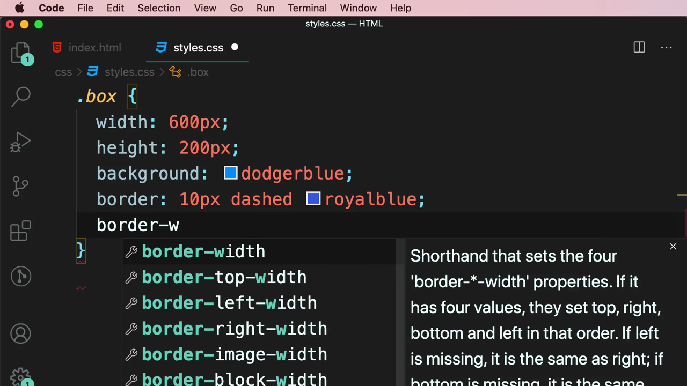

**4 ค่า** — กำหนดทีละด้านตามเข็มนาฬิกา (บน, ขวา, ล่าง, ซ้าย):

```css
border-width: 10px 20px 10px 20px;
```

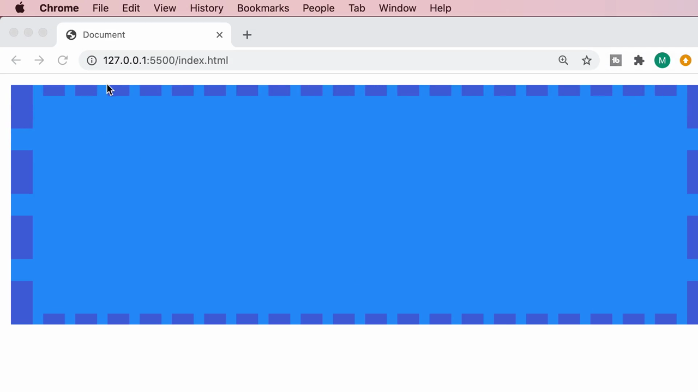

**3 ค่า** — ค่าแรก = บน, ค่าที่สอง = ซ้าย **และ** ขวา (เท่ากัน), ค่าที่สาม = ล่าง:

```css
border-width: 10px 20px 10px;
```

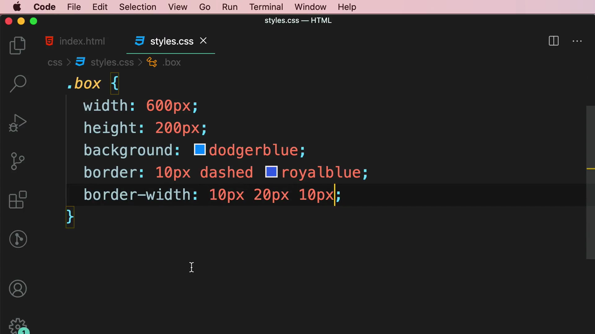

**2 ค่า** — ค่าแรก = บน **และ** ล่าง, ค่าที่สอง = ซ้าย **และ** ขวา:

```css
border-width: 10px 20px;
```

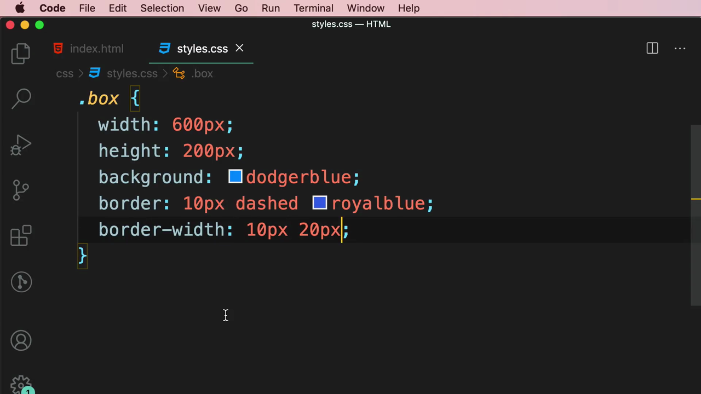

> **กฎการนับค่าแบบย่อ (ใช้ได้กับ `margin`, `padding` ด้วย เพราะเป็นหลักการเดียวกัน):**
> - **4 ค่า:** บน, ขวา, ล่าง, ซ้าย (วนตามเข็มนาฬิกาเริ่มจากบน)
> - **3 ค่า:** บน, ซ้าย-ขวา, ล่าง
> - **2 ค่า:** บน-ล่าง, ซ้าย-ขวา
> - **1 ค่า:** ใช้กับทั้ง 4 ด้านเท่ากันหมด

---

## 5. `border-style` และ `border-color` — Shorthand แยกตามคุณสมบัติ

นอกจาก `border-width` แล้ว ยังมี **`border-style`** (กำหนดรูปแบบเส้นแต่ละด้านแยกกันด้วยกฎ 2/3/4 ค่าเดียวกัน) และ **`border-color`** (กำหนดสีแต่ละด้าน):

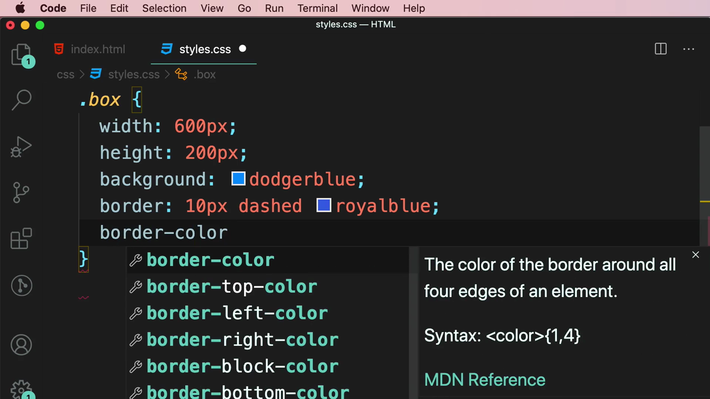

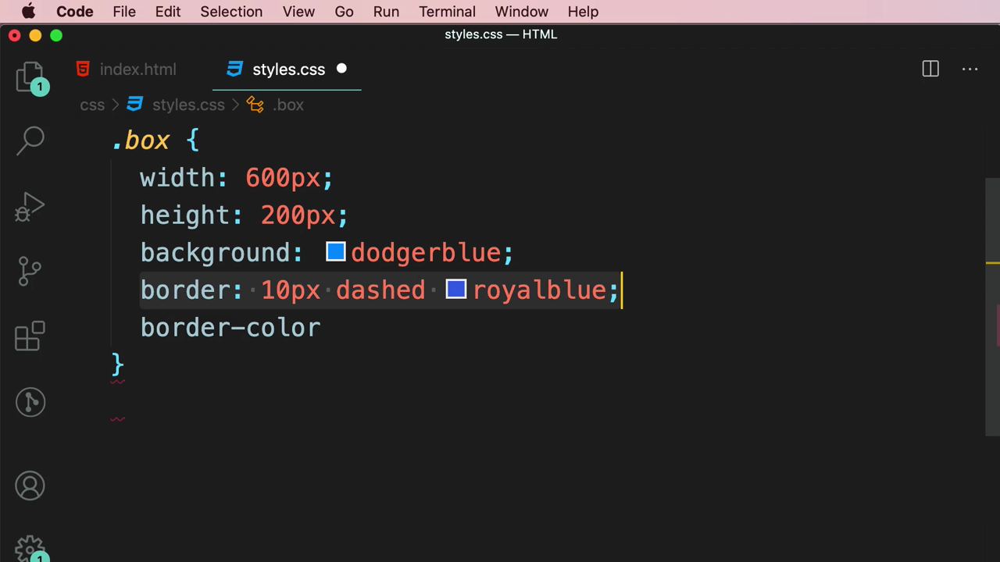

> **สรุปกลุ่ม property ของ border:** `border` (shorthand รวมทุกอย่างทุกด้าน) → `border-width`/`border-style`/`border-color` (shorthand แยกตามคุณสมบัติ ใช้กฎ 2/3/4 ค่า) → `border-top`/`border-right`/`border-bottom`/`border-left` (shorthand แยกตามด้าน) → และยังลงลึกได้อีกถึงระดับ `border-top-color`, `border-left-width` ฯลฯ (เจาะจงทั้งด้านและคุณสมบัติพร้อมกัน)

---

## 6. `border-radius` — ทำมุมโค้งมน

Mosh ลบโค้ดเดิม เหลือแค่ `border: 10px dashed royalblue;` แล้วเพิ่ม `border-radius`:

```css
.box {
  width: 600px;
  height: 200px;
  background: dodgerblue;
  border: 10px dashed royalblue;
  border-radius: 10px;
}
```

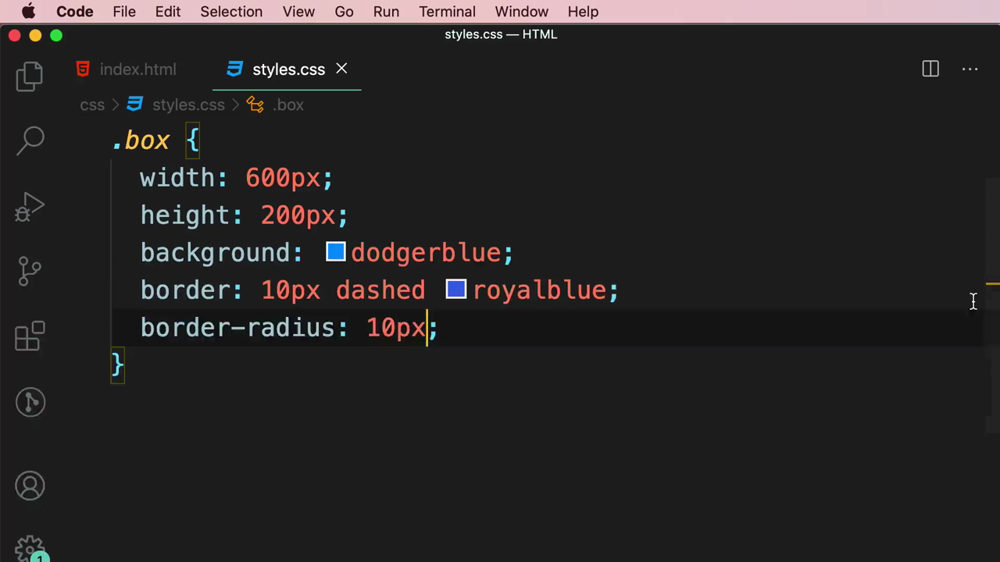

ผลลัพธ์: มุมทั้ง 4 ของกล่องโค้งมนขึ้นเล็กน้อย เมื่อเพิ่มเป็น `50px` มุมจะโค้งมากขึ้น:

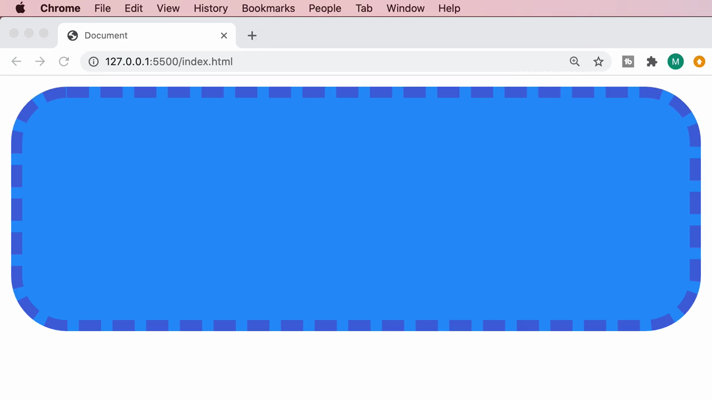

---

## 7. `border-radius: 50%` — เปลี่ยนสี่เหลี่ยมให้เป็นวงกลมสมบูรณ์

Mosh เปลี่ยนความกว้างและความสูงของกล่องให้เท่ากัน (สี่เหลี่ยมจัตุรัส) แล้วตั้งค่า `border-radius: 50%`:

```css
.box {
  width: 200px;
  height: 200px;
  background: dodgerblue;
  border: 10px dashed royalblue;
  border-radius: 50%;
}
```

ผลลัพธ์: กล่องสี่เหลี่ยมจัตุรัสกลายเป็น**วงกลมสมบูรณ์**:

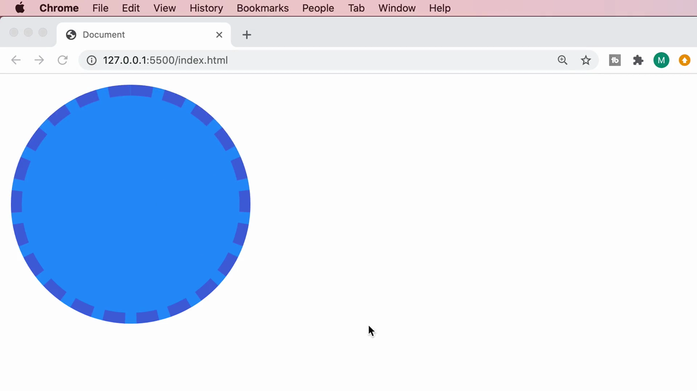

> **ทำไม 50% ถึงกลายเป็นวงกลม:** `border-radius` กำหนดรัศมีความโค้งของมุม เมื่อตั้งเป็น 50% ของขนาดกล่อง (ซึ่งเป็นสี่เหลี่ยมจัตุรัส) มุมทั้ง 4 จะโค้งเข้าหากันจนกลายเป็นวงกลมพอดี — เป็นเทคนิคที่ใช้บ่อยมากในการทำรูปโปรไฟล์ (avatar) วงกลม

---

## 8. เทคนิคขั้นสูง: ใช้ Border สร้างรูปทรง (CSS Shapes)

Mosh ค้นหาคำว่า **"css shapes"** ใน Google แล้วเปิดบทความ **"The Shapes of CSS"** จากเว็บไซต์ css-tricks.com เพื่อแสดงให้เห็นว่า border สามารถนำไปสร้างรูปทรงอื่นๆ ได้อีกมากมาย นอกเหนือจากสี่เหลี่ยมและวงกลม:

**Square/Rectangle Shape** — ใช้แค่ `width`, `height`, `background` ธรรมดา:

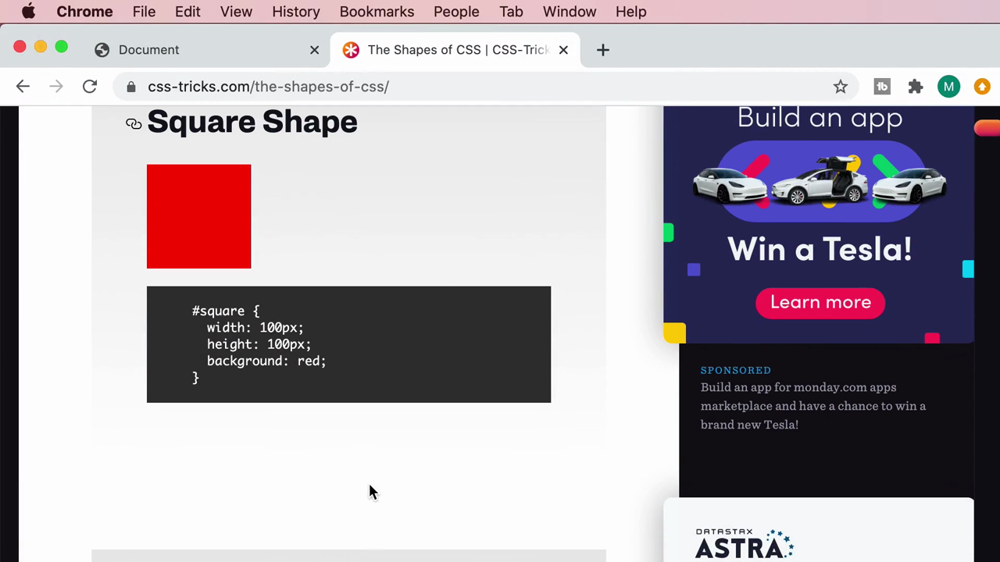

**Circle Shape** — ใช้ `border-radius: 50%` เหมือนที่เรียนมา:

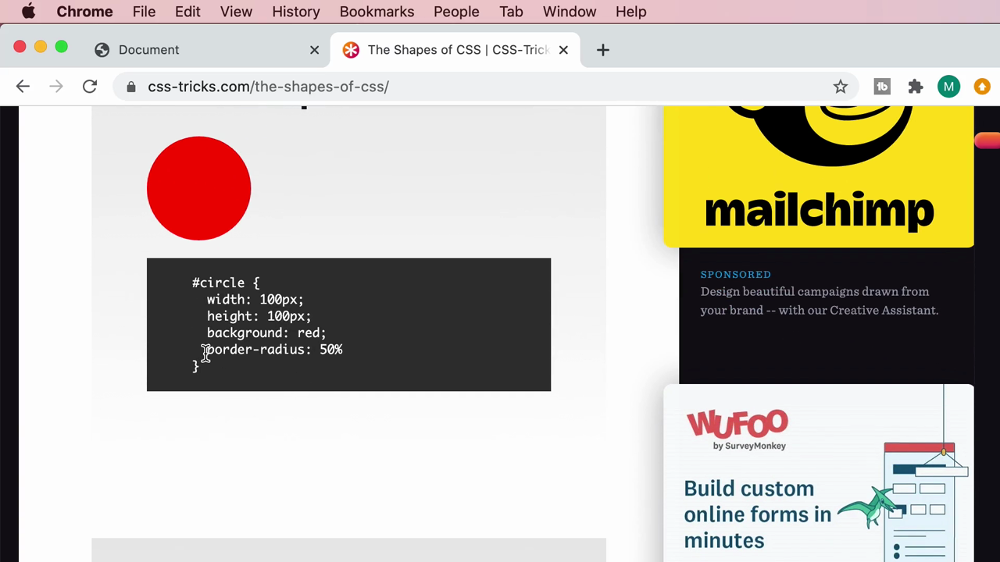

**Triangle Shape** — เทคนิคที่น่าสนใจที่สุด: ตั้ง `width: 0; height: 0;` (ไม่มีพื้นที่กล่องเลย) แล้วใช้ **border ที่ไม่เท่ากันแต่ละด้าน** โดยให้บางด้าน**โปร่งใส (`transparent`)** เพื่อ "บีบ" ให้เห็นเป็นรูปสามเหลี่ยม:

```css
#triangle-up {
  width: 0;
  height: 0;
  border-left: 50px solid transparent;
  border-right: 50px solid transparent;
  border-bottom: 100px solid red;
}
```

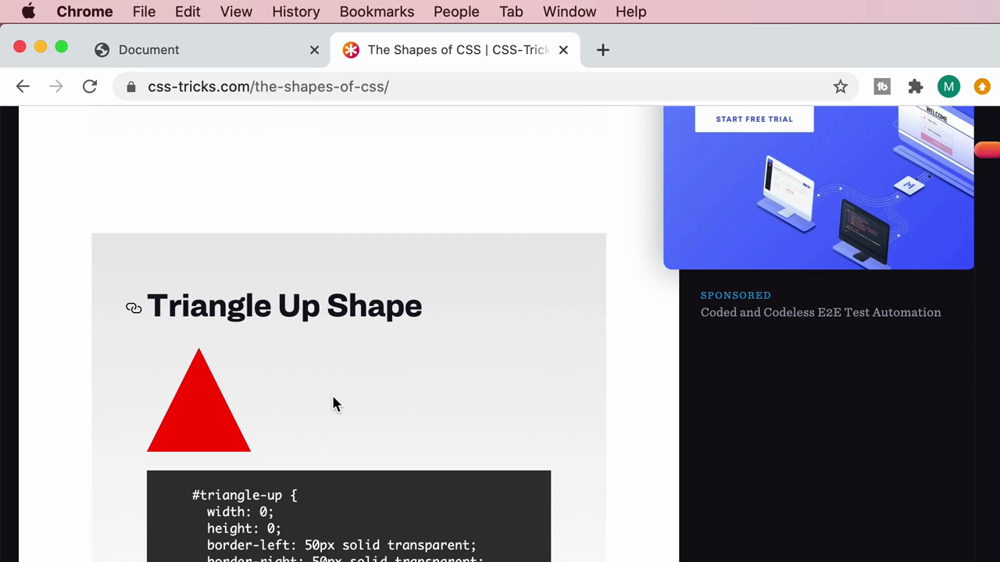

```css
#triangle-down {
  width: 0;
  height: 0;
  border-left: 50px solid transparent;
  border-right: 50px solid transparent;
  border-top: 100px solid red;
}
```

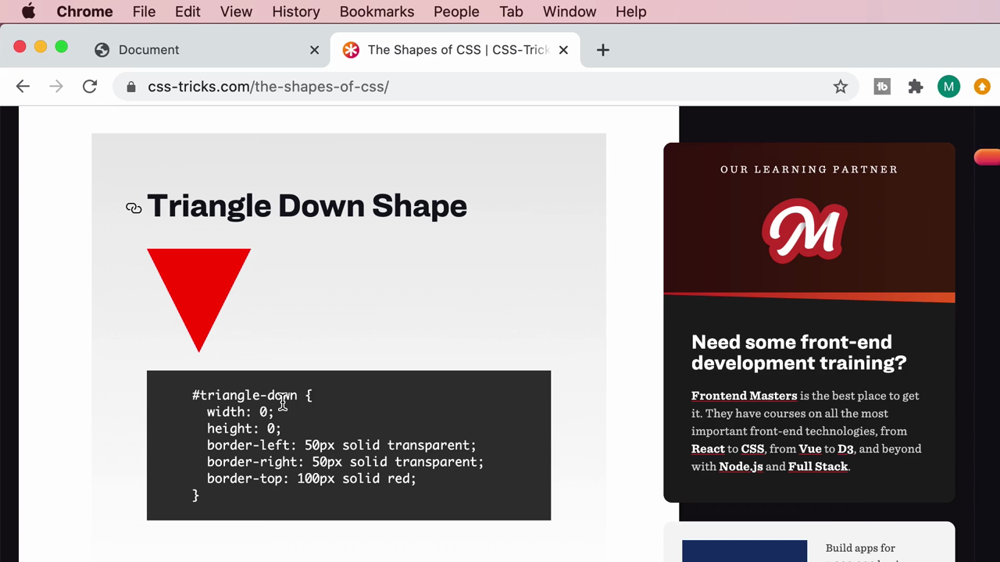

> **หลักการเบื้องหลังสามเหลี่ยม:** เมื่อกล่องไม่มีพื้นที่ (`width: 0; height: 0;`) เส้น border ของแต่ละด้านจะมาบรรจบกันตรงกลางเป็นรูปสามเหลี่ยมเสมอ (ลองนึกภาพกรอบสี่เหลี่ยมที่ border หนามากจนมุมเฉียงชนกันหมด) การทำให้ด้านซ้ายและขวาโปร่งใส (`transparent`) จะเหลือให้เห็นแค่ด้านที่มีสีทึบ (บนหรือล่าง) กลายเป็นรูปสามเหลี่ยมที่ชี้ขึ้นหรือลงตามด้านที่เลือกให้ทึบ

---

## สรุปที่ใช้ได้จริง

- **`border: <width> <style> <color>;`** เป็น shorthand หลักที่ใช้บ่อยที่สุด ตั้งค่าทั้ง 4 ด้านพร้อมกัน
- ตั้งค่าเฉพาะด้านด้วย `border-top`/`border-right`/`border-bottom`/`border-left` หรือตั้งเฉพาะคุณสมบัติทุกด้านด้วย `border-width`/`border-style`/`border-color` (รองรับ 1-4 ค่า ตามกฎ บน-ขวา-ล่าง-ซ้าย เหมือน `margin`/`padding`)
- **`border-style`** มีหลายแบบ: `solid`, `dotted`, `dashed`, `double`, `groove`, `ridge`, `inset`, `outset`, `none`
- **`border-radius`** ทำมุมโค้ง — ค่าน้อยโค้งนิดหน่อย ค่ามากโค้งมากขึ้น และ **`50%`** บนกล่องสี่เหลี่ยมจัตุรัสจะได้วงกลมสมบูรณ์
- Border ไม่ได้ใช้แค่ทำกรอบ แต่ยังใช้**สร้างรูปทรงอื่นๆ** เช่น สามเหลี่ยม ได้ด้วยเทคนิค `width: 0; height: 0;` ร่วมกับ `border-*: ... transparent;`

### จุดเชื่อมกับงานจริงของ Aum

- **Tailwind CSS มี utility class ครบสำหรับ border** เช่น `border`, `border-2`, `border-dashed`, `border-t-4`, `border-blue-500`, `rounded-lg`, `rounded-full` (เทียบเท่า `border-radius: 9999px` หรือ 50% สำหรับวงกลม) — เข้าใจหลักการ shorthand จากคลิปนี้ช่วยให้อ่าน class เหล่านี้ได้ง่ายขึ้นมาก
- **`rounded-full`** ใน Tailwind คือคลาสที่ใช้บ่อยที่สุดในการทำ avatar/profile picture วงกลม ตรงกับเทคนิค `border-radius: 50%` ที่เรียนในคลิปนี้เป๊ะๆ
- เทคนิคสามเหลี่ยมจาก border มีประโยชน์มากเวลาทำ **dropdown arrow, tooltip pointer, speech bubble** ในหน้าเว็บ ซึ่งเป็นองค์ประกอบ UI ที่พบบ่อยมากในงาน Front End จริง แม้จะใช้ Tailwind ก็ยังต้องพึ่งเทคนิคนี้ในบางกรณีที่ไม่มี utility class รองรับตรงๆ
- เว็บไซต์ **css-tricks.com** เป็นแหล่งอ้างอิงที่ดีมากสำหรับเทคนิค CSS ขั้นสูงที่ไม่ได้สอนในคอร์สพื้นฐาน ควรบุ๊กมาร์กไว้ใช้อ้างอิงต่อไป
