# 4-CSS Basics: 13 - Shadows (4:25)

**ไฟล์ต้นทาง:** `13-Shadows.mp4`

▶️ **[เปิดวิดีโอต้นฉบับ](../../../HTML-CSS-1/4-CSS%20Basics/13-Shadows.mp4)**

---

## ภาพรวมคลิปนี้

คลิปนี้ Mosh สอนเรื่อง **Shadow (เงา)** ใน CSS ทั้งสองรูปแบบ คือ **`box-shadow`** (เงาของกล่อง/element) และ **`text-shadow`** (เงาของตัวอักษร) พร้อมอธิบายความหมายของแต่ละค่าที่ใส่เข้าไป (ระยะแนวนอน, ระยะแนวตั้ง, ความเบลอ, สี) และเทคนิคการใช้เงาแบบโปร่งแสง (`rgba`) เพื่อให้ดูเป็นธรรมชาติมากขึ้น

---

## 1. `box-shadow` — เงาของกล่อง

Mosh เริ่มจากกล่อง `.box` สีพื้น dodgerblue แล้วพิมพ์ property `box-shadow` ดู IntelliSense tooltip:

> `box-shadow` — Attaches one or more drop-shadows to the box. The property is a comma-separated list of shadows, each specified by 2-4 length values, an optional color, and an optional 'inset' keyword. Omitted lengths are 0.

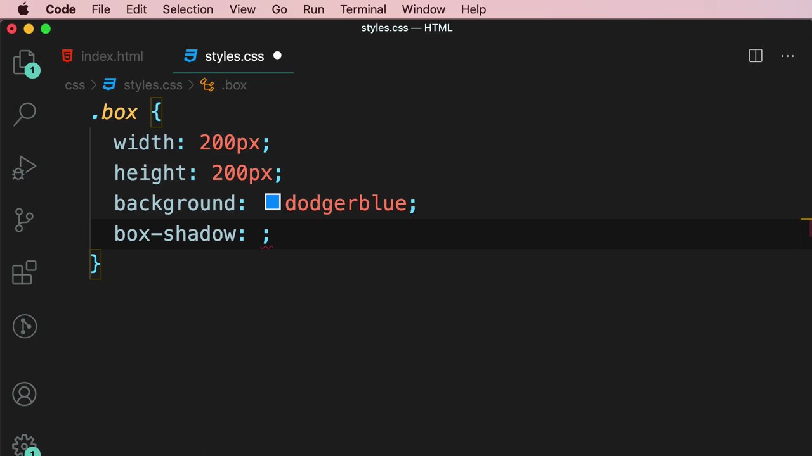

---

## 2. ค่าที่ 1 และ 2: ระยะแนวนอน (X) และแนวตั้ง (Y)

Mosh ใส่ค่า 2 ตัวแรก:

```css
.box {
  width: 200px;
  height: 200px;
  background: dodgerblue;
  box-shadow: 10px 10px;
}
```

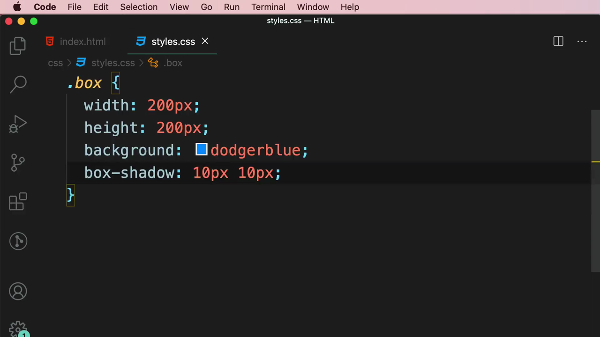

ผลลัพธ์: เกิดเงาสีดำ (ค่า default) เยื้องไปทาง**ขวา 10px และลง 10px** จากตัวกล่อง:

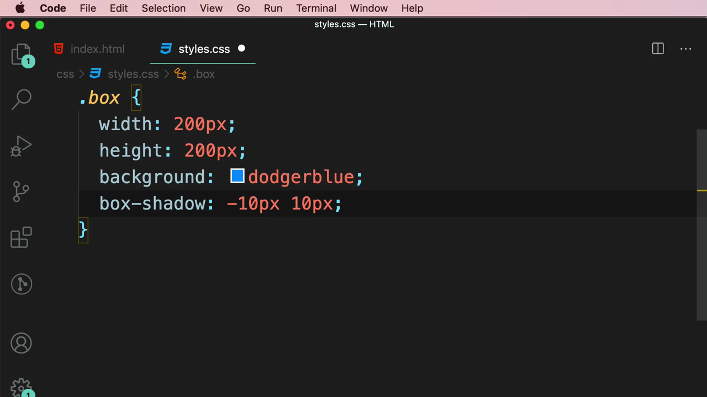

เมื่อเปลี่ยนค่าแรกเป็นค่าติดลบ (`-10px`) เงาจะเยื้องไปทาง**ซ้าย**แทน:

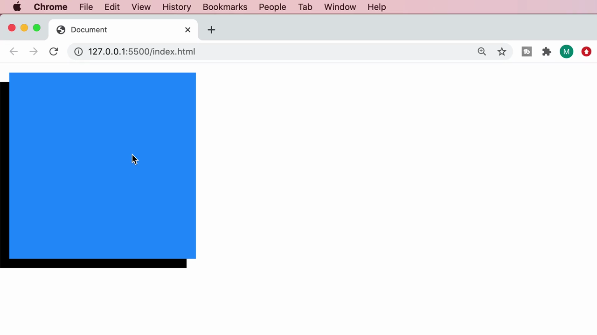

> **ความหมายของ 2 ค่าแรก:**
> - **ค่าที่ 1 (Horizontal offset)** — ระยะเยื้องแนวนอน ค่าบวก = เยื้องขวา, ค่าลบ = เยื้องซ้าย
> - **ค่าที่ 2 (Vertical offset)** — ระยะเยื้องแนวตั้ง ค่าบวก = เยื้องลง, ค่าลบ = เยื้องขึ้น

---

## 3. ค่าที่ 3: สีของเงา (Color)

Mosh เพิ่มค่าสีต่อท้าย:

```css
box-shadow: 10px 10px grey;
```

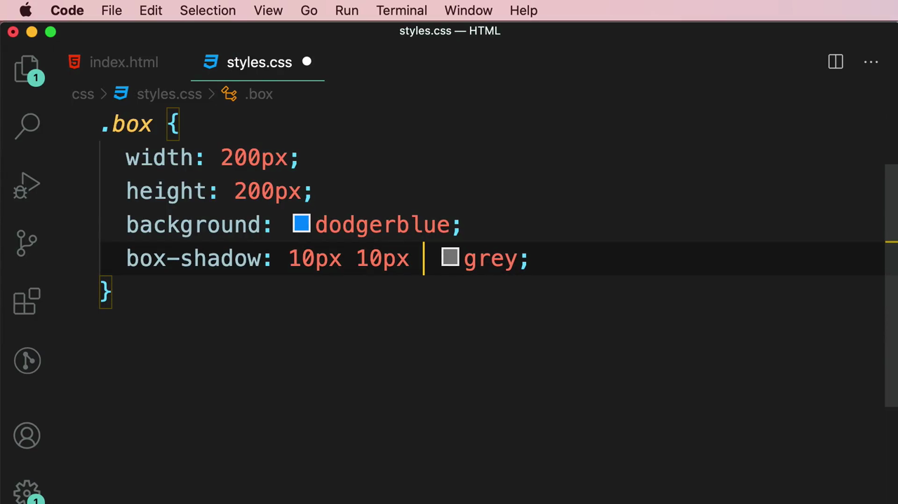

ผลลัพธ์: เงาเปลี่ยนจากสีดำ (default) เป็น**สีเทา** ขอบเงายังคมชัด (ไม่เบลอ):

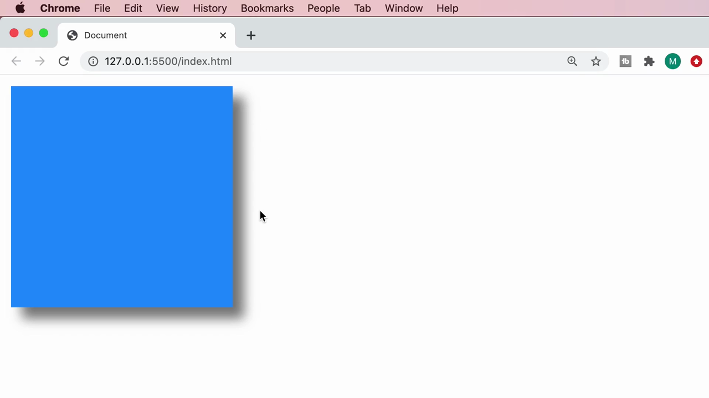

---

## 4. ค่าที่ 3 (ตัวเลข): Blur Radius — ความเบลอของเงา

Mosh เพิ่มค่าตัวเลขก่อนสี เพื่อกำหนดความเบลอ:

```css
box-shadow: 10px 10px 30px grey;
```

ผลลัพธ์: ขอบเงานุ่มและเบลอมากขึ้น (ยิ่งค่าตัวเลขมาก ยิ่งเบลอกระจายกว้าง):

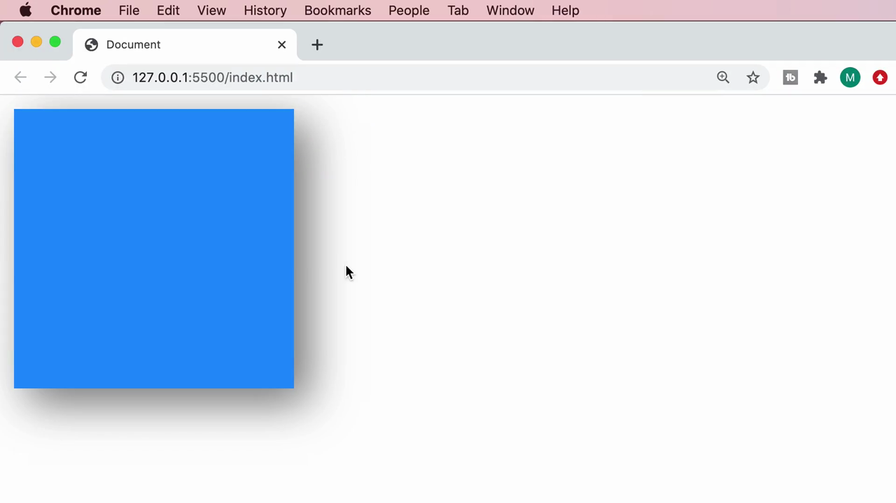

> **ลำดับค่าของ `box-shadow` แบบเต็ม:** `box-shadow: <X-offset> <Y-offset> <blur-radius> <spread-radius> <color>;` — X และ Y offset จำเป็นต้องมี ส่วน blur radius, spread radius และสี เป็นตัวเลือกเสริม (ถ้าไม่ใส่ blur จะได้เงาคมชัดไม่เบลอ)

---

## 5. เงารอบทิศทาง (Glow Effect) — ตั้ง X และ Y เป็น 0

Mosh ตั้งค่า X และ Y offset เป็น `0` ทั้งคู่ แล้วเพิ่ม blur มากๆ:

```css
.box {
  width: 200px;
  height: 200px;
  background: dodgerblue;
  box-shadow: 0 0 30px grey;
}
```

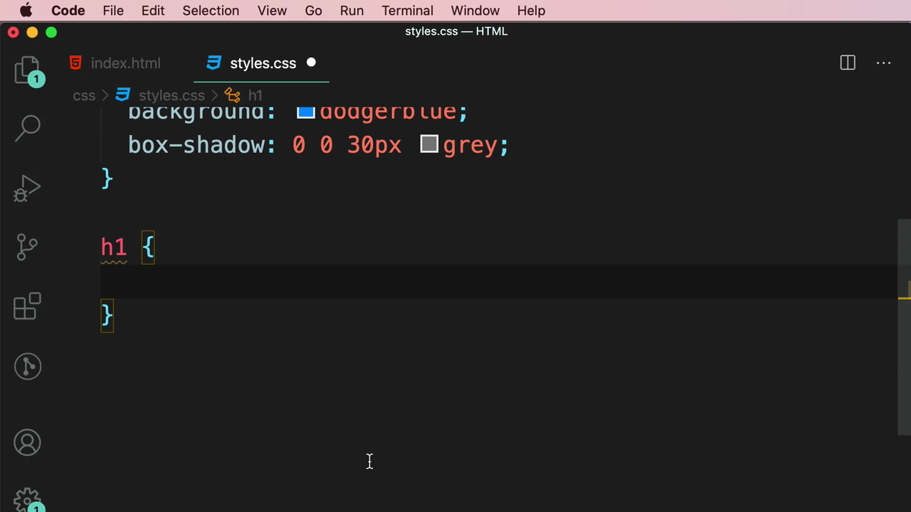

ผลลัพธ์: เงากระจายออกรอบทิศทางเท่าๆ กันทั้ง 4 ด้าน กลายเป็นเอฟเฟกต์ **"เรืองแสง" (glow)** รอบกล่อง แทนที่จะเยื้องไปด้านใดด้านหนึ่ง

---

## 6. `text-shadow` — เงาของตัวอักษร

Mosh เพิ่ม `<h1>Heading</h1>` เข้าไปในกล่อง แล้วเขียน CSS ให้ `h1` ดู IntelliSense tooltip ของ `text-shadow`:

```css
h1 {
  color: white;
  text-shadow: 3px 3px 5px grey;
}
```

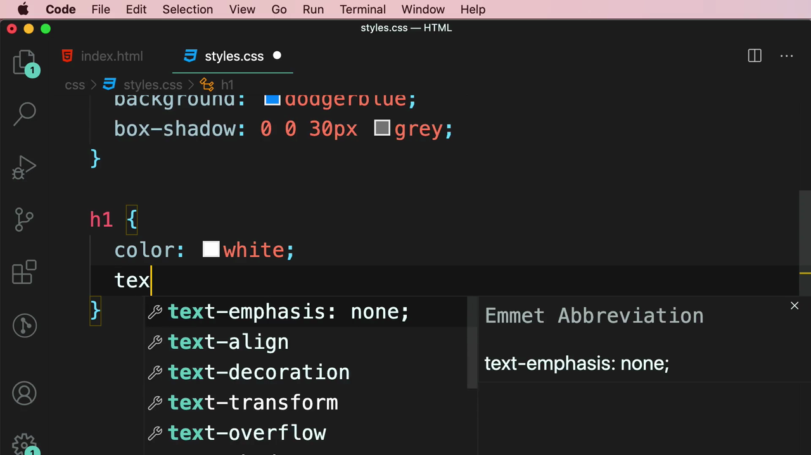

ผลลัพธ์: ตัวอักษร "Heading" สีขาวมีเงาสีเทาเยื้องขวาล่างเล็กน้อย ทำให้ตัวอักษรดูมีมิติและอ่านง่ายขึ้นแม้บนพื้นหลังสีเดียวกัน:

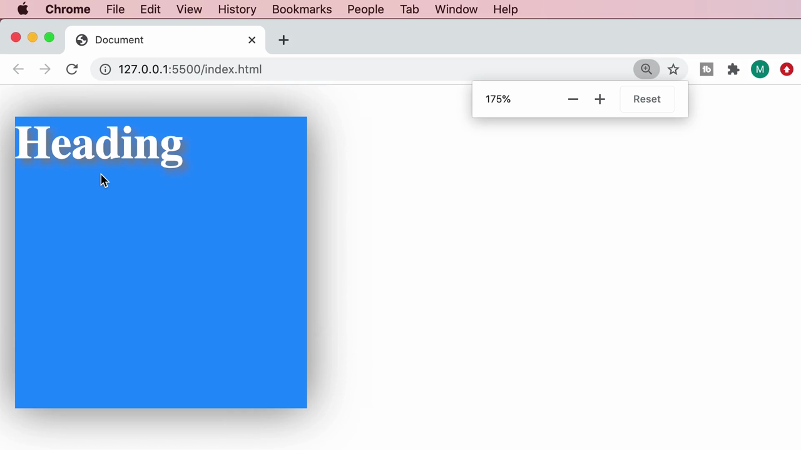

> **`text-shadow` ใช้ค่าชุดเดียวกันกับ `box-shadow`:** `text-shadow: <X-offset> <Y-offset> <blur-radius> <color>;` (ไม่มี spread radius เหมือน `box-shadow` เพราะใช้กับข้อความ ไม่ใช่กล่อง)

---

## 7. ใช้ `rgba()` แทนสีทึบ — เงาที่ดูเป็นธรรมชาติมากขึ้น

Mosh เปลี่ยนค่าสีจาก `grey` (สีทึบ) เป็น `rgba(0, 0, 0, 0.2)` (สีดำโปร่งแสง 20%):

```css
h1 {
  color: white;
  text-shadow: 3px 3px 5px rgba(0, 0, 0, 0.2);
}
```

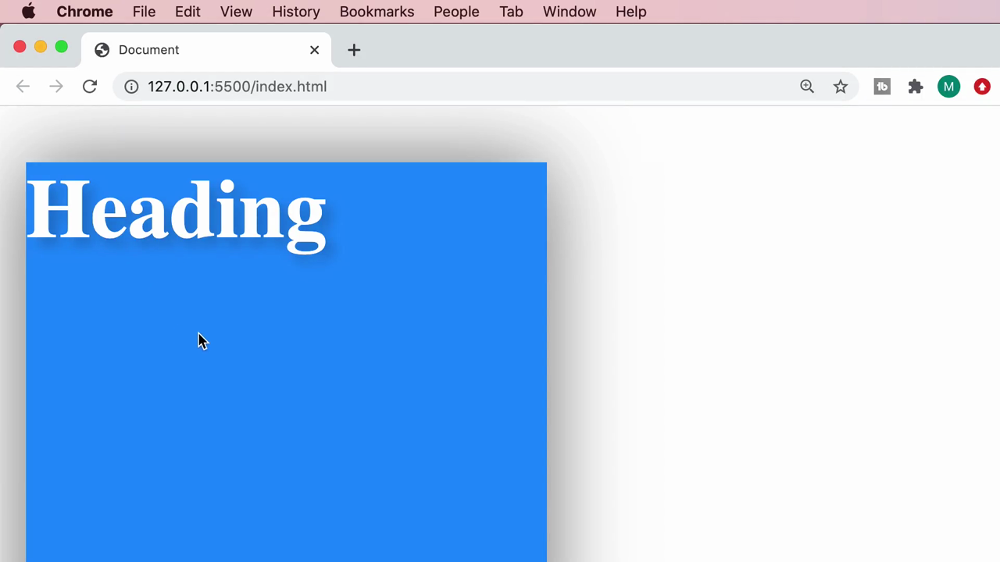

จากนั้น Mosh ทดลองเปลี่ยนสีพื้นหลังของกล่องเป็น `gold` และ `tomato` เพื่อแสดงให้เห็นว่าเงาแบบโปร่งแสงยัง**ดูกลมกลืนเป็นธรรมชาติ**ได้ดีไม่ว่าพื้นหลังจะเป็นสีอะไร:

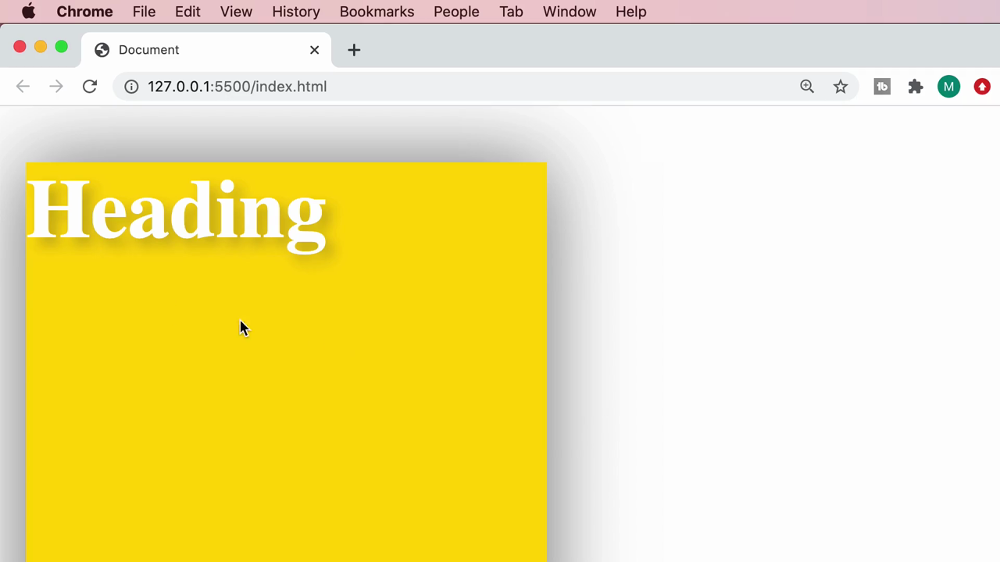

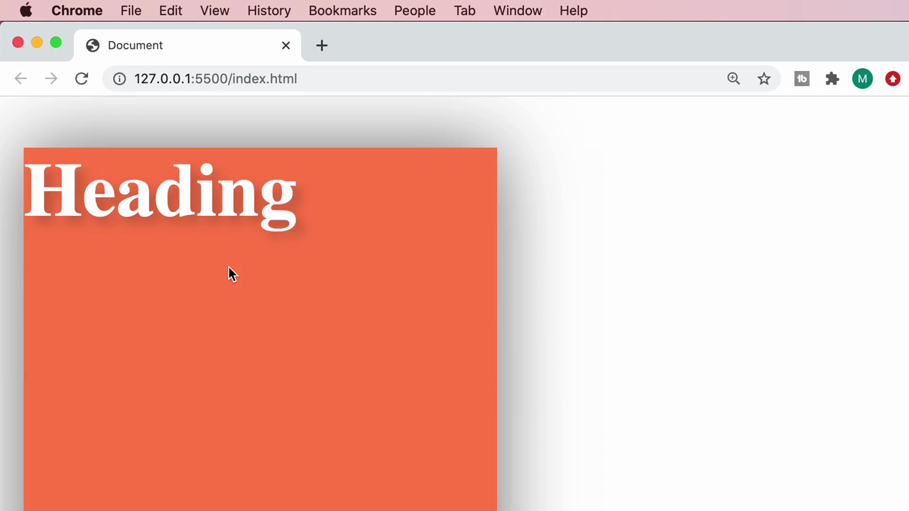

> **ทำไมควรใช้ `rgba()` แทนสีทึบสำหรับเงา:** เงาที่เป็นสีทึบ (เช่น `grey` หรือ `black`) จะดู "แข็ง" และอาจไม่กลมกลืนกับพื้นหลังบางสี แต่เงาที่เป็น **`rgba()` ที่มีค่า alpha ต่ำ (เช่น 0.2-0.3)** จะดูเป็นธรรมชาติมากกว่า เพราะเงาจริงในชีวิตจริงก็ไม่ใช่สีทึบ แต่เป็นการลดความสว่างของพื้นผิวด้านล่างแบบโปร่งแสง หลักการนี้ใช้ได้ทั้งกับ `box-shadow` และ `text-shadow`

---

## สรุปที่ใช้ได้จริง

- **`box-shadow: <x-offset> <y-offset> <blur> <spread> <color>;`** — ใส่เงาให้กล่อง/element ค่า x/y offset บังคับต้องมี ส่วน blur, spread, color เป็นตัวเลือก
- **`text-shadow: <x-offset> <y-offset> <blur> <color>;`** — ใส่เงาให้ตัวอักษรโดยตรง ใช้หลักการค่าเดียวกับ `box-shadow` (ไม่มี spread)
- ตั้ง **X = 0, Y = 0** พร้อม blur มากๆ จะได้เอฟเฟกต์ **glow** (เรืองแสงรอบทิศทาง) แทนที่จะเป็นเงาเยื้องด้านใดด้านหนึ่ง
- ควรใช้สีเงาแบบ **`rgba()` ที่มี alpha ต่ำ** (เช่น 0.2-0.3) แทนสีทึบ เพื่อให้เงาดูนุ่มนวลและเป็นธรรมชาติมากขึ้น กลมกลืนกับพื้นหลังได้ทุกสี

### จุดเชื่อมกับงานจริงของ Aum

- **Tailwind CSS มี utility class สำหรับเงาโดยเฉพาะ** เช่น `shadow-sm`, `shadow-md`, `shadow-lg`, `shadow-xl` (ระดับความเข้ม/ขนาดของ `box-shadow` ที่ตั้งไว้ล่วงหน้า) — เบื้องหลัง class เหล่านี้ก็คือค่า `box-shadow` แบบ multi-layer ที่ผสม offset, blur และสี rgba โปร่งแสงตามหลักการที่เรียนในคลิปนี้
- Tailwind ยังมี `drop-shadow-*` (ใช้ CSS filter) และไม่มี `text-shadow` utility ตรงๆ ในเวอร์ชันเก่า แต่สามารถเขียนเป็น arbitrary value ได้ เช่น `[text-shadow:3px_3px_5px_rgba(0,0,0,0.2)]` โดยใช้หลักการค่าเดียวกับที่เรียนมา
- เทคนิคการใช้ `box-shadow` แบบ **glow (0 0 blur color)** มีประโยชน์มากเวลาทำเอฟเฟกต์ **focus state** ของ input/button (เช่นตอนคลิกหรือ hover) ซึ่งเป็นแพทเทิร์น UI ที่พบบ่อยมากในหน้าเว็บสมัยใหม่และ landing page
- การเลือกใช้เงาแบบโปร่งแสง (`rgba` alpha ต่ำ) แทนสีทึบ เป็นหลักการออกแบบ (design principle) ที่สำคัญมากสำหรับงาน UI/UX จริง ควรนำไปใช้เป็นนิสัยเวลาออกแบบ shadow ให้ card, button, modal ในโปรเจกต์จริงของ Aum
