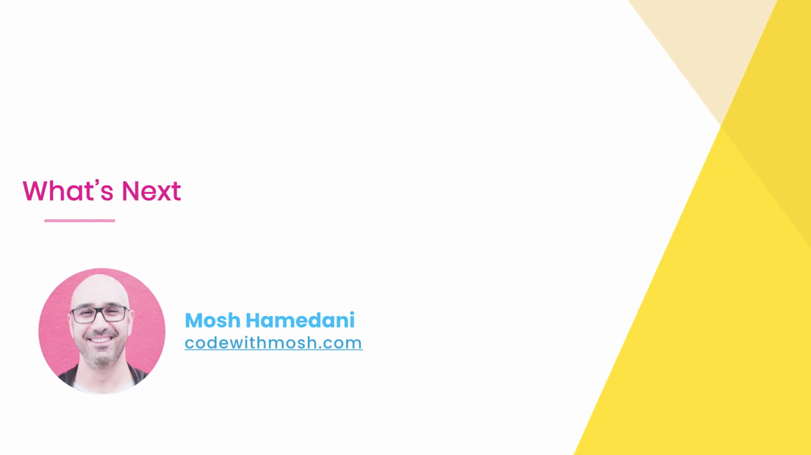
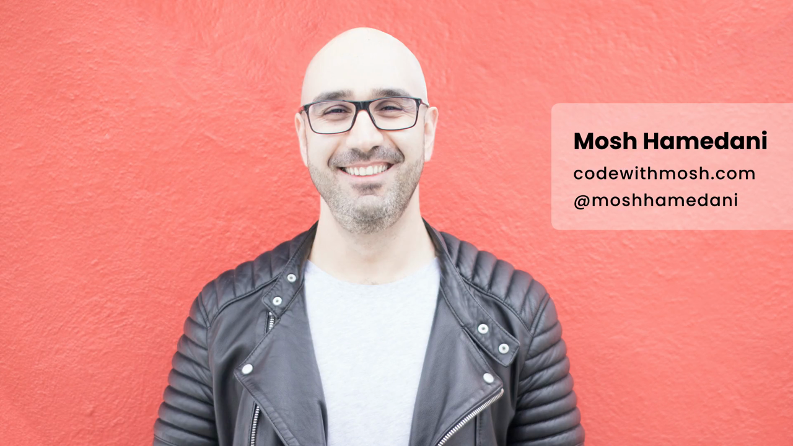
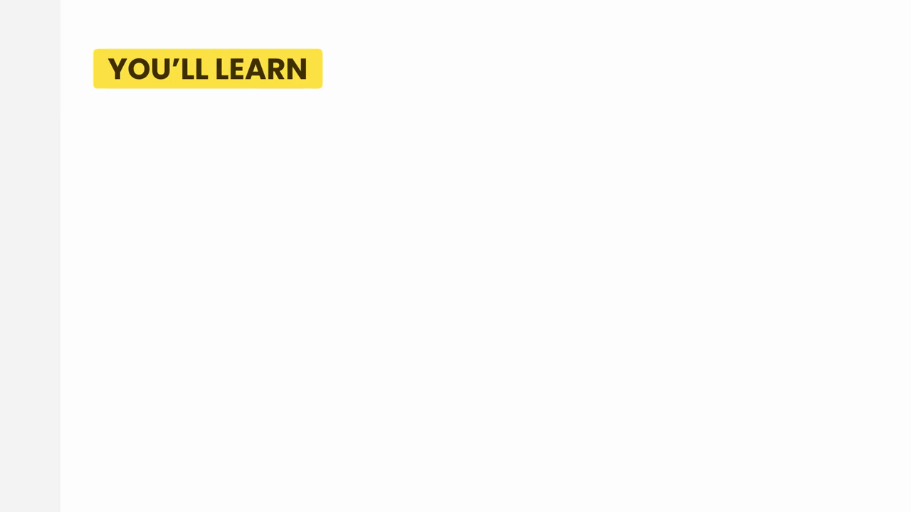
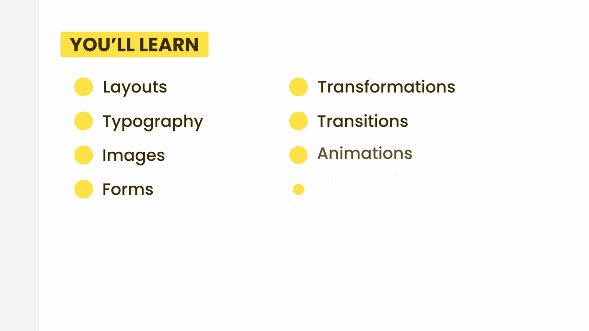

# 4-CSS Basics: 16 - What's Next (0:39)

**ไฟล์ต้นทาง:** `16-Whats-Next.mp4`

▶️ **[เปิดวิดีโอต้นฉบับ](../../../HTML-CSS-1/4-CSS%20Basics/16-Whats-Next.mp4)**

---

## ภาพรวมคลิปนี้

คลิปนี้เป็นคลิปสั้นๆ ปิดท้ายบท **"4-CSS Basics"** — Mosh สรุปว่าจบเนื้อหาพื้นฐานของ CSS แล้ว (Selectors, Specificity, Inheritance, Colors, Gradients, Borders, Shadows) และแนะนำภาพรวมหัวข้อที่จะเรียนต่อไปในบทถัดไป

---

## 1. สไลด์ปิดท้าย "What's Next"

จากนั้นตัดไปที่ภาพ Mosh แนะนำตัวพร้อมข้อมูลติดต่อ **codewithmosh.com** และ **@moshhamedani**:

---

## 2. สไลด์ "YOU'LL LEARN" — หัวข้อที่จะเรียนในบทถัดไป

รายการหัวข้อที่จะเรียนต่อ ปรากฏขึ้นทีละรายการเป็น 2 คอลัมน์:

**คอลัมน์ซ้าย:**
- Layouts (การจัดวางเลย์เอาต์)
- Typography (การจัดการตัวอักษร/ฟอนต์)
- Images (การจัดการรูปภาพ)
- Forms (ฟอร์มกรอกข้อมูล)

**คอลัมน์ขวา:**
- Transformations (การแปลงรูปทรง เช่น หมุน ย่อ-ขยาย เลื่อนตำแหน่ง)
- Transitions (การเปลี่ยนสถานะแบบมีอนิเมชันนุ่มนวล)
- Animations (แอนิเมชัน)
- Clean CSS (การเขียน CSS ให้สะอาดและดูแลง่าย)

---

## สรุปที่ใช้ได้จริง

บท "4-CSS Basics" ที่เพิ่งเรียนจบครอบคลุม: Selectors ทุกประเภท (Type, Class, ID, Attribute, Relational, Pseudo-class, Pseudo-element), Selector Specificity, Inheritance, Colors (RGB/HEX/HSL), Gradients (Linear/Radial), Borders (รวมเทคนิค CSS Shapes), และ Shadows (Box/Text) — เป็นพื้นฐานที่มั่นคงมากสำหรับก้าวต่อไป

บทถัดไปจะลงลึกเรื่อง**การจัดวางหน้าเว็บ (Layouts)**, **การจัดการตัวอักษร (Typography)**, **รูปภาพ**, **ฟอร์ม**, และเทคนิคที่ทำให้เว็บ "มีชีวิต" มากขึ้นอย่าง **Transformations, Transitions, Animations** รวมถึงแนวทางการเขียน **Clean CSS** ให้เป็นระเบียบ

### จุดเชื่อมกับงานจริงของ Aum

- หัวข้อ **Layouts** ที่กำลังจะเรียนต่อไปคือรากฐานสำคัญที่สุดสำหรับการทำ **landing page** และ full-stack project ที่ Aum กำลังฝึกอยู่ — ทั้ง Flexbox และ Grid ที่มักสอนในหัวข้อนี้เป็นเครื่องมือหลักที่ Tailwind CSS ก็สร้าง utility class มาครอบอีกที (เช่น `flex`, `grid`, `grid-cols-3`)
- **Transformations, Transitions, Animations** คือกลุ่มหัวข้อที่ตรงกับสิ่งที่ทำให้เว็บสมัยใหม่ดู "ลื่นไหล" มีชีวิตชีวา ซึ่งเป็นทักษะที่แยกความแตกต่างระหว่างเว็บพื้นฐานกับเว็บมืออาชีพ ตรงกับเป้าหมายที่ Aum อยากเป็น Front End engineer ที่แข็งแกร่งทั้งฝั่ง Web และ Mobile ในปี 2026
- **Clean CSS** เป็นหัวข้อที่มีประโยชน์มากเมื่อเริ่มทำงานร่วมกับ Tailwind CSS และ Next.js เพราะการจัดระเบียบโค้ด CSS/utility class ให้อ่านง่ายและดูแลรักษาได้ในระยะยาว เป็นทักษะที่จำเป็นมากสำหรับโปรเจกต์ full-stack ขนาดใหญ่ที่ใช้ local storage และ JSON server อยู่ในตอนนี้
- แนะนำให้ Aum ทบทวนไฟล์สรุปทั้ง 13 คลิปของบท "4-CSS Basics" นี้อีกครั้งก่อนเริ่มบทถัดไป โดยเฉพาะเรื่อง Specificity และ Inheritance เพราะเป็นความรู้พื้นฐานที่จะถูกใช้ซ้ำตลอดเวลาเมื่อเรียน Layout และ Responsive Design ในบทต่อๆ ไป
