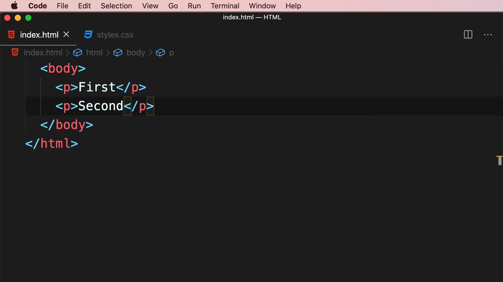
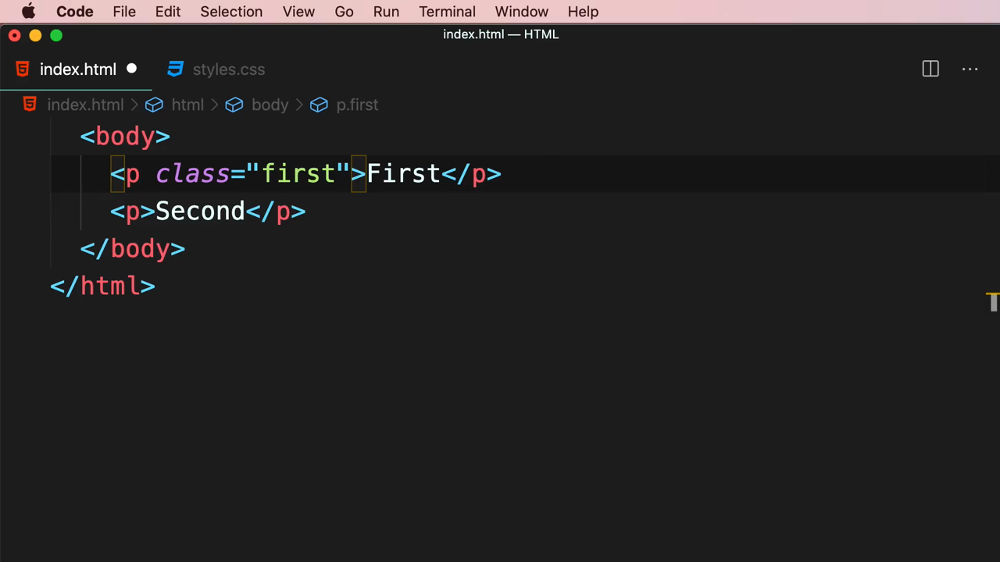
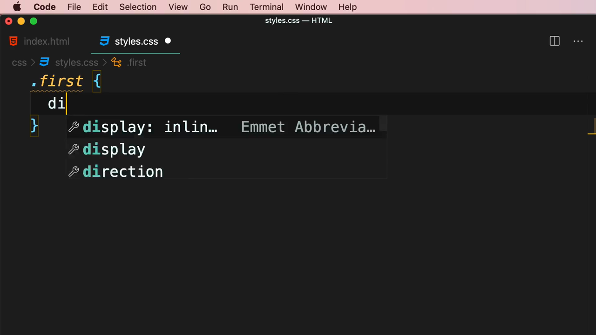
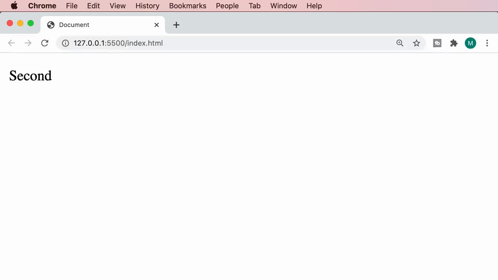
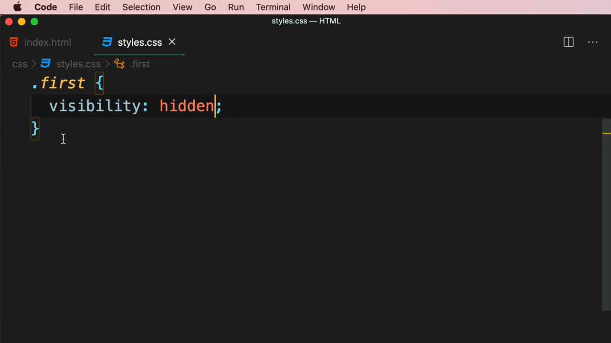
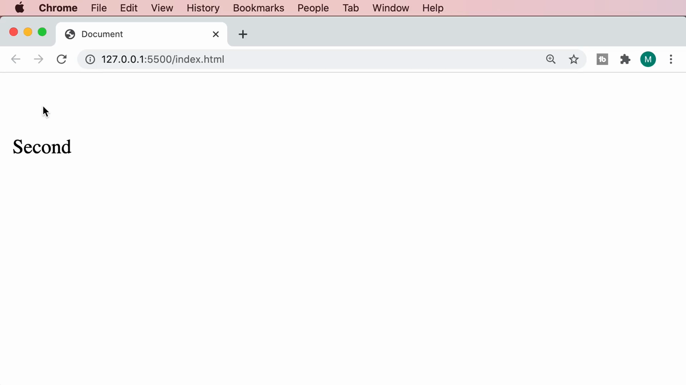

# 2-Layout: 10 - Hiding Elements (1:25)

**ไฟล์ต้นทาง:** `10-Hiding-Elements.mp4`

▶️ **[เปิดวิดีโอต้นฉบับ](../../../HTML-CSS-2/2-Layout/10-Hiding-Elements.mp4)**

---

## ภาพรวมคลิปนี้

คลิปสั้นๆ (ความยาวแค่ 1 นาทีกว่า) แต่เนื้อหาสำคัญมาก — Mosh สอนวิธี **"ซ่อน" element** ด้วย CSS สองแบบที่ให้ผลลัพธ์ต่างกันโดยสิ้นเชิง คือ `display: none` กับ `visibility: hidden` พร้อมเปรียบเทียบให้เห็นความแตกต่างชัดเจนผ่านตัวอย่างจริงในเบราว์เซอร์

---

## 1. ไตเติลเปิดคลิป


---

## 2. เตรียมตัวอย่าง: สองย่อหน้า

Mosh สร้าง HTML สองย่อหน้าง่ายๆ:

```html
<body>
  <p>First</p>
  <p>Second</p>
</body>
```



จากนั้นเพิ่ม `class="first"` ให้ย่อหน้าแรก เพื่อใช้เป็นเป้าหมายในการทดสอบซ่อน:

```html
<body>
  <p class="first">First</p>
  <p>Second</p>
</body>
```



---

## 3. วิธีที่ 1: `display: none` — ลบออกจากหน้าเว็บโดยสมบูรณ์

```css
.first {
  display: none;
}
```



ผลลัพธ์: ย่อหน้า "First" **หายไปโดยสมบูรณ์** ราวกับไม่เคยมีอยู่ใน HTML เลย — ย่อหน้า "Second" เลื่อนขึ้นมาแทนที่ตำแหน่งเดิมของ "First" ทันที ไม่มีช่องว่างเหลือทิ้งไว้เลย:



**สรุปพฤติกรรม `display: none`:**
- Element ถูกลบออกจาก layout ทั้งหมด (ไม่ถูกคำนวณพื้นที่ใดๆ)
- Element อื่นที่อยู่ถัดไปจะเลื่อนขึ้นมาแทนที่ทันที ราวกับ element ที่ซ่อนไปไม่เคยมีอยู่จริง

---

## 4. วิธีที่ 2: `visibility: hidden` — ซ่อนแต่ยังเก็บพื้นที่ไว้

Mosh เปลี่ยน CSS เป็น:

```css
.first {
  visibility: hidden;
}
```



ผลลัพธ์: ย่อหน้า "First" **มองไม่เห็น** (โปร่งใส) แต่**พื้นที่/ตำแหน่งเดิมยังคงถูกจองไว้** — สังเกตได้ว่าย่อหน้า "Second" ยังคงอยู่ตำแหน่งเดิมที่ต่ำลงมา (ไม่ได้เลื่อนขึ้นมาแทนที่เหมือนกรณี `display: none`) เพราะยังมีช่องว่างของย่อหน้าแรกคั่นอยู่:



**สรุปพฤติกรรม `visibility: hidden`:**
- Element มองไม่เห็นแต่ยังคง**ครอบครองพื้นที่ใน layout** เหมือนเดิมทุกประการ
- Element อื่นๆ ไม่เลื่อนมาแทนที่ เพราะพื้นที่ของ element ที่ถูกซ่อนยังถูกจองไว้อยู่

---

## สรุปภาพรวมของคลิปนี้

| Property | ผลลัพธ์ | พื้นที่ใน Layout |
|---|---|---|
| `display: none` | ลบออกจากหน้าเว็บโดยสมบูรณ์ | **ไม่เก็บพื้นที่ไว้** — element อื่นเลื่อนมาแทนที่ทันที |
| `visibility: hidden` | มองไม่เห็น (โปร่งใส) | **ยังคงเก็บพื้นที่ไว้** — element อื่นไม่เลื่อนมาแทนที่ |

> **เคล็ดลับการเลือกใช้:** ใช้ `display: none` เมื่อต้องการให้ element หายไปแบบสมบูรณ์และให้เนื้อหาอื่นขยับมาเติมช่องว่างแทน (เช่น ปุ่มที่ไม่จำเป็นต้องแสดงในบางเงื่อนไข) ส่วน `visibility: hidden` เหมาะกับกรณีที่ต้องการซ่อนชั่วคราวแต่ไม่อยากให้ layout ของหน้าเว็บขยับเปลี่ยนตำแหน่ง (เช่น องค์ประกอบที่จะแสดงกลับมาทีหลังในตำแหน่งเดิมพอดี)

---

*หมายเหตุ: คลิปนี้เป็นส่วนหนึ่งของบท "2-Layout" จากคอร์ส The Ultimate HTML and CSS Course โดย Mosh Hamedani (codewithmosh.com) — คลิปที่ 10 ของบทนี้ (ก่อนหน้านี้ไฟล์ที่อัปโหลดมาซ้ำกับ 8-FlexBox.mp4 จึงถูกข้ามไปก่อน ตอนนี้ได้รับไฟล์ที่ถูกต้องแล้วและทำสรุปสมบูรณ์)*
