# 2-Layout: 11 - Media Queries (10:06)

**ไฟล์ต้นทาง:** `11-Media-Queries.mp4`

▶️ **[เปิดวิดีโอต้นฉบับ](../../../HTML-CSS-2/2-Layout/11-Media-Queries.mp4)**

---

## ภาพรวมคลิปนี้

คลิปปิดท้ายบท Layout — Mosh สอนเรื่อง **Media Queries** เครื่องมือที่ทำให้เว็บไซต์กลายเป็น **Responsive Web Design** คือปรับหน้าตาให้เหมาะกับอุปกรณ์ที่แตกต่างกันได้ (มือถือ, แท็บเล็ต, จอคอมพิวเตอร์ ไปจนถึงตอนสั่งพิมพ์กระดาษ) ครอบคลุมตั้งแต่แนวคิด mobile-first, การใช้ Chrome DevTools จำลองอุปกรณ์ต่างๆ, การเขียน `@media` query ด้วยเงื่อนไข `min-width`/`max-width`, การใช้หลาย breakpoint ร่วมกัน ไปจนถึง `@media print` สำหรับสไตล์เฉพาะตอนพิมพ์

---

## 1. ไตเติลเปิดคลิปและคำนิยาม

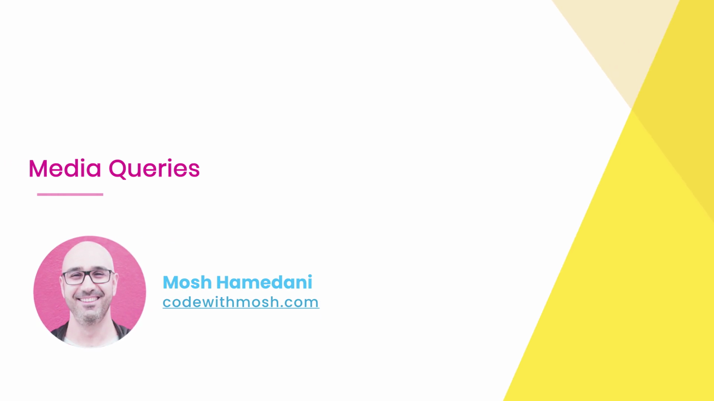

Mosh อธิบายนิยามของ Media Queries:

> **Media Queries** — To provide different styles for different devices depending on their features.

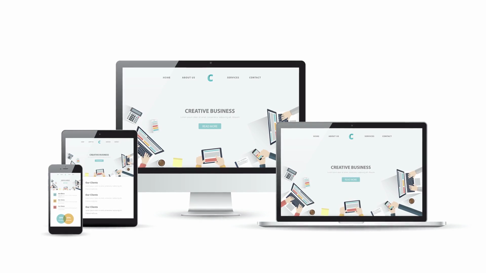

จากนั้นแสดงแอนิเมชันตัวอย่างเว็บไซต์เดียวกันที่ปรับ layout ให้เหมาะกับหน้าจอแต่ละขนาด (จอคอมพิวเตอร์, แล็ปท็อป, แท็บเล็ต, มือถือ) — นี่คือแนวคิดของ **Responsive Web Design**:

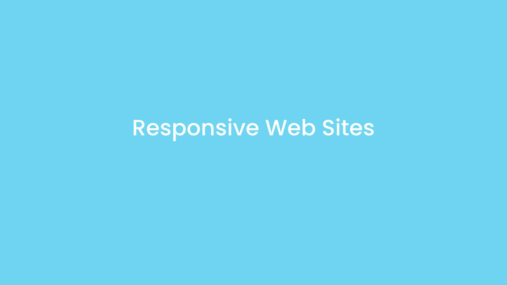

---

## 2. เตรียมตัวอย่าง: สองกล่องสีที่ต้องปรับตามขนาดจอ

Mosh สร้าง HTML สองกล่อง (เหลือง, ฟ้า) ที่มีข้อความ lorem ipsum อยู่ข้างใน:

```html
<div class="container">
  <div class="box">
    <p>Lorem ipsum dolor sit amet consectetur adipisicing elit...</p>
  </div>
  <div class="box"></div>
</div>
```

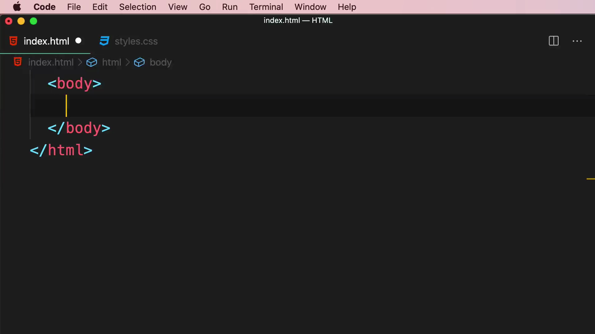

**กลยุทธ์ Mobile-First:** Mosh เริ่มออกแบบ CSS พื้นฐาน (ไม่มี media query) ให้เหมาะกับ**หน้าจอมือถือก่อน** — คือให้สองกล่องเรียงซ้อนกันในแนวตั้ง (คอลัมน์เดียว) เพราะหน้าจอมือถือแคบ:

```css
.container {
  display: flex;
  flex-direction: column;
}

.box {
  background: gold;
  padding: 1rem;
}

.box:nth-of-type(2) {
  background: dodgerblue;
}
```

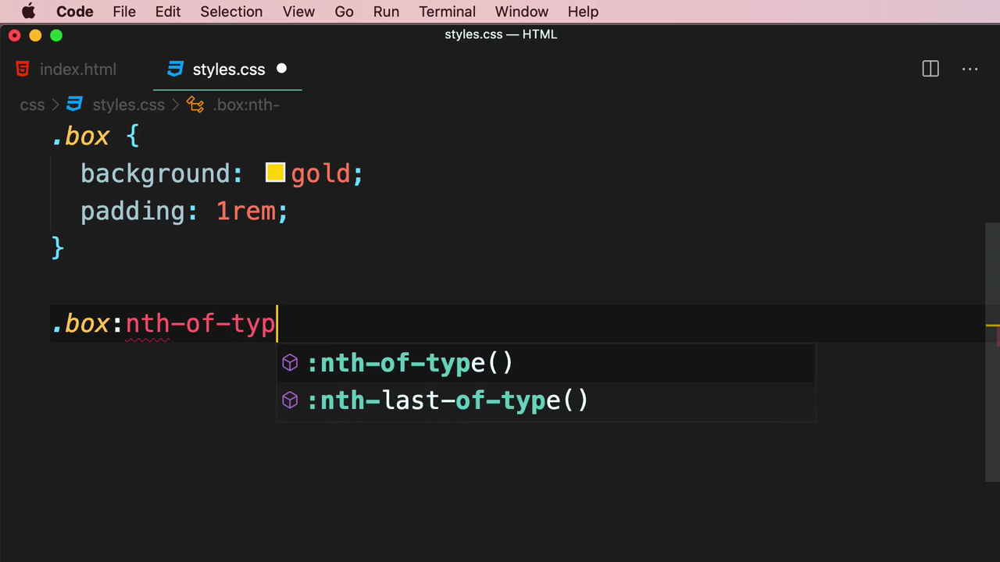

ผลลัพธ์: สองกล่องเรียงต่อกันในแนวตั้งเต็มความกว้างของหน้าจอ — เหมาะกับมือถือแต่ยังไม่เหมาะกับจอกว้างอย่างคอมพิวเตอร์:

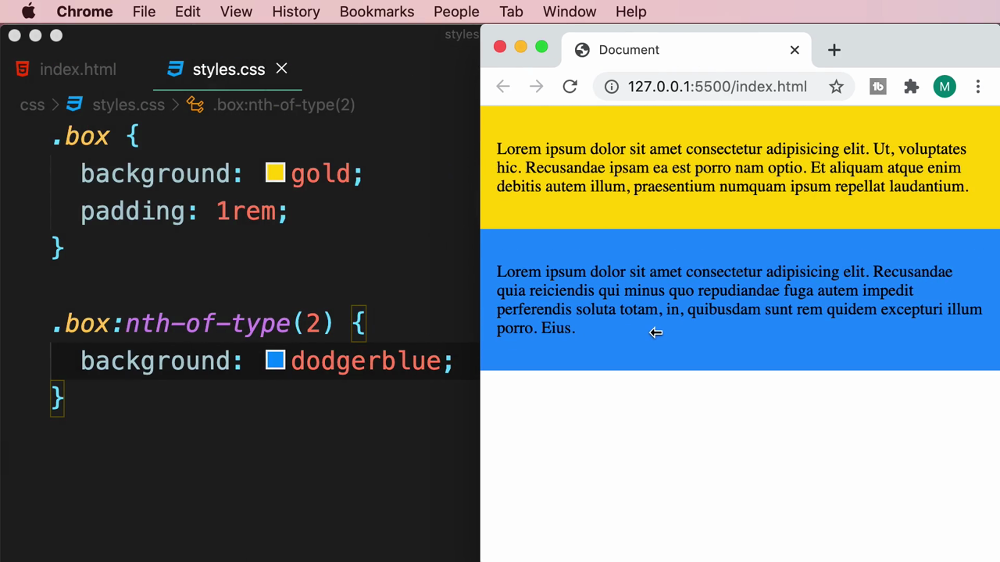

---

## 3. เครื่องมือทดสอบ Responsive ใน Chrome DevTools

Mosh เปิด Chrome DevTools (คลิกไอคอน "Toggle device toolbar" หรือกด `Cmd+Shift+M` บน Mac) เพื่อจำลองการแสดงผลบนอุปกรณ์ต่างๆ:

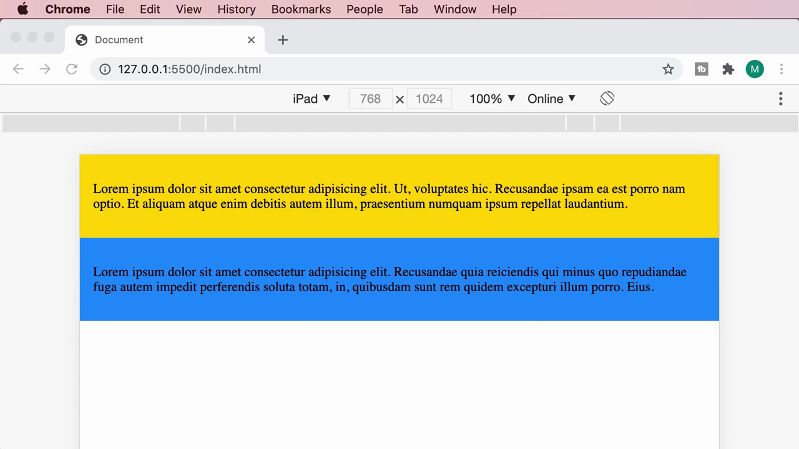

เมนู dropdown ด้านบนมีอุปกรณ์จำลองให้เลือกมากมาย เช่น Moto G4, Galaxy S5, Pixel 2, iPhone 5/SE, iPhone 6/7/8, iPhone X, iPad, iPad Pro, Surface Duo, Galaxy Fold รวมถึงโหมด **"Responsive"** ที่ให้ลากปรับขนาดหน้าจอได้อย่างอิสระ:

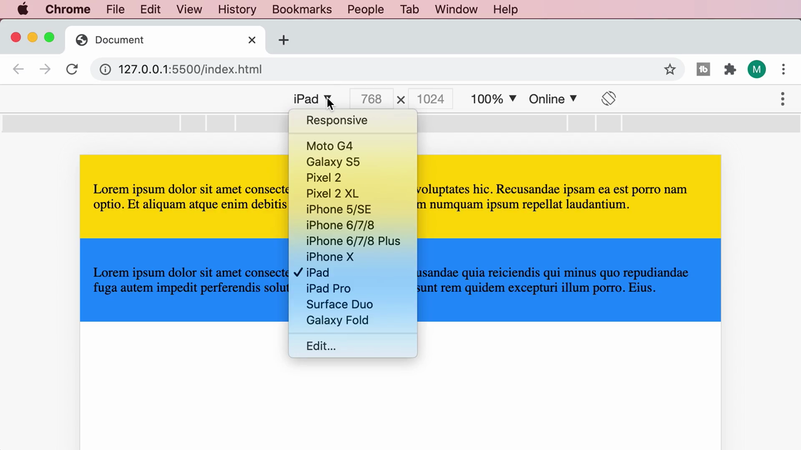

Mosh ยังสาธิตปุ่มหมุนจอ (rotate) เพื่อดูมุมมองแนวนอน (landscape) ของอุปกรณ์ที่เลือกไว้ด้วย:

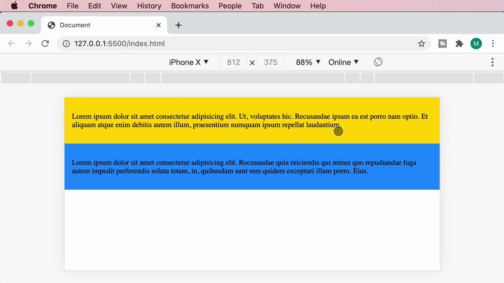

---

## 4. การหาจุด "Breakpoint" ที่เหมาะสม

นอกจากใช้ DevTools แล้ว Mosh ยังสาธิตการ**ลากขอบหน้าต่างเบราว์เซอร์จริง**ให้แคบ/กว้างขึ้นเรื่อยๆ พร้อมดูตัวเลขขนาดพิกเซล (px) ที่ Chrome แสดงมุมขวาบนขณะลาก เพื่อสังเกตว่าที่ขนาดเท่าไหร่ layout เริ่มดูไม่สวย (เช่น ข้อความในกล่องเริ่มดูอึดอัดเกินไป):

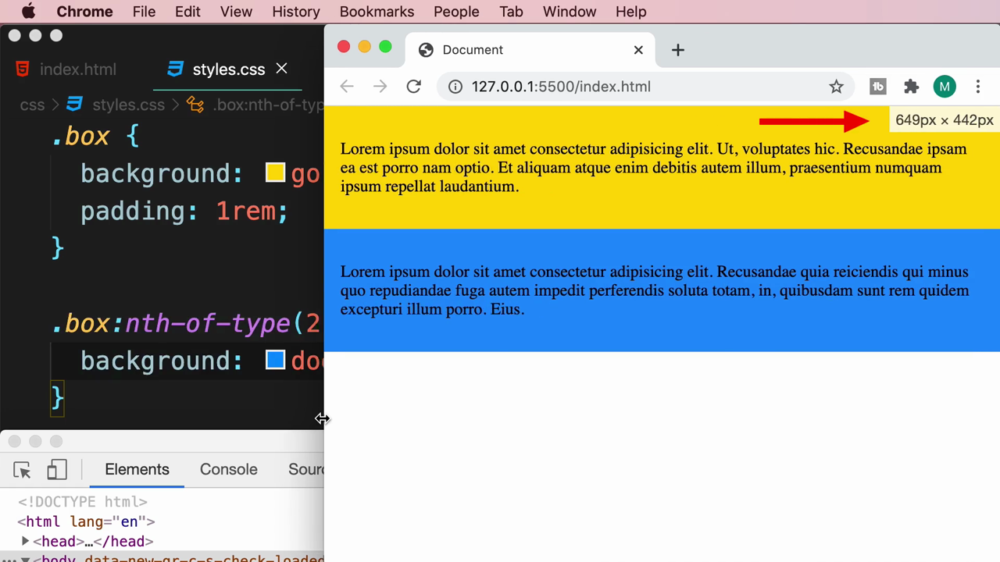

จากนั้น Mosh เปิดเว็บไซต์อ้างอิง (ricostacruz.com) ที่รวบรวมขนาดหน้าจอทั่วไปของอุปกรณ์ต่างๆ ไว้เป็นตาราง เพื่อใช้เป็นแนวทางเลือกค่า breakpoint ที่เหมาะสม:

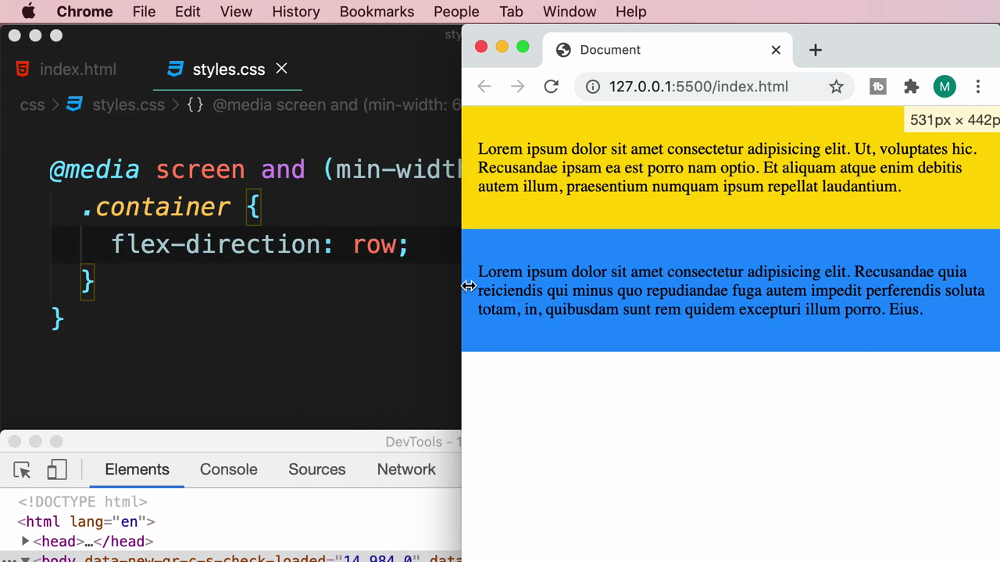

| ประเภทอุปกรณ์ | ช่วงความกว้าง |
|---|---|
| Mobile portrait | 320px ถึง 414px |
| Mobile landscape | 568px ถึง 812px |
| Tablet portrait | 768px ถึง 834px |
| Tablet landscape | 1024px ถึง 1112px |
| Laptop & Desktop | 1200px ขึ้นไป |

> **ข้อคิดสำคัญ:** Mosh เน้นย้ำว่าไม่มีตัวเลข breakpoint ที่ "ถูกต้องตายตัว" — ควรเลือกจากการสังเกตว่า**เนื้อหาของเราเอง**เริ่มดูไม่ดีที่ขนาดไหน มากกว่าจะยึดติดกับขนาดหน้าจอของอุปกรณ์ใดอุปกรณ์หนึ่งเป๊ะๆ

---

## 5. Syntax พื้นฐานของ `@media`

Mosh เริ่มเขียนกฎ media query แรก:

```css
@media screen and (min-width: 600px) {

}
```

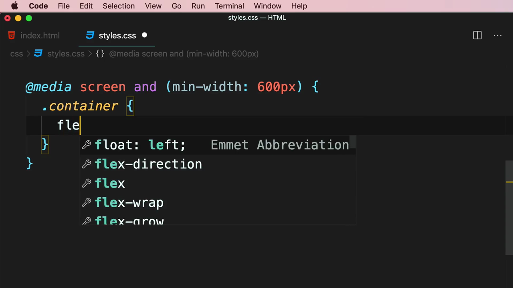

**อธิบายไวยากรณ์:**
- `@media` — คีย์เวิร์ดเริ่มต้น media query
- `screen` — media type (จอแสดงผลทั่วไป ตรงข้ามกับ `print` ที่จะพูดถึงด้านล่าง)
- `and` — เชื่อมเงื่อนไขหลายอันเข้าด้วยกัน
- `(min-width: 600px)` — เงื่อนไข feature query หมายถึง "เมื่อความกว้างของ viewport มากกว่าหรือเท่ากับ 600px"

ทุก CSS rule ที่เขียนไว้**ข้างใน**ปีกกาของ `@media` จะมีผลก็ต่อเมื่อเงื่อนไขเป็นจริงเท่านั้น

เพิ่มกฎเข้าไปเพื่อ**เขียนทับ**ค่า `flex-direction` เดิม:

```css
@media screen and (min-width: 600px) {
  .container {
    flex-direction: row;
  }
}
```

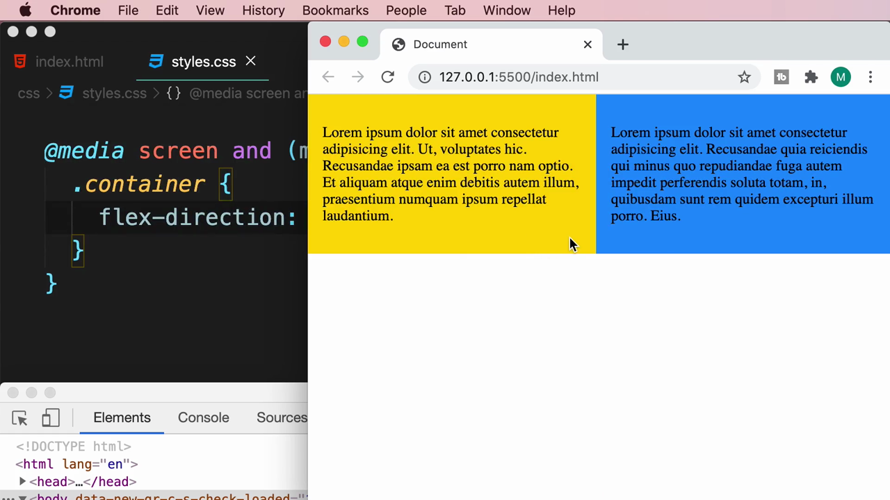

ผลลัพธ์: เมื่อความกว้างหน้าจอ ≥ 600px กล่องทั้งสองจะเปลี่ยนจากเรียงแนวตั้งเป็น**เรียงแนวนอนข้างกัน** (row) โดยอัตโนมัติ:

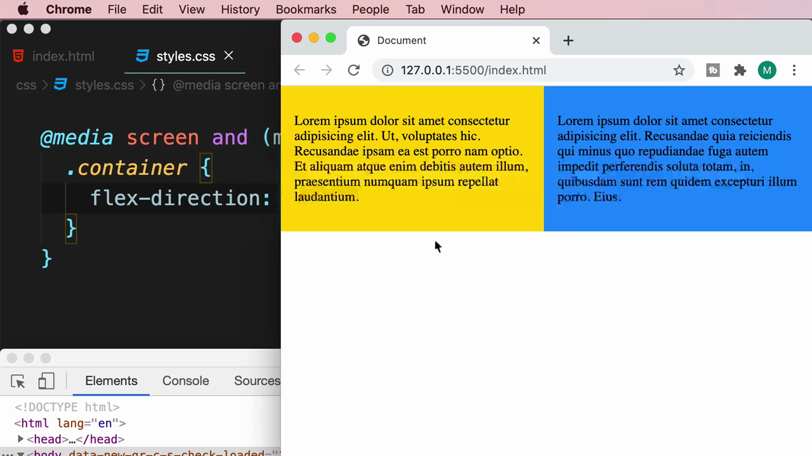

เมื่อ Mosh ลากหน้าต่างให้แคบกว่า 600px กล่องจะกลับไปเรียงแนวตั้งตามค่า default อีกครั้ง — นี่คือหัวใจของ Responsive Design

---

## 6. รวมเงื่อนไขหลายตัว: `min-width` และ `max-width`

Mosh สาธิตการรวมสองเงื่อนไขเข้าด้วยกันด้วย `and` เพื่อจำกัดให้กฎมีผลเฉพาะ**ช่วงความกว้างที่กำหนด**เท่านั้น:

```css
@media screen and (min-width: 600px) and (max-width: 900px) {
  .container {
    flex-direction: row;
  }
}
```

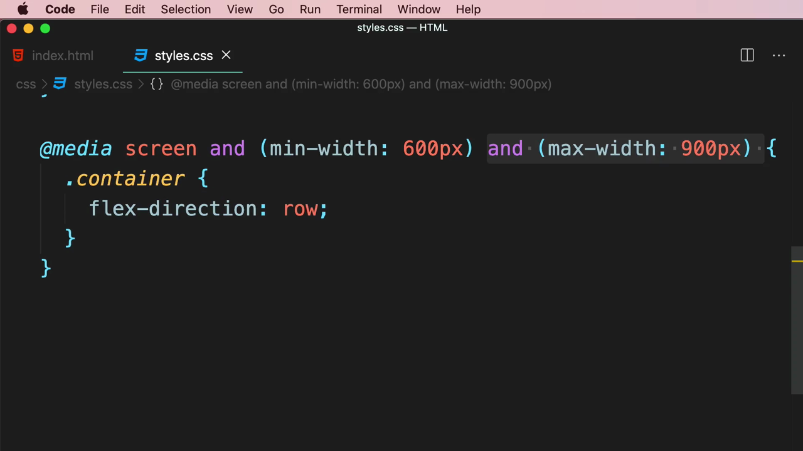

กฎนี้จะมีผลเฉพาะเมื่อความกว้างอยู่ระหว่าง 600px ถึง 900px เท่านั้น (นอกช่วงนี้จะไม่ถูกนำไปใช้)

---

## 7. หลาย Breakpoints ร่วมกัน (Progressive Enhancement)

Mosh สาธิตการเขียน `@media` หลายบล็อกต่อกัน เพื่อปรับ layout ทีละขั้นตามขนาดหน้าจอที่เพิ่มขึ้นเรื่อยๆ:

```css
@media screen and (min-width: 600px) {
  .container {
    flex-direction: row;
  }
}

@media screen and (min-width: 900px) {
  .box {
    background: white;
  }
}
```

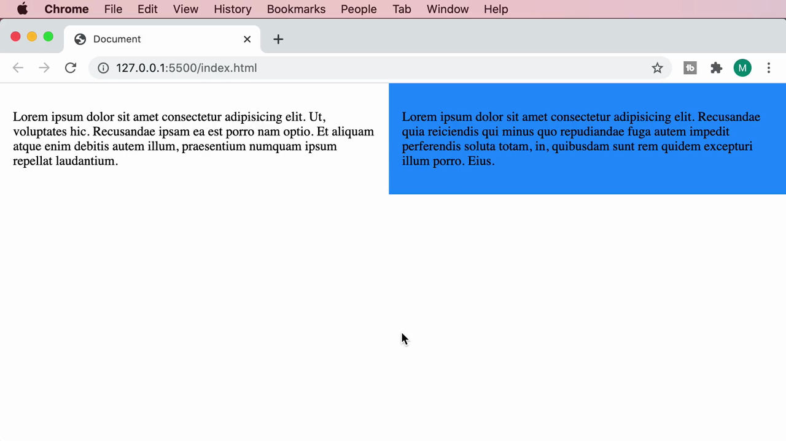

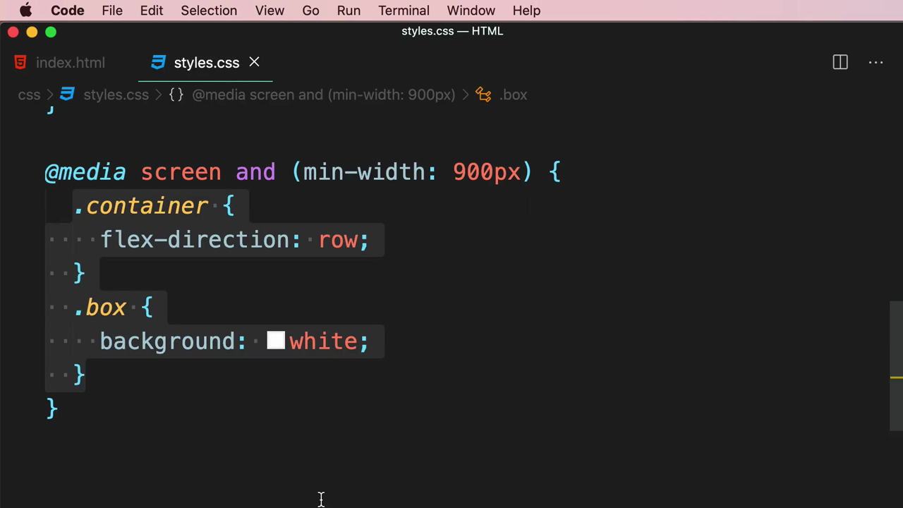

ผลลัพธ์: ที่ความกว้าง ≥ 600px กล่องจะเรียงแนวนอน (row) และเมื่อกว้างขึ้นไปอีกถึง ≥ 900px กล่องแรก (ที่ไม่ถูก `:nth-of-type(2)` เขียนทับ) จะเปลี่ยนพื้นหลังเป็นสีขาว — แสดงให้เห็นว่าสามารถวางเงื่อนไขซ้อนกันหลายระดับ (breakpoint) เพื่อค่อยๆ ปรับแต่งหน้าตาให้ประณีตขึ้นตามขนาดจอที่ใหญ่ขึ้นได้ (แนวคิดนี้เรียกว่า **Progressive Enhancement**)

---

## 8. `@media print` — สไตล์เฉพาะตอนสั่งพิมพ์

นอกจาก `screen` แล้ว Mosh แนะนำ media type อีกแบบคือ `print` ซึ่งมีผลเฉพาะตอนที่ผู้ใช้สั่งพิมพ์หน้าเว็บออกมาเป็นกระดาษเท่านั้น (ไม่มีผลตอนดูบนจอปกติ):

```css
@media print {
  body {
    font-size: 12pt;
  }

  .box {
    padding: 0.5cm;
  }
}
```

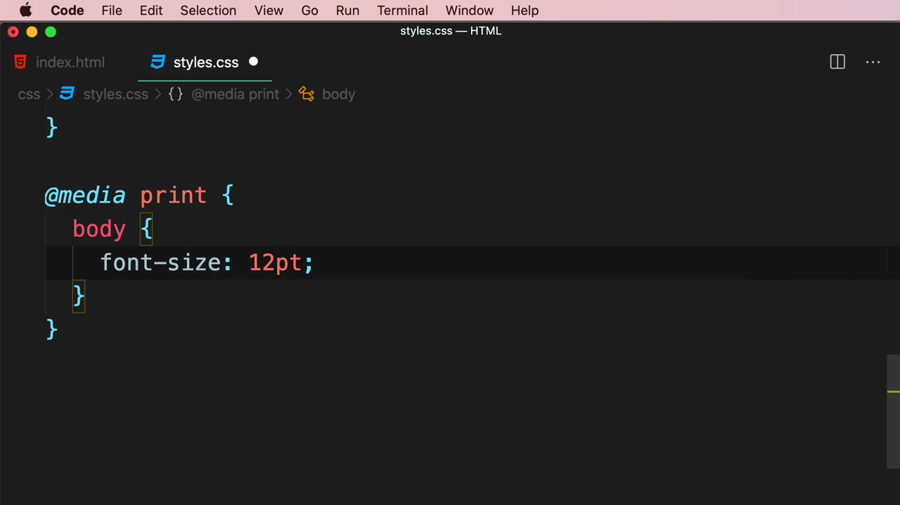

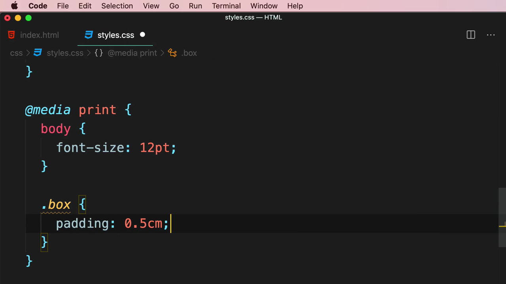

> **หมายเหตุ:** ใน `@media print` มักใช้หน่วยที่เหมาะกับกระดาษจริง เช่น `pt` (point) สำหรับขนาดตัวอักษร และ `cm` (เซนติเมตร) สำหรับระยะห่าง แทนที่จะใช้ `px` เหมือนหน้าจอทั่วไป

Mosh กด `Cmd+P` เพื่อเปิดหน้าต่างตัวอย่างก่อนพิมพ์ (Print Preview) ของ Chrome ให้ดูผลลัพธ์จริง — จะเห็นว่าเบราว์เซอร์แสดงเนื้อหาแบบขาวดำ ไม่มีพื้นหลังสี (ค่าเริ่มต้นของ browser เมื่อพิมพ์ เว้นแต่จะเปิดตัวเลือก "พิมพ์พื้นหลัง" เอง) และใช้ font-size/padding ตามที่กำหนดไว้ใน `@media print`:

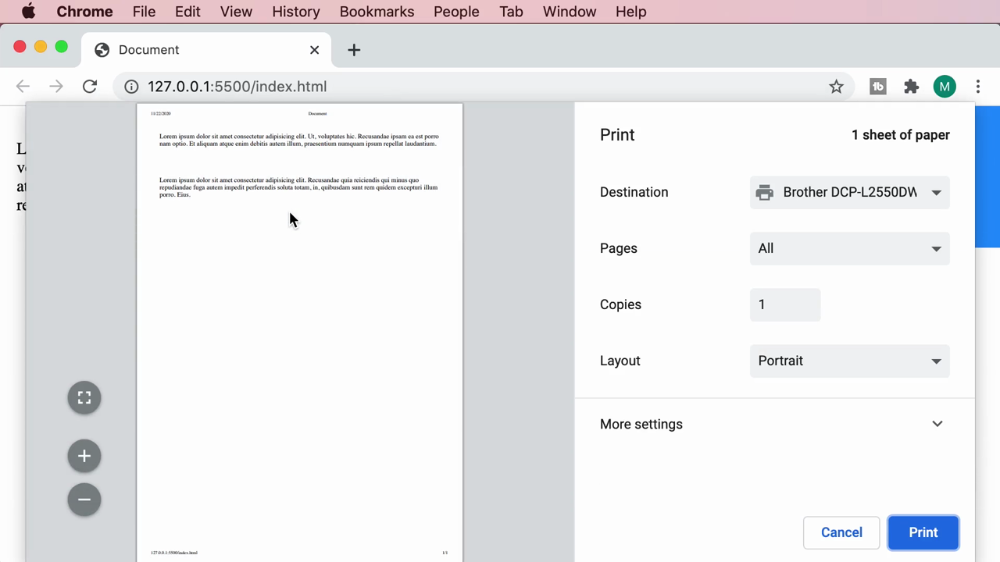

---

## สรุปภาพรวมของคลิปนี้

| หัวข้อ | สิ่งที่ได้เรียนรู้ |
|---|---|
| Responsive Web Design | การออกแบบเว็บให้ปรับตัวเข้ากับอุปกรณ์ต่างๆ ได้ |
| Mobile-First | เริ่มออกแบบ CSS พื้นฐานให้เหมาะกับมือถือก่อน แล้วค่อยเพิ่มเงื่อนไขสำหรับจอที่ใหญ่ขึ้น |
| Chrome DevTools Device Toolbar | จำลองอุปกรณ์จริงและโหมด Responsive เพื่อทดสอบ layout |
| `@media screen and (min-width: Npx)` | เขียนสไตล์ที่มีผลเมื่อความกว้างจอ ≥ ค่าที่กำหนด |
| `and (max-width: Npx)` | จำกัดช่วงความกว้างที่กฎมีผล |
| หลาย breakpoints ต่อกัน | ค่อยๆ ปรับ layout ทีละขั้นตามขนาดจอที่เพิ่มขึ้น (Progressive Enhancement) |
| `@media print` | กำหนดสไตล์เฉพาะตอนสั่งพิมพ์หน้าเว็บออกกระดาษ |

---

*หมายเหตุ: คลิปนี้เป็นส่วนหนึ่งของบท "2-Layout" จากคอร์ส The Ultimate HTML and CSS Course โดย Mosh Hamedani (codewithmosh.com) — เป็นคลิปสุดท้ายของบทนี้ (ไม่นับ 12-_Summary.pdf, 13-_Exercises.pdf และ Layout Exercises.zip ซึ่งไม่ใช่ไฟล์วิดีโอ)*
