# 2-Layout: 02 - The Box Model (6:03)

**ไฟล์ต้นทาง:** `2-The-Box-Model.mp4`

▶️ **[เปิดวิดีโอต้นฉบับ](../../../HTML-CSS-2/2-Layout/2-The-Box-Model.mp4)**

---

## ภาพรวมคลิปนี้

คลิปนี้ Mosh สอนแนวคิดที่**สำคัญที่สุดอย่างหนึ่งของ CSS** นั่นคือ **"The Box Model"** — หลักการที่ว่าทุก element บนหน้าเว็บถูกมองเป็น "กล่อง" ที่ประกอบด้วย 4 ชั้นซ้อนกันเสมอ คือ **Content, Padding, Border, Margin** เขาสาธิตผ่าน Chrome DevTools ที่มีเครื่องมือ **Box Model diagram** วาดให้ดูเป็นภาพ พร้อมทั้งสอนวิธีใช้ property `padding` และ `margin` ใน CSS และปิดท้ายด้วยแนวคิดที่มักทำให้มือใหม่สับสนที่สุดอย่างหนึ่งคือ **Margin Collapsing** (การยุบรวมกันของ margin แนวตั้ง)

---

## 1. ไตเติลเปิดคลิป

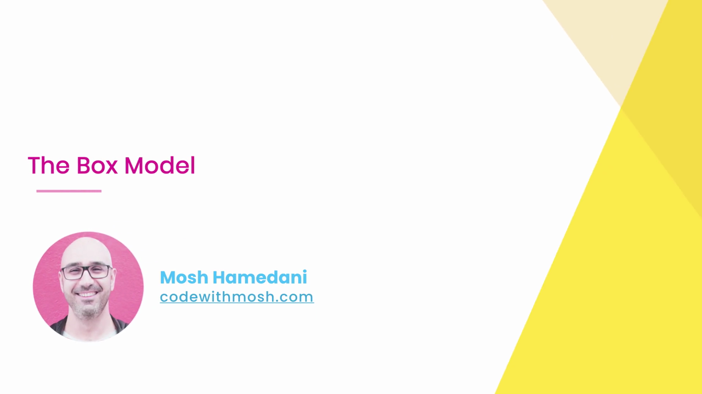

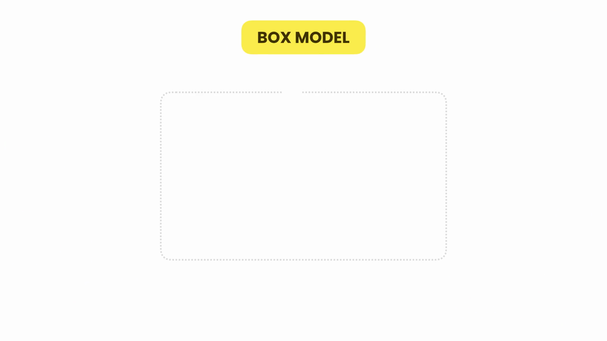

Mosh แนะนำว่า Box Model คือแนวคิดพื้นฐานที่สุดที่ต้องเข้าใจก่อนเรียนเรื่อง Layout อื่นๆ ต่อไป เพราะทุกอย่างที่เกี่ยวกับการจัดวางหน้าเว็บล้วนอิงกับหลักการนี้

---

## 2. เตรียมไฟล์ทดลอง — สร้าง `<p>` เปล่าใน `index.html`

Mosh เปิด VS Code แล้วสร้างแท็ก `<p></p>` เปล่าๆ ไว้ในไฟล์ `index.html`:

```html
<body>
  <p></p>
</body>
```

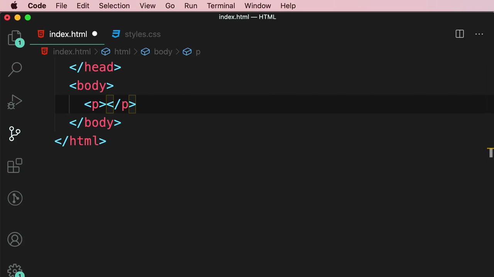

จากนั้นพิมพ์ข้อความ **"Lorem ipsum dolor sit amet."** ลงไปในแท็ก แล้วเปิดดูผลลัพธ์ผ่าน Live Server ที่ `127.0.0.1:5500`:

```html
<p>Lorem ipsum dolor sit amet.</p>
```

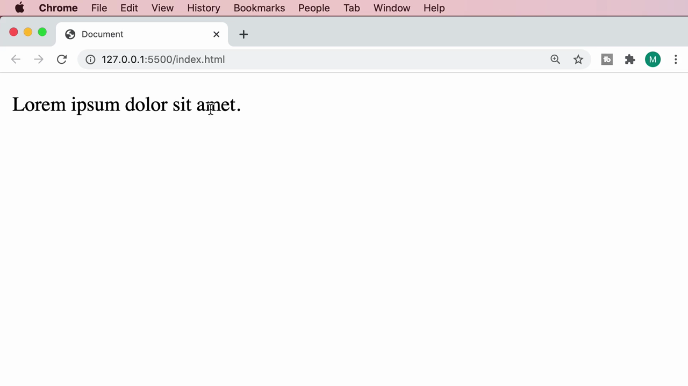

> **หมายเหตุ:** "Lorem ipsum..." เป็นข้อความจำลอง (placeholder text) ที่นักพัฒนาเว็บและนักออกแบบใช้กันทั่วโลกเพื่อเติมเนื้อหาแทนที่ตอนยังไม่มีข้อความจริง

---

## 3. เปิด Chrome DevTools ด้วย Inspect

Mosh คลิกขวาที่ข้อความในเบราว์เซอร์ แล้วเลือก **"Inspect"** จากเมนู เพื่อเปิด DevTools panel ขึ้นมาตรวจสอบ element:

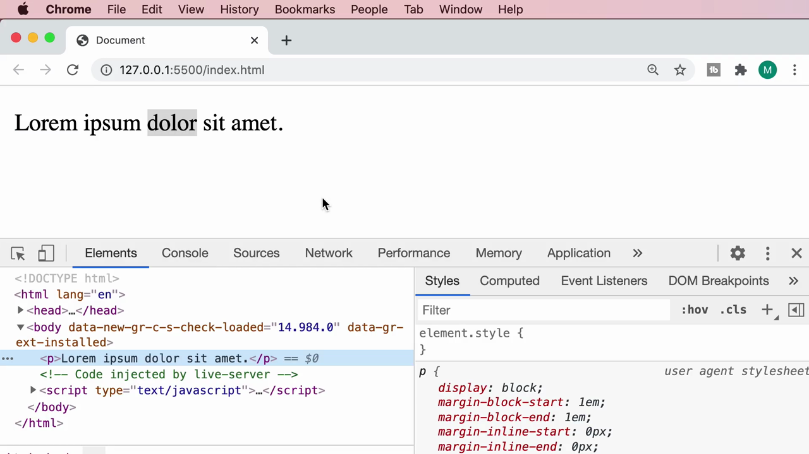

ในแท็บ **Styles** จะเห็นสไตล์ default ที่เบราว์เซอร์กำหนดให้กับแท็ก `<p>` โดยอัตโนมัติ เรียกว่า **user agent stylesheet**:

```css
p {
  display: block;
  margin-block-start: 1em;
  margin-block-end: 1em;
  margin-inline-start: 0px;
  margin-inline-end: 0px;
}
```

> **อธิบายค่าเหล่านี้:**
> - **`display: block`** — ทำให้ `<p>` ขึ้นบรรทัดใหม่เสมอ (กินพื้นที่เต็มความกว้างของ parent)
> - **`margin-block-start` / `margin-block-end`** — margin ด้านบนและล่าง (ตามทิศทางการไหลของเนื้อหา) ค่า default = `1em` (เทียบเท่าประมาณ 16px เพราะ font-size เริ่มต้นของเบราว์เซอร์คือ 16px)
> - **`margin-inline-start` / `margin-inline-end`** — margin ด้านซ้ายและขวา ค่า default = `0px`
>
> นี่คือเหตุผลที่ `<p>` ทุกอันจะมีช่องว่างเหนือ-ใต้ตัวมันเองโดยอัตโนมัติ แม้เราจะไม่ได้เขียน CSS ใดๆ เลยก็ตาม

ในบรรทัดของ element ที่เลือกไว้ใน Elements panel จะมีข้อความ `== $0` กำกับอยู่ — DevTools อธิบายว่า **`$0`** คือตัวแปรพิเศษที่ใช้อ้างอิงถึง element ที่เรากำลังเลือกอยู่ตอนนี้ผ่านทาง Console (พิมพ์ `$0` ใน Console แล้วกด Enter จะได้ element ตัวนี้กลับมา ใช้สะดวกเวลาอยากทดลองรันโค้ด JavaScript กับ element ที่เพิ่ง inspect)

---

## 4. Box Model Diagram ใน DevTools — เห็นภาพ 4 ชั้นของกล่อง

เลื่อนลงมาด้านล่างของแท็บ Styles จะเจอ **แผนภาพ Box Model** ที่ DevTools วาดให้แบบ interactive เป็นกล่องซ้อนกัน 4 ชั้นจากในสุดไปนอกสุด:

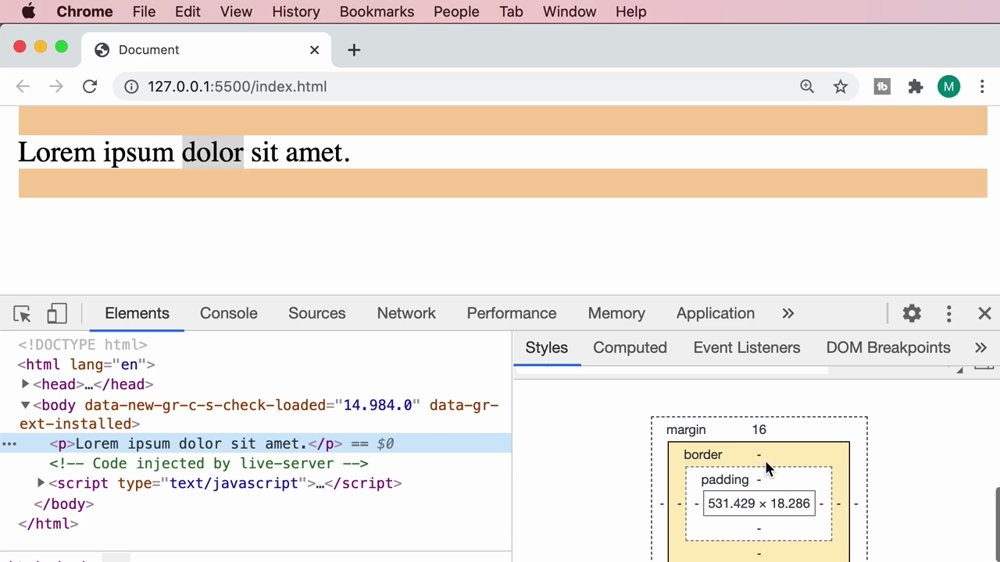

```
margin   16
  border   -
    padding   -
      content   531.429 x 18.286
```

> **4 ชั้นของ Box Model (จากในสุดไปนอกสุด):**
> 1. **Content** — เนื้อหาจริงของ element (ในที่นี้คือขนาดตัวอักษร "Lorem ipsum dolor sit amet." = 531.429 x 18.286 พิกเซล)
> 2. **Padding** — พื้นที่ว่าง "ภายใน" กล่อง ระหว่างขอบเนื้อหากับเส้นขอบ (border) — ค่า default ของ `<p>` คือ 0 (แสดงเป็นเครื่องหมาย `-`)
> 3. **Border** — เส้นขอบของกล่อง — ค่า default คือ 0 (ไม่มีเส้นขอบ)
> 4. **Margin** — พื้นที่ว่าง "ภายนอก" กล่อง ระหว่างเส้นขอบกับ element ข้างเคียง — ค่า default ของ `<p>` คือ 16px (มาจาก `1em` ที่เห็นในขั้นตอนก่อนหน้า)

**จุดที่สำคัญมาก:** เมื่อเอาเมาส์ไปวางเหนือแต่ละชั้นในแผนภาพนี้ (margin / border / padding / content) เบราว์เซอร์จะ**ไฮไลต์บริเวณที่ตรงกันในหน้าเว็บจริงด้วยสีที่ต่างกัน** ทำให้เห็นภาพชัดเจนว่าแต่ละชั้นครอบคลุมพื้นที่ไหนบ้าง:

- Hover ที่ **content** → ไฮไลต์เป็น**สีฟ้า** ครอบคลุมเฉพาะตัวข้อความ:

  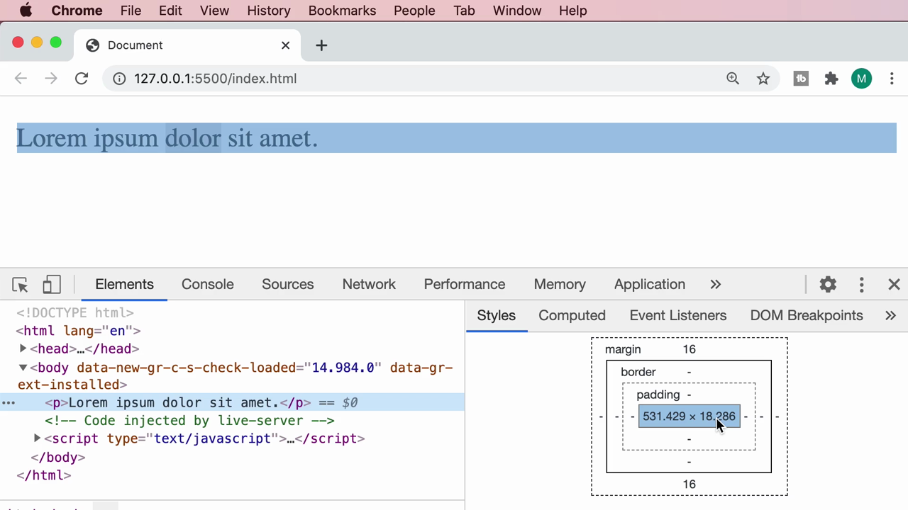

- Hover ที่ **margin** → ไฮไลต์เป็น**สีส้ม** เป็นแถบด้านบนและด้านล่างข้อความ (เพราะ margin ซ้าย-ขวาเป็น 0 ตาม default ของ `<p>` จึงเห็นเฉพาะแถบบน-ล่าง):

  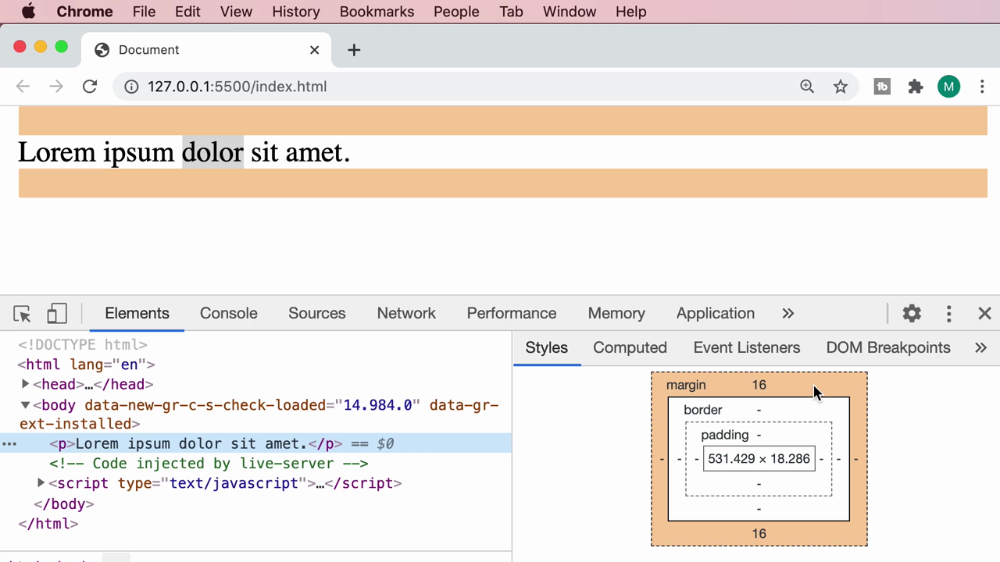

> เทคนิคนี้มีประโยชน์มากเวลา debug ปัญหา layout จริง เพราะทำให้รู้ทันทีว่าช่องว่างที่เห็นบนหน้าเว็บมาจาก padding หรือ margin ของ element ไหน

---

## 5. เพิ่ม `padding` ผ่าน CSS — ดู IntelliSense อธิบาย syntax

Mosh กลับไปที่ไฟล์ `styles.css` แล้วเขียน selector `p { }` จากนั้นเริ่มพิมพ์ property `padding` ใน VS Code จะมี **IntelliSense** ขึ้นมาช่วยแนะนำอัตโนมัติพร้อมคำอธิบาย:

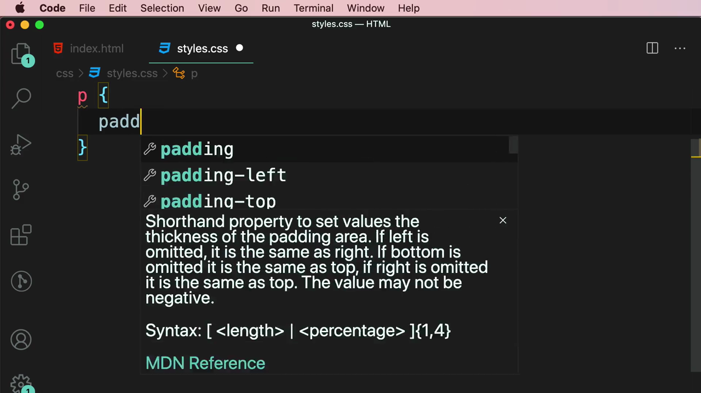

ตัวเลือกที่ IntelliSense แนะนำ: `padding`, `padding-left`, `padding-top`, `padding-bottom` (และ `padding-right` ที่ scroll ต่อได้)

ข้อความ tooltip อธิบาย `padding` (ดึงมาจากฐานข้อมูล MDN) แบบคำต่อคำ:

> **`padding`** — Shorthand property to set values the thickness of the padding area. If left is omitted, it is the same as right. If bottom is omitted it is the same as top, if right is omitted it is the same as top. The value may not be negative.
>
> **Syntax:** `[ <length> | <percentage> ]{1,4}`

> **แปลและอธิบายเพิ่มเติม:** `padding` เป็น shorthand property ที่รับค่าได้ตั้งแต่ 1 ถึง 4 ค่า:
> - **1 ค่า** เช่น `padding: 20px;` → ใช้ค่าเดียวกันทั้ง 4 ด้าน (บน ล่าง ซ้าย ขวา)
> - **2 ค่า** เช่น `padding: 10px 20px;` → ค่าแรก = บน-ล่าง, ค่าที่สอง = ซ้าย-ขวา
> - **3 ค่า** เช่น `padding: 10px 20px 30px;` → บน, ซ้าย-ขวา, ล่าง
> - **4 ค่า** เช่น `padding: 10px 20px 30px 40px;` → บน, ขวา, ล่าง, ซ้าย (ตามเข็มนาฬิกาเริ่มจากบน)
>
> กฎ "ถ้าไม่ใส่ครบ ให้ใช้ค่าตรงข้ามซ้ำ" ตามที่ tooltip อธิบายไว้ ก็คือหลักการ 2/3/4-value shorthand ของ CSS นั่นเอง

---

## 6. ทดลองใส่ `padding` แบบ 2 ค่า (บน-ล่าง ≠ ซ้าย-ขวา)

Mosh ใส่ค่า `padding` แบบ 2 ค่าไม่เท่ากัน (บน-ล่าง 10px, ซ้าย-ขวา 20px) แล้วยังเพิ่ม `border` เข้าไปด้วยเพื่อให้เห็นชั้น border ชัดขึ้นในแผนภาพ:

```css
p {
  padding: 10px 20px;
  border: 5px solid;
}
```

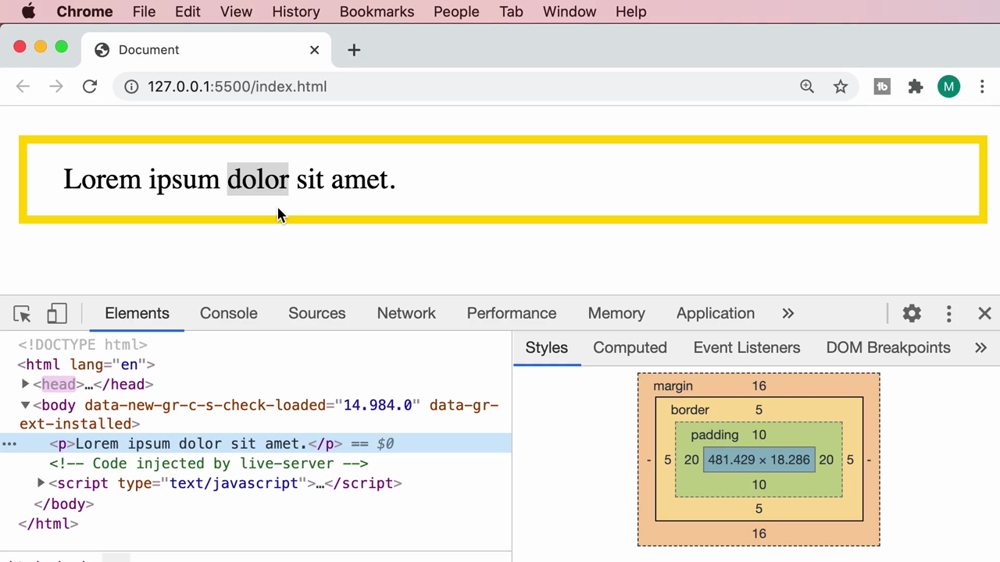

แผนภาพ Box Model อัปเดตทันที:

```
margin   16
  border   5
    padding   10 (บน/ล่าง)   20 (ซ้าย/ขวา)
      content   481.429 x 18.286
```

จะเห็นว่าตอนนี้ **border หนา 5px** ปรากฏขึ้นเป็นชั้นเพิ่มระหว่าง padding กับ margin และ **padding ไม่เท่ากันทั้ง 4 ด้าน** ตามค่าที่ใส่ (บน-ล่าง 10, ซ้าย-ขวา 20) ทำให้ขนาด content แคบลงเหลือ 481.429px (เพราะ padding ซ้าย+ขวา = 40px หักออกจากความกว้างเดิม)

Hover ที่ padding ในแผนภาพ → ไฮไลต์เป็น**สีเขียว** ครอบคลุมพื้นที่ padding รอบข้อความ (พื้นที่สีเขียวรอบตัวอักษรในกล่องสีเหลืองอ่อนของ border):

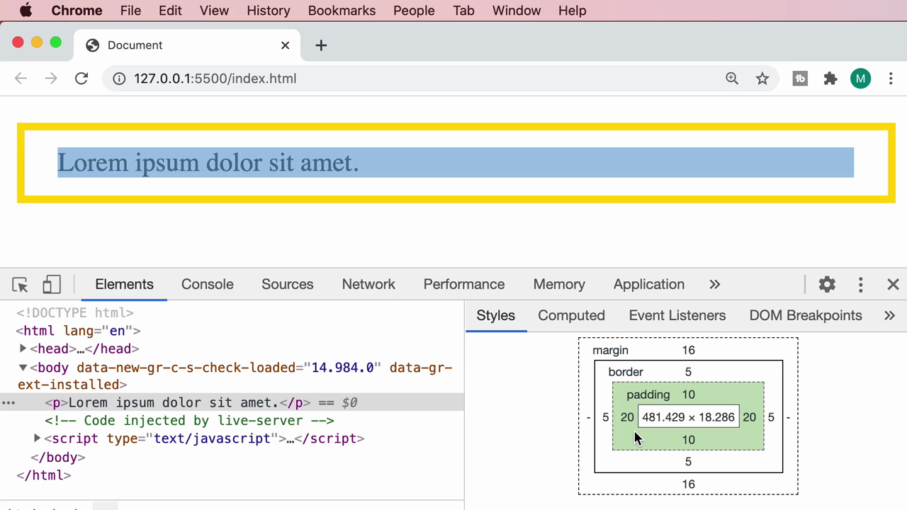

> **สรุปสีไฮไลต์ของ DevTools Box Model:** เมื่อ hover จะไฮไลต์แต่ละชั้นด้วยสีมาตรฐานเดียวกันเสมอในทุกโปรเจกต์ คือ **สีฟ้า = content, สีเขียว = padding, สีเหลือง/ส้มอ่อน = border, สีส้ม = margin** — จำสีเหล่านี้ไว้จะช่วยให้ debug layout ได้เร็วขึ้นมากในอนาคต

---

## 7. เพิ่มย่อหน้าที่สอง — เปลี่ยนเป็น `padding` ค่าเดียว (เท่ากันทุกด้าน)

Mosh เพิ่ม `<p>` อีกตัวในไฟล์ `index.html` (เนื้อหาเดียวกัน) เพื่อเตรียมสาธิตเรื่อง margin ระหว่าง element ที่อยู่ติดกัน:

```html
<body>
  <p>Lorem ipsum dolor sit amet.</p>
  <p>Lorem ipsum dolor sit amet.</p>
</body>
```

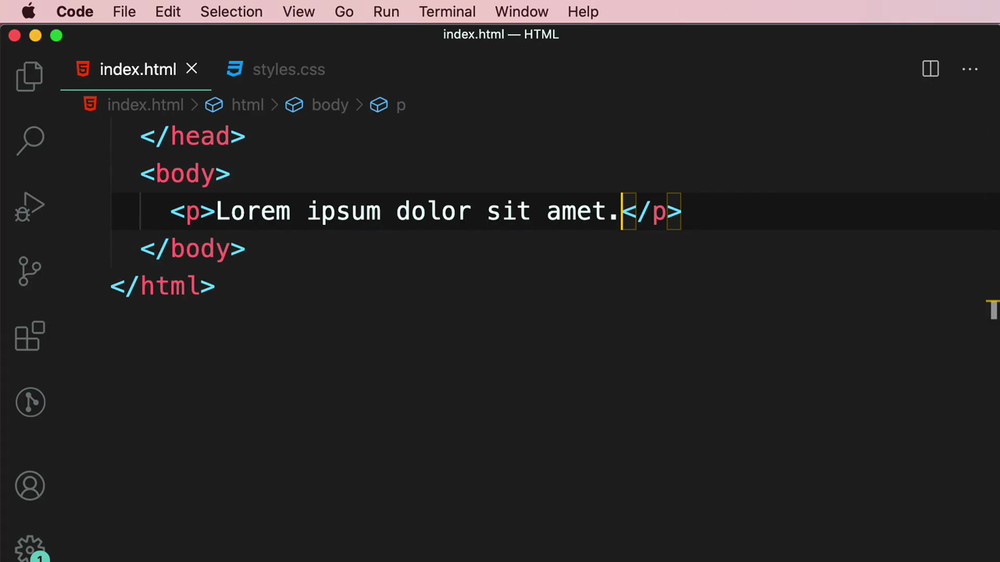

จากนั้นเปลี่ยน CSS ให้ `padding` เป็นค่าเดียว (เท่ากันทั้ง 4 ด้าน) และเอา `border` ออก:

```css
p {
  padding: 20px;
}
```

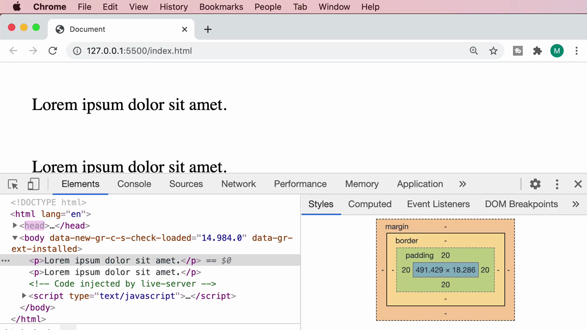

ตอนนี้ทั้งสองย่อหน้ามี**พื้นหลังสีเขียวอ่อนล้อมรอบข้อความเท่ากันทุกด้าน 20px** และมีระยะห่างจากกันเกิดจาก **margin เริ่มต้นของ `<p>` (16px)** ที่ยังคงอยู่

---

## 8. เครื่องมือวัดระยะ (Distance Measurement) ใน DevTools

เมื่อเลือก element หนึ่งไว้ใน DevTools แล้วเอาเมาส์ไปวางใกล้ element ข้างเคียง Chrome จะวาด**เส้นสีแดงพร้อมตัวเลขระยะห่างเป็นพิกเซล**ให้อัตโนมัติ ช่วยให้เห็นระยะห่างระหว่างกล่องสองใบได้แม่นยำโดยไม่ต้องคำนวณเอง:

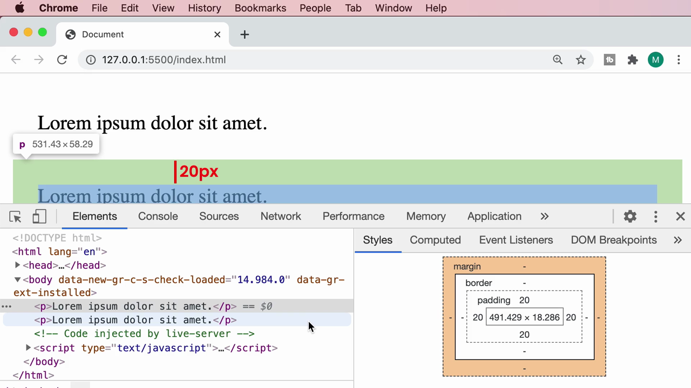

> เครื่องมือนี้มีประโยชน์มากเวลาต้องเช็คว่าทำไม element สองตัวถึงห่างกันเท่านี้ — แทนที่จะเดา สามารถวัดได้เลยจากหน้าจอจริง

---

## 9. เปลี่ยนไปทดลอง `margin` แทน `padding` — เผยปัญหาที่คนมักงง

Mosh เปลี่ยนกลับไปที่ `styles.css` แล้วลบ `padding` ออก แทนที่ด้วย `margin: 20px;` (เท่ากันทุกด้าน) ระหว่างพิมพ์ IntelliSense ก็ขึ้นแนะนำ property ที่เกี่ยวข้องอีกครั้ง (แสดง tooltip syntax แบบเดียวกับ `padding` เพราะ `margin` ก็เป็น shorthand property ลักษณะเดียวกัน):

```css
p {
  margin: 20px;
  padding: 0;
}
```

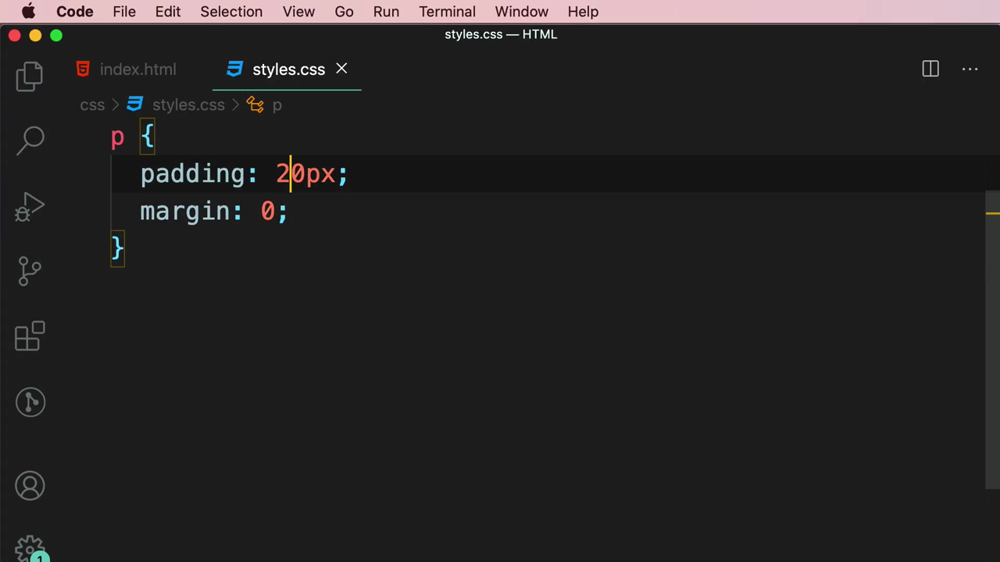

แผนภาพ Box Model อัปเดตเป็น:

```
margin   20 (ทุกด้าน)
  border   -
    padding   -
      content   491.429 x 18.286
```

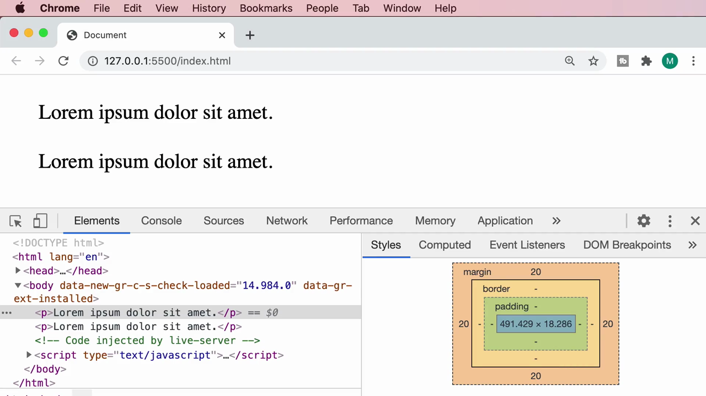

ตอนนี้ **padding หายไป (0)** เหลือแต่ **margin 20px รอบด้าน** ครอบคลุมทั้งสี่ทิศ

---

## 10. Margin Collapsing — เมื่อ margin แนวตั้งของสอง element "ชนกัน"

นี่คือจุดที่ Mosh เน้นย้ำว่าเป็นพฤติกรรมที่**คนเขียน CSS มือใหม่มักงงที่สุด**: ทั้งสองย่อหน้ามี `margin: 20px;` เท่ากัน ซึ่งถ้าคิดแบบตรงไปตรงมา ระยะห่างระหว่างย่อหน้าทั้งสองควรจะเป็น **20 + 20 = 40px** (margin-bottom ของย่อหน้าแรก บวก margin-top ของย่อหน้าที่สอง)

แต่เมื่อวัดระยะจริงด้วยเครื่องมือวัดระยะของ DevTools กลับพบว่า **ระยะห่างจริงคือแค่ 20px เท่านั้น** ไม่ใช่ 40px:

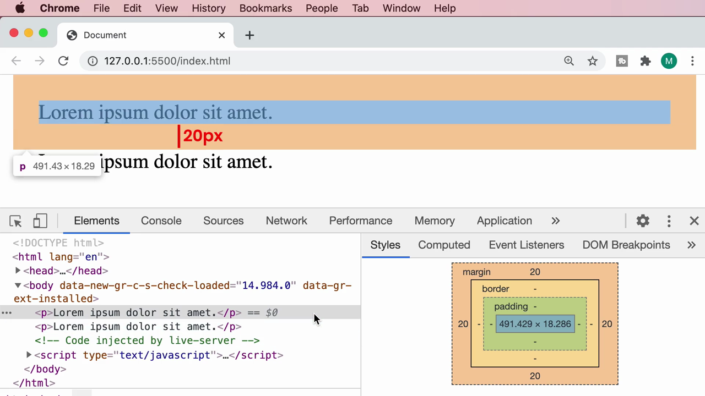

> **นี่คือปรากฏการณ์ที่เรียกว่า "Margin Collapsing" (การยุบรวมกันของ margin):**
>
> เมื่อ block-level element สองตัวเรียงต่อกันในแนวตั้ง (ตัวหนึ่งอยู่เหนืออีกตัวหนึ่ง) **margin-bottom ของตัวบนและ margin-top ของตัวล่างจะไม่ถูกบวกกัน** แต่จะ**"ยุบรวม" (collapse) เหลือแค่ค่าที่มากกว่าเพียงค่าเดียว**
>
> ในกรณีนี้ทั้งสองค่าเท่ากัน (20px ทั้งคู่) ระยะห่างที่ได้จึงเป็น **max(20, 20) = 20px** ไม่ใช่ 20+20 = 40px
>
> ถ้าค่าไม่เท่ากัน เช่น ย่อหน้าแรก `margin-bottom: 30px` และย่อหน้าที่สอง `margin-top: 20px` ระยะห่างที่ได้จะเป็น **max(30, 20) = 30px** เท่านั้น (ไม่ใช่ 50px)
>
> **ข้อควรระวัง:** Margin Collapsing เกิดขึ้นเฉพาะกับ **margin แนวตั้ง (top/bottom) ของ block-level element ที่อยู่ติดกันในโฟลว์ปกติ** เท่านั้น — **ไม่เกิดกับ margin แนวนอน (left/right)** และไม่เกิดกับ element ที่ใช้ `display: flex`, `display: grid`, หรือ `position: absolute` เป็นต้น

---

## สรุปที่ใช้ได้จริง

- **Box Model** คือหลักการที่ทุก element บนหน้าเว็บถูกมองเป็นกล่อง 4 ชั้นซ้อนกันจากในสุดไปนอกสุด: **Content → Padding → Border → Margin**
- **`padding`** คือพื้นที่ว่าง**ภายใน**กล่อง (ระหว่างเนื้อหากับเส้นขอบ) ส่วน **`margin`** คือพื้นที่ว่าง**ภายนอก**กล่อง (ระหว่างเส้นขอบกับ element ข้างเคียง)
- ทั้ง `padding` และ `margin` เป็น **shorthand property** ที่รับ 1-4 ค่าได้ ตามกฎ: 1 ค่า = ทุกด้าน, 2 ค่า = บน-ล่าง/ซ้าย-ขวา, 3 ค่า = บน/ซ้าย-ขวา/ล่าง, 4 ค่า = บน/ขวา/ล่าง/ซ้าย (ตามเข็มนาฬิกา)
- Chrome DevTools มี **Box Model diagram** ให้ดูค่าจริงของทั้ง 4 ชั้นแบบ interactive — hover ที่แต่ละชั้นจะไฮไลต์พื้นที่ที่ตรงกันในหน้าเว็บด้วยสีต่างกัน (ฟ้า=content, เขียว=padding, เหลือง=border, ส้ม=margin) และมีเครื่องมือวัดระยะห่างระหว่าง element (เส้นแดง + ตัวเลข px) ให้ใช้งานได้ทันที
- **Margin Collapsing**: margin แนวตั้ง (top/bottom) ของ block-level element ที่อยู่ติดกัน**จะยุบรวมเหลือค่าที่มากกว่าเพียงค่าเดียว ไม่ใช่ผลรวม** — เป็นพฤติกรรม default ของ CSS ที่ต้องเข้าใจไว้ ไม่งั้นจะคำนวณระยะห่างของ layout ผิดพลาดบ่อยๆ

### จุดเชื่อมกับงานจริงของ Aum

- **Tailwind CSS mapping โดยตรง:** `padding` → utility class กลุ่ม `p-*` (`p-4`, `px-4`, `py-2`, `pt-2` ฯลฯ) และ `margin` → กลุ่ม `m-*` (`m-4`, `mx-auto`, `my-2`, `mt-4` ฯลฯ) — ตัวเลขหลัง class เหล่านี้คือหน่วย spacing scale ของ Tailwind (เช่น `p-4` = `padding: 1rem` = 16px) ซึ่งใช้หลักการ shorthand แบบเดียวกับที่เรียนในคลิปนี้ทุกประการ เพียงแค่ Tailwind เขียนแยกเป็น class สั้นๆ แทนการเขียน CSS property ตรงๆ
- **`box-sizing`:** ค่า default ของเบราว์เซอร์คือ `content-box` (padding และ border จะถูก "บวกเพิ่ม" เข้าไปนอกความกว้างที่ตั้งไว้ ทำให้กล่องกว้างกว่าที่ตั้งใจ) แต่ Tailwind ตั้งค่า **`box-sizing: border-box` เป็นค่า default ให้ทุก element โดยอัตโนมัติ** (ผ่าน Preflight/reset) ทำให้ padding และ border ถูก "รวมอยู่ภายใน" ความกว้างที่กำหนด ไม่ทำให้กล่องบวมออก — นี่คือเหตุผลที่ layout ด้วย Tailwind มักจะ "นิ่ง" กว่าที่คาดไว้ตอนเทียบกับ CSS ธรรมดา
- **Margin Collapsing เป็นสาเหตุอันดับต้นๆ ของบั๊ก layout ที่ debug ยาก** โดยเฉพาะตอนทำ card list หรือ section ต่อกันใน landing page — ถ้าเจอกรณีที่ "ทำไมช่องว่างระหว่าง section ถึงไม่เท่ากับที่คำนวณไว้" ให้สงสัยเรื่องนี้เป็นอันดับแรก วิธีแก้ที่ทำงานจริงคือใช้ **Flexbox หรือ Grid พร้อม `gap` property** แทนการพึ่ง margin ล้วนๆ เพราะ `gap` **ไม่เกิด margin collapsing** เลย (Tailwind มี `gap-*` class ให้ใช้ตรงๆ)
- ทักษะการ**เปิด DevTools แล้วดู Box Model diagram** เป็นเครื่องมือ debug layout ที่สำคัญที่สุดที่ Aum ควรฝึกใช้จนชิน โดยเฉพาะตอนทำ full-stack project ที่ยังใช้ local storage/JSON server — เวลา UI ผิดเพี้ยนจากที่ตั้งใจ ให้ inspect element แล้วดูว่า padding/margin/border จริงตรงกับที่เขียนไว้ใน Tailwind class หรือไม่ ก่อนจะไปแก้จุดอื่น
