# 2-Layout: 03 - Sizing Elements (8:20)

**ไฟล์ต้นทาง:** `3-Sizing-Elements.mp4`

▶️ **[เปิดวิดีโอต้นฉบับ](../../../HTML-CSS-2/2-Layout/3-Sizing-Elements.mp4)**

---

## ภาพรวมคลิปนี้

คลิปนี้ Mosh สอนเรื่อง **การกำหนดขนาด (Sizing) ของ element** ผ่าน property `width` และ `height` พร้อมเจาะลึกว่า **`padding` และ `border` ส่งผลต่อขนาดจริงที่แสดงผลอย่างไร** ตามพฤติกรรม default ของเบราว์เซอร์ จากนั้นแนะนำ property ที่สำคัญที่สุดตัวหนึ่งคือ **`box-sizing: border-box`** ซึ่งเป็นแนวทางปฏิบัติมาตรฐาน (best practice) ที่โปรเจกต์ CSS เกือบทุกโปรเจกต์ใช้กัน และปิดท้ายด้วยแนวคิดเรื่อง **display type** (`block` / `inline` / `inline-block`) ที่ตัดสินว่า `width`/`height` จะมีผลกับ element หรือไม่

---

## 1. ไตเติลเปิดคลิป

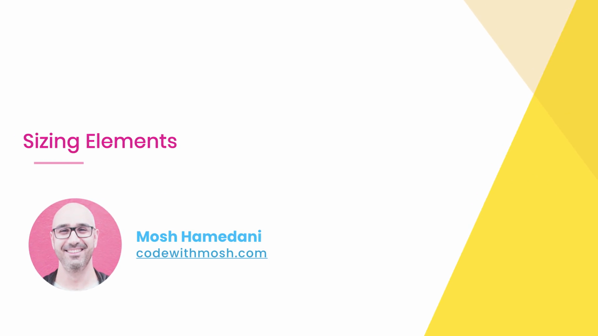

---

## 2. เริ่มต้น: สร้างกล่องด้วย `width` และ `height`

Mosh สร้าง `<div class="box"></div>` แล้วกำหนด CSS:

```css
.box {
  width: 100px;
  height: 100px;
  background-color: gold;
}
```

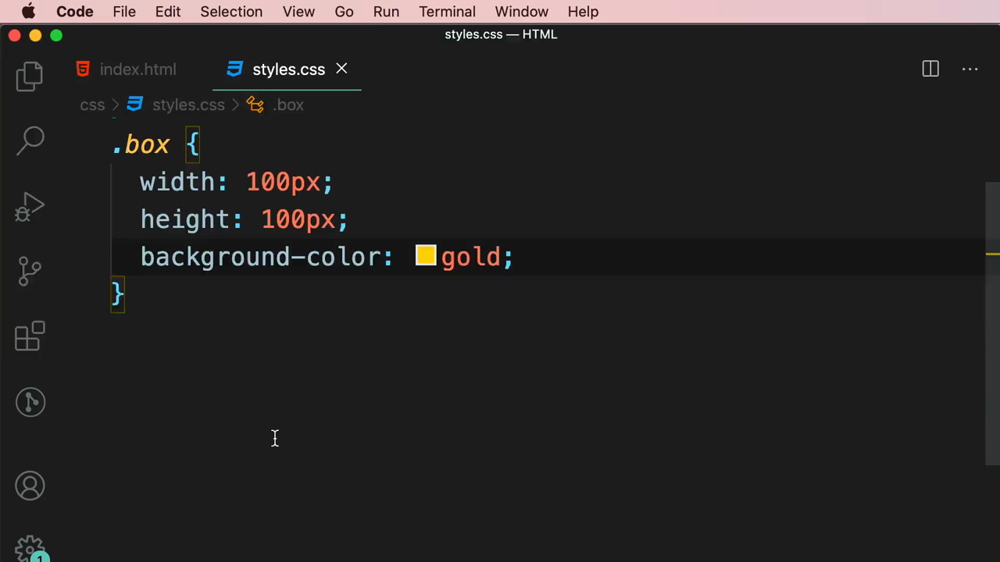

ผลลัพธ์ในเบราว์เซอร์: กล่องสีทอง (gold) ขนาด **100 x 100 พิกเซล** ตรงตามที่กำหนดไว้ทุกประการ (ยืนยันด้วย box model diagram ใน DevTools ที่แสดง content = 100x100 และ margin/border/padding เป็น 0 ทั้งหมด):

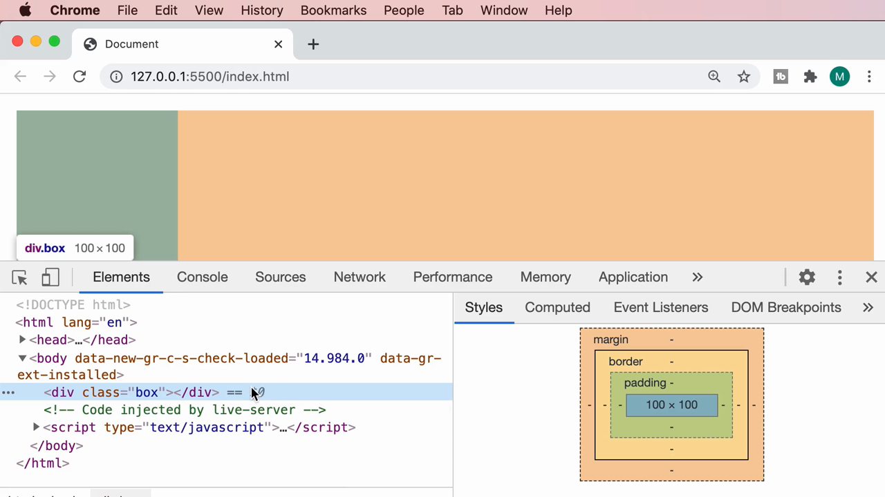

---

## 3. เพิ่ม `padding` และ `border` — ทำไมกล่องถึง "ใหญ่กว่าที่ตั้งไว้"

Mosh เพิ่ม `padding: 20px;` และ `border: 10px solid orange;` เข้าไป:

```css
.box {
  width: 100px;
  height: 100px;
  background-color: gold;
  padding: 20px;
  border: 10px solid orange;
}
```

Box model diagram อัปเดตเป็น:

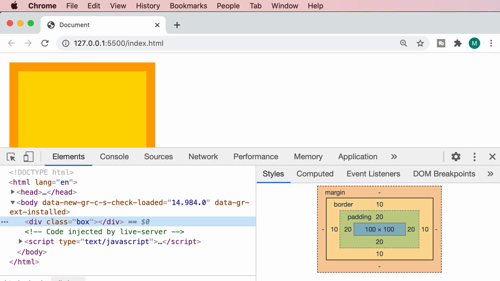

```
border   10
  padding   20
    content   100 x 100
```

แต่เมื่อดู**ขนาดจริงที่เบราว์เซอร์วาดออกมา** กลับพบว่ากล่องมีขนาด **160 x 160 พิกเซล** ไม่ใช่ 100 x 100 ตามที่ตั้งใจ:

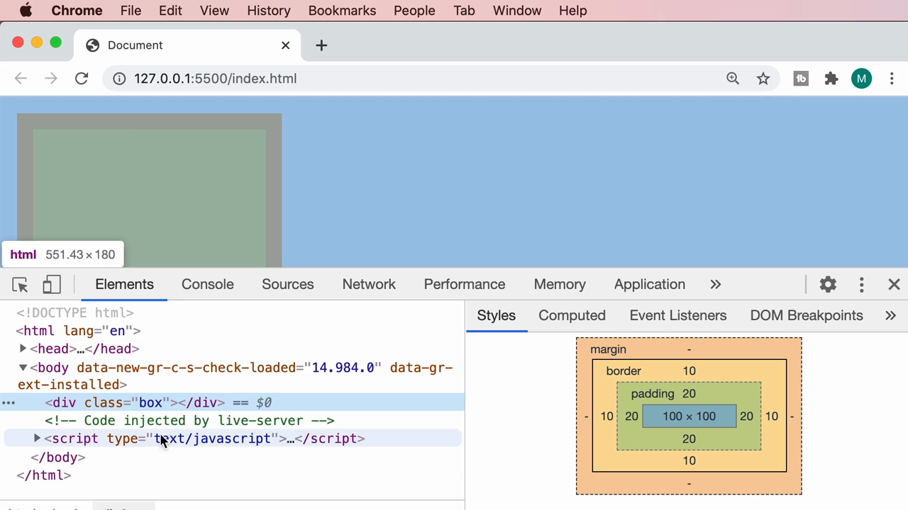

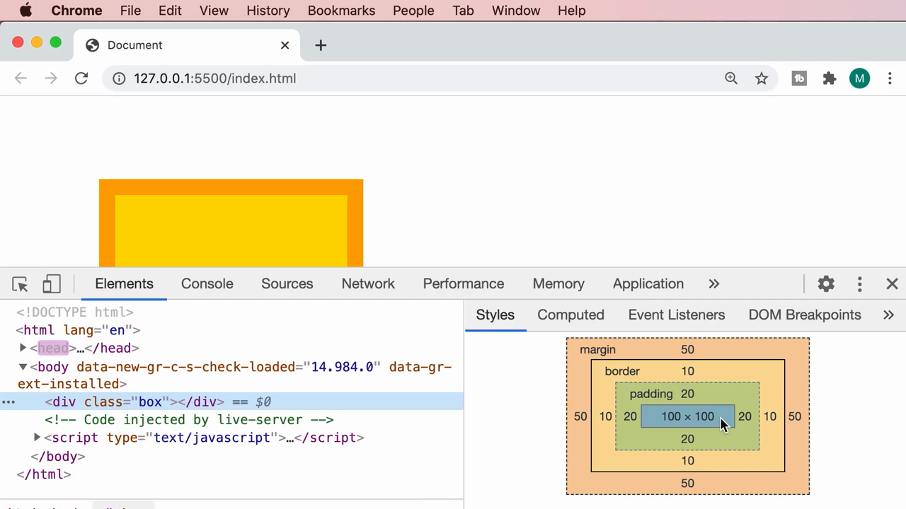

> **ทำไมถึงเป็น 160?** เพราะค่า default ของเบราว์เซอร์คือ **`box-sizing: content-box`** ซึ่งหมายความว่า `width`/`height` ที่เรากำหนด **ใช้กับ content เท่านั้น** ส่วน `padding` และ `border` จะถูก **"บวกเพิ่ม" เข้าไปนอกเหนือ** จากขนาดที่ตั้งไว้เสมอ
>
> คำนวณได้ดังนี้: 100 (content) + 20×2 (padding ซ้าย-ขวา/บน-ล่าง) + 10×2 (border ซ้าย-ขวา/บน-ล่าง) = **160 x 160**

---

## 4. เพิ่ม `margin` — ยืนยันว่า margin ไม่ทำให้กล่อง "โต" ขึ้น

Mosh เพิ่ม `margin: 50px;`:

```css
.box {
  width: 100px;
  height: 100px;
  background-color: gold;
  padding: 20px;
  border: 10px solid orange;
  margin: 50px;
}
```

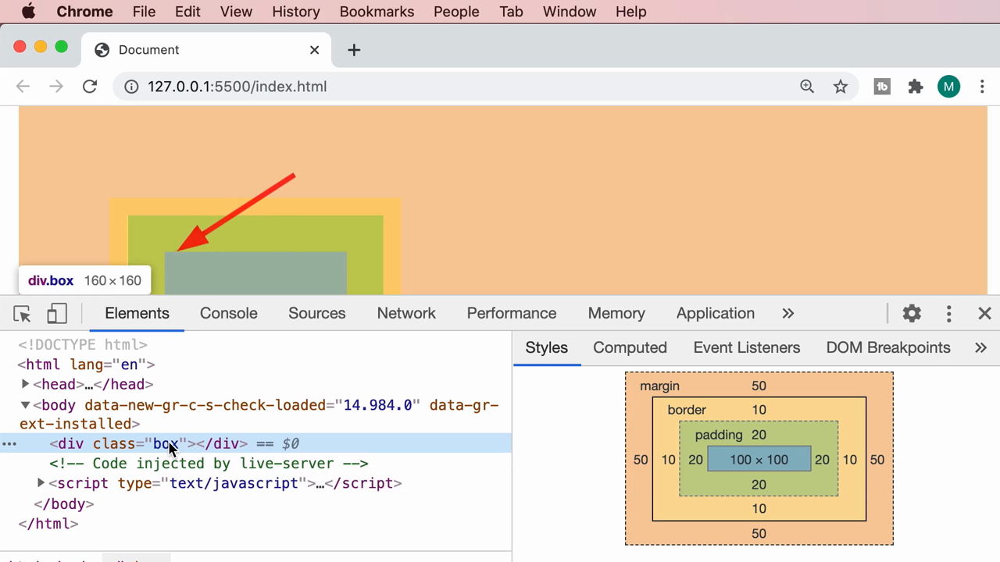

Box model diagram แสดง margin = 50 เพิ่มเข้ามาเป็นชั้นนอกสุด:

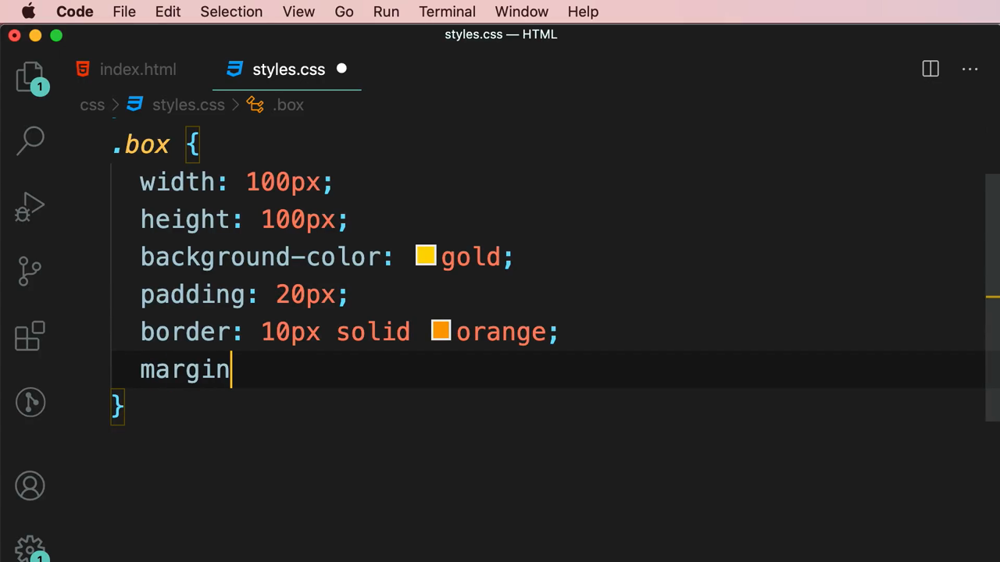

> **จุดสำคัญ:** ถึงแม้ margin จะมีค่าเยอะถึง 50px แต่**ขนาดของกล่องเอง (ที่ DevTools รายงานเป็น 160 x 160) ไม่เปลี่ยนแปลง** เพราะ margin เป็นแค่ "ระยะห่างจาก element ข้างเคียง" ไม่ใช่ส่วนหนึ่งของขนาดกล่อง (ต่างจาก padding และ border ที่ไปเพิ่มขนาดกล่องโดยตรงเมื่อใช้ `content-box`)

---

## 5. `box-sizing: border-box` — ทางแก้ปัญหานี้

Mosh เพิ่ม property `box-sizing: border-box;` เข้าไปใน `.box` (ยังมี `padding` และ `border` อยู่):

```css
.box {
  width: 100px;
  height: 100px;
  background-color: gold;
  padding: 20px;
  border: 10px solid orange;
  box-sizing: border-box;
}
```


ผลลัพธ์ที่เกิดขึ้นน่าประหลาดใจ: **กล่องด้านนอกยังคงมีขนาด 100 x 100 พิกเซลตามที่ตั้งใจไว้แต่แรก** แต่ **พื้นที่ content ด้านในกลับหดเหลือแค่ 40 x 40 พิกเซล**:

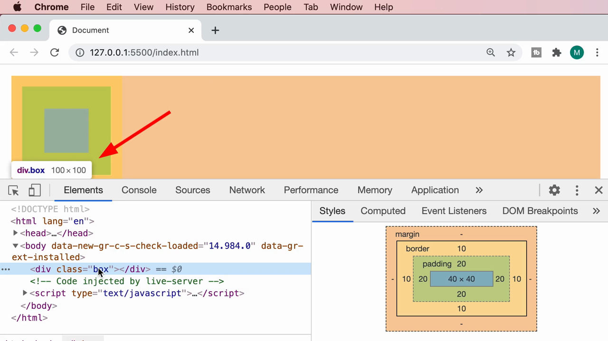

```
border   10
  padding   20
    content   40 x 40     ← หดจาก 100x100 เหลือ 40x40
```

> **อธิบายหลักการของ `box-sizing: border-box`:** เมื่อเปลี่ยนมาใช้ค่านี้ ความหมายของ `width`/`height` จะเปลี่ยนไปโดยสิ้นเชิง — แทนที่จะหมายถึง "ขนาดของ content เท่านั้น" มันจะหมายถึง **"ขนาดรวมทั้งหมดของกล่อง (รวม padding และ border ด้วย)"**
>
> คำนวณได้ว่า: 100 (ขนาดกล่องทั้งหมดที่ตั้งไว้) − 20×2 (padding) − 10×2 (border) = **content เหลือแค่ 40 x 40**
>
> พูดง่ายๆ คือ **`border-box` ทำให้ตัวเลขที่เราตั้งใน `width`/`height` คือขนาดจริงที่จะเห็นบนหน้าจอเป๊ะๆ** ไม่ต้องมานั่งคำนวณบวก padding/border เพิ่มเองอีกต่อไป — นี่คือเหตุผลที่นักพัฒนาส่วนใหญ่นิยมใช้ `border-box` แทน `content-box` (ค่า default)

---

## 6. ทดสอบ: `box-sizing: border-box` เพียงอย่างเดียวไม่มี padding/border จะเป็นอย่างไร?

Mosh ลองลบ `padding` และ `border` ออกชั่วคราว เหลือแค่ `box-sizing: border-box;`:

```css
.box {
  width: 100px;
  height: 100px;
  background-color: gold;
  box-sizing: border-box;
}
```

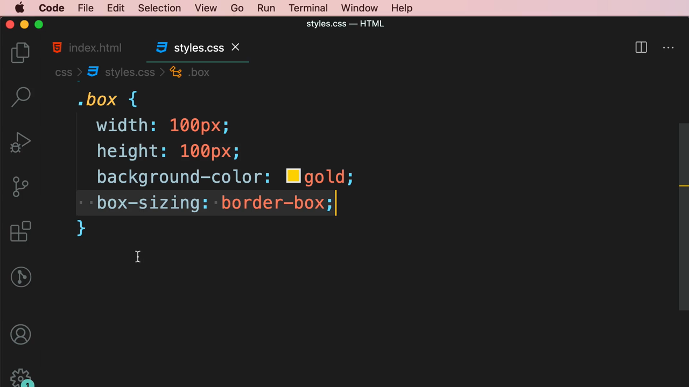

ผลลัพธ์: กล่องกลับมาเป็น **100 x 100 เหมือนเดิม** ไม่มีอะไรเปลี่ยนแปลง

> **สรุปจากการทดลองนี้:** `box-sizing: border-box` จะ**มีผลก็ต่อเมื่อ element นั้นมี `padding` หรือ `border` เท่านั้น** ถ้าไม่มีทั้งสองอย่าง ค่า `content-box` (default) กับ `border-box` จะให้ผลลัพธ์เหมือนกันทุกประการ

---

## 7. Best Practice: ใช้ Universal Selector รีเซ็ต `box-sizing` ให้ทุก element

เพราะ `box-sizing: border-box` มีประโยชน์และคาดเดาขนาดได้ง่ายกว่ามาก Mosh แนะนำว่า **ควรตั้งค่านี้ให้กับทุก element ในโปรเจกต์ตั้งแต่ต้น** โดยใช้ **Universal Selector (`*`)**:

```css
* {
  box-sizing: border-box;
}

body {
  margin: 10px;
}

.box {
  width: 100px;
  height: 100px;
  background-color: gold;
}
```

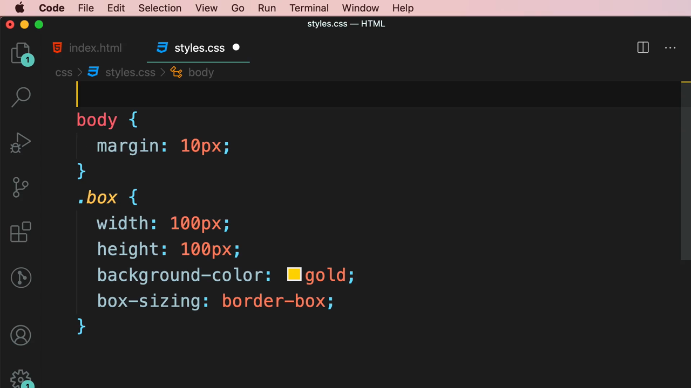

เมื่อรีเซ็ตแบบนี้แล้ว **ไม่จำเป็นต้องเขียน `box-sizing: border-box;` ซ้ำในทุก class อีกต่อไป** เพราะทุก element ในหน้าเว็บได้รับค่านี้แบบอัตโนมัติจากกฎ `*` (universal selector ครอบคลุมทุก element ในเอกสาร) ยืนยันด้วย box model diagram ที่แสดงผลถูกต้องเหมือนเดิม:

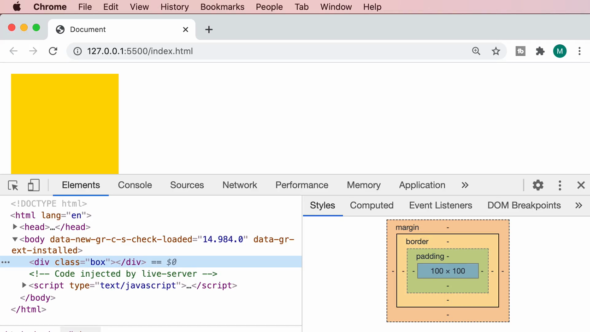

---

## 8. ทดลองเพิ่มเนื้อหาผ่าน Pseudo-element `::before`

ระหว่างสาธิต Mosh เพิ่ม pseudo-element `.box::before` พร้อม property `content` เพื่อแสดงข้อความ **"Hello"** ผ่าน CSS ล้วนๆ โดยไม่ต้องพิมพ์ข้อความลงใน HTML โดยตรง:

```css
.box::before {
  content: "Hello";
}
```

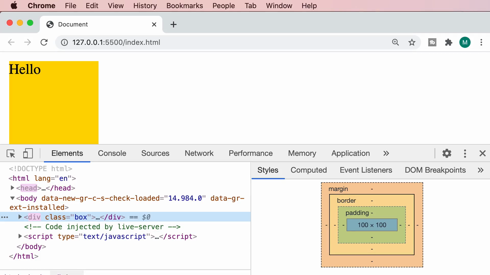

ใน Elements panel จะเห็น `::before` ปรากฏเป็น node ลูกของ `<div class="box">` และเนื้อหา "Hello" จะแสดงผลราวกับเป็นข้อความจริงในหน้าเว็บ

---

## 9. Universal Selector แบบสมบูรณ์ — อย่าลืม `::before` และ `::after`

Mosh อธิบายว่า pseudo-element อย่าง `::before` และ `::after` **ไม่ได้รับผลจาก `*` โดยอัตโนมัติ** จึงต้องเขียน selector เพิ่มให้ครอบคลุมทั้งสองตัวด้วย เพื่อให้การรีเซ็ต `box-sizing: border-box` สมบูรณ์ 100%:

```css
*,
*::before,
*::after {
  box-sizing: border-box;
}
```

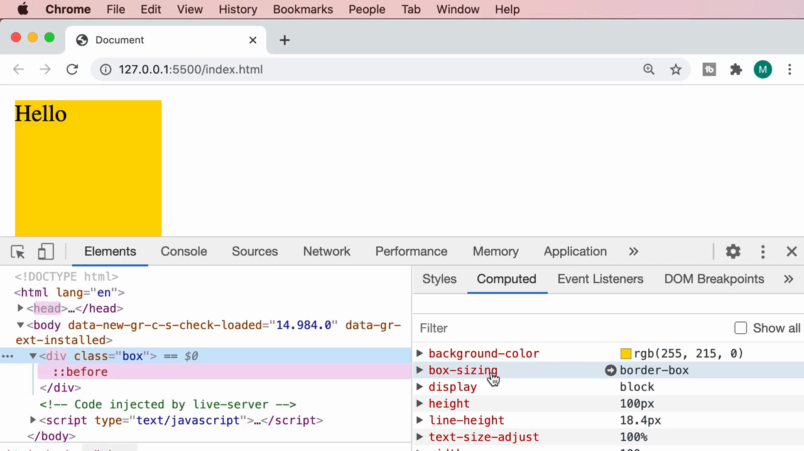

> **นี่คือ pattern มาตรฐาน (universal box-sizing reset)** ที่ปรากฏอยู่ในเกือบทุกโปรเจกต์ CSS สมัยใหม่ ไม่ว่าจะเป็นโปรเจกต์เปล่าหรือ CSS framework ต่างๆ — ควรใส่ไว้บนสุดของไฟล์ CSS เสมอ

Mosh ยังสาธิตวิธีตรวจสอบด้วยแท็บ **Computed** ใน DevTools ซึ่งจะแสดง**ค่าที่ถูกคำนวณจริงสุดท้าย (final resolved value)** ของทุก property ไม่ว่าค่านั้นจะมาจาก selector ไหนก็ตาม — ใช้ยืนยันได้ว่า `box-sizing: border-box` มีผลกับ `.box` จริงๆ ผ่านกฎ `*` ที่เขียนแยกไว้คนละที่:

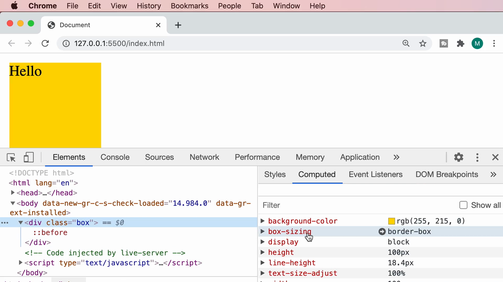

> **แท็บ Styles vs แท็บ Computed:**
> - **Styles** แสดงกฎ CSS ทั้งหมดที่เขียนไว้ (รวมกฎที่ถูก override/ขีดฆ่าทิ้ง) เรียงตามลำดับ specificity
> - **Computed** แสดงเฉพาะ**ค่าสุดท้ายที่เบราว์เซอร์ใช้จริง**ของทุก property (ค่าเดียวต่อ 1 property) เหมาะมากเวลาอยากรู้ "สรุปแล้วค่านี้คืออะไรกันแน่" โดยไม่ต้องไล่ดูทุกกฎเอง

---

## 10. Display Type — ทำไม `width`/`height` บางครั้งไม่มีผล?

ส่วนสุดท้ายของคลิป Mosh เปลี่ยนแท็ก `<div>` เป็น **`<span>`** (ยังใช้ class `box` เหมือนเดิม ไม่เปลี่ยน CSS):

```html
<span class="box"></span>
<span class="box"></span>
```

ผลลัพธ์ที่ได้ **ไม่ใช่กล่อง 100x100 สองอันเหมือนก่อนหน้า** แต่กลับเป็นแค่พื้นที่สีทองแคบๆ พอดีกับตัวอักษร "Hello" ที่มาจาก `::before` เท่านั้น — `width: 100px;` และ `height: 100px;` ที่ตั้งไว้**ถูกเบราว์เซอร์เพิกเฉยไปเลย**:

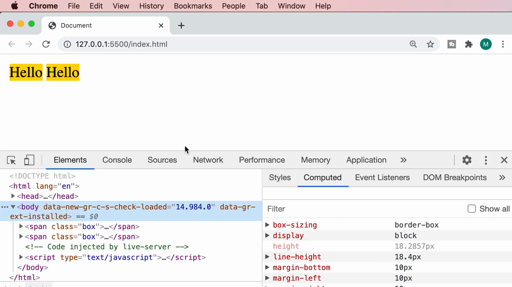

> **สาเหตุ:** `<span>` เป็น **inline element** โดย default (ต่างจาก `<div>` ซึ่งเป็น **block element**) และกฎสำคัญของ CSS คือ **inline element จะไม่รับค่า `width` และ `height` ที่กำหนดไว้เลย** ขนาดของมันจะถูกกำหนดโดยเนื้อหาข้างในเท่านั้น (เช่น ขนาดตัวอักษร)

Mosh แก้ปัญหานี้ด้วยการเพิ่ม property **`display: inline-block;`** ให้กับ `.box`:

```css
.box {
  width: 100px;
  height: 100px;
  background-color: gold;
  display: inline-block;
}
```

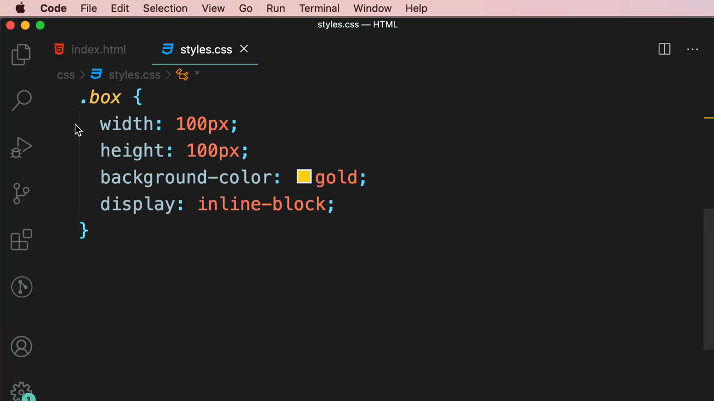

ผลลัพธ์: ทั้งสอง `<span>` กลับมาเป็นกล่องขนาด **100 x 100 เต็มตามที่ตั้งไว้** และยังคง**เรียงตัวอยู่ในแนวเดียวกัน (ไม่ขึ้นบรรทัดใหม่)** เหมือน inline element ทั่วไป:

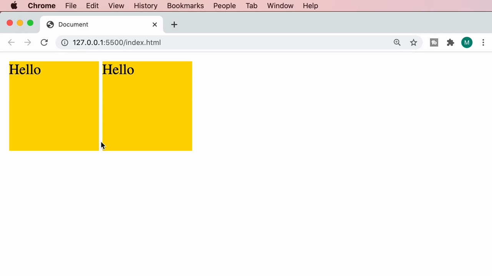

> **สรุปความแตกต่างของ `display` ทั้ง 3 แบบที่เกี่ยวข้อง:**
> - **`block`** (default ของ `<div>`, `<p>`, `<h1>` ฯลฯ) — รับค่า `width`/`height` เต็มที่, ขึ้นบรรทัดใหม่เสมอ (กินพื้นที่เต็มความกว้างของ parent โดย default)
> - **`inline`** (default ของ `<span>`, `<a>`, `<strong>` ฯลฯ) — **ไม่รับค่า `width`/`height` เลย**, เรียงต่อกันในบรรทัดเดียวกัน
> - **`inline-block`** — **รับค่า `width`/`height` ได้เหมือน block** แต่ยัง**เรียงต่อกันในบรรทัดเดียวกันได้เหมือน inline** (ผสมข้อดีของทั้งสองแบบเข้าด้วยกัน)

---

## สรุปที่ใช้ได้จริง

- ค่า default ของเบราว์เซอร์คือ **`box-sizing: content-box`** ซึ่งทำให้ `padding` และ `border` ถูก "บวกเพิ่ม" นอกเหนือจาก `width`/`height` ที่ตั้งไว้ ทำให้กล่องมักจะ**ใหญ่กว่าที่ตั้งใจ**
- **`box-sizing: border-box`** เปลี่ยนความหมายของ `width`/`height` ให้เป็น**ขนาดรวมทั้งหมด** (รวม padding+border) ทำให้ตัวเลขที่ตั้งไว้ตรงกับขนาดจริงบนหน้าจอเป๊ะๆ
- **Universal box-sizing reset** เป็น pattern มาตรฐานที่ควรใส่ไว้บนสุดของทุกโปรเจกต์: `*, *::before, *::after { box-sizing: border-box; }` (อย่าลืม `::before`/`::after` เพราะ `*` เพียงอย่างเดียวไม่ครอบคลุมถึง)
- แท็บ **Computed** ใน DevTools ใช้เช็คค่าสุดท้ายที่เบราว์เซอร์ใช้จริงของทุก property ได้ในที่เดียว
- **`width`/`height` มีผลเฉพาะกับ block-level และ inline-block element เท่านั้น** — inline element (เช่น `<span>`) จะเพิกเฉยต่อค่าเหล่านี้เสมอ จนกว่าจะเปลี่ยน `display` เป็น `inline-block` หรือ `block`

### จุดเชื่อมกับงานจริงของ Aum

- **Tailwind CSS ตั้งค่า `box-sizing: border-box` ให้ทุก element โดยอัตโนมัติผ่าน Preflight** (CSS reset ในตัว) ดังนั้น Aum ไม่ต้องเขียน universal selector reset เองเวลาใช้ Tailwind — แต่การเข้าใจว่าทำไมมันสำคัญ (จากคลิปนี้) จะช่วยให้ debug ปัญหาขนาด element ได้เร็วขึ้นมากเวลาทำงานกับ framework CSS อื่นที่ไม่มี reset นี้มาให้
- แนวคิดเรื่อง **`display: block / inline / inline-block`** ตรงกับ Tailwind utility class กลุ่ม `block`, `inline`, `inline-block`, `flex`, `grid` โดยตรง — เวลาเจอปัญหา "ทำไมใส่ `w-` หรือ `h-` แล้วไม่มีผล" ให้ตรวจสอบก่อนว่า element นั้นเป็น inline อยู่หรือไม่ (เช่น `<span>`, `<a>` ที่ยังไม่ได้ใส่ `inline-block`/`flex`)
- แท็บ **Computed** ของ DevTools เป็นเครื่องมือ debug ที่มีประโยชน์มากเวลาทำงานกับ Tailwind เพราะบางครั้ง utility class หลายตัวอาจ override กันเอง การดูค่าที่ "คำนวณจริงสุดท้าย" ช่วยยืนยันได้ไวกว่าการไล่เช็คทุก class ที่ใส่ไว้ใน HTML
- ทักษะเรื่อง content-box vs border-box และ inline vs block เป็นพื้นฐานสำคัญมากก่อนจะไปเรียน **Flexbox และ Grid** ที่ Aum ต้องใช้ทุกวันในการทำ landing page เพราะ layout system ทั้งสองตัวนี้เปลี่ยนพฤติกรรม `display` ของ element โดยตรง (Flexbox/Grid คือ `display: flex` / `display: grid`) และยังคงต้องอาศัยความเข้าใจเรื่อง box-sizing เป็นพื้นฐานอยู่เสมอ
