# 2-Layout: 04 - Overflowing (3:03)

**ไฟล์ต้นทาง:** `4-Overflowing.mp4`

▶️ **[เปิดวิดีโอต้นฉบับ](../../../HTML-CSS-2/2-Layout/4-Overflowing.mp4)**

---

## ภาพรวมคลิปนี้

คลิปนี้ Mosh สอนเรื่อง **`overflow`** — property ที่ควบคุมว่าจะเกิดอะไรขึ้นเมื่อ**เนื้อหาภายใน element มีขนาดใหญ่กว่ากล่องที่กำหนดไว้** (เช่น ตั้ง `height` ไว้ตายตัวแต่ข้อความยาวเกินกว่าจะพอดี) พร้อมสาธิตค่าที่เป็นไปได้ทั้งหมดของ `overflow` ผ่านตัวอย่างข้อความ Lorem Ipsum ที่ยาวเกินกล่อง

---

## 1. ไตเติลเปิดคลิป

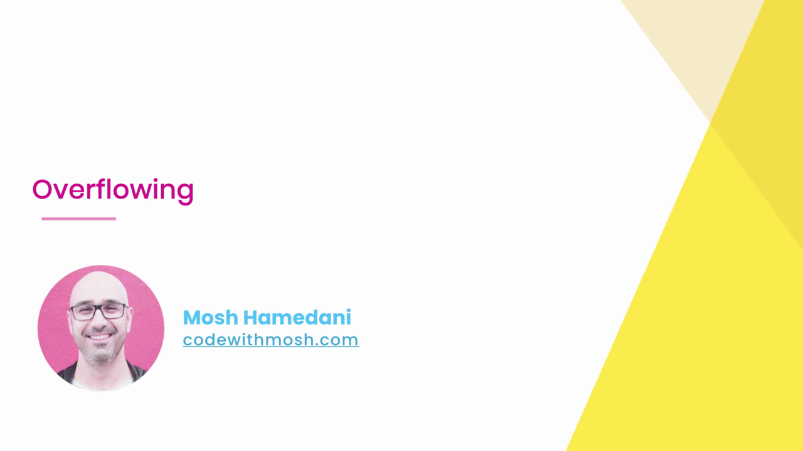

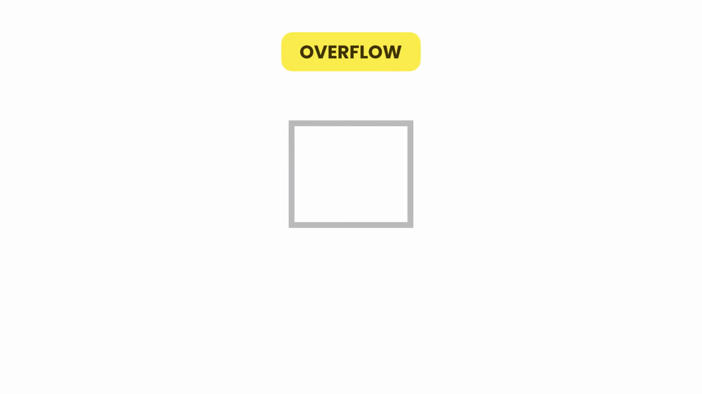

---

## 2. อุปมาเปิดเรื่อง — น้ำล้นแก้ว

Mosh เปิดด้วยวิดีโอเปรียบเทียบ **น้ำที่เทลงแก้วจนล้นออกมา** เพื่ออธิบายแนวคิดของคำว่า **"Overflow" (การล้น)** แบบเห็นภาพ: เมื่อของเหลว (เนื้อหา) มีปริมาณมากกว่าที่ภาชนะ (กล่อง/element) จะรับไหว มันจะ "ล้น" ออกมานอกขอบเขตที่กำหนดไว้ — นี่คือสิ่งเดียวกันที่เกิดขึ้นกับข้อความหรือเนื้อหาใน CSS เมื่อ element มีขนาดเล็กเกินกว่าจะบรรจุเนื้อหาทั้งหมดได้


---

## 3. เตรียมตัวอย่าง: กล่องที่ยังไม่ล้น

Mosh สร้าง `<div class="box">` ที่มี `<p>` ข้อความ Lorem Ipsum ยาวๆ อยู่ข้างใน:

```html
<div class="box">
  <p>Lorem ipsum, dolor sit amet consectetur adipisicing elit. Voltage quam vero est minus nisi quasi et. Nihil inventore provident et.</p>
</div>
```

```css
.box {
  border: 3px solid gold;
  width: 150px;
}
```

ตอนนี้ **ยังไม่ได้กำหนด `height`** ให้กับกล่อง ดังนั้นความสูงของกล่องจะ**ขยายตัวเองโดยอัตโนมัติ (auto)** ให้พอดีกับปริมาณข้อความเสมอ — ไม่มีทางเกิด overflow ได้เลยในสถานการณ์นี้:

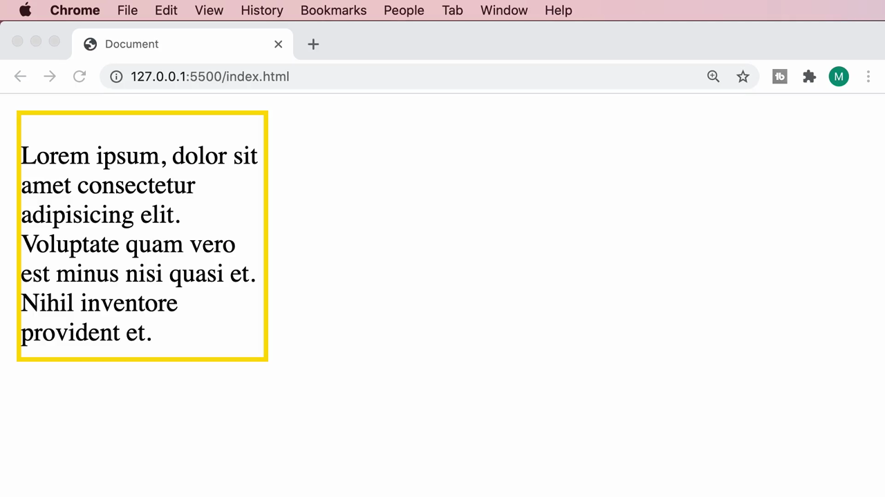

---

## 4. กำหนด `height` ตายตัว — จุดเริ่มต้นของปัญหา Overflow

Mosh เพิ่ม `height: 150px;` เข้าไปในกฎ `.box`:

```css
.box {
  border: 3px solid gold;
  width: 150px;
  height: 150px;
}
```

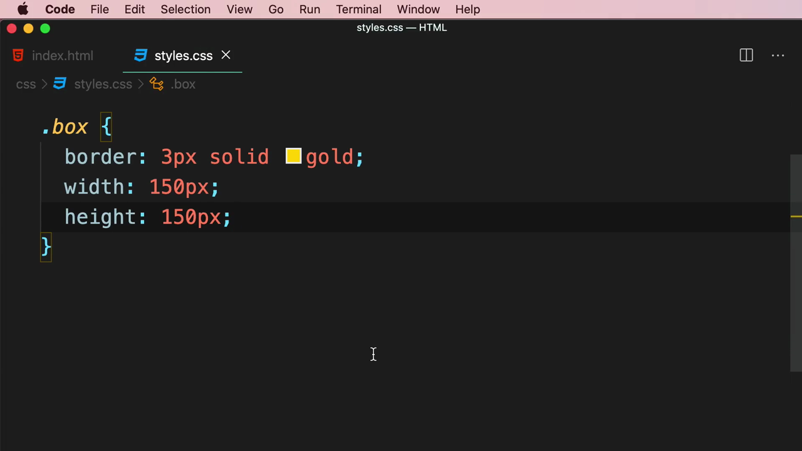

เมื่อข้อความมีมากกว่าที่ความสูง 150px จะรับไหว **เนื้อหาจะ "ล้น" ออกมานอกกรอบกล่องด้านล่าง** ทะลุผ่านเส้น border ไปเลย โดยไม่มีการตัดหรือซ่อนใดๆ:

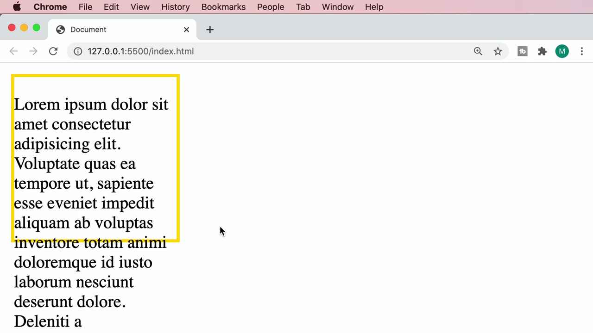

> **นี่คือค่า default ของ `overflow` คือ `visible`** — หมายความว่าเบราว์เซอร์จะ**ปล่อยให้เนื้อหาที่ล้นแสดงผลออกมาให้เห็นตามปกติ** โดยไม่ตัดหรือซ่อนอะไรเลย ถึงแม้จะทำให้ดูเหมือนกล่อง "แตก" ก็ตาม

---

## 5. `overflow: hidden;` — ซ่อนส่วนที่ล้นออกไปเงียบๆ

Mosh เปลี่ยนเป็น `overflow: hidden;`:

```css
.box {
  border: 3px solid gold;
  width: 150px;
  height: 150px;
  overflow: hidden;
}
```

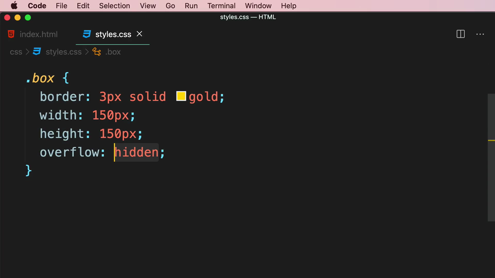

ผลลัพธ์: ข้อความที่เกินขอบเขตกล่องจะถูก **"ตัดทิ้ง" (clip) ไปเลยแบบเงียบๆ** ไม่มีการแจ้งเตือนหรือวิธีใดๆ ให้ผู้ใช้เห็นเนื้อหาส่วนที่ถูกซ่อนไป:

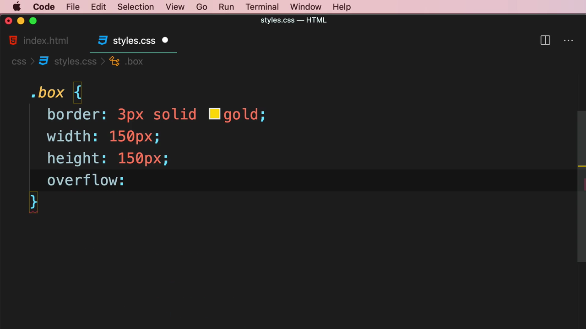

> **ข้อควรระวัง:** `overflow: hidden` มีประโยชน์เวลาต้องการซ่อนเนื้อหาส่วนเกินโดยตั้งใจ (เช่น ตัดรูปภาพให้อยู่ในกรอบ) แต่ถ้าใช้กับข้อความสำคัญที่ผู้ใช้ต้องอ่านครบ อาจทำให้ **ข้อมูลบางส่วนหายไปโดยผู้ใช้ไม่รู้ตัวเลย** — ต้องใช้อย่างระมัดระวัง

---

## 6. `overflow: scroll;` — ให้ผู้ใช้เลื่อนดูเนื้อหาที่ล้นได้เอง

Mosh เปลี่ยนเป็น `overflow: scroll;`:

```css
.box {
  border: 3px solid gold;
  width: 150px;
  height: 150px;
  overflow: scroll;
}
```

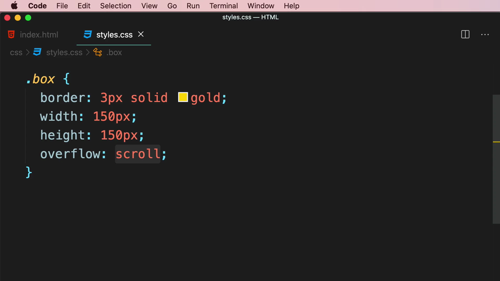

ผลลัพธ์: กล่องจะแสดง **scrollbar แนวตั้ง** ขึ้นมาโดยอัตโนมัติทางด้านขวาของกล่อง ทำให้ผู้ใช้**เลื่อนดูเนื้อหาที่เกินมาได้เอง** โดยไม่มีข้อมูลสูญหาย:

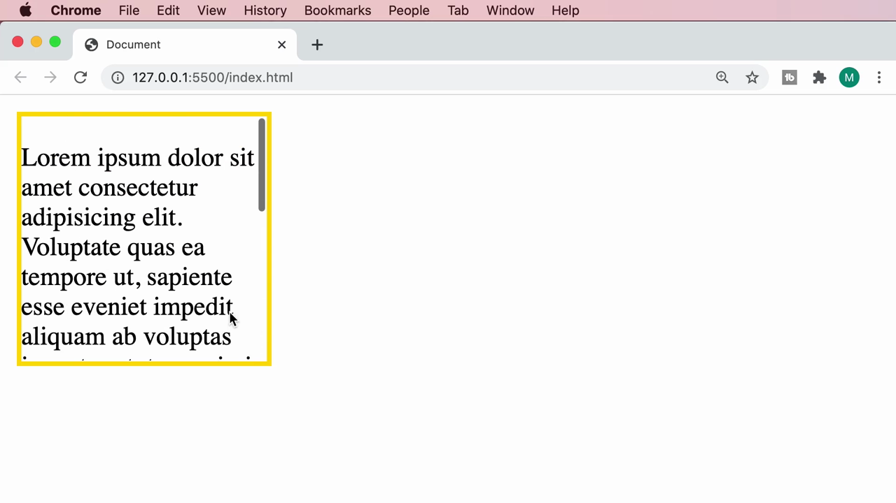

เมื่อเลื่อน scrollbar ลง จะเห็นข้อความส่วนที่เหลือที่เคยถูกซ่อน/ล้นออกไป:

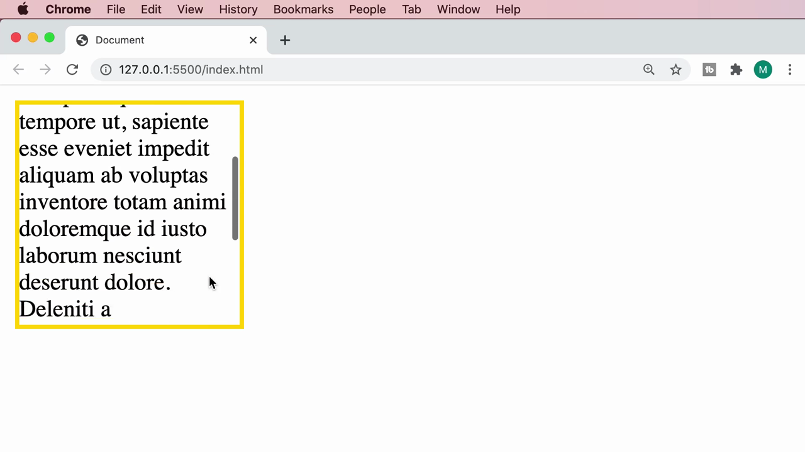

> **ข้อสังเกตสำคัญ:** `overflow: scroll` จะ**แสดง scrollbar ไว้เสมอ ไม่ว่าเนื้อหาจะล้นจริงหรือไม่ก็ตาม** ซึ่งบางครั้งอาจดูไม่สวยงามถ้าเนื้อหาพอดีกับกล่องอยู่แล้วแต่ scrollbar ก็ยังโผล่มาให้เห็น (แม้จะเลื่อนไม่ได้เพราะไม่มีอะไรให้เลื่อน)

---

## 7. `overflow: auto;` — ค่าที่ "ฉลาด" ที่สุด

สุดท้าย Mosh แนะนำ `overflow: auto;` และเริ่มพิมพ์ `overflow-x:` เพื่อแนะนำว่าสามารถควบคุมแยกแกนได้ด้วย:

```css
.box {
  border: 3px solid gold;
  width: 150px;
  height: 150px;
  overflow: auto;
}
```

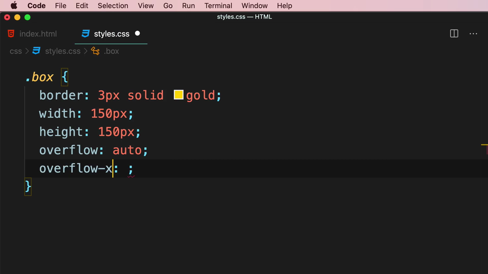

> **`overflow: auto` ทำงานอย่างชาญฉลาด:** เบราว์เซอร์จะ**แสดง scrollbar ก็ต่อเมื่อเนื้อหาล้นออกจากกล่องจริงๆ เท่านั้น** ถ้าเนื้อหาพอดีกับขนาดกล่องอยู่แล้ว จะไม่มี scrollbar ปรากฏขึ้นมาให้เกะกะเลย — นี่คือเหตุผลที่ `auto` มักเป็นค่าที่นักพัฒนาเลือกใช้บ่อยที่สุดในทางปฏิบัติ (ดีกว่าทั้ง `hidden` ที่เสี่ยงซ่อนข้อมูลสำคัญ และ `scroll` ที่โชว์ scrollbar ตลอดเวลาโดยไม่จำเป็น)
>
> Mosh ยังเกริ่นถึง **`overflow-x`** และ **`overflow-y`** ซึ่งเป็น property ย่อยที่ให้ **ควบคุม overflow แยกกันคนละแกน** ได้ (แนวนอน vs แนวตั้ง) เช่น อาจต้องการให้เลื่อนได้เฉพาะแนวตั้ง (`overflow-y: auto;`) แต่ตัดเนื้อหาที่ล้นแนวนอนทิ้งไปเลย (`overflow-x: hidden;`) — มีประโยชน์มากเวลาทำตารางข้อมูลหรือ carousel ที่ต้องการเลื่อนแค่แกนเดียว

---

## สรุปที่ใช้ได้จริง

- **`overflow`** ควบคุมพฤติกรรมของเนื้อหาที่ **ใหญ่กว่ากล่องที่บรรจุมันอยู่** — เกิดขึ้นได้บ่อยเมื่อกำหนด `width`/`height` ตายตัวแต่เนื้อหาข้างในมีปริมาณไม่แน่นอน (เช่น ข้อความจาก user หรือฐานข้อมูล)
- ค่าที่เป็นไปได้ของ `overflow`:
  - **`visible`** (default) — ปล่อยให้เนื้อหาล้นออกมาให้เห็นตามปกติ ไม่ตัดอะไรเลย
  - **`hidden`** — ตัด/ซ่อนเนื้อหาส่วนที่เกินไปเลย ไม่มีทางเข้าถึงได้อีก
  - **`scroll`** — แสดง scrollbar ให้เลื่อนดูเนื้อหาที่ล้นเสมอ ไม่ว่าจะล้นจริงหรือไม่
  - **`auto`** — แสดง scrollbar เฉพาะตอนที่เนื้อหาล้นออกมาจริงๆ เท่านั้น (ค่าที่นิยมใช้มากที่สุด)
- **`overflow-x`** และ **`overflow-y`** ให้ควบคุม overflow แยกแกนแนวนอน/แนวตั้งได้อย่างอิสระจากกัน

### จุดเชื่อมกับงานจริงของ Aum

- **Tailwind CSS มี utility class ตรงตัวสำหรับทุกค่านี้:** `overflow-visible`, `overflow-hidden`, `overflow-scroll`, `overflow-auto` และแยกแกนได้ด้วย `overflow-x-*` / `overflow-y-*` (เช่น `overflow-y-auto overflow-x-hidden`) — ใช้หลักการเดียวกับที่เรียนในคลิปนี้ทุกประการ
- `overflow: hidden` เป็นเทคนิคที่ใช้บ่อยมากในงาน UI จริง เช่น **ตัดรูปโปรไฟล์ให้เป็นวงกลม** (ร่วมกับ `border-radius: 50%`), **ทำ card ที่มีขอบมนไม่ให้เนื้อหาข้างในทะลุมุมโค้งออกมา**, หรือ **จำกัดความสูงของ preview text แล้วค่อยมีปุ่ม "อ่านเพิ่มเติม"**
- `overflow-y: auto` เป็น pattern ที่พบบ่อยมากในแอปที่ Aum กำลังฝึกทำ (full-stack ด้วย local storage/JSON server) เช่น **กล่องแชท, รายการ comment, หรือ dropdown menu ที่มีรายการยาว** — ต้องการให้เลื่อนดูได้เฉพาะแนวตั้งโดยไม่กระทบ layout ด้านนอก
- ควรระวัง `overflow: hidden` กับเนื้อหาที่มาจาก user โดยตรง (เช่น ชื่อสินค้า, คอมเมนต์) เพราะถ้าข้อความยาวเกินคาด อาจทำให้ **ข้อมูลสำคัญถูกซ่อนไปโดยผู้ใช้ไม่รู้ตัว** — ควรพิจารณาใช้ `text-overflow: ellipsis;` ร่วมกับ `overflow: hidden; white-space: nowrap;` (Tailwind: `truncate`) เพื่อบอกผู้ใช้ว่ามีเนื้อหาเพิ่มเติมที่ถูกตัดไป แทนที่จะซ่อนแบบเงียบๆ
