# 2-Layout: 05 - Measurement Units (10:59)

**ไฟล์ต้นทาง:** `5-Measurement-Units.mp4`

▶️ **[เปิดวิดีโอต้นฉบับ](../../../HTML-CSS-2/2-Layout/5-Measurement-Units.mp4)**

---

## ภาพรวมคลิปนี้

คลิปนี้เป็นหนึ่งในคลิปที่**สำคัญและยาวที่สุด**ของบท Layout — Mosh สอนหน่วยวัดขนาด (Measurement Units) ทั้งหมดที่ใช้ใน CSS อย่างละเอียด แบ่งเป็น 2 กลุ่มใหญ่คือ **Absolute (สัมบูรณ์)** ได้แก่ `px` และ **Relative (สัมพัทธ์)** ได้แก่ `%`, `vw`/`vh`, และ `em`/`rem` พร้อมสาธิตให้เห็นจริงว่าแต่ละหน่วย "สัมพัทธ์กับอะไร" ผ่านตัวอย่างที่จับต้องได้ และปิดท้ายด้วยเหตุผลเชิง **accessibility (การเข้าถึง)** ว่าทำไมควรใช้หน่วยสัมพัทธ์แทน px ในโปรเจกต์จริง

---

## 1. ไตเติลเปิดคลิป และภาพรวมหน่วยวัดทั้งหมด


Mosh เปิดด้วยตารางสรุปหน่วยวัดทั้งหมดที่จะเรียนในคลิปนี้:

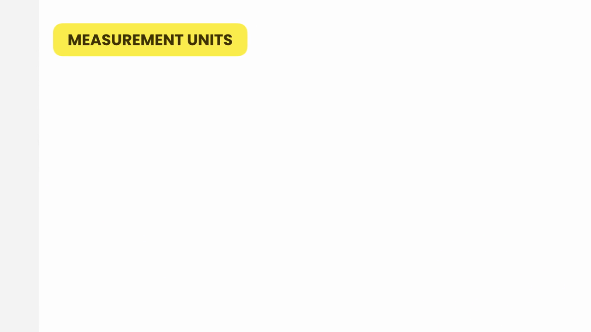

| ABSOLUTE | RELATIVE | สัมพัทธ์กับอะไร |
|---|---|---|
| `px` | | ค่าคงที่ ไม่สัมพัทธ์กับอะไรเลย |
| | `%` | สัมพัทธ์กับ**ขนาดของ container (parent)** |
| | `vw`, `vh` | สัมพัทธ์กับ**viewport** (ขนาดหน้าจอเบราว์เซอร์) |
| | `em`, `rem` | สัมพัทธ์กับ**ขนาดตัวอักษร (font size)** |

> **ความแตกต่างหลักระหว่าง Absolute กับ Relative:** หน่วย **absolute** (`px`) จะมีขนาดเท่าเดิมเสมอไม่ว่าอะไรจะเปลี่ยน ส่วนหน่วย **relative** จะเปลี่ยนขนาดไปตาม "สิ่งอ้างอิง" ของมัน (parent, viewport, หรือ font size) ทำให้เหมาะกับการทำเว็บที่ **responsive**

---

## 2. `px` — หน่วยสัมบูรณ์พื้นฐานที่สุด

Mosh เริ่มด้วยตัวอย่างพื้นฐาน:

```css
.box {
  width: 100px;
  height: 100px;
  background-color: gold;
}
```

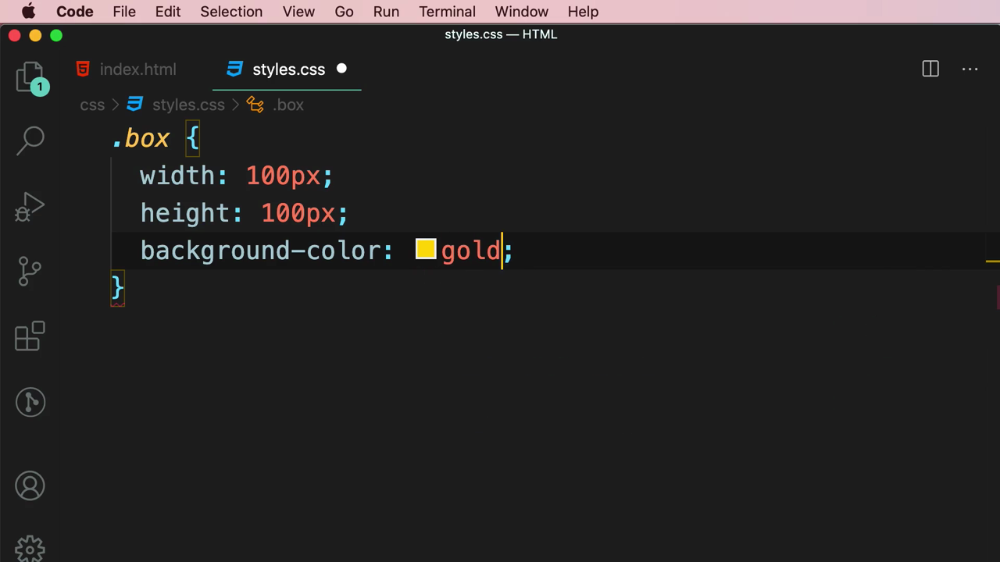

จากนั้นเพิ่ม `border-top: 3px solid orange;` เป็นเส้นสีส้มบางๆ ด้านบนเพื่อให้สังเกตขอบเขตกล่องได้ง่ายขึ้นในตัวอย่างถัดๆ ไป:

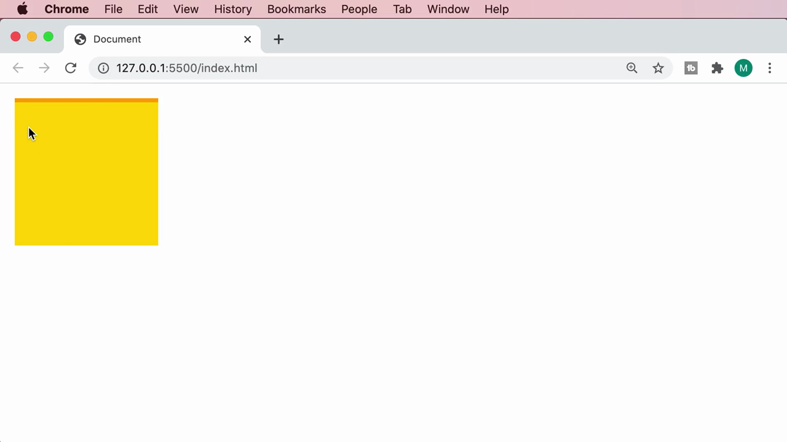

> **`px` (pixel)** คือหน่วยวัดที่ตรงไปตรงมาที่สุด — 100px จะมีขนาด 100px เสมอ ไม่ว่าหน้าจอจะใหญ่หรือเล็กแค่ไหน ไม่ว่า parent จะมีขนาดเท่าไหร่ก็ตาม (หน่วย absolute)

---

## 3. `%` — สัมพัทธ์กับขนาดของ Parent (Container)

Mosh เปลี่ยน `width` เป็นเปอร์เซ็นต์ และกำหนดขนาด `body` (parent) ไว้ตายตัวเพื่อพิสูจน์:

```css
body {
  margin: 10px;
  width: 300px;
}

.box {
  /* 50% of the width of the parent */
  width: 50%;
  height: 100px;
  background-color: gold;
  border-top: 3px solid orange;
}
```


ยืนยันด้วยแท็บ **Computed** ใน DevTools: เมื่อ `body` กว้าง 300px และ `.box` ตั้ง `width: 50%` ผลลัพธ์ที่คำนวณจริงคือ **150px** (ครึ่งหนึ่งของ 300):

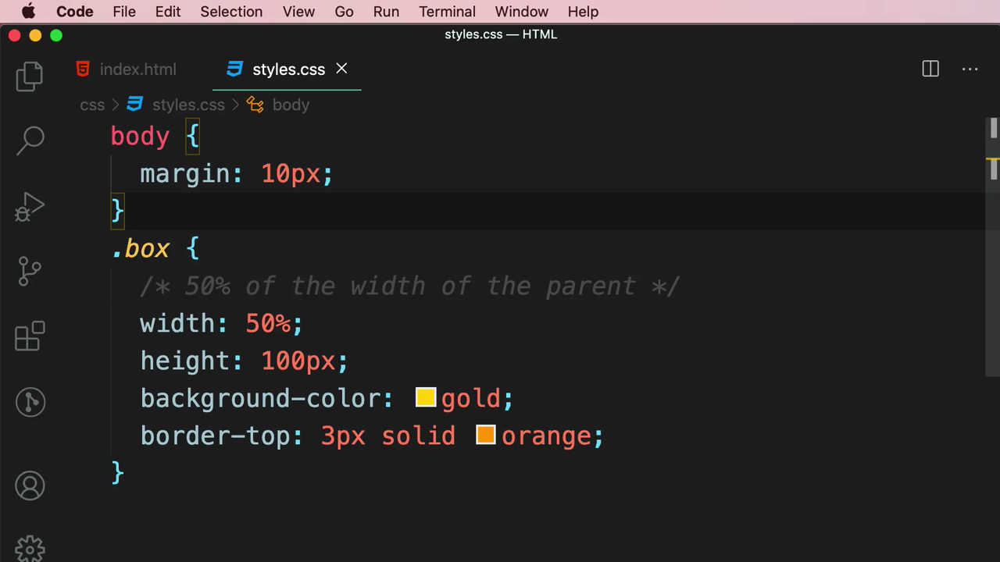

จากนั้น Mosh ลบ `width: 300px;` ออกจาก `body` (ทำให้ body กว้างเท่ากับหน้าต่างเบราว์เซอร์ทั้งหมดตาม default) แล้วลองขยาย/ย่อขนาดหน้าต่างเบราว์เซอร์ดู:

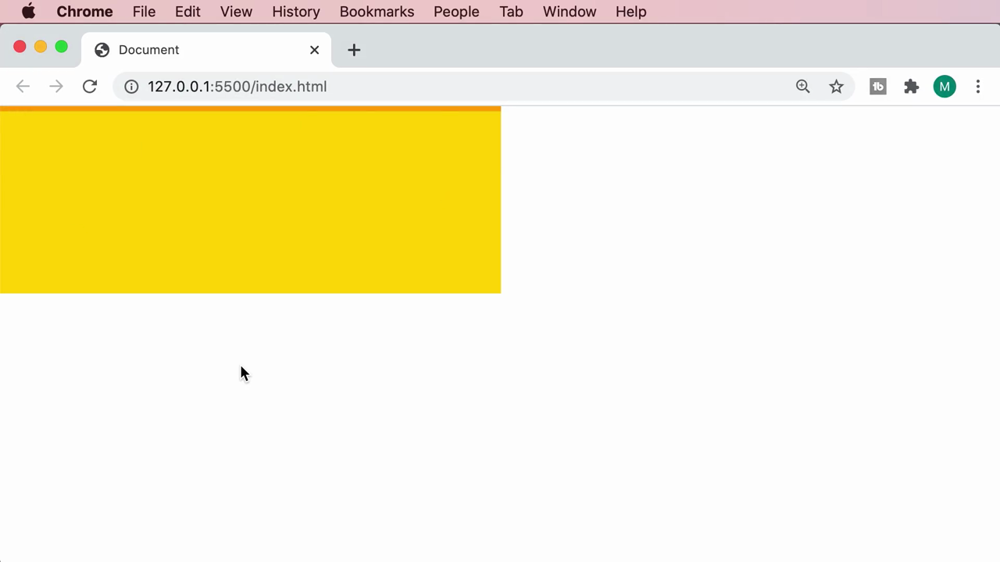

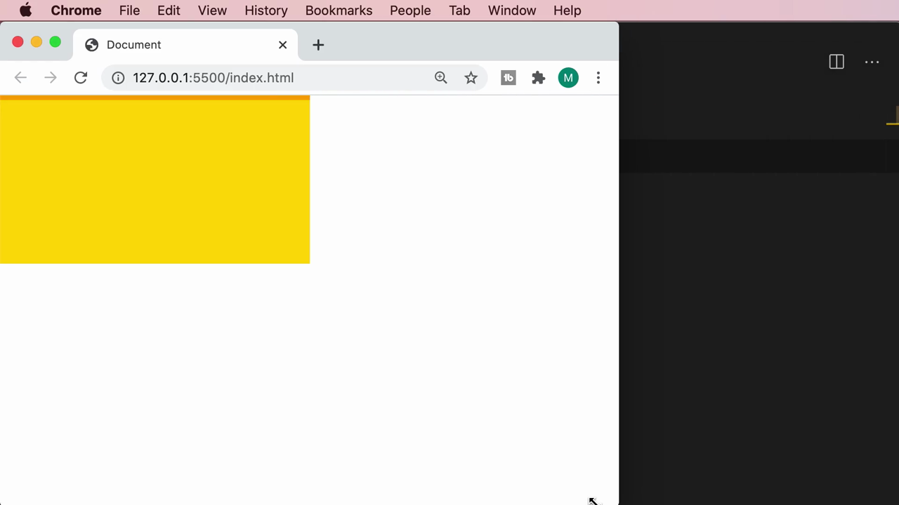

> **จุดสำคัญที่สุดของ `%`:** กล่อง**ปรับขนาดตามไปด้วยโดยอัตโนมัติแบบเรียลไทม์**ทุกครั้งที่ parent (ในที่นี้คือ body/หน้าต่างเบราว์เซอร์) เปลี่ยนขนาด — นี่คือกลไกเบื้องหลังของการทำเว็บ **responsive** ที่ปรับตัวตามหน้าจอต่างๆ ได้เอง โดยไม่ต้องเขียน media query ทุกจุด

---

## 4. กับดักของ `%`: `height: 100%` ไม่ทำงานเหมือน `width`

Mosh ทดลองเปลี่ยนเป็น `height: 100%;` (คอมเมนต์ `margin` ของ `body` ออกชั่วคราว):

```css
body {
  /* margin: 10px; */
}

.box {
  /* 50% of the width of the parent */
  width: 50%;
  height: 100%;
  background-color: gold;
  border-top: 3px solid orange;
}
```

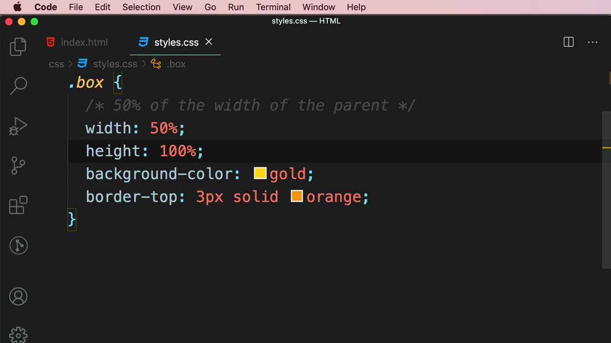

ผลลัพธ์ที่เกิดขึ้นน่าประหลาดใจมาก: กล่องไม่ได้สูงเต็มหน้าจอตามที่คาดไว้ แต่กลับ**เหลือแค่ความสูง 3px (เท่ากับ border-top เท่านั้น)**:

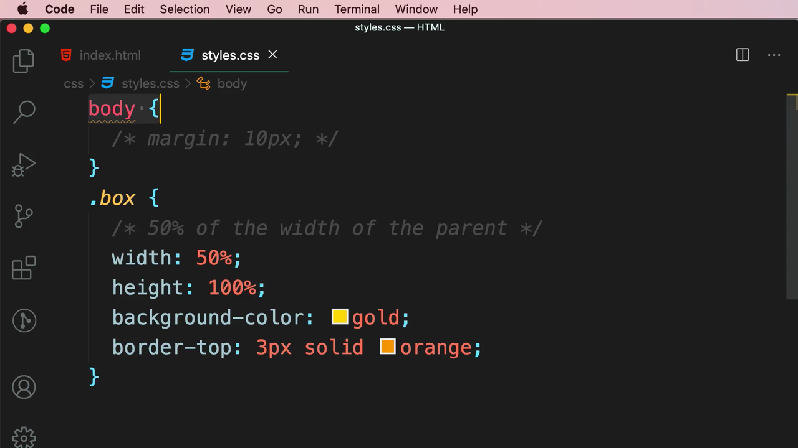

> **ทำไม `height: 100%` ถึงไม่ทำงาน?** เพราะ `%` ของ **`height`** ต้องการให้ **parent ทุกชั้น (ไล่ขึ้นไปจนถึง `<html>`) มีการกำหนด `height` ไว้อย่างชัดเจนเป็นตัวเลขจริง** ถ้า parent ไหนสักชั้นมี `height: auto` (ค่า default ซึ่งคำนวณจากเนื้อหาข้างใน) chain การคำนวณเปอร์เซ็นต์จะขาดตอน และเบราว์เซอร์จะตีความว่า "ไม่มีความสูงให้อ้างอิง" จึงได้ผลลัพธ์เป็น 0
>
> นี่คือ**กับดักที่มือใหม่เจอบ่อยที่สุด**เวลาพยายามทำกล่องให้สูงเต็มหน้าจอด้วย `height: 100%` — ต่างจาก `width: 100%` ที่ใช้งานได้ตรงไปตรงมาเพราะ `<html>`/`<body>` มีความกว้างเต็มหน้าจอเป็น default อยู่แล้ว

---

## 5. `vw` / `vh` — ทางแก้ปัญหา และหน่วยที่สัมพัทธ์กับ Viewport โดยตรง

Mosh เปลี่ยนมาใช้ **`vh` (viewport height)** แทน:

```css
.box {
  width: 50%;
  height: 100vh;
  background-color: gold;
  border-top: 3px solid orange;
}
```

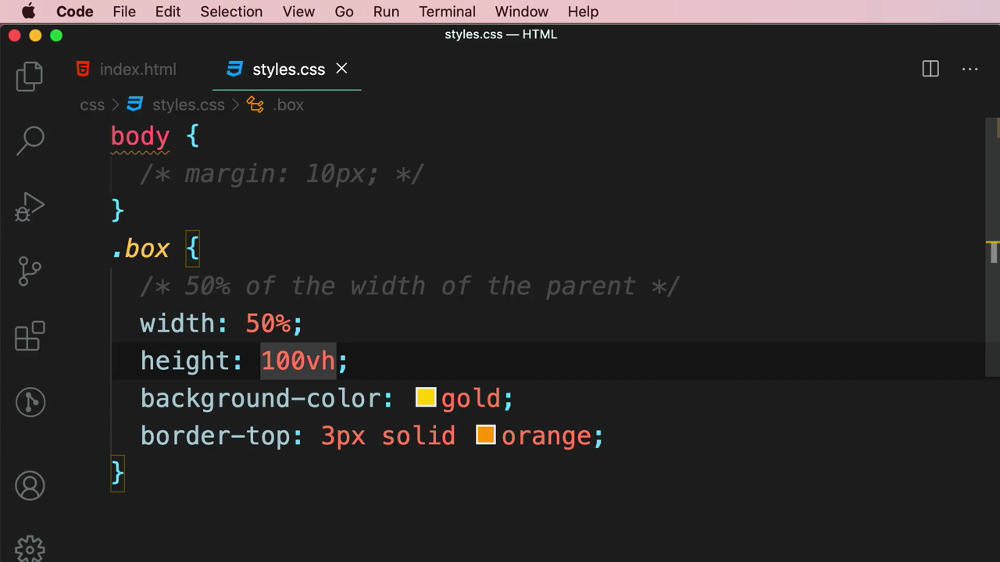

ผลลัพธ์: กล่อง**สูงเต็มหน้าจอทันที** โดยไม่ต้องพึ่งพา parent ใดๆ เลย:

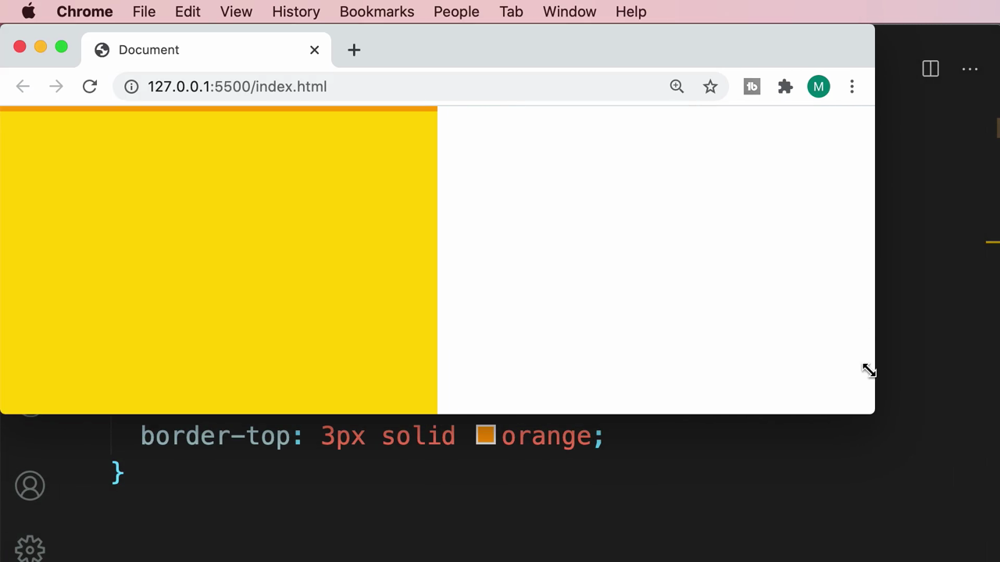

จากนั้น Mosh ยังเปลี่ยน `width` จาก `%` เป็น `vw` (viewport width) ด้วย: `width: 50vw;` เพื่อให้ทั้งกว้างและสูงอ้างอิงกับ viewport เหมือนกัน

> **`vw` และ `vh` คืออะไร:**
> - **`1vw`** = 1% ของ**ความกว้างของ viewport** (หน้าต่างเบราว์เซอร์ที่มองเห็น)
> - **`1vh`** = 1% ของ**ความสูงของ viewport**
> - ดังนั้น **`100vh` = สูงเต็มหน้าจอพอดี เสมอ ไม่ว่า parent จะมี height กำหนดไว้หรือไม่ก็ตาม** — นี่คือข้อดีที่เหนือกว่า `%` ตรงที่ `vw`/`vh` **ไม่ต้องพึ่งพา parent chain เลย** สัมพัทธ์กับหน้าจอโดยตรงเสมอ

---

## 6. `em` — สัมพัทธ์กับ Font Size ของ Element ปัจจุบัน

Mosh เปลี่ยนมาสาธิตหน่วย `em`:

```css
.box {
  /* 10 x 16px = 160px */
  width: 10em;
  height: 100vh;
  background-color: gold;
  border-top: 3px solid orange;
}
```

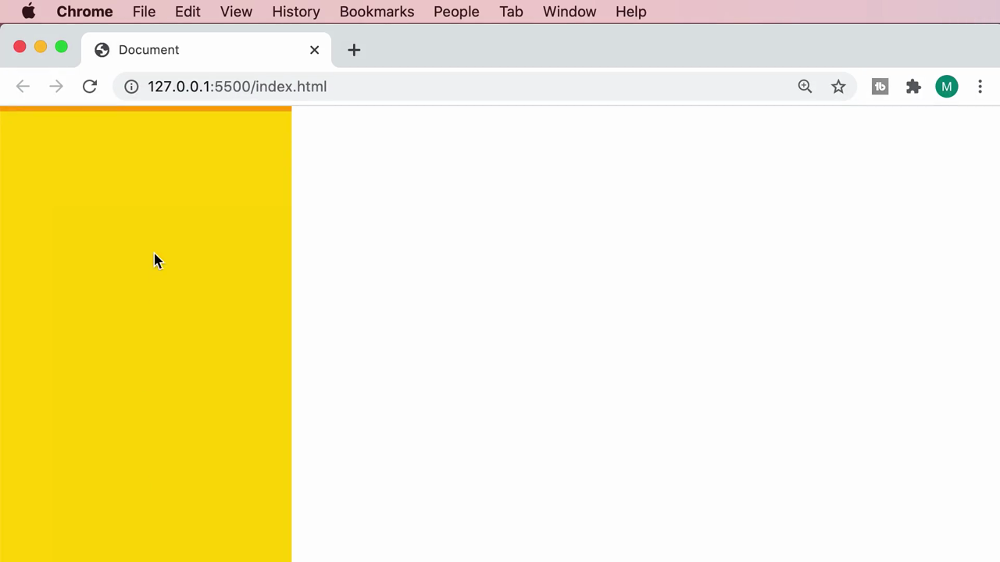

เนื่องจาก font-size default ของเบราว์เซอร์คือ **16px** ค่า `10em` จึงเท่ากับ `10 × 16px = 160px`

จากนั้น Mosh เพิ่ม `font-size: 20px;` ให้กับ `.box` เอง เพื่อพิสูจน์ว่า `em` จะเปลี่ยนตามไปด้วย:

```css
.box {
  font-size: 20px;
  width: 10em;
  height: 100vh;
  background-color: gold;
  border-top: 3px solid orange;
}
```

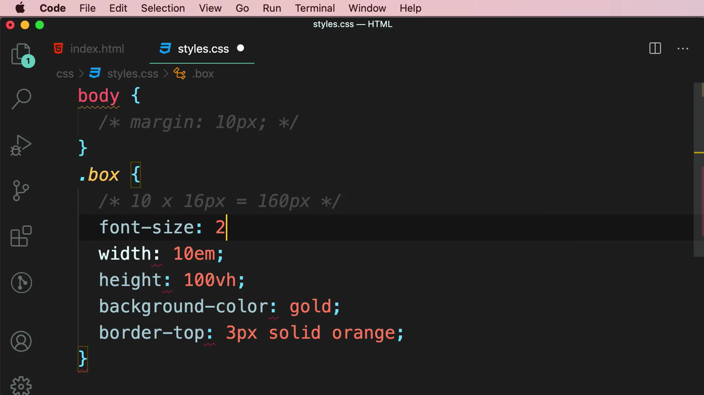

แท็บ Computed ยืนยันว่าตอนนี้ `width` กลายเป็น **200px** (10 × 20px):

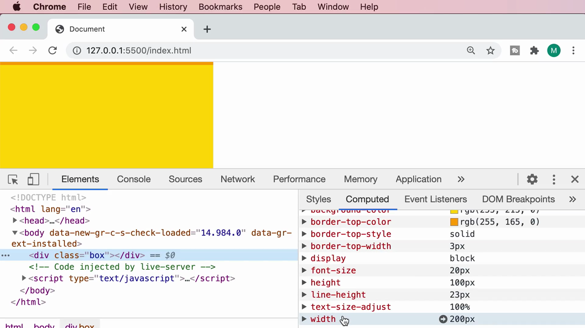

> **`em` สัมพัทธ์กับ font-size ของ element ตัวมันเอง (หรือ font-size ที่ inherit มาจาก parent ถ้าไม่ได้ตั้งเอง)** — เมื่อไหร่ที่ font-size ของ element นั้นเปลี่ยน ค่าที่คำนวณจาก `em` ก็จะเปลี่ยนตามไปด้วยทันที

---

## 7. `rem` — สัมพัทธ์กับ Font Size ของ Root Element (`<html>`) เท่านั้น

Mosh เปลี่ยนเป็น `rem`:

```css
.box {
  /* 10 x font size of the root element */
  width: 15rem;
  height: 100vh;
  background-color: gold;
  border-top: 3px solid orange;
}
```

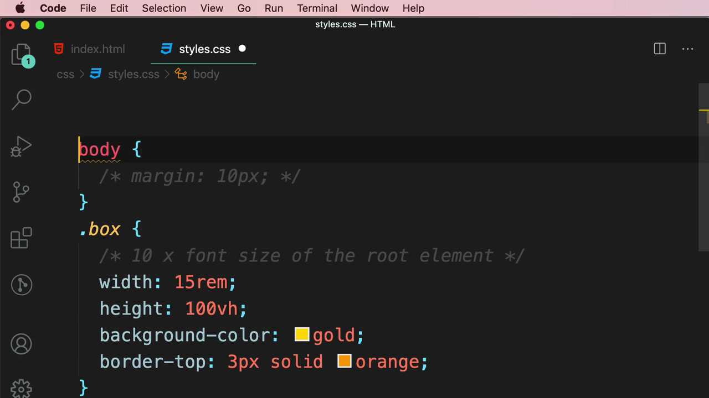

Mosh แนะนำเทคนิคยอดนิยมที่เรียกว่า **"62.5% trick"** — ตั้งค่า font-size ของ `<html>` เป็น `62.5%` เพื่อให้ **1rem = 10px พอดี** (คำนวณง่ายในหัว):

```css
html {
  /* 62.5% of 16px = 10px */
  font-size: 62.5%;
}
```

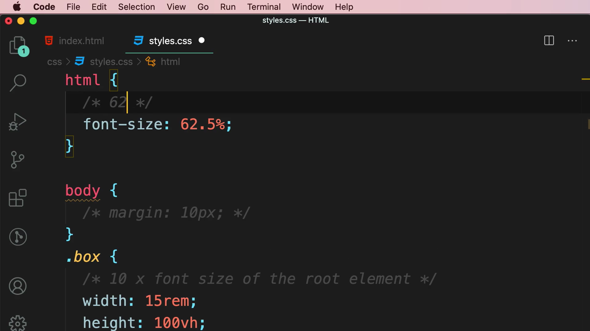

ยืนยันด้วย DevTools: font-size ของ root กลายเป็น **10px** ทำให้ `15rem = 15 × 10px = 150px` พอดี:

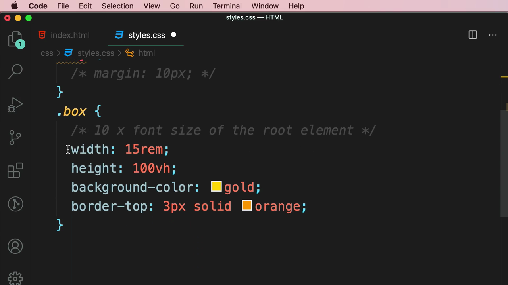

> **ความแตกต่างสำคัญระหว่าง `em` กับ `rem`:**
> - **`em`** สัมพัทธ์กับ font-size ของ **element ปัจจุบัน** (เปลี่ยนไปเรื่อยๆ ตามแต่ละ element ที่ nested ลึกเข้าไป ซ้อนกันได้หลายชั้นจนคำนวณยาก)
> - **`rem`** ("root em") สัมพัทธ์กับ font-size ของ **`<html>` เพียงจุดเดียวเท่านั้น** ไม่ว่า element จะอยู่ลึกแค่ไหนในหน้าเว็บ ทำให้ **คาดเดาและคำนวณได้ง่ายกว่ามาก** — นี่คือเหตุผลที่ `rem` เป็นหน่วยที่นิยมใช้กันมากที่สุดในโปรเจกต์จริง (โดยเฉพาะกับ font-size และ spacing)

---

## 8. เหตุผลที่แท้จริงว่าทำไมต้องใช้หน่วยสัมพัทธ์: Accessibility (การเข้าถึง)

ส่วนสุดท้ายที่สำคัญที่สุดของคลิป Mosh เปิด **การตั้งค่า Font Size ของ Chrome เอง** (`chrome://settings` → ค้นหา "font size") เพื่อจำลองสถานการณ์ของผู้ใช้ที่มีปัญหาการมองเห็นและต้องการขยายขนาดตัวอักษรทั้งเบราว์เซอร์ให้ใหญ่ขึ้น:

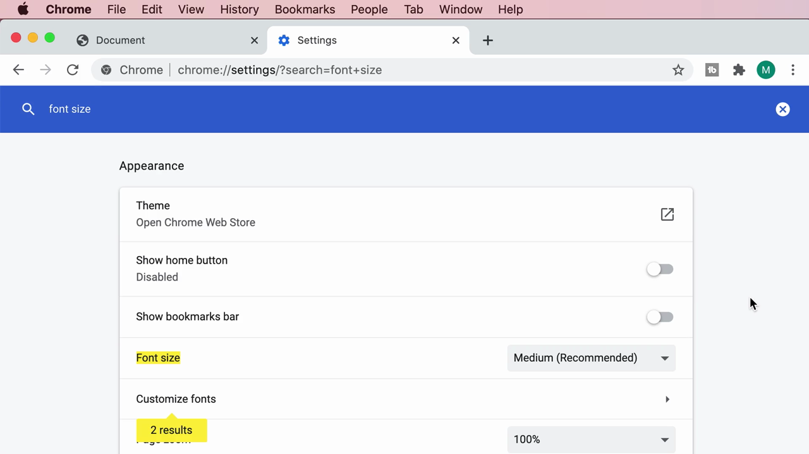

เมื่อเปลี่ยนค่าจาก "Medium (Recommended)" เป็น **"Very large"** — font-size default ของเบราว์เซอร์ (ปกติ 16px) จะเพิ่มขึ้นตามไปด้วย (ในตัวอย่างนี้กลายเป็น 24px) ส่งผลให้ `.box` ที่ใช้ `rem` **ขยายใหญ่ขึ้นตามไปด้วยโดยอัตโนมัติ**: width จาก 150px กลายเป็น 225px, font-size ของกล่องจาก 10px กลายเป็น 15px:

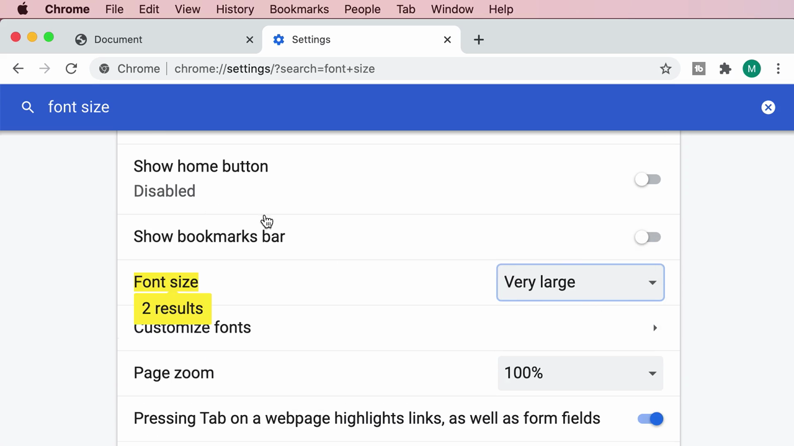

และเมื่อลองปรับกลับไปเป็น **"Very small"** กล่องก็หดตัวลงตามไปด้วยเช่นกัน (width เหลือ 84.375px, font-size เหลือ 9px):

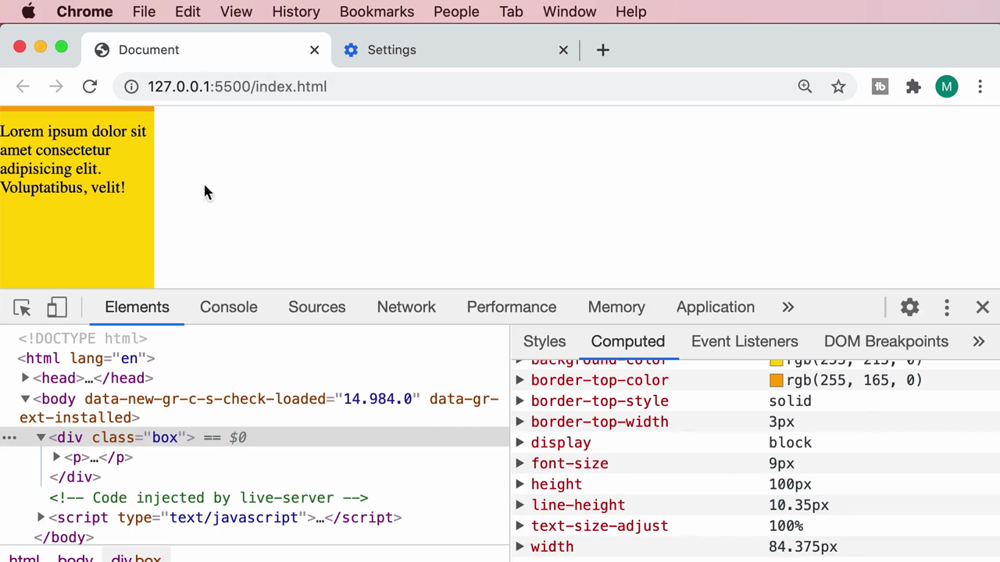

> **นี่คือเหตุผลที่แท้จริงและสำคัญที่สุดว่าทำไมควรใช้หน่วยสัมพัทธ์ (`rem`/`em`) แทน `px` ในโปรเจกต์จริง:** ผู้ใช้บางคน (โดยเฉพาะผู้ที่มีปัญหาสายตา) จะตั้งค่าขนาดตัวอักษรของเบราว์เซอร์ให้ใหญ่กว่าปกติเพื่อให้อ่านง่ายขึ้น ถ้าเว็บไซต์ใช้ `px` ล้วนๆ ทุกอย่าง (ทั้งขนาดตัวอักษรและ layout) จะ**ไม่ขยายตามการตั้งค่านี้เลย** ทำให้ผู้ใช้กลุ่มนี้อ่านเว็บไซต์ลำบาก แต่ถ้าใช้ `rem`/`em` เว็บทั้งหน้าจะ**ขยายสัดส่วนตามกันโดยอัตโนมัติ** ทำให้เว็บไซต์เข้าถึงได้ง่ายขึ้นสำหรับทุกคน

---

## สรุปที่ใช้ได้จริง

- **`px`** — หน่วย absolute คงที่เสมอ ไม่สัมพัทธ์กับอะไร เหมาะกับรายละเอียดเล็กๆ ที่ไม่ต้องการให้เปลี่ยนแปลง (เช่น border width)
- **`%`** — สัมพัทธ์กับขนาดของ **parent** ใช้ได้ตรงไปตรงมากับ `width` แต่ `height: 100%` ต้องการให้ **ทุก parent ในสายมี height กำหนดไว้ชัดเจน** ไม่งั้นจะได้ค่า 0
- **`vw`/`vh`** — สัมพัทธ์กับ **viewport** โดยตรง ไม่ต้องพึ่ง parent chain เลย เป็นทางแก้ปัญหาของ `height: 100%` ที่ใช้งานได้ทันที
- **`em`** — สัมพัทธ์กับ font-size ของ **element ปัจจุบัน** (คำนวณยากเมื่อซ้อนกันหลายชั้น)
- **`rem`** — สัมพัทธ์กับ font-size ของ **`<html>` เท่านั้น** คำนวณง่ายและคาดเดาได้ เป็นหน่วยที่นิยมที่สุดสำหรับ font-size และ spacing ในโปรเจกต์จริง
- **เหตุผลหลักที่ควรใช้ `rem`/`em` แทน `px`:** เพื่อรองรับผู้ใช้ที่ปรับขนาดตัวอักษรของเบราว์เซอร์เอง (accessibility) — เว็บที่ใช้หน่วยสัมพัทธ์จะขยาย/หดตามสัดส่วนโดยอัตโนมัติ

### จุดเชื่อมกับงานจริงของ Aum

- **Tailwind CSS ใช้ `rem` เป็นหน่วยหลักในเกือบทุก utility class** (เช่น `p-4` = `1rem`, `text-lg` = `1.125rem`, `w-64` = `16rem`) นี่คือเหตุผลที่ design system ของ Tailwind รองรับ accessibility ได้ดีตั้งแต่ต้นโดยที่ Aum ไม่ต้องตั้งค่าอะไรเพิ่มเอง
- เทคนิค **"62.5% trick"** ที่ Mosh สอน เป็น pattern ที่โปรเจกต์ CSS จำนวนมากยังคงใช้อยู่ (แม้ Tailwind จะจัดการเรื่องนี้ให้อัตโนมัติแล้ว) มีประโยชน์มากถ้า Aum ต้องเขียน CSS ดิบโดยไม่พึ่ง framework ในบางโปรเจกต์
- กับดักเรื่อง **`height: 100%`** เป็นบั๊กที่พบบ่อยมากเวลาทำ full-stack project ที่มี layout เต็มหน้าจอ (เช่น sidebar หรือ modal ที่ต้องสูงเต็มจอ) — ถ้าเจอปัญหา "ทำไม height 100% ไม่ทำงาน" ให้ตรวจสอบก่อนว่าทุก parent ในสาย (`html`, `body`, ไล่ขึ้นไป) มี height กำหนดไว้ครบหรือไม่ ถ้าไม่แน่ใจให้ใช้ `100vh` แทนจะปลอดภัยกว่า (Tailwind: `h-screen`)
- `vw`/`vh` ตรงกับ Tailwind utility `w-screen`/`h-screen` โดยตรง ใช้บ่อยมากเวลาทำ hero section หรือ landing page ที่ต้องการให้ section แรกสูงเต็มหน้าจอพอดี
- ทักษะเรื่อง accessibility ผ่านหน่วยสัมพัทธ์นี้เป็นพื้นฐานสำคัญมากสำหรับเป้าหมายการเป็น **Front End engineer มืออาชีพทั้ง Web และ Mobile ในปี 2026** เพราะมาตรฐานการเข้าถึง (accessibility standards) เป็นสิ่งที่บริษัทเทคโนโลยีจริงให้ความสำคัญมากขึ้นเรื่อยๆ ในการตรวจสอบคุณภาพโค้ด
