# 2-Layout: 06 - Positioning (9:46)

**ไฟล์ต้นทาง:** `6-Positioning.mp4`

▶️ **[เปิดวิดีโอต้นฉบับ](../../../HTML-CSS-2/2-Layout/6-Positioning.mp4)**

---

## ภาพรวมคลิปนี้

คลิปสุดท้ายของบท Layout — Mosh สอนเรื่อง **`position`** ซึ่งเป็น property ที่ควบคุมว่า element จะถูกวางตำแหน่งอย่างไรบนหน้าเว็บ โดยเจาะลึกความแตกต่างระหว่างค่า **`relative`**, **`absolute`**, และ **`fixed`** พร้อมสาธิตด้วยตัวอย่างกล่องสี 3 ใบที่ให้เห็นผลลัพธ์ชัดเจนในแต่ละกรณี และปิดท้ายด้วยตัวอย่างการใช้งานจริง (fixed header/banner)

---

## 1. ไตเติลเปิดคลิป

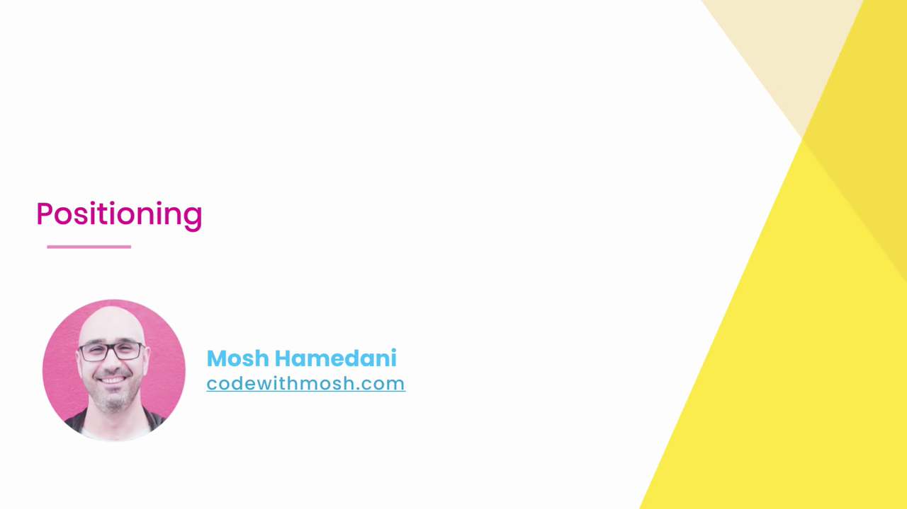

---

## 2. เตรียมตัวอย่าง: กล่องสี 3 ใบเรียงต่อกัน

Mosh สร้างโครงสร้าง HTML เป็น container `.boxes` ที่มี `<div class="box">` อยู่ข้างใน 3 อัน:

```html
<div class="boxes">
  <div class="box"></div>
  <div class="box"></div>
  <div class="box"></div>
</div>
```

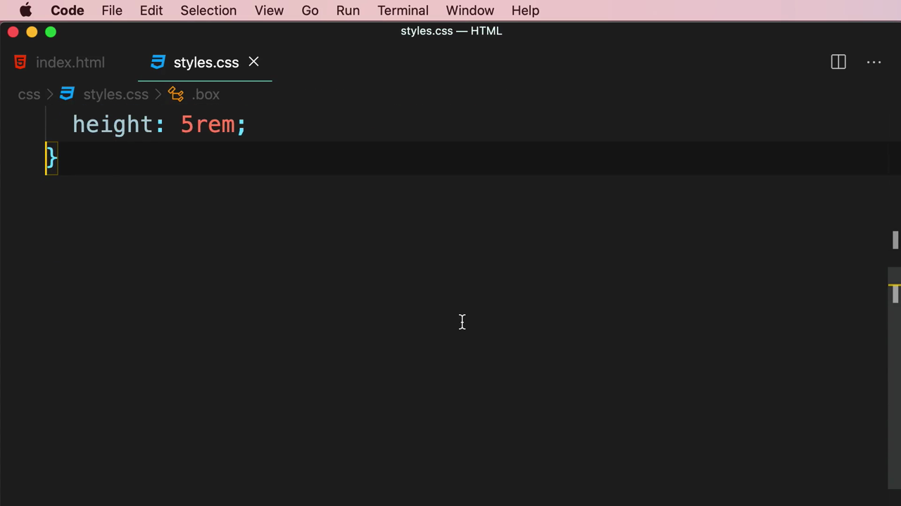

จากนั้นกำหนด CSS ให้แต่ละกล่องมีขนาดเท่ากันและสีต่างกัน:

```css
.boxes {
  border: 3px solid lightgrey;
}

.box {
  width: 5rem;
  height: 5rem;
}

.box-one {
  background: gold;
}

.box-two {
  background: tomato;
}

.box-three {
  background: dodgerblue;
}
```

ผลลัพธ์: กล่องทั้งสามเรียงซ้อนกันในแนวตั้งตามพฤติกรรม default ของ block element:

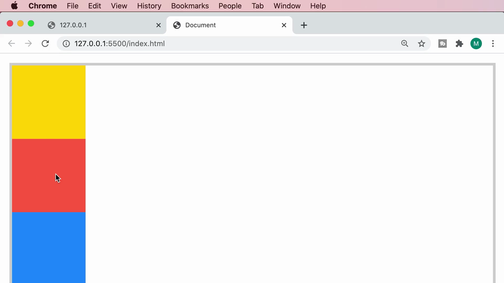

---

## 3. `position: relative` — ขยับจากตำแหน่งเดิมของตัวเอง

Mosh เพิ่ม `position: relative;` และ `left: 5rem;` ให้กับ `.box-two` (กล่องสีแดง/tomato):

```css
.box-two {
  background: tomato;
  position: relative;
  left: 5rem;
}
```

ผลลัพธ์: กล่องสีแดงเลื่อนไปทางขวา 5rem ตามที่ตั้งไว้ แต่สิ่งที่สำคัญที่สุดคือ **ตำแหน่งเดิมของมันยังคง "เว้นว่างไว้"** (ช่องว่างสีขาวตรงตำแหน่งเดิมไม่ถูกกล่องอื่นมาแทนที่):

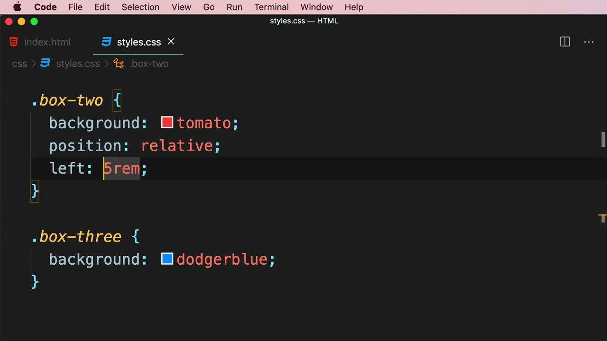

Mosh ลองเปลี่ยนเป็นค่าติดลบ `left: -4rem;` เพื่อให้เห็นว่าเลื่อนไปทางซ้ายได้เช่นกัน:

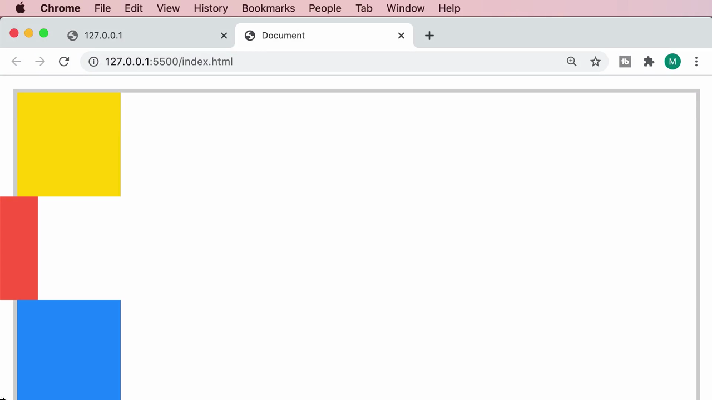

จากนั้นสาธิตว่า `right: 4rem;` ก็ให้ผลคล้ายกัน (แต่นับระยะจากด้านขวาเข้ามาแทน):

```css
.box-two {
  background: tomato;
  position: relative;
  right: 4rem;
}
```

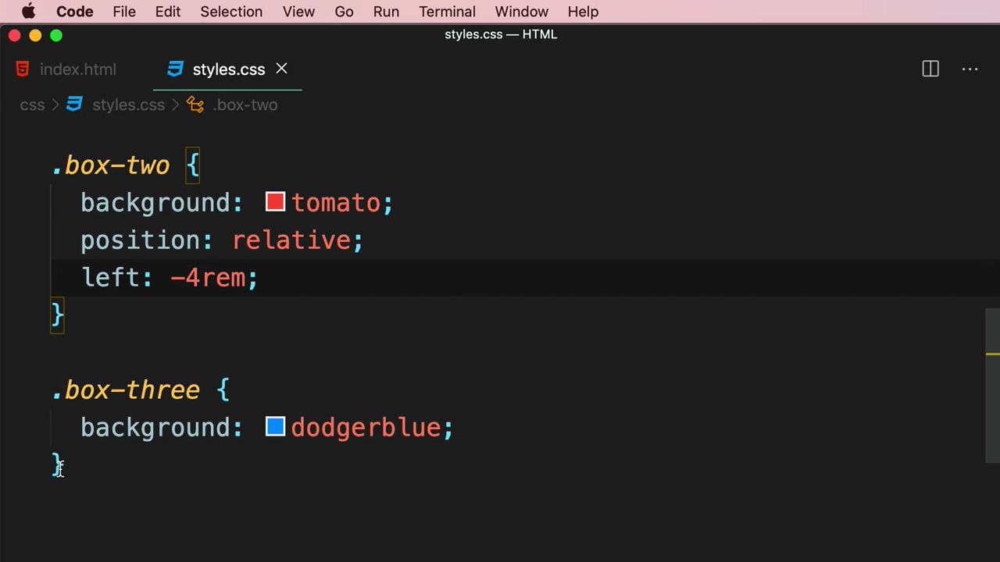

> **สรุปหลักการของ `position: relative`:** เมื่อกำหนด `position: relative` ให้ element แล้วใช้ `top`/`right`/`bottom`/`left` เพื่อขยับตำแหน่ง element จะ**เลื่อนออกจากตำแหน่งปกติของมันเอง (normal position)** แต่ **"พื้นที่เดิม" ในเอกสารยังคงถูกจองไว้เหมือนเดิม** (element อื่นจะไม่มาแทนที่ช่องว่างนั้น) — นี่คือความหมายของคำว่า **"relative to the element's normal position"**

---

## 4. รวม `left`/`top`/`bottom` เพื่อขยับ 2 แกนพร้อมกัน

Mosh สาธิตว่าสามารถใช้ property มากกว่า 1 ตัวพร้อมกันเพื่อขยับทั้งแนวนอนและแนวตั้งได้:

```css
.box-two {
  background: tomato;
  position: relative;
  left: 4rem;
  top: 2rem;
}
```

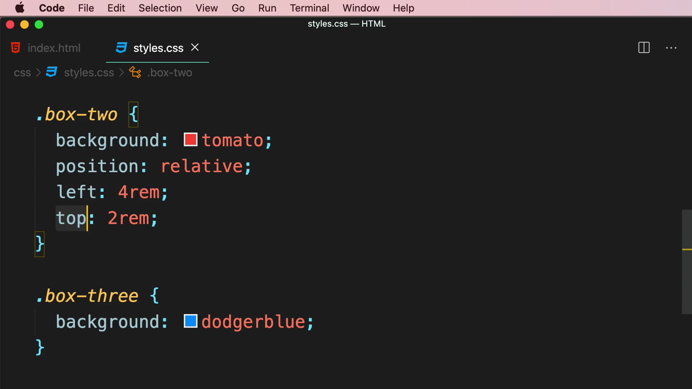

จากนั้นเปลี่ยน `top` เป็น `bottom`:

```css
.box-two {
  background: tomato;
  position: relative;
  left: 4rem;
  bottom: 4rem;
}
```

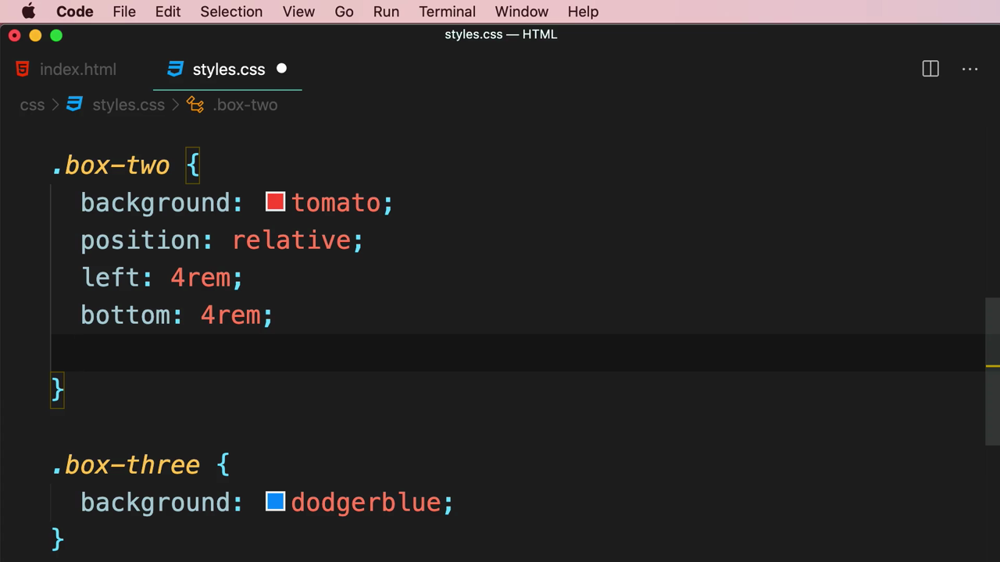

---

## 5. `z-index` — ควบคุมลำดับการซ้อนทับ

เมื่อกล่องเลื่อนมาซ้อนทับกับกล่องอื่น Mosh แนะนำ property **`z-index`** เพื่อควบคุมว่ากล่องไหนจะอยู่ "ด้านบนสุด" ในการซ้อนทับ:

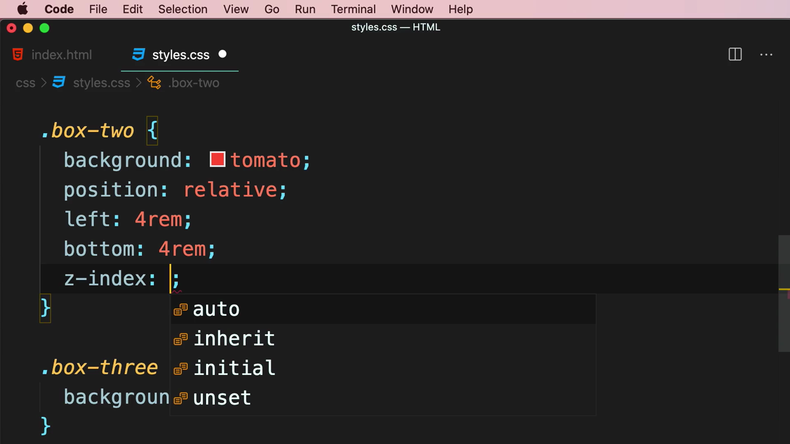

> **`z-index`** รับค่าเป็นตัวเลข — ยิ่งค่ามาก element ยิ่งอยู่ **ด้านบนสุด (ใกล้ผู้ใช้มากที่สุด)** ของการซ้อนทับ ค่านี้จะมีผลก็ต่อเมื่อ element มี `position` เป็นค่าอื่นที่ไม่ใช่ `static` (default) เท่านั้น

---

## 6. `position: absolute` — สัมพัทธ์กับ Parent

Mosh เพิ่ม `position: relative;` ให้กับ **`.boxes`** (container หลัก) ก่อน เพื่อเตรียมเป็น**จุดอ้างอิง**:

```css
.boxes {
  border: 3px solid lightgrey;
  position: relative;
}
```

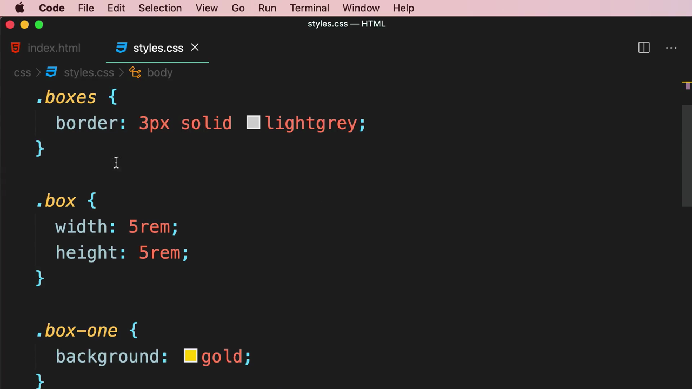

จากนั้นตั้งค่า `z-index: 999999;` (ตัวเลขสูงมากๆ เพื่อการันตีว่าจะอยู่บนสุดเสมอ) ให้ `.box-two`:

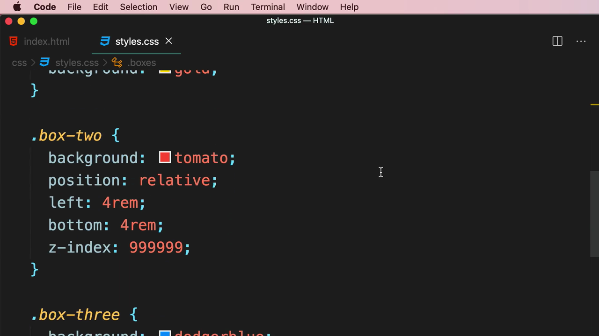

แล้วเปลี่ยน `position` ของ `.box-two` เป็น **`absolute`** พร้อมตั้ง `right: 0; bottom: 0;`:

```css
.box-two {
  background: tomato;
  position: absolute;
  right: 0;
  bottom: 0;
  z-index: 999999;
}
```

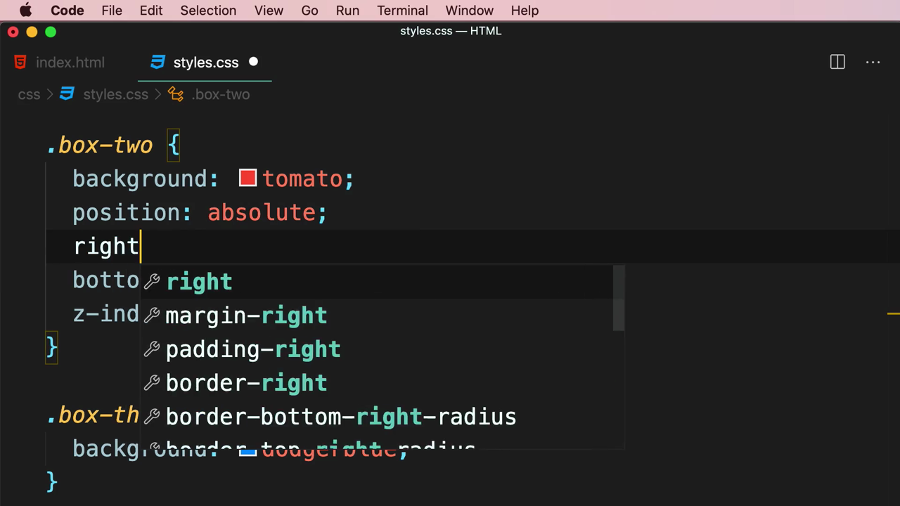

ผลลัพธ์ที่สำคัญที่สุด: กล่องสีแดง**หลุดออกจาก document flow โดยสิ้นเชิง** ไปเกาะติดที่มุมล่างขวาของ container (`.boxes`) และ**ช่องว่างที่มันเคยอยู่ก็หายไปด้วย** — กล่องเหลืองและน้ำเงินขยับมาชิดกันเติมเต็มช่องว่างนั้นทันที:

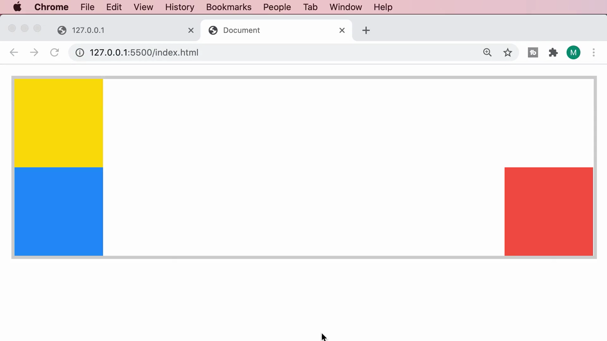

> **สรุปหลักการของ `position: absolute`:** element จะ**หลุดออกจาก document flow ทั้งหมด** (ไม่เหลือช่องว่างไว้เหมือน `relative`) แล้วไปอ้างอิงตำแหน่งกับ **parent ที่ใกล้ที่สุดซึ่งมีการกำหนด `position` เป็นค่าอื่นที่ไม่ใช่ `static`** (ในที่นี้คือ `.boxes` ที่เพิ่งตั้ง `position: relative` ไว้) ถ้าไม่มี parent ไหนกำหนด position ไว้เลย จะไปอ้างอิงกับทั้งหน้าเว็บ (`<html>`) แทน — นี่คือความหมายของ **"relative to the parent"**

---

## 7. `position: fixed` — สัมพัทธ์กับ Viewport เสมอ

Mosh เปลี่ยน `position` เป็น **`fixed`**:

```css
.box-two {
  background: tomato;
  position: fixed;
  bottom: 0;
  z-index: 999999;
}
```

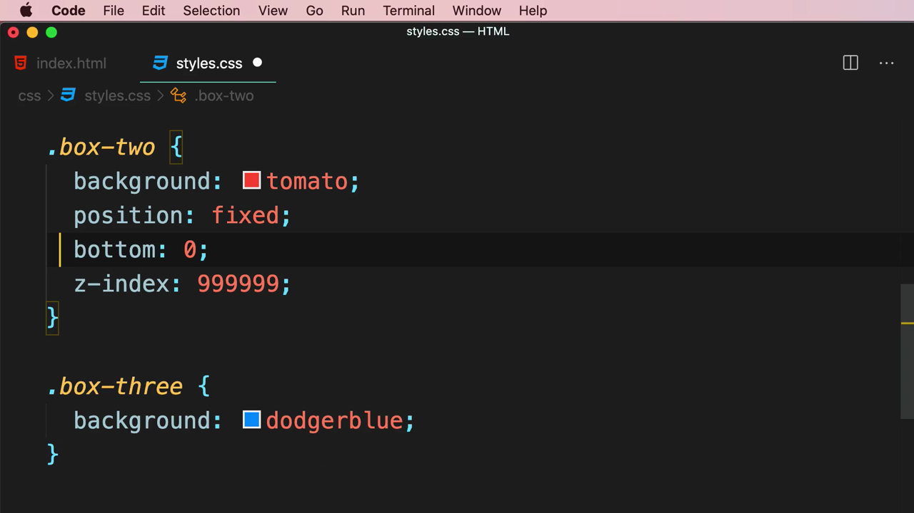

จากนั้นเลื่อนหน้าเว็บลง (scroll) เพื่อพิสูจน์ว่ากล่องสีแดง**ยังคงอยู่ตำแหน่งเดิมเทียบกับหน้าจอเสมอ ไม่ขยับตามการเลื่อนหน้าเว็บเลย**:

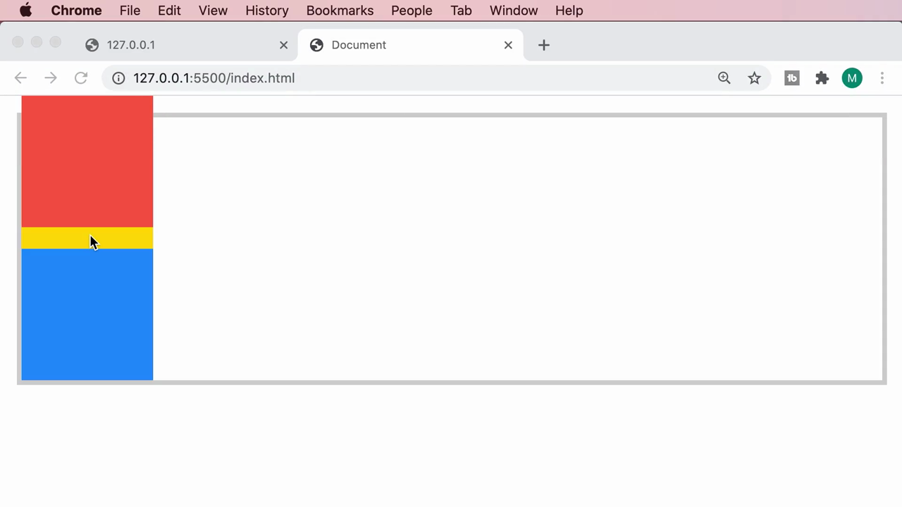

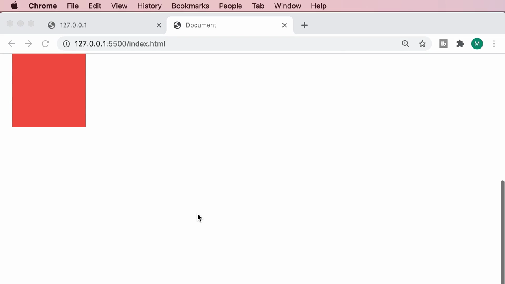

> **สรุปหลักการของ `position: fixed`:** element จะ**หลุดออกจาก document flow เหมือน `absolute`** แต่จะอ้างอิงตำแหน่งกับ **viewport (หน้าต่างเบราว์เซอร์) เสมอ ไม่ว่าจะมี parent ที่กำหนด position ไว้หรือไม่ก็ตาม** และ**ไม่ขยับตามการเลื่อนหน้าเว็บ (scroll)** — ต่างจาก `absolute` ที่อ้างอิงกับ parent และจะเลื่อนตามหน้าเว็บไปด้วย

---

## 8. ตัวอย่างใช้งานจริง: Fixed Banner เต็มความกว้างหน้าจอ

Mosh สาธิตการใช้งานจริงของ `position: fixed` — ทำแบนเนอร์ที่ติดอยู่ด้านบนสุดของหน้าจอเสมอ (เหมือน sticky header ที่พบได้ทั่วไป) โดยตั้งค่า `top: 0;` และ `left: 2rem;`:

```css
.box-two {
  background: tomato;
  position: fixed;
  top: 0;
  left: 2rem;
  z-index: 999999;
}
```

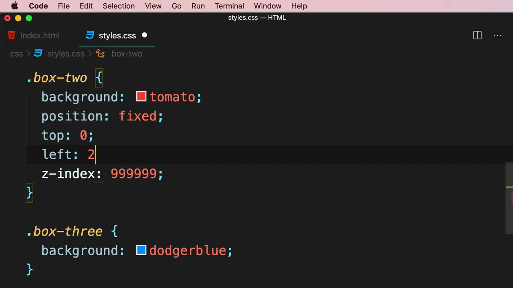

จากนั้นเพิ่ม `right: 2rem;` เข้าไปด้วย (กำหนดทั้ง `left` และ `right` พร้อมกัน):

```css
.box-two {
  background: tomato;
  position: fixed;
  top: 0;
  left: 2rem;
  right: 2rem;
  z-index: 999999;
}
```

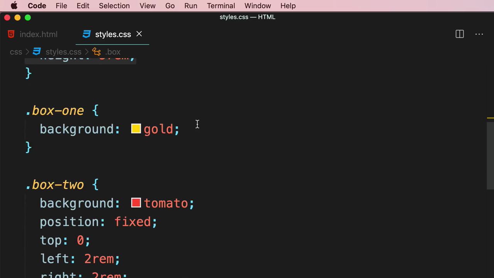

สุดท้ายเพิ่ม `width: auto;` เพื่อ override ค่า `width: 5rem;` ที่มาจาก class `.box` เดิม:

```css
.box-two {
  background: tomato;
  position: fixed;
  top: 0;
  left: 2rem;
  right: 2rem;
  width: auto;
  z-index: 999999;
}
```

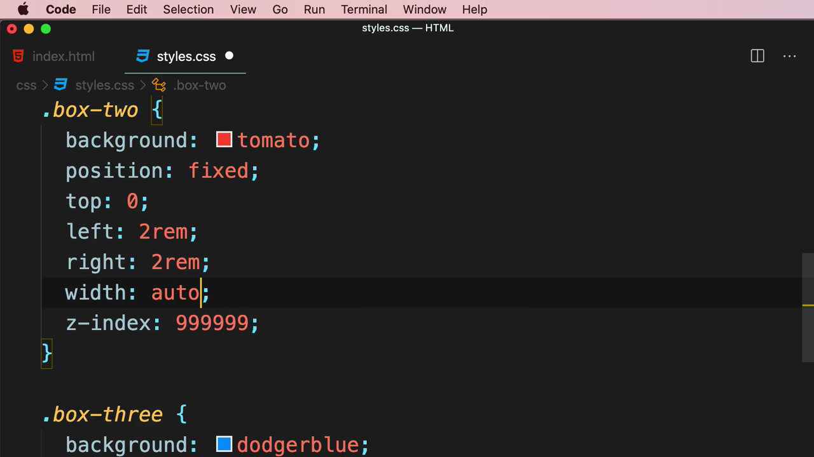

ผลลัพธ์: กล่องสีแดงกลายเป็น**แบนเนอร์เต็มความกว้าง (เว้นระยะ 2rem ทั้งซ้ายขวา) ที่ติดอยู่บนสุดของหน้าจอเสมอ** — นี่คือเทคนิคเบื้องหลังของ **fixed header/navbar** ที่ใช้กันแทบทุกเว็บไซต์:

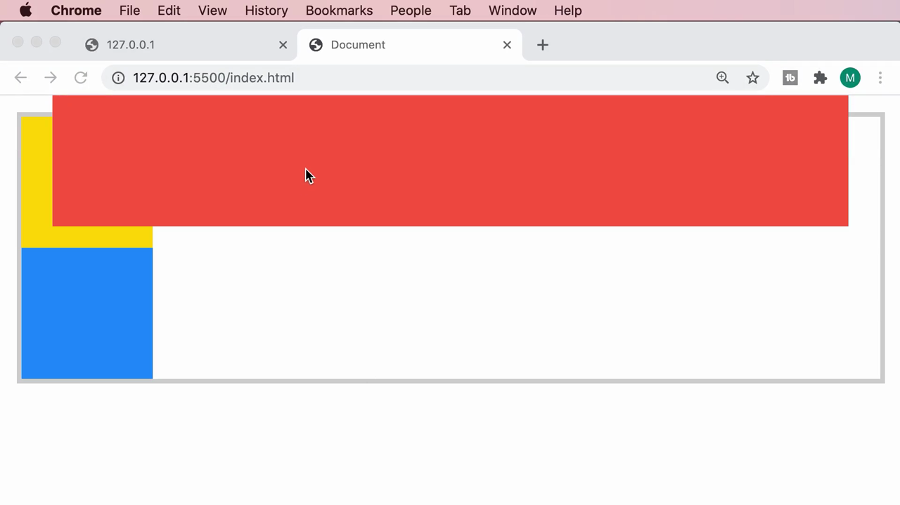

> **เหตุผลที่ `width: auto` ทำให้เกิดผลนี้:** เมื่อ element เป็น `position: fixed` (หรือ `absolute`) และกำหนดทั้ง `left` และ `right` พร้อมกันโดยไม่มี `width` ตายตัว เบราว์เซอร์จะ**คำนวณความกว้างให้เองโดยอัตโนมัติ** ให้พอดีกับช่องว่างระหว่างค่า `left` และ `right` ที่ตั้งไว้ — เป็นเทคนิคที่มีประโยชน์มากสำหรับทำ element ที่ต้อง "ยืด" เต็มความกว้างแต่เว้นระยะขอบเท่าๆ กันทั้งสองข้าง

---

## 9. สรุปส่งท้าย: Relative vs Absolute (สไลด์ปิดคลิป)

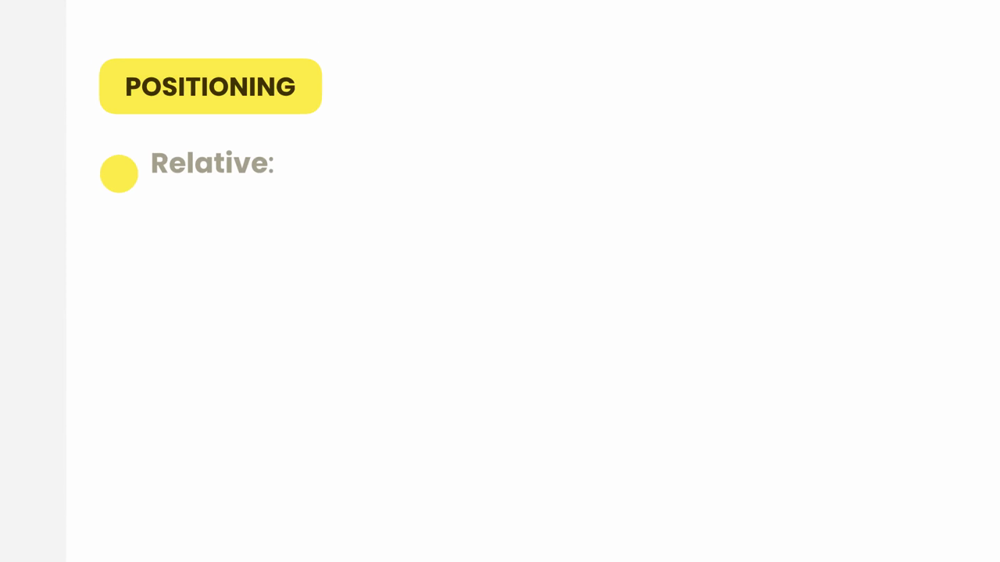

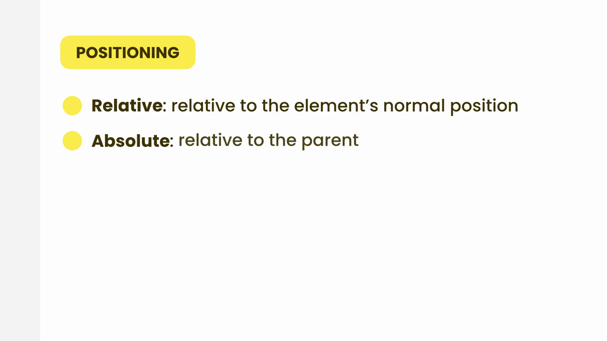

> **POSITIONING:**
> - **Relative:** relative to the element's normal position (สัมพัทธ์กับตำแหน่งปกติของตัว element เอง)
> - **Absolute:** relative to the parent (สัมพัทธ์กับ parent ที่ใกล้ที่สุดที่มี position ไม่ใช่ static)

---

## สรุปที่ใช้ได้จริง

- **`position: static`** (default) — element อยู่ตามลำดับปกติของ document flow, property `top`/`left`/`right`/`bottom`/`z-index` ไม่มีผลใดๆ
- **`position: relative`** — ขยับ element จากตำแหน่งปกติของตัวเอง แต่**ยังเว้นช่องว่างเดิมไว้**ในเอกสาร (ไม่กระทบ element อื่น) มักใช้เป็น "จุดอ้างอิง" (positioning context) ให้ลูกที่เป็น `absolute` ด้วย
- **`position: absolute`** — **หลุดออกจาก document flow**, อ้างอิงตำแหน่งกับ parent ที่ใกล้ที่สุดที่มี position ไม่ใช่ `static` (ถ้าไม่มีเลยจะอ้างอิงกับ `<html>`)
- **`position: fixed`** — หลุดออกจาก document flow เช่นกัน แต่อ้างอิงกับ **viewport เสมอ** ไม่ขยับตามการ scroll เลย
- **`z-index`** ควบคุมลำดับการซ้อนทับเมื่อ element เหลื่อมกัน มีผลเฉพาะกับ element ที่ position ไม่ใช่ `static`
- การกำหนด `left`+`right` (หรือ `top`+`bottom`) พร้อมกันโดยไม่ตั้ง `width`/`height` ตายตัว จะทำให้เบราว์เซอร์คำนวณขนาดให้ "ยืด" เต็มพื้นที่ที่เหลือโดยอัตโนมัติ

### จุดเชื่อมกับงานจริงของ Aum

- **Tailwind CSS มี utility class ตรงตัวสำหรับทุกค่า:** `static`, `relative`, `absolute`, `fixed`, `sticky` (Tailwind ยังมี `sticky` เพิ่มมาจากที่เรียนในคลิปนี้ — เป็นค่าผสมระหว่าง `relative` และ `fixed` ที่มีประโยชน์มากสำหรับ header ที่ "ติดจอ" เฉพาะตอนเลื่อนผ่านมันไปแล้ว) พร้อม `inset-0`, `top-0`, `left-0`, `right-0`, `bottom-0`, `z-10` ฯลฯ
- Pattern **fixed header ที่ยืดเต็มความกว้าง** (`left`+`right`+`width:auto`) ที่เรียนในคลิปนี้คือหลักการเดียวกับ Tailwind class `fixed inset-x-0 top-0` ที่ใช้ทำ navbar แทบทุกเว็บที่ Aum จะทำในอนาคต
- `position: relative` บน parent + `position: absolute` บน child เป็น **pattern ที่ใช้บ่อยที่สุดใน UI จริง** เช่น badge ตัวเลขมุมขวาบนไอคอนกระดิ๊ง, ไอคอนปิด (X) มุมบนขวาของ modal, หรือ overlay ทับรูปภาพ — Tailwind เขียนเป็น `relative` บน parent และ `absolute -top-1 -right-1` บน child
- ทักษะเรื่อง `z-index` สำคัญมากเวลาทำ **modal, dropdown, tooltip** ในโปรเจกต์ full-stack ที่ Aum กำลังฝึกอยู่ เพราะ element เหล่านี้มักต้องลอยอยู่เหนือเนื้อหาอื่นทั้งหมดของหน้าเว็บเสมอ
- คลิปนี้ปิดท้ายบท **"2-Layout"** ทั้งหมด (Box Model, Sizing Elements, Overflowing, Measurement Units, Positioning) ซึ่งเป็นรากฐานสำคัญที่สุดก่อนจะไปเรียน **Flexbox และ Grid** ในคลิปถัดๆ ไปของคอร์ส — ทุกแนวคิดที่เรียนมาในบทนี้จะถูกใช้ซ้ำตลอดเวลาเมื่อทำ layout ด้วย Flexbox/Grid ในการเป็น Front End engineer ทั้ง Web และ Mobile ตามเป้าหมายปี 2026
