# 2-Layout: 07 - Floating Elements (9:33)

**ไฟล์ต้นทาง:** `7-Floating-Elements.mp4`

▶️ **[เปิดวิดีโอต้นฉบับ](../../../HTML-CSS-2/2-Layout/7-Floating-Elements.mp4)**

---

## ภาพรวมคลิปนี้

คลิปนี้ Mosh สอนเรื่อง **`float`** — property ที่แต่เดิมถูกออกแบบมาให้ทำ layout แบบหนังสือพิมพ์ (ให้รูปลอยอยู่ด้านหนึ่งแล้วให้ข้อความไหลล้อมรอบ) แต่ทุกวันนี้แทบไม่ได้ใช้ทำ layout ใหญ่ๆ แล้ว (มี Flexbox/Grid มาแทน) ยังคงมีประโยชน์อยู่บ้างสำหรับ "ให้ข้อความไหลล้อมรอบรูปภาพ" แบบดั้งเดิม Mosh ใช้ตัวอย่าง "การ์ด tweet" (avatar + ข้อความ) มาอธิบาย พร้อมเจาะลึกปัญหาคลาสสิกที่ตามมาเสมอเมื่อใช้ float คือ **"collapsing container"** (กล่องแม่ยุบตัวจนเหลือความสูง 0) และแนะนำ 3 วิธีแก้ไล่เรียงจากแบบเก่าไปแบบใหม่ที่สุด

---

## 1. ไตเติลเปิดคลิป


---

## 2. เตรียมตัวอย่าง: การ์ด Tweet (avatar + ข้อความ)

Mosh สร้างโครงสร้าง HTML จำลองการ์ดทวีตขึ้นมา ประกอบด้วย `<article class="tweet">` ที่มี `<div class="avatar">` (รูปโปรไฟล์) กับ `<p>` (ข้อความทวีต) อยู่ข้างใน:

```html
<body>
  <article class="tweet">
    <div class="avatar"></div>
    <p>Lorem ipsum dolor sit amet.</p>
  </article>
</body>
```

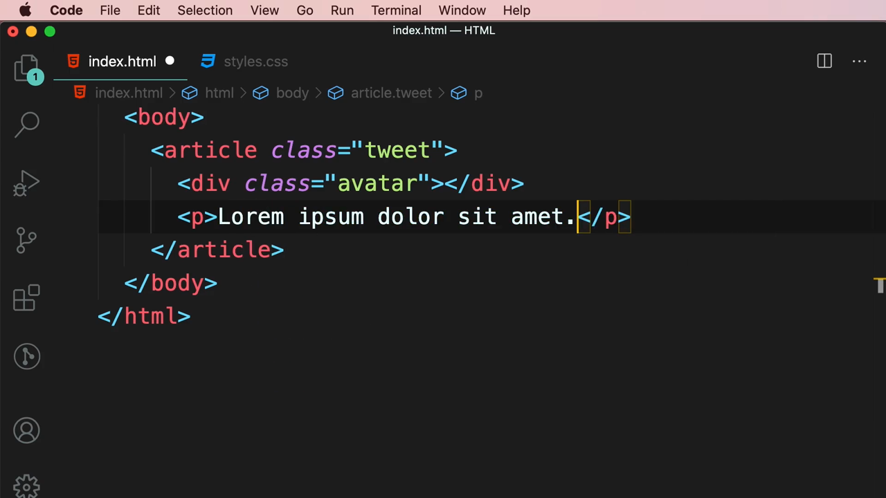

จากนั้นกำหนดสไตล์ให้ `.avatar` เป็นสี่เหลี่ยมจัตุรัสสีทอง (`gold`) ขนาด 5rem x 5rem ก่อน โดยยังไม่ได้ float:

```css
.avatar {
  width: 5rem;
  height: 5rem;
  background-color: gold;
}
```

ผลลัพธ์คือ กล่อง avatar สีทองอยู่ด้านบน และข้อความ "Lorem ipsum dolor sit amet." อยู่ด้านล่างแบบ block ปกติ (คนละบรรทัดกัน เพราะ `div` เป็น block-level element)

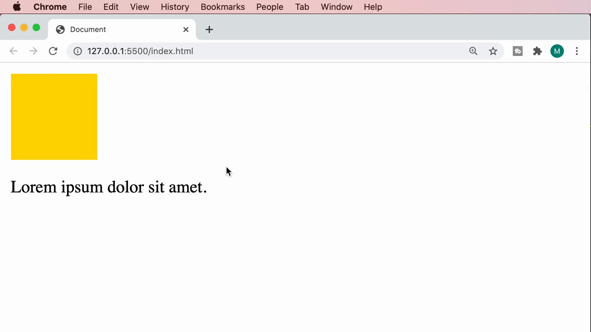

> **หมายเหตุ IntelliSense:** ตอนพิมพ์ `background-color: go...` VS Code จะแสดงรายการสี CSS ที่ขึ้นต้นด้วย "go" เช่น `gold` (#ffd700), `goldenrod` (#daa520), `ghostwhite` (#f8f8ff), `gainsboro` (#dcdcdc), `greenyellow` (#adff2f) — พร้อมตัวอย่างสีเป็นสี่เหลี่ยมเล็กๆ ข้างหน้าแต่ละชื่อ

---

## 3. เพิ่ม `float: left` — หัวใจของคลิปนี้

Mosh เพิ่ม property `float: left;` เข้าไปใน `.avatar`:

```css
.avatar {
  width: 5rem;
  height: 5rem;
  background-color: gold;
  float: left;
}
```

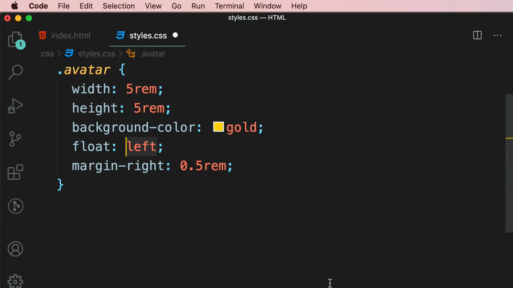

ผลลัพธ์ทันที: กล่อง avatar สีทอง "ลอย" (float) ไปทางซ้าย และข้อความ "Lorem ipsum dolor sit amet." ที่เดิมอยู่คนละบรรทัด ตอนนี้ขึ้นมา**ไหลล้อมรอบ**ด้านขวาของกล่องแทน (ไม่ตกลงมาอยู่ข้างล่างเหมือนก่อนหน้านี้)

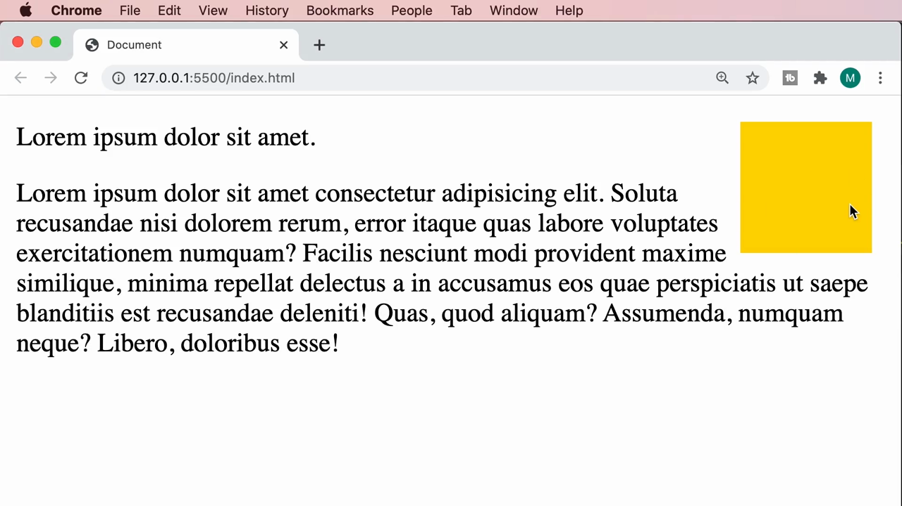

**หลักการสำคัญของ `float`:**
- Element ที่ถูก float จะถูก "ดึงออกจาก normal flow" (removed from the normal document flow)
- Element ที่ตามมาหลังจากนั้น (ในตัวอย่างนี้คือ `<p>`) จะขยับขึ้นมาแทนที่ แล้ว**ไหลล้อมรอบ**ด้านที่ยังว่างของ element ที่ถูก float
- ค่าที่ใช้ได้คือ `float: left`, `float: right`, หรือ `float: none` (ค่าเริ่มต้น)

จากนั้น Mosh เพิ่มย่อหน้าที่สองที่มีข้อความยาวขึ้น (สร้างด้วย Emmet abbreviation `p` + เนื้อหา lorem ipsum ยาว) เพื่อโชว์ให้เห็นชัดว่าข้อความจะไหลล้อมรอบกล่อง avatar ต่อไปเรื่อยๆ จนกว่าจะสูงพ้นกล่อง จากนั้นจึงขยายเต็มความกว้างของหน้า:

```html
<p>Lorem ipsum dolor sit amet consectetur adipisicing elit. Soluta recusandae nisi dolorem rerum, error itaque quas labore voluptates exercitationem numquam? Facilis nesciunt modi provident maxime similique, minima repellat delectus a in accusamus eos quae perspiciatis ut saepe blanditiis est recusandae deleniti! Quas, quod aliquam? Assumenda, numquam neque? Libero, doloribus esse!</p>
```

ผลลัพธ์: บรรทัดแรกๆ ของย่อหน้าที่สองไหลอยู่ข้างกล่อง avatar เหมือนย่อหน้าแรก แล้วเมื่อข้อความยาวเกินความสูงของกล่อง จึงขยายเต็มความกว้างหน้าจอในบรรทัดถัดๆ ไป — นี่คือพฤติกรรมคลาสสิกของ float ที่ใช้ทำ layout แบบนิตยสาร/หนังสือพิมพ์

Mosh ยังเพิ่ม `margin-right: 0.5rem;` ให้ `.avatar` เพื่อให้มีระยะห่างเล็กน้อยระหว่างกล่องกับข้อความที่ไหลอยู่ข้างๆ (ไม่ให้ข้อความชิดขอบกล่องเกินไป):

```css
.avatar {
  width: 5rem;
  height: 5rem;
  background-color: gold;
  float: left;
  margin-right: 0.5rem;
}
```

---

## 4. Property `clear` (แนะนำผ่าน IntelliSense)

ระหว่างสำรวจ Mosh พิมพ์ `clear` ใน CSS แล้วให้ดู IntelliSense suggestions ที่ VS Code แสดงขึ้นมา:

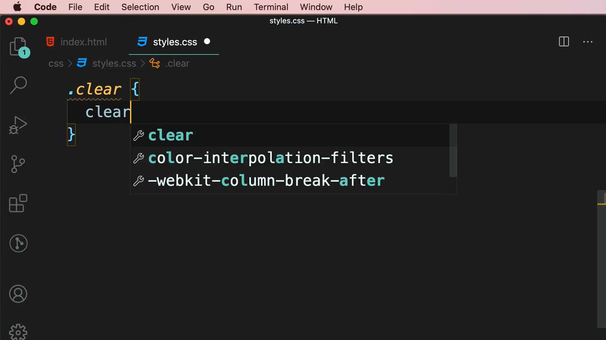

รายการที่ขึ้นมาได้แก่ `clear`, `color-interpolation-filters`, `-webkit-column-break-after` — โดย `clear` คือ property ที่ใช้ "หยุด" ไม่ให้ element ไหลล้อมรอบ float element ที่อยู่ก่อนหน้าอีกต่อไป (ค่าที่ใช้บ่อยคือ `clear: left`, `clear: right`, หรือ `clear: both`)

---

## 5. ทดลองย้าย element ออกไปนอก `<article>`

Mosh ทดลองย้ายย่อหน้าที่สองออกมาไว้**นอก** `</article>` (เป็น sibling ของ `<article class="tweet">` แทนที่จะอยู่ข้างใน):

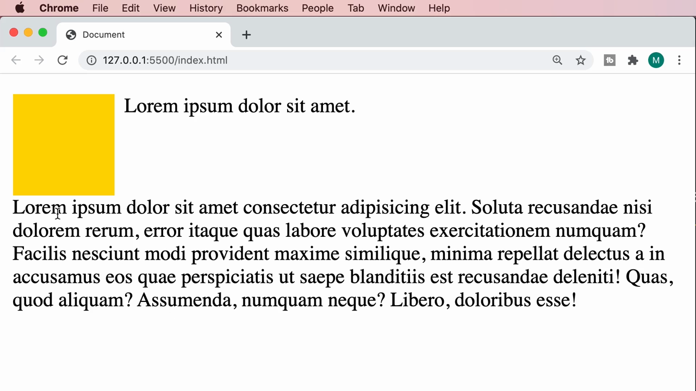

ผลลัพธ์ที่เห็น: ย่อหน้าที่สองยังคง**ไหลล้อมรอบ**กล่อง avatar อยู่ดี ทั้งๆ ที่ไม่ได้อยู่ใน `<article>` เดียวกันแล้ว — นี่คือจุดสำคัญที่ทำให้เห็นปัญหาต่อไป

---

## 6. ปัญหา Collapsing Container — หัวใจสำคัญของคลิปนี้

Mosh เพิ่มเส้นขอบ (border) ให้กับ `<article class="tweet">` เพื่อให้เห็นขอบเขตของกล่องแม่ชัดเจนขึ้น:

```css
.tweet {
  border: 3px solid lightgrey;
}
```

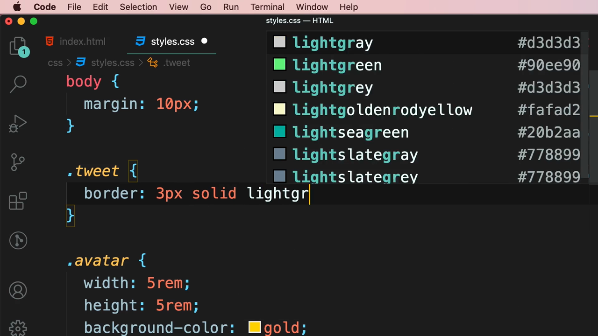

**ปัญหาที่เกิดขึ้น:** เมื่อย่อหน้าที่สอง (element สุดท้ายใน `.tweet`) ถูกย้ายออกไปนอก article (ตามข้อ 5) เหลือแค่ `<div class="avatar">` (ที่ float แล้ว) กับ `<p>` ข้อความแรกอยู่ข้างใน `.tweet` — จะเห็นว่า**เส้นขอบของ `.tweet` ยุบตัวลงมาจนแทบไม่เหลือความสูง** ตัดผ่านกึ่งกลางกล่อง avatar สีทองพอดี ทั้งที่กล่อง avatar สูงตั้ง 5rem!

```html
<article class="tweet">
  <div class="avatar"></div>
  <p>Lorem ipsum dolor sit amet.</p>
</article>
```

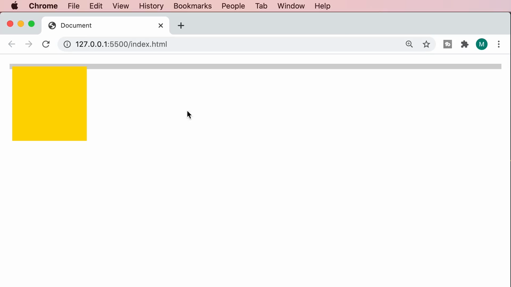

**สาเหตุ:** เพราะ element ที่ถูก `float` จะถูกดึงออกจาก normal flow ไปเลย ทำให้ browser **ไม่นับความสูงของ element ที่ float แล้ว** เป็นส่วนหนึ่งของความสูง container แม่ (`.tweet`) เนื่องจากในกล่องนี้ทุก child ล้วน float หรือเป็น inline content ที่สั้นมาก container เลยยุบเหลือความสูงเกือบ 0 — นี่คือปัญหาคลาสสิกที่เรียกว่า **"collapsing container problem"**

---

## 7. วิธีแก้ที่ 1: เพิ่ม Empty `<div class="clear">` (วิธีเก่า)

วิธีแก้แบบดั้งเดิมที่สุด คือเพิ่ม `<div>` เปล่าๆ ไว้เป็น element สุดท้ายในกล่องแม่ แล้วให้มัน `clear: both`:

```html
<article class="tweet">
  <div class="avatar"></div>
  <p>Lorem ipsum dolor sit amet.</p>
  <div class="clear"></div>
</article>
```

```css
.clear {
  clear: both;
}
```

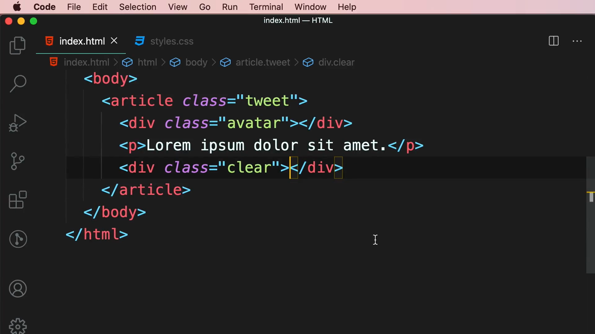

ผลลัพธ์: เส้นขอบของ `.tweet` กลับมาครอบคลุมความสูงของกล่อง avatar อย่างถูกต้องแล้ว เพราะ `<div class="clear">` ถูกบังคับให้ "เคลียร์" การไหลล้อม จึงลงไปอยู่ใต้กล่อง avatar และทำให้ container แม่คำนวณความสูงรวมกล่อง avatar เข้าไปด้วย

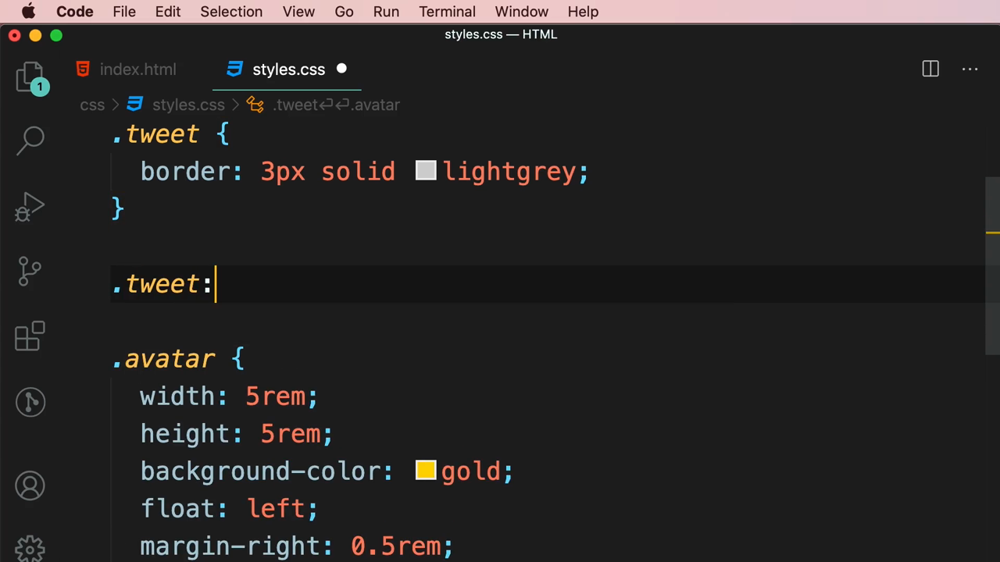

**ข้อเสียของวิธีนี้:** ต้องเพิ่ม HTML element เปล่าๆ ที่ไม่มีความหมายทางความหมาย (semantic) เข้าไปในหน้าเว็บ ซึ่งไม่ใช่แนวทางที่ดีนัก

---

## 8. วิธีแก้ที่ 2: Pseudo-element `::after` (Clearfix แบบไม่ต้องแก้ HTML)

Mosh แนะนำวิธีที่ดีกว่า คือใช้ **pseudo-element** `::after` เพื่อ "แทรก" element เสมือนเข้าไปแทน โดยไม่ต้องเพิ่ม `<div>` จริงใน HTML เลย — เอา `<div class="clear">` ออกจาก HTML แล้วเขียน CSS แทน:

```css
.tweet::after {
  content: '';
  display: block;
  clear: both;
}
```


**อธิบายแต่ละบรรทัด:**
- `content: ''` — จำเป็นต้องมีเสมอสำหรับ pseudo-element `::before`/`::after` (แม้จะเป็น string ว่างก็ตาม) ไม่งั้น pseudo-element จะไม่ถูกสร้างขึ้นมาเลย
- `display: block` — ทำให้ pseudo-element นี้เป็น block-level (เพื่อให้ `clear` มีผล)
- `clear: both` — บังคับให้ pseudo-element นี้เคลียร์ float ทั้งสองด้าน (ทำหน้าที่แทน `<div class="clear">` เดิม)

ผลลัพธ์เหมือนเดิมทุกประการ (เส้นขอบกลับมาถูกต้อง) แต่ตอนนี้ HTML สะอาดขึ้น ไม่มี element เปล่าๆ ปนอยู่แล้ว

```html
<article class="tweet">
  <div class="avatar"></div>
  <p>Lorem ipsum dolor sit amet.</p>
</article>
```

---

## 9. ปัญหาการซ้ำโค้ด (DRY) — ทำไมต้องมี Class `.clearfix`

Mosh ยกตัวอย่างว่า ถ้ามี element อื่นในหน้าเว็บที่ใช้ float เหมือนกัน เช่น `.ad` (โฆษณา) ก็ต้องเขียน `::after` ซ้ำอีกชุดสำหรับมันด้วย:

```css
.ad::after {
  content: '';
  display: block;
  clear: both;
}
```

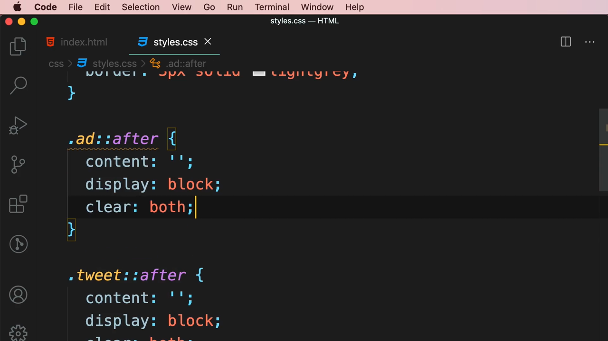

นี่คือปัญหาการเขียนโค้ดซ้ำซ้อน (ผิดหลัก DRY - Don't Repeat Yourself) เพราะทุก container ที่มี float ข้างในต้องเขียน `::after` เหมือนกันทุกครั้ง

**วิธีแก้:** สร้าง class กลางชื่อ `.clearfix` ขึ้นมาแทน แล้วนำไปแปะ (apply) กับ element ไหนก็ได้ที่ต้องการเคลียร์ float:

```css
.clearfix::after {
  content: '';
  display: block;
  clear: both;
}
```

จากนั้นในฝั่ง HTML ก็แค่เพิ่ม class `clearfix` เข้าไปในกล่องที่ต้องการ (ใช้คู่กับ class เดิมได้เลย):

```html
<article class="tweet clearfix">
  <div class="avatar"></div>
  <p>Lorem ipsum dolor sit amet.</p>
</article>
```

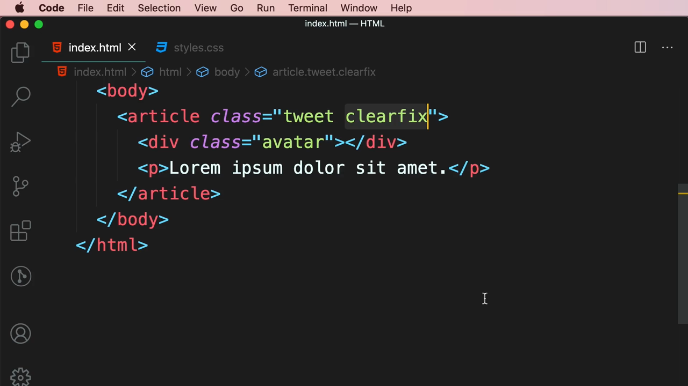

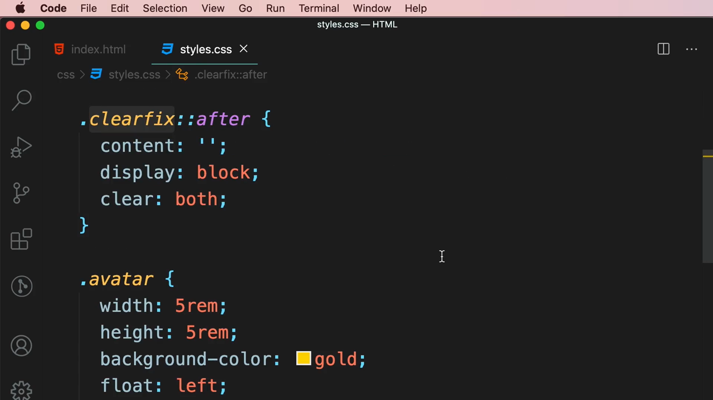

ผลลัพธ์เหมือนเดิม (เส้นขอบถูกต้อง) แต่ตอนนี้ class `.clearfix` เป็น **utility class ที่ reusable** — สามารถแปะกับ container ไหนก็ได้ที่มี float อยู่ข้างใน โดยไม่ต้องเขียน `::after` ซ้ำอีก

---

## 10. วิธีแก้ที่ 3: `overflow: hidden` — วิธีที่ง่ายและนิยมที่สุดในปัจจุบัน

สุดท้าย Mosh แสดงวิธีที่ง่ายที่สุด (และเป็นที่นิยมมากในปัจจุบัน) คือแค่เพิ่ม `overflow: hidden;` (หรือ `overflow: auto;`) เข้าไปที่ container แม่โดยตรง โดยไม่ต้องใช้ `.clearfix` หรือ pseudo-element อะไรเลย:

```css
.tweet {
  border: 3px solid lightgrey;
  overflow: hidden;
}
```

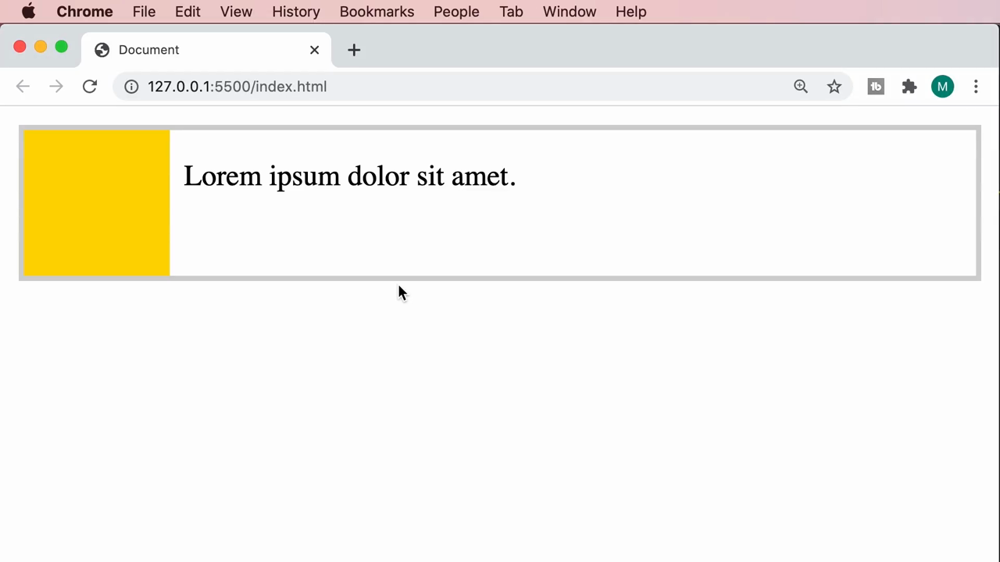

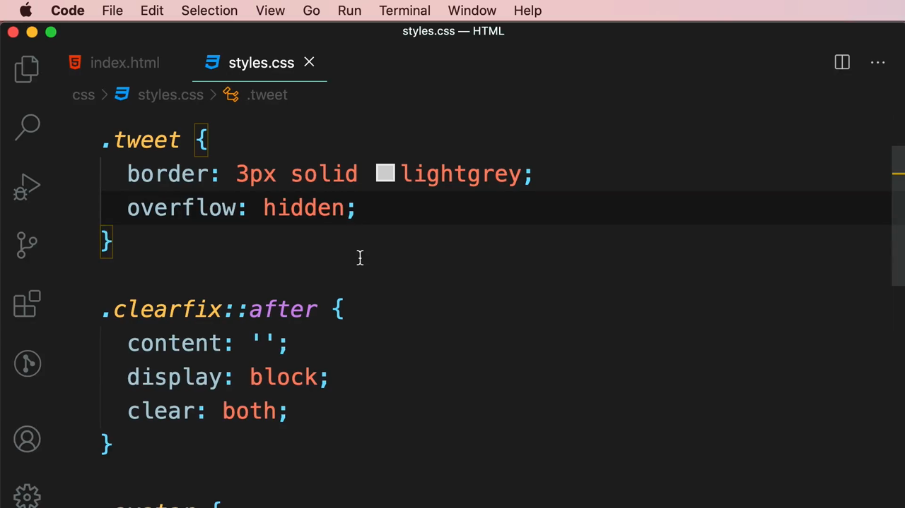

**ทำไมวิธีนี้ถึงได้ผล:** การกำหนดค่า `overflow` ที่ไม่ใช่ `visible` (เช่น `hidden`, `auto`, `scroll`) ให้กับ element จะทำให้ browser สร้าง**"new block formatting context"** ขึ้นมา ซึ่งผลพลอยได้ (side effect) ของมันคือ container จะ**คำนวณความสูงรวม element ลูกที่ float อยู่ข้างในด้วย** โดยอัตโนมัติ — ผลลัพธ์คือเส้นขอบกลับมาถูกต้องเหมือนวิธีที่ 1 และ 2 ทุกประการ แต่เขียนโค้ดสั้นกว่ามาก (บรรทัดเดียว ไม่ต้องแก้ HTML และไม่ต้องเขียน pseudo-element)

> **หมายเหตุ:** วิธีนี้ใช้ได้ก็ต่อเมื่อ container ไม่มีเนื้อหาอื่นที่จำเป็นต้อง "ล้น" ออกมาให้เห็น (เพราะ `overflow: hidden` จะซ่อนเนื้อหาที่ล้นออกไปด้วย) หากมีเนื้อหาที่ต้องแสดงให้เห็นล้นขอบ ควรใช้วิธี `.clearfix` (ข้อ 9) แทน

---

## สรุปภาพรวมของคลิปนี้

| หัวข้อ | สิ่งที่ได้เรียนรู้ |
|---|---|
| `float: left` / `float: right` | ดึง element ออกจาก normal flow ให้ "ลอย" ไปด้านใดด้านหนึ่ง และให้เนื้อหาที่ตามมาไหลล้อมรอบ |
| `clear: left/right/both` | หยุดไม่ให้ element ไหลล้อม float element ก่อนหน้าอีกต่อไป |
| Collapsing container problem | Container แม่ไม่นับความสูงของลูกที่ถูก float ทำให้ยุบตัวจนความสูงเกือบ 0 |
| วิธีแก้ที่ 1 | เพิ่ม empty `<div>` + `clear: both` (วิธีเก่า, ต้องแก้ HTML) |
| วิธีแก้ที่ 2 | ใช้ `::after` pseudo-element + class `.clearfix` แบบ reusable (ไม่ต้องแก้ HTML) |
| วิธีแก้ที่ 3 | `overflow: hidden` หรือ `auto` บน container แม่ (สั้นที่สุด, นิยมที่สุดในปัจจุบัน) |

---

*หมายเหตุ: คลิปนี้เป็นส่วนหนึ่งของบท "2-Layout" จากคอร์ส The Ultimate HTML and CSS Course โดย Mosh Hamedani (codewithmosh.com)*
