# 2-Layout: 08 - FlexBox (14:59)

**ไฟล์ต้นทาง:** `8-FlexBox.mp4`

▶️ **[เปิดวิดีโอต้นฉบับ](../../../HTML-CSS-2/2-Layout/8-FlexBox.mp4)**

---

## ภาพรวมคลิปนี้

คลิปนี้เป็นคลิปสำคัญที่สุดคลิปหนึ่งของบท Layout — Mosh สอนเรื่อง **Flexbox (Flexible Box Layout)** ซึ่งเป็นระบบ layout ที่ใช้จัด "แถวเดียว" หรือ "คอลัมน์เดียว" ของ element ได้อย่างยืดหยุ่น ครอบคลุมตั้งแต่การเปิดใช้งาน `display: flex`, ทิศทางของแกน (`flex-direction`), การจัดตำแหน่งตามแกนหลัก/แกนขวาง (`justify-content`, `align-items`, `align-content`), การขึ้นบรรทัดใหม่ (`flex-wrap`), การควบคุม item รายตัว (`align-self`) ไปจนถึงการควบคุมขนาด (`flex-basis`, `flex-grow`, `flex-shrink`) และ shorthand `flex`

---

## 1. ไตเติลเปิดคลิปและคำนิยาม

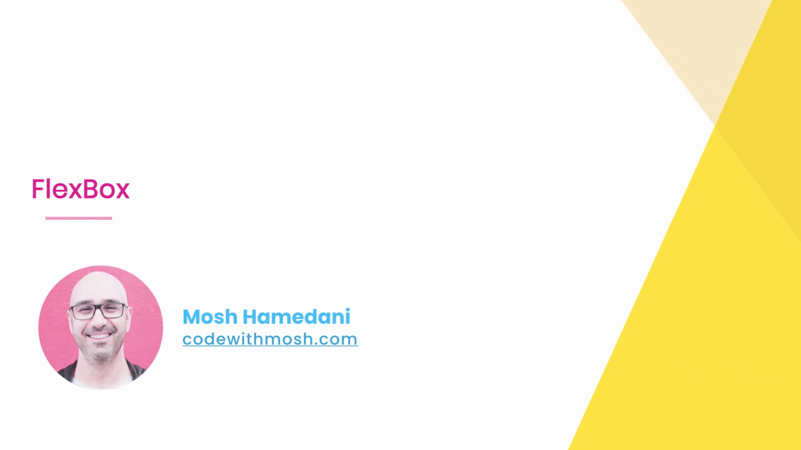

Mosh อธิบายนิยามของ Flexbox ไว้ชัดเจน:

> **Flexible Box Layout (FlexBox)** — Used for laying out elements **in one direction**

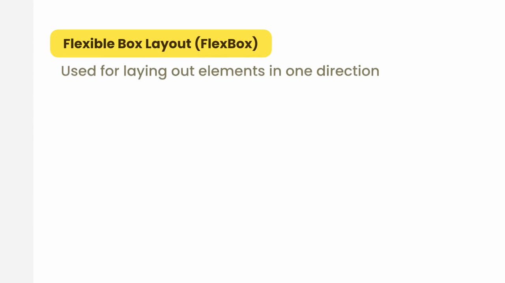

พูดง่ายๆ คือ Flexbox เหมาะกับการจัดวาง element เป็น "แถวเดียว" (ซ้าย-ขวา) หรือ "คอลัมน์เดียว" (บน-ล่าง) เท่านั้น ถ้าต้องการจัด layout แบบตารางหลายแถวหลายคอลัมน์พร้อมกัน ควรใช้ CSS Grid แทน (จะสอนในคลิปถัดไป)

---

## 2. เตรียมตัวอย่าง: กล่อง A, B, C ในกล่องแม่ `.container`

Mosh สร้างโครงสร้าง HTML เป็น `<div class="container">` ที่มี `<div class="box">` อยู่ข้างใน 3 อัน (A, B, C):

```html
<div class="container">
  <div class="box">A</div>
  <div class="box">B</div>
  <div class="box">C</div>
</div>
```

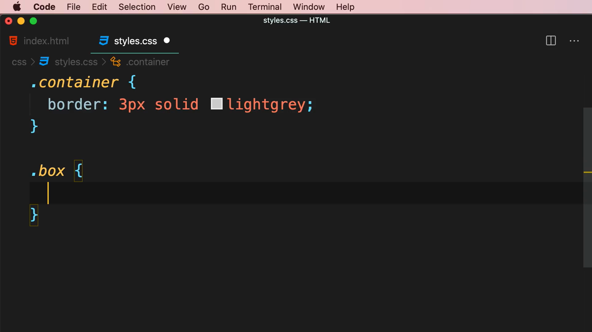

จากนั้นกำหนด CSS พื้นฐาน:

```css
body {
  margin: 10px;
}

.container {
  border: 3px solid lightgrey;
}

.box {
  width: 5rem;
  height: 5rem;
  background: gold;
  margin: 1rem;
}
```

ก่อนเปิดใช้งาน flex ผลลัพธ์คือกล่อง A, B, C เรียงต่อกันตามแนวตั้ง (block-level element เริ่มต้น) เต็มความกว้างของ container:

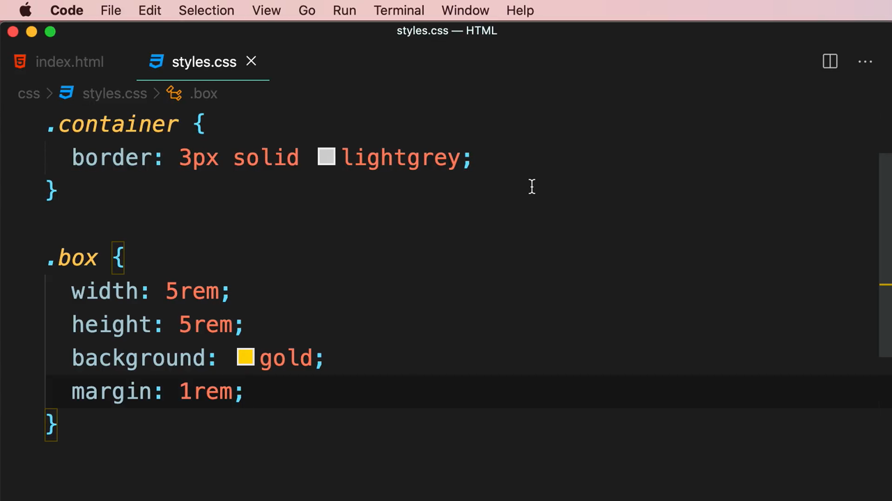

> **หมายเหตุ IntelliSense:** ตอนพิมพ์ `display: f...` VS Code แสดงตัวเลือก `flex`, `flexbox`, `flow-root`, `inline-flex` ให้เลือก

---

## 3. เปิดใช้งาน `display: flex`

เพิ่ม `display: flex;` เข้าไปใน `.container`:

```css
.container {
  border: 3px solid lightgrey;
  display: flex;
}
```

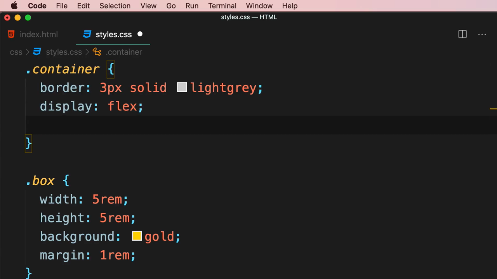

ผลลัพธ์ทันที: กล่อง A, B, C เปลี่ยนจากเรียงตามแนวตั้งมาเป็น**เรียงตามแนวนอน (row)** ติดกันโดยอัตโนมัติ — นี่คือพฤติกรรมเริ่มต้น (default) ของ `display: flex`

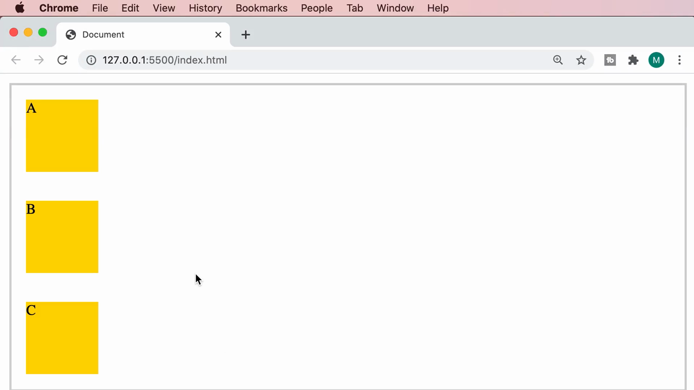

---

## 4. `flex-direction` — กำหนดทิศทางของแกนหลัก

Mosh สาธิตค่าต่างๆ ของ `flex-direction`:

```css
.container {
  border: 3px solid lightgrey;
  display: flex;
  flex-direction: column-reverse;
}
```

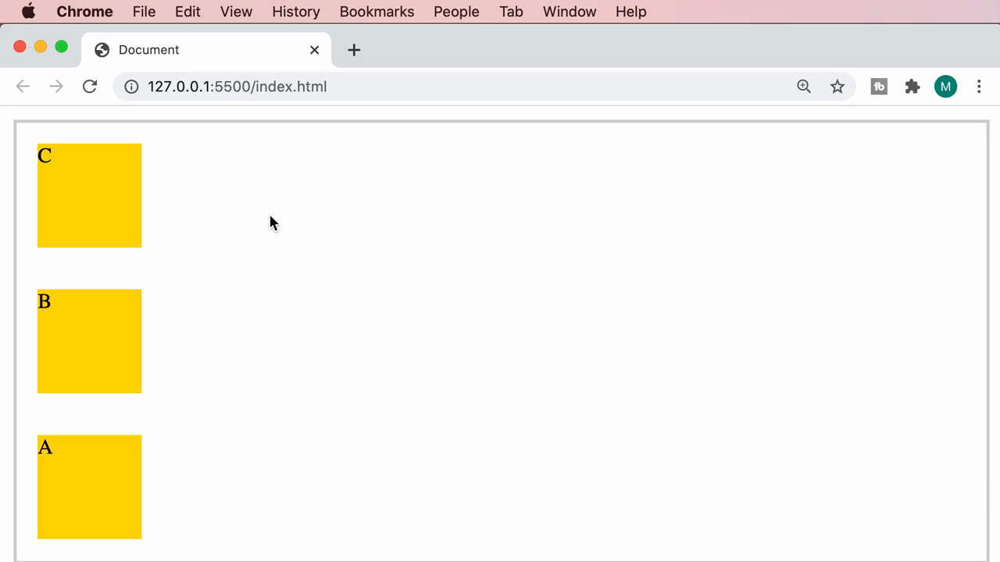

ผลลัพธ์: กล่องเรียงตามแนวตั้งแต่**กลับลำดับ** (C บนสุด, B กลาง, A ล่างสุด)

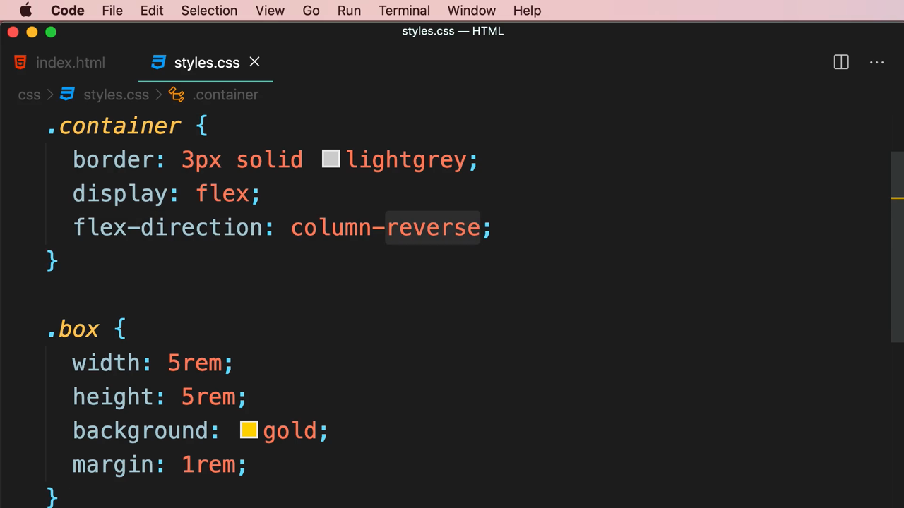

**ค่าที่ใช้ได้ทั้งหมดของ `flex-direction`:**
- `row` (ค่าเริ่มต้น) — แนวนอน จากซ้ายไปขวา
- `row-reverse` — แนวนอน จากขวาไปซ้าย
- `column` — แนวตั้ง จากบนลงล่าง
- `column-reverse` — แนวตั้ง จากล่างขึ้นบน

---

## 5. Main Axis และ Cross Axis (แกนหลัก / แกนขวาง) — แนวคิดสำคัญที่สุด

Mosh อธิบายด้วยไดอะแกรมที่ชัดเจนมาก:

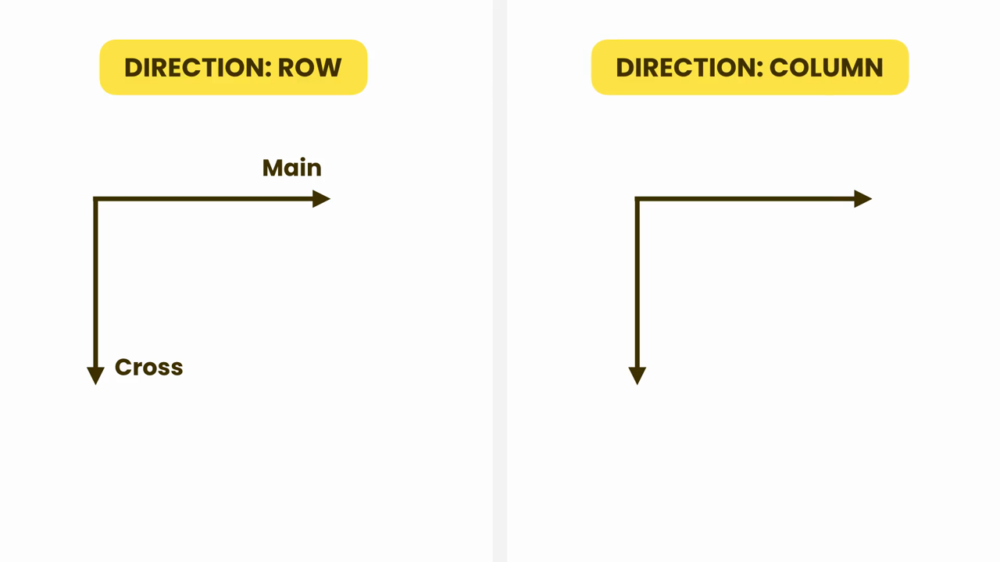

- เมื่อ `flex-direction: row` → **แกนหลัก (Main axis)** วิ่งตามแนวนอน (ซ้าย→ขวา), **แกนขวาง (Cross axis)** วิ่งตามแนวตั้ง (บน→ล่าง)
- เมื่อ `flex-direction: column` → **แกนหลัก (Main axis)** วิ่งตามแนวตั้ง (บน→ล่าง), **แกนขวาง (Cross axis)** วิ่งตามแนวนอน (ซ้าย→ขวา)

พูดง่ายๆ คือ **แกนหลักจะเปลี่ยนไปตามค่าของ `flex-direction` เสมอ** ส่วนแกนขวางจะตั้งฉากกับแกนหลักเสมอ — แนวคิดนี้สำคัญมากเพราะ property ถัดไปทั้งหมดอ้างอิงกับสองแกนนี้

---

## 6. การจัดตำแหน่ง Item (Aligning Items)

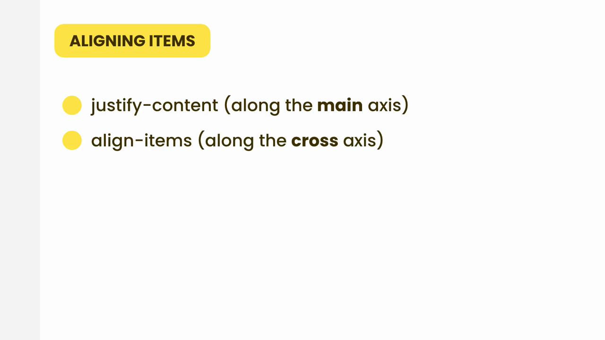

Mosh สรุปสอง property หลักที่ใช้จัดตำแหน่ง:
- **`justify-content`** — จัดตำแหน่งตาม**แกนหลัก (main axis)**
- **`align-items`** — จัดตำแหน่งตาม**แกนขวาง (cross axis)**

### 6.1 `justify-content` (แกนหลัก)

Mosh กลับไปตั้ง `flex-direction: row;` แล้วทดลองค่า `justify-content` ทีละค่า:

```css
.container {
  border: 3px solid lightgrey;
  display: flex;
  flex-direction: row;
  justify-content: flex-end;
}
```

ผลลัพธ์: กล่อง A, B, C ทั้งหมดถูกดันไปชิดขวา (ยังคงเรียงลำดับ A, B, C ตามปกติ ไม่ใช่กลับด้าน)

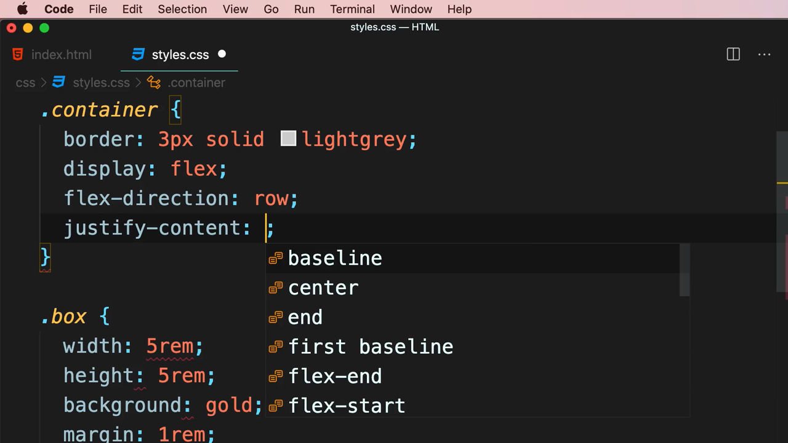

จากนั้นเปลี่ยนเป็น `justify-content: center;` — กล่องทั้งหมดถูกจัดกึ่งกลางแนวนอน:

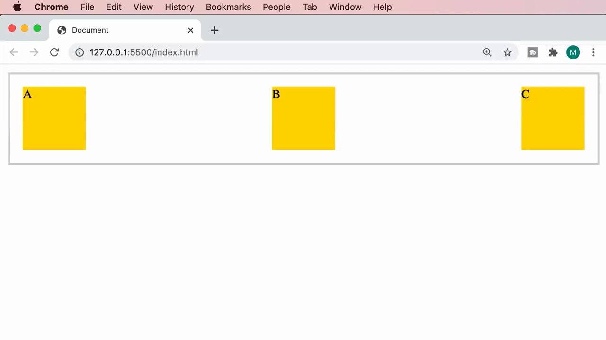

Mosh เปิด DevTools ขึ้นมาดูและทดลองเปลี่ยนเป็น `space-between` (ระยะห่างเท่ากันระหว่างกล่อง แต่กล่องแรก/สุดท้ายชิดขอบ), `space-around` (ระยะห่างรอบแต่ละกล่องเท่ากัน กล่องริมมีช่องว่างครึ่งหนึ่ง), และ `space-evenly` (ระยะห่างทุกช่องเท่ากันหมดรวมถึงขอบ):

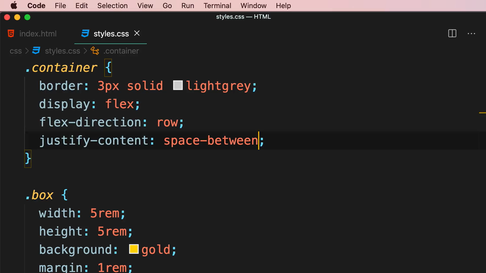

**ค่าทั้งหมดของ `justify-content`:** `flex-start` (ค่าเริ่มต้น), `flex-end`, `center`, `space-between`, `space-around`, `space-evenly`

### 6.2 `align-items` (แกนขวาง)

เพื่อให้เห็นผลของ `align-items` ชัดเจน Mosh เพิ่ม `height: 90vh;` ให้ `.container` ก่อน (ทำให้กล่องมีที่ว่างแนวตั้งให้ขยับ):

```css
.container {
  border: 3px solid lightgrey;
  display: flex;
  flex-direction: row;
  justify-content: center;
  align-items: flex-end;
  height: 90vh;
}
```

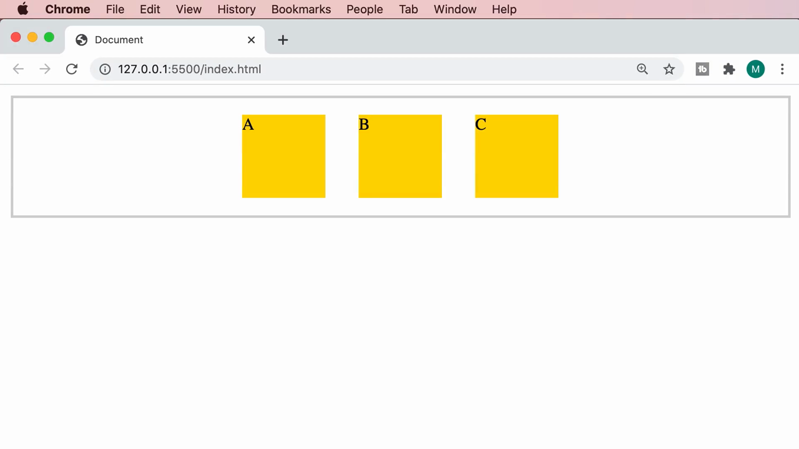

ค่าที่ IntelliSense แสดงคือ `baseline`, `center`, `flex-end`, `flex-start`, `stretch` (ค่าเริ่มต้น), `inherit`, `initial`

จากนั้นเปลี่ยนเป็น `align-items: center;` ร่วมกับ `justify-content: center;` เพื่อสาธิตการ**จัดกึ่งกลางทั้งแนวนอนและแนวตั้งพร้อมกัน** — เทคนิคที่ใช้บ่อยที่สุดในการ center เนื้อหาแบบ Flexbox:

```css
.container {
  border: 3px solid lightgrey;
  display: flex;
  flex-direction: row;
  justify-content: center;
  align-items: center;
  height: 90vh;
}
```

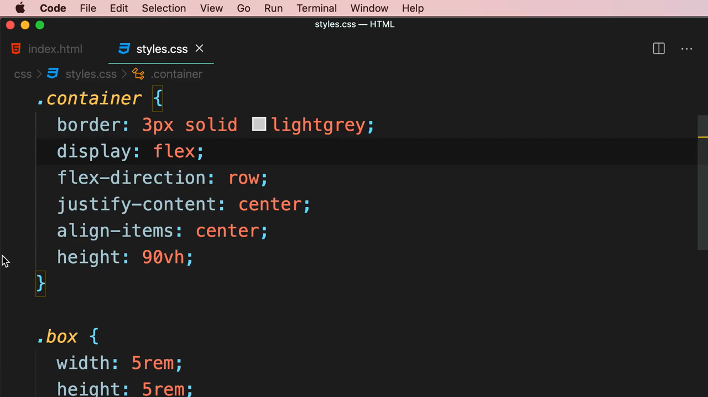

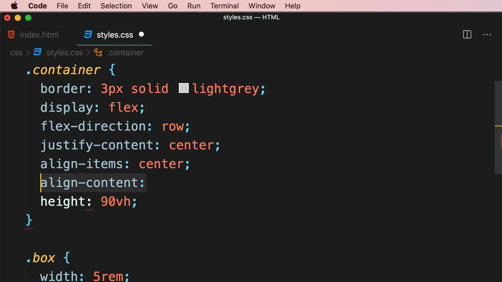

ผลลัพธ์: กล่อง A, B, C อยู่กึ่งกลางทั้งแนวนอนและแนวตั้งของ container พอดี

---

## 7. `flex-wrap` และ `align-content` — เมื่อ item มีหลายบรรทัด

Mosh เพิ่มกล่องจาก A-C เป็น A ถึง H (8 กล่อง) เพื่อสาธิตการขึ้นบรรทัดใหม่ แล้วเพิ่ม `flex-wrap: wrap;`:

```css
.container {
  border: 3px solid lightgrey;
  display: flex;
  flex-direction: row;
  justify-content: center;
  align-items: center;
  flex-wrap: wrap;
  height: 90vh;
}
```

ผลลัพธ์: เมื่อกล่องมีมากเกินกว่าจะอยู่ในแถวเดียว มันจะ**ขึ้นบรรทัดใหม่** (wrap) แทนที่จะบีบอัดหรือล้นออกนอกกรอบ — เกิดเป็น 2 แถว (A-F แถวแรก, G-H แถวสอง)

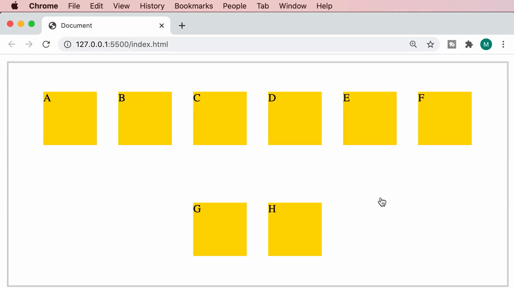

เมื่อมีหลายแถวแบบนี้ จะมี property เพิ่มเข้ามาคือ **`align-content`** ซึ่งใช้ควบคุมระยะห่าง**ระหว่างแถว** (ต่างจาก `align-items` ที่ควบคุมตำแหน่งของ item ภายในแต่ละแถว):

```css
align-content: center;
```

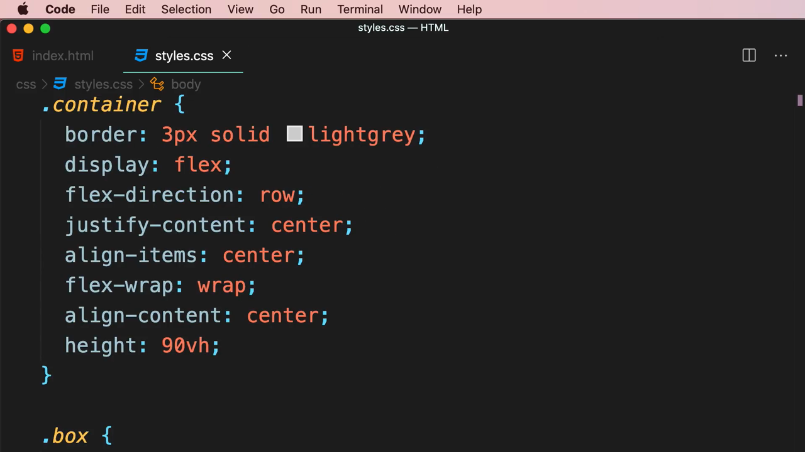

ผลลัพธ์: ทั้งสองแถวถูกจัดให้อยู่กึ่งกลางของ container ตามแนวตั้งร่วมกัน (ค่าที่ใช้ได้เหมือนกับ `justify-content`: `flex-start`, `flex-end`, `center`, `space-between`, `space-around`, `space-evenly`)

จากนั้น Mosh ลบกล่อง D-H ออก กลับไปเหลือแค่ A, B, C เหมือนเดิมเพื่อไปสอนหัวข้อถัดไป

---

## 8. `align-self` — override การจัดตำแหน่งของ item รายตัว

บางครั้งต้องการให้ item หนึ่งตัวมีตำแหน่งต่างจากพี่น้องตัวอื่นบนแกนขวาง Mosh เพิ่ม class `.box-one` ให้กล่อง A แล้วกำหนด:

```html
<div class="box box-one">A</div>
```

```css
.box-one {
  align-self: flex-start;
}
```

ผลลัพธ์: กล่อง A ขยับไปชิดขอบบนของ container ในขณะที่ B และ C ยังคงอยู่ตรงกลาง (ตาม `align-items: center` ของกลุ่ม) — แสดงให้เห็นว่า **`align-self` เขียนทับ (override) `align-items` ได้เฉพาะ item นั้นตัวเดียว**

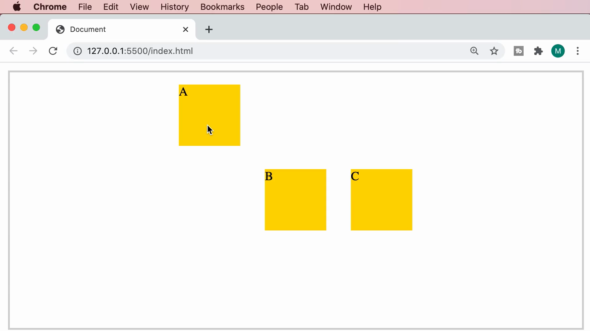

---

## 9. การกำหนดขนาด Item (Sizing Items)

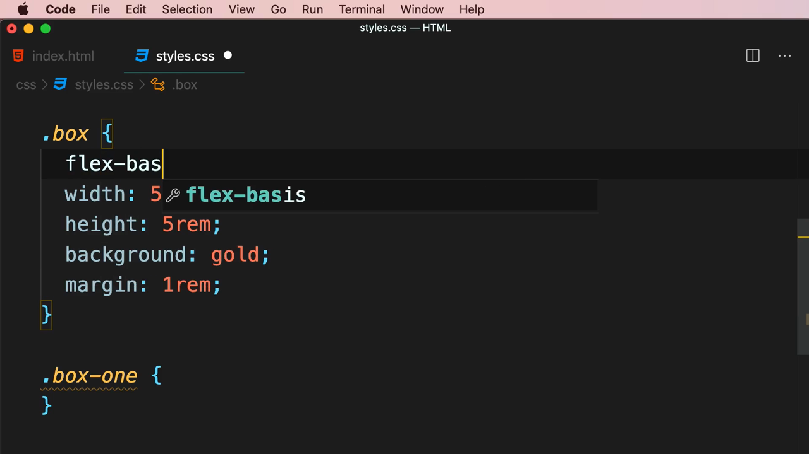

Mosh แนะนำ 3 property หลักที่ใช้ควบคุมขนาดของ flex item:
- **`flex-basis`** — ขนาดเริ่มต้น (initial size) ของ item
- **`flex-grow`** — ตัวคูณการ "โต" (growth factor) เมื่อมีพื้นที่ว่างเหลือ
- **`flex-shrink`** — ตัวคูณการ "หด" (shrink factor) เมื่อพื้นที่ไม่พอ

### 9.1 `flex-basis`

```css
.box {
  flex-basis: 10rem;
  width: 5rem;
  height: 5rem;
  background: gold;
  margin: 1rem;
}
```

ผลลัพธ์: กล่องทั้งหมดกว้างขึ้นเป็น 10rem แทนที่จะเป็น 5rem ตาม `width` — แสดงว่า **`flex-basis` มีความสำคัญเหนือกว่า `width`** เมื่ออยู่ใน flex container (ในทิศทาง main axis)

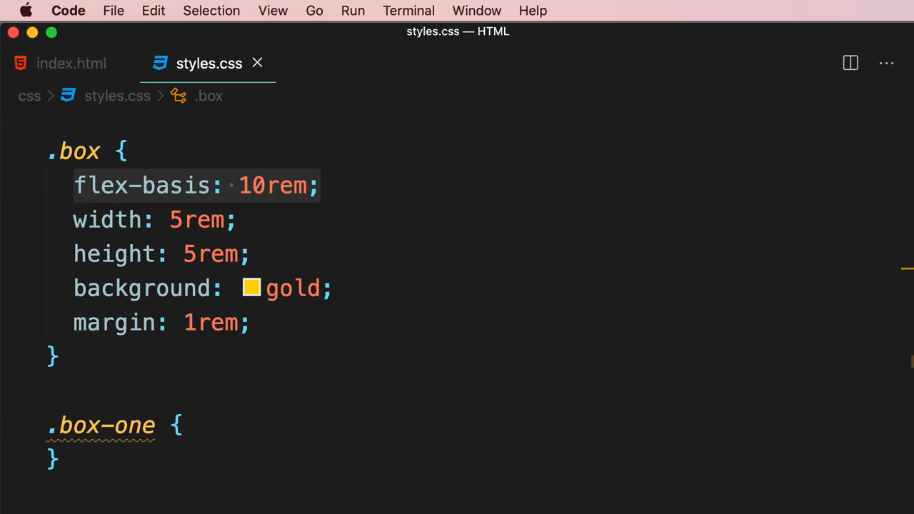

จากนั้น Mosh ปรับ `flex-basis: 5rem;` เพื่อให้เท่ากับ `width` เดิม (กลับไปที่ขนาดปกติ) ก่อนไปสอน `flex-grow`

### 9.2 `flex-grow`

```css
.box {
  flex-basis: 5rem;
  flex-grow: 1;
  width: 5rem;
  height: 5rem;
  background: gold;
  margin: 1rem;
}
```

ผลลัพธ์: กล่องทั้ง 3 ใบ**ขยายตัวเท่าๆ กัน**จนเต็มพื้นที่ว่างที่เหลือใน container (เพราะทุกกล่องมี `flex-grow: 1` เท่ากัน จึงแบ่งพื้นที่ว่างที่เหลือคนละเท่าๆ กัน)

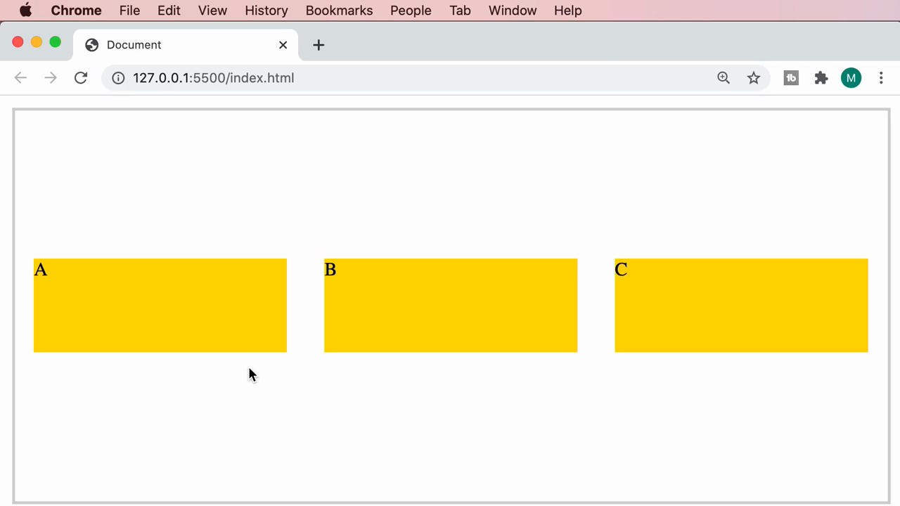

จากนั้น Mosh เพิ่ม class `.box-one` ให้กล่อง A แล้วกำหนดค่า `flex-grow` ต่างจากกลุ่ม (เช่น `flex-grow: 0;` หรือ `flex-grow: 2;`) เพื่อสาธิตว่ากล่อง A จะโตน้อยกว่าหรือมากกว่ากล่องอื่นตามสัดส่วนของตัวเลข:

```css
.box-one {
  flex-grow: 0;
}
```

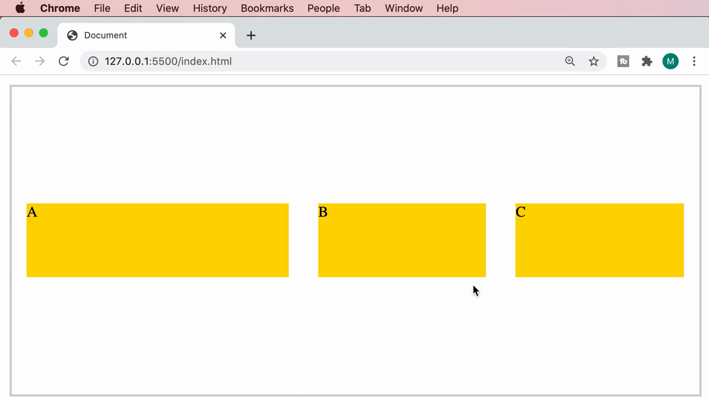

**หลักการ:** `flex-grow` เป็นค่า "สัดส่วน" ไม่ใช่ค่าตายตัว — ถ้ากล่อง A มี `flex-grow: 2` และกล่องอื่นมี `flex-grow: 1` กล่อง A จะได้รับส่วนแบ่งพื้นที่ว่างเป็น 2 เท่าของกล่องอื่น

### 9.3 `flex-shrink`

Mosh ปรับ `flex-basis: 15rem;` (ให้กล่องใหญ่กว่าที่จะพอดีกับหน้าจอ) และตั้ง `flex-shrink: 1;` แล้วค่อยๆ ลดขนาดหน้าต่างเบราว์เซอร์ให้แคบลง:

```css
.box {
  flex-basis: 15rem;
  flex-shrink: 1;
  width: 5rem;
  height: 5rem;
  background: gold;
  margin: 1rem;
}
```

ผลลัพธ์: เมื่อพื้นที่ในหน้าจอไม่พอ กล่องทั้ง 3 ใบจะ**หดตัวลงเท่าๆ กัน**เพื่อให้พอดีกับพื้นที่ที่มี (แทนที่จะล้นออกนอกจอ)

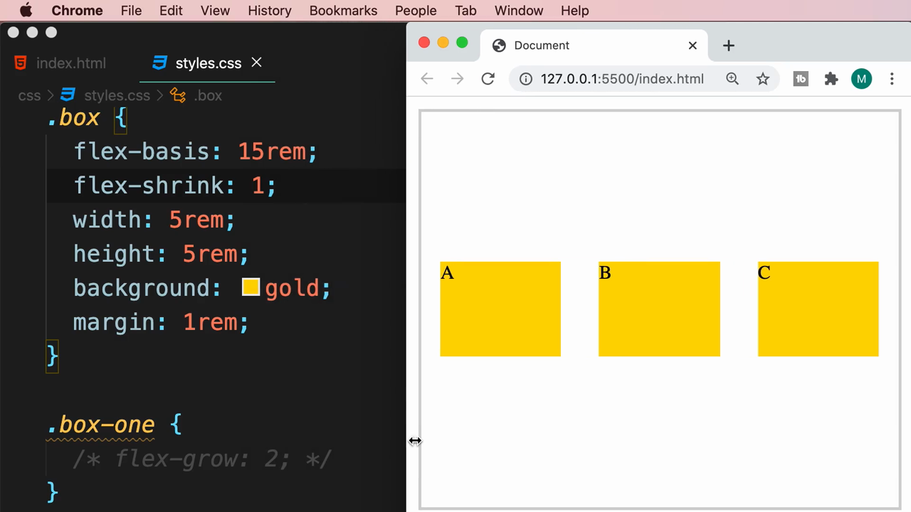

จากนั้น Mosh เพิ่ม `.box-one { flex-shrink: 0; }` ให้กล่อง A เพื่อบอกว่า **"ห้ามหด"** — ผลลัพธ์: เมื่อบีบหน้าต่างให้แคบ กล่อง A ยังคงขนาดเดิม (15rem) ในขณะที่กล่อง B และ C หดตัวลงเพื่อเบียดพื้นที่ให้พอ:

```css
.box-one {
  flex-shrink: 0;
}
```

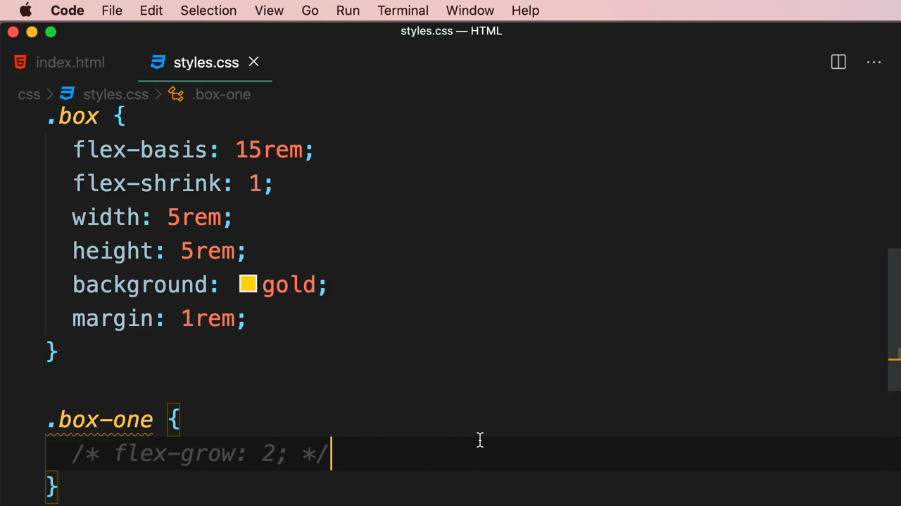

---

## 10. Shorthand `flex` — รวม 3 property เป็นบรรทัดเดียว

สุดท้าย Mosh แนะนำว่าแทนที่จะเขียน `flex-basis`, `flex-grow`, `flex-shrink` แยกกัน 3 บรรทัด สามารถเขียนรวมเป็น shorthand เดียวคือ `flex` (เรียงตามลำดับ **grow shrink basis**):

```css
.box {
  flex: 1 1 15rem;
  /* เทียบเท่ากับ:
     flex-grow: 1;
     flex-shrink: 1;
     flex-basis: 15rem;
  */
  width: 5rem;
  height: 5rem;
  background: gold;
  margin: 1rem;
}
```

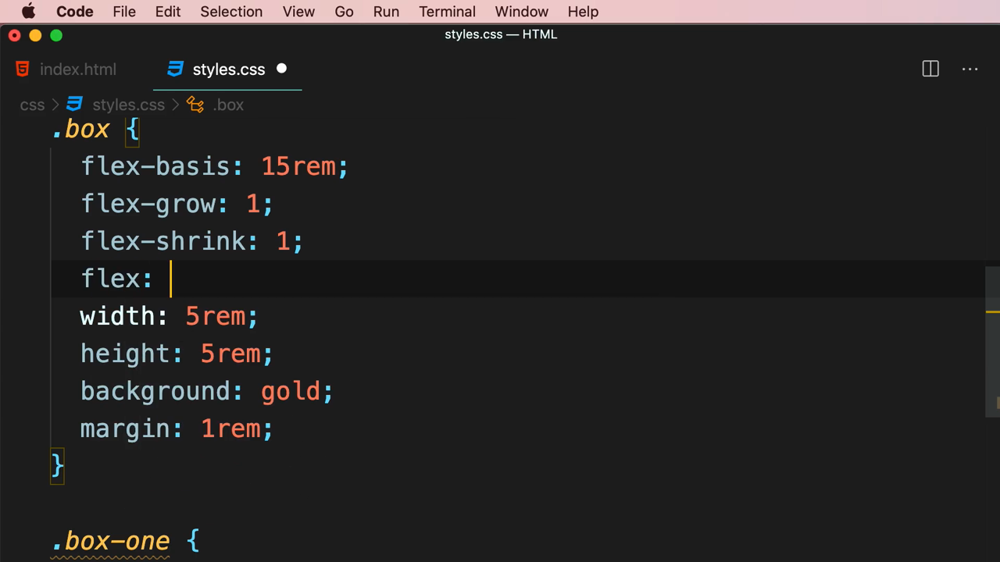

การใช้ shorthand `flex` เป็นแนวทางที่นักพัฒนามืออาชีพนิยมใช้มากกว่าการเขียนแยก 3 บรรทัด เพราะสั้นกระชับกว่าและอ่านง่ายเมื่อคุ้นเคยแล้ว

---

## สรุปภาพรวมของคลิปนี้

| Property | หน้าที่ |
|---|---|
| `display: flex` | เปิดใช้งาน Flexbox ให้ container |
| `flex-direction` | กำหนดทิศทางแกนหลัก: `row`, `row-reverse`, `column`, `column-reverse` |
| `justify-content` | จัดตำแหน่ง item ตามแกนหลัก (main axis) |
| `align-items` | จัดตำแหน่ง item ตามแกนขวาง (cross axis) |
| `flex-wrap` | อนุญาตให้ item ขึ้นบรรทัดใหม่เมื่อพื้นที่ไม่พอ |
| `align-content` | จัดระยะห่างระหว่างหลายแถว (ใช้คู่กับ `flex-wrap`) |
| `align-self` | override การจัดตำแหน่งแกนขวางของ item รายตัว |
| `flex-basis` | ขนาดเริ่มต้นของ item (สำคัญกว่า width/height ในทิศทาง main axis) |
| `flex-grow` | สัดส่วนการขยายตัวเมื่อมีพื้นที่ว่างเหลือ |
| `flex-shrink` | สัดส่วนการหดตัวเมื่อพื้นที่ไม่พอ |
| `flex` (shorthand) | รวม `flex-grow flex-shrink flex-basis` ในบรรทัดเดียว |

---

*หมายเหตุ: คลิปนี้เป็นส่วนหนึ่งของบท "2-Layout" จากคอร์ส The Ultimate HTML and CSS Course โดย Mosh Hamedani (codewithmosh.com)*
