# 2-Layout: 09 - Grid (19:04)

**ไฟล์ต้นทาง:** `9-Grid.mp4`

▶️ **[เปิดวิดีโอต้นฉบับ](../../../HTML-CSS-2/2-Layout/9-Grid.mp4)**

---

## ภาพรวมคลิปนี้

คลิปที่ยาวที่สุดในบท Layout — Mosh สอนเรื่อง **CSS Grid** ระบบ layout ที่ทรงพลังที่สุดใน CSS เพราะสามารถจัดวาง element ได้ทั้ง**แถวและคอลัมน์พร้อมกัน** (ต่างจาก Flexbox ที่จัดได้ทีละทิศทางเดียว) ครอบคลุมตั้งแต่การสร้าง grid พื้นฐาน (`grid-template-rows`/`columns`), การจัดตำแหน่ง item (`justify-items`, `align-items`, `justify-content`, `align-content`), หน่วย `fr`, ระยะห่างระหว่างเซลล์ (`gap`), การวาง item แบบระบุตำแหน่งเอง (`grid-column`, `grid-row`, `grid-area`) ไปจนถึงเทคนิคขั้นสูงสุดคือการตั้งชื่อพื้นที่ด้วย `grid-template-areas`

---

## 1. ไตเติลเปิดคลิปและคำนิยาม


Mosh อธิบายนิยามของ Grid เทียบกับ Flexbox:

> **Grid** — Used to lay out elements **in both rows and columns**

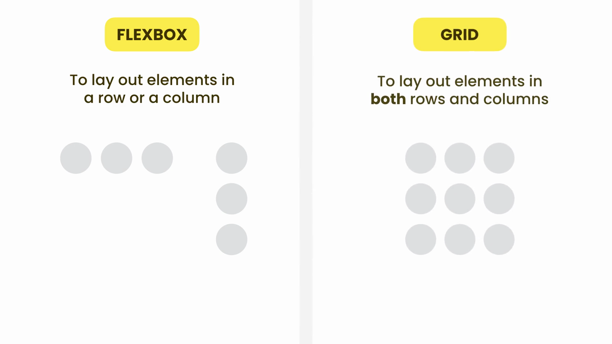

พูดง่ายๆ คือ ถ้า Flexbox จัดได้แค่ "แถวเดียว" หรือ "คอลัมน์เดียว" Grid จะจัดได้ทั้งสองมิติพร้อมกัน เหมาะกับ layout ที่ซับซ้อนกว่า

Mosh ยกตัวอย่างการใช้งานจริง 2 แบบที่ Grid เหมาะสมที่สุด:

**ตัวอย่างที่ 1 — แกลเลอรีรูปภาพอาหาร (Image Gallery)** จัดเป็นตาราง 4 คอลัมน์ x 3 แถว:

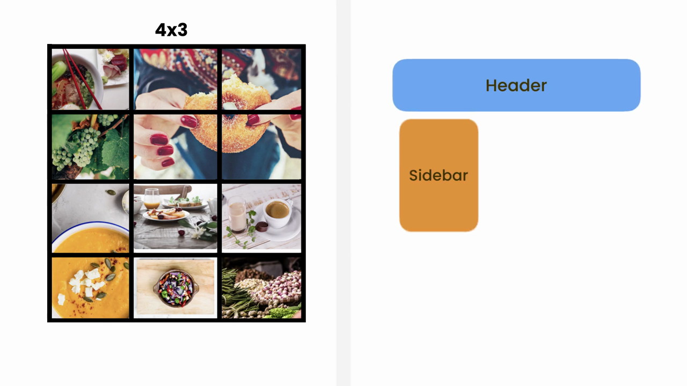

**ตัวอย่างที่ 2 — โครงหน้าเว็บ (Page Layout)** แบบ Header ด้านบน, Sidebar ด้านซ้าย, Content ตรงกลาง, Footer ด้านล่าง:

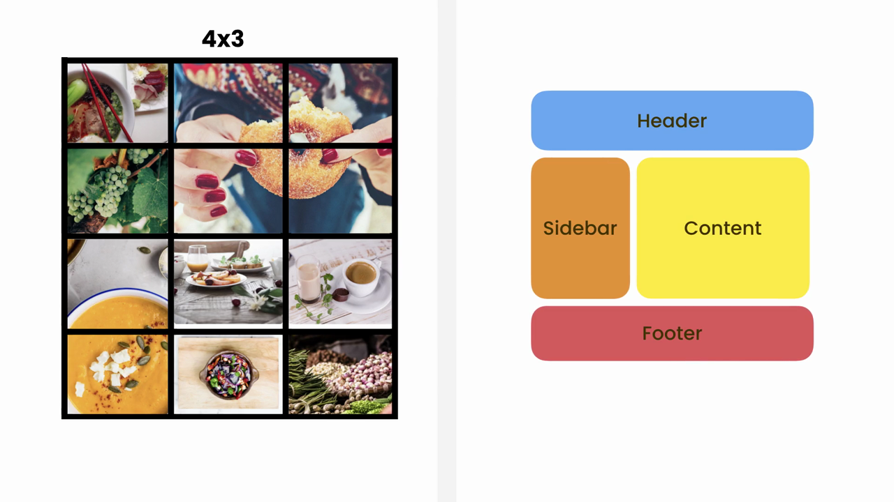

---

## 2. การสร้าง Grid พื้นฐาน (Defining a Grid)

Mosh สร้าง `<div class="container">` ว่างๆ แล้วกำหนด:

```css
.container {
  display: grid;
  grid-template-rows: 100px 100px 100px;
  grid-template-columns: 100px 100px;
  border: 3px solid lightgrey;
}
```

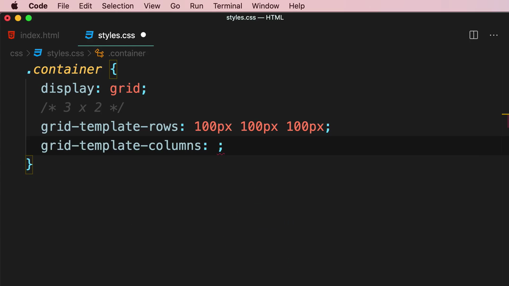

โค้ดนี้สร้าง **grid ขนาด 3 แถว x 2 คอลัมน์** (แต่ละ track กว้าง/สูง 100px) แม้ในตอนนี้ container ยังไม่มี child element ใดๆ อยู่ข้างในเลยก็ตาม

**จุดสำคัญที่ Mosh เน้นย้ำ:** เมื่อเปิด Chrome DevTools แล้วไปที่แท็บ **Layout** จะเห็นว่า browser วาดเส้น grid (สีน้ำเงิน) ให้เห็นล่วงหน้าทันที ทั้งที่ container ยังว่างเปล่า — นี่คือความต่างสำคัญจาก Flexbox ที่ถ้าไม่มี item ข้างในก็จะไม่มีอะไรให้เห็นเลย (Grid **นิยามโครงสร้างตาราง**ไว้ล่วงหน้าเสมอ ไม่ขึ้นกับเนื้อหาข้างใน):

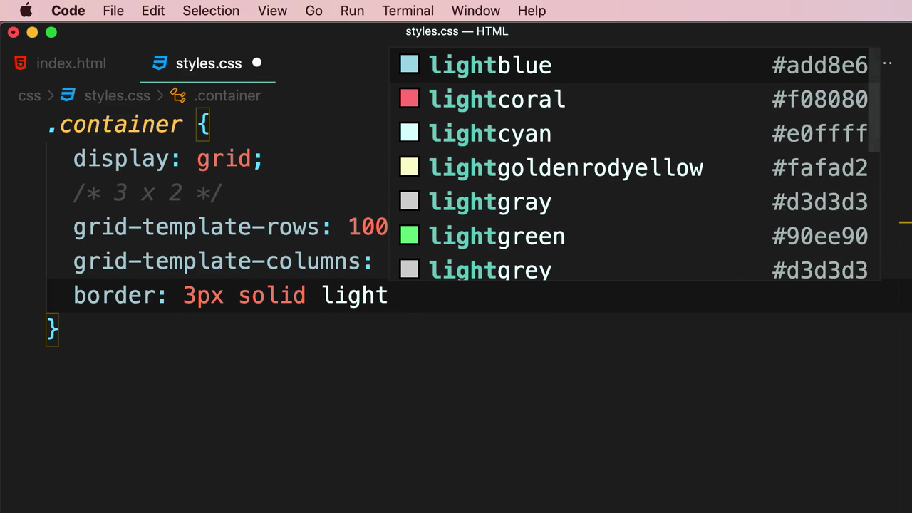

DevTools ยังมีปุ่ม **"Show track sizes"** (แสดงขนาดแต่ละ track) และแสดง**เลขเส้น (grid line numbers)** กำกับทุกเส้นตาราง โดยนับจาก 1 ขึ้นไปจากซ้ายบน และมีเลขลบ (-1, -2, -3, ...) นับจากขวาล่างย้อนกลับมา ใช้อ้างอิงตำแหน่งได้ทั้งสองทิศทาง:

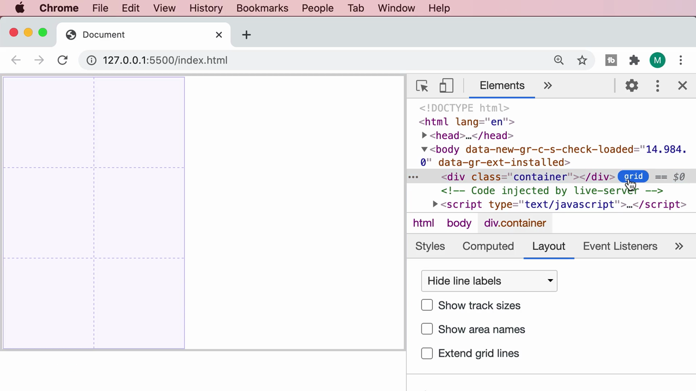

### ฟังก์ชัน `repeat()` — ลดการเขียนโค้ดซ้ำ

แทนที่จะเขียน `100px 100px 100px` ซ้ำ 3 รอบ ใช้ฟังก์ชัน `repeat()` แทนได้:

```css
.container {
  display: grid;
  grid-template-rows: repeat(3, 100px);
  grid-template-columns: repeat(2, 100px);
  border: 3px solid lightgrey;
}
```

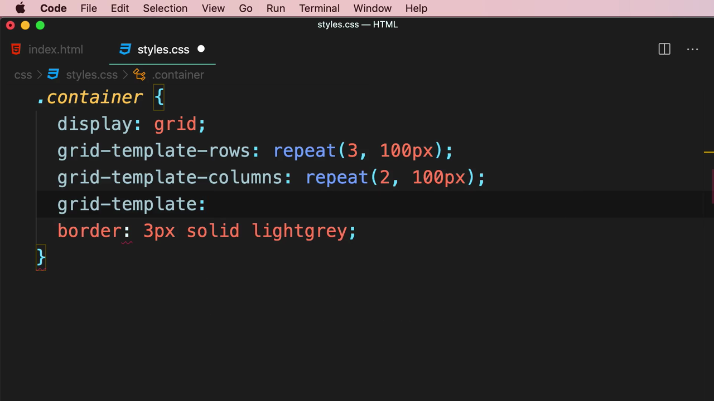

ผลลัพธ์เหมือนเดิมทุกประการแต่โค้ดสั้นกระชับกว่า (`repeat(จำนวนครั้ง, ขนาด)`)

---

## 3. การเพิ่ม Item และ Auto-placement

Mosh เพิ่ม `<div class="box">A</div>` ถึง `<div class="box">D</div>` (4 กล่อง) เข้าไปใน container:

```html
<div class="container">
  <div class="box">A</div>
  <div class="box">B</div>
  <div class="box">C</div>
  <div class="box">D</div>
</div>
```

ผลลัพธ์: Grid จะจัดวางกล่องโดยอัตโนมัติ (auto-placement) เรียงจากซ้ายไปขวา บนลงล่าง ทีละแถว — เนื่องจากมี 2 คอลัมน์ จึงได้ A,B แถวแรก และ C,D แถวสอง (ใช้แค่ 2 จาก 3 แถวที่นิยามไว้):

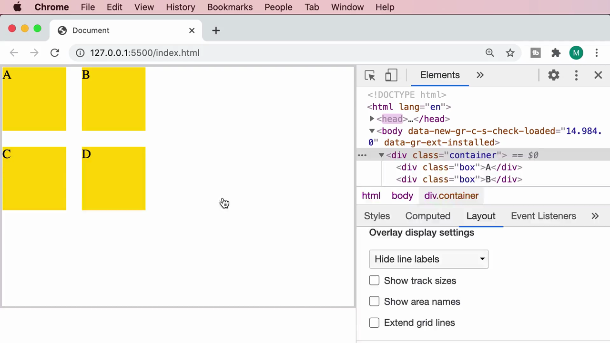

เปิด DevTools แท็บ Layout อีกครั้งจะเห็นว่าแถวที่ 3 (ที่ยังไม่มี item ไปวาง) ยังคงถูกไฮไลต์เป็นพื้นที่ว่างสีชมพู/ม่วงไว้ — ยืนยันว่า Grid จองพื้นที่ตามที่นิยามไว้เสมอ แม้จะไม่มีเนื้อหาไปเติมก็ตาม:

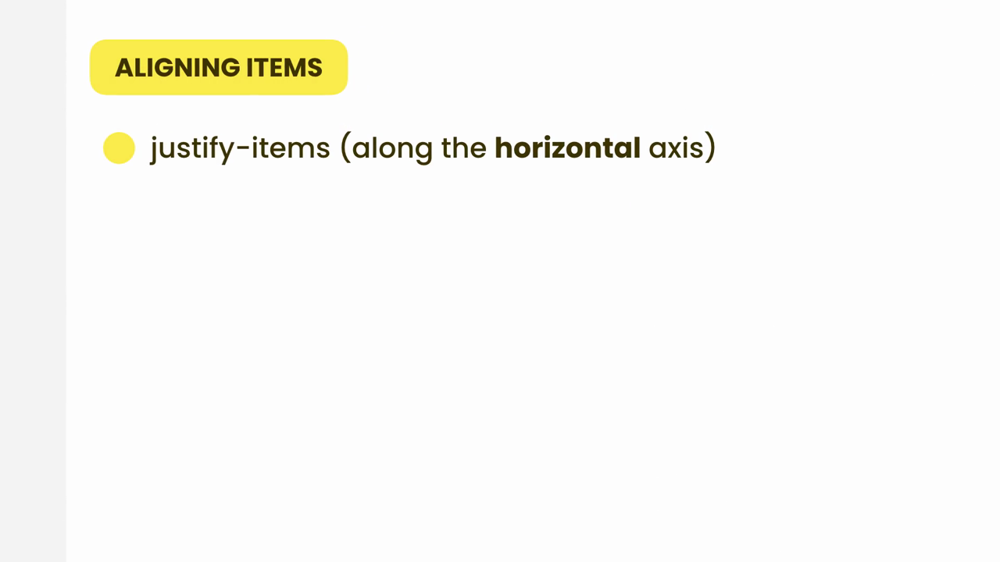

---

## 4. การจัดตำแหน่ง Item (Aligning Items)

Grid มี property การจัดตำแหน่งคล้าย Flexbox แต่ชื่อต่างกันเล็กน้อย — สำคัญมากที่ต้องจำให้แม่น:

| Property | ใช้จัด... |
|---|---|
| `justify-items` | ตำแหน่ง item ภายในเซลล์ตามแนวนอน |
| `align-items` | ตำแหน่ง item ภายในเซลล์ตามแนวตั้ง |
| `justify-content` | ตำแหน่งของ **grid ทั้งหมด** ภายใน container ตามแนวนอน |
| `align-content` | ตำแหน่งของ **grid ทั้งหมด** ภายใน container ตามแนวตั้ง |

### 4.1 `justify-items` และ `align-items`

```css
.container {
  display: grid;
  grid-template-rows: repeat(3, 100px);
  grid-template-columns: repeat(2, 100px);
  border: 3px solid lightgrey;
  justify-items: center;
  align-items: center;
}
```

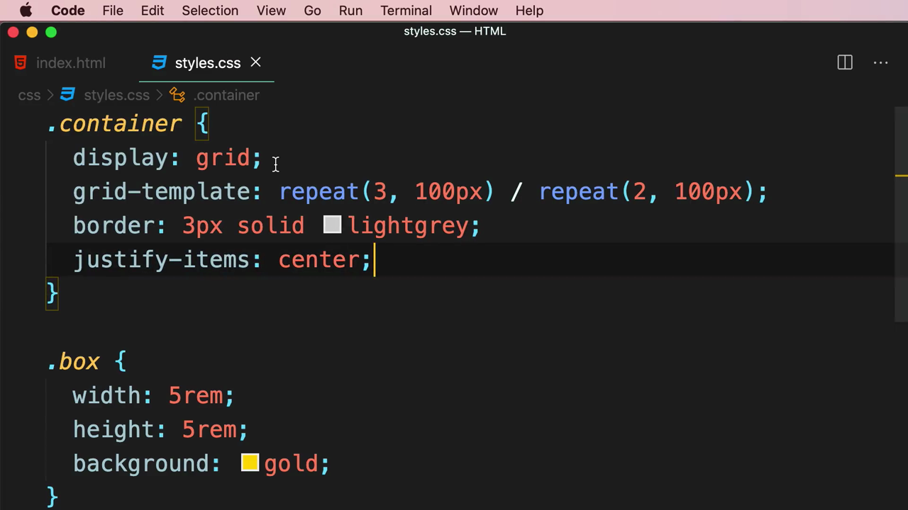

ผลลัพธ์: กล่องแต่ละใบหดตัวเหลือขนาดปกติ (5rem ตาม `.box`) และถูกจัดให้อยู่**กึ่งกลางของเซลล์ตัวเอง** ทั้งแนวนอนและแนวตั้ง (ไม่ยืดเต็มเซลล์เหมือนค่าเริ่มต้น):

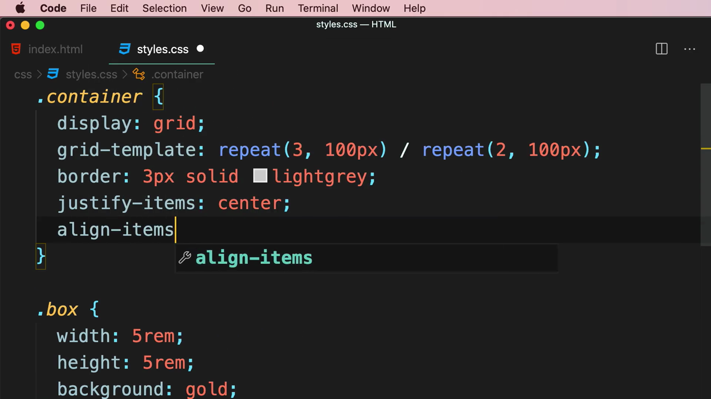

**ค่าที่ใช้ได้ทั้งหมด:** `stretch` (ค่าเริ่มต้น — ยืดเต็มเซลล์), `start`, `end`, `center`

### 4.2 `justify-content` และ `align-content`

เมื่อขนาดรวมของ grid ทั้งหมดเล็กกว่า container (เช่น container สูง 100vh แต่ grid สูงแค่ 300px) จะใช้ property นี้จัดตำแหน่งของ**ตัว grid ทั้งก้อน**ภายใน container:

```css
.container {
  display: grid;
  grid-template-rows: repeat(3, 100px);
  grid-template-columns: repeat(2, 100px);
  border: 3px solid lightgrey;
  justify-items: center;
  align-items: center;
  justify-content: center;
  align-content: center;
  height: 100vh;
}
```

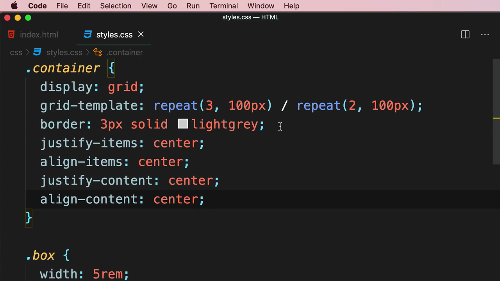

ผลลัพธ์: ตาราง grid ทั้งก้อนถูกจัดให้อยู่กึ่งกลางของหน้าจอ (ทั้งแนวนอนและแนวตั้ง)

### 4.3 `stretch` — ค่าเริ่มต้นที่ทำให้ item เต็มเซลล์

Mosh สาธิตว่าค่าเริ่มต้นของ `justify-items`/`align-items` คือ `stretch`:

```css
justify-items: stretch;
align-items: stretch;
```

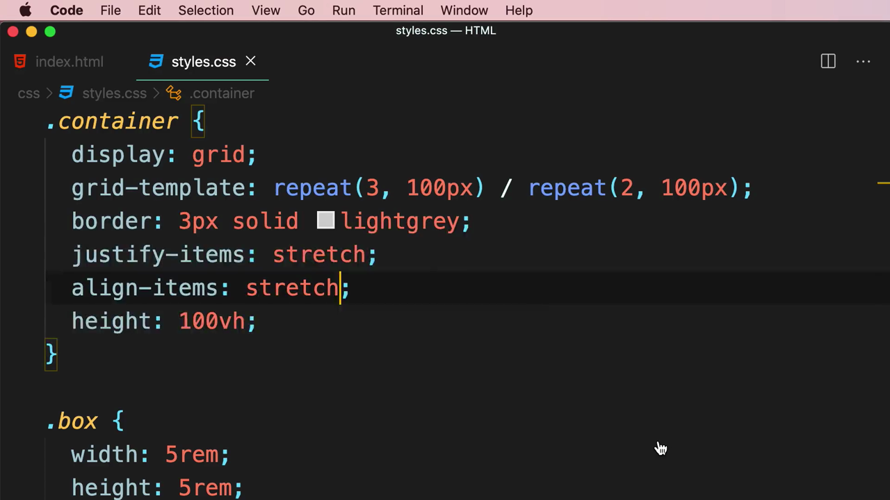

เมื่อลบ `width`/`height` ออกจาก `.box` ทั้งหมด (เหลือแค่ `background: gold;`) แต่ละกล่องจะ**ขยายเต็มเซลล์ของตัวเองพอดี** โดยอัตโนมัติ:

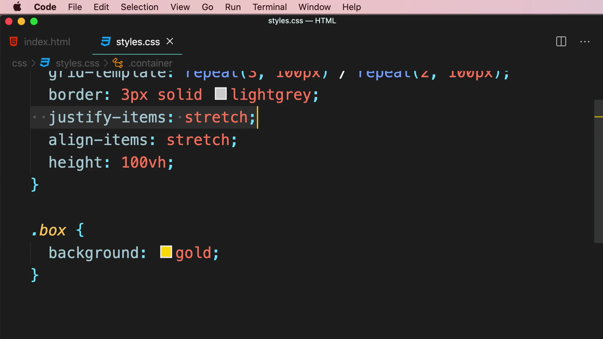

---

## 5. หน่วยขนาด: Mixed Units และ `fr` (Fractional Unit)

### 5.1 ผสมหน่วยได้อิสระ

`grid-template-columns` สามารถผสมหน่วยต่างชนิดกันในบรรทัดเดียวได้ เช่น:

```css
grid-template: repeat(3, 100px) / 100px 30% 70%;
```

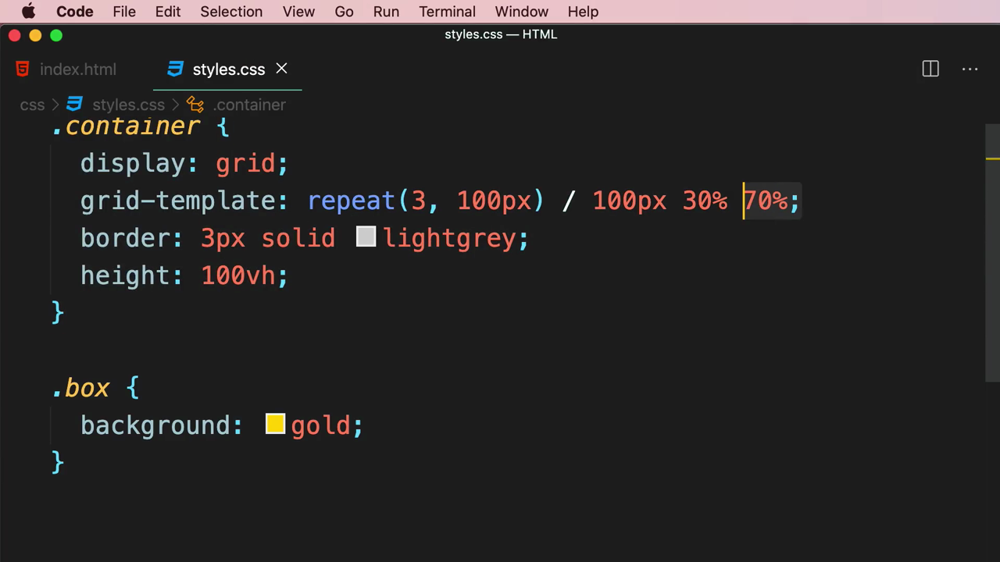

### 5.2 หน่วย `fr` (Fraction) — หน่วยเฉพาะของ Grid

`fr` คือหน่วย "สัดส่วน" ของพื้นที่ว่างที่เหลือ (คล้ายกับ `flex-grow` ใน Flexbox):

```css
.container {
  display: grid;
  grid-template: 100px auto 100px / 30fr 70fr;
  border: 3px solid lightgrey;
  height: 100vh;
}
```

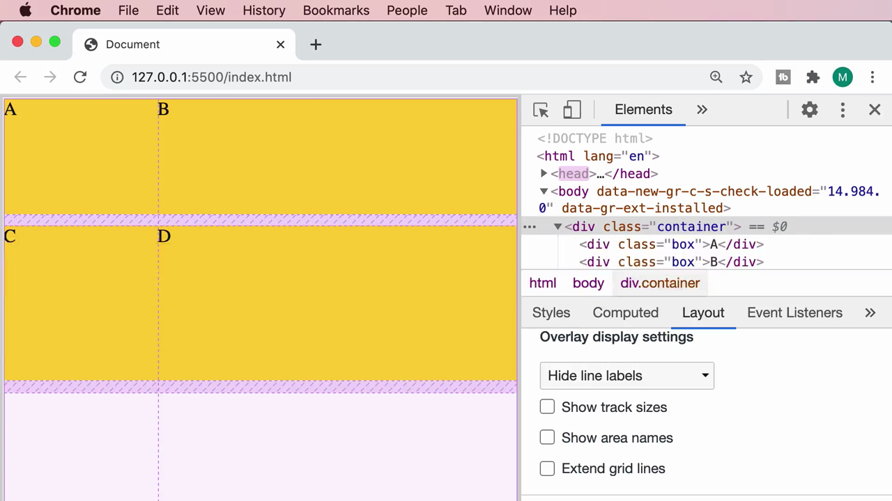

ผลลัพธ์: คอลัมน์แรกได้พื้นที่ 30% ของความกว้างทั้งหมด และคอลัมน์ที่สองได้ 70% — สัดส่วนจะปรับตามขนาดหน้าจอโดยอัตโนมัติเสมอ (responsive) ต่างจาก `%` ที่คำนวณจาก container โดยตรง

> **หมายเหตุ:** ค่า `auto` ในแถวกลาง หมายถึงให้แถวนั้นมีความสูงเท่ากับเนื้อหาข้างในพอดี (ไม่บังคับขนาดตายตัว)

---

## 6. `gap`, `row-gap`, `column-gap` — ระยะห่างระหว่างเซลล์

```css
.container {
  display: grid;
  grid-template: 100px auto 100px / 30fr 70fr;
  row-gap: 10px;
  column-gap: 10px;
  border: 3px solid lightgrey;
  height: 100vh;
}
```

ผลลัพธ์: เกิดช่องว่าง (gutter) ระหว่างแต่ละแถวและคอลัมน์ 10px โดยไม่กระทบกับขอบนอกสุดของ container:

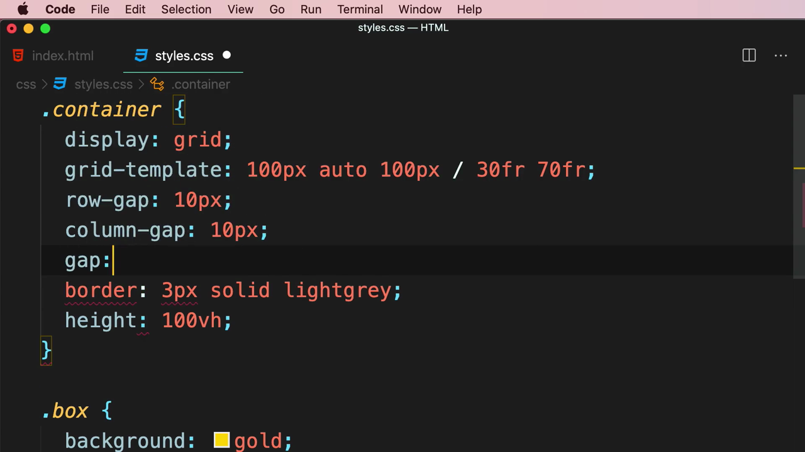

Mosh แนะนำว่าสามารถรวมสองบรรทัดเป็น shorthand เดียวได้:

```css
gap: 10px;
```

(`gap` เพียงค่าเดียวจะกำหนดทั้ง row-gap และ column-gap พร้อมกัน หรือใส่สองค่า `gap: 10px 20px;` เพื่อกำหนดแยกกันก็ได้)

---

## 7. การวาง Item เอง (Placing Items) — `grid-column` และ `grid-row`

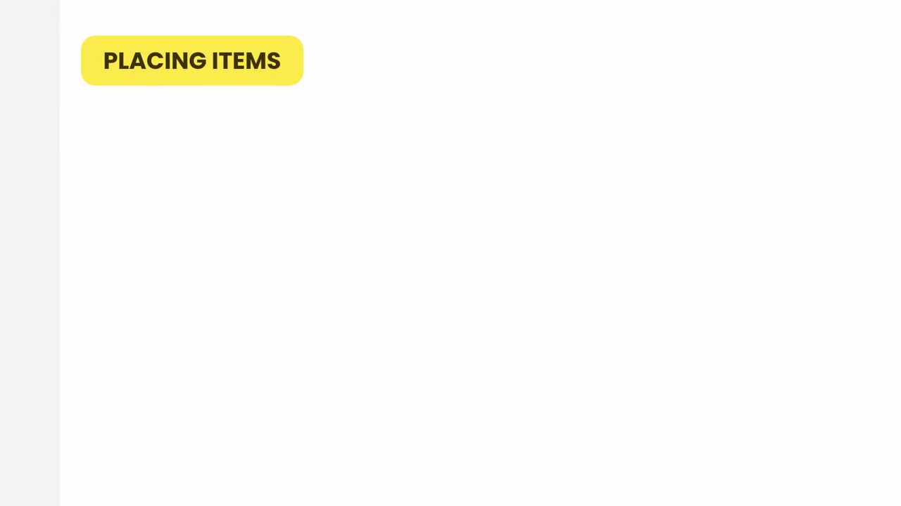

### 7.1 ระบุแค่เส้นเริ่มต้น

```css
.box-one {
  grid-column: 2;
}
```

ผลลัพธ์: กล่อง A ถูกบังคับให้ไปอยู่ที่**คอลัมน์เส้นที่ 2** แทน (กล่อง B, C, D ที่เหลือจะถูก auto-placement ไปเติมเต็มช่องว่างที่เหลือตามลำดับปกติ):

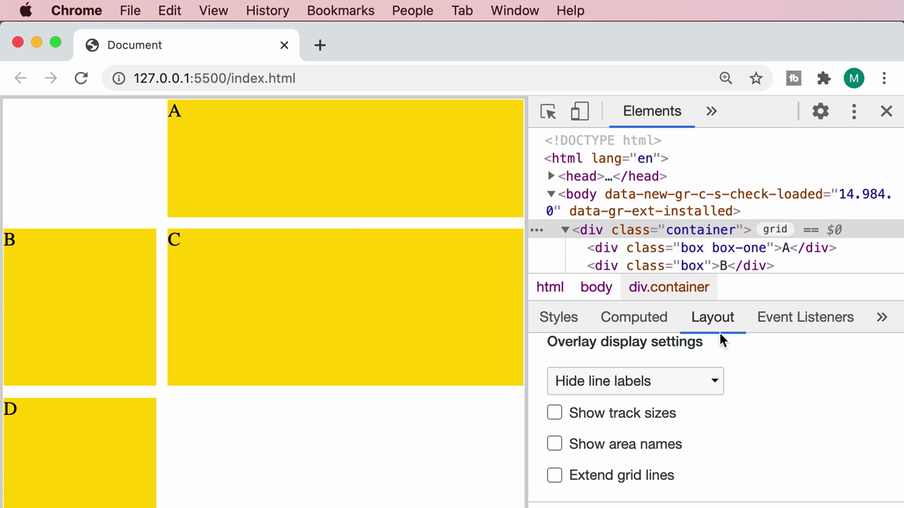

### 7.2 ระบุช่วง start / end

```css
.box-one {
  grid-column: 1 / 3;
}
```

ผลลัพธ์: กล่อง A ขยายกว้างครอบคลุมตั้งแต่เส้นที่ 1 ถึงเส้นที่ 3 (คือทั้งสองคอลัมน์รวมกัน — กล่อง A กลายเป็นแถบยาวเต็มความกว้าง):


### 7.3 ใช้เลขลบอ้างอิงจากท้ายตาราง

```css
.box-one {
  grid-column: 1 / -1;
}
```

ผลลัพธ์เหมือนเดิม (เต็มความกว้าง) แต่ใช้ `-1` (เส้นสุดท้ายจากขวา) แทนการนับเลขบวกจากซ้าย — สะดวกเมื่อไม่รู้จำนวนคอลัมน์แน่ชัด หรือจำนวนคอลัมน์อาจเปลี่ยนแปลงได้:

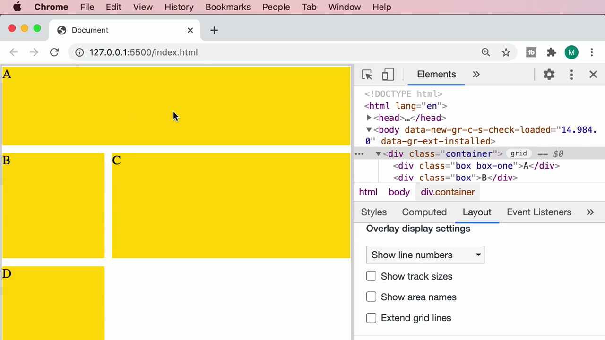

### 7.4 คีย์เวิร์ด `span`

```css
.box-one {
  grid-column: 1 / span 2;
}
```

`span 2` หมายถึง "ขยายคลุม 2 tracks นับจากจุดเริ่มต้น" — เขียนสั้นกว่าการระบุเลขเส้นปลายทางตรงๆ และ Mosh ยังสาธิตการใช้ `grid-row` ควบคู่กันเพื่อให้กล่อง A ขยายทั้งแนวนอนและแนวตั้งพร้อมกัน:

```css
.box-one {
  grid-column: 1 / span 2;
  grid-row: 2 / 4;
}
```

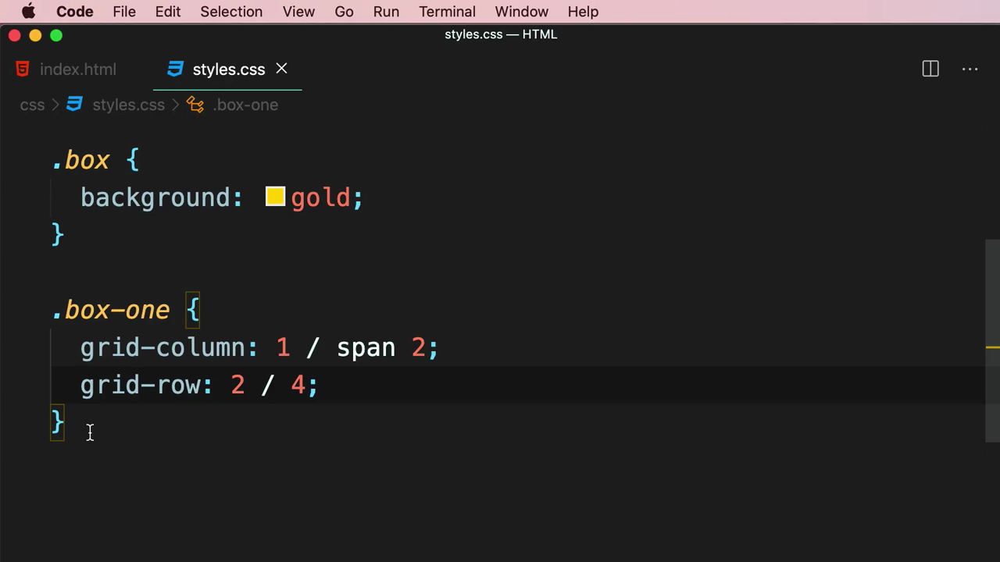

---

## 8. Shorthand `grid-area` (แบบเลขเส้น)

แทนที่จะเขียน `grid-column` และ `grid-row` แยกกัน สามารถรวมเป็น `grid-area` เดียวได้ (ลำดับ: **row-start / column-start / row-end / column-end**):

```css
.box-one {
  grid-area: 2 / 1 / 4 / 3;
}
```

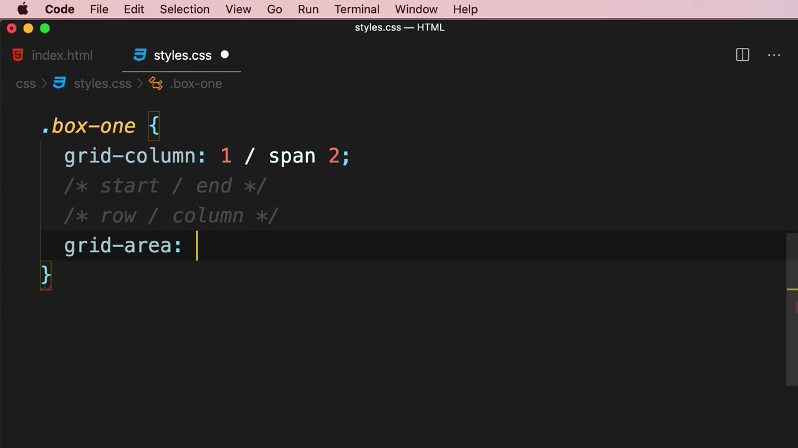

---

## 9. เทคนิคขั้นสูงสุด: `grid-template-areas` (ตั้งชื่อพื้นที่)

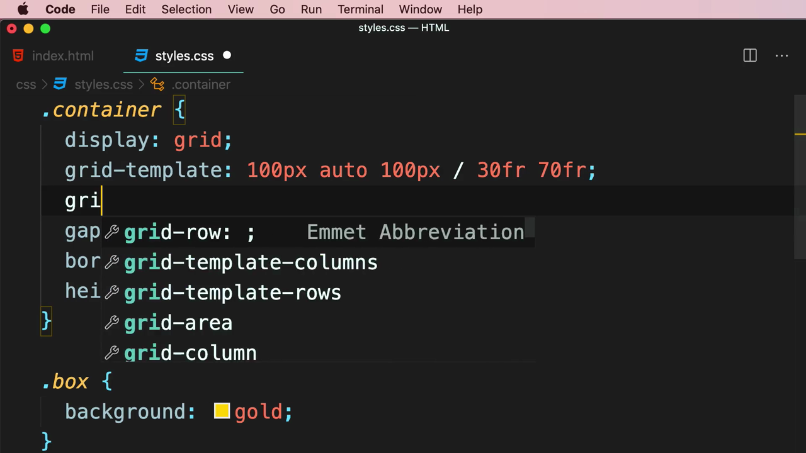

นี่คือเทคนิคที่ทรงพลังและอ่านง่ายที่สุดของ Grid — แทนที่จะอ้างอิงด้วยเลขเส้น สามารถ**วาดผังหน้าเว็บเป็นชื่อ** ได้ตรงๆ ใน CSS:

```css
.container {
  display: grid;
  grid-template: 100px auto 100px / 30fr 70fr;
  grid-template-areas:
    "header header"
    "sidebar main"
    "footer footer";
  gap: 10px;
  border: 3px solid lightgrey;
  height: 100vh;
}
```

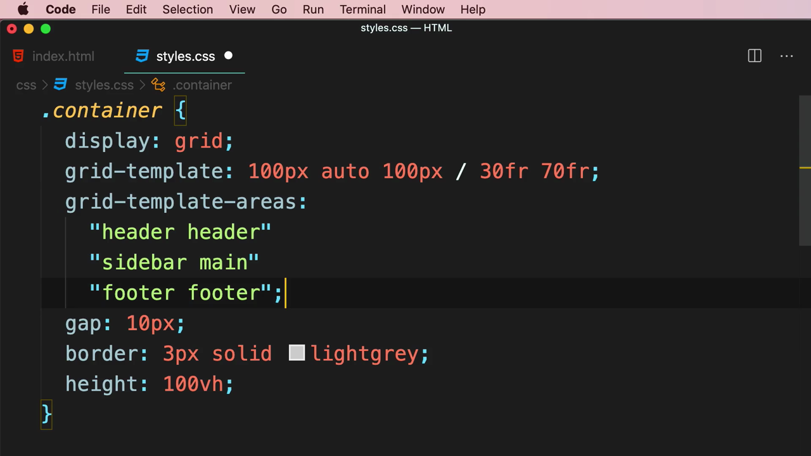

**อธิบายวิธีอ่าน:** แต่ละบรรทัดในเครื่องหมายคำพูด (`"..."`) แทนหนึ่งแถวของ grid โดยแต่ละคำ (แยกด้วยช่องว่าง) แทนหนึ่งเซลล์ — ถ้าคำเดียวกันปรากฏซ้ำติดกัน (เช่น `"header header"`) แปลว่าเซลล์เหล่านั้นถูก**รวมเป็นพื้นที่เดียวกัน** (merge) โดยอัตโนมัติ

จากนั้นกำหนดให้แต่ละกล่องไปอยู่ในพื้นที่ที่ตั้งชื่อไว้ ด้วย `grid-area` (แบบชื่อ ไม่ใช่เลขเส้น):

```css
.box-one {
  grid-area: header;
}

.box-four {
  grid-area: footer;
}
```

(กล่อง B และ C จะเข้าไปอยู่ในพื้นที่ `sidebar` และ `main` ตามลำดับโดยอัตโนมัติ เพราะ HTML เรียง B ก่อน C)

**ผลลัพธ์สุดท้าย:** เมื่อเปิด DevTools แล้วติ๊ก **"Show area names"** จะเห็นชื่อพื้นที่ (`header`, `sidebar`, `main`, `footer`) กำกับอยู่บนตาราง grid จริงๆ ยืนยันว่าโค้ดสร้างโครงหน้าเว็บแบบ Header/Sidebar/Main/Footer ได้สำเร็จ:

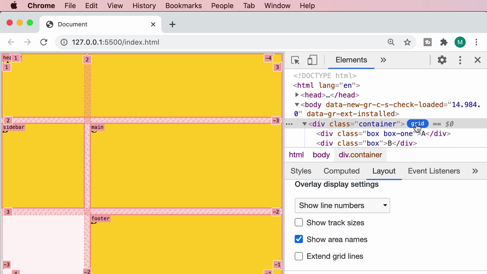

> **ทำไมเทคนิคนี้ถึงสำคัญ:** `grid-template-areas` ทำให้โค้ด CSS **อ่านแล้วเห็นภาพผังหน้าเว็บได้ทันที** โดยไม่ต้องนับเลขเส้นหรือคำนวณตำแหน่งเอง เหมาะมากสำหรับ layout หน้าเว็บทั่วไปที่มี Header, Sidebar, Content, Footer

---

## สรุปภาพรวมของคลิปนี้

| หัวข้อ | สิ่งที่ได้เรียนรู้ |
|---|---|
| `display: grid` | เปิดใช้งาน Grid layout |
| `grid-template-rows/columns` | กำหนดจำนวนและขนาดของแถว/คอลัมน์ |
| `repeat()` | ลดการเขียนขนาด track ซ้ำๆ |
| `justify-items` / `align-items` | จัดตำแหน่ง item ภายในเซลล์ของตัวเอง |
| `justify-content` / `align-content` | จัดตำแหน่งของ grid ทั้งก้อนภายใน container |
| หน่วย `fr` | สัดส่วนพื้นที่ว่างที่เหลือ (responsive) |
| `gap` / `row-gap` / `column-gap` | ระยะห่างระหว่างเซลล์ |
| `grid-column` / `grid-row` | วาง item เองด้วยเลขเส้น (รองรับ negative index และ `span`) |
| `grid-area` (เลขเส้น) | shorthand ของ row-start/column-start/row-end/column-end |
| `grid-template-areas` + `grid-area` (ชื่อ) | ตั้งชื่อพื้นที่แล้ววาดผัง layout ได้ตรงๆ ใน CSS |

---

*หมายเหตุ: คลิปนี้เป็นส่วนหนึ่งของบท "2-Layout" จากคอร์ส The Ultimate HTML and CSS Course โดย Mosh Hamedani (codewithmosh.com)*
