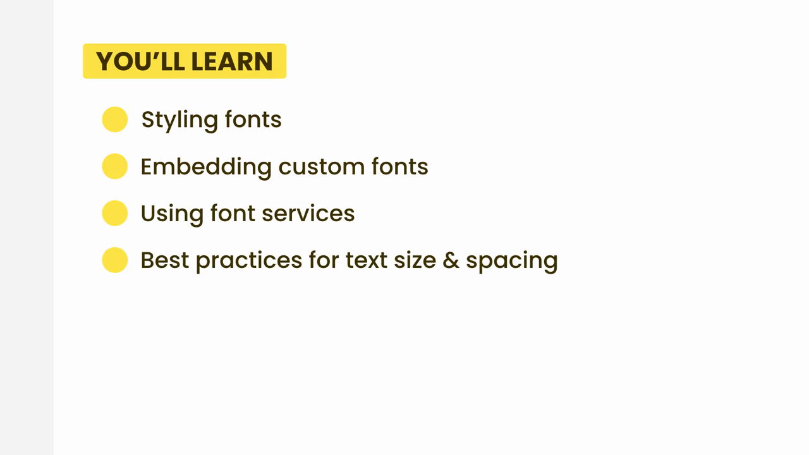

# 3-Typography: 01 - Introduction (0:44)

**ไฟล์ต้นทาง:** `1-Introduction.mp4`

▶️ **[เปิดวิดีโอต้นฉบับ](../../../HTML-CSS-2/3-Typography/1-Introduction.mp4)**

---

## ภาพรวมคลิปนี้

คลิปเปิดตัวบทใหม่ **"3-Typography"** (การจัดวางตัวอักษรและข้อความ) เป็นคลิปสั้นๆ แนะนำหัวข้อที่จะได้เรียนในบทนี้ทั้งหมด ก่อนเข้าเนื้อหาจริงในคลิปถัดไป

---

## หัวข้อที่จะได้เรียนในบทนี้ (You'll Learn)

Mosh สรุปภาพรวม 4 หัวข้อหลักของบท Typography ไว้ในสไลด์เดียว:

- **Styling fonts** — การจัดสไตล์ตัวอักษร (font-family, font-weight, font-style ฯลฯ)
- **Embedding custom fonts** — การฝังฟอนต์ที่กำหนดเองเข้าไปในเว็บไซต์
- **Using font services** — การใช้บริการฟอนต์ออนไลน์ (เช่น Google Fonts)
- **Best practices for text size & spacing** — แนวทางปฏิบัติที่ดีสำหรับขนาดตัวอักษรและระยะห่างของข้อความ

---

## แผนที่เนื้อหาของบท "3-Typography" (10 คลิป)

จากหัวข้อที่แนะนำไว้ บทนี้จะประกอบด้วยคลิปย่อยดังนี้ (ตามลำดับไฟล์ที่ได้รับ):

1. Introduction (คลิปนี้)
2. Styling Fonts
3. Embedding Web Fonts
4. Flash of Unstyled Text
5. Font Services
6. System Font Stack
7. Sizing Fonts
8. Vertical Spacing
9. Horizontal Spacing
10. Formatting Text

---

*หมายเหตุ: คลิปนี้เป็นคลิปแรกของบท "3-Typography" จากคอร์ส The Ultimate HTML and CSS Course โดย Mosh Hamedani (codewithmosh.com)*
