# 3-Typography: 10 - Formatting Text (6:15)

**ไฟล์ต้นทาง:** `10-Formatting_Text.mp4`

▶️ **[เปิดวิดีโอต้นฉบับ](../../../HTML-CSS-2/3-Typography/10-Formatting_Text.mp4)**

---

## ภาพรวมคลิปนี้

คลิปสุดท้ายของบท "3-Typography" — Mosh รวบรวม property ต่างๆ ที่ใช้ **จัดรูปแบบข้อความ (Formatting Text)** ครอบคลุมทั้งหมด 6 หัวข้อหลักตามสไลด์ outline: `text-align`, `text-indent`, `text-decoration`, `text-transform`, `white-space` และ `column-*` (การจัดคอลัมน์แบบหนังสือพิมพ์) พร้อมด้วยหัวข้อเสริมที่เกี่ยวเนื่องกัน เช่น `overflow`, `text-overflow` และ `direction`

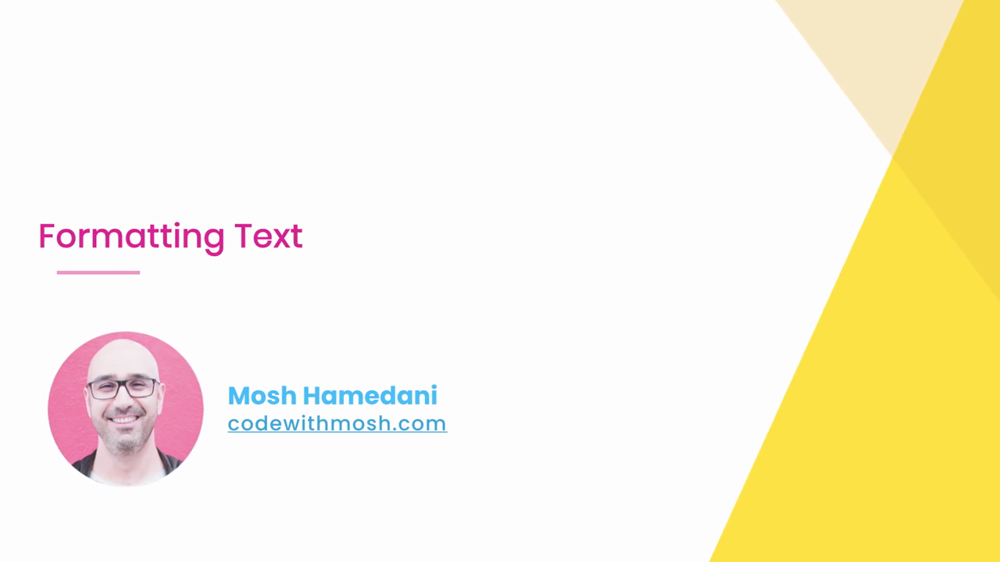

---

## 0. ภาพรวมหัวข้อของคลิปนี้

Mosh เปิดคลิปด้วยสไลด์ outline แสดงหัวข้อทั้งหมดที่จะพูดถึงตามลำดับ:

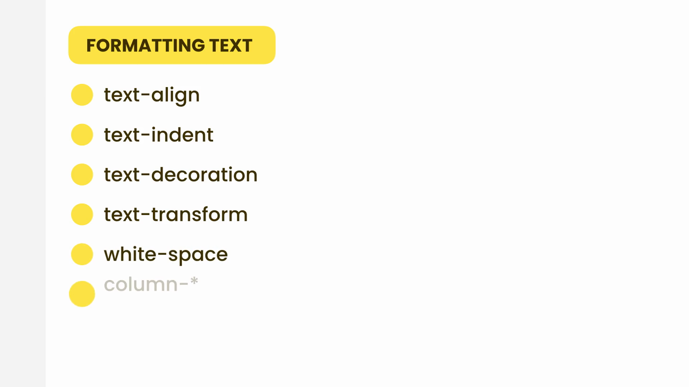

> `text-align` → `text-indent` → `text-decoration` → `text-transform` → `white-space` → `column-*`

(หัวข้อ `column-*` ถูกแสดงเป็นสีจางกว่ารายการอื่นในสไลด์ บ่งบอกว่าจะถูกพูดถึงในช่วงท้ายของคลิป)

---

## 1. จำกัดความกว้างบรรทัดด้วย `ch` — ทบทวนจากคลิปก่อนหน้า

ก่อนเริ่มหัวข้อใหม่ Mosh ตั้งค่า `width` ให้กับ `p` โดยใช้หน่วยที่ยังไม่เคยแนะนำมาก่อน:

```css
p {
  width: 50ch;
}
```

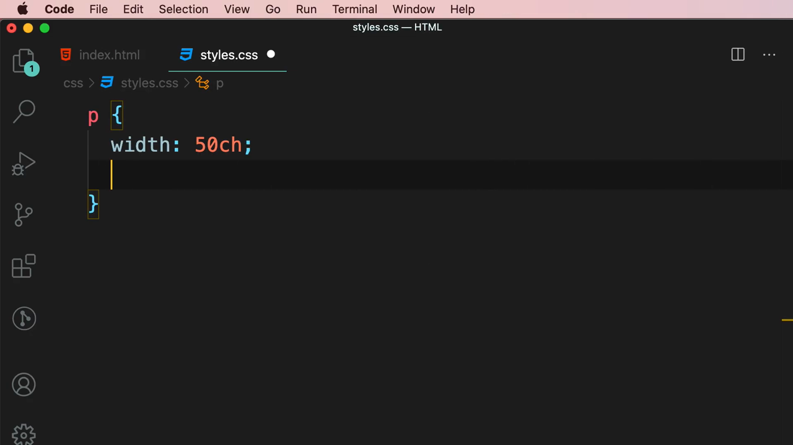

> **หน่วย `ch` คืออะไร:** `ch` ย่อมาจาก "character" คือหน่วยที่อ้างอิงจาก**ความกว้างของตัวอักษร "0" (เลขศูนย์)** ในฟอนต์ปัจจุบันของ element นั้น ดังนั้น `width: 50ch;` จึงหมายถึง "กำหนดความกว้างให้พอสำหรับตัวอักษรประมาณ 50 ตัว"

> **ทบทวน (เชื่อมโยงกับคลิป "Horizontal Spacing"):** คลิปก่อนหน้าได้แนะนำหลักการ **Ideal Line Length** ไว้ว่าความยาวบรรทัดที่เหมาะสมควรอยู่ระหว่าง 50-70 ตัวอักษร แต่ตอนนั้นยังไม่ได้ให้โค้ดตัวอย่างที่ชัดเจนว่าจะเขียนอย่างไร — `width: 50ch;` นี่เองคือคำตอบเชิงปฏิบัติของหลักการนั้น เพราะมันจำกัดความกว้างของบล็อกข้อความให้พอดีกับ 50 ตัวอักษรต่อบรรทัดโดยตรง โดยไม่ต้องมานั่งคำนวณเป็น `px` หรือ `rem` เอง

---

## 2. `text-align`: จัดตำแหน่งข้อความในแนวนอน

### 2.1 `text-align: center;`

Mosh เพิ่ม `text-align: center;` ให้กับ `p`:

```css
p {
  width: 50ch;
  text-align: center;
}
```

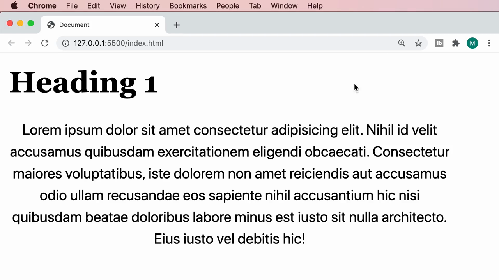

ผลลัพธ์: ข้อความในย่อหน้าทุกบรรทัดถูกจัดให้อยู่กึ่งกลางของกรอบ (แต่ละบรรทัดมีความยาวไม่เท่ากัน จึงเห็นขอบซ้าย-ขวาเยื้องกันไปมา):

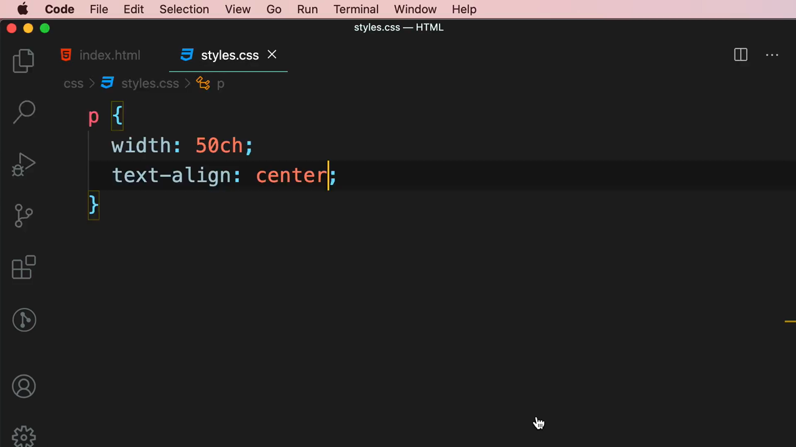

### 2.2 `text-align: justify;`

จากนั้น Mosh เปลี่ยนค่าเป็น `justify`:

```css
p {
  width: 50ch;
  text-align: justify;
}
```

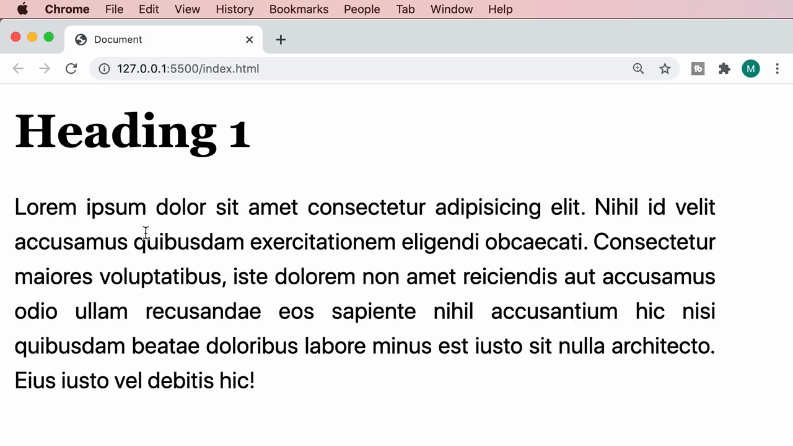
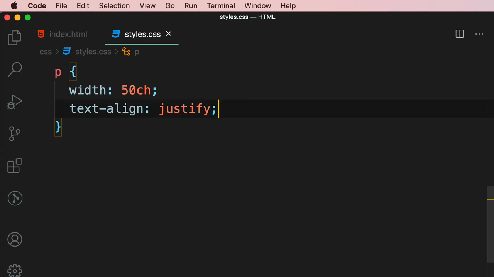

ผลลัพธ์: ทุกบรรทัด (ยกเว้นบรรทัดสุดท้าย) จะถูก**ยืดขยายระยะห่างระหว่างคำโดยอัตโนมัติ** ให้ขอบซ้ายและขอบขวาชิดกรอบพอดีทั้งสองด้าน (เหมือนหนังสือพิมพ์หรือหนังสือที่จัดพิมพ์แบบมืออาชีพ):

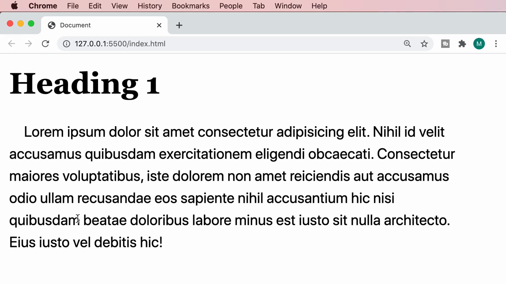

> **สรุปค่าที่ใช้บ่อยของ `text-align`:** `left` (ค่าเริ่มต้น), `center` (กึ่งกลาง), `right` (ชิดขวา), `justify` (ยืดขอบให้ชิดทั้งสองด้าน)

---

## 3. `text-indent`: ย่อหน้าบรรทัดแรก

Mosh ลบ `text-align` ออก แล้วเพิ่ม property ใหม่:

```css
p {
  width: 50ch;
  text-indent: 1rem;
}
```

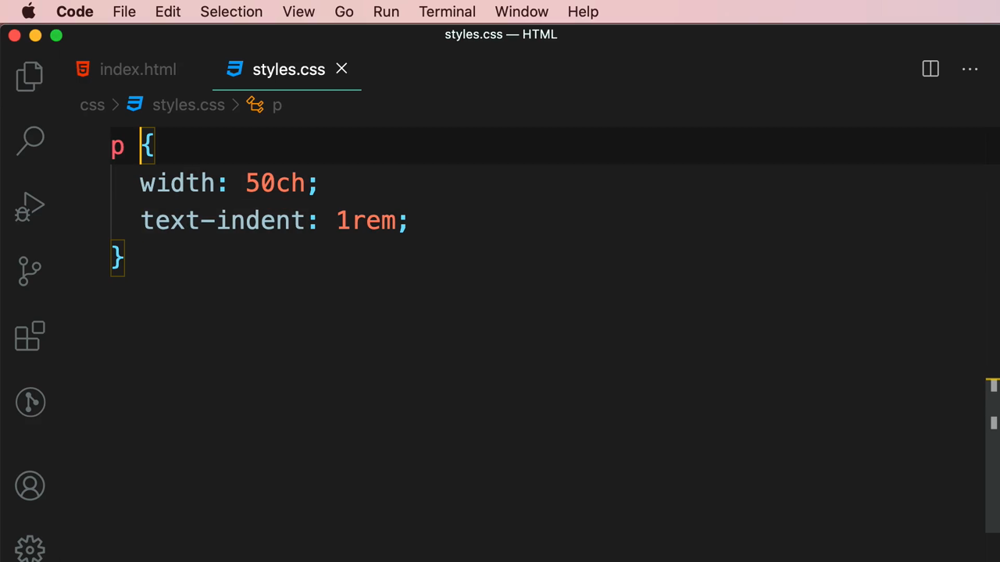

ผลลัพธ์: **เฉพาะบรรทัดแรก**ของแต่ละย่อหน้าถูกดันร่นเข้ามาจากขอบซ้าย 1rem ส่วนบรรทัดที่เหลือของย่อหน้ายังคงชิดขอบซ้ายตามปกติ — เป็นเทคนิคคลาสสิกที่ใช้แยกจุดเริ่มต้นของแต่ละย่อหน้าให้เห็นชัดโดยไม่ต้องเว้นบรรทัางว่างคั่น:

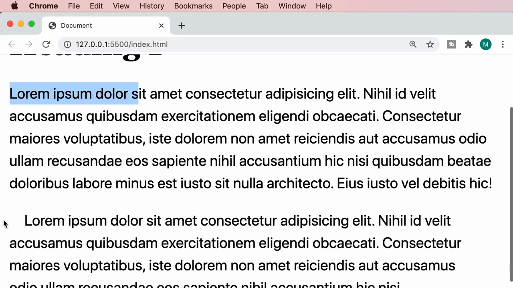

> **หมายเหตุ:** `text-indent` มีผลกับ**บรรทัดแรกของแต่ละกล่องข้อความ (block)** เท่านั้น ต่างจาก `text-align` หรือ `letter-spacing`/`word-spacing` ที่มีผลกับทุกบรรทัดเท่ากันหมด

---

## 4. `text-decoration`: เส้นตกแต่งข้อความ

### 4.1 `text-decoration: underline;`

Mosh เปลี่ยน property เป็น `text-decoration`:

```css
p {
  width: 50ch;
  text-decoration: underline;
}
```

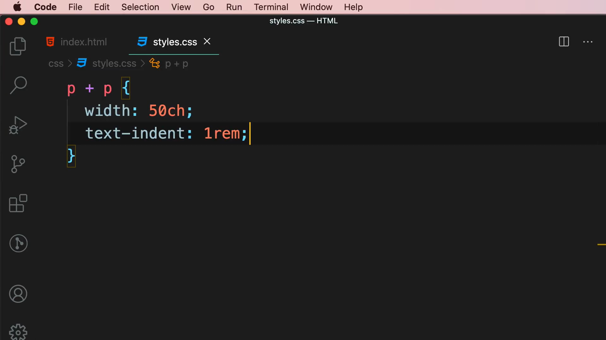

ผลลัพธ์: มีเส้นขีดเส้นใต้ปรากฏใต้ข้อความทุกบรรทัดในย่อหน้า:

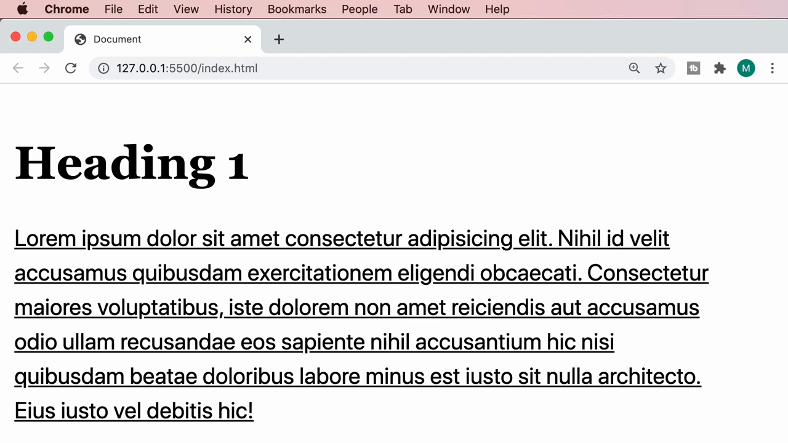

### 4.2 `text-decoration: line-through;`

จากนั้นเปลี่ยนค่าเป็น `line-through`:

```css
p {
  width: 50ch;
  text-decoration: line-through;
}
```

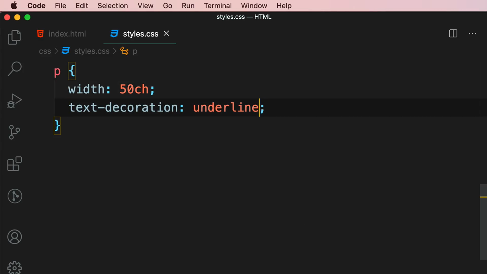

ผลลัพธ์: ข้อความถูกขีดฆ่ากลางบรรทัดทุกบรรทัด (คล้ายการทำเครื่องหมาย "ยกเลิก"):

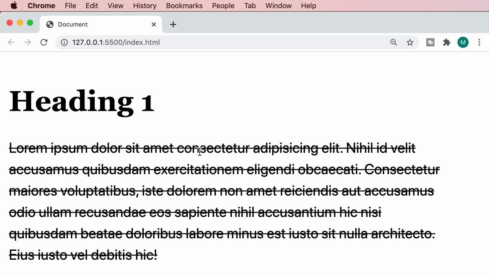

> **ค่าอื่นๆ ของ `text-decoration` ที่ควรรู้:** `none` (ไม่มีเส้น — มักใช้ลบขีดเส้นใต้ของลิงก์ `<a>` ที่เบราว์เซอร์ใส่มาให้โดยดีฟอลต์), `overline` (เส้นด้านบนข้อความ)

---

## 5. `text-transform`: แปลงตัวพิมพ์เล็ก-ใหญ่อัตโนมัติ

Mosh เปลี่ยน property เป็น `text-transform: capitalize;`:

```css
p {
  width: 50ch;
  text-transform: capitalize;
}
```

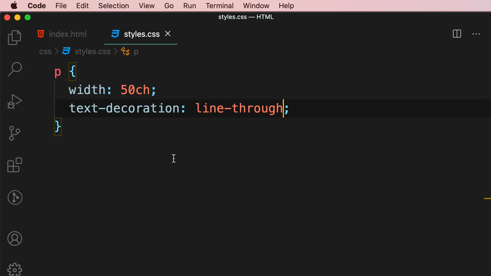

ผลลัพธ์: **ตัวอักษรแรกของทุกคำ**ในย่อหน้าถูกแปลงเป็นตัวพิมพ์ใหญ่โดยอัตโนมัติ โดยไม่ต้องแก้ไขข้อความต้นฉบับใน HTML เลย:

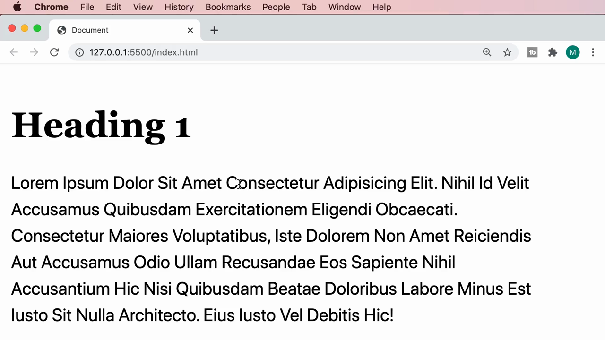

> **ค่าอื่นๆ ของ `text-transform`:** `uppercase` (แปลงทุกตัวอักษรเป็นพิมพ์ใหญ่ทั้งหมด), `lowercase` (แปลงทุกตัวอักษรเป็นพิมพ์เล็กทั้งหมด), `none` (ค่าเริ่มต้น ไม่แปลงอะไร)
>
> **ประโยชน์สำคัญ:** เพราะ `text-transform` เป็นการแปลงผลลัพธ์การ**แสดงผล**เท่านั้น ข้อมูลจริงในฐานข้อมูลหรือ HTML ยังคงเก็บในรูปแบบเดิม (เช่น ชื่อผู้ใช้ที่พิมพ์มาแบบตัวพิมพ์เล็กล้วน) ทำให้ยืดหยุ่นกว่าการบังคับแปลงตัวอักษรในโค้ด/ฐานข้อมูลโดยตรง

---

## 6. `white-space`: ควบคุมการตัดบรรทัดและช่องว่าง

Mosh ลบ `text-transform` ออก แล้วพิมพ์ `white-space` ให้ IntelliSense แนะนำค่าที่เป็นไปได้:

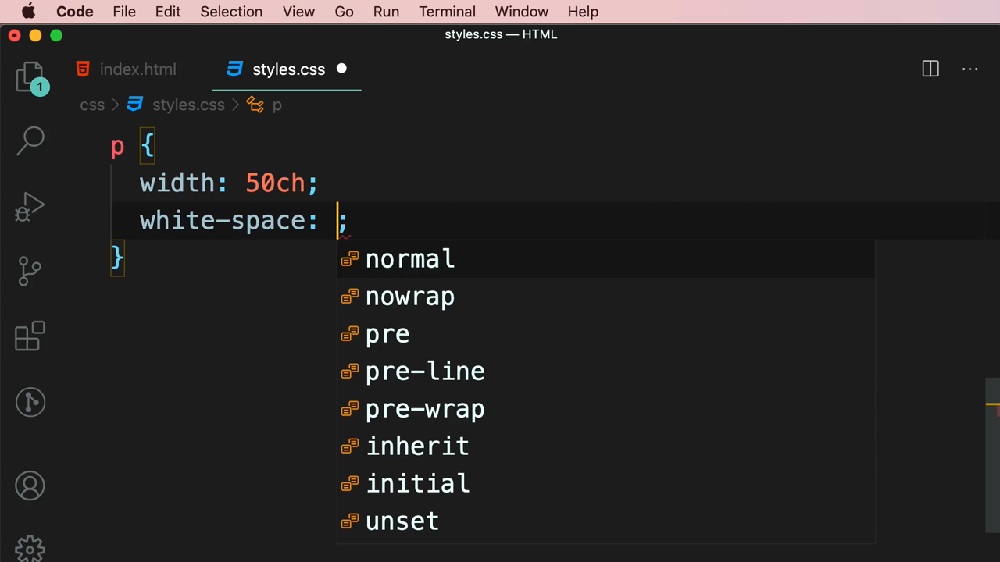

> **ตัวเลือกที่ปรากฏ:** `normal` (ค่าเริ่มต้น — ตัดบรรทัดอัตโนมัติเมื่อเนื้อหาล้นกรอบ, ยุบช่องว่าง/ขึ้นบรรทัดใหม่ที่พิมพ์ซ้ำๆ ให้เหลือช่องว่างเดียว), `nowrap`, `pre`, `pre-line`, `pre-wrap`, `inherit`, `initial`, `unset`

### 6.1 พฤติกรรมปกติ (`normal`)

ก่อนเปลี่ยนแปลงใดๆ ข้อความจะตัดบรรทัดลงมาพอดีกับความกว้าง `50ch` ตามปกติ:

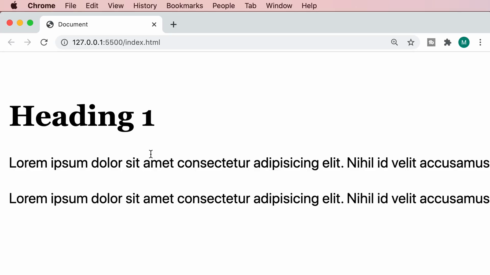

### 6.2 `white-space: nowrap;`

Mosh เลือกค่า `nowrap`:

```css
p {
  width: 50ch;
  white-space: nowrap;
}
```

ผลลัพธ์: ข้อความทั้งย่อหน้าถูกบังคับให้อยู่ **บรรทัดเดียวยาวต่อเนื่อง** โดยไม่มีการตัดขึ้นบรรทัดใหม่เลย แม้จะกำหนด `width: 50ch;` ไว้ก็ตาม — เนื้อหาจึงล้นออกไปนอกกรอบและต้องเลื่อนจอ (scroll) ในแนวนอนเพื่อดูข้อความที่เหลือ:

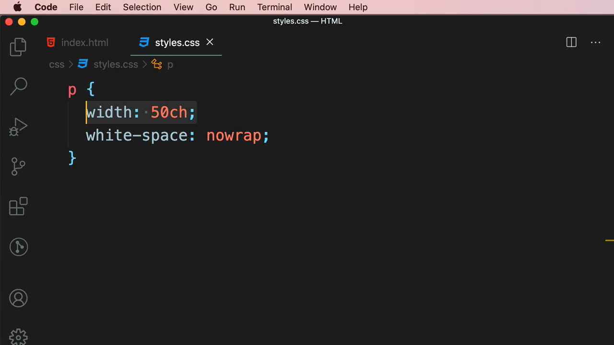

> **หลักการสำคัญ:** `white-space: nowrap;` ทำให้เบราว์เซอร์**ไม่สนใจความกว้างของกรอบเลย** เมื่อพิจารณาว่าจะขึ้นบรรทัดใหม่ตรงไหน — เนื้อหาจะขยายกว้างออกไปเรื่อยๆ ตามความยาวจริงของข้อความ ต่างจากพฤติกรรมปกติที่จะตัดคำลงบรรทัดใหม่เมื่อถึงขอบกรอบ

### 6.3 มองเห็นปัญหาชัดเจนขึ้นด้วย `border`

Mosh เพิ่มกรอบสีทองให้กับ `p` เพื่อให้เห็นขอบเขตของกล่องชัดเจน:

```css
p {
  width: 50ch;
  white-space: nowrap;
  border: 3px solid gold;
}
```

ผลลัพธ์: เห็นชัดว่ากรอบสีทองยังคงกว้างแค่ `50ch` ตามที่กำหนด แต่ข้อความ (เพราะ `nowrap`) ล้นทะลุออกไปนอกกรอบทางขวาอย่างเห็นได้ชัด:

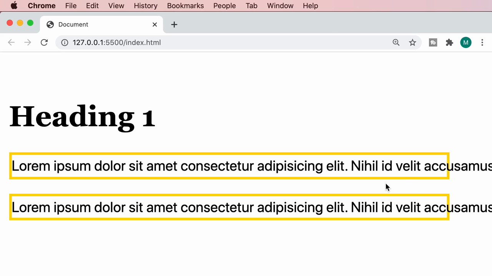

### 6.4 ควบคุมเนื้อหาที่ล้นด้วย `overflow` และ `text-overflow` (หัวข้อเสริม)

เพื่อแก้ปัญหาเนื้อหาล้นกรอบที่เห็นข้างต้น Mosh แนะนำสอง property ที่เกี่ยวข้องเพิ่มเติม เริ่มจาก `overflow: hidden;`:

```css
p {
  width: 50ch;
  white-space: nowrap;
  border: 3px solid gold;
  overflow: hidden;
}
```

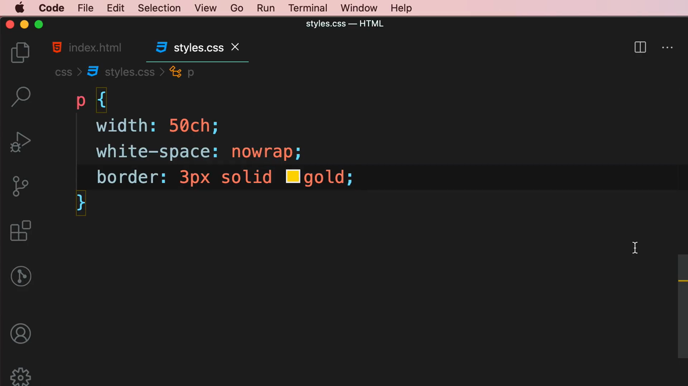

ผลลัพธ์: ส่วนของข้อความที่ล้นออกนอกกรอบถูก**ตัดทิ้งและซ่อนไป** ทำให้มองเห็นเฉพาะส่วนที่พอดีกับความกว้างของกรอบเท่านั้น (ไม่มีการ scroll หรือแสดงส่วนเกินอีกต่อไป):

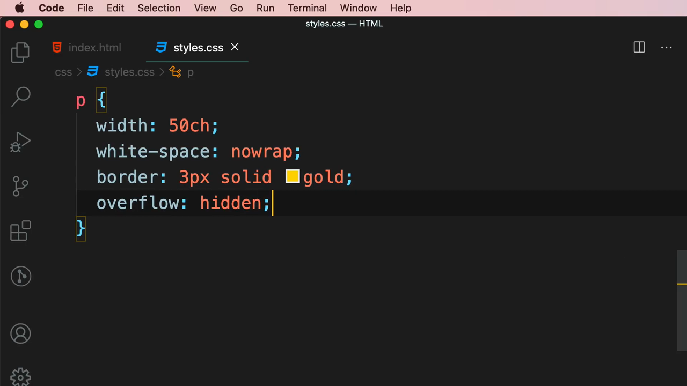

จากนั้นเพิ่ม `text-overflow: ellipsis;` เพื่อบอกผู้อ่านว่ายังมีข้อความต่ออีกที่ถูกซ่อนไว้:

```css
p {
  width: 50ch;
  white-space: nowrap;
  border: 3px solid gold;
  overflow: hidden;
  text-overflow: ellipsis;
}
```

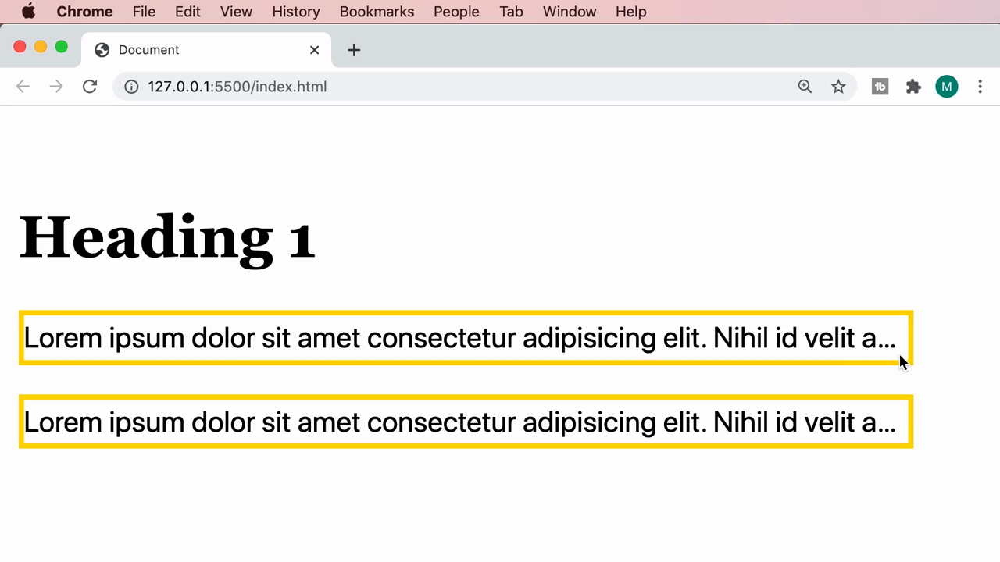
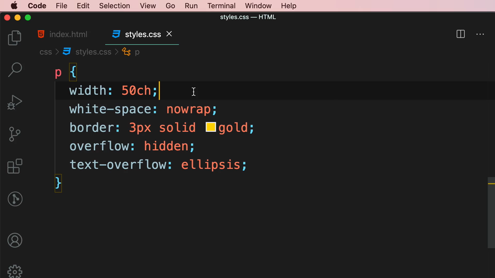

> **หลักการทำงานร่วมกันของสาม property นี้:** `text-overflow: ellipsis;` จะทำงาน**ก็ต่อเมื่อ**ตั้งค่า `white-space: nowrap;` (บังคับให้อยู่บรรทัดเดียว) และ `overflow: hidden;` (ซ่อนส่วนที่ล้น) ไว้ด้วยพร้อมกันทั้งสามค่า — ผลลัพธ์คือข้อความที่ยาวเกินกรอบจะถูกตัดและแสดงจุดไข่ปลา (`...`) ต่อท้ายแทน ซึ่งเป็นรูปแบบที่พบได้บ่อยมากในการแสดงชื่อไฟล์ยาวๆ หรือหัวข้อการ์ดที่มีพื้นที่จำกัดในเว็บแอปพลิเคชันจริง

---

## 7. `column-*`: จัดข้อความเป็นหลายคอลัมน์แบบหนังสือพิมพ์

Mosh ลบ property ทดลองก่อนหน้าออกทั้งหมด เหลือแค่ `width: 50ch;` แล้วเริ่มหัวข้อสุดท้ายตามสไลด์ outline

### 7.1 `column-count: 2;`

```css
p {
  width: 50ch;
  column-count: 2;
}
```

ผลลัพธ์: เนื้อหาในย่อหน้าถูกแบ่งออกเป็น **2 คอลัมน์**โดยอัตโนมัติ วางเรียงกันในแนวนอนคล้ายการจัดหน้าหนังสือพิมพ์หรือนิตยสาร:

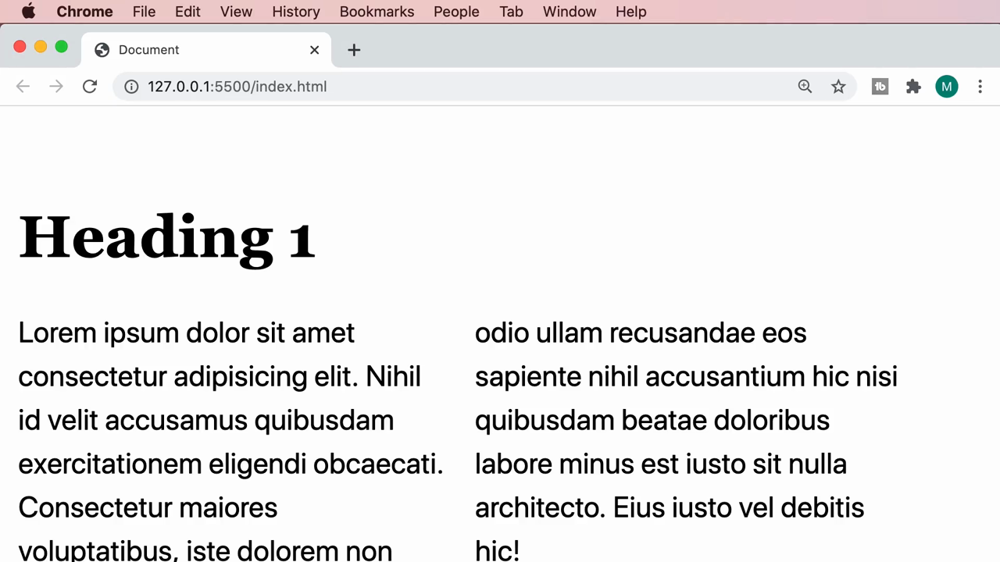

### 7.2 `column-gap`: ระยะห่างระหว่างคอลัมน์

Mosh พิมพ์ property ใหม่ต่อจาก `column-count`:

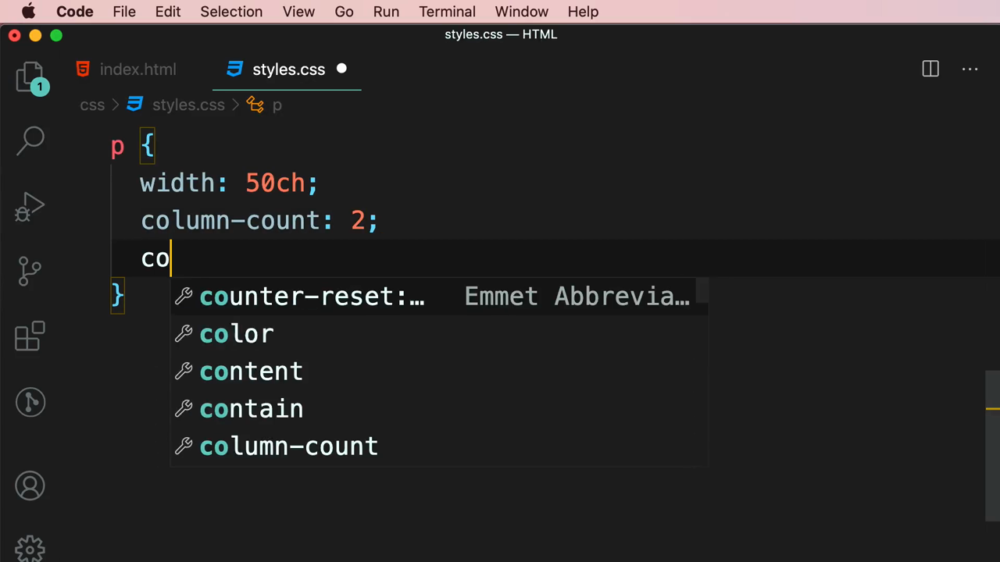

```css
p {
  width: 50ch;
  column-count: 2;
  column-gap: 2rem;
}
```

ผลลัพธ์: ระยะห่างระหว่างคอลัมน์ที่ 1 และคอลัมน์ที่ 2 เพิ่มขึ้นตามค่าที่กำหนด (2rem) ทำให้คอลัมน์แยกออกจากกันชัดเจนขึ้น อ่านง่ายขึ้น:

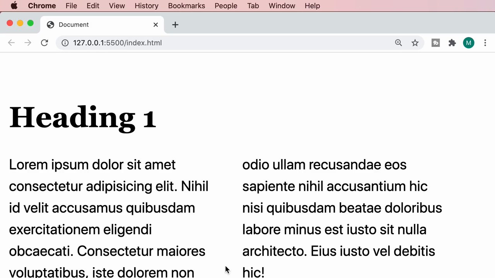

### 7.3 `column-rule`: เส้นแบ่งระหว่างคอลัมน์

Mosh พิมพ์ `column-rule` และเลือกใช้ shorthand แบบเดียวกับ `border`:

```css
p {
  width: 50ch;
  column-count: 2;
  column-gap: 2rem;
  column-rule: 3px dotted #999;
}
```

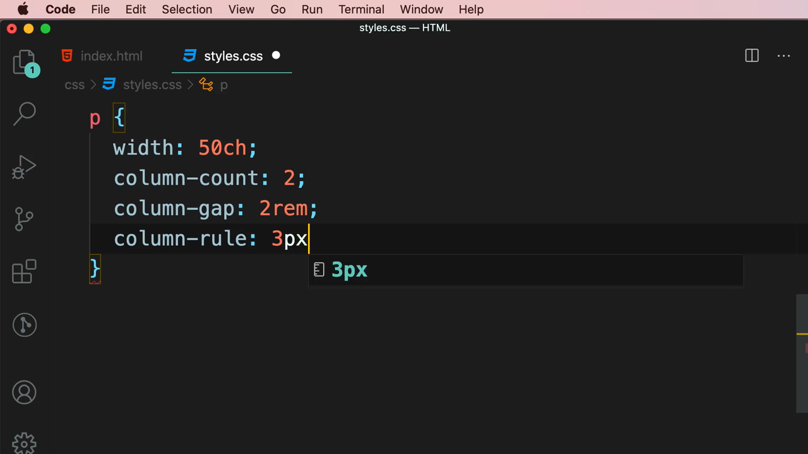

ผลลัพธ์: ปรากฏ**เส้นประแนวตั้ง**สีเทา (`#999`) หนา 3px คั่นกลางระหว่างสองคอลัมน์พอดี ช่วยแบ่งแยกคอลัมน์ให้เห็นชัดเจนยิ่งขึ้นไปอีก:

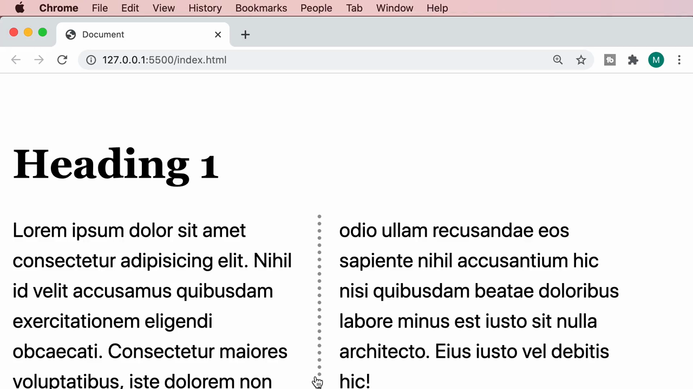

> **อธิบาย shorthand `column-rule: 3px dotted #999;`:** เขียนในรูปแบบเดียวกับ `border` shorthand — ค่าแรกคือความหนาของเส้น (`3px`), ค่าที่สองคือลักษณะเส้น (`dotted` = เส้นประจุด, สามารถใช้ `solid`, `dashed` ได้เช่นกัน), ค่าที่สามคือสีของเส้น (`#999` = สีเทา)
>
> **หมายเหตุ:** `column-rule` จะ**วาดเส้นเฉพาะช่องว่างระหว่างคอลัมน์ (`column-gap`)** เท่านั้น ไม่ใช่รอบกรอบทั้งหมดเหมือน `border` ดังนั้นการมี `column-gap` ที่มีความกว้างเพียงพอจึงจำเป็นเพื่อให้เส้นแสดงผลได้สวยงาม

---

## 8. `direction`: ทิศทางการอ่านข้อความ (หัวข้อเสริมท้ายคลิป)

ก่อนจบคลิป Mosh แนะนำ property เสริมอีกหนึ่งตัวที่ไม่ได้อยู่ในสไลด์ outline แต่เกี่ยวข้องกับการจัดรูปแบบข้อความเช่นกัน — `direction`:

```css
p {
  width: 50ch;
  direction: rtl;
}
```

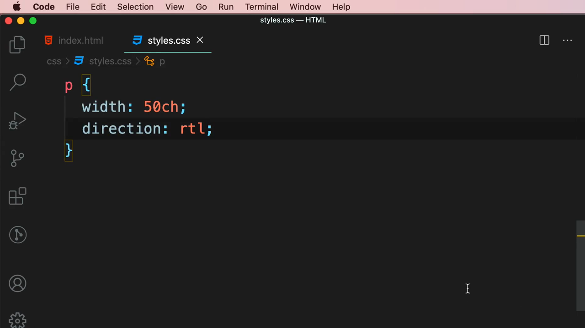

ผลลัพธ์: ทิศทางการอ่านของทั้งหัวข้อ (`h1`) และย่อหน้า (`p`) ถูกสลับจากซ้าย-ไปขวา (LTR) เป็น **ขวา-ไปซ้าย (RTL)** — ข้อความยังคงเป็นภาษาอังกฤษเหมือนเดิม แต่ตำแหน่งเริ่มต้นของแต่ละบรรทัดถูกย้ายไปอยู่ทางขวาของกรอบแทน:

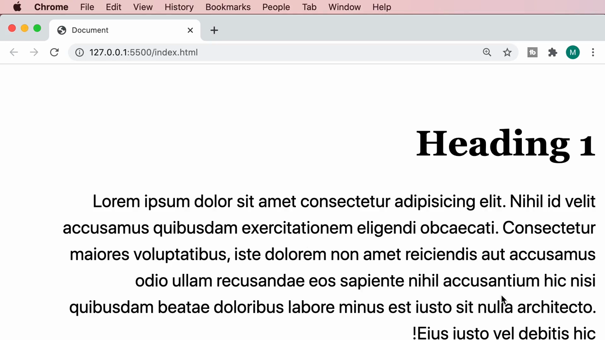

> **`rtl` ย่อมาจาก "right to left"** ค่าตรงข้ามคือ `ltr` ("left to right" ซึ่งเป็นค่าเริ่มต้นของภาษาส่วนใหญ่รวมถึงภาษาไทยและภาษาอังกฤษ) — property นี้สำคัญมากสำหรับเว็บไซต์ที่ต้องรองรับภาษาที่เขียนจากขวาไปซ้ายโดยธรรมชาติ เช่น ภาษาอาหรับ (Arabic) หรือภาษาฮีบรู (Hebrew)

---

## 9. ล้างโค้ดทดลองทั้งหมดก่อนจบคลิป

ก่อนปิดคลิป Mosh ลบ property ทดลองทั้งหมดใน selector `p` ออกจนหมด กลับไปเหลือแค่ CSS หลักของ `body` ที่ตั้งค่าไว้ตั้งแต่ต้นบท (System Font Stack, `font-size: 1rem;`, `line-height: 1.5;`) เพื่อเตรียมพร้อมสำหรับหัวข้อถัดไปของคอร์ส:

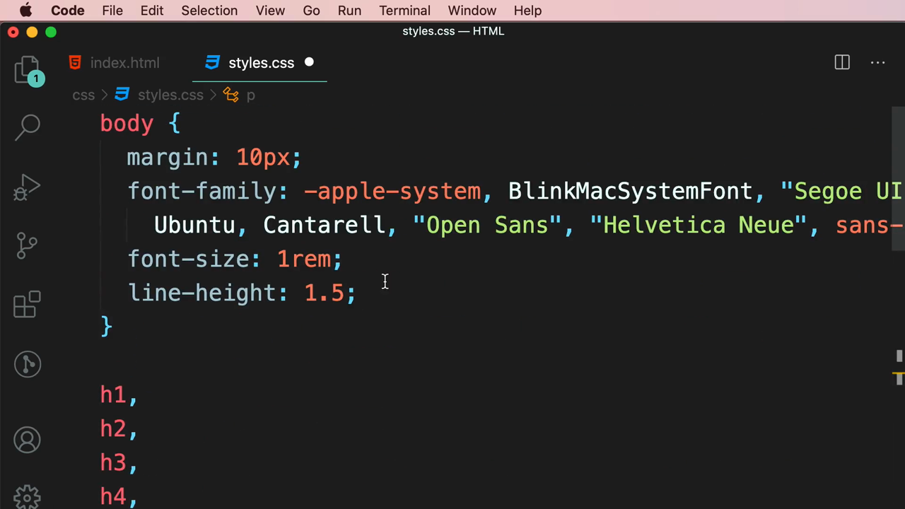

---

## สรุปภาพรวมของคลิปนี้

| Property | หน้าที่ | ค่าที่สาธิต |
|---|---|---|
| `width` (หน่วย `ch`) | จำกัดความกว้างบรรทัดเป็นจำนวนตัวอักษร | `50ch` |
| `text-align` | จัดตำแหน่งข้อความในแนวนอน | `center`, `justify` |
| `text-indent` | ย่อบรรทัดแรกของแต่ละย่อหน้า | `1rem` |
| `text-decoration` | เส้นตกแต่งข้อความ | `underline`, `line-through` |
| `text-transform` | แปลงตัวพิมพ์เล็ก-ใหญ่โดยไม่แก้ข้อมูลจริง | `capitalize` |
| `white-space` | ควบคุมการตัดบรรทัด/ยุบช่องว่าง | `nowrap` |
| `overflow` + `text-overflow` | ควบคุมเนื้อหาที่ล้นกรอบ (หัวข้อเสริม) | `hidden` + `ellipsis` |
| `column-count` / `column-gap` / `column-rule` | จัดข้อความเป็นหลายคอลัมน์แบบหนังสือพิมพ์ | `2`, `2rem`, `3px dotted #999` |
| `direction` | ทิศทางการอ่านข้อความ (หัวข้อเสริม) | `rtl` |

**แนวคิดสำคัญที่ได้จากคลิปนี้:**

1. **`ch` เป็นหน่วยที่เหมาะกับการจำกัดความกว้างข้อความโดยเฉพาะ** เพราะอ้างอิงจากความกว้างตัวอักษรจริง ทำให้ควบคุม "จำนวนตัวอักษรต่อบรรทัด" ได้ตรงไปตรงมากว่าหน่วยอื่น และเชื่อมโยงโดยตรงกับหลักการ Ideal Line Length ที่เรียนมาก่อนหน้า
2. **`text-transform` แปลงแค่การแสดงผล ไม่แก้ข้อมูลจริง** — เป็นแนวทางที่ดีกว่าการบังคับแปลงตัวอักษรในฐานข้อมูลหรือโค้ดโดยตรง เพราะยังคงความยืดหยุ่นของข้อมูลต้นฉบับไว้
3. **`white-space: nowrap;` มักถูกใช้คู่กับ `overflow: hidden;` และ `text-overflow: ellipsis;`** เป็นชุดสามประสานที่พบบ่อยมากในเว็บแอปพลิเคชันจริง สำหรับตัดข้อความยาวให้แสดงจุดไข่ปลาแทนการล้นกรอบ
4. **`column-*` เหมาะกับเนื้อหาที่เป็นข้อความยาวต่อเนื่อง** เช่น บทความข่าวหรือนิตยสารออนไลน์ ช่วยให้อ่านง่ายขึ้นโดยลดความยาวบรรทัดในแต่ละคอลัมน์ลง คล้ายหลักการ Ideal Line Length แต่ทำในสเกลของทั้งบล็อกเนื้อหา
5. **`direction: rtl;` เป็น property ที่สำคัญสำหรับการทำเว็บไซต์รองรับหลายภาษา (internationalization)** โดยเฉพาะภาษาที่เขียนจากขวาไปซ้ายตามธรรมชาติ

---

## สรุปส่งท้ายบท "3-Typography"

คลิปนี้เป็นคลิปสุดท้าย (คลิปที่ 10 จาก 10) ของบท **"3-Typography"** ซึ่งครอบคลุมเนื้อหาทั้งหมดตั้งแต่การเลือกฟอนต์ (`font-family`, Web Safe Fonts), การฝังฟอนต์เอง (`@font-face`, FOUT/`font-display`), การใช้ Font Service (Google Fonts), System Font Stack, การกำหนดขนาดฟอนต์ด้วย `rem`, ระยะห่างแนวตั้ง-แนวนอน (`line-height`, `letter-spacing`, `word-spacing`) ไปจนถึงการจัดรูปแบบข้อความในคลิปนี้ — ครบทุกแง่มุมสำคัญของการทำงานกับข้อความบนเว็บ

---

*หมายเหตุ: คลิปนี้เป็นส่วนหนึ่งของบท "3-Typography" จากคอร์ส The Ultimate HTML and CSS Course โดย Mosh Hamedani (codewithmosh.com) — คลิปที่ 10 ของบทนี้ (คลิปสุดท้าย)*
