# 3-Typography: 02 - Styling Fonts (7:38)

**ไฟล์ต้นทาง:** `2-Styling-Fonts.mp4`

▶️ **[เปิดวิดีโอต้นฉบับ](../../../HTML-CSS-2/3-Typography/2-Styling-Fonts.mp4)**

---

## ภาพรวมคลิปนี้

คลิปนี้เป็นคลิปหลักคลิปแรกของบท Typography ที่ลงลึกเรื่อง **การจัดสไตล์ตัวอักษร (Styling Fonts)** อย่างละเอียด ครอบคลุมตั้งแต่ `font-family`, การแบ่งหมวดหมู่ฟอนต์ (Serif / Sans-serif / Monospace), แนวคิด Web Safe Fonts, การใช้ inheritance เพื่อลดโค้ดซ้ำซ้อน, ไปจนถึง `font-weight`, `font-style`, `font-size` และ `color` — พร้อมสาธิตการตรวจสอบค่าจริงผ่าน Chrome DevTools

---

## 1. เตรียมไฟล์ตัวอย่าง

Mosh เริ่มจากไฟล์ HTML เปล่า แล้วเพิ่ม heading กับย่อหน้าเนื้อหา (lorem ipsum) เพื่อใช้ทดลอง:

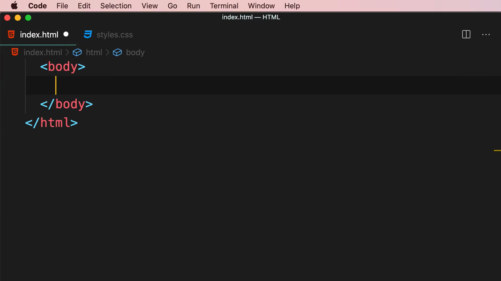

```html
<body>
  <h1>Heading</h1>
  <p>
    Lorem ipsum dolor sit amet consectetur adipisicing elit. Nihil id velit
    accusamus quibusdam exercitationem eligendi obcaecati. Consectetur
    maiores voluptatibus, iste dolorem non amet reiciendis aut accusamus
    odio ullam recusandae eos sapiente nihil accusantium hic nisi quibusdam
    beatae doloribus labore minus est iusto sit nulla architecto. Eius iusto vel
    debitis hic!
  </p>
</body>
```

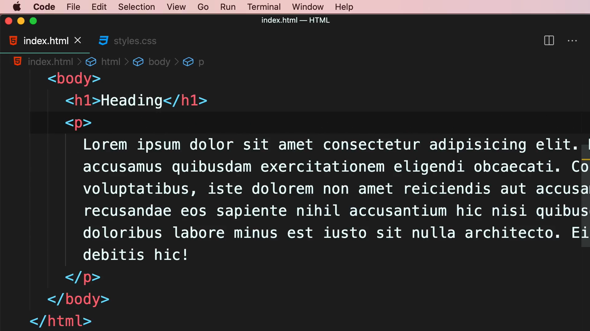

ใน `styles.css` เพิ่ม reset เล็กน้อยก่อน:

```css
body {
  margin: 10px;
}
```

---

## 2. รู้จัก Property `font-family`

Mosh เริ่มพิมพ์ selector `p { }` แล้วพิมพ์ `font-` เพื่อให้ VS Code IntelliSense แสดงตัวเลือก properties ที่เกี่ยวกับฟอนต์ทั้งหมด:

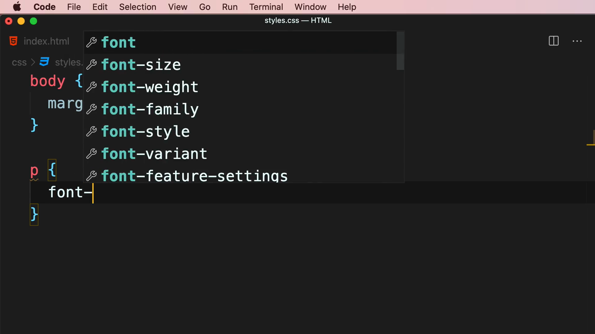

รายการที่ขึ้นมาให้เลือก (verbatim จากหน้าจอ):
- `font`
- `font-size`
- `font-weight`
- `font-family`
- `font-style`
- `font-variant`
- `font-feature-settings`
- `font-display`

Mosh อธิบายว่า `font-family` คือ property ที่ใช้กำหนด **"ตระกูล" หรือชนิดของตัวอักษร (typeface)** ที่จะใช้แสดงผลข้อความ

---

## 3. สามหมวดหมู่หลักของฟอนต์ (Serif / Sans-serif / Monospace)

ก่อนจะใส่ค่าให้ `font-family` Mosh หยุดอธิบายทฤษฎีผ่านสไลด์เปรียบเทียบฟอนต์ 3 ประเภท:

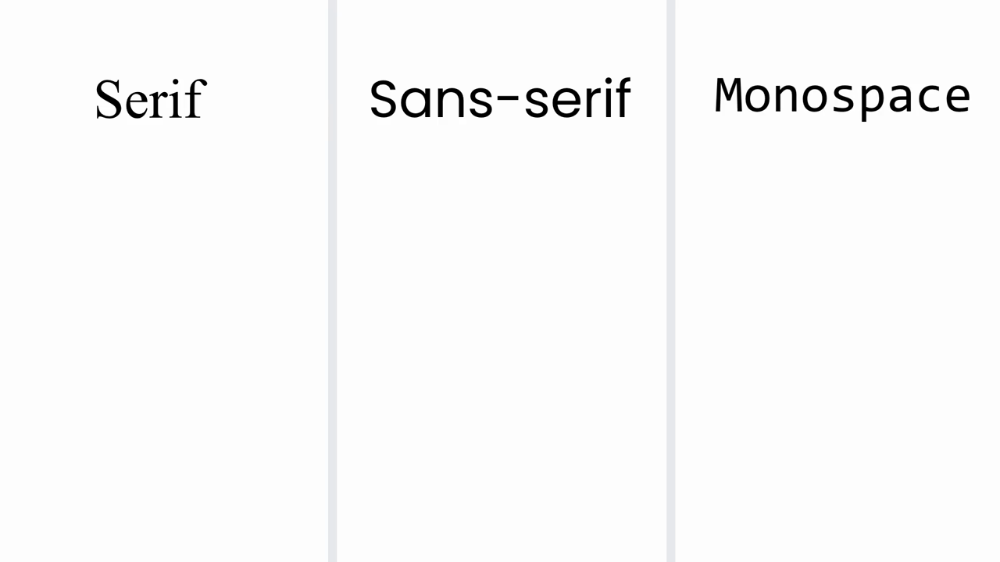

- **Serif** — ฟอนต์ที่มี "เชิง" หรือขีดเล็กๆ ยื่นออกมาที่ปลายตัวอักษร (เหมือนปากกาคอแร้งสมัยก่อน) ให้ความรู้สึกเป็นทางการ/คลาสสิก เช่น Times New Roman, Georgia
- **Sans-serif** — ฟอนต์ที่ **ไม่มี** เชิงเหล่านั้น ("sans" แปลว่า "ไม่มี" ในภาษาฝรั่งเศส) เส้นสะอาด เรียบง่าย อ่านง่ายบนจอ เช่น Arial, Helvetica
- **Monospace** — ฟอนต์ที่ทุกตัวอักษรมี **ความกว้างเท่ากันหมด** (fixed-width) นิยมใช้กับโค้ดหรือข้อความแบบตาราง เช่น Courier New

Mosh ซูมเข้าไปที่คำว่า "Serif" พร้อมวงกลมสีแดงชี้ไปที่ขีดเล็กๆ ที่ปลายตัวอักษร เพื่อให้เห็นความแตกต่างชัดเจน:

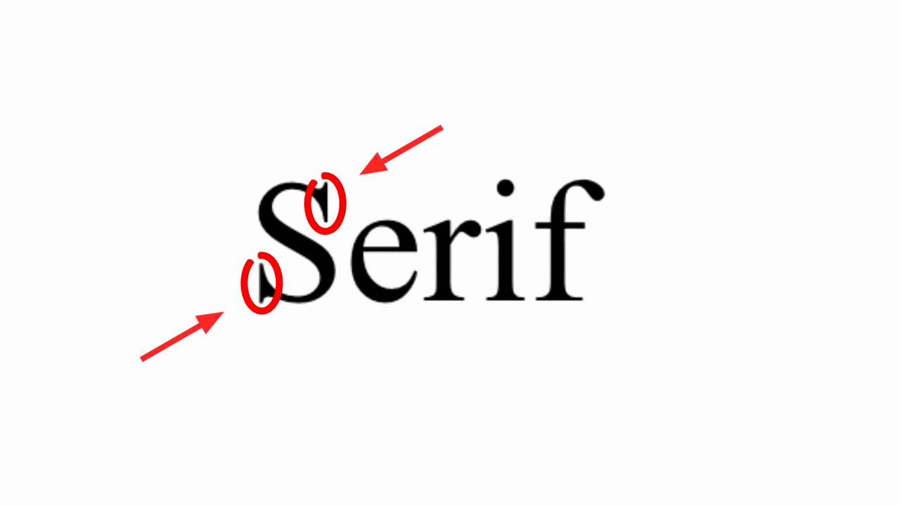

> **เคล็ดลับการจำ:** มองหา "เชิง/ตีนตัวอักษร" เล็กๆ ที่ปลายเส้น — ถ้ามีคือ Serif ถ้าไม่มีคือ Sans-serif

---

## 4. แนวคิด "Web Safe Fonts" และการเขียน Font Fallback Stack

กลับมาที่โค้ด Mosh พิมพ์ `font-family: ` แล้วปล่อยว่างไว้ก่อน จากนั้นให้ VS Code auto-complete แสดงชุดฟอนต์ที่เป็นมาตรฐาน (Web Safe Fonts) ขึ้นมาให้เลือก:

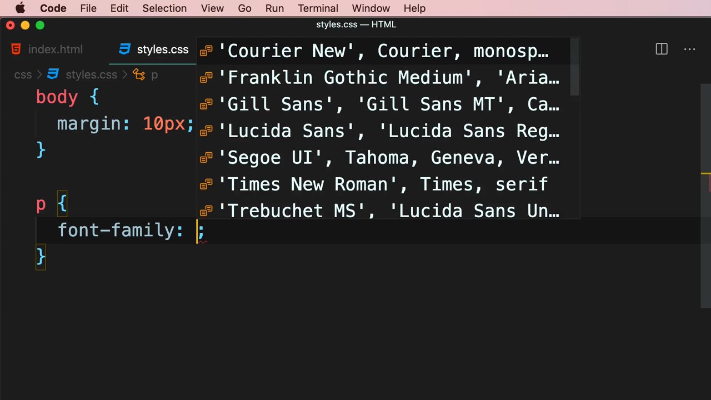

ตัวอย่างชุด fallback ที่ปรากฏใน dropdown (verbatim):
- `'Courier New', Courier, monospace`
- `'Franklin Gothic Medium', 'Aria...` (Franklin Gothic Medium, Arial Narrow, Arial, sans-serif)
- `'Gill Sans', 'Gill Sans MT', Ca...` (Gill Sans, Gill Sans MT, Calibri, sans-serif)
- `'Lucida Sans', 'Lucida Sans Reg...` (Lucida Sans, Lucida Sans Regular, ...)
- `'Segoe UI', Tahoma, Geneva, Ver...` (Segoe UI, Tahoma, Geneva, Verdana, sans-serif)
- `'Times New Roman', Times, serif`
- `'Trebuchet MS', 'Lucida Sans Un...` (Trebuchet MS, Lucida Sans Unicode, ...)

Mosh อธิบายว่า **"Web Safe Fonts"** คือรายชื่อฟอนต์ที่ถูกติดตั้งมาพร้อมกับระบบปฏิบัติการส่วนใหญ่อยู่แล้ว (Windows, macOS) จึงมั่นใจได้ว่าผู้ใช้ส่วนใหญ่จะเห็นฟอนต์ตามที่ตั้งใจไว้ โดยไม่ต้องพึ่งการโหลดฟอนต์จากภายนอก

ไวยากรณ์ของ `font-family` คือการเขียนเป็น **"รายการฟอนต์สำรอง (fallback list)"** เรียงจากที่ต้องการมากที่สุดไปน้อยที่สุด คั่นด้วยจุลภาค — ถ้าเบราว์เซอร์ไม่มีฟอนต์แรก จะลองฟอนต์ถัดไปในรายการ จนถึงฟอนต์ตระกูลกว้างๆ ตัวสุดท้าย (เช่น `sans-serif`, `serif`, `monospace`) เป็นตัวรับประกันสุดท้าย

จากนั้น Mosh พิมพ์ `Ar` และเลือกตัวเลือกที่ระบบแนะนำ:

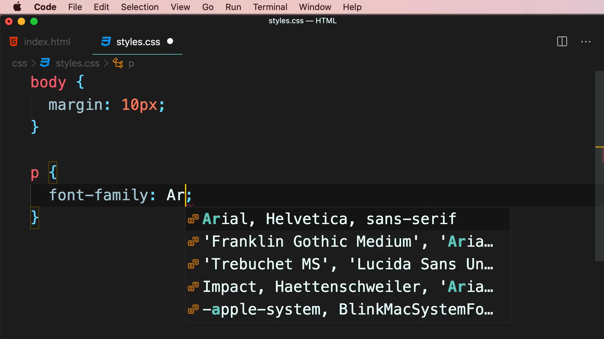

```css
p {
  font-family: Arial, Helvetica, sans-serif;
}
```

ผลลัพธ์ในเบราว์เซอร์ — ข้อความเปลี่ยนจากฟอนต์ default (serif ของเบราว์เซอร์) เป็น Arial (sans-serif):

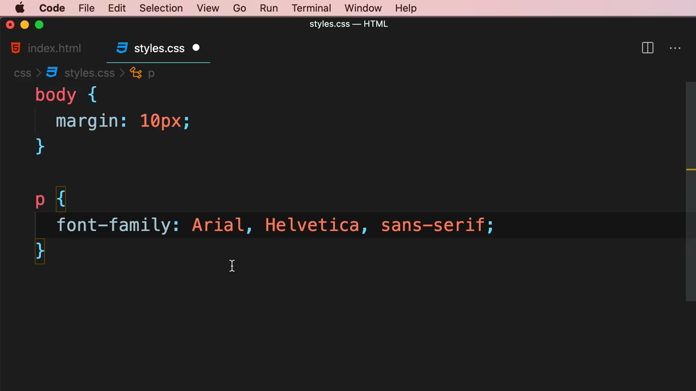

---

## 5. ปัญหาโค้ดซ้ำซ้อน และทางแก้ด้วย Inheritance

Mosh เพิ่มลิงก์เข้าไปในหน้าเพื่อสาธิตต่อ:

```html
<a href="#">Link</a>
```

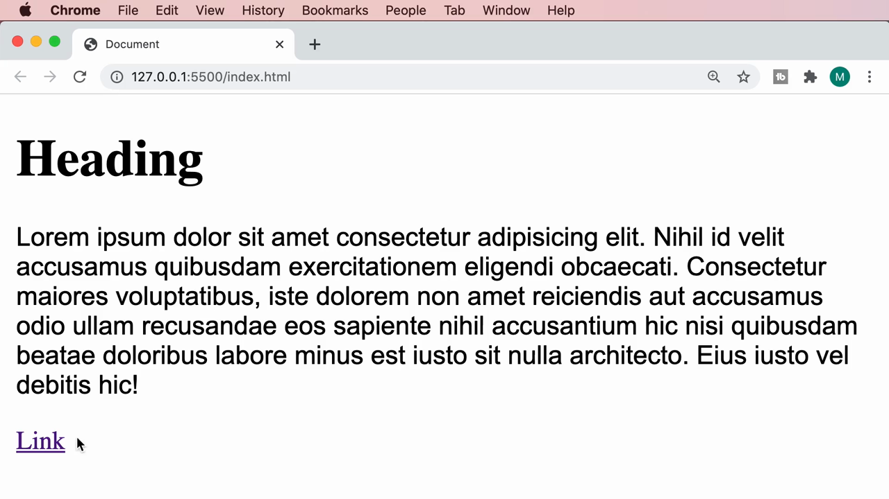

เมื่อดูผลลัพธ์จะพบว่าลิงก์ (`<a>`) ใช้ฟอนต์ serif ของเบราว์เซอร์ (ค่า default) ต่างจาก `<p>` ที่เป็น Arial แล้ว — ถ้าต้องการให้ลิงก์ใช้ฟอนต์เดียวกัน วิธีตรงไปตรงมาที่สุดคือเขียน `font-family` ซ้ำใน selector `a`:

```css
p {
  font-family: Arial, Helvetica, sans-serif;
}

a {
  font-family: Arial, Helvetica, sans-serif;
}
```

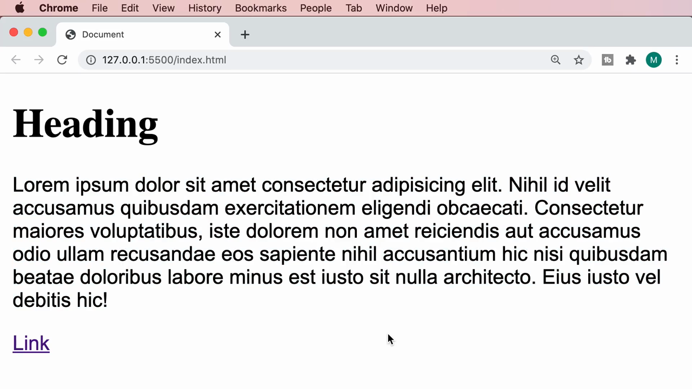

Mosh ชี้ให้เห็นว่าวิธีนี้ **"ไม่ดี"** เพราะเกิดโค้ดซ้ำซ้อน (code duplication) — ถ้าวันหนึ่งอยากเปลี่ยนฟอนต์ ต้องมาแก้หลายที่ เสี่ยงต่อความผิดพลาดและดูแลรักษายาก

### ทางแก้: ย้าย `font-family` ไปไว้ที่ `body` (ใช้หลัก Inheritance)

เนื่องจาก CSS มีกลไก **inheritance** — บาง property (เช่น `font-family`, `color`) จะถูก "สืบทอด" จาก element แม่ไปสู่ element ลูกโดยอัตโนมัติ — Mosh จึงย้าย `font-family` ไปประกาศไว้ที่ `body` เพียงจุดเดียว:

```css
body {
  margin: 10px;
  font-family: Arial, Helvetica, sans-serif;
}
```

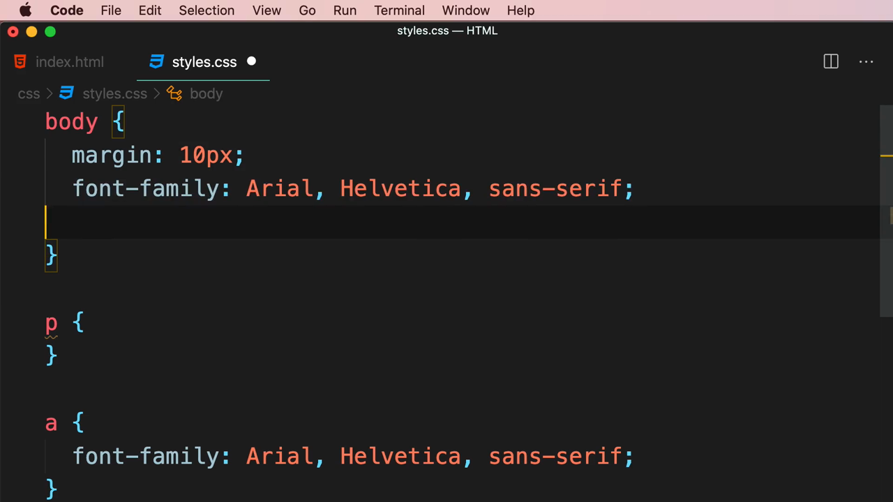

จากนั้นลบ `font-family` ที่ซ้ำซ้อนออกจาก `p` และ `a` (เหลือแค่ selector ว่างๆ หรือลบทิ้งไปเลยถ้าไม่มี property อื่น):

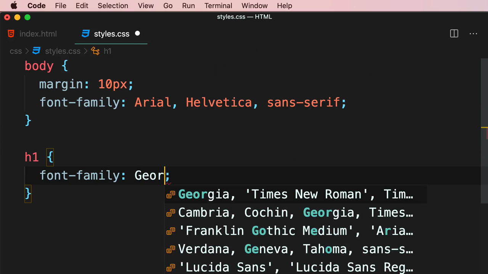

ผลลัพธ์ที่หน้าเว็บยังคงเหมือนเดิมทุกประการ — ทั้ง heading, paragraph และ link ต่างก็ได้ฟอนต์ Arial เพราะสืบทอดมาจาก `body` แต่โค้ดสั้นลงและดูแลง่ายขึ้นมาก

> **หลักการสำคัญ:** เขียน `font-family` (และ property อื่นที่ inherit ได้) ไว้ที่ element ระดับบนสุดที่ครอบคลุมทุกอย่าง (มักจะเป็น `body`) แล้วปล่อยให้ลูกๆ สืบทอดค่ามาโดยอัตโนมัติ — ใช้เฉพาะ selector เฉพาะเจาะจง (เช่น `h1`) เมื่อต้องการ **override** ค่าที่สืบทอดมาเท่านั้น

---

## 6. Override ฟอนต์เฉพาะจุด: `h1` ใช้ Serif

เพื่อสาธิตการ override Mosh กำหนดให้ `h1` ใช้ฟอนต์ตระกูล serif ต่างจากฟอนต์หลักของ body:

```css
h1 {
  font-family: Georgia, "Times New Roman", Times, serif;
}
```

(พิมพ์ `Geor` แล้วเลือกจาก autocomplete ที่แนะนำ `Georgia, 'Times New Roman', Tim...`)

ผลลัพธ์: หัวข้อ "Heading" เปลี่ยนเป็นฟอนต์ Serif (มีเชิง) ขณะที่ย่อหน้าและลิงก์ยังคงเป็น Arial (Sans-serif) ตามที่สืบทอดจาก `body`:

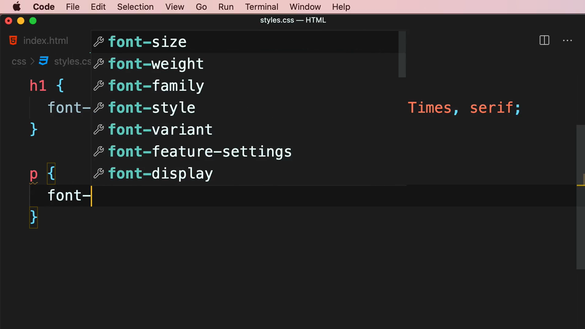

นี่คือตัวอย่างที่ชัดเจนของการผสมผสาน **inheritance + override**: ใช้ฟอนต์ร่วมกันจาก `body` เป็นค่าเริ่มต้น แล้ว override เฉพาะจุดที่ต้องการความแตกต่าง

---

## 7. Property `font-weight` — ความหนาบางของตัวอักษร

Mosh ย้ายไปที่ `p` แล้วพิมพ์ `font-weight:` ให้ IntelliSense แสดงค่าตัวเลขที่ใช้ได้:

`100, 200, 300, 400, 500, 600, 700` (ไปจนถึง 900)

ตัวเลขเหล่านี้แทนความหนาของเส้นตัวอักษร ยิ่งเลขมาก ยิ่งหนา (bold) มากขึ้น — 400 คือความหนาปกติ (normal), 700 คือหนา (bold) แบบมาตรฐาน

Mosh ทดลองใส่ค่าสูงสุดก่อน:

```css
p {
  font-weight: 900;
}
```

ผลลัพธ์: ข้อความในย่อหน้าหนาขึ้นมากอย่างเห็นได้ชัด:

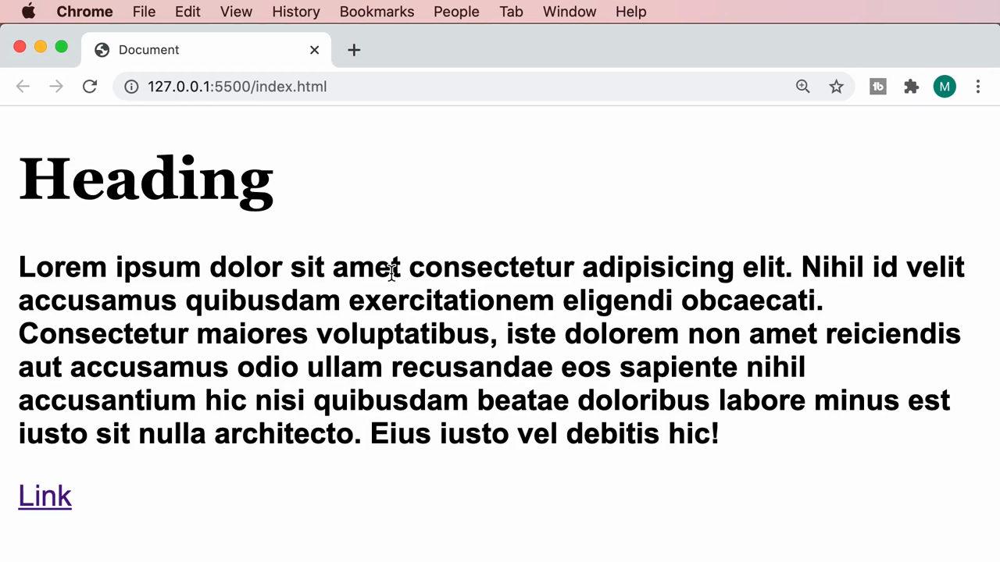

### ตรวจสอบค่าจริงผ่าน Chrome DevTools

Mosh คลิกขวาที่ย่อหน้าแล้วเลือก **Inspect** เพื่อเปิด DevTools แล้วเปลี่ยนค่า `font-weight` เป็นคำสำคัญ (keyword) แทนตัวเลข:

```css
p {
  font-weight: bold;
}
```

เมื่อดูที่แท็บ **Computed** ใน DevTools จะเห็นว่า browser แปลคำว่า `bold` เป็นค่าตัวเลข **700** โดยอัตโนมัติ:

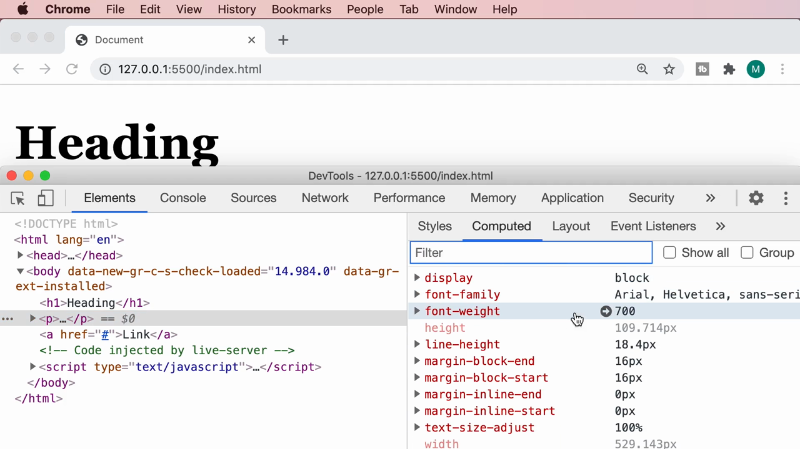

จากนั้นเปลี่ยนเป็น:

```css
p {
  font-weight: normal;
}
```

แท็บ Computed แสดงว่า `normal` มีค่าเท่ากับ **400**:

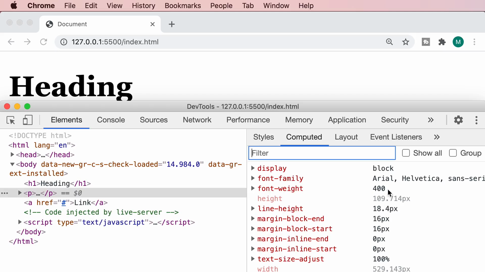

> **สรุปคีย์เวิร์ด font-weight:**
> - `normal` = **400** (ปกติ)
> - `bold` = **700** (หนา)
> - นอกจากนี้ยังสามารถใส่เป็นตัวเลขตรงๆ ได้ตั้งแต่ `100` (บางที่สุด) ถึง `900` (หนาที่สุด) เพื่อความละเอียดมากกว่าการใช้แค่ 2 คีย์เวิร์ด

---

## 8. Property `font-style` — ตัวเอียง (Italic)

Mosh เพิ่ม property ใหม่ในกฎ `p` เดิม:

```css
p {
  font-weight: normal;
  font-style: italic;
}
```

ผลลัพธ์: ข้อความทั้งย่อหน้าเอียงเป็นตัว *Italic*:

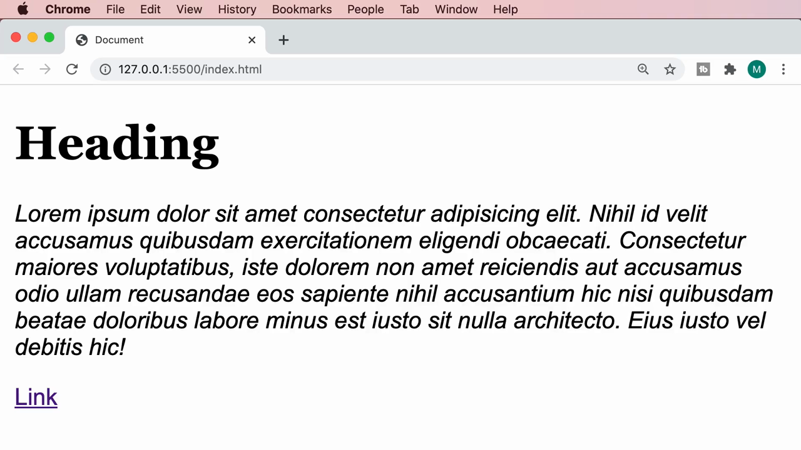

Mosh อธิบายสั้นๆ ว่า `font-style` มีค่าหลักๆ คือ `normal` (ปกติ), `italic` (เอียงแบบใช้ฟอนต์ italic จริงถ้ามี) และ `oblique` (เอียงแบบเทาลาดเอียงฟอนต์ปกติ)

---

## 9. Property `font-size` — ขนาดตัวอักษร

Mosh พิมพ์ `font-size:` แล้วปล่อยให้ IntelliSense แสดงคีย์เวิร์ดขนาดสัมพัทธ์ที่ใช้ได้:

`large, larger, medium, small, smaller, x-large, x-small, xx-large, xx-small`


ทดลองใส่หน่วยพิกเซลตรงๆ ก่อน:

```css
p {
  font-size: 30px;
}
```

ผลลัพธ์: ข้อความในย่อหน้าใหญ่ขึ้นชัดเจน (30 พิกเซล):

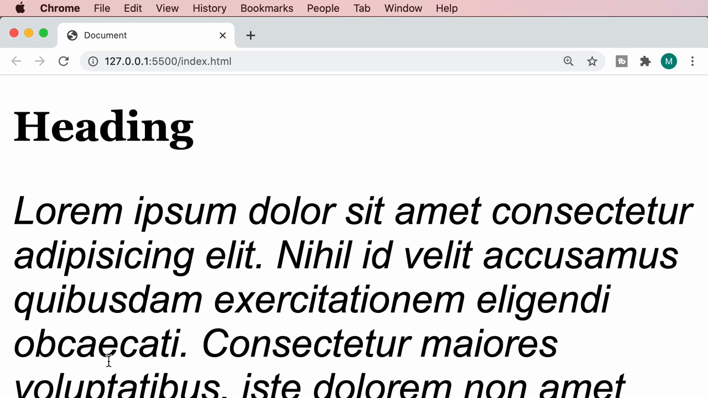

Mosh hover เมาส์ดู tooltip คำอธิบายของ `font-size` จาก IntelliSense ซึ่งอธิบายว่า (สรุปใจความ): กำหนดความสูงของตัวอักษรตามที่ต้องการ สำหรับฟอนต์แบบ scalable ค่า font-size จะถูกใช้เป็นตัวคูณสเกลกับหน่วย EM ของฟอนต์นั้น ไวยากรณ์ที่รองรับคือ `<absolute-size> | <relative-size> | <length-percentage>`

จากนั้นเปลี่ยนมาใช้หน่วย **`rem`** แทน pixel:

```css
p {
  font-size: 1rem;
}
```

> **หน่วย `rem` คืออะไร:** ย่อมาจาก "root em" หมายถึงขนาดที่คำนวณโดยอิงจาก font-size ของ element ราก (`<html>`) ซึ่งโดย default browser มักตั้งไว้ที่ 16px ดังนั้น `1rem` = 16px, `2rem` = 32px เป็นต้น การใช้ `rem` แทน `px` ตรงๆ ช่วยให้ขนาดตัวอักษรปรับสเกลตามการตั้งค่าการเข้าถึง (accessibility) ของผู้ใช้ได้ดีกว่า

---

## 10. Property `color` — สีของตัวอักษร

สุดท้าย Mosh เพิ่ม property `color` เพื่อกำหนดสีข้อความ โดยพิมพ์ `color` แล้วปล่อยให้ autocomplete แสดงตัวเลือก properties ที่มีคำว่า "color" ทั้งหมด (เช่น `color`, `background-color`, `border-color` ฯลฯ):

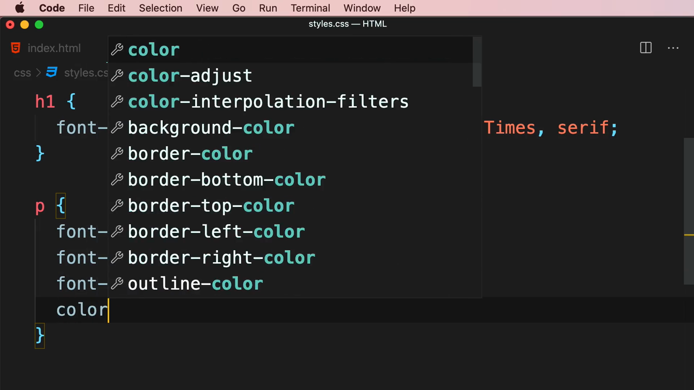

Mosh ทดลองไล่ค่าสีเทาเข้มหลายเฉด (hex code สั้น 3 หลัก) เพื่อดูผลต่างของความเข้ม:

```css
p {
  color: #222; /* เข้มมาก เกือบดำ */
}
```

จากนั้นปรับเป็น:

```css
p {
  color: #444; /* เทาเข้มปานกลาง */
}
```

และค่าสุดท้ายที่ Mosh เลือกใช้ปิดคลิป:

```css
p {
  font-weight: normal;
  font-style: italic;
  font-size: 1rem;
  color: #333; /* เทาเข้ม - อ่านง่ายกว่าสีดำสนิท */
}
```

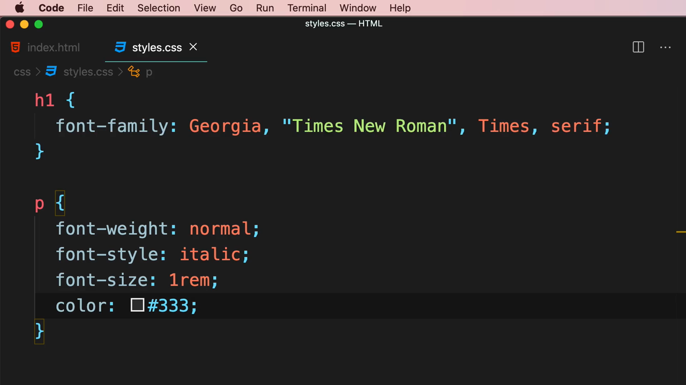

Mosh อธิบายว่าในทางปฏิบัติ นักออกแบบเว็บมักไม่ใช้สีดำสนิท (`#000`) กับข้อความเนื้อหา เพราะให้ contrast จัดเกินไปจนอ่านนานแล้วเมื่อยตา — สีเทาเข้ม เช่น `#333` หรือ `#444` จะดูสบายตากว่า

---

## สรุปภาพรวมของคลิปนี้

| Property | หน้าที่ | ตัวอย่างค่าที่ใช้ในคลิป |
|---|---|---|
| `font-family` | กำหนดตระกูล/ชนิดของตัวอักษร (fallback list) | `Arial, Helvetica, sans-serif` / `Georgia, "Times New Roman", Times, serif` |
| `font-weight` | กำหนดความหนาบางของเส้นตัวอักษร | `900`, `bold` (=700), `normal` (=400) |
| `font-style` | กำหนดตัวเอียง | `italic` |
| `font-size` | กำหนดขนาดตัวอักษร | `30px`, `1rem` |
| `color` | กำหนดสีของตัวอักษร | `#222` → `#444` → `#333` |

**แนวคิดสำคัญที่ได้จากคลิปนี้:**

1. **หมวดหมู่ฟอนต์ 3 แบบ:** Serif (มีเชิง) / Sans-serif (ไม่มีเชิง) / Monospace (ความกว้างเท่ากันทุกตัว)
2. **Web Safe Fonts:** ใช้ชุดฟอนต์ fallback ที่ติดตั้งมากับระบบปฏิบัติการส่วนใหญ่ เพื่อความแน่นอนของการแสดงผล
3. **Inheritance:** ประกาศ `font-family` (และ property ที่ inherit ได้อื่นๆ) ไว้ที่ `body` เพียงจุดเดียว แล้วให้ element ลูกสืบทอดค่ามา ลดโค้ดซ้ำซ้อน — ใช้ selector เฉพาะเจาะจง (เช่น `h1`) เฉพาะตอนต้องการ override
4. **`font-weight` เป็นตัวเลข ไม่ใช่แค่ bold/normal:** `bold` = 700, `normal` = 400 และปรับละเอียดได้ตั้งแต่ 100-900
5. **หน่วย `rem` ดีกว่า `px` สำหรับขนาดตัวอักษร** เพราะยืดหยุ่นตามการตั้งค่าการเข้าถึง (accessibility) ของผู้ใช้
6. **หลีกเลี่ยงสีดำสนิทกับข้อความเนื้อหา** ใช้เทาเข้ม (เช่น `#333`) เพื่อความสบายตาในการอ่าน

---

*หมายเหตุ: คลิปนี้เป็นส่วนหนึ่งของบท "3-Typography" จากคอร์ส The Ultimate HTML and CSS Course โดย Mosh Hamedani (codewithmosh.com) — คลิปที่ 2 ของบทนี้*
