# 3-Typography: 03 - Embedding Web Fonts (7:39)

**ไฟล์ต้นทาง:** `3-Embedding-Web-Fonts.mp4`

▶️ **[เปิดวิดีโอต้นฉบับ](../../../HTML-CSS-2/3-Typography/3-Embedding-Web-Fonts.mp4)**

---

## ภาพรวมคลิปนี้

คลิปนี้สอนวิธี **"ฝังฟอนต์ที่กำหนดเอง (Embed Custom Fonts)"** เข้าไปในเว็บไซต์ แทนที่จะพึ่งพา Web Safe Fonts ที่มีอยู่แล้วในเครื่องผู้ใช้เพียงอย่างเดียว โดยสาธิตขั้นตอนทั้งหมดตั้งแต่การดาวน์โหลดฟอนต์ฟรีจาก Font Squirrel, การแปลงไฟล์ฟอนต์ให้อยู่ในรูปแบบที่เว็บใช้ได้ (Webfont Generator), การตรวจสอบความรองรับของเบราว์เซอร์ผ่าน Can I Use, ไปจนถึงการเขียน `@font-face` และจัดระเบียบไฟล์ในโปรเจกต์

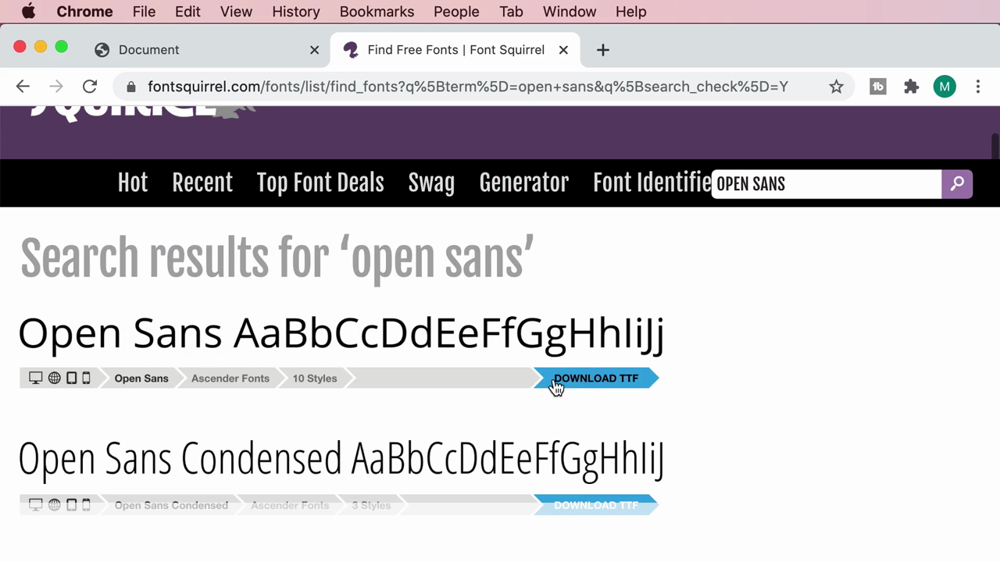

---

## 1. ทบทวน: Web Safe Fonts (จากคลิปก่อนหน้า)

ก่อนเข้าเนื้อหาใหม่ Mosh ทบทวนสั้นๆ ถึงแนวคิด **Web Safe Fonts** ที่เรียนไปในคลิปก่อน — ชุดฟอนต์ที่มั่นใจได้ว่าติดตั้งอยู่ในเครื่องผู้ใช้ส่วนใหญ่อยู่แล้ว เช่น Arial, Helvetica, Georgia, Times New Roman:

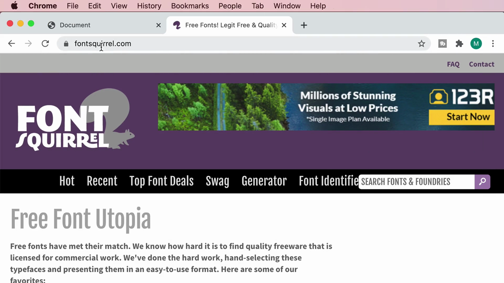

Mosh ตั้งคำถามว่า **"แล้วถ้าอยากใช้ฟอนต์ที่ไม่ใช่ Web Safe Font ล่ะ?"** เช่น ฟอนต์สวยๆ ที่ดาวน์โหลดมาจากอินเทอร์เน็ต — คำตอบคือต้อง **"ฝัง" (embed)** ฟอนต์นั้นเข้าไปในเว็บไซต์โดยตรง เพื่อให้เบราว์เซอร์ของผู้ใช้ดาวน์โหลดฟอนต์นั้นมาแสดงผล แม้เครื่องผู้ใช้จะไม่มีฟอนต์นั้นติดตั้งอยู่ก็ตาม

---

## 2. ดาวน์โหลดฟอนต์ฟรีจาก Font Squirrel

Mosh เปิดเว็บไซต์ **fontsquirrel.com** ซึ่งเป็นแหล่งรวมฟอนต์ฟรีที่ได้รับอนุญาต (licensed) ให้ใช้งานเชิงพาณิชย์ได้ แล้วค้นหาฟอนต์ชื่อ **"Open Sans"**:

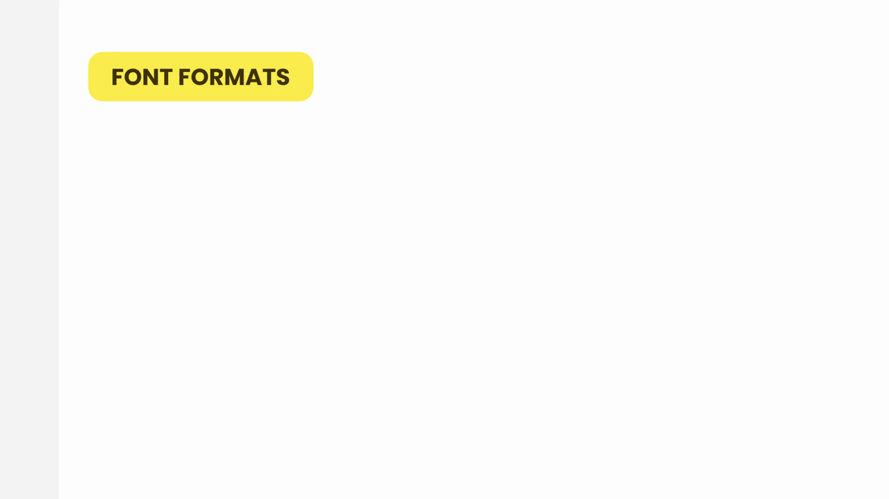

คลิก **Download TTF** เพื่อดาวน์โหลดไฟล์ฟอนต์ในรูปแบบ **TTF (TrueType Font)** ซึ่งเป็นรูปแบบไฟล์ฟอนต์มาตรฐานที่ใช้กันทั่วไปบนระบบปฏิบัติการ (แต่ยังไม่เหมาะกับการใช้บนเว็บโดยตรง):

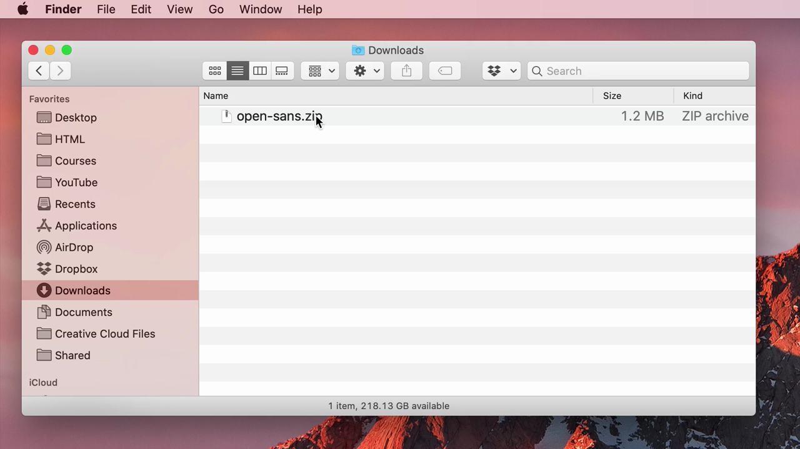

แตกไฟล์ zip ออกมา จะได้ไฟล์ `.ttf` หลายไฟล์ — หนึ่งไฟล์ต่อหนึ่ง**น้ำหนัก/สไตล์** ของฟอนต์ (Regular, Bold, Italic, Light, Semibold, ExtraBold ฯลฯ) รวมถึงไฟล์ Apache License:

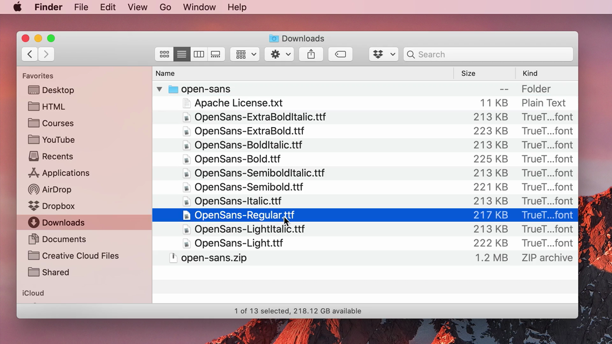

> **ทำไมต้องมีหลายไฟล์?** ฟอนต์แต่ละน้ำหนัก/สไตล์ (regular, bold, italic) จริงๆ แล้วเป็น **ไฟล์ฟอนต์คนละไฟล์กัน** ไม่ใช่ไฟล์เดียวที่ปรับความหนาได้อัตโนมัติเหมือน CSS `font-weight` ที่ใช้กับ web safe font — ดังนั้นถ้าต้องการใช้ทั้ง regular และ bold ของฟอนต์ที่ฝังเอง จะต้องดาวน์โหลดและฝังทั้งสองไฟล์แยกกัน

---

## 3. แปลงไฟล์ TTF เป็น Web Font ด้วย Webfont Generator

ไฟล์ `.ttf` ที่ดาวน์โหลดมายังไม่เหมาะกับการใช้บนเว็บโดยตรง (ไฟล์ใหญ่ ไม่ได้บีบอัดสำหรับการโหลดผ่านอินเทอร์เน็ต) Mosh จึงใช้เครื่องมือ **Webfont Generator** ของ Font Squirrel (`fontsquirrel.com/tools/webfont-generator`) เพื่อแปลงไฟล์ให้อยู่ในรูปแบบที่เหมาะกับเว็บ:

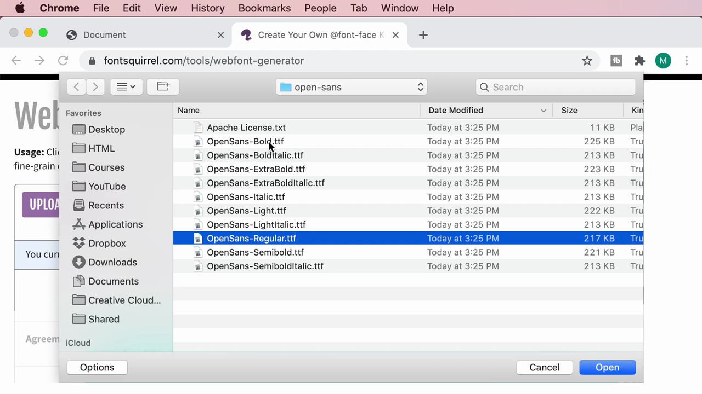

คลิก **Upload Fonts** แล้วเลือกไฟล์ `OpenSans-Regular.ttf` และ `OpenSans-Bold.ttf` (สองน้ำหนักที่จะใช้ในตัวอย่าง):

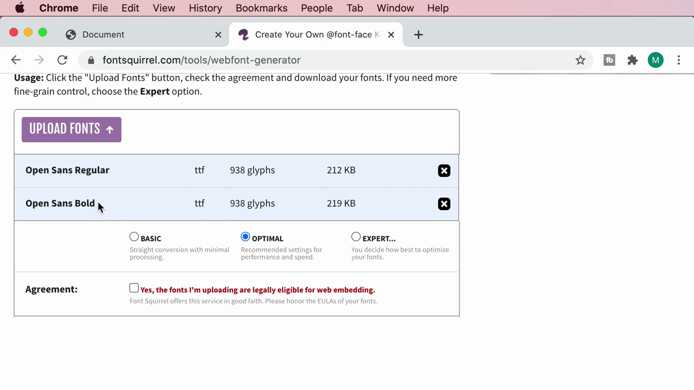

เลือกโหมด **Optimal** (ค่าแนะนำ) ติ๊กยอมรับข้อตกลง (Agreement) แล้วกด **Download Your Kit**:

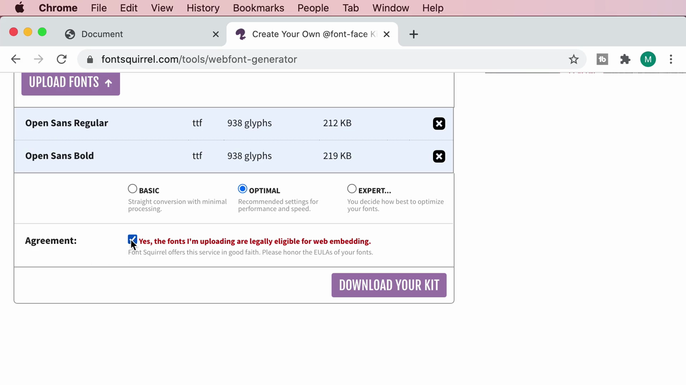

แตกไฟล์ zip ที่ได้ออกมา จะพบชุดไฟล์ต่อไปนี้:

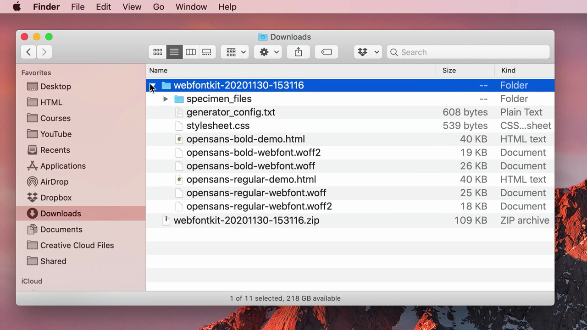

- `stylesheet.css` — ไฟล์ CSS ที่มีโค้ด `@font-face` สำเร็จรูปมาให้แล้ว (สำคัญที่สุด)
- `opensans-regular-webfont.woff` และ `.woff2` — ไฟล์ฟอนต์รูปแบบ **WOFF / WOFF2** (Web Open Font Format) ที่ถูกบีบอัดให้เหมาะกับการโหลดผ่านเว็บ
- `opensans-bold-webfont.woff` และ `.woff2` — เช่นเดียวกันสำหรับน้ำหนัก Bold
- `opensans-*-demo.html` — ไฟล์ตัวอย่างสาธิตการใช้งาน
- `generator_config.txt` — ไฟล์ config ที่บันทึกการตั้งค่าที่ใช้แปลง (เผื่อใช้แปลงซ้ำในอนาคต)

---

## 4. ทำไมต้องใช้ WOFF/WOFF2 แทน TTF? — ตรวจสอบด้วย Can I Use

Mosh อธิบายว่ารูปแบบ **WOFF** (Web Open Font Format) และ **WOFF2** ถูกออกแบบมาเฉพาะสำหรับใช้บนเว็บ — บีบอัดไฟล์ให้เล็กลงกว่า TTF ทำให้โหลดหน้าเว็บได้เร็วขึ้น

เพื่อยืนยันว่าเบราว์เซอร์ต่างๆ รองรับ WOFF ดีแค่ไหน Mosh เปิดเว็บไซต์ **caniuse.com** แล้วค้นหา "woff":

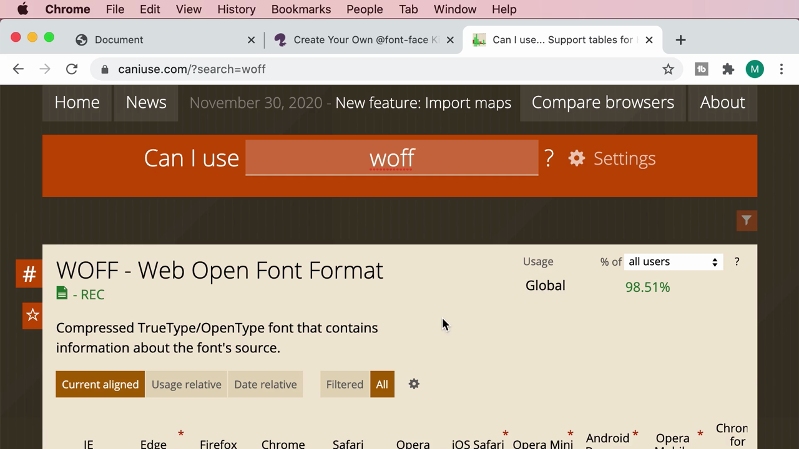

ผลลัพธ์แสดงว่า **WOFF ได้รับการรองรับจากเบราว์เซอร์ทั่วโลกกว่า 98%** (WOFF 2.0 อยู่ที่ประมาณ 96%) จึงมั่นใจได้ว่าใช้งานจริงได้อย่างปลอดภัย

> **สรุปรูปแบบไฟล์ฟอนต์ที่ควรรู้:**
> - **TTF/OTF** — รูปแบบดั้งเดิม ใช้บนระบบปฏิบัติการทั่วไป ไม่ได้ถูกบีบอัดสำหรับเว็บ
> - **WOFF** — บีบอัดสำหรับเว็บ รองรับเบราว์เซอร์เกือบทั้งหมด (~98%)
> - **WOFF2** — เวอร์ชันบีบอัดดีกว่า WOFF เดิม (ใหม่กว่า รองรับ ~96%)
> - **แนวทางปฏิบัติ:** ใส่ทั้ง `.woff2` และ `.woff` ใน `@font-face` (woff2 มาก่อนเป็นตัวเลือกแรก, woff เป็น fallback) เพื่อให้ครอบคลุมเบราว์เซอร์ได้มากที่สุด

---

## 5. จัดระเบียบไฟล์ในโปรเจกต์

กลับมาที่ VS Code Mosh สร้างโฟลเดอร์ใหม่ภายใต้ `css/` ชื่อ **`fonts`** แล้วสร้างโฟลเดอร์ย่อยชื่อ **`open-sans`** ข้างในอีกที เพื่อจัดเก็บไฟล์ฟอนต์แยกเป็นสัดส่วน:

```
css/
  fonts/
    open-sans/
      opensans-regular-webfont.woff
      opensans-regular-webfont.woff2
      opensans-bold-webfont.woff
      opensans-bold-webfont.woff2
  normalize.css
  styles.css
```

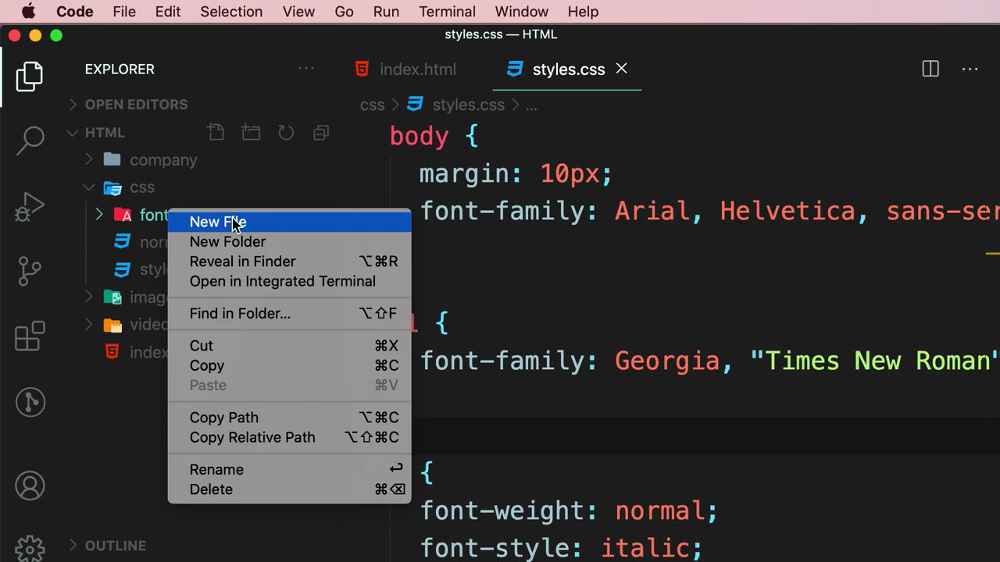

จากนั้นลาก (drag & drop) ไฟล์ `.woff` และ `.woff2` ทั้ง 4 ไฟล์จาก Finder เข้ามาวางในโฟลเดอร์ `open-sans` ที่สร้างไว้:

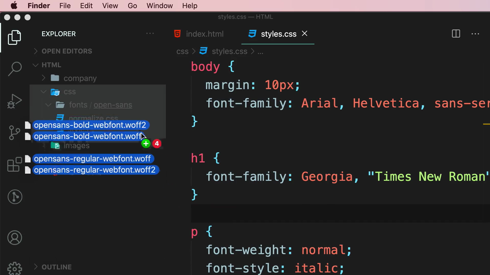

---

## 6. เขียน `@font-face` — เปิดไฟล์ stylesheet.css ที่ Font Squirrel สร้างให้

Mosh เปิดไฟล์ `stylesheet.css` ที่ได้จาก Webfont Generator เพื่อดูโค้ด `@font-face` ที่สร้างมาให้อัตโนมัติ:

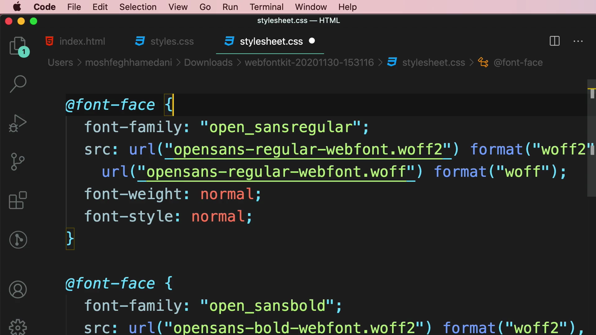

```css
/*! Generated by Font Squirrel (https://www.fontsquirrel.com) ... */

@font-face {
  font-family: "open_sansregular";
  src: url("opensans-regular-webfont.woff2") format("woff2"),
       url("opensans-regular-webfont.woff") format("woff");
  font-weight: normal;
  font-style: normal;
}

@font-face {
  font-family: "open_sansbold";
  src: url("opensans-bold-webfont.woff2") format("woff2"),
       url("opensans-bold-webfont.woff") format("woff");
  font-weight: normal;
  font-style: normal;
}
```

Mosh อธิบายโครงสร้างของ **`@font-face`** ทีละส่วน:

- **`font-family`** — ตั้งชื่อที่จะใช้เรียกฟอนต์นี้ในโค้ด CSS ส่วนอื่น (ชื่อนี้กำหนดเองได้ ไม่จำเป็นต้องตรงกับชื่อฟอนต์จริง)
- **`src`** — ระบุตำแหน่งไฟล์ฟอนต์ พร้อม `format()` กำกับชนิดไฟล์ โดยเรียงจากรูปแบบที่ดีที่สุดก่อน (woff2 → woff) เบราว์เซอร์จะเลือกใช้ไฟล์แรกที่มันรองรับ
- **`font-weight`** / **`font-style`** — กำหนดว่า `@font-face` บล็อกนี้ใช้กับน้ำหนัก/สไตล์ใด

Mosh คัดลอกโค้ด `@font-face` ทั้งสองบล็อกนี้ไปวางไว้ที่ด้านบนของไฟล์ `styles.css` หลักของโปรเจกต์:

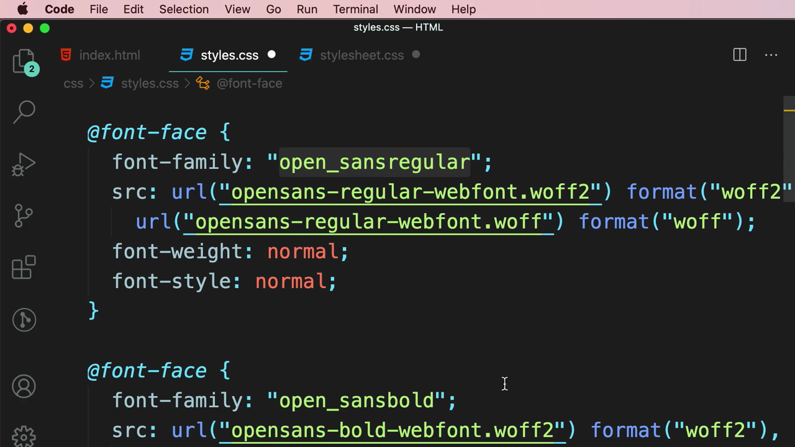

---

## 7. ปรับปรุงโค้ด: รวม `font-family` เป็นชื่อเดียว แยกด้วย `font-weight`

Mosh ชี้ให้เห็นว่าการตั้งชื่อ `font-family` แยกกันเป็น `"open_sansregular"` และ `"open_sansbold"` นั้น**ไม่สะดวก** เพราะเวลาจะสลับความหนาต้องเปลี่ยนชื่อ font-family ทั้งหมด — วิธีที่ดีกว่าคือตั้งชื่อ **เหมือนกัน** ทั้งสองบล็อก (เช่น `"opensans"`) แล้วใช้ **`font-weight`** เป็นตัวแยกว่าบล็อกไหนคือ regular บล็อกไหนคือ bold:

```css
@font-face {
  font-family: "opensans";
  src: url("opensans-regular-webfont.woff2") format("woff2"),
       url("opensans-regular-webfont.woff") format("woff");
  font-weight: normal;
  font-style: normal;
}

@font-face {
  font-family: "opensans";
  src: url("opensans-bold-webfont.woff2") format("woff2"),
       url("opensans-bold-webfont.woff") format("woff");
  font-weight: bold;
  font-style: normal;
}
```

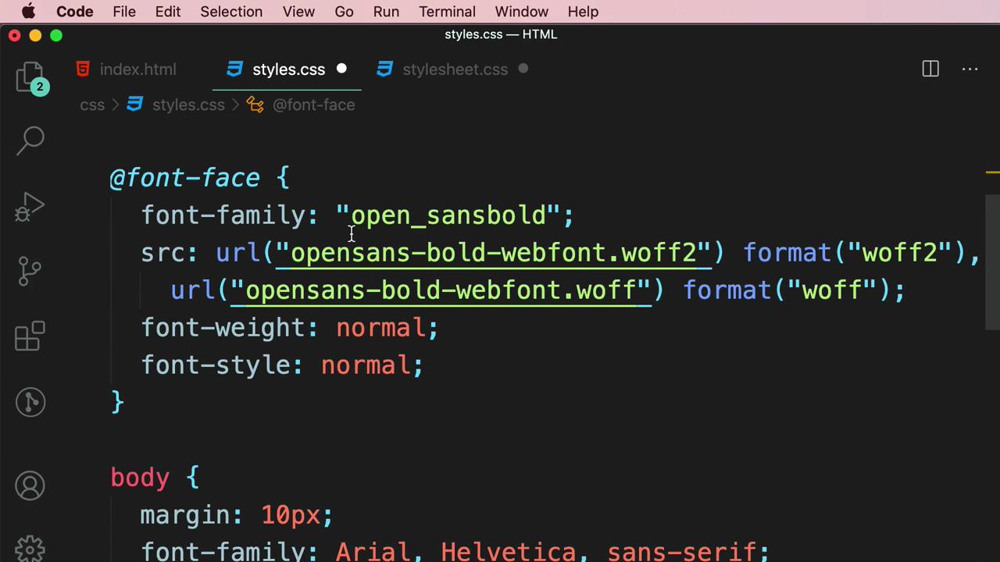

> **ประโยชน์ของเทคนิคนี้:** เมื่อภายหลังเขียน CSS ว่า `font-family: "opensans"; font-weight: bold;` เบราว์เซอร์จะรู้เองว่าต้องไปโหลดไฟล์ฟอนต์ตัวหนา (bold-webfont) มาใช้โดยอัตโนมัติ — ไม่ต้องสร้างชื่อ font-family ใหม่สำหรับแต่ละน้ำหนัก เหมือนกับวิธีที่ระบบปฏิบัติการจัดการฟอนต์ตามปกติ

---

## 8. นำฟอนต์ที่ฝังไปใช้งานจริงที่ `body`

สุดท้าย Mosh แก้ไข `font-family` ของ `body` จาก Web Safe Font (`Arial, Helvetica, sans-serif`) ให้เปลี่ยนไปใช้ฟอนต์ที่เพิ่งฝัง (`opensans`) แทน:

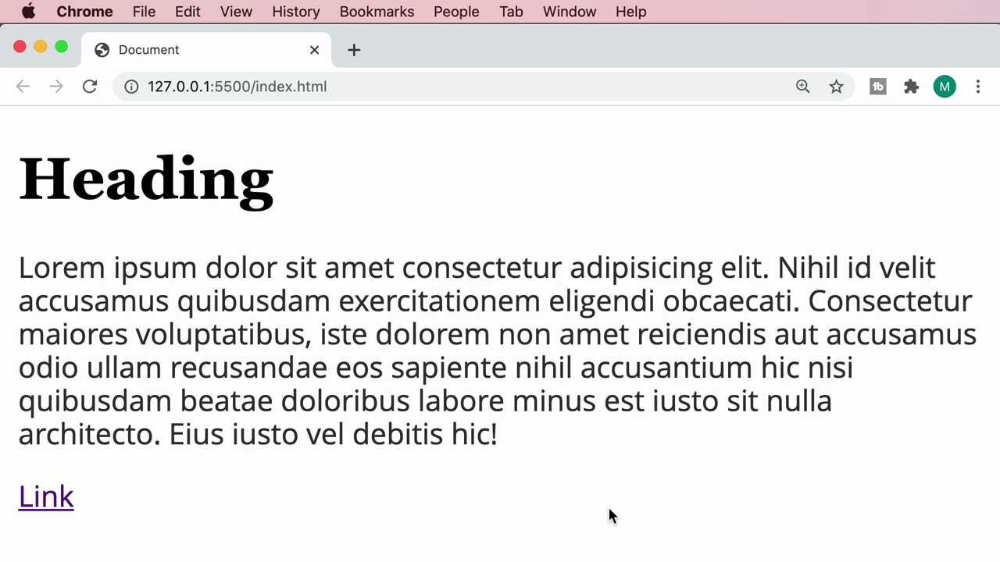

```css
body {
  margin: 10px;
  font-family: 'opensans', Arial, Helvetica, sans-serif;
}
```

> **สังเกต:** Mosh ยังคงเก็บ `Arial, Helvetica, sans-serif` ไว้เป็น **fallback ต่อท้าย** — ถ้าด้วยเหตุผลใดก็ตามไฟล์ฟอนต์ `opensans` โหลดไม่สำเร็จ (เช่น เน็ตช้า หรือไฟล์เสียหาย) เบราว์เซอร์จะยังมีฟอนต์สำรองให้ใช้แสดงผลต่อไปได้ ไม่ทำให้หน้าเว็บพังหรือข้อความหายไป

### แก้ไข path ให้ตรงกับตำแหน่งไฟล์จริงหลังจัดระเบียบโฟลเดอร์

เนื่องจากย้ายไฟล์ฟอนต์ไปไว้ในโฟลเดอร์ `fonts/open-sans/` (ไม่ได้อยู่ตำแหน่งเดียวกับ `styles.css` อีกต่อไป) Mosh จึงต้องแก้ path ใน `url()` ของ `@font-face` ทั้งสองบล็อกให้ชี้ไปยังตำแหน่งไฟล์ที่ถูกต้อง:

```css
@font-face {
  font-family: "opensans";
  src: url("fonts/open-sans/opensans-regular-webfont.woff2") format("woff2"),
       url("fonts/open-sans/opensans-regular-webfont.woff") format("woff");
  font-weight: normal;
  font-style: normal;
}

@font-face {
  font-family: "opensans";
  src: url("fonts/open-sans/opensans-bold-webfont.woff2") format("woff2"),
       url("fonts/open-sans/opensans-bold-webfont.woff") format("woff");
  font-weight: bold;
  font-style: normal;
}
```

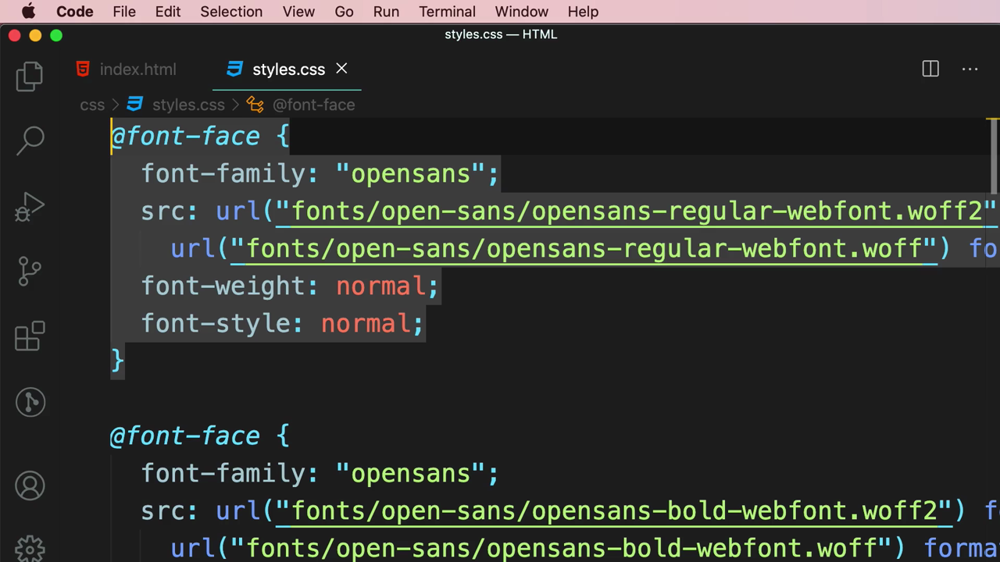

> **เคล็ดลับสำคัญ:** path ใน `url()` ของ `@font-face` เป็น **relative path** ที่นับจากตำแหน่งไฟล์ CSS ที่เขียนโค้ดนั้นอยู่ (ในที่นี้คือ `styles.css`) ไม่ใช่จากตำแหน่งไฟล์ HTML — ถ้าย้ายไฟล์ฟอนต์หรือย้ายไฟล์ CSS ไปที่อื่น ต้องอัปเดต path นี้ให้ตรงกันเสมอ ไม่เช่นนั้นฟอนต์จะโหลดไม่ขึ้นและ browser จะ fallback ไปใช้ฟอนต์สำรองแทนแบบเงียบๆ

---

## สรุปภาพรวมของคลิปนี้

| ขั้นตอน | เครื่องมือ/ไฟล์ที่ใช้ | ผลลัพธ์ |
|---|---|---|
| 1. หาฟอนต์ฟรี | fontsquirrel.com | ไฟล์ `.ttf` (Open Sans Regular, Bold) |
| 2. แปลงเป็น web font | Font Squirrel Webfont Generator | ไฟล์ `.woff` / `.woff2` + `stylesheet.css` |
| 3. ตรวจสอบความรองรับ | caniuse.com | ยืนยัน WOFF รองรับ ~98% ของเบราว์เซอร์ |
| 4. จัดระเบียบไฟล์ | VS Code + Finder | โฟลเดอร์ `css/fonts/open-sans/` |
| 5. เขียน `@font-face` | `styles.css` | กำหนด `font-family`, `src`, `font-weight` |
| 6. ใช้งานจริง | `body { font-family: 'opensans', ... }` | ฟอนต์ที่ฝังเองแสดงผลทั่วทั้งเว็บไซต์ |

**แนวคิดสำคัญที่ได้จากคลิปนี้:**

1. **`@font-face` คือกลไกหลักในการฝังฟอนต์ที่กำหนดเอง** — ระบุชื่อ, ตำแหน่งไฟล์ (พร้อม format), น้ำหนักและสไตล์
2. **ใช้ WOFF/WOFF2 แทน TTF บนเว็บ** เพราะถูกบีบอัดให้เหมาะกับการโหลดผ่านอินเทอร์เน็ตและรองรับเบราว์เซอร์กว้างขวาง
3. **ตั้งชื่อ `font-family` เดียวกันสำหรับทุกน้ำหนัก** แล้วแยกด้วย `font-weight`/`font-style` แทนการสร้างชื่อใหม่ทุกน้ำหนัก
4. **เก็บ fallback fonts ไว้เสมอ** แม้จะใช้ฟอนต์ที่ฝังเองแล้วก็ตาม เผื่อกรณีโหลดฟอนต์ไม่สำเร็จ
5. **Path ใน `@font-face` เป็น relative ต่อไฟล์ CSS** ต้องระวังเวลาย้ายไฟล์ในโปรเจกต์

---

*หมายเหตุ: คลิปนี้เป็นส่วนหนึ่งของบท "3-Typography" จากคอร์ส The Ultimate HTML and CSS Course โดย Mosh Hamedani (codewithmosh.com) — คลิปที่ 3 ของบทนี้*
