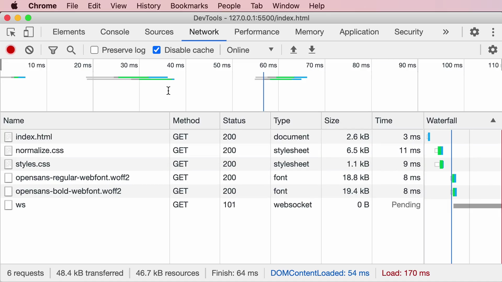
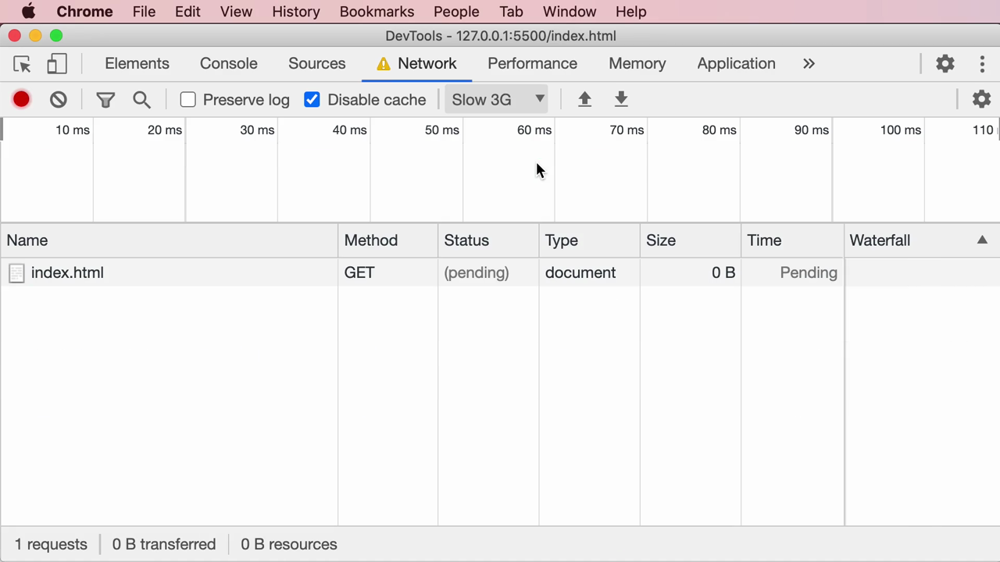
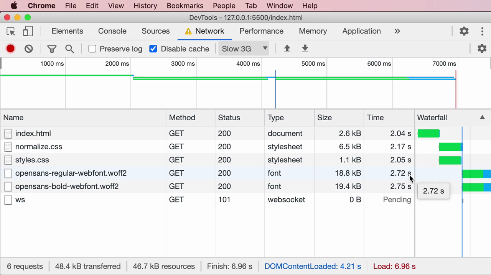
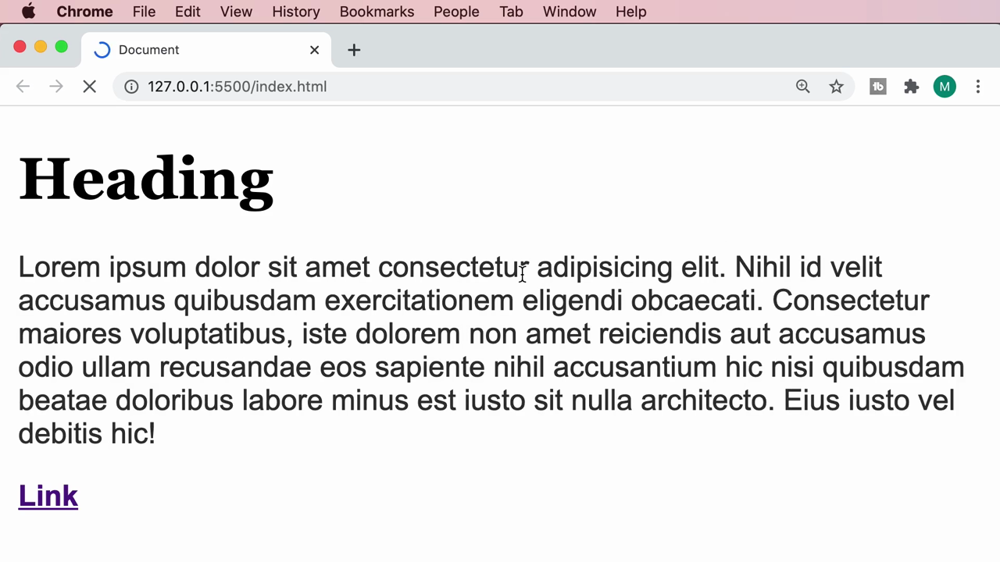
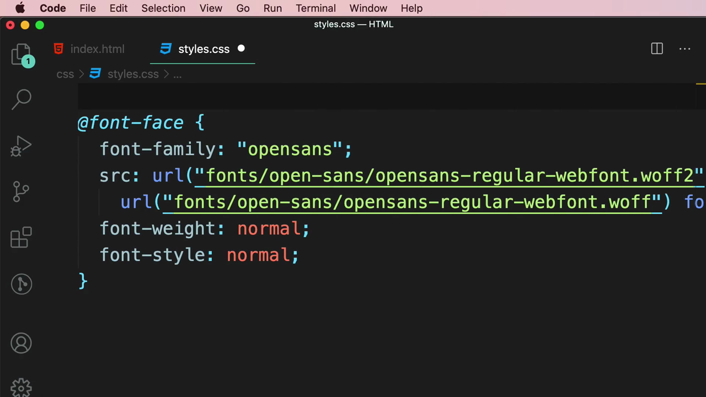
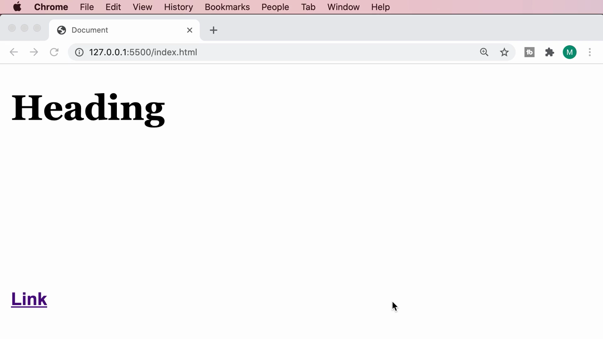
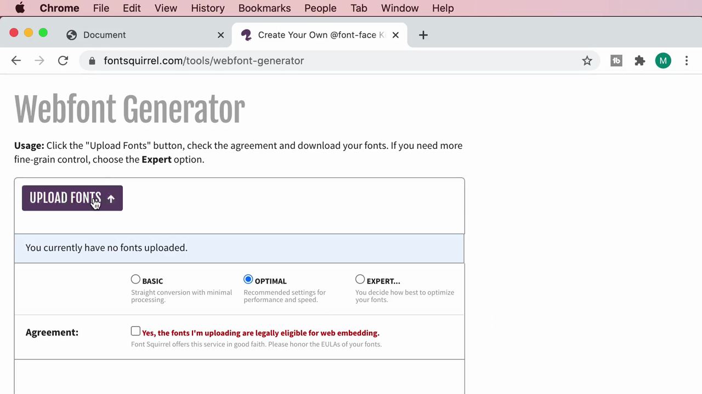
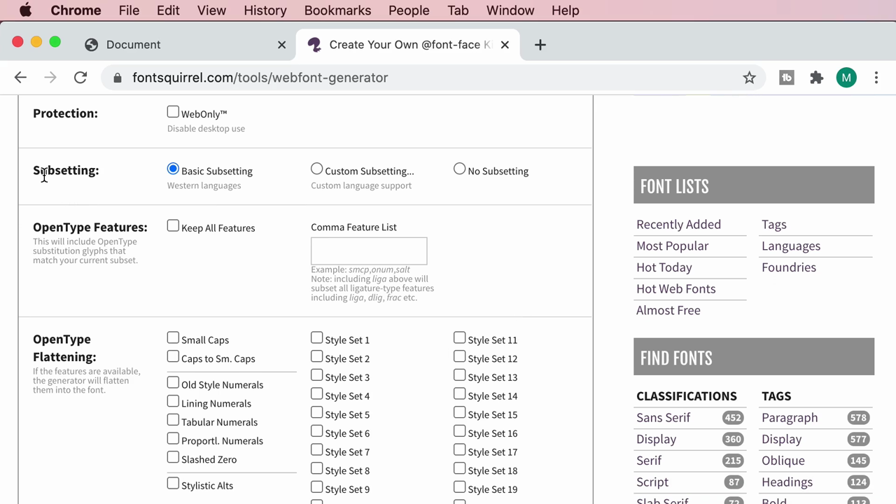

# 3-Typography: 04 - Flash of Unstyled Text (6:45)

**ไฟล์ต้นทาง:** `4-Flash-of-Unstyled-Text.mp4`

▶️ **[เปิดวิดีโอต้นฉบับ](../../../HTML-CSS-2/3-Typography/4-Flash-of-Unstyled-Text.mp4)**

---

## ภาพรวมคลิปนี้

คลิปนี้ต่อยอดจากคลิปก่อนหน้า (Embedding Web Fonts) โดยพูดถึง **ปัญหาที่เกิดขึ้นจริง** เมื่อฝังฟอนต์ที่กำหนดเอง — ปรากฏการณ์ **"Flash of Unstyled Text" (FOUT)** — พร้อมสาธิตให้เห็นปัญหาจริงผ่าน Chrome DevTools (จำลองเน็ตช้า) และแนะนำวิธีควบคุมพฤติกรรมนี้ด้วย property `font-display`


---

## 1. ทบทวน: ไฟล์ฟอนต์ถูกโหลดแยกเป็น Request ต่างหาก

Mosh เปิด Chrome DevTools แท็บ **Network** แล้วรีโหลดหน้าเว็บ (ที่ฝังฟอนต์ `opensans` ไว้แล้วจากคลิปก่อน) เพื่อให้เห็นว่าไฟล์ฟอนต์ `.woff2` ถูกดาวน์โหลดเป็น **request แยกต่างหาก** เช่นเดียวกับไฟล์ CSS หรือรูปภาพ:



จะเห็นรายการ `opensans-regular-webfont.woff2` และ `opensans-bold-webfont.woff2` เป็น request ประเภท `font` แยกจาก `index.html`, `normalize.css`, `styles.css`

---

## 2. จำลองเน็ตช้าด้วย Network Throttling

เพื่อให้เห็นปัญหาชัดเจนขึ้น Mosh เปลี่ยนการตั้งค่าความเร็วเน็ตใน DevTools จาก **Online** เป็น **Slow 3G** (จำลองอินเทอร์เน็ตความเร็วต่ำ) และติ๊ก **Disable cache** เพื่อบังคับให้เบราว์เซอร์โหลดทุกไฟล์ใหม่ทุกครั้ง:



เมื่อรีโหลดหน้าเว็บอีกครั้ง จะเห็น waterfall chart แสดงให้เห็นว่าไฟล์แต่ละไฟล์ใช้เวลาโหลดนานขึ้นมาก:



- `index.html` โหลดเสร็จที่ ~2.04 วินาที
- `normalize.css` / `styles.css` โหลดเสร็จที่ ~2.05-2.17 วินาที
- `opensans-regular-webfont.woff2` และ `opensans-bold-webfont.woff2` **ใช้เวลานานกว่านั้นมาก** (~2.7 วินาทีนับจากเริ่มเกิดการรีเควสต์ ซึ่งเริ่มช้ากว่าไฟล์ CSS ด้วย) กว่าจะโหลดเสร็จ

---

## 3. เห็นปัญหาจริง: ข้อความเปลี่ยนฟอนต์กะทันหันระหว่างโหลด

ระหว่างที่หน้าเว็บกำลังโหลด (สังเกตไอคอน "กำลังโหลด" หมุนอยู่ที่แท็บ) เบราว์เซอร์จะ**แสดงข้อความด้วยฟอนต์สำรอง (fallback font)** ไปพลางๆ ก่อน เพราะฟอนต์ที่ฝังเอง (`opensans`) ยังโหลดไม่เสร็จ:



สังเกตว่าตัวอักษรตอนนี้มีความกว้างและรูปแบบต่างจากฟอนต์ Open Sans ที่ตั้งใจใช้ (เป็นฟอนต์ระบบ/sans-serif ทั่วไปที่ระบุไว้เป็น fallback ใน `font-family`) — ทันทีที่ฟอนต์ `opensans` โหลดเสร็จ ข้อความทั้งหมดจะ **"กระพริบ" เปลี่ยนฟอนต์กะทันหัน** ทำให้เค้าโครง (layout) ขยับเปลี่ยนแปลงเล็กน้อยไปด้วย เพราะฟอนต์แต่ละตัวมีความกว้างตัวอักษรไม่เท่ากัน:


---

## 4. รู้จักศัพท์: Flash of Unstyled Text (FOUT)

Mosh สรุปปรากฏการณ์ที่เพิ่งเห็นด้วยสไลด์:


> **Flash of Unstyled Text (FOUT)** คือปรากฏการณ์ที่เบราว์เซอร์แสดงข้อความด้วยฟอนต์สำรอง (fallback font) ก่อน แล้วจึง **"กระพริบ" เปลี่ยน** เป็นฟอนต์ที่กำหนดเองทันทีที่โหลดเสร็จ — เกิดขึ้นเพราะเบราว์เซอร์เลือกที่จะ**แสดงเนื้อหาให้ผู้ใช้เห็นก่อน** (ด้วยฟอนต์ใดก็ได้ที่มีอยู่) แทนที่จะรอฟอนต์ที่ถูกต้องโหลดเสร็จก่อนแล้วค่อยแสดงผล

Mosh อธิบายว่า FOUT เป็น **ผลข้างเคียงที่หลีกเลี่ยงไม่ได้ 100%** ของการฝังฟอนต์ที่กำหนดเอง แต่ **ควบคุมพฤติกรรมของมันได้** ผ่าน CSS property ตัวหนึ่ง

---

## 5. ควบคุมพฤติกรรมด้วย `font-display`

Mosh กลับไปที่ `styles.css` แล้วเพิ่ม property ใหม่เข้าไปในบล็อก `@font-face`:

```css
@font-face {
  font-family: "opensans";
  src: url("fonts/open-sans/opensans-regular-webfont.woff2") format("woff2"),
       url("fonts/open-sans/opensans-regular-webfont.woff") format("woff");
  font-weight: normal;
  font-style: normal;
  font-display: block;
}
```



เมื่อรีโหลดหน้าเว็บด้วยเน็ตช้าอีกครั้ง (พร้อม `font-display: block;`) ผลลัพธ์เปลี่ยนไป — ข้อความในย่อหน้า (paragraph) จะ **"หายไป" ไม่แสดงผลเลยชั่วขณะ** (มองไม่เห็นตัวอักษรใดๆ) แทนที่จะแสดงด้วยฟอนต์สำรองแบบเดิม จนกว่าฟอนต์ `opensans` จะโหลดเสร็จ จึงค่อยปรากฏขึ้นมาพร้อมฟอนต์ที่ถูกต้องทันที:



> **ค่าของ `font-display` ที่ควรรู้ (สรุปจากคลิป):**
> - **`auto`** (ค่าเริ่มต้น) — เบราว์เซอร์เลือกพฤติกรรมเอง มักแสดงฟอนต์สำรองก่อนแล้วสลับ (เกิด FOUT)
> - **`block`** — ซ่อนข้อความไว้ก่อน (invisible) รอฟอนต์โหลดเสร็จในช่วงเวลาสั้นๆ ที่กำหนด แล้วค่อยแสดงผล ถ้าฟอนต์โหลดไม่เสร็จภายในเวลานั้นจะ fallback ไปใช้ฟอนต์สำรองแทน — เหมาะเมื่อ**รูปลักษณ์ของฟอนต์สำคัญกว่าการเห็นข้อความทันที** (ป้องกันไม่ให้ผู้ใช้เห็นข้อความกระพริบเปลี่ยนฟอนต์)
> - **`swap`** — แสดงฟอนต์สำรองทันที แล้วค่อยสลับเป็นฟอนต์จริงทันทีที่โหลดเสร็จ (ยอมให้เกิด FOUT แต่ผู้ใช้เห็นเนื้อหาเร็วที่สุด) — เหมาะเมื่อ**ความเร็วในการเห็นเนื้อหาสำคัญกว่า**
> - **`fallback`** / **`optional`** — ค่ากลางๆ ที่ผสมผสานระหว่างสองแนวทางข้างต้น โดยมีเงื่อนไขเรื่องระยะเวลาการรอที่ต่างกัน

---

## 6. ปรับแต่งเชิงลึกเพิ่มเติม: Webfont Generator โหมด Expert

ก่อนจบคลิป Mosh พาไปดูออปชันขั้นสูงของเครื่องมือ **Webfont Generator** (Font Squirrel) ที่ใช้แปลงไฟล์ฟอนต์ในคลิปก่อนหน้า โดยเปลี่ยนจากโหมด **Optimal** เป็น **Expert**:



โหมด Expert เปิดให้ปรับแต่งรายละเอียดได้มากขึ้น เช่น TrueType Hinting, Rendering, Vertical Metrics, Protection และที่สำคัญคือ **Subsetting** — การเลือก**เฉพาะตัวอักษร/ภาษาที่จำเป็นต้องใช้จริง** เพื่อลดขนาดไฟล์ฟอนต์:



> **เชื่อมโยงกับ FOUT:** ไฟล์ฟอนต์ที่มีขนาดเล็กลง (เพราะตัดตัวอักษรที่ไม่ใช้ออกด้วย Subsetting) จะ**ดาวน์โหลดเร็วขึ้น** ซึ่งช่วยลดระยะเวลาที่เกิด FOUT (หรือข้อความที่มองไม่เห็นในกรณีใช้ `font-display: block`) ลงไปด้วย — นี่คือหนึ่งในเทคนิคการเพิ่มประสิทธิภาพ (performance optimization) ของการฝังฟอนต์

---

## สรุปภาพรวมของคลิปนี้

| ประเด็น | รายละเอียด |
|---|---|
| **ปัญหา** | Flash of Unstyled Text (FOUT) — ข้อความกระพริบเปลี่ยนฟอนต์กะทันหันระหว่างที่ฟอนต์ที่ฝังเองกำลังโหลด |
| **สาเหตุ** | ไฟล์ฟอนต์เป็น resource แยกที่ต้องดาวน์โหลดเพิ่ม เบราว์เซอร์เลือกแสดงเนื้อหาก่อนด้วยฟอนต์สำรอง |
| **เครื่องมือตรวจสอบ** | Chrome DevTools → Network tab + Throttling (Slow 3G) + Disable cache |
| **วิธีควบคุม** | CSS property `font-display` ใน `@font-face` (`auto`, `block`, `swap`, `fallback`, `optional`) |
| **เพิ่มประสิทธิภาพเสริม** | Webfont Generator โหมด Expert → Subsetting เพื่อลดขนาดไฟล์ฟอนต์ |

**แนวคิดสำคัญที่ได้จากคลิปนี้:**

1. **FOUT เป็นผลข้างเคียงตามธรรมชาติของการฝังฟอนต์** ไม่ใช่บั๊ก แต่เป็นการตัดสินใจของเบราว์เซอร์ระหว่างความเร็วในการแสดงผลกับความสม่ำเสมอของรูปลักษณ์
2. **ใช้ DevTools Network throttling เพื่อทดสอบสภาพเน็ตช้า** ก่อนที่จะเจอปัญหาจริงกับผู้ใช้จริง
3. **`font-display` คือเครื่องมือหลักในการควบคุม trade-off** ระหว่าง "เห็นเนื้อหาเร็ว" กับ "ไม่เห็นฟอนต์กระพริบเปลี่ยน"
4. **ขนาดไฟล์ฟอนต์ยิ่งเล็ก ยิ่งลดปัญหา FOUT** — การทำ subsetting ช่วยได้

---

*หมายเหตุ: คลิปนี้เป็นส่วนหนึ่งของบท "3-Typography" จากคอร์ส The Ultimate HTML and CSS Course โดย Mosh Hamedani (codewithmosh.com) — คลิปที่ 4 ของบทนี้*
