# 3-Typography: 05 - Font Services (8:22)

**ไฟล์ต้นทาง:** `5-Font-Services.mp4`

▶️ **[เปิดวิดีโอต้นฉบับ](../../../HTML-CSS-2/3-Typography/5-Font-Services.mp4)**

---

## ภาพรวมคลิปนี้

หลังจากเรียนวิธีฝังฟอนต์เองแบบ manual (`@font-face` + ดาวน์โหลดไฟล์ + จัดการ FOUT) ในคลิปก่อนหน้า คลิปนี้แนะนำ **"Font Services"** — บริการฟอนต์ออนไลน์ที่ทำให้การฝังฟอนต์ง่ายขึ้นมาก โดยเจาะลึกที่ **Google Fonts** ซึ่งเป็นบริการฟอนต์ฟรีที่ได้รับความนิยมสูงสุด ตั้งแต่การเลือกฟอนต์ ไปจนถึงการฝังเข้าโปรเจกต์จริงด้วยโค้ดเพียงไม่กี่บรรทัด

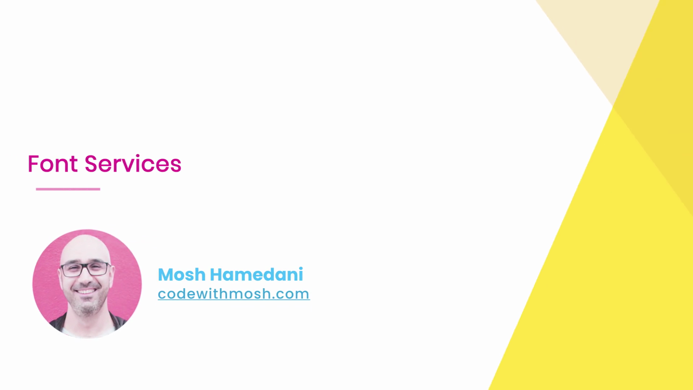

---

## 1. รู้จัก Font Services ที่นิยมใช้

Mosh แนะนำบริการฟอนต์ออนไลน์ 3 เจ้าหลักที่นักพัฒนาเว็บนิยมใช้:

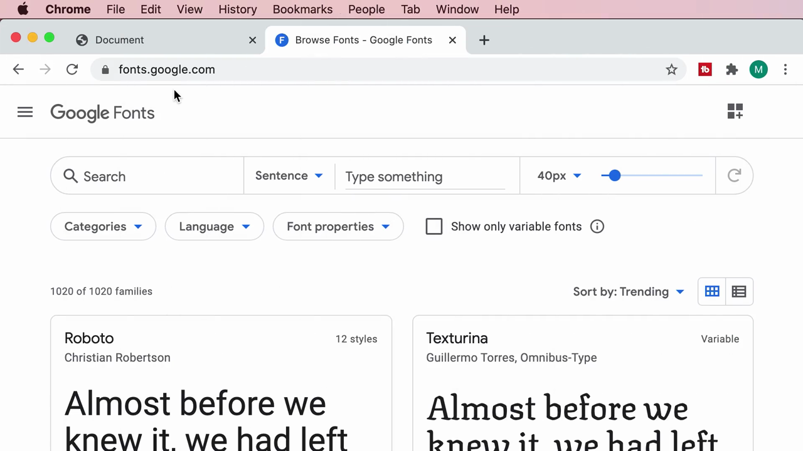

- **Google Web Fonts** (`fonts.google.com`) — ฟรี ไม่มีค่าใช้จ่าย เป็นที่นิยมที่สุด
- **Adobe Fonts** (`fonts.adobe.com`) — มักมาพร้อมกับการสมัครสมาชิก Adobe Creative Cloud
- **fonts.com** — บริการฟอนต์เชิงพาณิชย์อีกเจ้าหนึ่ง

คลิปนี้เลือกสาธิตด้วย **Google Fonts** เพราะฟรีและใช้งานง่ายที่สุดสำหรับผู้เริ่มต้น

---

## 2. สำรวจเว็บไซต์ Google Fonts

Mosh เปิดเว็บไซต์ `fonts.google.com`:

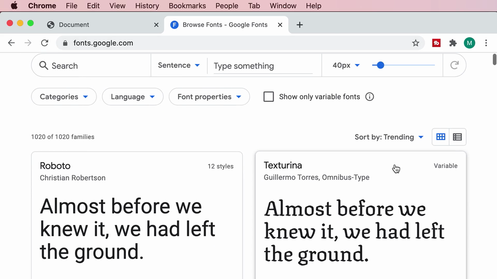

หน้าเว็บแสดงรายการฟอนต์ทั้งหมด (**1020 families**) พร้อมช่องพรีวิวข้อความแบบ real-time — พิมพ์ข้อความอะไรก็ได้ในช่อง "Type something" เพื่อดูตัวอย่างฟอนต์นั้นแสดงข้อความของเราเอง

เครื่องมือกรอง/ค้นหาที่มีให้ใช้:

- **Search** — ค้นหาฟอนต์ตามชื่อ
- **Sort by** — เรียงลำดับ (Trending, Most popular ฯลฯ)
- **Categories** — กรองตามหมวดหมู่ (Sans Serif, Serif, Display, Handwriting, Monospace)
- **Language** — กรองตามภาษาที่รองรับ
- **Font properties** — กรองตามคุณสมบัติอื่นๆ

Mosh เลือกกรองด้วย **Sort by: Most popular** และหมวด **Sans Serif** แล้วคลิกเข้าไปที่ฟอนต์ **"Open Sans"** (ฟอนต์เดียวกับที่ฝังเองด้วยมือในคลิปก่อนหน้า — คราวนี้จะทำผ่าน Google Fonts แทน):

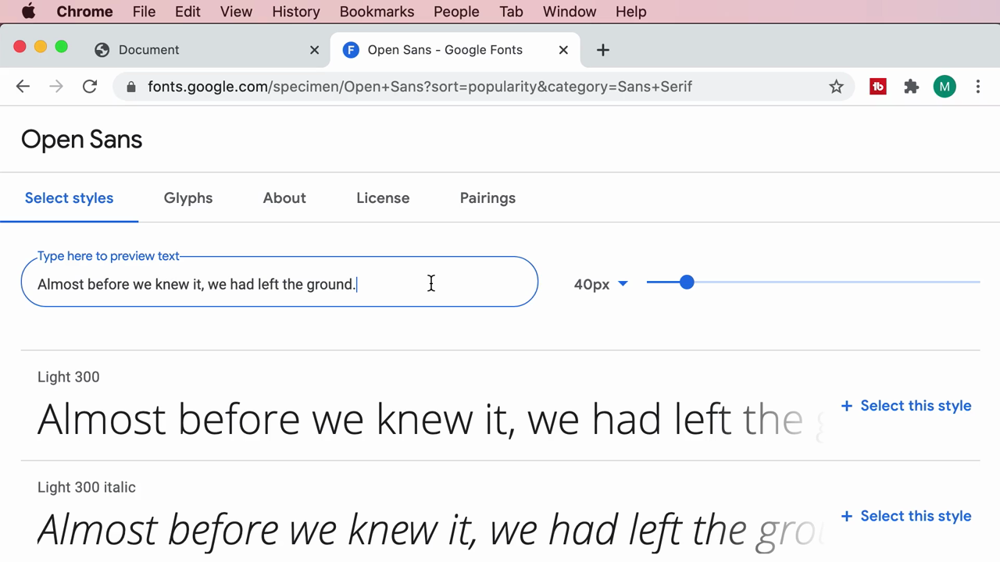

---

## 3. หน้ารายละเอียดฟอนต์ (Specimen Page)

หน้ารายละเอียดของแต่ละฟอนต์มี 5 แท็บ:

### Select styles

แสดงรายการน้ำหนัก/สไตล์ทั้งหมดที่ฟอนต์นี้มีให้ (ตั้งแต่ Light 300 ไปจนถึง Extra-bold 800 พร้อมเวอร์ชัน italic ของแต่ละน้ำหนัก) พร้อมตัวอย่างข้อความจริง:

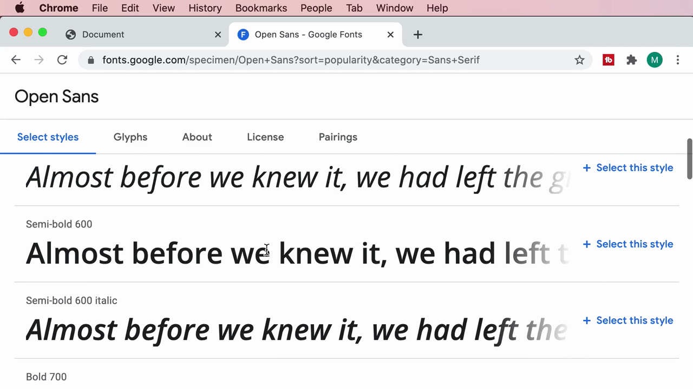

คลิก **"+ Select this style"** ที่น้ำหนักที่ต้องการใช้ (เลือก **Regular 400** และ **Bold 700**) จะเปิดแผง **"Selected family"** ทางด้านขวา ซึ่งมีโค้ด `<link>` สำเร็จรูปให้คัดลอกไปวางใน `<head>` ของ HTML:

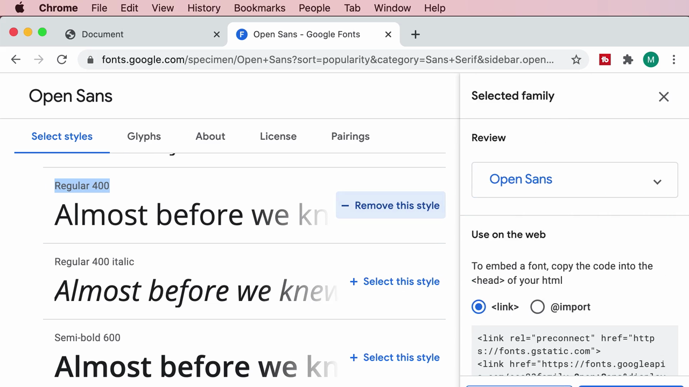

### Glyphs

แสดงตัวอักษรและสัญลักษณ์ทั้งหมด (897 ตัวอักษร) ที่ฟอนต์นี้รองรับ ครอบคลุมทั้งภาษาอังกฤษ, Cyrillic, กรีก และสัญลักษณ์พิเศษ:

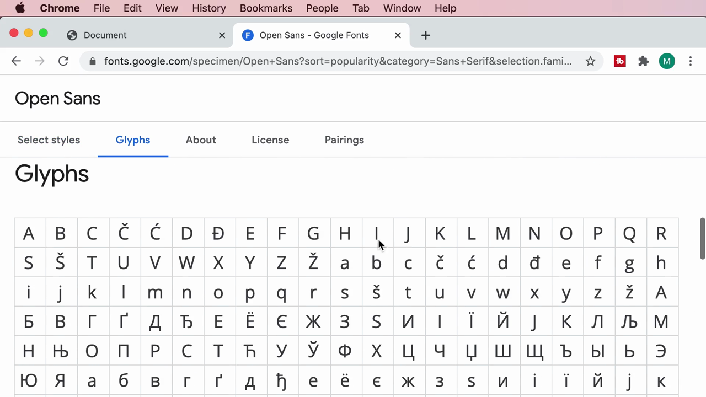

### About

ให้ข้อมูลเกี่ยวกับฟอนต์และผู้ออกแบบ — Open Sans เป็น **humanist sans-serif** ออกแบบโดย **Steve Matteson** (Type Director ของ Ascender Corp) ถูกออกแบบมาให้อ่านง่ายทั้งบนสิ่งพิมพ์ เว็บ และมือถือ:

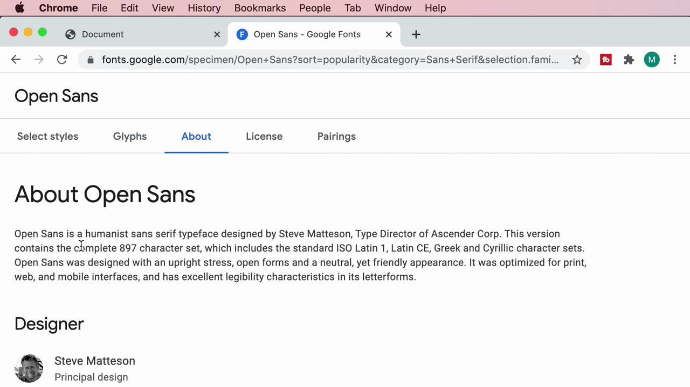

### License

Open Sans อยู่ภายใต้ **Apache License 2.0** — ใช้ได้ฟรีทั้งงานส่วนตัวและเชิงพาณิชย์ เพียงแต่**ห้ามนำฟอนต์ไปขายต่อโดยลำพัง**:

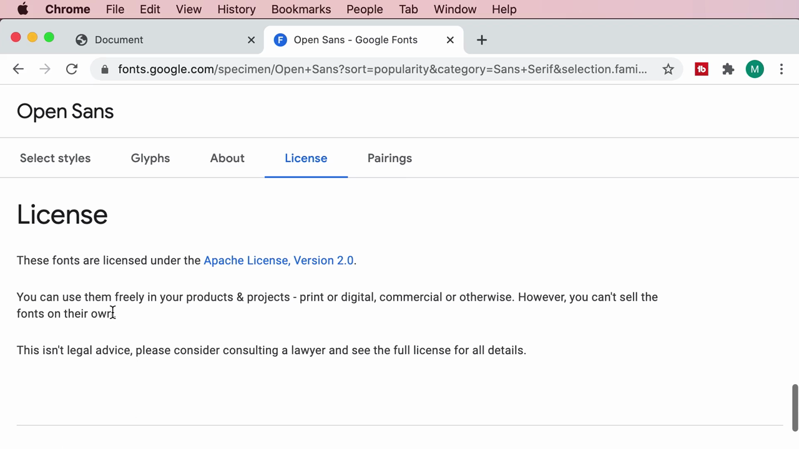

### Pairings

แนะนำฟอนต์อื่นที่ **"เข้ากันดี"** เมื่อใช้คู่กับ Open Sans (เช่น Roboto, Lato, Montserrat, Raleway) พร้อมตัวอย่างข้อความจริงให้เห็นภาพว่าฟอนต์คู่นั้นหน้าตาเป็นอย่างไรเมื่อวางคู่กัน:

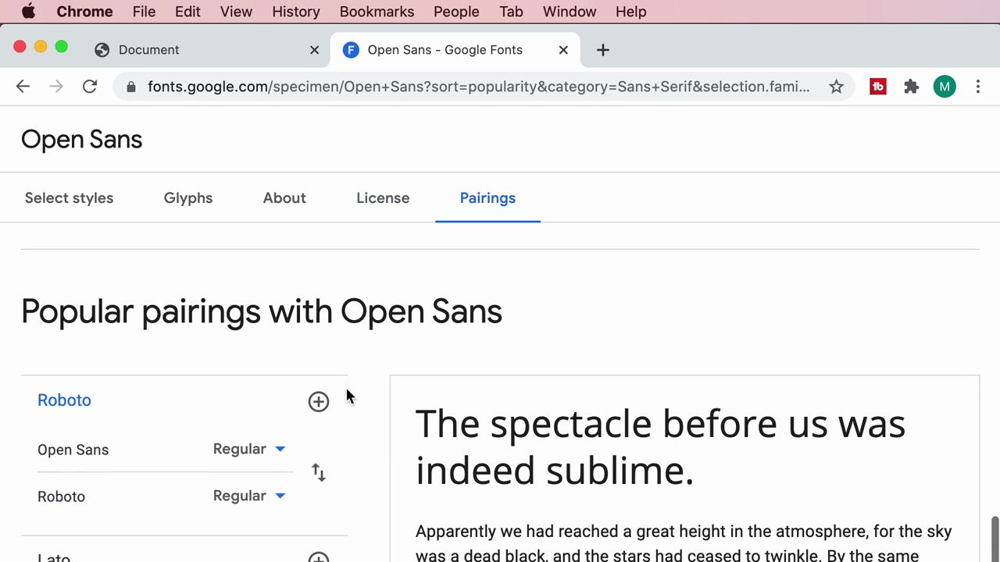

---

## 4. เลือกฟอนต์มากกว่า 1 ตระกูล

Mosh สาธิตต่อโดยกดปุ่ม **"+"** ที่ฟอนต์ **Roboto** ในแท็บ Pairings เพื่อเพิ่ม Roboto เข้าไปในรายการที่เลือกไว้ด้วย (นอกเหนือจาก Open Sans) — แผง **"Selected families"** จะอัปเดตแสดงทั้งสองฟอนต์:

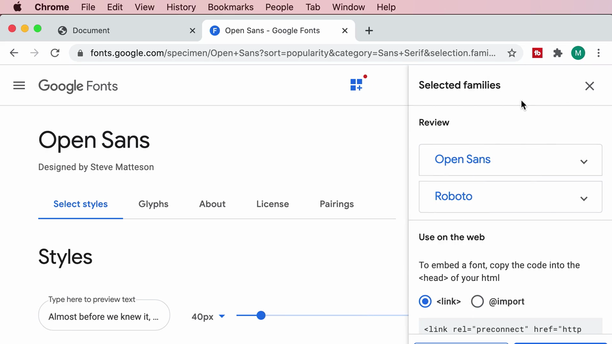

ด้านล่างมีโค้ด `<link>` ที่รวมทั้งสองฟอนต์ไว้ใน request เดียว รวมถึงส่วน **"CSS rules to specify families"** ที่บอกวิธีเรียกใช้แต่ละฟอนต์ใน CSS:

```css
font-family: 'Open Sans', sans-serif;
font-family: 'Roboto', sans-serif;
```

---

## 5. นำโค้ด `<link>` ไปวางในโปรเจกต์

Mosh คัดลอกโค้ด `<link>` ทั้งหมดจากแผง Selected families แล้ววางไว้ใน `<head>` ของ `index.html` **ก่อน** ลิงก์ไปยัง `normalize.css` และ `styles.css` ของโปรเจกต์:

```html
<link rel="preconnect" href="https://fonts.gstatic.com">
<link
  href="https://fonts.googleapis.com/css2?family=Open+Sans:wght@400;700&family=Roboto:wght@700&display=swap"
  rel="stylesheet"
/>
<link rel="stylesheet" href="css/normalize.css" />
<link rel="stylesheet" href="css/styles.css" />
```

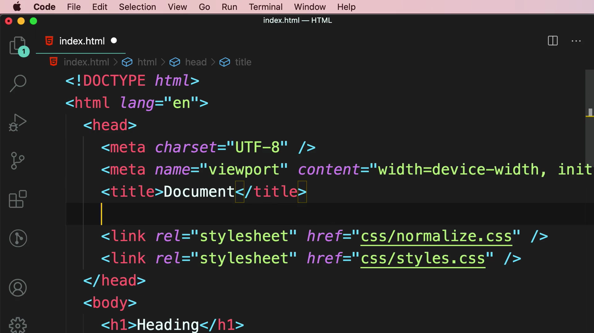

> **ทำไมต้องมี `<link rel="preconnect">` ด้วย?** เป็นการบอกเบราว์เซอร์ให้**เริ่มเชื่อมต่อกับ server ของ Google (`fonts.gstatic.com`) ล่วงหน้า** ก่อนที่จะรู้ด้วยซ้ำว่าต้องโหลดไฟล์อะไรบ้าง ช่วยลดเวลาหน่วง (latency) ในการโหลดฟอนต์ให้เร็วขึ้นเล็กน้อย

---

## 6. เบื้องหลัง: Google สร้าง `@font-face` ให้อัตโนมัติ

Mosh เปิด URL ของ `<link>` โดยตรงในแท็บใหม่ของเบราว์เซอร์ (`fonts.googleapis.com/css2?family=...`) เพื่อให้เห็นว่า **ไฟล์ CSS ที่เบราว์เซอร์ได้รับจริงๆ คืออะไร**:

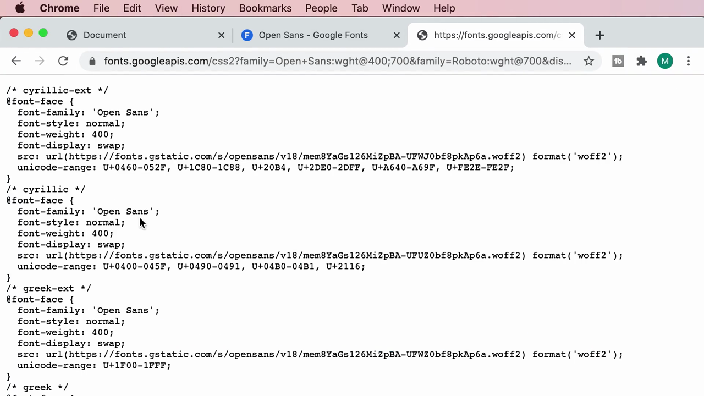

```css
/* cyrillic-ext */
@font-face {
  font-family: 'Open Sans';
  font-style: normal;
  font-weight: 400;
  font-display: swap;
  src: url(https://fonts.gstatic.com/s/opensans/v18/...woff2) format('woff2');
  unicode-range: U+0460-052F, U+1C80-1C88, U+20B4, U+2DE0-2DFF, U+A640-A69F, U+FE2E-FE2F;
}
/* cyrillic */
@font-face {
  font-family: 'Open Sans';
  font-style: normal;
  font-weight: 400;
  font-display: swap;
  src: url(...) format('woff2');
  unicode-range: U+0400-045F, U+0490-0491, U+04B0-04B1, U+2116;
}
/* greek-ext */
@font-face { ... unicode-range: U+1F00-1FFF; }
/* greek */
@font-face { ... }
```

Mosh ชี้ให้เห็นประเด็นสำคัญ 3 ข้อจากไฟล์นี้:

1. **Google สร้าง `@font-face` หลายบล็อกให้อัตโนมัติ** — แยกตาม **"subset" ของภาษา/ชุดตัวอักษร** (เช่น cyrillic, cyrillic-ext, greek, greek-ext, latin, vietnamese ฯลฯ) โดยแต่ละบล็อกมี `unicode-range` กำกับว่าใช้กับตัวอักษรช่วงไหน — เบราว์เซอร์จะ**โหลดเฉพาะไฟล์ฟอนต์ของ subset ที่หน้าเว็บใช้จริงเท่านั้น** ไม่โหลดทุกภาษาทิ้งเปล่าๆ ช่วยประหยัดขนาดไฟล์ที่ต้องดาวน์โหลด
2. **ไฟล์ฟอนต์ถูกโฮสต์ไว้บน `fonts.gstatic.com`** (CDN ของ Google เอง) ทำให้ผู้ใช้ไม่ต้องดาวน์โหลด/อัปโหลดไฟล์ฟอนต์เองเลย ต่างจากวิธี manual ในคลิปก่อนที่ต้องจัดการไฟล์ `.woff`/`.woff2` เอง
3. **มี `font-display: swap;` ใส่มาให้อัตโนมัติทุกบล็อก** — Google Fonts เลือกค่านี้เป็นค่าเริ่มต้นเพื่อจัดการปัญหา FOUT ที่เรียนไปในคลิปก่อนหน้าให้แล้ว โดยที่เราไม่ต้องเขียนเอง

---

## 7. ใช้งานฟอนต์ที่โหลดจาก Google Fonts ใน CSS

กลับมาที่ `styles.css` Mosh เปลี่ยน `font-family` ของ `body` และ `h1` จากฟอนต์ที่ฝังเอง (self-hosted) ให้เรียกใช้ฟอนต์จาก Google Fonts แทน:

```css
body {
  margin: 10px;
  font-family: "Open Sans", Arial, Helvetica, sans-serif;
}

h1 {
  font-family: Roboto, Arial, Helvetica, sans-serif;
}
```

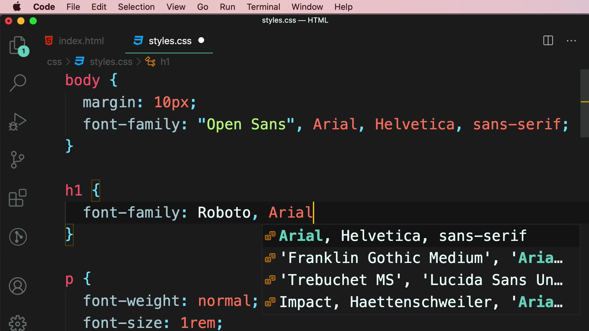

ผลลัพธ์ในเบราว์เซอร์: หัวข้อ "Heading" แสดงด้วยฟอนต์ **Roboto** ส่วนย่อหน้าเนื้อหาและลิงก์แสดงด้วยฟอนต์ **Open Sans** — ครบทั้งสองฟอนต์โดยไม่ต้องเขียน `@font-face` หรือดาวน์โหลดไฟล์ฟอนต์ใดๆ เองเลย:

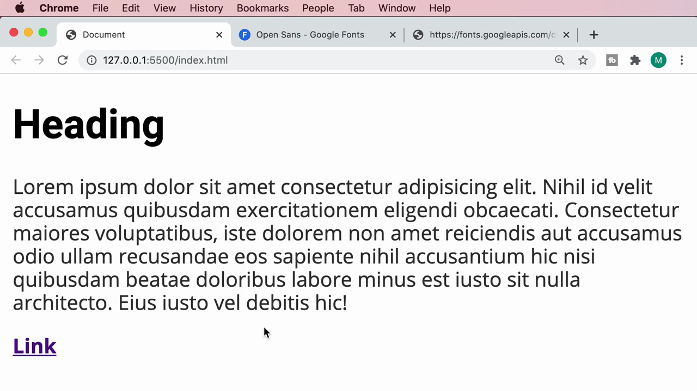

> **ข้อสังเกตสำคัญ:** ยังคงเขียน fallback fonts (`Arial, Helvetica, sans-serif`) ต่อท้ายไว้เหมือนเดิม — แม้จะใช้ Font Service แล้ว ก็ยังมีโอกาสที่การโหลดฟอนต์จาก Google ล้มเหลว (เช่น ผู้ใช้ปิดกั้น third-party requests หรือไม่มีอินเทอร์เน็ต) จึงควรเผื่อ fallback ไว้เสมอ

---

## 8. ทำความเข้าใจ Query String ใน URL ของ Google Fonts

Mosh อธิบายโครงสร้างของ URL ที่ได้จาก Google Fonts อย่างละเอียด โดยเน้นที่ **Query String Parameters** (ส่วนหลังเครื่องหมาย `?`):

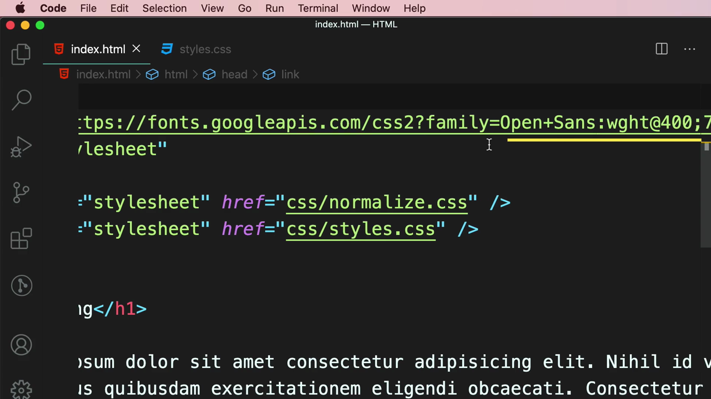

```
https://fonts.googleapis.com/css2?family=Open+Sans:wght@400&family=Roboto:wght@700&display=swap
```

- **`family=`** — ระบุชื่อฟอนต์ที่ต้องการ (เว้นวรรคในชื่อฟอนต์ต้องแทนด้วย `+` เช่น `Open+Sans`)
- **`:wght@400`** — ระบุน้ำหนัก (weight) ที่ต้องการของฟอนต์นั้นๆ ต่อท้ายด้วย `@` ตามด้วยตัวเลขน้ำหนัก ถ้าต้องการหลายน้ำหนักคั่นด้วย `;` (เช่น `wght@400;700`)
- **`&family=...`** — ใช้เครื่องหมาย **`&`** เพื่อ**เชื่อมพารามิเตอร์ตัวถัดไป** เข้าด้วยกัน ทำให้ขอฟอนต์หลายตระกูลได้ในคำขอ (request) เดียว
- **`&display=swap`** — กำหนดพฤติกรรม `font-display` ของฟอนต์ทั้งหมดที่ขอมาในคำขอนี้ (ตรงกับ property `font-display` ที่เรียนในคลิปก่อนหน้า)

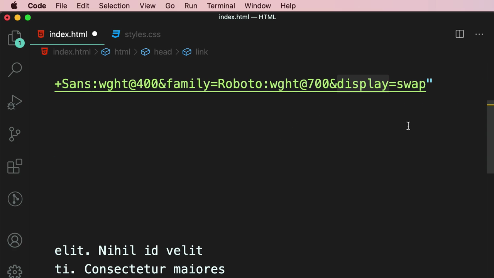

> **สรุปแนวคิด Query String:** URL ส่วนหลัง `?` คือชุดคำสั่ง "key=value" ที่คั่นด้วย `&` — Google Fonts ใช้รูปแบบนี้ให้เราปรับแต่งได้ว่าอยากได้ฟอนต์ตระกูลไหน น้ำหนักเท่าไหร่ และพฤติกรรมการแสดงผลแบบไหน ทั้งหมดผ่าน URL เดียว โดยไม่ต้องเขียน `@font-face` เอง

---

## สรุปภาพรวมของคลิปนี้

| หัวข้อ | รายละเอียด |
|---|---|
| **Font Services ที่แนะนำ** | Google Web Fonts, Adobe Fonts, fonts.com |
| **ข้อดีของ Font Service** | ไม่ต้องดาวน์โหลด/แปลงไฟล์ฟอนต์เอง, ไม่ต้องเขียน `@font-face` เอง, มี CDN โฮสต์ไฟล์ให้, ตั้งค่า `font-display` ให้อัตโนมัติ |
| **ขั้นตอนใช้งาน Google Fonts** | ค้นหาฟอนต์ → เลือกน้ำหนักที่ต้องการ → คัดลอกโค้ด `<link>` → วางใน `<head>` → เรียกใช้ผ่าน `font-family` ใน CSS |
| **โครงสร้าง URL** | `family=ชื่อฟอนต์:wght@น้ำหนัก&family=...&display=swap` |
| **เบื้องหลังไฟล์ CSS ที่ได้** | หลาย `@font-face` แยกตาม unicode subset พร้อม `font-display: swap` มาให้อัตโนมัติ |

**แนวคิดสำคัญที่ได้จากคลิปนี้:**

1. **Font Services ทำให้การฝังฟอนต์ง่ายขึ้นมาก** เทียบกับการฝังเอง (manual `@font-face`) ที่เรียนในคลิปก่อนหน้า
2. **Google Fonts จัดการเรื่อง performance ให้ในระดับหนึ่งแล้ว** ทั้งการแบ่ง subset ตามภาษาและการตั้งค่า `font-display: swap`
3. **ยังคงต้องเขียน fallback fonts เสมอ** แม้ใช้ Font Service ก็ตาม
4. **เข้าใจโครงสร้าง Query String ใน URL** ช่วยให้ปรับแต่งการขอฟอนต์ได้เอง โดยไม่ต้องพึ่งแค่โค้ดที่ Google สร้างให้เท่านั้น

---

*หมายเหตุ: คลิปนี้เป็นส่วนหนึ่งของบท "3-Typography" จากคอร์ส The Ultimate HTML and CSS Course โดย Mosh Hamedani (codewithmosh.com) — คลิปที่ 5 ของบทนี้*
