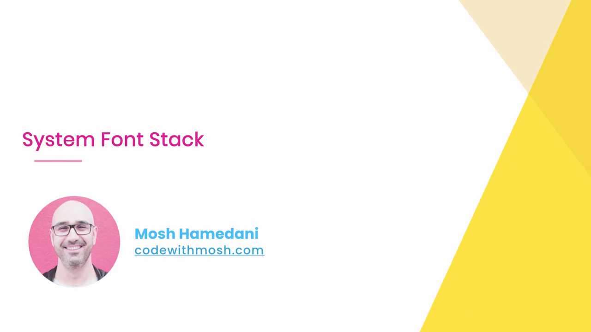
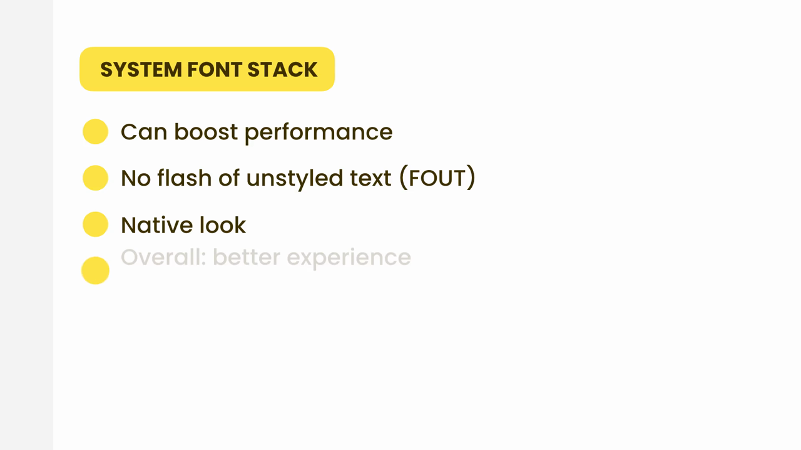
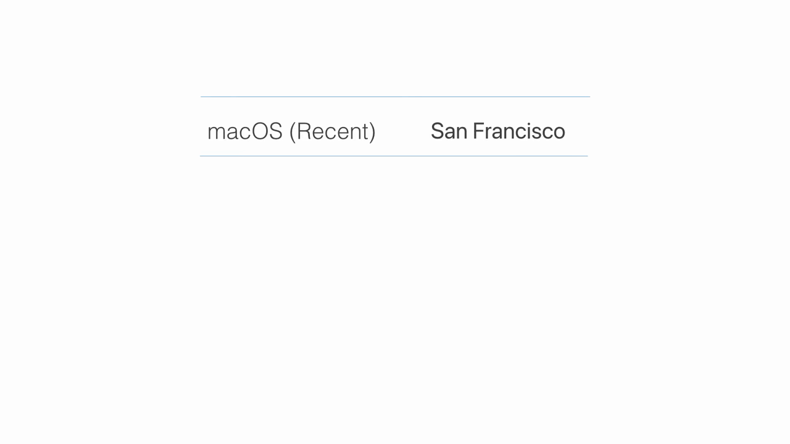
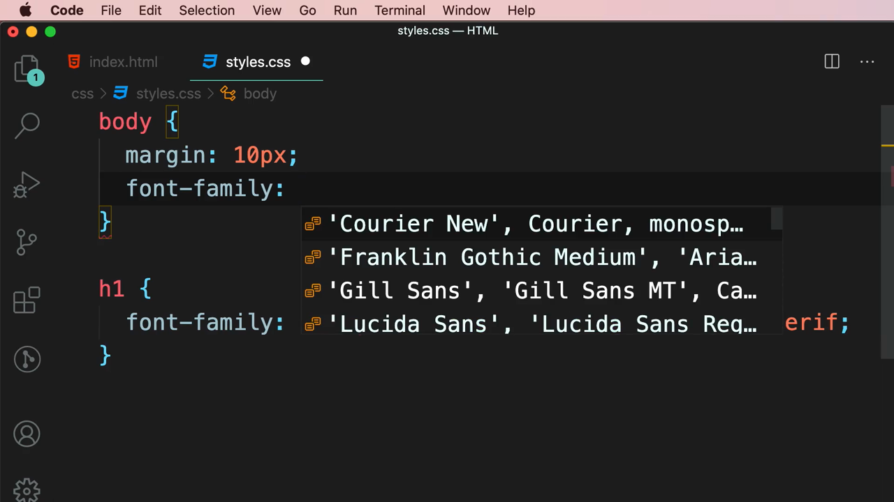
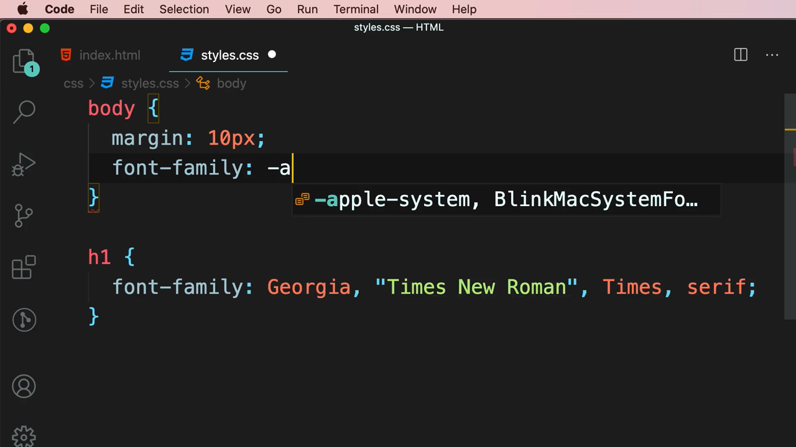
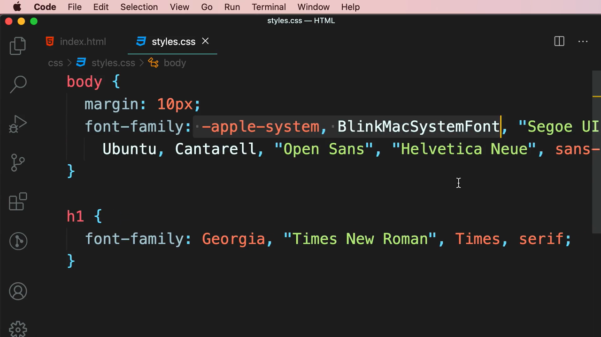
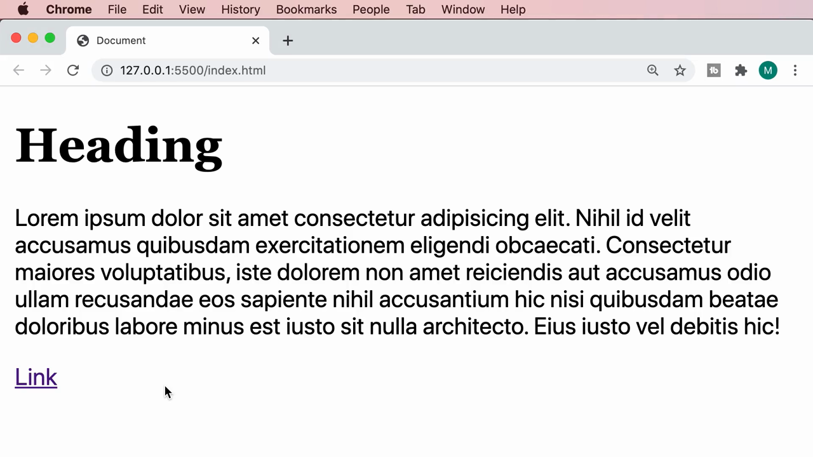

# 3-Typography: 06 - System Font Stack (2:48)

**ไฟล์ต้นทาง:** `6-System-Font-Stack.mp4`

▶️ **[เปิดวิดีโอต้นฉบับ](../../../HTML-CSS-2/3-Typography/6-System-Font-Stack.mp4)**

---

## ภาพรวมคลิปนี้

คลิปสั้นๆ แต่สำคัญ — Mosh แนะนำเทคนิค **"System Font Stack"** ซึ่งเป็นแนวทางตรงข้ามกับการฝังฟอนต์ที่กำหนดเอง (ทั้งแบบ manual และแบบ Font Service ที่เรียนในสองคลิปก่อน) โดยแทนที่จะบังคับให้ผู้ใช้ทุกคนเห็นฟอนต์เดียวกัน กลับ**ปล่อยให้แต่ละระบบปฏิบัติการแสดงฟอนต์ประจำถิ่นของตัวเอง**



---

## 1. System Font Stack คืออะไร และมีข้อดีอะไรบ้าง

Mosh อธิบายด้วยสไลด์สรุปประโยชน์หลัก 3 ข้อของแนวทางนี้:



- **Can boost performance (เพิ่มประสิทธิภาพได้)** — เพราะไม่ต้องดาวน์โหลดไฟล์ฟอนต์เพิ่มเลย ใช้ฟอนต์ที่**ติดตั้งอยู่ในเครื่องผู้ใช้อยู่แล้ว**
- **No flash of unstyled text (FOUT)** — เนื่องจากไม่มีการโหลดฟอนต์จากภายนอก จึงไม่มีปัญหาข้อความกระพริบเปลี่ยนฟอนต์ที่เรียนไปในคลิปก่อนหน้าเลย
- **Native look (รูปลักษณ์ที่คุ้นเคยกับระบบ)** — ข้อความจะแสดงด้วยฟอนต์เดียวกับที่ระบบปฏิบัติการของผู้ใช้ใช้อยู่แล้ว (เช่น เมนู, การตั้งค่า) ทำให้เว็บไซต์ให้ความรู้สึกกลมกลืนเป็นธรรมชาติกับระบบนั้นๆ
- **Overall: better experience** — ผลรวมคือประสบการณ์การใช้งานที่ดีขึ้นในหลายมิติพร้อมกัน

---

## 2. แต่ละระบบปฏิบัติการมีฟอนต์ประจำถิ่นของตัวเอง

Mosh ยกตัวอย่างด้วยตารางเปรียบเทียบ:



| ระบบปฏิบัติการ | ฟอนต์ประจำถิ่น |
|---|---|
| **macOS (เวอร์ชันล่าสุด)** | **San Francisco** |
| Windows | Segoe UI |
| Android | Roboto |
| Linux (เช่น Ubuntu) | Ubuntu / Cantarell |

แต่ละฟอนต์เหล่านี้ถูกออกแบบมาให้**เข้ากับสไตล์ของระบบปฏิบัติการนั้นๆ โดยเฉพาะ** และมีการปรับแต่ง (optimize) มาอย่างดีสำหรับการแสดงผลบนหน้าจอของอุปกรณ์นั้น

---

## 3. เขียน CSS เพื่อดึงฟอนต์ประจำถิ่นของแต่ละระบบ

Mosh กลับไปที่ `styles.css` แล้วลบ `font-family` เดิม (`Arial, Helvetica, sans-serif`) ออกจาก `body`:



จากนั้นพิมพ์ `-a` ให้ VS Code IntelliSense แนะนำ snippet ของ **System Font Stack** ที่มีมาให้สำเร็จรูป:



เลือก snippet นั้น จะได้โค้ดเต็มดังนี้:

```css
body {
  margin: 10px;
  font-family: -apple-system, BlinkMacSystemFont, "Segoe UI", Roboto,
    Ubuntu, Cantarell, "Open Sans", "Helvetica Neue", sans-serif;
}
```



Mosh อธิบายความหมายของแต่ละรายการใน fallback list นี้ทีละตัว:

- **`-apple-system`** — เรียกใช้ฟอนต์ระบบของ **macOS/iOS เวอร์ชันใหม่** (San Francisco) โดยตรง (เครื่องหมาย `-` นำหน้าหมายถึงเป็น vendor-specific keyword)
- **`BlinkMacSystemFont`** — เป็น fallback สำหรับเบราว์เซอร์ที่ใช้ **Blink engine** (เช่น Chrome เก่าบน macOS) ให้ดึงฟอนต์ระบบเดียวกัน
- **`"Segoe UI"`** — ฟอนต์ประจำถิ่นของ **Windows**
- **`Roboto`** — ฟอนต์ประจำถิ่นของ **Android**
- **`Ubuntu`**, **`Cantarell`** — ฟอนต์ประจำถิ่นของดิสโทร Linux ยอดนิยม (Ubuntu และ GNOME/Cantarell ตามลำดับ)
- **`"Open Sans"`**, **`"Helvetica Neue"`** — ฟอนต์สำรองเพิ่มเติมสำหรับกรณีอื่นๆ
- **`sans-serif`** — ฟอนต์ตระกูลกว้างๆ เป็นตัวรับประกันสุดท้าย

> **หลักการทำงาน:** เบราว์เซอร์จะไล่ตรวจตามลำดับรายการนี้ทีละตัว แล้ว**เลือกใช้ตัวแรกที่ระบบปฏิบัติการนั้นรู้จัก** — ผลลัพธ์คือผู้ใช้ macOS จะเห็น San Francisco, ผู้ใช้ Windows จะเห็น Segoe UI, ผู้ใช้ Android จะเห็น Roboto และเป็นเช่นนี้ไปเรื่อยๆ โดยอัตโนมัติ ไม่ต้องเขียนโค้ดแยกตามระบบปฏิบัติการเอง

---

## 4. ผลลัพธ์ที่ได้

เมื่อรีเฟรชหน้าเว็บบนเครื่อง macOS ข้อความในย่อหน้าและลิงก์แสดงด้วยฟอนต์ San Francisco ของระบบทันที (ไม่มีการดาวน์โหลดใดๆ) ส่วนหัวข้อ (`h1`) ยังคงใช้ `Georgia, "Times New Roman", Times, serif` ตามที่ตั้งไว้ก่อนหน้า:



---

## สรุปภาพรวมของคลิปนี้

| ประเด็น | รายละเอียด |
|---|---|
| **แนวคิด** | ใช้ฟอนต์ประจำถิ่นของแต่ละระบบปฏิบัติการ แทนการบังคับใช้ฟอนต์เดียวกันทุกที่ |
| **ข้อดี** | เพิ่มประสิทธิภาพ (ไม่ต้องโหลดไฟล์เพิ่ม), ไม่มี FOUT, ให้ความรู้สึกกลมกลืนกับระบบ (native look) |
| **วิธีเขียน** | `font-family: -apple-system, BlinkMacSystemFont, "Segoe UI", Roboto, Ubuntu, Cantarell, "Open Sans", "Helvetica Neue", sans-serif;` |
| **เหมาะกับ** | โปรเจกต์ที่เน้นความเร็วในการโหลดและอยากให้ผู้ใช้รู้สึกคุ้นเคยกับระบบของตัวเอง มากกว่าการควบคุมรูปลักษณ์ฟอนต์ให้เหมือนกันทุก platform |

**แนวคิดสำคัญที่ได้จากคลิปนี้:**

1. **System Font Stack เป็นทางเลือกที่สาม** นอกเหนือจากการฝังฟอนต์เอง (manual `@font-face`) และการใช้ Font Service (Google Fonts) ที่เรียนมาในสองคลิปก่อนหน้า
2. **ไม่มีการดาวน์โหลดไฟล์ฟอนต์เพิ่มเลย** จึงเร็วที่สุดในบรรดาสามวิธี และไม่มีปัญหา FOUT
3. **Trade-off สำคัญ:** แลกกับความสม่ำเสมอของรูปลักษณ์ฟอนต์ข้ามแพลตฟอร์ม — ผู้ใช้แต่ละคนจะเห็นฟอนต์ต่างกันไปตามระบบปฏิบัติการของตน
4. **VS Code มี snippet สำเร็จรูปให้** เพียงพิมพ์ `-a` ก็เรียกใช้ทั้ง stack ได้ทันที ไม่ต้องจำรายชื่อฟอนต์ทั้งหมดเอง

---

*หมายเหตุ: คลิปนี้เป็นส่วนหนึ่งของบท "3-Typography" จากคอร์ส The Ultimate HTML and CSS Course โดย Mosh Hamedani (codewithmosh.com) — คลิปที่ 6 ของบทนี้*
