# 3-Typography: 07 - Sizing Fonts (7:24)

**ไฟล์ต้นทาง:** `7-Sizing_Fonts.mp4`

▶️ **[เปิดวิดีโอต้นฉบับ](../../../HTML-CSS-2/3-Typography/7-Sizing_Fonts.mp4)**

---

## ภาพรวมคลิปนี้

คลิปนี้เจาะลึกเรื่อง **การกำหนดขนาดตัวอักษร (font sizing)** อย่างถูกวิธี ตั้งแต่ปัญหาของหน่วยขนาดคงที่ (`px`) บนหน้าจอความละเอียดสูง ไปจนถึงการใช้หน่วยสัมพัทธ์ (`rem`) เพื่อรองรับการตั้งค่าการเข้าถึง (accessibility) ของผู้ใช้ การทำ responsive typography ด้วย media query และการใช้เครื่องมือ **type-scale.com** เพื่อสร้างระบบขนาดตัวอักษรที่เป็นสัดส่วนกันอย่างมืออาชีพ

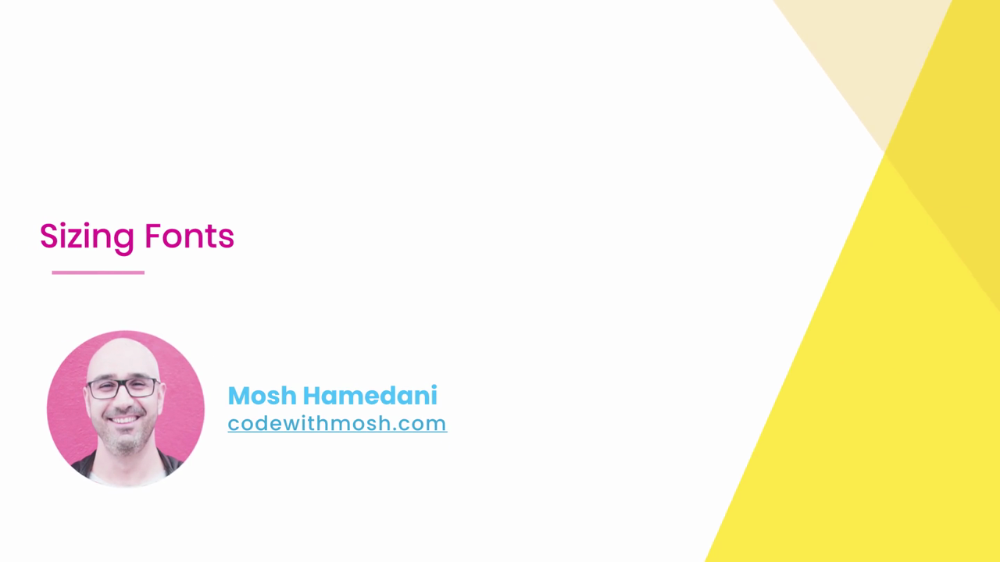

---

## 1. ปัญหาของหน่วย `px`: หน้าจอ Retina Display

ก่อนพูดถึงหน่วยขนาด Mosh ยกประเด็นเรื่อง **Retina Display** (หน้าจอความละเอียดสูงของ Apple และอุปกรณ์สมัยใหม่อื่นๆ):


หน้าจอ Retina มี **pixel ทางกายภาพมากกว่า 1 พิกเซลต่อ 1 "px" ของ CSS** (เรียกว่า device pixel ratio) ทำให้ 1px ที่เขียนใน CSS ไม่ได้แปลว่ามีขนาดทางกายภาพเท่ากันทุกหน้าจอเสมอไป — นี่เป็นหนึ่งในเหตุผลที่ควรพิจารณาใช้หน่วยสัมพัทธ์แทนการล็อกขนาดด้วย pixel ตรงๆ

---

## 2. รู้จัก "หน่วยสัมพัทธ์" (Relative Units)

Mosh สรุปหน่วยขนาดแบบสัมพัทธ์ที่ควรรู้จักด้วยสไลด์:

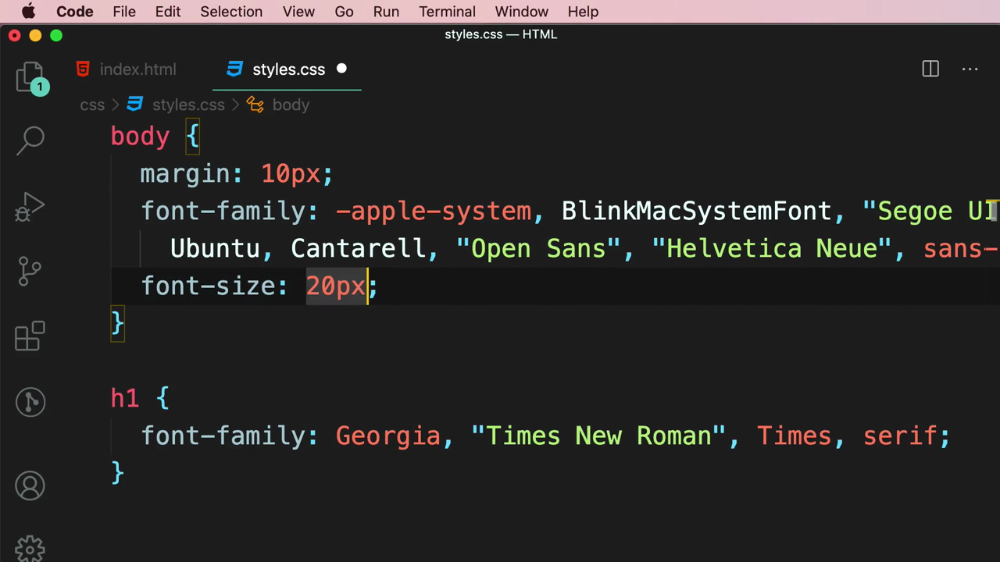

- **`%`** — เปอร์เซ็นต์เทียบกับค่าของ element แม่
- **`vw`, `vh`** — สัดส่วนเทียบกับความกว้าง/ความสูงของหน้าจอ (viewport width/height)
- **`rem`** (root em) — สัดส่วนเทียบกับ `font-size` ของ element ราก (`<html>`) ซึ่งเป็นหน่วยที่เหมาะกับ `font-size` มากที่สุด

Mosh เปลี่ยน `font-size` ของ `body` จาก `20px` (หน่วยคงที่) เป็น `1rem` (หน่วยสัมพัทธ์):

```css
body {
  margin: 10px;
  font-family: -apple-system, BlinkMacSystemFont, "Segoe UI", Roboto,
    Ubuntu, Cantarell, "Open Sans", "Helvetica Neue", sans-serif;
  /* 1 x font size of the root element (html) */
  font-size: 1rem;
}
```

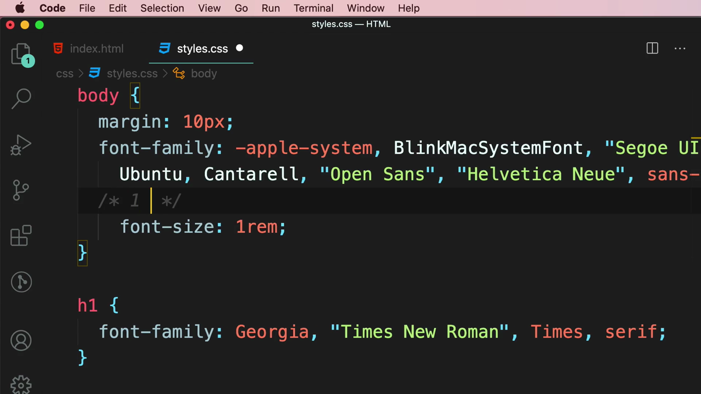

---

## 3. ทำไม `rem` ถึงดีกว่า `px`: ทดสอบกับการตั้งค่าเบราว์เซอร์ของผู้ใช้

Mosh เปิด Chrome Settings แล้วค้นหา "font size" เพื่อแสดงให้เห็นว่าผู้ใช้สามารถ**ปรับขนาดฟอนต์เริ่มต้นของเบราว์เซอร์เองได้** (ค่าเริ่มต้นคือ Medium, ปรับเป็น Large/Very Large ได้ หรือกำหนดเปอร์เซ็นต์ page zoom เอง):

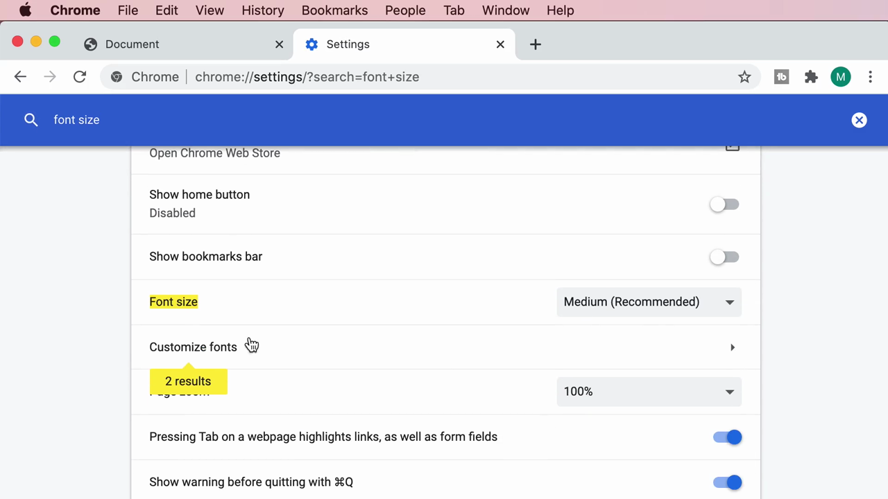

> **หลักการสำคัญ:** ถ้าเขียน `font-size` ด้วยหน่วย `px` ตรงๆ ข้อความในเว็บไซต์จะ**ไม่ตอบสนอง**ต่อการตั้งค่านี้เลย — แต่ถ้าใช้ `rem` (ซึ่งอิงจาก font-size ของ `<html>` และ font-size ของ `<html>` เองก็อิงจากค่าเริ่มต้นของเบราว์เซอร์) ข้อความในเว็บไซต์จะ**ขยายตามการตั้งค่าของผู้ใช้โดยอัตโนมัติ** — สำคัญมากสำหรับผู้ใช้ที่มีปัญหาด้านสายตาและต้องการขนาดตัวอักษรที่ใหญ่ขึ้นทั่วทั้งเบราว์เซอร์

---

## 4. เทคนิค "62.5%" เพื่อให้คำนวณ `rem` ง่ายขึ้น

Mosh สาธิตเทคนิคยอดนิยมที่นักพัฒนาหลายคนใช้: กำหนด `font-size` ของ `html` เป็น **`62.5%`**

```css
html {
  /* 62.5% of 16px = 10px */
  font-size: 62.5%;
}
```

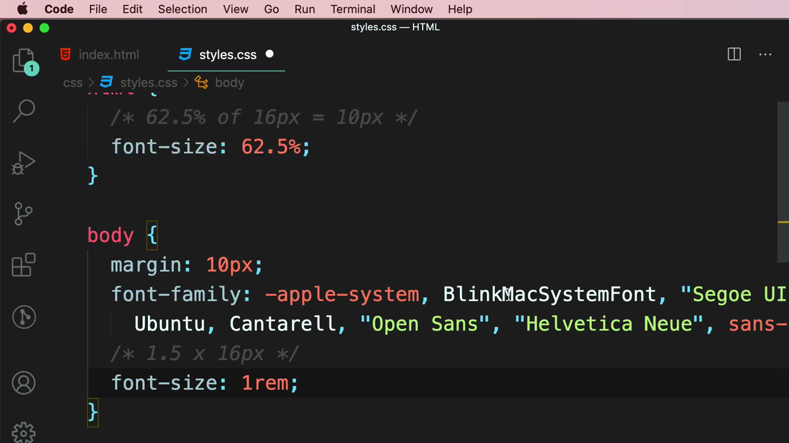

เนื่องจากค่าเริ่มต้นของเบราว์เซอร์ส่วนใหญ่คือ `16px` การตั้งค่า `62.5%` จะทำให้ **`1rem` กลายเป็นเท่ากับ `10px` พอดี** (62.5% ของ 16px = 10px) ทำให้การแปลงหน่วยในหัวง่ายขึ้นมาก เช่น `1.6rem` = 16px, `2rem` = 20px, `2.4rem` = 24px เป็นต้น — ไม่ต้องคำนวณทศนิยมยุ่งยากเหมือนตอนที่ 1rem = 16px

---

## 5. Responsive Typography ด้วย Media Query

Mosh สาธิตการปรับขนาดฟอนต์ตามความกว้างหน้าจอด้วย `@media`:

```css
@media screen and (min-width: 400px) {
  html {
    font-size: 130%;
  }
}
```

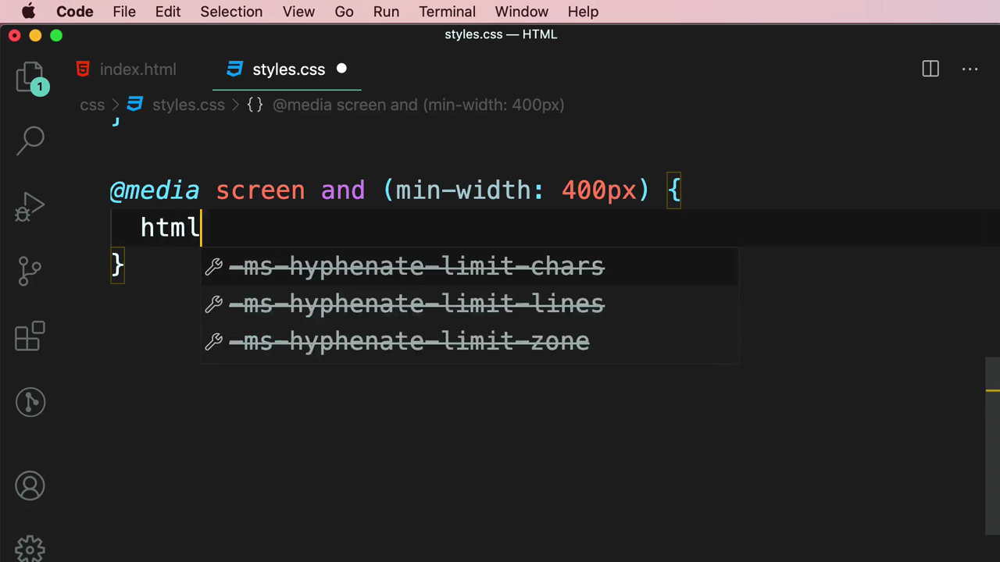

> **หลักการทำงาน:** เมื่อความกว้างหน้าจอ (viewport) มากกว่าหรือเท่ากับ `400px` `font-size` ของ `<html>` จะถูกปรับเป็น `130%` ของค่าเดิม ทำให้**ทุก `rem` ในหน้าเว็บขยายตามไปด้วยโดยอัตโนมัติ** เพราะ `rem` ทั้งหมดอิงจากค่าของ `html` — นี่คือข้อดีสำคัญของการใช้ `rem`: สามารถปรับขนาดตัวอักษรทั้งเว็บไซต์พร้อมกันได้ด้วยการแก้ไขที่จุดเดียว (`html { font-size }`) แทนที่จะต้องไปแก้ทุก selector ที่มี `font-size` แยกกัน

---

## 6. เครื่องมือช่วยออกแบบ Typography Scale: type-scale.com

Mosh แนะนำเว็บไซต์ **type-scale.com** — เครื่องมือคำนวณ **Typographic Scale** (ชุดขนาดตัวอักษรที่เป็นสัดส่วนกันอย่างเป็นระบบ) แบบ visual:

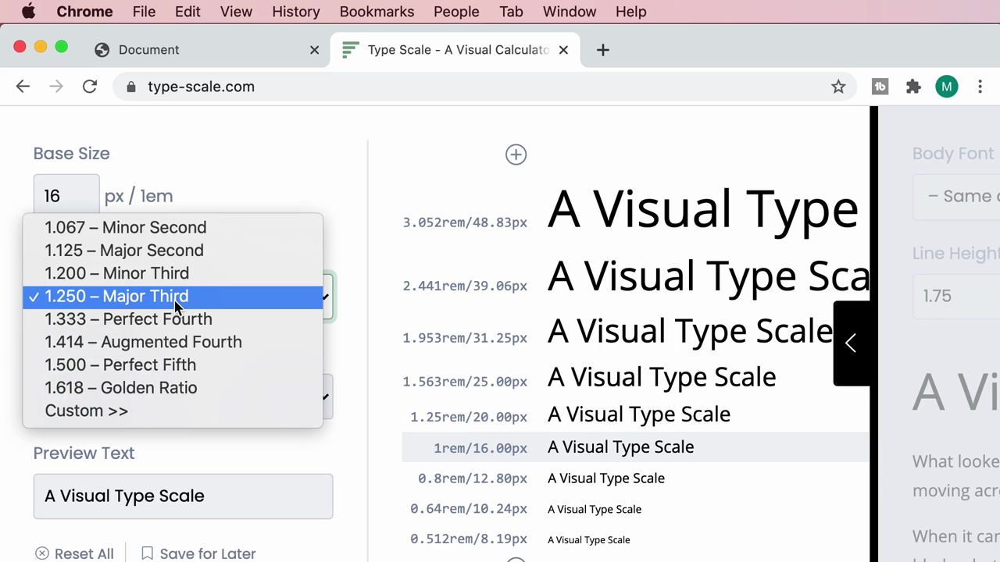

เครื่องมือนี้มีตัวเลือกให้ปรับ:

- **Base Size** — ขนาดฐาน (ค่าเริ่มต้น 16px / 1em)
- **Scale** — อัตราส่วนการเพิ่มขนาดระหว่างแต่ละระดับ (เช่น 1.250 Major Third, 1.333 Perfect Fourth) — ยิ่งอัตราส่วนสูง ความแตกต่างระหว่างระดับขนาดยิ่งชัดเจน
- **Google Fonts** และ **Weight** — เลือกฟอนต์และน้ำหนักเพื่อดูตัวอย่างจริง

Mosh เลือกสเกล **"1.333 — Perfect Fourth"**:

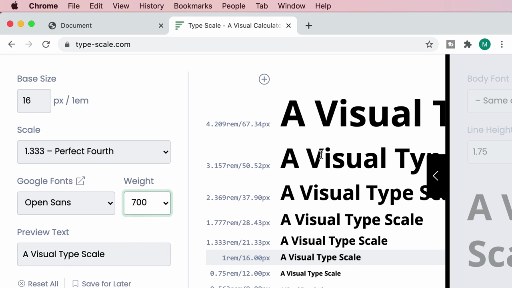

เครื่องมือจะคำนวณรายการขนาดที่เป็นสัดส่วนกันไล่ลงมาให้ทันที ทั้งในหน่วย `rem` และ `px` (เช่น `4.209rem/67.34px`, `3.157rem/50.52px`, `2.369rem/37.90px`, `1.777rem/28.43px`, `1.333rem/21.33px`, `1rem/16.00px` เป็นฐาน) — ซึ่งเหมาะจะนำไปใช้กับ `h1` ถึง `h6` ตามลำดับ

---

## 7. นำค่าที่ได้จาก Type Scale มาใช้กับ Heading

Mosh คัดลอกค่า `4.209rem` (ระดับสูงสุด) มาใช้กับ `h1`:

```css
h1 {
  font-family: Georgia, "Times New Roman", Times, serif;
  font-size: 4.209rem;
}
```

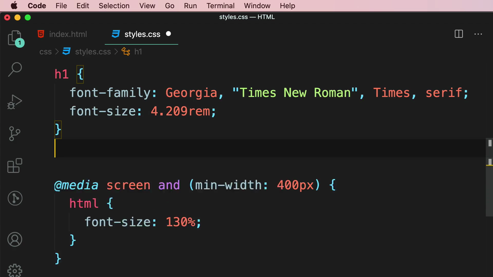

จากนั้นเพิ่ม `<h2>Heading</h2>` ในไฟล์ HTML เพื่อทดสอบระดับถัดไป:

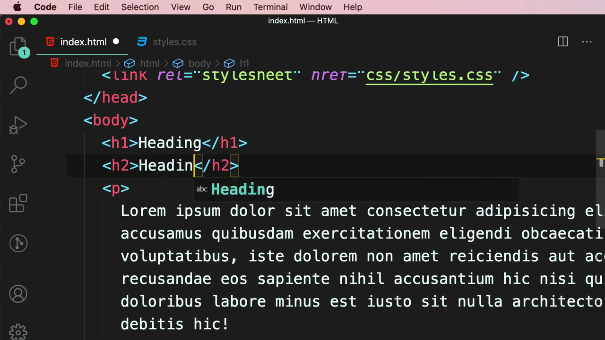

```css
h2 {
  font-size: 3.157rem;
}
```

ผลลัพธ์ในเบราว์เซอร์: `Heading 1` และ `Heading 2` มีขนาดที่เป็นสัดส่วนกันอย่างชัดเจนและดูเป็นระบบระเบียบ ต่างจากการเดาขนาดเอาเองแบบสุ่ม:

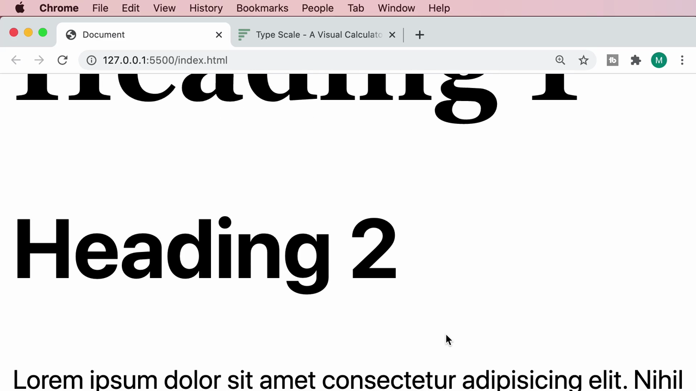

---

## 8. ปรับโครงสร้าง CSS ให้ไม่ซ้ำซ้อน: รวม `font-family` ของทุก Heading

Mosh สังเกตว่าตอนนี้ต้องเขียน `font-family: Georgia, ...` ซ้ำในทั้ง `h1` และ `h2` (และจะต้องซ้ำต่อไปถ้าเพิ่ม h3-h6) จึงรวม selector ของ heading ทั้งหมดเข้าด้วยกันโดยใช้ comma-separated selector:

```css
h1,
h2,
h3,
h4,
h5,
h6 {
  font-family: Georgia, "Times New Roman", Times, serif;
}

h1 {
  font-size: 4.209rem;
}

h2 {
  font-size: 3.157rem;
}
```

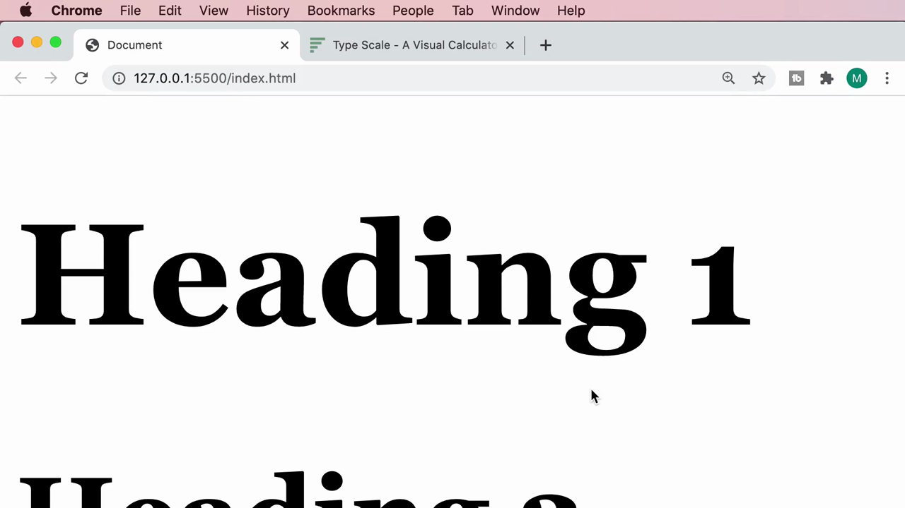

> **หลักการ:** เมื่อหลาย selector ต้องการ property ชุดเดียวกัน (เช่น `font-family` ที่ทุก heading ควรใช้ร่วมกัน) ให้เขียน selector เหล่านั้นคั่นด้วยจุลภาคไว้ในกฎเดียว แล้วเก็บเฉพาะ property ที่ต่างกันจริง (เช่น `font-size` ของแต่ละระดับ) ไว้ใน selector เฉพาะของมันเอง — เป็นการประยุกต์ใช้หลัก DRY (Don't Repeat Yourself) เช่นเดียวกับที่เรียนเรื่อง inheritance ในคลิป "Styling Fonts"

ผลลัพธ์สุดท้าย: ทั้ง `Heading 1` และ `Heading 2` แสดงด้วยฟอนต์ Georgia (serif) เหมือนกัน แต่มีขนาดที่เป็นสัดส่วนกันตาม type scale ที่คำนวณไว้:

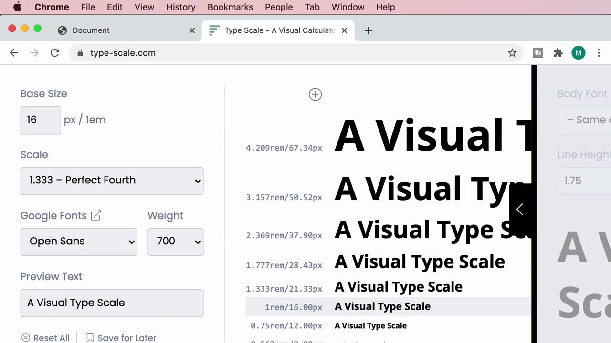

---

## สรุปภาพรวมของคลิปนี้

| หัวข้อ | รายละเอียด |
|---|---|
| **ปัญหาของ `px`** | หน้าจอ Retina มี pixel ทางกายภาพมากกว่า 1 px ต่อ 1 CSS px |
| **หน่วยสัมพัทธ์ที่ควรรู้** | `%`, `vw`/`vh`, `rem` |
| **ทำไมต้องใช้ `rem` กับ font-size** | ตอบสนองต่อการตั้งค่าขนาดฟอนต์ของเบราว์เซอร์/ระบบผู้ใช้ (accessibility) |
| **เทคนิค 62.5%** | `html { font-size: 62.5%; }` ทำให้ `1rem` = `10px` คำนวณง่ายขึ้น |
| **Responsive typography** | ปรับ `font-size` ของ `html` ผ่าน `@media` เพื่อขยายทุก `rem` ในหน้าเว็บพร้อมกัน |
| **เครื่องมือ** | type-scale.com — คำนวณชุดขนาดตัวอักษรที่เป็นสัดส่วนกันตาม scale ratio |
| **การจัดโครงสร้าง CSS** | รวม selector heading ทั้งหมดสำหรับ property ที่ใช้ร่วมกัน แยกเฉพาะ `font-size` ต่อระดับ |

**แนวคิดสำคัญที่ได้จากคลิปนี้:**

1. **ใช้ `rem` แทน `px` สำหรับ `font-size` เสมอ** เพื่อรองรับการตั้งค่า accessibility ของผู้ใช้
2. **เทคนิค 62.5% ช่วยให้คำนวณค่า `rem` ในใจง่ายขึ้นมาก**
3. **Media query บน `html { font-size }` คือวิธีทำ responsive typography ที่ทรงพลัง** เพราะกระทบทุก `rem` ในหน้าเว็บพร้อมกัน
4. **Typographic Scale (เช่นจาก type-scale.com) ช่วยให้ขนาด heading เป็นสัดส่วนกันอย่างมีหลักการ** แทนการเดาตัวเลขเอาเอง
5. **รวม selector ที่ใช้ property ร่วมกันด้วย comma** เพื่อลดโค้ดซ้ำซ้อน (DRY)

---

*หมายเหตุ: คลิปนี้เป็นส่วนหนึ่งของบท "3-Typography" จากคอร์ส The Ultimate HTML and CSS Course โดย Mosh Hamedani (codewithmosh.com) — คลิปที่ 7 ของบทนี้*
