# 3-Typography: 08 - Vertical Spacing (4:44)

**ไฟล์ต้นทาง:** `8-_Vertical_Spacing.mp4`

▶️ **[เปิดวิดีโอต้นฉบับ](../../../HTML-CSS-2/3-Typography/8-_Vertical_Spacing.mp4)**

---

## ภาพรวมคลิปนี้

คลิปนี้พูดถึง **ระยะห่างในแนวตั้ง (Vertical Spacing)** ของข้อความ — ทั้งระยะห่างระหว่างบล็อกเนื้อหา (เช่น หัวข้อกับย่อหน้าถัดไป) ด้วย `margin` และระยะห่างระหว่างบรรทัดภายในย่อหน้าเดียวกันด้วย `line-height` พร้อมข้อควรระวังสำคัญเรื่องหน่วยที่ใช้กับ `line-height`


---

## 1. ปัญหา: เนื้อหาติดกันเกินไป

Mosh เริ่มจากไฟล์ HTML ที่มี `h1` และ `p` แล้วคัดลอกซ้ำเป็นสองชุดติดกัน เพื่อจำลองสถานการณ์ที่ต้องมีหลายบล็อกเนื้อหาต่อกันในหน้าเดียว:

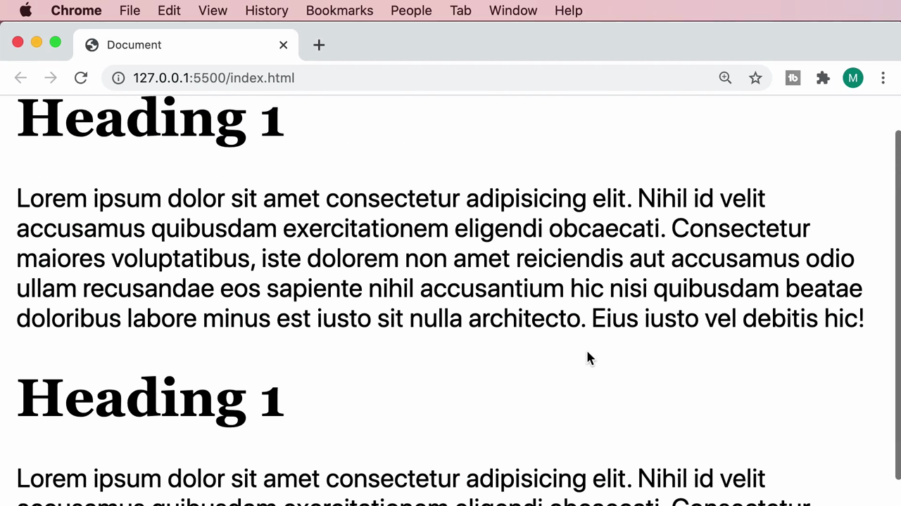

จะเห็นว่าย่อหน้าสุดท้ายของบล็อกแรกอยู่ชิดกับหัวข้อของบล็อกถัดไปมากเกินไป ทำให้แยกแยะเนื้อหาแต่ละส่วนได้ยาก

---

## 2. หลักการออกแบบ: Law of Proximity

Mosh อธิบายด้วยสไลด์หลักการออกแบบที่เรียกว่า **Law of Proximity** (กฎแห่งความใกล้ชิด):

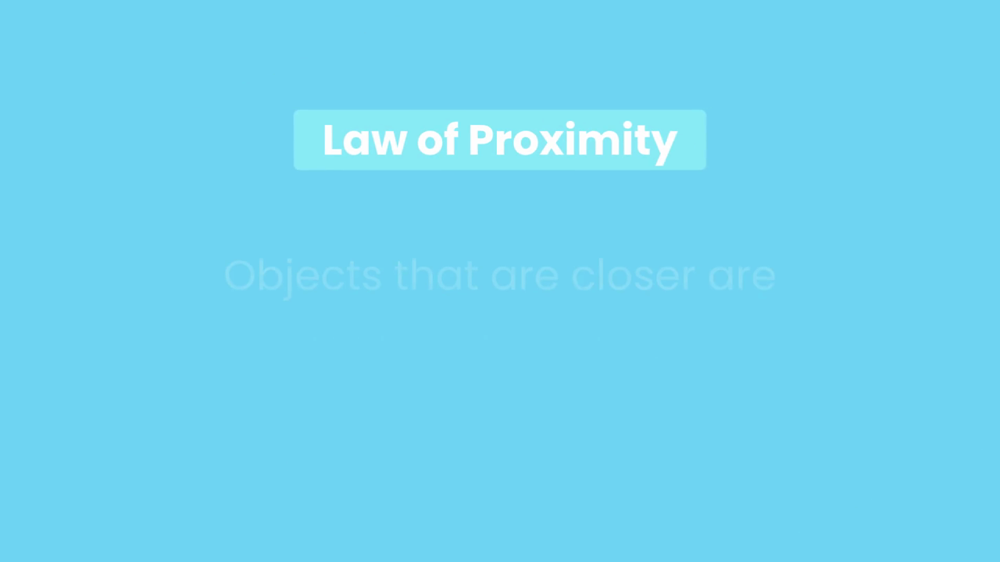

> **"Objects that are closer (to each other) are perceived to be more related than objects that are further apart"**
> (สิ่งที่อยู่ใกล้กันมากกว่า จะถูกรับรู้ว่ามีความเกี่ยวข้องกันมากกว่าสิ่งที่อยู่ห่างกัน)

หลักการนี้เป็นพื้นฐานสำคัญในการออกแบบ UI/UX — การเว้นระยะห่างที่เหมาะสมระหว่างกลุ่มเนื้อหาที่ไม่เกี่ยวข้องกัน ช่วยให้ผู้อ่านแยกแยะโครงสร้างของหน้าเว็บได้ง่ายขึ้นโดยไม่ต้องอ่านข้อความละเอียด

---

## 3. เพิ่มระยะห่างระหว่างบล็อกด้วย `margin`

Mosh เพิ่ม `margin` แบบ shorthand ให้กับ `h1`:

```css
h1 {
  margin: 3rem 0 1rem;
}
```

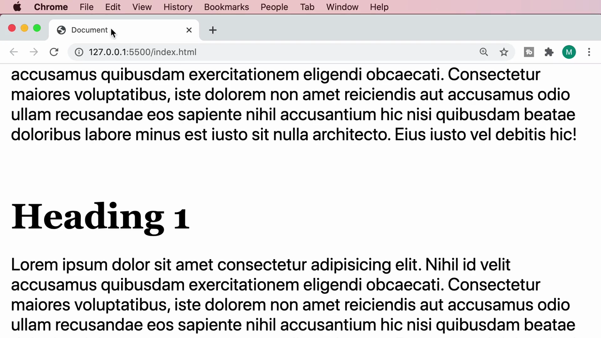

> **อธิบาย shorthand `margin: 3rem 0 1rem;`:** เมื่อมีค่า 3 ค่า เบราว์เซอร์จะตีความเป็น `margin-top`, `margin-left`/`margin-right` (ค่าเดียวกันทั้งซ้ายขวา), `margin-bottom` ตามลำดับ — ในที่นี้คือ **บน 3rem, ซ้าย-ขวา 0, ล่าง 1rem**

ผลลัพธ์: มีช่องว่างด้านบนของแต่ละ `h1` มากขึ้น (แยกจากเนื้อหาก่อนหน้า) และช่องว่างด้านล่างเล็กน้อยก่อนเข้าสู่ย่อหน้า ทำให้แต่ละบล็อกเนื้อหาแยกออกจากกันชัดเจนขึ้นตามหลัก Law of Proximity:

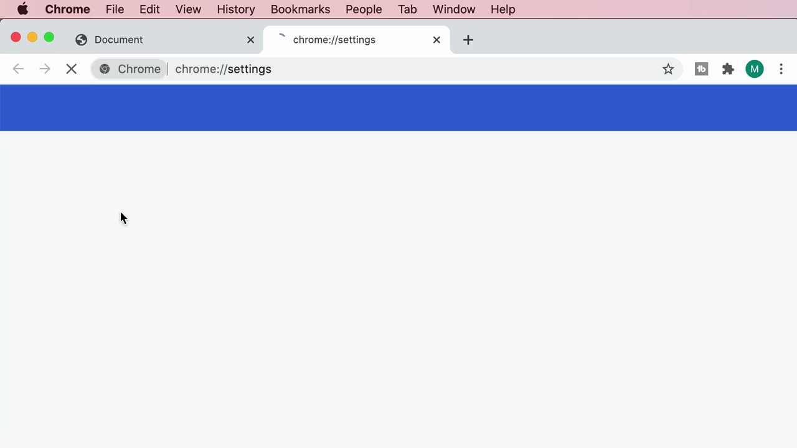

---

## 4. ยืนยันข้อดีของ `rem`: margin ก็ปรับตามการตั้งค่าผู้ใช้ได้

Mosh เปิด Chrome Settings แล้วเปลี่ยน **Font size** เป็น **Very large** อีกครั้ง (เทคนิคเดียวกับที่สาธิตในคลิป "Sizing Fonts"):

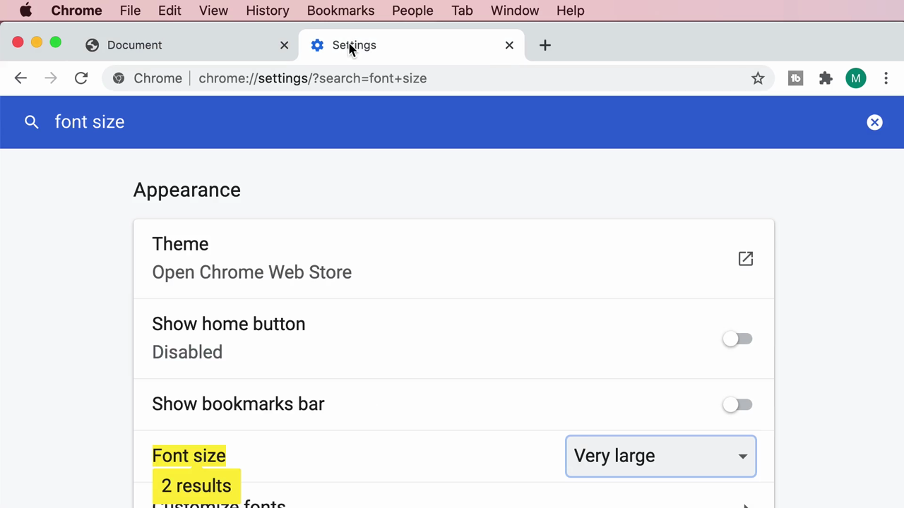

เมื่อรีเฟรชหน้าเว็บ จะเห็นว่า**ระยะห่าง (margin) ที่เขียนด้วย `rem` ก็ขยายตามไปด้วยโดยอัตโนมัติ** พร้อมกับขนาดตัวอักษร — เพราะทั้ง `font-size` และ `margin` ต่างก็อิงจากค่า `font-size` ของ `<html>` เหมือนกัน:

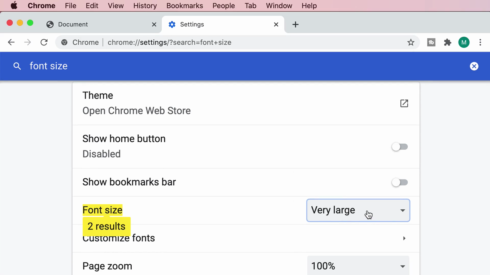

> **สรุป:** ควรใช้ `rem` ไม่เฉพาะกับ `font-size` เท่านั้น แต่รวมถึง `margin`, `padding` และค่าระยะห่างอื่นๆ ด้วย เพื่อให้ทั้งหน้าเว็บปรับสัดส่วนไปพร้อมกันเมื่อผู้ใช้ปรับการตั้งค่าการเข้าถึง

---

## 5. ระยะห่างระหว่างบรรทัด: `line-height`

Mosh กลับไปที่ `body` แล้วเริ่มพิมพ์ `line-` ให้ IntelliSense แนะนำ property ที่เกี่ยวข้อง (`line-height`, `line-break`, `line-clamp` ฯลฯ) และเลือก **`line-height`**:

```css
body {
  margin: 10px;
  font-family: -apple-system, BlinkMacSystemFont, "Segoe UI", Roboto,
    Ubuntu, Cantarell, "Open Sans", "Helvetica Neue", sans-serif;
  font-size: 1rem;
  line-height: 1.5rem;
}
```

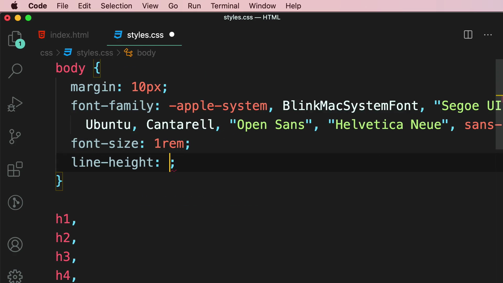

ผลลัพธ์: บรรทัดในย่อหน้ามีระยะห่างเพิ่มขึ้นอย่างชัดเจน อ่านง่ายขึ้นกว่าตอนที่บรรทัดชิดกัน:

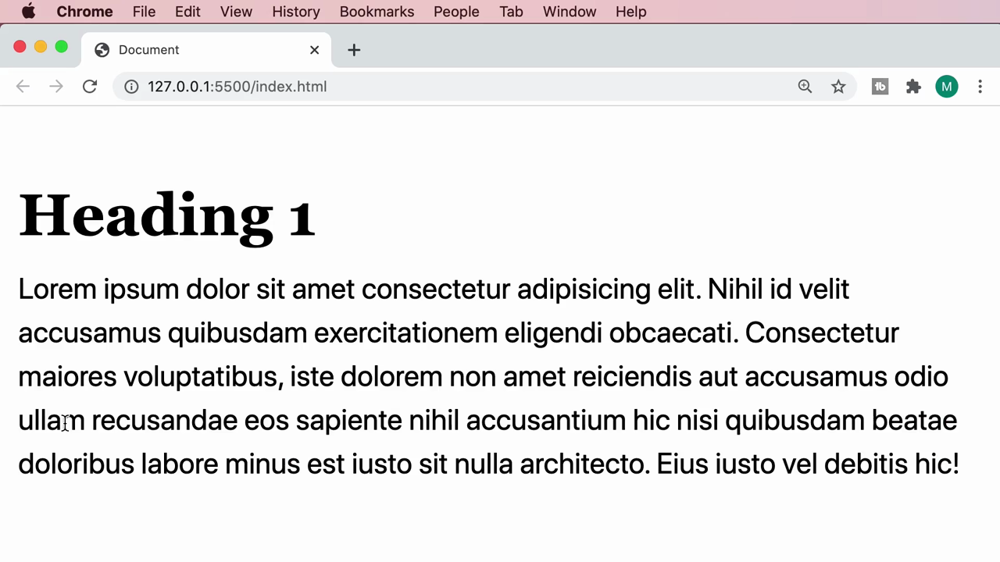

---

## 6. ข้อควรระวังสำคัญ: อย่าใช้หน่วยคงที่กับ `line-height`

Mosh ทดลองใส่ค่า `line-height` ที่เล็กเกินไป (`.5rem`) เพื่อให้เห็นปัญหา — บรรทัดจะ**ทับซ้อนกันเอง** เพราะระยะห่างน้อยกว่าความสูงของตัวอักษรเอง:

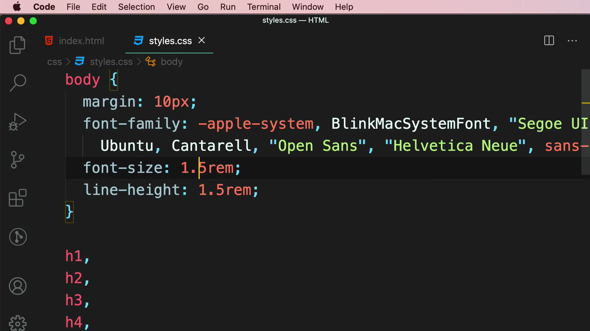

จากนั้น Mosh สาธิตปัญหาที่ลึกซึ้งกว่านั้น: ทดลองเปลี่ยน `font-size` ของ `body` เป็น `2rem` โดยที่ยังคง `line-height: 1.5rem;` (หน่วยคงที่) ไว้เหมือนเดิม:

```css
body {
  font-size: 2rem;
  line-height: 1.5rem;
}
```

ผลลัพธ์: เพราะฟอนต์ใหญ่ขึ้น (2rem = 32px) แต่ `line-height` ยังคงตายตัวที่ `1.5rem` (24px) ซึ่ง**เล็กกว่าฟอนต์เอง** ทำให้บรรทัดข้อความมาซ้อนทับกัน อ่านไม่ออกเลย:

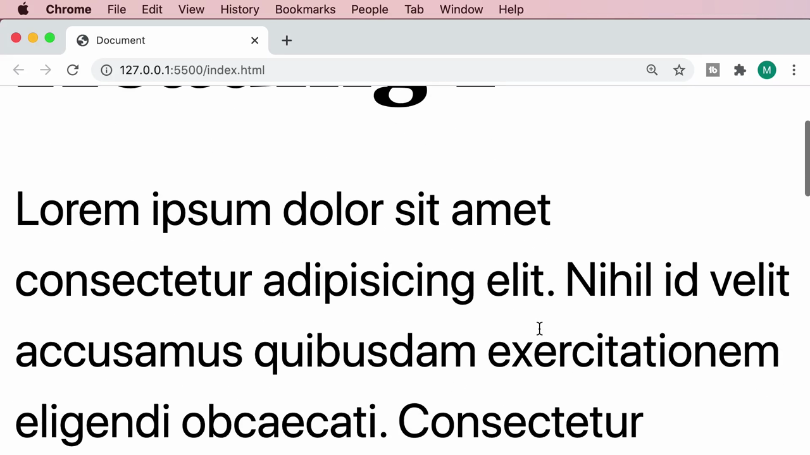

> **ต้นตอของปัญหา:** เมื่อ `line-height` เขียนด้วยหน่วยคงที่ (เช่น `rem`, `px`) มันจะ**ไม่ปรับตาม `font-size`** ของ element นั้นๆ โดยอัตโนมัติ — ถ้า `font-size` เปลี่ยนไป (ไม่ว่าจะจากการแก้โค้ดโดยตรง หรือจากการ override ใน selector ลูก) แต่ `line-height` ยังคงค่าเดิม ก็มีความเสี่ยงสูงที่จะเกิดปัญหาข้อความซ้อนทับกัน

---

## 7. ทางแก้: ใช้ `line-height` แบบ "ไม่มีหน่วย" (Unitless)

Mosh แก้ปัญหาด้วยการลบหน่วย `rem` ออกจากค่า `line-height` เหลือแค่ตัวเลขเปล่าๆ:

```css
body {
  font-size: 2rem;
  line-height: 1.5;
}
```

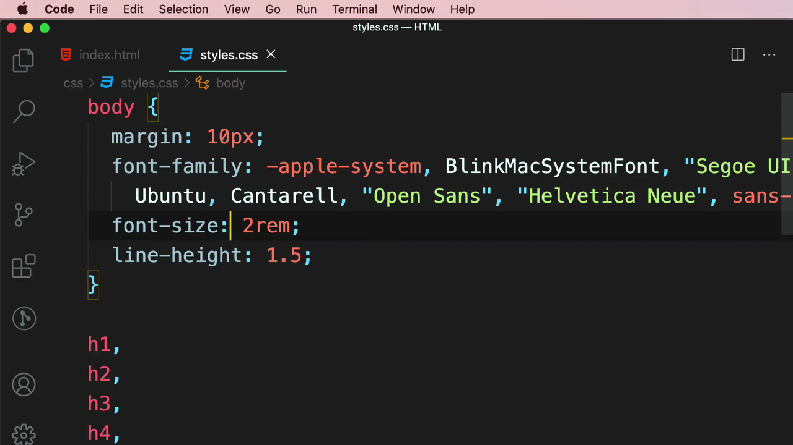

ผลลัพธ์: บรรทัดกลับมาเว้นระยะห่างได้อย่างถูกต้อง แม้จะเปลี่ยน `font-size` เป็น `2rem` แล้วก็ตาม:

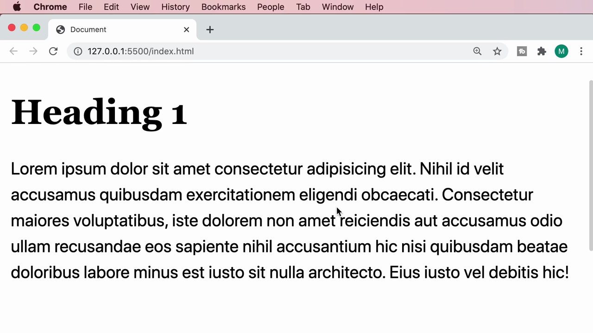

> **หลักการสำคัญที่สุดของคลิปนี้:** เมื่อ `line-height` เป็นตัวเลขที่ **ไม่มีหน่วย** (unitless) เบราว์เซอร์จะตีความว่าเป็น **ตัวคูณ (multiplier) ของ `font-size` ของ element นั้นๆ เอง** เช่น `line-height: 1.5;` หมายถึง "1.5 เท่าของ font-size ปัจจุบัน" เสมอ ไม่ว่า `font-size` จะเป็นเท่าไหร่ก็ตาม — ทำให้ระยะห่างระหว่างบรรทัด**ปรับสัดส่วนตาม font-size โดยอัตโนมัติ** ต่างจากการใช้หน่วยคงที่ที่ต้องคำนวณและแก้ไขเองทุกครั้งที่ font-size เปลี่ยน

---

## สรุปภาพรวมของคลิปนี้

| หัวข้อ | รายละเอียด |
|---|---|
| **หลักการออกแบบ** | Law of Proximity — วัตถุที่ใกล้กันถูกมองว่าเกี่ยวข้องกันมากกว่า |
| **ระยะห่างระหว่างบล็อก** | ใช้ `margin` (แนะนำหน่วย `rem` เพื่อให้ปรับตาม accessibility settings ได้) |
| **ระยะห่างระหว่างบรรทัด** | ใช้ `line-height` |
| **ข้อผิดพลาดที่พบบ่อย** | ใช้หน่วยคงที่ (`rem`, `px`) กับ `line-height` ทำให้บรรทัดซ้อนทับกันเมื่อ `font-size` เปลี่ยน |
| **แนวทางที่ถูกต้อง** | ใช้ `line-height` แบบไม่มีหน่วย (เช่น `1.5`) ให้เป็นตัวคูณของ `font-size` เสมอ |

**แนวคิดสำคัญที่ได้จากคลิปนี้:**

1. **Law of Proximity เป็นหลักการพื้นฐานที่อยู่เบื้องหลังการเว้นระยะห่างในงานออกแบบ** ไม่ใช่แค่เรื่องสวยงาม แต่ช่วยสื่อสารโครงสร้างเนื้อหา
2. **ใช้ `rem` กับ `margin`/`padding` เช่นเดียวกับ `font-size`** เพื่อให้ทั้งหน้าเว็บปรับสัดส่วนพร้อมกันตามการตั้งค่าของผู้ใช้
3. **`line-height` แบบไม่มีหน่วยคือแนวทางที่ปลอดภัยที่สุด** เพราะปรับตาม `font-size` ของ element นั้นเองโดยอัตโนมัติ ป้องกันปัญหาข้อความซ้อนทับกันเมื่อ `font-size` เปลี่ยนแปลง (ไม่ว่าจากการ override, media query, หรือ user setting)

---

*หมายเหตุ: คลิปนี้เป็นส่วนหนึ่งของบท "3-Typography" จากคอร์ส The Ultimate HTML and CSS Course โดย Mosh Hamedani (codewithmosh.com) — คลิปที่ 8 ของบทนี้*
