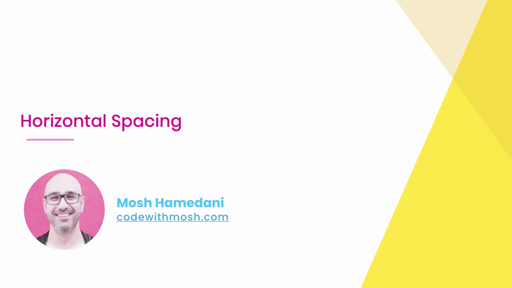
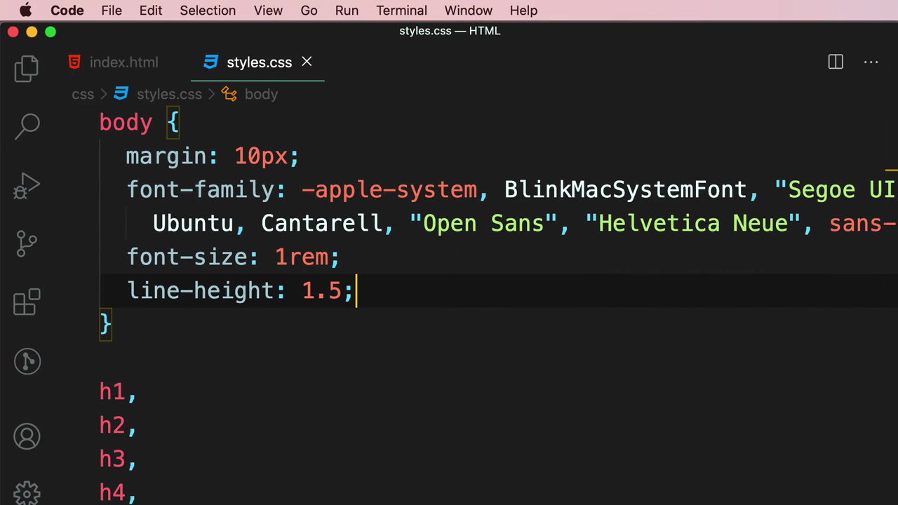
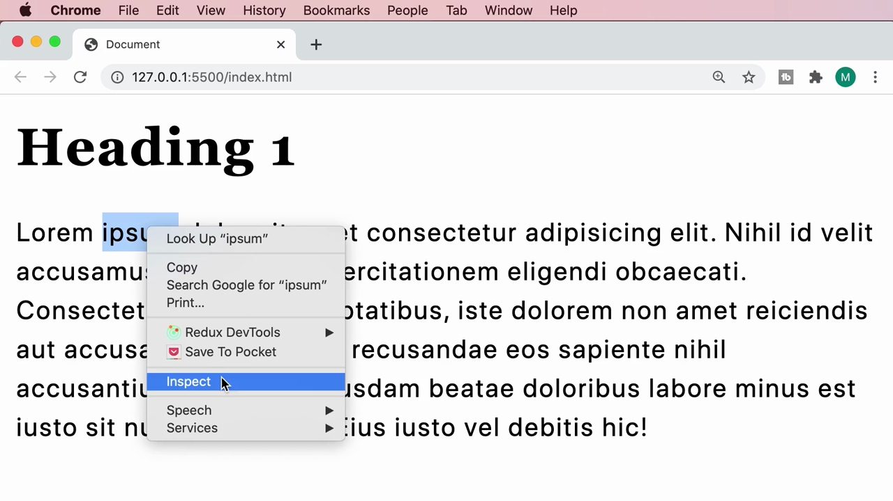
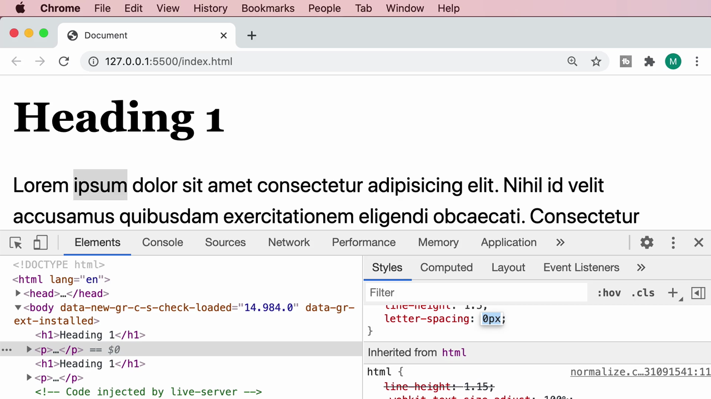
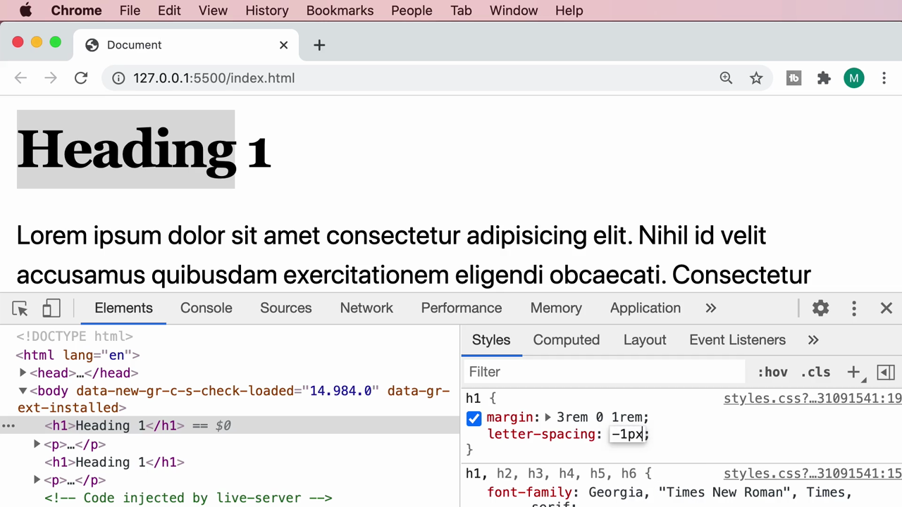
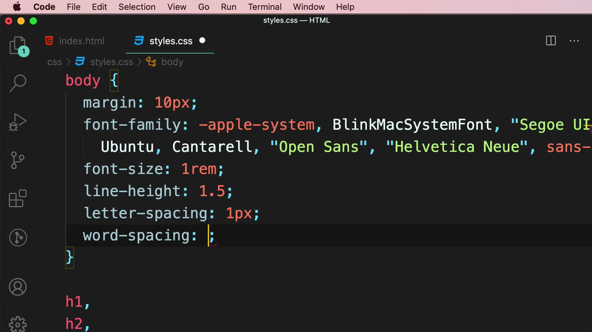
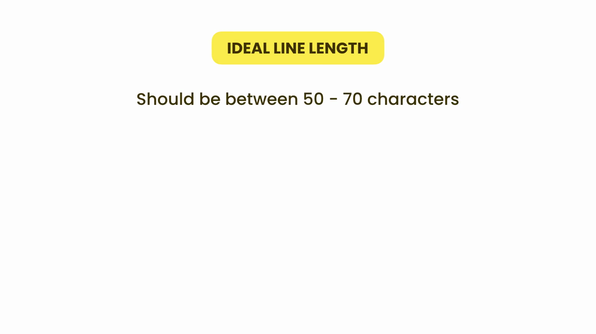
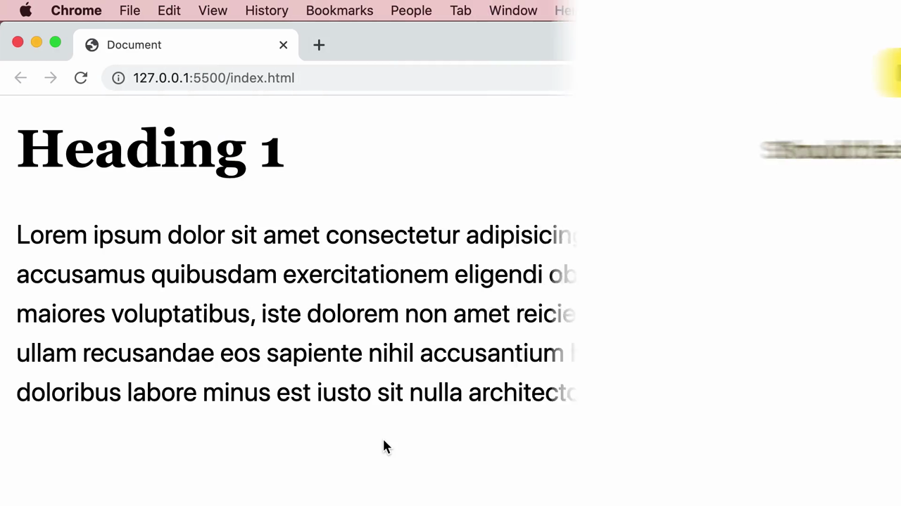
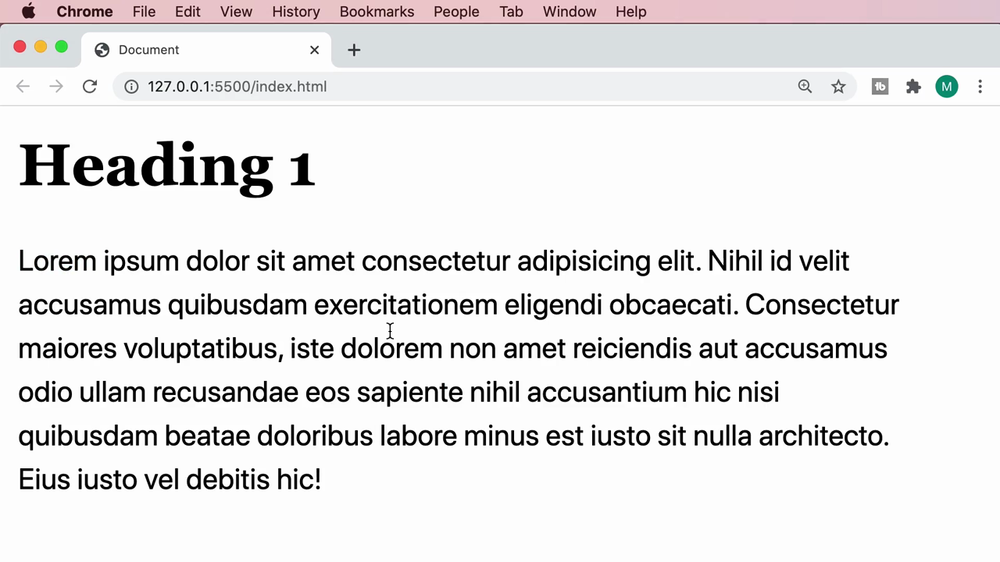

# 3-Typography: 09 - Horizontal Spacing (3:16)

**ไฟล์ต้นทาง:** `9-_Horizontal_Spacing.mp4`

▶️ **[เปิดวิดีโอต้นฉบับ](../../../HTML-CSS-2/3-Typography/9-_Horizontal_Spacing.mp4)**

---

## ภาพรวมคลิปนี้

ต่อเนื่องจากคลิป "Vertical Spacing" คลิปนี้พูดถึง **ระยะห่างในแนวนอน (Horizontal Spacing)** ของข้อความ ครอบคลุม `letter-spacing` (ระยะห่างระหว่างตัวอักษร), `word-spacing` (ระยะห่างระหว่างคำ) และหลักการ **Ideal Line Length** (ความยาวบรรทัดที่เหมาะสมต่อการอ่าน)



---

## 1. ตัวอย่างสุดโต่งของ `letter-spacing`

Mosh เปิดด้วยภาพประกอบที่แสดงผลของการตั้งค่า `letter-spacing` มากเกินไป — ตัวอักษรแต่ละตัวถูกดันห่างออกจากกันจนอ่านยากผิดปกติ เพื่อให้เห็นภาพชัดว่า property นี้ทำอะไร ก่อนจะเข้าสู่การใช้งานจริงที่เหมาะสม:



---

## 2. รู้จัก `letter-spacing`

Mosh เพิ่ม property `letter-spacing` ให้กับ `body`:

```css
body {
  font-size: 1rem;
  line-height: 1.5;
  letter-spacing: 1rem;
}
```



`letter-spacing` ควบคุมระยะห่างระหว่างตัวอักษรแต่ละตัวภายในคำ — ค่าบวกจะดันตัวอักษรให้ห่างออกจากกัน ค่าลบจะดึงให้ชิดกันมากขึ้น

### ทดลองปรับค่าแบบ real-time ผ่าน Chrome DevTools

Mosh คลิกขวาเลือก **Inspect** แล้วแก้ไขค่า `letter-spacing` ในแผง Styles ของ DevTools โดยตรงเพื่อดูผลลัพธ์ทันที — ทดลองปรับจากค่าเริ่มต้นลงมาที่ `0px`:



จากนั้นเลือก element `h1` แล้วทดลองใส่ค่า**ลบ** (`-1px`) เพื่อดึงตัวอักษรในหัวข้อให้ชิดกันมากขึ้นเล็กน้อย ซึ่งเป็นเทคนิคที่ดีไซเนอร์นิยมใช้กับหัวข้อขนาดใหญ่ (large display type) เพื่อให้ดูกระชับสวยงามขึ้น:



> **การใช้งานจริง:** `letter-spacing` มักใช้ค่าเพียงเล็กน้อย (เช่น `0.5px` ถึง `2px`) สำหรับปรับความรู้สึกของฟอนต์ หรือใช้ค่าลบเล็กน้อยกับหัวข้อขนาดใหญ่ ไม่ควรใช้ค่ามากเกินไปเหมือนตัวอย่างสุดโต่งที่แสดงตอนต้นคลิป เพราะจะทำให้อ่านยาก

---

## 3. รู้จัก `word-spacing`

Mosh พิมพ์ property ใหม่ต่อจาก `letter-spacing`:

```css
body {
  font-size: 1rem;
  line-height: 1.5;
  letter-spacing: 1px;
  word-spacing: 5px;
}
```



ผลลัพธ์: ระยะห่าง**ระหว่างคำ** (ไม่ใช่ระหว่างตัวอักษรภายในคำเดียวกัน) เพิ่มขึ้นอย่างเห็นได้ชัด:



> **ความแตกต่างระหว่าง `letter-spacing` กับ `word-spacing`:**
> - **`letter-spacing`** ปรับระยะห่างระหว่าง**ตัวอักษรทุกตัว** รวมถึงภายในคำเดียวกันด้วย
> - **`word-spacing`** ปรับเฉพาะระยะห่าง**ระหว่างคำ** (ที่ตำแหน่งช่องว่าง/spacebar) เท่านั้น ไม่กระทบตัวอักษรภายในคำ

---

## 4. หลักการอ่านง่าย: Ideal Line Length

Mosh อธิบายหลักการออกแบบข้อความอีกข้อหนึ่งด้วยสไลด์:



> **Ideal Line Length: Should be between 50 - 70 characters**
> (ความยาวบรรทัดที่เหมาะสมควรอยู่ระหว่าง 50-70 ตัวอักษรต่อบรรทัด)

Mosh อธิบายว่าถ้าบรรทัดข้อความยาวเกินไป (กว้างเต็มหน้าจอ) สายตาผู้อ่านจะต้องเคลื่อนไหวมากเกินไปในการอ่านจบหนึ่งบรรทัดแล้วย้อนกลับไปหาจุดเริ่มต้นบรรทัดถัดไป ทำให้เหนื่อยล้าและอ่านยาก ควรจำกัดความกว้างของบล็อกข้อความ (เช่นด้วย `max-width` บน container หรือย่อหน้า) ให้บรรทัดมีความยาวอยู่ในช่วงที่อ่านสบาย

Mosh ปรับโครงสร้าง CSS เพื่อจำกัดความกว้างของเนื้อหาให้แคบลงกว่าความกว้างเต็มหน้าจอ ผลลัพธ์คือแต่ละบรรทัดมีจำนวนตัวอักษรที่เหมาะสมกว่าเดิม อ่านสบายตาขึ้นอย่างชัดเจน เมื่อเทียบกับตอนที่ข้อความยืดเต็มความกว้างหน้าจอ:



---

## สรุปภาพรวมของคลิปนี้

| Property/หลักการ | หน้าที่ |
|---|---|
| `letter-spacing` | ระยะห่างระหว่างตัวอักษรแต่ละตัว (ค่าลบ = ชิดกัน, ค่าบวก = ห่างกัน) |
| `word-spacing` | ระยะห่างระหว่างคำ (ไม่กระทบตัวอักษรภายในคำ) |
| Ideal Line Length | ความยาวบรรทัดควรอยู่ระหว่าง 50-70 ตัวอักษร เพื่อการอ่านที่สบายตา |

**แนวคิดสำคัญที่ได้จากคลิปนี้:**

1. **`letter-spacing` และ `word-spacing` เป็นเครื่องมือละเอียดสำหรับปรับ "ความรู้สึก" ของข้อความ** ไม่ใช่แค่เรื่องความสวยงามผิวเผิน แต่ส่งผลต่อความอ่านง่าย
2. **ใช้ค่าน้อยๆ พอประมาณ** — ค่ามากเกินไปจะทำลายความอ่านง่ายแทนที่จะช่วย
3. **ค่าลบของ `letter-spacing` เหมาะกับหัวข้อขนาดใหญ่** เพื่อให้ดูกระชับขึ้น
4. **Ideal Line Length (50-70 ตัวอักษร) เป็นหลักการสำคัญที่มักถูกมองข้าม** — การจำกัดความกว้างของบล็อกข้อความช่วยลดความเหนื่อยล้าของสายตาผู้อ่านได้มาก โดยเฉพาะบนหน้าจอกว้าง

---

*หมายเหตุ: คลิปนี้เป็นส่วนหนึ่งของบท "3-Typography" จากคอร์ส The Ultimate HTML and CSS Course โดย Mosh Hamedani (codewithmosh.com) — คลิปที่ 9 ของบทนี้*
