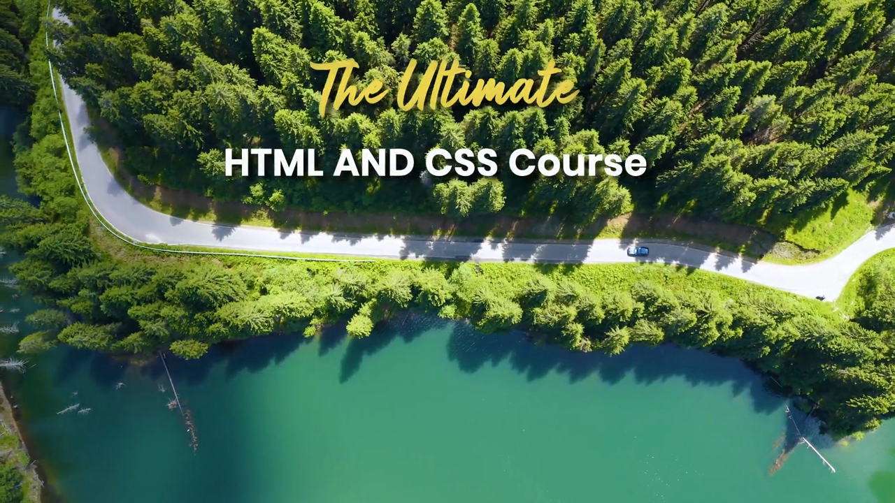
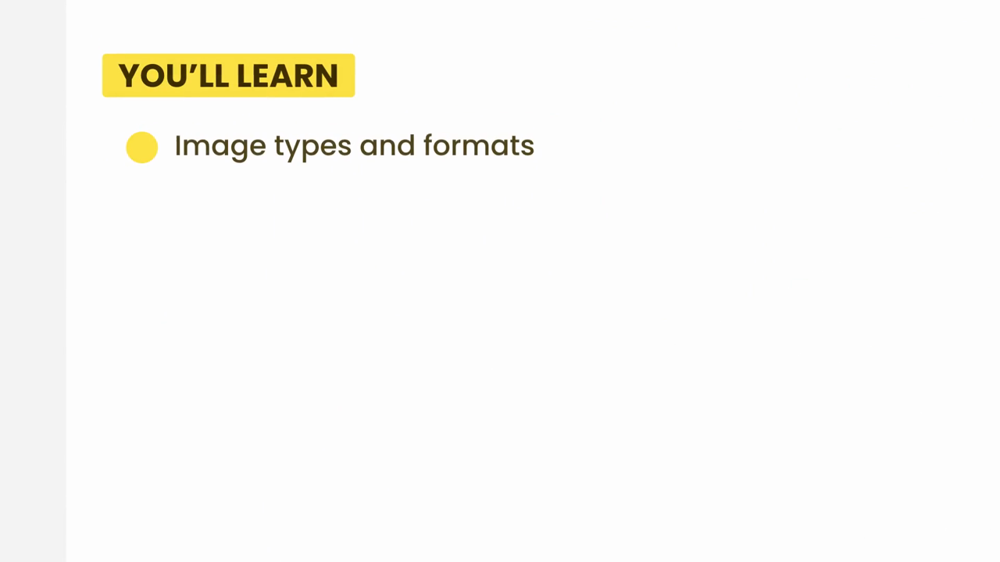
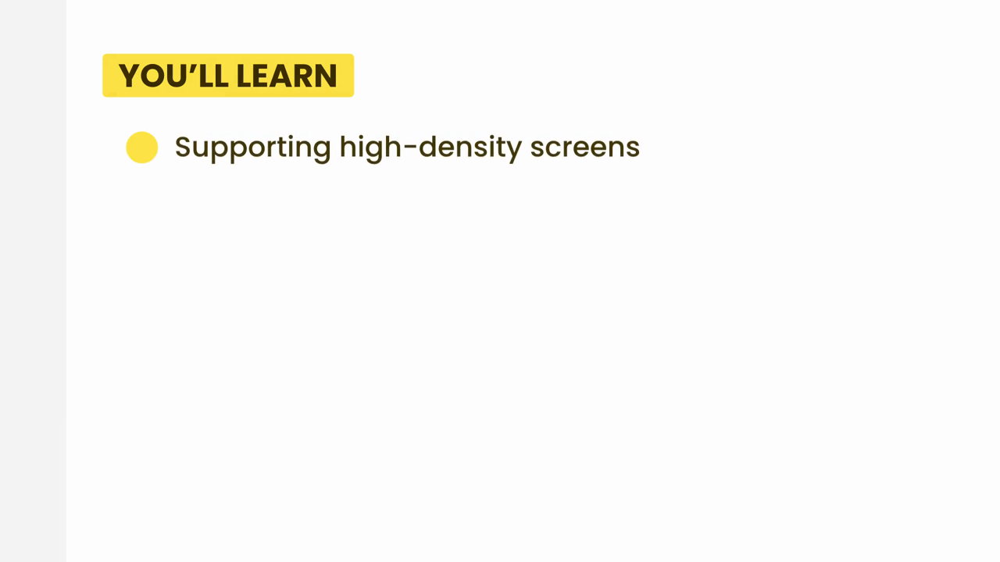

# 4-Images: 01 - Introduction (1:14)

**ไฟล์ต้นทาง:** `1-Introduction.mp4`

▶️ **[เปิดวิดีโอต้นฉบับ](../../../HTML-CSS-2/4-Images/1-Introduction.mp4)**

---

## ภาพรวมคลิปนี้

คลิปเปิดบทใหม่ **"4-Images"** — เป็นคลิปแนะนำสั้นๆ (แบบเดียวกับที่ใช้เปิดทุกบทของคอร์ส) แสดงชื่อบทและสไลด์สรุปหัวข้อทั้งหมดที่จะได้เรียนรู้ในบทนี้ ยังไม่มีการลงโค้ดใดๆ

---

## 1. หัวข้อทั้งหมดที่จะได้เรียนในบทนี้

Mosh แสดงสไลด์ **"YOU'LL LEARN"** สรุปหัวข้อของบท "4-Images" ทีละหัวข้อ (ทยอยแสดงทีละบรรทัด) รวมทั้งหมด 10 หัวข้อ:

รายการหัวข้อทั้งหมดของบทนี้ (เรียงตามลำดับที่จะสอน):

1. **Image types and formats** — ชนิดและรูปแบบไฟล์ภาพ
2. **Background images** — ภาพพื้นหลังด้วย CSS
3. **CSS sprites** — เทคนิครวมภาพหลายภาพไว้ในไฟล์เดียว
4. **Data URLs** — การฝังภาพลงในโค้ดโดยตรง
5. **Clipping images** — การครอบตัด (clip) รูปทรงของภาพ
6. **Applying filters** — เอฟเฟกต์ภาพด้วย CSS filter
7. **Supporting high-density screens** — รองรับหน้าจอความละเอียดสูง (Retina)
8. **Resolution switching** — สลับภาพตามความละเอียดหน้าจอ
9. **Using modern image formats (WebP)** — รูปแบบไฟล์ภาพยุคใหม่
10. **Art direction** — ปรับภาพให้เหมาะกับแต่ละขนาดหน้าจอ

> **หมายเหตุ:** บทนี้มีทั้งหมด 14 คลิป (รวมคลิป Introduction และคลิปเสริมอย่าง SVG และ Font Icons ที่ไม่ได้ระบุไว้ในสไลด์นี้โดยตรงแต่จะได้เรียนในลำดับถัดๆ ไป)

---

## สรุปภาพรวมของคลิปนี้

| ประเด็น | รายละเอียด |
|---|---|
| **ชื่อบท** | 4-Images |
| **จำนวนหัวข้อในสไลด์แนะนำ** | 10 หัวข้อ |
| **เนื้อหา** | ภาพรวมของทุกเรื่องเกี่ยวกับการทำงานกับรูปภาพบนเว็บ ตั้งแต่พื้นฐาน (ชนิดไฟล์, การฝังภาพ) ไปจนถึงเทคนิคขั้นสูง (responsive images, art direction, WebP) |

**แนวคิดสำคัญที่ได้จากคลิปนี้:**

1. **บท "4-Images" ครอบคลุมเนื้อหากว้างมาก** ตั้งแต่การใช้ภาพพื้นฐานไปจนถึงเทคนิคเพื่อ performance และ responsive design ที่จำเป็นสำหรับเว็บไซต์ยุคปัจจุบัน
2. **หัวข้อสำคัญที่ควรให้ความสนใจเป็นพิเศษ** ได้แก่ High-density Screens และ Resolution Switching เพราะเกี่ยวข้องโดยตรงกับการทำเว็บให้แสดงผลดีบนอุปกรณ์ต่างๆ (มือถือ, จอ Retina) ซึ่งเป็นทักษะสำคัญของ Front End Developer ยุคนี้

---

*หมายเหตุ: คลิปนี้เป็นส่วนหนึ่งของบท "4-Images" จากคอร์ส The Ultimate HTML and CSS Course โดย Mosh Hamedani (codewithmosh.com) — คลิปที่ 1 ของบทนี้*
