# 4-Images: 10 - Resolution Switching (7:02)

**ไฟล์ต้นทาง:** `10-Resolution_Switching.mp4`

▶️ **[เปิดวิดีโอต้นฉบับ](../../../HTML-CSS-2/4-Images/10-Resolution_Switching.mp4)**

---

## ภาพรวมคลิปนี้

คลิปนี้ต่อยอดจากคลิปก่อนหน้า (Supporting High-density Screens) โดยแนะนำเทคนิคที่คล้ายกันแต่**แก้ปัญหาคนละแบบ** — แทนที่จะเลือกไฟล์ภาพตาม**ความหนาแน่นของพิกเซล (DPR)** เหมือนคลิปที่แล้ว คลิปนี้สอนให้เบราว์เซอร์เลือกไฟล์ภาพตาม**ขนาดพื้นที่แสดงผลจริงบนหน้าจอ (viewport size)** โดยใช้ **width descriptor (`w`)** ร่วมกับ attribute ใหม่ **`sizes`** พร้อมแนะนำเว็บไซต์เครื่องมือที่ช่วยสร้างไฟล์ภาพหลายขนาดโดยอัตโนมัติ

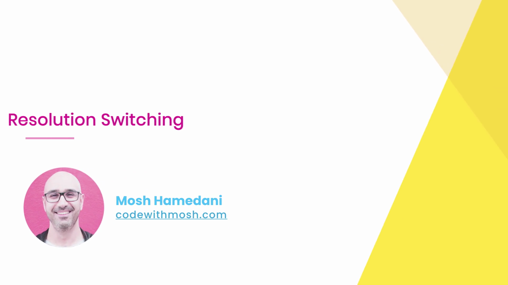

---

## 1. ทบทวนโค้ดจากคลิปก่อนหน้า

คลิปนี้เริ่มต้นด้วยการทบทวนโค้ดที่ค้างไว้จากคลิปที่แล้ว ซึ่งมี `` สองแท็ก (แท็กหนึ่งเป็นตัวเปรียบเทียบแบบไม่มี `srcset`) — Mosh ลบแท็กที่ไม่จำเป็นออก เหลือไว้เพียงแท็กเดียวที่มี `srcset` ครบสมบูรณ์จากคลิปก่อน:

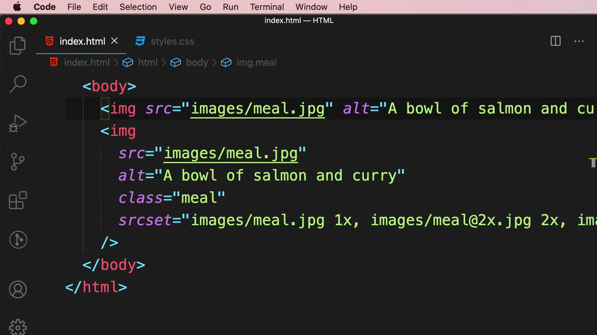

```html

```

พร้อม CSS เดิม:

```css
.meal {
  width: 400px;
}
```

Mosh สรุปทบทวนแนวคิดเรื่อง **Retina Displays** อีกครั้งสั้นๆ ผ่านสไลด์ที่ยกตัวอย่าง **iPhone 8** ซึ่งมี Logical resolution 667 x 375:

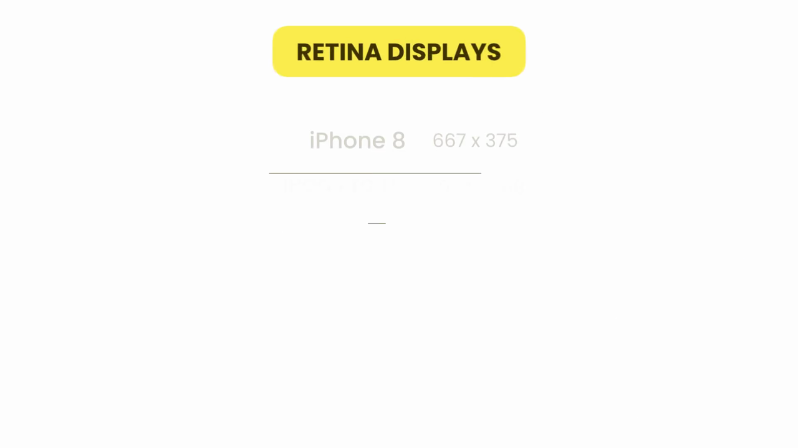

---

## 2. ปัญหาใหม่: ขนาดหน้าจอที่แตกต่างกัน (ไม่ใช่แค่ความหนาแน่นของพิกเซล)

Mosh เปิดสไลด์อธิบายปัญหาใหม่ที่แตกต่างจากคลิปก่อน โดยแสดงอุปกรณ์สามขนาด — มือถือ, แท็บเล็ต, และจอคอมพิวเตอร์:

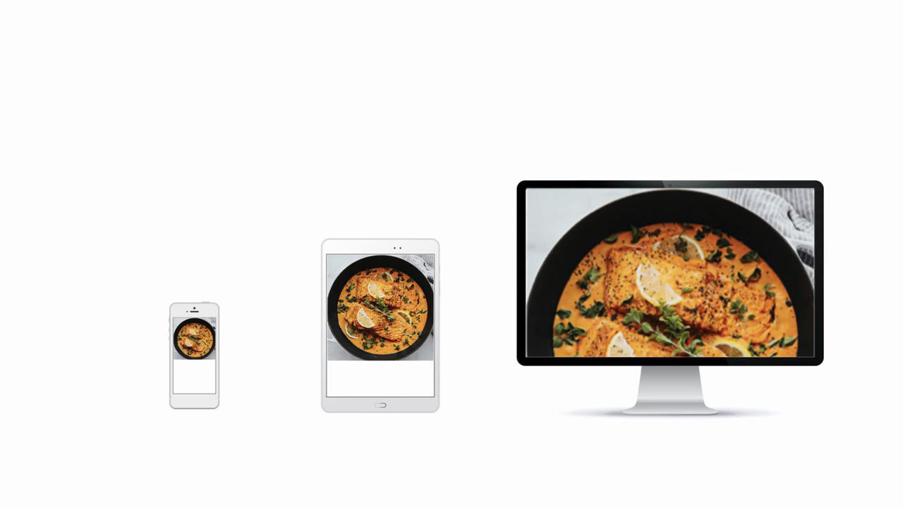

จากนั้นวางภาพอาหารเดียวกันไว้บนอุปกรณ์ทั้งสามขนาด:

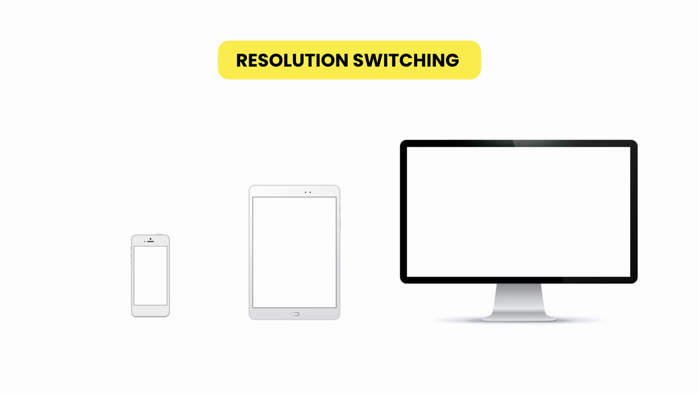

> **ปัญหาที่ต้องการอธิบาย:** แม้จะไม่เกี่ยวกับ DPR เลยก็ตาม — ภาพเดียวกันจะถูกแสดงผลด้วย**ขนาดพื้นที่ (viewport width) ที่แตกต่างกันมาก** ระหว่างมือถือ (เล็ก), แท็บเล็ต (กลาง) และจอคอมพิวเตอร์ (ใหญ่) หากใช้ไฟล์ภาพความละเอียดสูงไฟล์เดียวกันสำหรับทุกอุปกรณ์ (เผื่อไว้สำหรับจอใหญ่สุด) จะทำให้**มือถือต้องดาวน์โหลดไฟล์ภาพที่ใหญ่เกินความจำเป็นมาก** ทั้งที่พื้นที่แสดงผลจริงบนมือถือมีขนาดเล็กกว่ามาก — สิ้นเปลือง bandwidth และทำให้เว็บโหลดช้าลงโดยไม่จำเป็น

สไลด์เปลี่ยนหัวข้อเป็น **"RESOLUTION SWITCHING"**:

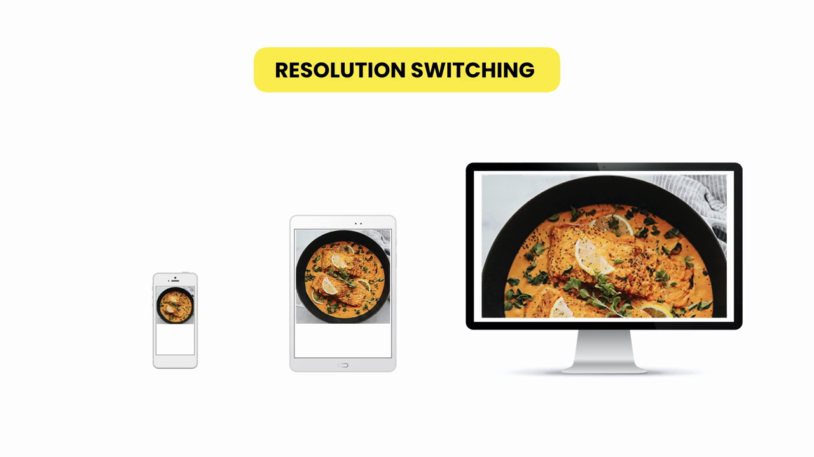

> **หลักการของ Resolution Switching:** คือการให้เบราว์เซอร์เลือกไฟล์ภาพที่มีขนาดพิกเซลจริงเหมาะสมกับ**ขนาดพื้นที่แสดงผลของภาพบนหน้าจอนั้นๆ** โดยตรง แทนที่จะใช้ไฟล์เดียวกันสำหรับทุกขนาดหน้าจอ — ต่างจากคลิปก่อนหน้าที่เลือกไฟล์ตาม DPR (ความคมชัด) เพียงอย่างเดียว

---

## 3. กลับสู่ VS Code — ปรับ CSS ให้ภาพขยายเต็มความกว้างจอ (Full-bleed)

Mosh กลับไปที่ `styles.css` แก้ไขค่า `width` ของ `.meal` จาก `400px` (ค่าคงที่) เป็น **`100vw`** (100% ของความกว้าง viewport):

```css
.meal {
  width: 100vw;
}
```

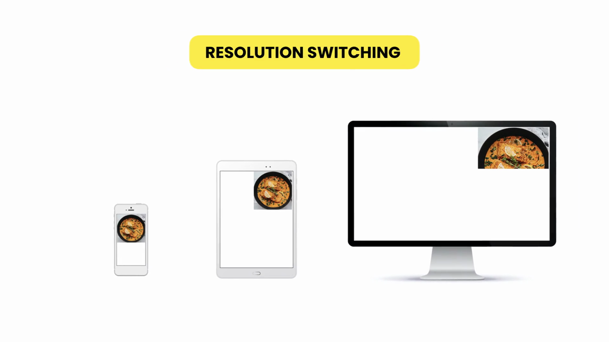

> **`100vw`** หมายถึง "100% ของความกว้าง viewport (หน้าต่างเบราว์เซอร์)" — การเปลี่ยนมาใช้หน่วยนี้ทำให้ภาพขยายเต็มความกว้างหน้าจอเสมอ ไม่ว่าหน้าจอจะกว้างแค่ไหนก็ตาม (full-bleed image) ซึ่งเป็นสถานการณ์ที่เหมาะสำหรับสาธิตปัญหาเรื่อง Resolution Switching ได้ชัดเจนที่สุด เพราะขนาดภาพที่แสดงผลจะเปลี่ยนแปลงตามขนาดหน้าจอโดยตรง

---

## 4. เปลี่ยน `srcset` จาก Density Descriptor (`x`) เป็น Width Descriptor (`w`)

Mosh แก้ไขค่า `srcset` ของ `` โดยเปลี่ยนหน่วยจาก density descriptor (`1x`, `2x`, `3x`) เป็น **width descriptor (`w`)** ซึ่งระบุ**ความกว้างที่แท้จริงของไฟล์ภาพเป็นพิกเซล**แทน:

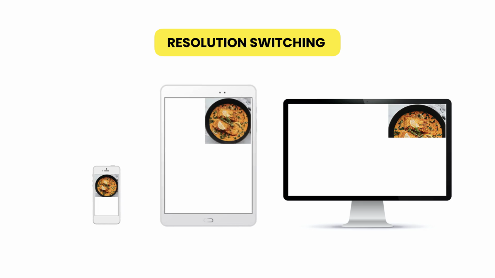

```html

```

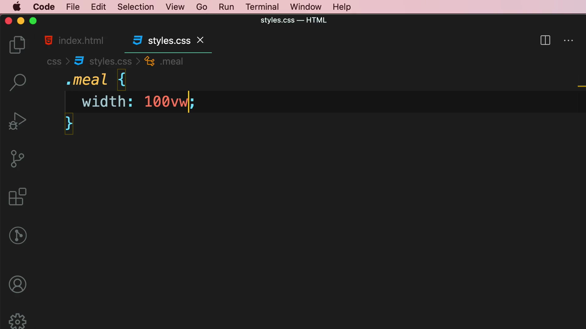

> **ความแตกต่างสำคัญระหว่าง `x` และ `w` descriptor:**
> - **`x` (density descriptor)** บอกเบราว์เซอร์ว่า "ไฟล์นี้เหมาะกับหน้าจอที่มี DPR เท่านี้" — เบราว์เซอร์จะเลือกไฟล์โดยดูจาก **DPR ของหน้าจอ** เพียงอย่างเดียว ไม่สนใจขนาดพื้นที่แสดงผลจริงของภาพเลย
> - **`w` (width descriptor)** บอกเบราว์เซอร์ว่า "ไฟล์นี้มีความกว้างจริงกี่พิกเซล" (เช่น `images/meal@2x.jpg 800w` หมายถึงไฟล์นี้กว้าง 800 พิกเซลจริง) — เบราว์เซอร์จะนำตัวเลขนี้ไปคำนวณร่วมกับ**ขนาดพื้นที่แสดงผลจริงของภาพบนหน้าจอ** (ซึ่งต้องบอกผ่าน attribute `sizes` เพิ่มเติม) เพื่อเลือกไฟล์ที่เหมาะสมที่สุด
> - **ข้อสำคัญ:** เมื่อใช้ `w` descriptor แล้ว **จำเป็นต้องมี attribute `sizes` กำกับไว้ด้วยเสมอ** มิฉะนั้นเบราว์เซอร์จะไม่รู้ว่าภาพจะถูกแสดงผลด้วยขนาดเท่าใด (ต่างจาก `x` descriptor ที่ไม่จำเป็นต้องมี `sizes`)

---

## 5. เพิ่ม Attribute `sizes` — บอกเบราว์เซอร์ว่าภาพจะถูกแสดงผลด้วยขนาดเท่าใดในแต่ละสถานการณ์

Mosh เพิ่ม attribute ใหม่ **`sizes`** ต่อจาก `srcset` โดยพิมพ์เงื่อนไข media query สั้นๆ (คล้าย `@media` ใน CSS) ตามด้วยขนาดที่ภาพจะถูกแสดงผลในกรณีนั้น:

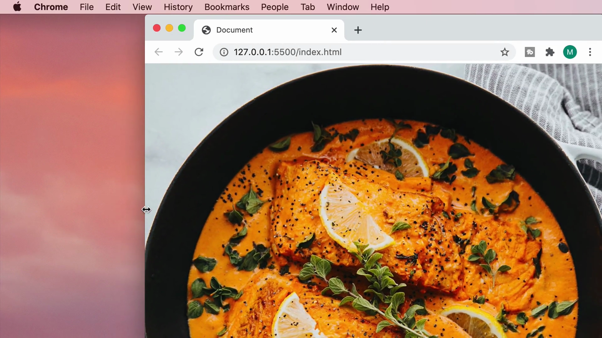

โค้ดสมบูรณ์หลังพิมพ์เสร็จ:

```html

```

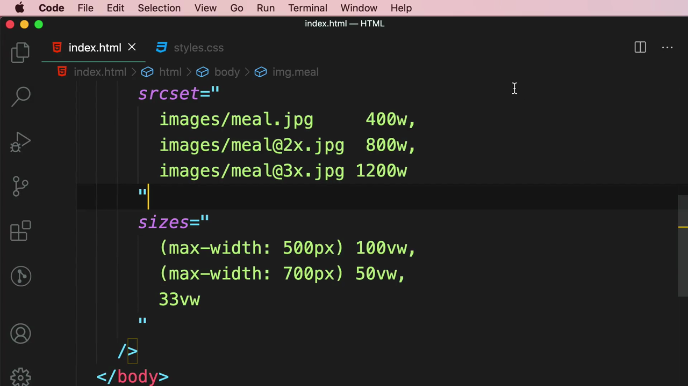

> **วิธีอ่านค่า `sizes` นี้ (เบราว์เซอร์จะอ่านจากซ้ายไปขวา และหยุดที่เงื่อนไขแรกที่เป็นจริง):**
> 1. **`(max-width: 500px) 100vw`** — ถ้าหน้าจอ (viewport) กว้างไม่เกิน 500px ภาพจะถูกแสดงผลเต็มความกว้างจอ (100% ของ viewport)
> 2. **`(max-width: 700px) 50vw`** — ถ้าหน้าจอกว้างไม่เกิน 700px (แต่มากกว่า 500px) ภาพจะถูกแสดงผลที่ 50% ของความกว้างจอ
> 3. **`33vw`** (ไม่มีเงื่อนไข = ค่าสุดท้าย/ค่าเริ่มต้น) — ถ้าหน้าจอกว้างเกิน 700px ภาพจะถูกแสดงผลที่ 33% ของความกว้างจอ
>
> เมื่อเบราว์เซอร์ทราบทั้ง**ขนาดพิกเซลจริงของแต่ละไฟล์** (จาก `srcset` ด้วย `w`) และ**ขนาดที่ภาพจะถูกแสดงผลจริง** (จาก `sizes`) แล้ว เบราว์เซอร์จะคำนวณเองว่าไฟล์ไหนคือไฟล์ที่**เล็กที่สุดแต่ยังคงคมชัดเพียงพอ**สำหรับสถานการณ์นั้นๆ (โดยคำนึงถึง DPR ของอุปกรณ์ด้วยในการคำนวณเบื้องหลัง)

---

## 6. ทดสอบผลลัพธ์จริงด้วยการปรับขนาดหน้าต่างเบราว์เซอร์

Mosh เปิด Google Chrome ไปที่ `127.0.0.1:5500/index.html` แล้วค่อยๆ **ลดขนาดหน้าต่างเบราว์เซอร์ให้แคบลง** เพื่อสังเกตพฤติกรรมของภาพ:

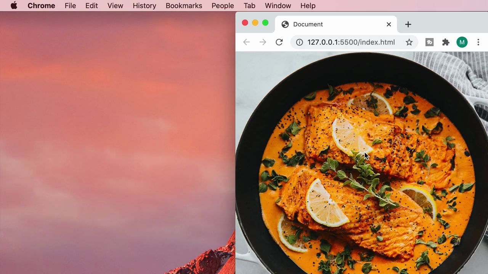

เมื่อหน้าต่างแคบลงจนน้อยกว่า 500px ภาพจะขยายเต็มความกว้างของหน้าต่างพอดี (ตามเงื่อนไข `(max-width: 500px) 100vw`):

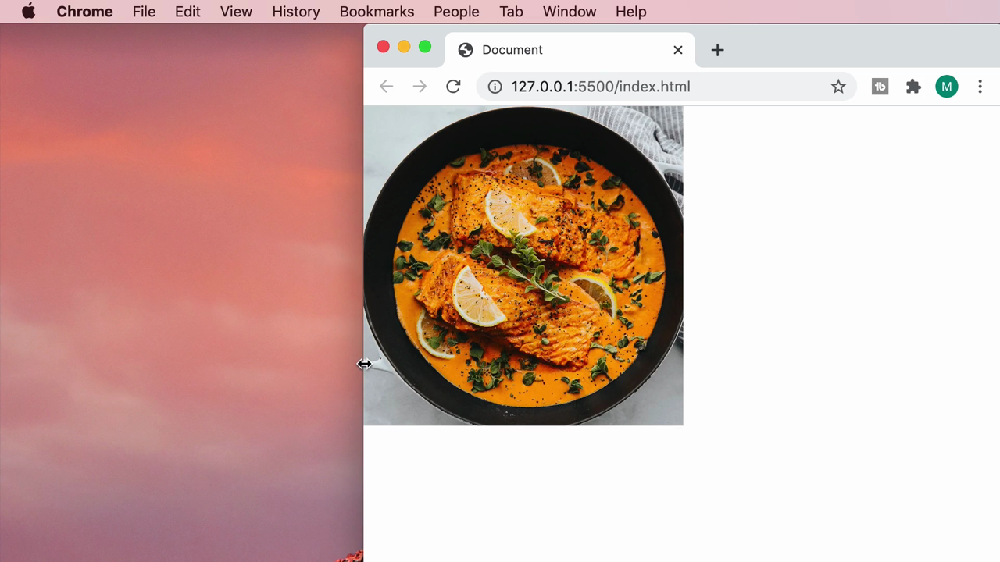

> **ผลลัพธ์ที่สำคัญ:** เมื่อทดลองปรับขนาดหน้าต่างไปมา ภาพจะปรับขนาดการแสดงผลตาม CSS (`width: 100vw`) เสมอ แต่**ไฟล์ภาพจริงที่เบราว์เซอร์เลือกโหลดมาจะเปลี่ยนไปตามเงื่อนไขใน `sizes`** — หากเปิด DevTools แท็บ Network ดูควบคู่ไปด้วย จะเห็นว่าเมื่อหน้าต่างแคบ (มือถือ) เบราว์เซอร์จะเลือกไฟล์เล็ก (`meal.jpg` 400px) แต่เมื่อหน้าต่างกว้างขึ้น (จอคอมพิวเตอร์) เบราว์เซอร์จะเลือกไฟล์ที่มีความละเอียดสูงขึ้นตามความจำเป็นจริง ไม่ใช่โหลดไฟล์ใหญ่สุดเสมอไป

---

## 7. เครื่องมือช่วยสร้างไฟล์ภาพหลายขนาดโดยอัตโนมัติ: Responsive Breakpoints Generator

การสร้างไฟล์ภาพหลายขนาดด้วยมือ (แบบที่ทำใน Photoshop ในคลิปก่อน) อาจไม่สะดวกเมื่อต้องการหลายขนาดมากๆ (breakpoint หลายจุด) Mosh จึงแนะนำเว็บไซต์ **responsivebreakpoints.com**:

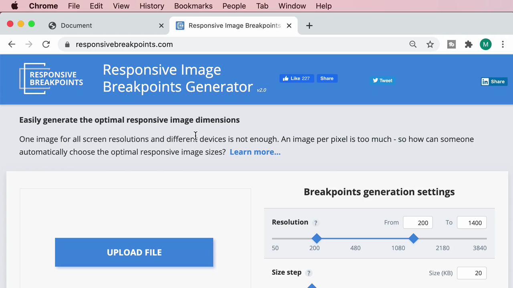

> คำอธิบายจากเว็บไซต์: *"One image for all screen resolutions and different devices is not enough. An image per pixel is too much - so how can someone automatically choose the optimal responsive image sizes?"*
>
> สรุปใจความ: การใช้ภาพเดียวสำหรับทุกความละเอียดหน้าจอนั้น**ไม่เพียงพอ** แต่การสร้างไฟล์แยกสำหรับทุกๆ พิกเซลก็**มากเกินไป** เว็บไซต์นี้จึงช่วยคำนวณหา**จำนวน breakpoint ที่เหมาะสมที่สุด** โดยอัตโนมัติ

### 7.1 ตั้งค่าการสร้าง Breakpoints

เว็บไซต์มีส่วน **"Breakpoints generation settings"** ให้ปรับแต่งได้ละเอียด:

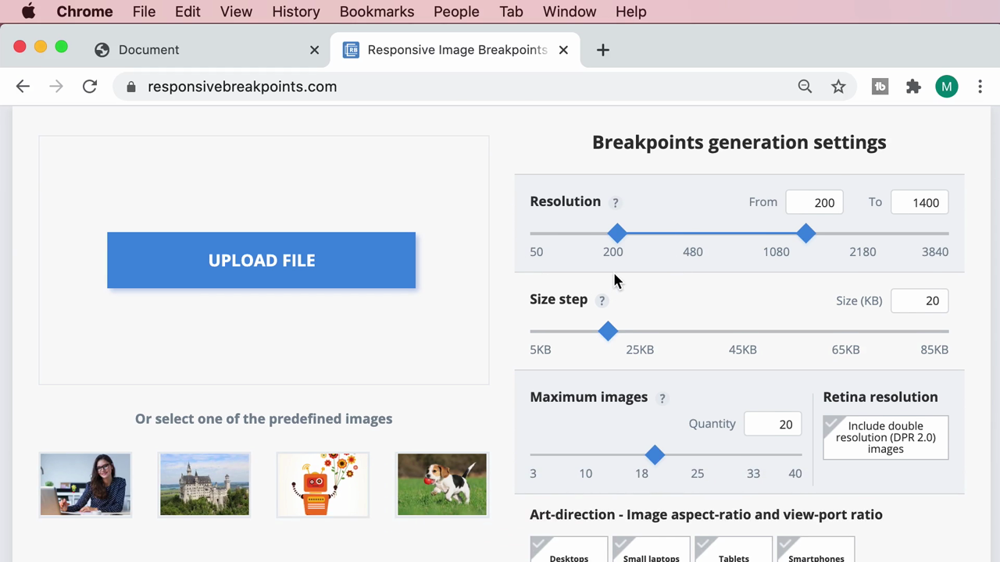

| ตัวเลือก | ความหมาย |
|---|---|
| **Resolution (From - To)** | ช่วงความกว้างของภาพที่ต้องการให้สร้าง (ในตัวอย่าง: 200px ถึง 1400px) |
| **Size step (KB)** | ระยะห่างของขนาดไฟล์ระหว่างแต่ละ breakpoint (ในตัวอย่าง: 50KB) |
| **Maximum images** | จำนวนไฟล์ภาพสูงสุดที่จะสร้าง (ในตัวอย่าง: ปรับได้ตั้งแต่ 3 ถึง 40 ไฟล์) |
| **Retina resolution** | ตัวเลือก "Include double resolution (DPR 2.0) images" — รวมเวอร์ชัน Retina (2x) ด้วยหรือไม่ |
| **Art-direction** | กำหนดอัตราส่วนภาพ (aspect ratio) ที่แตกต่างกันสำหรับ Desktops, Small laptops, Tablets, Smartphones |

### 7.2 อัปโหลดไฟล์ภาพต้นฉบับ

คลิกปุ่ม **"UPLOAD FILE"** เปิดหน้าต่างให้เลือกไฟล์:

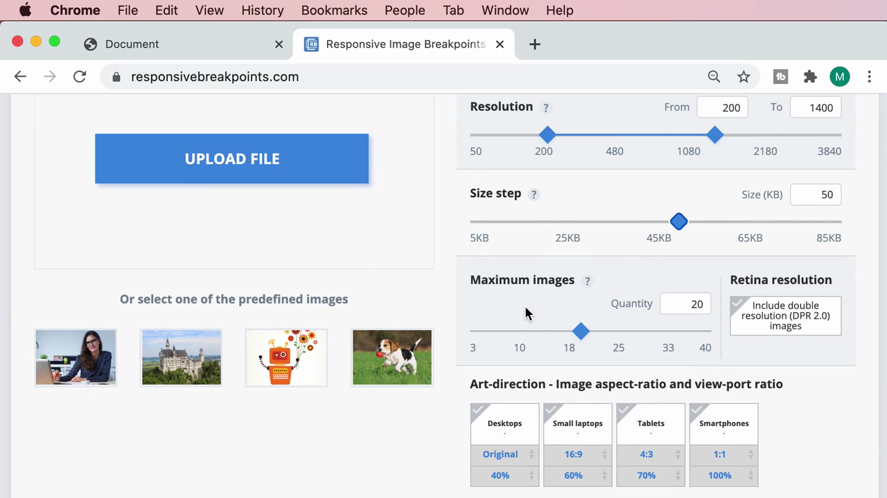

เลือกไฟล์ **`meal-full.jpg`** (ไฟล์ต้นฉบับความละเอียดสูงสุดเดิมที่ใช้ในคลิปก่อนหน้า) จาก Finder — สังเกตว่าในโฟลเดอร์เดียวกันมีไฟล์ `meal-w200.jpg`, `meal-w937.jpg`, `meal-w1400.jpg` ที่มีอยู่แล้วจากการทดลองใช้เว็บไซต์นี้มาก่อน:

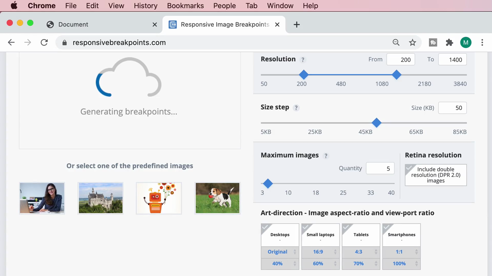

ระบบแสดงตัวอย่างไฟล์ที่เลือก:

> **ไฟล์ที่อัปโหลด:** `meal-full.jpg` ขนาด **2396 x 2396** พิกเซล รูปแบบ **JPEG (2.6 MB)**

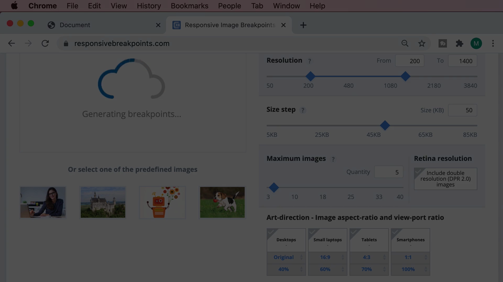

ระบบเริ่มประมวลผล แสดงข้อความ **"Generating breakpoints..."**:

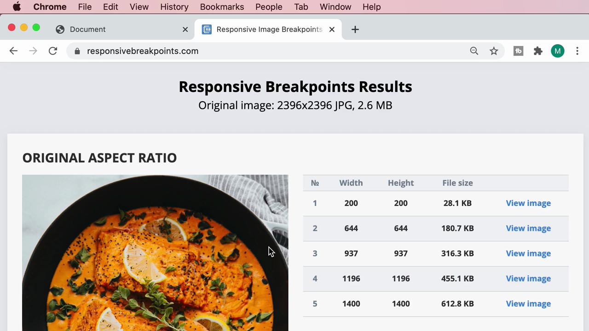

### 7.3 ผลลัพธ์: ชุดไฟล์ภาพหลายขนาดพร้อมโค้ดสำเร็จรูป

เมื่อประมวลผลเสร็จ เว็บไซต์แสดงหน้า **"Responsive Breakpoints Results"** พร้อมตารางสรุปไฟล์ที่สร้างขึ้น:

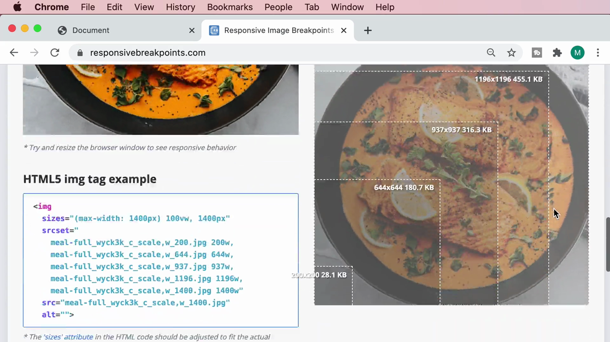

| # | Width | Height | File size |
|---|---|---|---|
| 1 | 200 | 200 | 28.1 KB |
| 2 | 644 | 644 | 180.7 KB |
| 3 | 937 | 937 | 316.3 KB |
| 4 | 1196 | 1196 | 455.1 KB |
| 5 | 1400 | 1400 | 612.8 KB |

เลื่อนลงมาดูส่วน **"HTML5 img tag example"** ซึ่งเป็นโค้ด `` พร้อมใช้งานที่ระบบสร้างให้อัตโนมัติ โดยมีทั้ง `sizes` และ `srcset` (พร้อมภาพตัวอย่างแสดงเส้นประบอกขอบเขตของแต่ละ breakpoint บนภาพจริง):

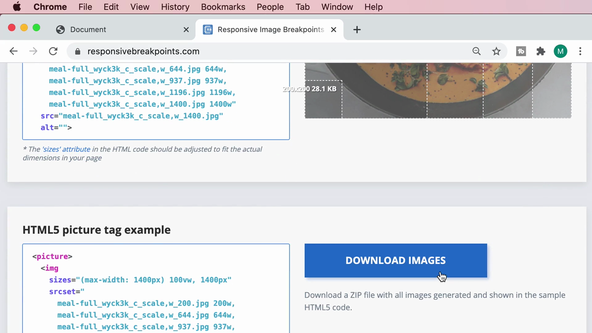

```html

```

> หมายเหตุจากเว็บไซต์: *"The 'sizes' attribute in the HTML code should be adjusted to fit the actual dimensions in your page"* — เตือนว่าค่า `sizes` ที่ระบบสร้างให้เป็นเพียงค่าเริ่มต้น ควรนำไปปรับแก้ให้ตรงกับ layout จริงของหน้าเว็บที่จะนำไปใช้

ต่อมาเป็นส่วน **"HTML5 picture tag example"** ที่นำโค้ดชุดเดียวกันไปห่อด้วยแท็ก `<picture>` (สำหรับกรณีที่ต้องการควบคุมการเลือกไฟล์ที่ซับซ้อนกว่า `` เดี่ยวๆ) พร้อมปุ่ม **"DOWNLOAD IMAGES"** ให้ดาวน์โหลดไฟล์ภาพทั้งหมดที่สร้างเป็น ZIP ได้ทันที:

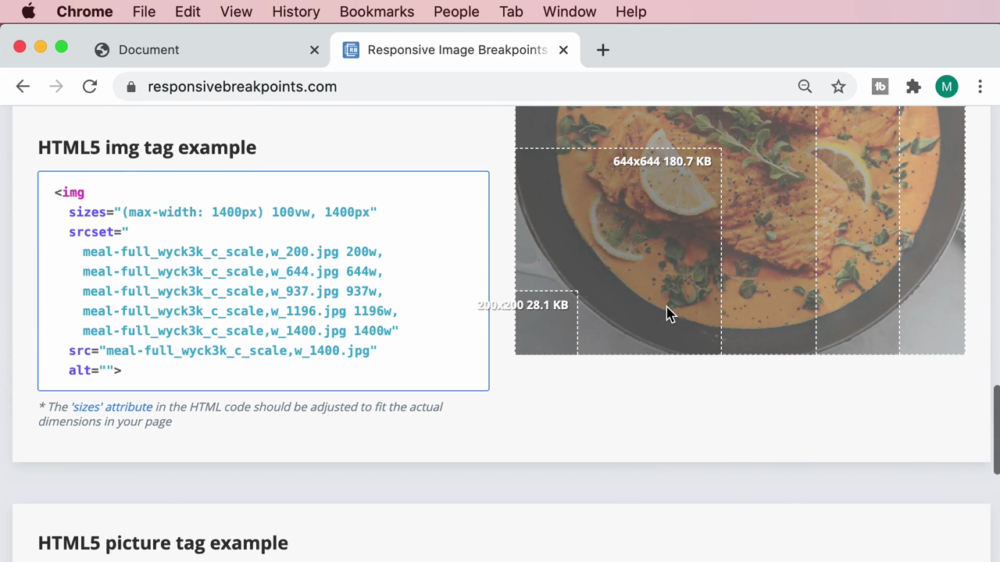

> เว็บไซต์นี้จึงช่วยประหยัดเวลาได้มาก เพราะไม่ต้องมานั่งเปิด Photoshop ย่อขนาดภาพทีละไฟล์ด้วยมือ — อัปโหลดไฟล์ต้นฉบับเพียงไฟล์เดียว ก็ได้ทั้งชุดไฟล์ภาพหลายขนาดและโค้ด HTML พร้อมใช้งานทันที

---

## สรุปภาพรวมของคลิปนี้

| หัวข้อ | รายละเอียด |
|---|---|
| **ปัญหาที่แก้** | ขนาดพื้นที่แสดงผล (viewport) ที่แตกต่างกันระหว่างอุปกรณ์ ไม่ใช่แค่ความหนาแน่นของพิกเซล (DPR) |
| **Density descriptor (`x`)** | ใช้ในคลิปก่อน — เลือกไฟล์ตาม DPR ของหน้าจอเท่านั้น ไม่สนใจขนาดพื้นที่แสดงผล |
| **Width descriptor (`w`)** | ใช้ในคลิปนี้ — ระบุความกว้างจริง (พิกเซล) ของแต่ละไฟล์ใน `srcset` |
| **Attribute `sizes`** | บอกเบราว์เซอร์ว่าภาพจะถูกแสดงผลด้วยขนาดเท่าใดในแต่ละเงื่อนไข media query (จำเป็นต้องมีคู่กับ `w`) |
| **เครื่องมือช่วยสร้างไฟล์** | responsivebreakpoints.com — อัปโหลดไฟล์ต้นฉบับเดียว ได้ทั้งชุดไฟล์หลายขนาดและโค้ดสำเร็จรูป |
| **การพิสูจน์ผล** | ปรับขนาดหน้าต่างเบราว์เซอร์ไปมา สังเกตว่าเบราว์เซอร์เลือกไฟล์ที่เหมาะสมกับขนาดที่แสดงผลจริง |

**แนวคิดสำคัญที่ได้จากคลิปนี้:**

1. **Resolution Switching และ Retina Display support (คลิปก่อนหน้า) เป็นเทคนิคคนละแบบที่แก้ปัญหาคนละมิติ** — อย่างแรกแก้ปัญหาเรื่อง**ขนาดพื้นที่แสดงผล** อย่างหลังแก้ปัญหาเรื่อง**ความหนาแน่นของพิกเซล** แต่ทั้งสองสามารถใช้ร่วมกันได้ในไฟล์ภาพชุดเดียวกัน (เช่น สร้างไฟล์ทั้ง 1x/2x/3x และหลายขนาดความกว้างพร้อมกัน)
2. **การใช้ `w` descriptor ต้องมาคู่กับ `sizes` เสมอ** เพราะเบราว์เซอร์ต้องรู้ทั้งขนาดไฟล์จริงและขนาดที่จะแสดงผลจริง จึงจะคำนวณเลือกไฟล์ที่เหมาะสมได้
3. **`sizes` เขียนในรูปแบบคล้าย media query แต่เป็น attribute ของ HTML ไม่ใช่ CSS** และเบราว์เซอร์จะอ่านจากซ้ายไปขวา หยุดที่เงื่อนไขแรกที่ตรงกับสถานการณ์ปัจจุบัน (ค่าสุดท้ายที่ไม่มีเงื่อนไขคือค่าเริ่มต้น/fallback)
4. **ไม่จำเป็นต้องสร้างไฟล์ภาพหลายขนาดด้วยมือเสมอไป** — เว็บไซต์อย่าง responsivebreakpoints.com ช่วยคำนวณจำนวน breakpoint ที่เหมาะสมและสร้างไฟล์ทั้งหมดให้อัตโนมัติ พร้อมโค้ด HTML สำเร็จรูปทั้งแบบ `` และ `<picture>`
5. **การทดสอบผลลัพธ์ที่ดีที่สุดคือการปรับขนาดหน้าต่างเบราว์เซอร์จริงและสังเกตพฤติกรรม** ควบคู่กับการเปิด DevTools ดู Network tab เพื่อยืนยันว่าไฟล์ที่ถูกเลือกเปลี่ยนไปตามขนาดหน้าจอจริง

---

*หมายเหตุ: คลิปนี้เป็นส่วนหนึ่งของบท "4-Images" จากคอร์ส The Ultimate HTML and CSS Course โดย Mosh Hamedani (codewithmosh.com) — คลิปที่ 10 ของบทนี้*
